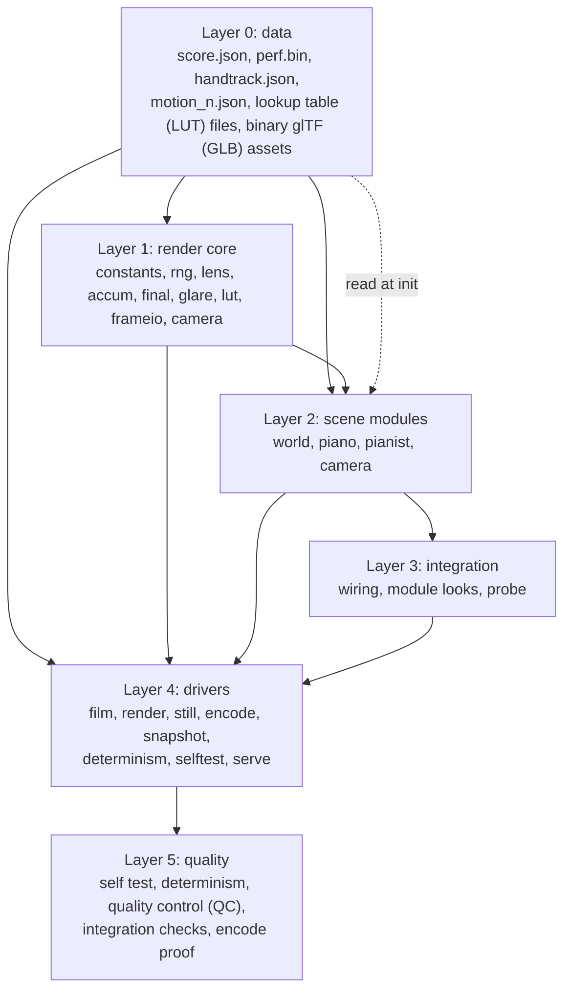
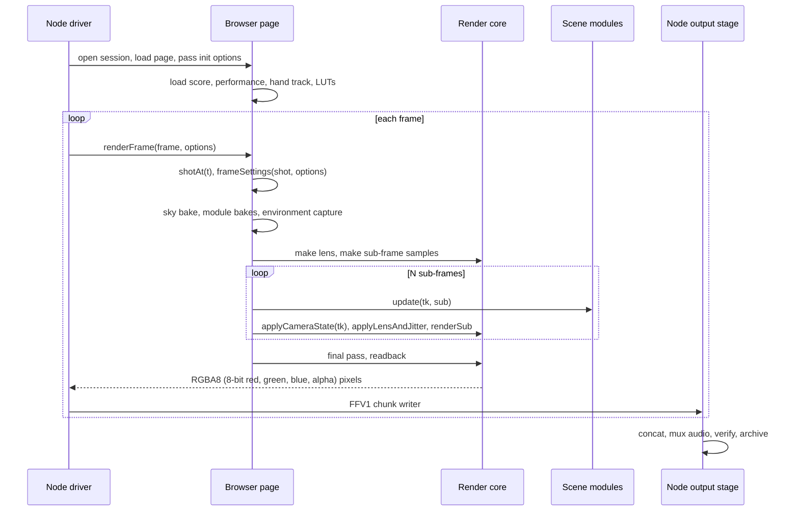

# 01 Architecture: six layers and the data contracts

This document gives the structure of Afterglow. It names the six layers, the module slots, the
data contracts and the owner of each piece of state. It also gives the rule that keeps the page
replaceable. [`00-overview.md`](00-overview.md) gives the film and its numbers.
[`02-core-mechanism.md`](02-core-mechanism.md) follows one frame through these layers.
[`03-workflow-and-quality.md`](03-workflow-and-quality.md) gives the build order.
[`04-limits-and-comparison.md`](04-limits-and-comparison.md) gives the limits. The index is
[`README.md`](README.md).

## 1. The six layers

The project has six software layers, numbered 0 to 5. Each layer has one job and one direction
of dependence. Layers 4 and 5 share the `render` directory: Layer 4 holds the runnable drivers,
and Layer 5 holds the checks that read their output.

| Layer | Job | Lives in | May read |
|---|---|---|---|
| 0 Data | Non-code inputs | `music/final`, `scene/src/integration` (snapshots), `assets`, `build` | Nothing |
| 1 Render core | Frame math and input/output | `scene/src/core` | Layer 0 |
| 2 Scene modules | World, piano, pianist, camera | `scene/src/world`, `piano`, `pianist`, `camera` | Layers 0 and 1 |
| 3 Integration | Wiring and module checks | `scene/src/integration` | Layers 0, 1 and 2 |
| 4 Drivers | Plans, renders, resumes, verifies and encodes | `render` | Layers 0 to 3 |
| 5 Quality | Tests and proof records | `render`, `perf/qc`, `docs` | All layers |

Layer 0 lists `scene/src/camera/handtrack.json` and `scene/src/integration/motion_n.json`. The camera module
`scene/src/camera/hands.js` (Layer 2) reads the hand track. `scene/src/main.js` reads `MOTION_N_URL` and applies the
motion table. Layer 3 integration only checks the hashes (`scene/src/integration/index.js:67-84`).

The dependency direction is downward: code may import a lower layer, and a lower layer does not
import a higher one. A module does not import a driver. There is one exception: `render/*.mjs`
plan code imports `scene/src/camera/shots.js` to read the shot list as data. That import does not
make the driver part of the page. The integration module is the only place that knows all modules
at once, and it loads last.



The table is the full permission list. Shared files are plain ECMAScript modules with no
browser-only dependency. The Node.js driver and the page both import the constants file, so both
get the same frame rate and music offset.

## 2. Layer 0: the data layer

The data layer holds every input that can change without code. A data file is frozen or generated
in `build/`.

| File | Kind | Producer | Consumer |
|---|---|---|---|
| `music/final/score.json` | Frozen | `music/afterglow_score.py` | Sampler, solver, edit |
| `assets/pianist/pianist.glb` | Frozen, Git Large File Storage (LFS) | Blender build in `tools/pianist` | Pianist module |
| `assets/pianist/rig.json` | Frozen | Blender build | Solver, pianist module |
| `build/anim/perf.bin` | Generated | `perf/solve.mjs` | Page, encoder checks |
| `build/anim/perf.json` | Generated | `perf/solve.mjs` | Page, integration checks |
| `scene/src/camera/handtrack.json` | Frozen snapshot | `sandbox/camera/handtrack.mjs` | Camera focus |
| `scene/src/integration/motion_n.json` | Frozen snapshot | `sandbox/integration/blurstep.mjs` | `main.js` |
| `scene/src/core/luts/*.cube` | Frozen | LUT bake script | Final pass |
| `build/audio/afterglow_film.wav` | Generated | `music/render_audio.py` | Encoder |

The generated files do not all carry a hash. A chunk manifest carries a settings hash, a scene
tree hash and a hash for every input file (`render/render.mjs:42-66`, `:141-143`). The
performance JavaScript Object Notation (JSON) file carries a Secure Hash Algorithm 256 bit
(SHA-256) value of the binary. The hand track and motion table record the performance hash they
were built from. The integration
module compares those values (`scene/src/integration/index.js:67-84`). The QC report and the
audio log carry timestamps and measurements, not input hashes. A mismatch is a failed wiring
check.

The film configuration is a contract: presets, sizes, chunk length and soundtrack path.

```text
# scene/src/film.config.js:13-20
export const SIZES = Object.freeze({ '640p': [640, 360], '540p': [960, 540], '1080p': [1920, 1080], '1440p': [2560, 1440], '2160p': [3840, 2160] });

/**
 * Soundtrack. build/audio/afterglow_film.wav is the approved mix with MUSIC_OFFSET (4.0 s) of silence already in front
 * (checked bit-exact against afterglow.wav, sandbox/integration/PROGRESS.md), so it is placed at film time 0
 * (encode.mjs --offset 0). The plain afterglow.wav would need --offset 4 instead. Never mux both conventions.
 */
export const AUDIO = Object.freeze({ file: 'build/audio/afterglow_film.wav', offset: 0, music: 'build/audio/afterglow.wav', musicOffset: MUSIC_OFFSET });
```

The audio contract has one trap: `afterglow.wav` starts at music time zero; `afterglow_film.wav`
starts at film time zero. The plain file with offset zero puts the first note 4 seconds early;
never mix the two. The size names follow the height in pixels, except `640p`. That key follows the width and is
640 by 360 pixels, so its common name would be 360p. The animatic uses it. A preset with
`N: null` uses each shot's own N. A number forces that N for all shots.

```text
# scene/src/film.config.js:27-38
export const PRESETS = Object.freeze({
  // perSession: chunks per browser session in film.mjs render (session start 65-180 s each; out/estimate.json)
  'final-1080p': { size: '1080p', quality: 'final', N: null, chunk: 300, perSession: 4, chunks: 'build/chunks/film_1080p', out: 'build/out/afterglow_1080p60.mp4' },
  'final-1440p': { size: '1440p', quality: 'final', N: null, chunk: 300, perSession: 4, chunks: 'build/chunks/film_1440p', out: 'build/out/afterglow_1440p60.mp4' },
  'final-2160p': { size: '2160p', quality: 'final', N: null, chunk: 300, perSession: 4, chunks: 'build/chunks/film_2160p', out: 'build/out/afterglow_2160p60.mp4' },
  // review: every shot at its OWN N (motion-review clips, approval stills): N=16 draws a fast edge as 16 banded copies
  // in the close-ups that the film renders at N 32/48 (round-4 sync critic), so N=16 presets are for wiring/sync only
  'review-1080p': { size: '1080p', quality: 'final', N: null, chunk: 300, perSession: 2, chunks: 'build/chunks/review_1080p', out: 'build/out/review_1080p.mp4' },
  'check-1080p': { size: '1080p', quality: 'final', N: 16, chunk: 300, chunks: 'build/chunks/check_1080p', out: 'build/out/check_1080p.mp4' },
  'check-1440p': { size: '1440p', quality: 'final', N: 16, chunk: 300, chunks: 'build/chunks/check_1440p', out: 'build/out/check_1440p.mp4' },
  animatic: { size: '640p', quality: 'preview', N: 1, chunk: 600, chunks: 'build/chunks/animatic_integrated', out: 'build/out/animatic_integrated.mp4' },
});
```

The final presets use the edit's own N and group four chunks per session; the review preset groups two. The check
presets force N 16 for wiring and sync. The animatic renders one sub-frame per frame. The N=16 comment sits under the
review preset in the source, but the N=16 value applies to `check-1080p` and `check-1440p`. `review-1080p` has `N:
null`. The session start in the comment is 65 to 180 seconds per session, and its estimate file is
`build/out/estimate.json`. The film has `13,857 / 300 = 46.19` chunks, rounded up to 47. Four chunks per session gives
`47 / 4 = 11.75` sessions, rounded up to 12.
[`04-limits-and-comparison.md`](04-limits-and-comparison.md) explains why N 16 is not a valid motion review.

## 3. Layer 1: the render core

The render core is small modules, each owning one mathematical object or data path. The
main page passes them to modules through a context object.

| File | Owns | Key export |
|---|---|---|
| `core/constants.js` | Frame rate, music offset, sensor width, rig yaw, shutter | `FPS` (frames per second), `MUSIC_OFFSET` |
| `core/rng.js` | Sample tables, hashes, pixel jitter, aperture samples | `subframeSamples`, `subframeDim` |
| `core/lens.js` | Thin-lens geometry, circle of confusion, focus limits | `makeLens`, `cocInfPx` |
| `core/accum.js` | Sub-frame accumulation, depth-of-field gap fill | `AccumRenderer` |
| `core/final.js` | Tone map, glare, grade, LUT, dither | `FinalPass` |
| `core/frameio.js` | Pixel readback and chunk upload | `FrameIO` |
| `core/camera.js` | Camera director and state interpolation | `CameraDirector` |
| `core/glare.js` | Energy-conserving veiling glare | `Glare` |
| `core/lut.js` | Lookup table load and identity | `loadLut`, `parseCube` |

The final pass has this step-to-module map. `final.js` runs the ordered pass. `glare.js` computes
the veiling glare level and energy, and `lut.js` applies the 3D lookup table. `final.js` applies
grade, grain and dither. `frameio.js` reads the RGBA8 pixels back.

The core does not import the film assets, the shot list, the score or the pianist. It holds the
camera math and shared constants. It receives a camera state, settings, a scene and a sub-frame
index, so the self test runs without the film assets.

The page owns the frame settings object (`scene/src/main.js:87-94`); Section 6 gives the merge
order.

## 4. Layers 2 and 3: the scene modules and integration

### Layer 2: the scene modules

The page loads the modules in a fixed order. Each slot has a name, a web address, an optional
placeholder and a parent group. The parent decides the attach point: `world` names `worldGroup`
and `rig` names `rigGroup` (`scene/src/main.js:42`, `47-53`). The camera attaches to the world
group; the piano, pianist and integration attach to the rig group.

A module has optional methods. The page calls `create(ctx)` once, `beforeFrame(frame, t, info)` once per output frame
before any sub-frame, and `update(t, sub)` once at the frame centre and then once per sub-frame. The `info` argument
is a per-frame record with the frame, time, shot, settings and context. It is not the `info()` method, which
returns diagnostics on demand. `probe()` is only for a check; the integration module uses `probe` to inspect the
piano, the pianist and the water at a film time.

The camera module is not a scene object. It exports the shot list and a raw director from `createDirector`. The core
wraps the module in a `CameraDirector` instance. The wrapper adds four things. It provides a
single `stateAt(t)` call, the override priority order and the default camera when the module is
absent. It converts a state to the core's world or rig frame (`scene/src/core/camera.js:20`).

The data contract is small.

```text
# scene/src/main.js:54-60
export const CAMERA_MODULE_URL = './camera/shots.js';
// Shared data loaded once at init into ctx.data (missing optional files resolve to null; modules must cope).
export const DEFAULT_DATA = {
  score: { url: '/music/final/score.json', optional: true },
  perfMeta: { url: '/build/anim/perf.json', optional: true },
  perf: { url: '/build/anim/perf.bin', optional: true },
};
```

The optional flag lets the page start without a performance file. The pianist then has no tracks,
and the wiring check fails, but a placeholder test still renders.

The camera module carries the director. `MusicTimeline` holds the score's bar, beat, section and phrase tables and
maps bars and beats to music time (`scene/src/camera/score.js:44-70`). The five named score points are:

- `end`: the end of the last bar.
- `lastNote`: the last key release, the largest note `t_off`.
- `pedalUp`: the final pedal release.
- `lastMel`: the onset of the final melody note.
- `filmEnd`: the computed film end.

An anchor is a film or music time (`fN`, `mN`), one of those named points, a bar or `bar:beat`, or a section,
optionally `section@bar:beat`. Each form can take offsets in seconds, frames or beats
(`scene/src/camera/score.js:146-170`). The director compiles the edit once. It resolves each anchor, quantises the cut
to the frame at or before the beat, and builds the camera position and move profiles
(`scene/src/camera/director.js:45-85`). It evaluates the shot at every sub-frame time, so camera motion and focus
pulls are exact (`scene/src/camera/director.js:1-4`). It does not resample keys to a fixed rate. The sub-frame time is
the sample time.

The move profile remaps net shot time to a normalised progress `u`. A shot with `cam.orbit` interpolates azimuth,
distance and height around a pivot. A shot without it follows `cam.path`, a spline reparameterised by arc length. Arc
length means that equal steps in the path parameter cover equal distance, so the move has constant speed along the
curve. The look target interpolates, and it can blend toward a hand track by weight `w`
(`scene/src/camera/director.js:141-166`). The weight is a number or a pair `[w0, w1]` that is interpolated along the
move. The blend is positional: `target = lerp3(baseTarget, handPoint, w)`.

The focus point can be the look target, a fixed point, a distance, or a hand box from the solved performance. For a
hand box, let `a` be the near edge distance along the lens axis and `b` the far edge distance. At weight `w = 0.5`,
the focus depth is `2ab/(a+b)`. That is the harmonic mean of `a` and `b`, and it makes both edges blur equally
because `1/f = 1/(2a) + 1/(2b)`. An override replaces the shot list for a test render
(`scene/src/core/camera.js:9-13`, `93-99`).

### Layer 3: integration

The module order has one hard rule. The integration module loads last. It checks the wiring of
all modules. It also forwards per-shot pianist looks, because the edit does not copy that field
into the shot object. It wraps the pianist's `beforeFrame` hook, reads the look from the shot
spec, and writes it to the shot state (`scene/src/integration/index.js:97-108`). A pianist look
is one shot's hand and cloth fields: `handEnv` (hand environment light), `handDesat` (hand
desaturation), `woolSheen` (suit sheen) and `rimKick` (rim light strength)
(`scene/src/camera/shots.js:87`, `121`, `162`, `203`).

```text
# scene/src/integration/index.js:1-3
// Integration glue (slot 'integration', loaded LAST by scene/src/main.js MODULE_SLOTS). Owner: the integrator.
// docs/INTEGRATION.md describes how the film is assembled; this module only connects modules that already exist and
// never edits their files. What it does:
```

The integration layer is thin by design. It owns no geometry, material, timing or camera math.
It checks that the modules agree on the rig frame, the seat height, the ripple source and the
three hashes (performance, hand track, motion table). The rig constants are `KB_CENTER_X` 0.780,
`RIG_Y_OFFSET` -0.04 and `KEY_FRONT_Z` 0.022 metres (`docs/INTEGRATION.md:46-47`,
`docs/PIANO.md:114`). The piano group has scale `(-1, 1, 1)`. It is mirrored in x because the piano
asset uses a left-handed frame, and the rig uses a right-handed frame with the treble at -x
(`docs/PIANO.md:32`, `docs/INTEGRATION.md:46`). `setBenchHeight` is idempotent: a second call with
the same height changes nothing. Its per-frame work only forwards the shot's pianist look, and it
renders nothing itself. Its probe re-poses the piano and pianist for the check scripts, which the
render drivers do not call.

## 5. Layer 4: the drivers

The drivers are Node.js programs. The render drivers open a browser session, load the page, send
frame requests and collect the results. The page never starts its own loop. The encode, snapshot
and serve drivers do not request frames: encode reads chunks, snapshot copies inputs and runs the
derived-table tools, and serve hosts the page for a person.

| Driver | Job |
|---|---|
| `render/still.mjs` | Render one frame or a list of frames to still images |
| `render/render.mjs` | Render a frame range into resumable FFmpeg Video Codec 1 (FFV1) chunks |
| `render/film.mjs` | Apply a preset, group chunks per session, call render and encode |
| `render/encode.mjs` | Concatenate chunks, mux audio, verify and archive |
| `render/snapshot.mjs` | Freeze the inputs and regenerate the derived tables |
| `render/determinism.mjs` | Run three sessions and compare their results |
| `render/selftest.mjs` | Test the core paths on a small frame |
| `render/serve.mjs` | Serve the page for a person to inspect |

The chunk driver is the centre of the layer. A chunk is 300 frames (5 seconds). The driver writes
a partial file first and renames it only after the frame count is
confirmed. A lost Web Graphics Library (WebGL) context, a page crash or a dead FFV1 process fails
the chunk. The driver retries it from its first frame in a fresh session.

The completeness test is a contract. The driver reads the JavaScript Object Notation (JSON)
manifest and compares the status, the settings hash, the frame count and the file size. Any
mismatch fails the chunk, and the chunk is rendered again. With `--rerender-stale`, a stale input
also fails it. Without that flag, the driver reports the stale list and keeps the chunk.

```text
# render/render.mjs:50-62
function chunkComplete([s, e]) {
  const base = path.join(outDir, nameOf([s, e]));
  const mf = base + '.manifest.json', mkv = base + '.mkv';
  if (!fs.existsSync(mf) || !fs.existsSync(mkv)) return { ok: false, why: 'missing' };
  let m; try { m = JSON.parse(fs.readFileSync(mf, 'utf8')); } catch { return { ok: false, why: 'bad manifest' }; }
  if (m.status !== 'complete') return { ok: false, why: `status ${m.status}` };
  if (m.settingsHash !== settingsHash) return { ok: false, why: `settings changed (${m.settingsHash} -> ${settingsHash})` };
  if (m.nb_frames !== e - s) return { ok: false, why: `nb_frames ${m.nb_frames} != ${e - s}` };
  if (fs.statSync(mkv).size !== m.bytes) return { ok: false, why: 'size mismatch' };
  const stale = m.inputs ? staleInputs(m.inputs) : (m.sceneHash !== sceneHash ? [`scene/ tree ${m.sceneHash} -> ${sceneHash}`] : []);
  if (stale.length && a['rerender-stale']) return { ok: false, why: `inputs changed: ${stale.slice(0, 4).join(', ')}${stale.length > 4 ? ` (+${stale.length - 4})` : ''}` };
  return { ok: true, manifest: m, stale };
}
```

`film.mjs` reads a preset and calls the chunk driver and the encoder as child processes. It
groups chunks by the preset's `perSession` value, so each group holds the machine-wide graphics
processing unit (GPU) lock for a limited time. The final preset groups four chunks, so the film
has 12 session starts instead of 47.

```text
# render/film.mjs:8-10
// render: chunks of the preset's length; every group of K chunks runs in its OWN render.mjs process (= its own browser
// session and its own hold of the machine-wide GPU lock, render/lib/gpulock.mjs), so other GPU users get the slot
// between groups and no session runs for hours. K = --per-session, default the preset's perSession (final presets 4,
```

## 6. Settings resolution and ownership

The page does not read a settings file per frame. It builds a settings object from four fixed
levels, and a later level wins.

1. The default settings object.
2. The shot's own settings from the edit.
3. The session overrides from `AG.init`.
4. The per-frame options from `renderFrame`.

The second level is not the whole shot object. The camera module builds a small `settings`
wrapper with five keys: `N`, `preblur`, `nearestDist`, `rigYawCheatDeg` and `shutter`
(`scene/src/camera/director.js:100-103`). The other eight keys in `FRAME_SETTING_KEYS` keep their
defaults unless a session or frame option sets them. They are `maxPreblurPx`, `preblurKernel`,
`aaFilter`, `aaSigma`, `blades`, `bladeRotation`, `debugView` and `sunElevationDeg`. The edit does
not set them per shot. The camera director adds `sunElevationDeg` to each frame state, not to the
shot settings (`scene/src/camera/director.js:205-211`), and the edit's `sun` keys replace
`DEFAULT_SUN_KEYS` for the film (`scene/src/camera/director.js:51-56`,
`scene/src/camera/shots.js:55`).

In preview mode, the page replaces the shot's N with `previewN`; a session or frame value can
still override it.

The motion-blur N boost acts on one table, `S.motionN`. That object is the parsed
`motion_n.json` with one added field, `perfOk`. `perfOk` is true when the table's `perfSha` equals
the `perf.json` SHA-256 value, so the table was solved from the rendered performance. The boost has
six outer conditions:

1. `S.motionN` exists.
2. `mn.perfOk` is true.
3. The quality is final.
4. The frame number is not null.
5. No session N is set.
6. No frame option N is set.

The table entry must then pass three checks. The boost is above the current N. The entry belongs to
the current shot (`mn.shotOf[frame] === shot.id`). The shot's own N equals the solved N
(`mn.editN[shot.id] === st.N`), so an override does not qualify.
`sandbox/integration/blurstep.mjs` generates the table from the frozen snapshot and the edit's N.

```text
# scene/src/main.js:148-160
  function frameSettings(shot, opts, frame = null) {
    const quality = S.quality;
    const base = { ...DEFAULT_SETTINGS };
    const shotS = { ...shot.settings };
    if (quality === 'preview') { base.N = DEFAULT_SETTINGS.previewN; delete shotS.N; }
    const st = { ...base, ...pick(shotS, FRAME_SETTING_KEYS), ...S.sessionOverrides, ...pick(opts, FRAME_SETTING_KEYS) };
    st.N = Math.max(1, Math.round(st.N));
    // motion-blur N boost (MOTION_N_URL): own-N final renders only
    const mn = S.motionN;
    if (mn && mn.perfOk && quality === 'final' && frame != null && S.sessionOverrides.N === undefined && opts.N === undefined) {
      const nb = mn.frames[frame];
      if (nb > st.N && mn.shotOf[frame] === shot.id && mn.editN[shot.id] === st.N) { st.nBase = st.N; st.N = nb; }
    }
```

The default settings are frozen. The default N is 16 for the self test and the check presets. An
own-N final render replaces it with the shot's N. The default shutter is 0.5, the pixel aperture
filter is a box, and the depth-of-field (DOF) pre-blur is off. Blades are 9 at 0.3 radians. A box
filter gives each sub-frame a jitter uniform in [-0.5, 0.5] pixels on each axis. `aaSigma` 0.42
pixels is used only when `aaFilter` is `gauss`; it is the Gaussian sigma of the pixel filter.

`blurstep.mjs` projects fingertip and knuckle points at `t - 1/240` and `t + 1/240` seconds. It
divides the largest image displacement by the shot's N to get copy spacing. If spacing exceeds the
target of 1.5 pixels, it raises N to the next multiple of 16 that meets the target, up to 128. An
A/B test is a side-by-side comparison of two settings on the same frames. N256 is a 256-sample
reference render that the project treats as the converged image.

```text
# scene/src/main.js:90-94
  N: 16, previewN: 4, shutter: DEFAULT_SHUTTER, preblur: 0, nearestDist: null, maxPreblurPx: 96, preblurKernel: 'layered',
  aaFilter: 'box', aaSigma: 0.42, blades: 9, bladeRotation: 0.3, debugView: 'none', rigYawCheatDeg: 0, sunElevationDeg: null,
});
const FRAME_SETTING_KEYS = ['N', 'shutter', 'preblur', 'nearestDist', 'maxPreblurPx', 'preblurKernel', 'aaFilter', 'aaSigma', 'blades', 'bladeRotation',
  'debugView', 'rigYawCheatDeg', 'sunElevationDeg'];
```

The settings resolution has a consequence that is easy to miss. A forced N changes the sampling
pattern and disables the boost. A forced-N 16 render is for wiring and sync, not a motion review
of a shot rendered at 32 or 48.

## 7. The data contracts in detail

The design document states the score, performance and shot contracts. `music/dsl.py` holds the
score writer `to_json`; `music/afterglow_score.py:480-486` calls it and adds the chord table and
seed.

```text
# docs/DESIGN.md:93-97
## 4. Data contracts

**Score** `music/final/score.json` (written by music/dsl.py `to_json`): notes[{id, pitch, name, t_on, t_off, vel, hand,
voice, finger, bar, section, beat}], pedal[[t, cc64]], bars[{bar, t, beats}], sections[...], phrases[...], beats[...].
`t_off` is the key release (sound may continue under pedal).
```

The design contract also fixes the performance track. It holds 240 Hz in music time, one local
quaternion per pianist bone, 88 key angles and 88 hammer angles. It also holds 88 damper lifts,
3 pedal angles and the ripple events. It uses nlerp between quaternion samples. The contract says "every pianist bone". The
skeleton has 163 joints (`assets/pianist/README.md:26`), and the performance track animates 72
bones (`docs/INTEGRATION.md:50`). The other 91 stay in the bind pose.

A data contract is useful only if a check reads it. The edit calls the depth-of-field pre-blur
`dofPreblur`; the compressed settings wrapper calls it `preblur` and calls the nearest depth
`nearestDist`. The integration module checks the rig placement and the ripple source. The sync
check compares the piano's applied key values with the performance track at the same time. The
encode check compares the soundtrack with the picture.
[`03-workflow-and-quality.md`](03-workflow-and-quality.md) lists the commands.

The score contract has a subtle field. `t_off` is the key release, not the end of the sound. The
pedal can hold the sound after the key release. The pedal list is `pedal[[t, cc64]]`, where
`cc64` is Musical Instrument Digital Interface (MIDI) controller 64, the sustain pedal. The
sampler needs the curve for the real decay, and the solver needs it to move the damper.

The shot contract is the link between the edit and the core. It names a `focusDist`, a `fStop`
and an optional `fovDeg` or `focalMm`. The director resolves them into a camera state. The 36 mm
sensor width fixes the conversion between the two angle forms:
`hfovDeg = 2 * atan(36 / (2 * focalMm))`. The core turns the state into a thin lens, and the
accumulator uses the lens for the circle of confusion and the aperture samples. The depth
composite is the DOF gap fill; [`02-core-mechanism.md`](02-core-mechanism.md) section 4 gives its
equation.

## 8. The rule that keeps the page replaceable

**Aha:** The architecture is not the scene graph. It is the set of files that pass between the
drivers and the page. The page holds no state that the pre-roll cannot rebuild. The frame number
selects the film time and the score sample. The edit selects the shot and the camera state. A
frame is a deterministic function of those inputs and the scene history at the chunk
start. The render default is a 3-frame pre-roll. The determinism driver defaults to no pre-roll
and fails. With `--preroll 3`, all three frames are bit-identical in sessions A, B and C
(`docs/INTEGRATION.md:154-168`). The driver can kill the page and continue at any frame. This is
why the render can be chunked, resumed, retried and checked. The scene graph is an implementation
detail inside one frame.

The rule has three parts. First, every module update is a deterministic function of film time,
the sub-frame sample and the previous-frame state that the pre-roll rebuilds. Second, no code
that draws may use `Math.random`, `Date`, `performance.now` or `requestAnimationFrame`. Third,
all noise comes from a hash of the frame, sub-frame and pixel indices.

The rule does not cover the whole page. The water surface, the sky bake and some material state
can depend on the previous frame by design, and the pre-roll rebuilds that state. The project
reports that one shot had a longer memory than one frame.
[`02-core-mechanism.md`](02-core-mechanism.md) gives the pre-roll code and the reason.

## 9. Dependency rules and the file map

The project has a few dependency rules. A bundler does not enforce them; review and the import
structure do.

- `scene/src/core` imports no scene module.
- A scene module reads another only through the context object, and only in `update` or
  `beforeFrame`.
- `scene/src/integration` may import the other modules, because it is the integration layer.
- `render/*.mjs` may import `scene/src/core/constants.js` and `scene/src/film.config.js`. One
  more file is allowed: the plan command reads the camera edit, `scene/src/camera/shots.js`, for
  the shot list.
- `perf/` and `music/` do not import `scene/`. They write data files that `scene/` reads.
- The page does not import a Node.js built-in module. The performance reader has a Node.js branch,
  but it loads the module lazily and only when `window` is absent.

The file map follows the layers: `scene` holds the page, core and modules; `render` drivers;
`music` score and sound; `perf` solver and quality control; `tools` asset builders; `docs`
records.

The entry files are these:

| Entry | Role |
|---|---|
| `scene/src/main.js` | Creates the renderer, the modules and the frame loop |
| `render/film.mjs` | Runs a preset from plan to encode |
| `render/render.mjs` | Renders a frame range to chunks |
| `render/encode.mjs` | Concatenates, muxes and verifies |
| `perf/solve.mjs` | Solves the performance |
| `music/render_audio.py` | Renders the soundtrack |
| `music/afterglow_score.py` | Defines and writes the score through `music/dsl.py` |

The package manifest is also part of the architecture. It fixes the runtime version and the two
runtime dependencies. The page has no build step: the browser loads the ECMAScript modules
directly, and the Node.js drivers use the same files. A different three.js version can change a
shader or a matrix convention, and the pixels change with it.

```text
# package.json:1-23
{
  "name": "afterglow",
  "version": "0.1.0",
  "private": true,
  "description": "Afterglow: an offline-rendered three.js solo-piano film (render core, scene, Node render driver).",
  "type": "module",
  "license": "MIT",
  "engines": {
    "node": ">=22"
  },
  "scripts": {
    "serve": "node render/serve.mjs",
    "still": "node render/still.mjs",
    "render": "node render/render.mjs",
    "encode": "node render/encode.mjs",
    "determinism": "node render/determinism.mjs --placeholders",
    "selftest": "node render/selftest.mjs"
  },
  "dependencies": {
    "puppeteer-core": "25.15.0",
    "three": "0.186.1"
  }
}
```

The manifest licence field says `MIT`. The repository licence is split. The field is not a
statement about the film or the music. [`00-overview.md`](00-overview.md) gives the summary, and
[`04-limits-and-comparison.md`](04-limits-and-comparison.md) gives the full boundary.

## 10. Where the layers meet

The layers meet in two places. At the frame request, the driver sends a frame number and a
settings object, and the page returns pixels. At the encode, the driver reads the chunk files
and the soundtrack, and it writes the deliverable.



The sequence shows ownership. The driver owns the order and the retry, and the page owns one
frame. The core owns the math, the modules own the scene state, and the encoder owns the join
between picture and sound. No layer calls upward.

The camera state shows the contract. The page asks the director for a state at a time; the
director resolves the shot, orbit, target, lens and focus. The accumulator turns the lens into
aperture offsets and a circle of confusion. The final pass reads the focus distance and the
infinity circle of confusion for the depth composite.

## 11. What this architecture buys, and what it costs

The architecture buys four properties. Resumability follows from the frame function. Auditability follows from the
input hashes in the manifest. Replaceability follows from a page with no durable state. A small test surface follows
from a core that does not know the film.

It costs three things: a pre-roll for scene history, a strict asset pin for derived tables, and a
large bookkeeping layer of manifests and checks.
[`04-limits-and-comparison.md`](04-limits-and-comparison.md) weighs these costs.

The next document follows the frame: [`02-core-mechanism.md`](02-core-mechanism.md) gives the
sub-frame loop, the accumulation, the gap fill and the final pass.
[`03-workflow-and-quality.md`](03-workflow-and-quality.md) gives the commands and the gates. The
index is [`README.md`](README.md).
