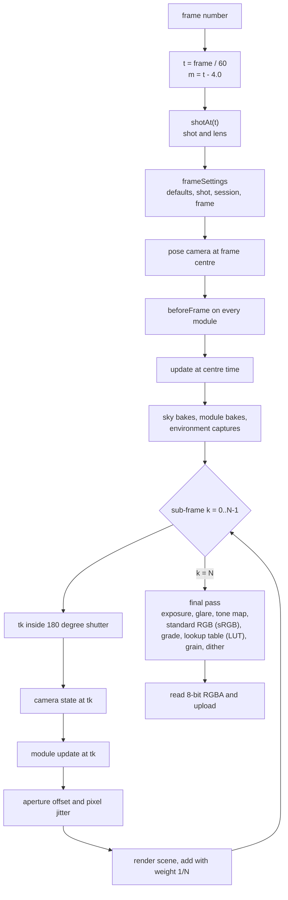
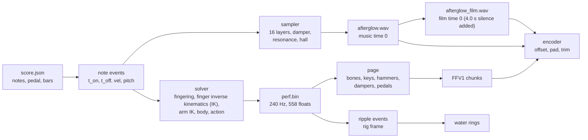

# 02 Core mechanism: one frame, and the split from score to sound and motion

This document follows one output frame from the edit to the lossless chunk. It then follows the
score into two side chains: sound and motion. [`01-architecture.md`](01-architecture.md) gives
the layers and the contracts. [`00-overview.md`](00-overview.md) gives the film and the numbers.
[`03-workflow-and-quality.md`](03-workflow-and-quality.md) gives the commands.
[`04-limits-and-comparison.md`](04-limits-and-comparison.md) gives the limits. The index is
[`README.md`](README.md).

## 1. The frame request

From the frame number the page resolves film time
`t = frame / 60`, music time `m = t - 4.0`, the shot at `t` and the merged settings. It sets the
rig yaw, the sun and the context fields. `ctx` is the shared context object, owned by
`scene/src/main.js` and passed to every module. Its fields include `renderer`, `scene`, `camera`,
`accum`, `settings`, `frame`, `t`, `m`, `shot`, `sun`, `subframe`, `data` and `rigGroup`. The
render options use JavaScript Object Notation (JSON). `S` is the page state. `AG` is the
application object that the driver calls (`scene/src/main.js:118`, `220`). `S.ctxWatch` is
the WebGL context watcher. `now()` is `performance.now`, used only for timing statistics. `D2R`
is pi/180. `AG.setCamera` sets `S.director.override`, which replaces the shot list for that
render (`scene/src/main.js:515`).

```text
# scene/src/main.js:355-362
    async renderFrame(frame, opts = {}) {
      if (!S.renderer) throw new Error('AG.init first');
      if (!Number.isInteger(frame) || frame < 0) throw new Error(`bad frame ${frame}`);
      S.curFrame = frame;
      S.ctxWatch.check(`start of frame ${frame}`);
      const { renderer: r, scene, camera, accum, ctx } = S;
      const T = {}; const tStart = now(); let tp = tStart; const lap = (k) => { const n = now(); T[k] = (T[k] || 0) + (n - tp); tp = n; };
      const t = frameToTime(frame), m = filmToMusic(t);
```

The page runs four preparation steps. First, it poses the camera at frame centre and builds a
centre `sub`. Second, it calls `beforeFrame` once per module. Third, it calls `update` once per
module at the centre time. Last, it runs the sky bakes, the module bakes and the environment
captures. A sky bake runs once per output frame. A module bake with `when: 'shot'` runs when the
shot changes; `when: 'frame'` runs every frame. An environment capture is a prefiltered
environment map for image-based lighting; `hooks.env` holds the captures, each a pure function of
the frame.



## 2. Sub-frame time, jitter and aperture

`makeSub` builds the `sub` object that modules read. It has `k`, `N`, `frame`, `time`, `centre`,
`frameT`, `camera`, `shutterPos`, `jitter {x, y}`, `lens {x, y, dx, dy, radius, focalMm, fStop,
focusDist}`, `seed`, and `dim(i)` for eight extra dimensions. The centre sub uses `k = -1`,
shutter position 0.5, no jitter and no lens offset. The shutter position is the stratum centre
`(k + 0.5) / N` between 0 and 1. The sub-frame time is `t + (s.t - 0.5) * shutter / FPS`, where
`FPS` means frames per second. The piano module reads `dim(i)` for stochastic key and hammer
sampling (`scene/src/piano/index.js:668-676`).

```text
# scene/src/main.js:391-407
      // 3. sub-frames
      accum.clear();
      const N = st.N;
      const samples = RNG.subframeSamples(N, { blades: centreLens.blades ?? st.blades, bladeRotation: st.bladeRotation, aaFilter: st.aaFilter, aaSigma: st.aaSigma });
      const pre = accum.setupPreblur(camera, centreLens, N, { preblur: st.preblur, nearestDist: st.nearestDist, maxPreblurPx: st.maxPreblurPx, preblurKernel: st.preblurKernel });
      let lens = centreLens;
      for (const s of samples) {
        const tk = t + (s.t - 0.5) * st.shutter / FPS;
        // camera state is a pure function of t: pose it first (no aperture offset yet) so modules can read it
        lens = applyCameraState(S.director.stateAt(tk, shot, override), S.aspect);
        const sub = makeSub(s.k, N, tk, s, lens, frame);
        ctx.subframe = sub;
        for (const mod of S.modules) mod.inst.update?.(tk, sub);
        accum.applyLensAndJitter(camera, s, lens);   // thin-lens eye offset + focal-plane shear + pixel jitter
        for (const fn of S.hooks.pre) fn(sub);
        accum.renderSub(scene, camera, s.k, N);      // render() updates world matrices itself
      }
```

The camera state is the input to the lens. The director resolves the shot, orbit or path, look
target, focus and lens into one state for each sub-frame time. An override has highest priority,
then the camera module, then the built-in default.

```text
# scene/src/core/camera.js:1-7
// Camera director: turns the shot list (scene/src/camera/shots.js, once it exists), a per-render override or the
// built-in default into a camera state for any film time t. Pure functions of t.
//
// Camera state (what every source resolves to):
//   { pos:[x,y,z], target:[x,y,z], up:[0,1,0], rollDeg, focalMm | fovDeg | hfovDeg, focusDist, fStop, near, far,
//     space: 'world' | 'rig' }   // 'rig' = pos/target in the rig frame (rig yaw applied); posRig/targetRig mix freely
//   focusDist defaults to |target - pos|. fStop <= 0 disables depth of field.
```

The lens is a thin lens. The aperture radius is the entrance pupil radius in metres; the
entrance pupil is the aperture image seen through the lens front. It is focal
length in millimetres divided by 1000, the f-number and 2. The circle of confusion (CoC)
at infinity is the aperture diameter times the focal length in pixels, divided by the focus
distance. At a point depth it scales by the absolute depth difference over the depth.

```text
# scene/src/core/lens.js:26-35
/** aperture radius in metres: entrance pupil diameter = f / N */
export const apertureRadius = (focalMm, fStop) => (fStop > 0 ? (focalMm / 1000) / fStop / 2 : 0);

/** CoC diameter at infinity in pixels (K above) */
export function cocInfPx({ focalMm, fStop, focusDist }, widthPx, sensorW = SENSOR_W_MM) {
  if (!(fStop > 0)) return 0;
  const f = focalMm / 1000;
  const fpx = focalMm * widthPx / sensorW;
  return (f / fStop) * fpx / focusDist;
}
```

The aperture sample moves the eye on the aperture plane. The sample gives unit coordinates `lx`
and `ly` on the lens. The code multiplies each by the aperture radius to get `dx` and `dy`, the
eye offset in metres (`scene/src/core/accum.js:318-323`). The
projection matrix is sheared so that points at the focus distance project to the same pixel for
every sample. The shear uses `P[8] -= P[0] * dx / focusDist` and `P[9] -= P[5] * dy / focusDist`
(`scene/src/core/accum.js:325-327`). `P[0]` and `P[5]` are the x and y scale terms of the
column-major projection matrix. `P[8]` and `P[9]` are its x and y translation terms. A point at
another depth moves in proportion to the
aperture radius and the depth difference. The pixel jitter is added after the shear, in
normalized device coordinates (`scene/src/core/accum.js:329-330`).

## 3. Accumulation and the clearing trap

The accumulator has two targets: a half-float red, green, blue, alpha (RGBA16F) scene buffer and
a 32-bit RGBA32F accumulation buffer. It needs more precision because it sums N weighted values,
and 16-bit storage would band in dark gradients. Each
sub-frame renders into
the scene target, then draws a full-screen quad into the accumulation target with a weight of
`1/N`.

In three.js, `renderer.autoClear` defaults to true, so a
`render` call clears the current target. The code switches `autoClear` off around the additive
quad and restores it after the draw. With `autoClear` on, the quad would clear the accumulation
and leave the last sub-frame divided by N.

```text
# scene/src/core/accum.js:336-346
  renderSub(scene, camera, k, N) {
    const r = this.renderer;
    r.setRenderTarget(this.sceneRT);
    r.setClearColor(0x000000, 1);
    r.clear(true, true, true);
    r.render(scene, camera);
    // The additive quad must not clear its target (with autoClear on, render() would wipe the accumulation and the
    // result would silently be the last sub-frame / N). autoClear is switched off only here, so modules keep
    // three's default behaviour (CubeCamera, their own render targets).
    const ac = r.autoClear;
    r.autoClear = false;
```

Each additive quad writes alpha `1/N`, so N passes sum to 1.0. The page reads one alpha pixel
at (0,0) after the loop (`scene/src/main.js:411-413`). The self test checks accumulation alpha
at every pixel (`render/selftest.mjs:3`). Before the readback, the check zeroes a strided sample
of output alpha bytes. A failed read leaves them zero. A successful final pass overwrites them
with 255. Each sampled byte must be 255 after the read (`scene/src/core/frameio.js:9-10`,
`39-42`), so a read that did nothing cannot pass the previous frame as this frame. A fault away
from pixel (0,0) can pass the per-frame check. A lost context or a cleared target leaves zero or
a partial sum, so the check throws and the chunk fails.

## 4. The depth-of-field gap fill

A defocused point in a sampled aperture is N copies, so a small N shows separate highlights. A
pre-blur fuses them. Its sigma grows with the circle of confusion and falls as `1/sqrt(N)`.

N samples on a disk of diameter CoC lie about
`0.886 * CoC / sqrt(N)` apart, and the source does not derive that constant. The infinity sigma
is `0.5 * preblur * CoC / sqrt(N)`, again underived. The near sigma multiplies it by
`(sf - dn) / dn`, where `sf` is focus distance and `dn` nearest visible depth. Without
`nearestDist`, `dn` is 0.6 of focus distance. `preblur` is
the shot setting; the default is 0, every shot sets 0.8 to 1.1
(`scene/src/camera/shots.js:81-511`).

```text
# scene/src/core/accum.js:142-149
  setupPreblur(camera, lens, N, { preblur = 0, nearestDist = null, maxPreblurPx = 96, preblurKernel = 'layered' } = {}) {
    if (!(preblur > 0) || !(lens?.fStop > 0)) { this._pre = null; return null; }
    const K = cocInfPx(lens, this.width);   // CoC diameter at infinity, px
    const sf = lens.focusDist;
    const scale = preblur / Math.sqrt(N);
    const dn = nearestDist ?? sf * 0.6;      // nearest visible depth in the shot
    const sigmaNear = 0.5 * K * scale * Math.max(0, (sf - dn) / dn);
    const sigmaInf = 0.5 * K * scale;
```

The layered kernel has four steps: prepass, base, near levels and composite. The prepass writes
each pixel's colour and a signed circle of confusion: positive in front of the focus plane,
negative behind it (`scene/src/core/accum.js:193-204`). The sign separates the fields: positive
pixels feed the near levels, and negative pixels go to the base. The base handles all behind-focus
blur and mild in-front blur below two pixels of sigma. It runs two separable normalised gathers:
each gathers nearby colours along one axis, and each tap has its own one-dimensional Gaussian
weight (`scene/src/core/accum.js:206-232`). Normalised means the weights sum to one. The base
share of an in-front pixel falls from one at one pixel of sigma to zero at two
(`scene/src/core/accum.js:59`). The near levels have sigma 2, 4, 8, 16 and 32 pixels. Near level
1 is full resolution; each later level halves width and height. A pixel's level weight is 1 at
that level's sigma and 0 at the next, falling linearly in log2 sigma; the top level takes all
blurrier content (`scene/src/core/accum.js:51-56`). Each level is premultiplied by its weight,
then blurred by a separable Gaussian of two texels at that level
(`scene/src/core/accum.js:233-271`).

The composite sums the near levels. Its per-pixel base weight is `1 - min(A, 1)`, where `A` is
the summed alpha of the near levels. The base fills the share that the near levels do not
cover. The shader is:

```text
# scene/src/core/accum.js:272-286
    const composite = quad('AG.dofComposite', compU, /* glsl */`
      uniform sampler2D tBase, tL1, tL2, tL3, tL4, tL5; uniform vec2 uS1, uS2, uS3, uS4, uS5; uniform float uWeight, uKTop;
      varying vec2 vUv;
      void main() {
        vec3 base = texelFetch(tBase, ivec2(gl_FragCoord.xy), 0).rgb;
        vec4 n = vec4(0.0);
        if (uKTop > 0.5) n += texture2D(tL1, vUv * uS1);
        if (uKTop > 1.5) n += texture2D(tL2, vUv * uS2);
        if (uKTop > 2.5) n += texture2D(tL3, vUv * uS3);
        if (uKTop > 3.5) n += texture2D(tL4, vUv * uS4);
        if (uKTop > 4.5) n += texture2D(tL5, vUv * uS5);
        float A = n.a;
        vec3 c = n.rgb / max(A, 1.0) + (1.0 - min(A, 1.0)) * base;
        gl_FragColor = vec4(c * uWeight, uWeight);
      }`, ADD_BLEND);
```

The final preblurred colour is `c_pre = n.rgb / max(A, 1) + (1 - min(A, 1)) * base`. The
accumulator adds it with weight `1/N`. One output pixel is
`out = sum over k of (1/N) * [n_k.rgb / max(A_k, 1) + (1 - min(A_k, 1)) * base_k]`.
That is the depth-of-field (DOF) composite.

**Aha:** N is a look parameter, not only a quality parameter. The gap-fill sigma is
`0.5 * preblur * CoC / sqrt(N)`. A lower N makes the sample spacing larger, and sigma grows by
the same square-root factor. The ratio stays at about 0.56 for preblur 1, and at
`0.564 * preblur` generally. It stays fixed when N changes at a given preblur. The absolute blur
grows as N falls;
[`04-limits-and-comparison.md`](04-limits-and-comparison.md) gives the cost. The blur footprint
stays matched to the sample pattern at every N. The project can halve N after film time 1:50
without changing lens or preblur setting.

## 5. The final pass

The order matters: each step expects scene-linear, display-linear, display-encoded or
output code values. The saturation step preserves luma under Recommendation ITU-R BT.709
(Rec.709). The opto-electronic transfer function (OETF) of standard Red Green Blue (sRGB) returns
display-encoded values. Grain and dither come last, in code values.

```text
# scene/src/core/final.js:1-9
// Final pass, once per output frame: HDR accumulation -> 8-bit display frame (rows flipped top-down for readPixels).
//
//   hdr (scene-linear, RGBA32F accumulation)
//     -> exposure (linear multiplier)
//     -> veiling glare: (1 - a') * hdr + a' * PSF_lobe(hdr), a' = amount * (1 - PSF core energy)  (glare.js)
//     -> Khronos PBR Neutral tone map                                          -> display-linear [0,1]
//     -> saturation (Rec.709 luma preserving, display-linear)
//     -> sRGB OETF                                                             -> display-encoded
//     -> lift / gamma / gain on the encoded signal:  c = (c*gain + lift*(1-c))^(1/gamma)
```

The glare step is not a threshold bloom. A point spread function (PSF) has a wide lobe and a
narrow core. The kernel is `k(r) ~ (1 + (r/r0)^2)^-1.5`, and its encircled
energy is `E(R) = 1 - 1 / sqrt(1 + (R/r0)^2)` (`scene/src/core/glare.js:1-18`). `r0` is the
kernel scale, 0.002 of the image height (`scene/src/core/glare.js:65-73`). The core kept in the
image is `r < sqrt(2) px`. The lobe fraction is the energy outside that core,
`1 - E(sqrt 2 px)`. The mix weight is `a' = amount * lobeFraction`.
The pyramid halves per level until the smaller side is below 2 pixels, with a cap of 16
levels; at 1080p that is 10 levels. Level `i` covers the annulus `[2^(i-1/2), 2^(i+1/2)]` px,
and the last level also takes the tail. The level weights sum to `lobeFraction`
(`scene/src/core/glare.js:75-80`).

`pbrNeutral` is the Khronos PBR Neutral tone map. The shot LUT is null by default, so the page
uses the session LUT,
`core/luts/afterglow_film.cube`, unless `AG.init` sets another (`scene/src/main.js:67-70`,
`257-263`). `uLutMix` is 1.0 for a real table and 0.0 for the identity table. The glare amount is
0.015. Grain is off. Dither is on at 1.0, a triangular probability density function (TPDF) of
plus or minus one least significant bit (`scene/src/core/final.js:33`).

## 6. Readback and upload

The final pass writes alpha 255 to the RGBA8 (8-bit red, green, blue, alpha) output. A strided
sample of alpha bytes checks the read (`scene/src/core/frameio.js:14`).

```text
# scene/src/core/frameio.js:1-6
// Pixel readback and upload to the Node driver (research/rendering.md section 3).
//
// - Sync readPixels of the RGBA8 output target (rows already flipped top-down by the final pass): 7-16 ms at 1080p.
//   (The async PBO path was measured slower.)
// - Upload = 4 parallel fetch POSTs of Blob slices (~200 MB/s on localhost; an ArrayBuffer body is 10x slower).
// - Pipelined: the upload of frame f runs while frame f+1 renders; at most one upload is in flight.
```

The upload runs while the next frame renders. Each of the four slice POSTs has a 180-second
timeout (`scene/src/core/frameio.js:12`). A timer aborts the fetch through an `AbortController`,
so a receiver that stops accepting bytes fails the frame instead of hanging the page.

Transfer mode `none` skips the readback. `read` reads without an upload. `post4async` uploads in
four parts while the next frame renders (`scene/src/main.js:182-191`).

## 7. From frame to lossless chunk

The chunk driver opens a browser session, sets a frame handler and opens an FFmpeg Video Codec 1
(FFV1) encoder. It renders pre-roll frames with transfer off, so they set history but produce no
output.
It then renders each frame with a background upload. After the last frame, it waits for the
assembler, checks the frame count and context state, closes the encoder, and renames the partial
file.

```text
# render/render.mjs:104-114
  try {
    if (preroll && s > 0 && lastRendered !== s - 1) {
      lastRendered = null;
      const p0 = Math.max(0, s - preroll);
      for (let f = p0; f < s; f++) await S.renderFrame(f, { ...frameOpts, transfer: 'none' });   // discarded: only sets the history
      prerolled = [p0, s]; lastRendered = s - 1;
    }
    for (let f = s; f < e; f++) {
      lastRendered = null;
      const r = await S.renderFrame(f, { ...frameOpts, transfer: 'post4async', tag }); // throws on context loss / crash
      lastRendered = f;
```

The manifest gives the frame range, rate, music offset, count, size, hashes, settings, sub-frame
counts, shots and pre-roll. It records the git revision, the scene and input hashes, the three.js
version, graphics processing unit (GPU), modules, camera source, browser, Node.js version, host,
timings and command.

## 8. Determinism and the sample tables

The random module builds one base table for each N. The cache key adds blade count, rotation,
anti-aliasing filter and sigma. The table has seven groups. The shutter group is one-dimensional
and uses the stratum centres. The pixel jitter group is a correlated multi-jittered (CMJ)
pattern on an `m` by `n` grid. A CMJ pattern holds one point per cell and has the N-rooks
property: each one-dimensional projection has one point per stratum. Here `m` is the largest
divisor of N not greater than `sqrt(N)`, and `n = N / m`. The aperture group is CMJ, mapped to
the aperture shape. The four module dimension groups are two-dimensional CMJ pairs, and
`dim(0..7)` are those pairs. The seeds use a fixed candidate list: 256 candidates for N at most
8, else 32. A candidate is scored by centroid, x/y correlation and isotropy. A local search
assigns points to sub-frames to reduce cross-dimension correlation
(`scene/src/core/rng.js:224-232`).

```text
# scene/src/core/rng.js:56-64
// ---------------------------------------------------------------------------------------------------------------
// Sub-frame sample tables: one table per N, identical for every output frame and every session.
//
// The sample dimensions come in groups. Each group is a stratified point set over the N sub-frames:
//   T   shutter time      1-D: the N stratum centres (k + 0.5) / N, exactly centred on the frame (no lag vs audio)
//   J   pixel jitter      2-D correlated multi-jittered pattern (CMJ, Kensler 2013) on m x n = N cells: one point per
//                         cell and N-rooks in both axes (each 1-D projection has one point per 1/N stratum)
//   L   aperture          2-D CMJ, mapped to the disk / 9-blade polygon with the concentric map
//   D0..D3  module dims   sub.dim(0..7): four 2-D CMJ pairs (0,1) (2,3) (4,5) (6,7)
```

The sample function turns the table into one frozen object per sub-frame:
`{k, jx, jy, lx, ly, t, dims}`. It applies the anti-aliasing filter and maps the aperture pair to
the aperture shape; the default is a nine-blade polygon (`scene/src/core/rng.js:422`). The output
is frozen, so a module cannot change a sample table.

```text
# scene/src/core/rng.js:304-310
export function subframeSamples(N, { blades = 9, bladeRotation = 0.3, aaFilter = 'box', aaSigma = 0.42 } = {}) {
  N = Math.max(1, Math.round(N));
  const key = `${N}|${blades}|${bladeRotation}|${aaFilter}|${aaSigma}`;
  const hit = _cache.get(key);
  if (hit) return hit;
  const T = subframeTable(N);
  const out = [];
```

The sub-frame seed is `hashInts(frame, k)`. The centre pose uses `hashInts(frame, 0xFFFF)`, which
seeds the stochastic sampling of the centre sub, such as a hashed alpha. The final pass hashes
the pixel and frame index. No drawing code calls a random number generator, so the result is the
same in every session on the same inputs.

## 9. The other chain: score to sound

The soundtrack is not rendered from the performance tracks. The sampler renders it from the
score (`music/sampler.py`). The solver reads the same score fields, so the two chains agree on
every onset `t_on`. The sampler works in this order:

1. It takes the note event and crossfades the 16 velocity layers.
2. It applies pitch shift, the damper and pedal envelope, the re-strike fade and the key pan.
3. It adds key-up noise and damper release samples.
4. It adds sympathetic string resonance while the dampers are lifted.
5. It convolves a synthetic hall impulse response, applies master equalisation, normalises
   loudness to BS.1770 and limits the true peak.
The audio driver `music/render_audio.py` writes a 48 kilohertz, 24-bit
Waveform Audio File Format (WAV) with sample zero at music time zero. It also writes
`afterglow_film.wav`, which adds 4.0 seconds of silence, so its sample zero is film time zero.



## 10. The other chain: score to motion

The performance solver reads the score and the pianist rig. It solves the chains in a fixed
order for each hand. The stages live in `perf/lib/fingering.js`, `palm.js`, `hand.js` and
`arm.js`, then `body.js`, `keys.js` and `timing.js`, called from `perf/lib/solver.js`
(`perf/solve.mjs:24`). It writes the tracks at 240 hertz and a quality control (QC) report;
`--no-qc` turns that report off.

A worked mapping for one note, the final A4 with ID 1129:

1. Fingering. `fingerHand` runs a second-order Viterbi search per hand with held-key state. Each
   assignment pays the Parncutt span and leap rules plus a soft composer prior of 2.5.
2. Palm pose. The planner optimises wrist position (3 values) plus a rotation vector (3 values)
   on the bind wrist orientation. The objective scores finger posture, hand orientation, wrist
   angles against an approximate arm, free-finger clearance and continuity. Contact fingers are
   solved exactly by inverse kinematics (IK) inside the objective.
3. Finger IK. `HandModel` solves the metacarpophalangeal (MCP), proximal interphalangeal (PIP)
   and distal interphalangeal (DIP) angles, with the DIP coupled to the PIP. The thumb has its
   own chain. Pad contact is a fitted sphere, refined against the skinned pad vertices.
4. Arm IK. `ArmModel` takes the wrist pose from the palm planner, places the elbow with
   `elbowPos`, and rotates the forearm about the bind hinge. Pronation splits 0.5/0.5 over the
   two lower-arm bones.

```text
# perf/lib/fingering.js:1-4
// Fingering: second-order Viterbi per hand with held-key state (research/performance.md section 7.2), ported from
// sandbox/performance/scripts/fingering_dp.py (Parncutt et al. 1997 rules 1-12 + polyphony additions), plus:
//  - composer fingers (score note.finger) as a prior: hard when note.preset (or note.finger_fixed) is set, soft otherwise;
//  - early release of a held key when the hand runs out of fingers (only cheap under the sustain pedal).
```

```text
# perf/lib/palm.js:1-4
// Palm pose optimisation (research/performance.md 8.2) on the rig hand: variables = wrist position (3) + rotation
// vector (3) applied to the bind wrist orientation. Contact fingers are solved exactly by IK inside the objective;
// the objective scores finger posture, hand orientation, wrist angles against an approximate arm, free-finger
// clearance and continuity.
```

```text
# perf/lib/arm.js:1-4
// Arm IK on the rig (research/performance.md 8.5): shoulder from the torso FK, wrist pose from the palm planner.
// The elbow is a hinge: the upper-arm rotation is chosen so the bind hinge axis maps onto the new S-E-W plane normal,
// then the forearm rotates about that hinge only. Pronation/supination is split 0.5/0.5 over lowerarm01 and the twist
// bone lowerarm02 about their local +Y (rig contract); the wrist bone takes the remaining flexion/deviation.
```

The keyframe objective is a weighted sum of squared pose residuals with named weights and
joint-limit constraints. Examples are `composer = 2.5` and `chord_over_span = 30.0` in the
fingering cost, and a thumb MCP floor of 14 degrees in the hand solver. The source gives no single
objective function and no global pass threshold. The QC report measures the written tracks, so
its counts are evidence, not a solver gate.

```text
# perf/solve.mjs:1-5
#!/usr/bin/env node
// Performance solver CLI (docs/PERFORMANCE.md).
//   node perf/solve.mjs [--score music/final/score.json] [--rig assets/pianist/rig.json] [--glb assets/pianist/<x>.glb]
//                       [--out build/anim] [--fingering composer|solver] [--range m0,m1] [--no-qc] [--qc-rate 60]
// Defaults fall back to music/candidates/melody/score.json and sandbox/human/out/v11/ while the final files are missing.
```

The writer packs the channels into one interleaved float array: bone quaternions first, then the
root position, the key, hammer and damper arrays, and the three pedals. It computes the Secure
Hash Algorithm 256 bit (SHA-256) hash of the binary and writes it into the JSON.


The solver also makes the water ripples. It groups attacks with onsets within 40 milliseconds.
The energy of a group is the sum of `(vel/127)^2 * w`. Here `vel` is the note
velocity and `w` rises from 0.5 at high pitch to 2.0 at low pitch
(`perf/lib/ripples.js:22-23`). The low register is pitch below 45.

A main group has energy above 0.9. It moves the bass leg, the treble leg and the pedal lyre;
above 1.6 it also moves the rear leg. A weaker group has energy at most 0.9 and low-register
energy above 0.30; it moves the bass leg alone.

The main amplitude is `clamp(0.0006 * (E - 0.6), 0.2, 2.2)` millimetres. The source scales are
0.6 to 1.0 for the bass leg, 0.7 for the treble leg, 0.8 for the lyre and 0.6 for the rear leg
(`perf/lib/ripples.js:24-27`). A pedal stroke that raises travel by more than 0.6 in 20 samples,
after less than 0.3 in the prior 20, moves two sources. Travel is normalised from 0 to 1, and 20
samples at 240 hertz is 1/12 second. The right foot moves 0.35 millimetres; the lyre moves 0.25
millimetres. A body pitch rate above 3.0 radians per second moves the bench legs. The bench legs
are separate from these four piano legs. Each event has
amplitude 0.15 to 2.2 millimetres and a minimum gap of 0.35 to 2.5 seconds per source
(`perf/lib/ripples.js:18-37`).

Worked example: three notes at velocity 100, with no pitch weight, give energy
`3 * (100/127)^2 = 1.86`. The group is above 1.6, so it moves all four piano legs. The main
amplitude is `clamp(0.0006 * (1.86 - 0.6), 0.2, 2.2) = 0.756` millimetres.

## 11. The join at encode

The chains meet in the encoder. It reads the chunk manifests, checks that every chunk came
from compatible settings and inputs, concatenates the frames and muxes the soundtrack.

Here `offset` is the soundtrack offset in seconds: the film time of audio sample zero. `T0` is
the first frame time. `dur` is the video duration, `frames / FPS`, and `sr` is the audio sample
rate (`render/encode.mjs:51`). The alignment uses `lead = offset - T0`. If the film starts
before the music (`lead > 0`), the encoder delays the audio with `adelay`. If the film starts
inside the music (`lead < 0`), it trims the head with `atrim`. It then pads or trims to the exact
sample count.

```text
# render/encode.mjs:104-111
  const lead = offset - T0; // > 0: silence before the music; < 0: start inside the music
  const total = Math.round(dur * sr);
  const parts = [];
  if (lead > 0) parts.push(`adelay=delays=${Math.round(lead * sr)}S:all=1`);
  else if (lead < 0) parts.push(`atrim=start_sample=${Math.round(-lead * sr)}`, 'asetpts=N/SR/TB');
  parts.push(`apad=whole_len=${total}`, `atrim=end_sample=${total}`, 'asetpts=N/SR/TB');
  afilter = parts.join(',');
  aIn = ['-i', wav]; aMap = ['-map', '1:a:0', '-af', afilter];
```

The verification decodes the output audio. It builds the expected segment by taking the source
WAV from sample `T0 - offset` for `n = dur * sr` samples. It compares the two at the same film
time. It measures onset error in milliseconds and cross-correlation lag in two loud windows. The
check passes if both are under 2 milliseconds and the correlation is above 0.9.

```text
# render/encode.mjs:286-290
if (a.audio && main.audio) {
  const SR = 48000, n = Math.round(dur * SR), shift = Math.round((T0 - offset) * SR);
  const wavAll = await decodeMono48k(path.resolve(a.audio));
  const expected = new Float32Array(n);
  for (let i = 0; i < n; i++) { const j = i + shift; if (j >= 0 && j < wavAll.length) expected[i] = wavAll[j]; }
```

The picture check decodes each FFV1 source frame to RGB and compares each output frame with its
source and two neighbours. A dropped, duplicated or reordered frame is closer to a neighbour than
to its source, so the identity test fails on every later moving frame. The compression peak
signal-to-noise ratio (PSNR) is a quality bound, not an identity test. The H.264 bounds are
average 42 decibels, first percentile 38 and minimum 30. `p3` is the neighbour-to-neighbour
source PSNR. The encoder also checks the colour matrix: the decoded Rec.709 conversion must beat
the wrong Recommendation ITU-R BT.601 (BT.601) conversion by more than 3 decibels.

## 12. Where to go next

The mechanism has two halves: the frame math from lens to chunk, and the data split from score
to sound and motion. The encoder joins them.
[`03-workflow-and-quality.md`](03-workflow-and-quality.md) turns this into a rebuild order and
gates; [`04-limits-and-comparison.md`](04-limits-and-comparison.md) gives the weak points. The
index is [`README.md`](README.md).
