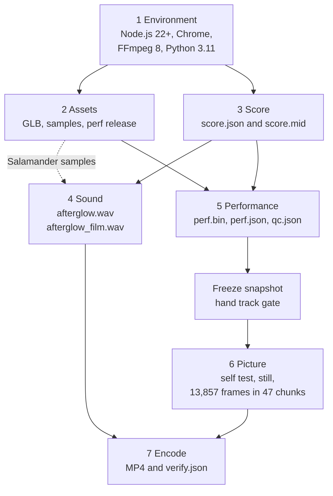
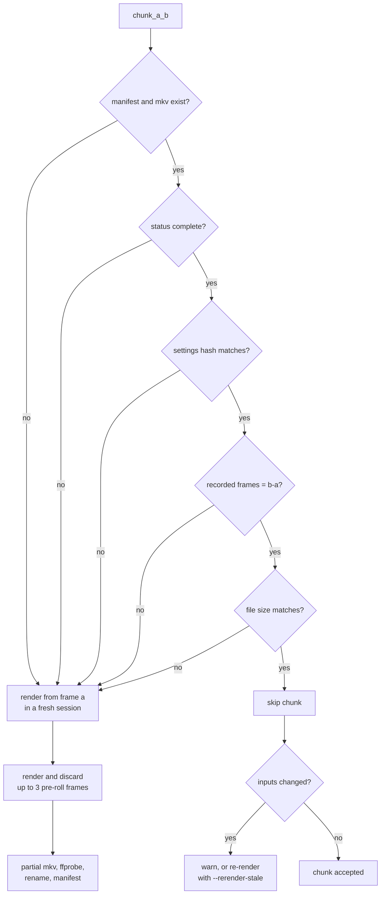

# 03 Workflow and quality: a clean rebuild, and the gates that stop a bad result

This document gives the rebuild order and the checks. It starts from the pin and ends at the
encoded film and its verification report. It does not run any command. Every command comes from
the project documents at the pin. [`01-architecture.md`](01-architecture.md) gives the layers.
[`02-core-mechanism.md`](02-core-mechanism.md) gives the frame math.
[`04-limits-and-comparison.md`](04-limits-and-comparison.md) gives the limits and the budget cuts.
[`00-overview.md`](00-overview.md) gives the film and the numbers. The index is
[`README.md`](README.md).

## 1. What a clean rebuild means

A clean rebuild takes the source at `ced1038` and produces the film again in seven stages. The
order follows the data: a later stage consumes an earlier output, and some links carry a hash. A
later stage cannot repair a wrong earlier stage. The project ships no single script; the operator
runs the commands in order. Stage 5 has two paths: the released performance tracks reproduce the
film, and a fresh solve tests the solver (Section 2).

Stages 1 to 3 have named commands. The commands use Windows paths; other systems need equivalent
paths. Stage 1 runs `git lfs install` for Git Large File Storage (LFS), `npm ci`,
`python -m venv .venv` and `.venv\Scripts\python -m pip install -r requirements.txt`. Stage 2
fetches the two LFS files from the v1.0 release. The release tag `v1.0` is not the Node.js
package version. Stage 3 runs
`.venv\Scripts\python music\afterglow_score.py` and writes the frozen score (`README.md:154-189`).

| Stage | Input | Output | Gate |
|---|---|---|---|
| 1 Environment | Source, package files | Node.js modules, Python packages | Version and browser check |
| 2 Assets | Large files and samples | Pianist binary glTF (GLB), piano samples | Hash or release check |
| 3 Score | Note source or frozen score | `score.json`, Musical Instrument Digital Interface (MIDI) | Score checks and frozen data |
| 4 Sound | Score, samples, preset | `afterglow.wav`, `afterglow_film.wav` | Note log and offset |
| 5 Performance | Score, rig, GLB | `perf.bin`, `perf.json`, `qc.json` | Quality control (QC) report |
| 6 Picture | Score, performance, edit, scene | 47 FFmpeg Video Codec 1 (FFV1) chunks and manifests | Snapshot gate, self test, still, determinism |
| 7 Encode | Chunks and film-aligned Waveform Audio File Format (WAV) | H.264 (Advanced Video Coding) MPEG-4 Part 14 (MP4) and verify report | Provenance, identity, peak signal-to-noise ratio (PSNR), colour, audio |



The diagram adds the snapshot gate between Stage 5 and Stage 6; the table lists it inside
Stage 6.

Stage 3 is frozen. The score in `music/final/` is the approved version. A fresh solve is a
different performance and is not the released film, because the solver changed after the release.
Use the released tracks for the film; a new solve tests the solver. At the pin, the released
performance and the solver version are fixed constants of the film.

## 2. Environment and assets

The project was tested on Windows 11 with one laptop graphics processing unit (GPU), the AMD
Radeon 780M. The code expects Node.js 22 or later (`package.json:8`), Chrome, FFmpeg 8 and
Python 3.11 (`README.md:154-155`). The Node.js package set is pinned: three.js 0.186.1 and
puppeteer-core 25.15.0
(`package.json:20-21`). The Python packages come from `requirements.txt` in a virtual
environment.

Two binary assets use LFS: the pianist GLB and the Detmold concert hall impulse response. The GLB
is about 24 megabytes; a clone without LFS gives a text pointer of about 130 bytes, and the page
cannot load a pianist. The sample set has no stated hash check. The v1.0 GitHub release
(`README.md:192`), not the package version, holds both files. The source does not state which
commit the release was built from, so the release files are not proven to match `ced1038`. A
reader can clone with the LFS download disabled, fetch the release files and check the Secure
Hash Algorithm 256 bit (SHA-256) hash against the release notes. The bypass steps and the release
notes are in `README.md:154-199`.

The sound stage needs the Salamander Grand Piano V3 sample set, 1.35 gibibytes at 48 kilohertz
and 24 bits under the Creative Commons Attribution 3.0 licence. The archive is at
`https://archive.org/details/SalamanderGrandPianoV3` (`README.md:183`). The soundtrack render
takes about 16 minutes. The released mix does not use the Detmold impulse response, so that file
is optional.

The performance stage has two paths. The fast path downloads `afterglow_perf_g1f.zip` from the
v1.0 GitHub release (`README.md:192`) and unpacks `perf.json`, `perf.bin` and `qc.json` into
`build/anim/`. The source does not define the `g1f` label. These are the exact tracks of
the released film, and the committed camera hand track is keyed to them. The slow path runs the
solver for about 20 minutes and the QC for about 25 minutes. That path tests the solver, not the
released film.

## 3. The sound stage

The score stage produces `music/final/score.json` and `score.mid`. The frozen files are the
approved score. The generator `music/afterglow_score.py` rebuilds them from the note source. It
calls the library `music/dsl.py`, which holds `to_json`.

The sound render has one entry point. It reads the score JavaScript Object Notation (JSON) or a
MIDI file and writes four outputs. The WAV has sample zero at music time zero; the film-aligned
WAV starts at film time zero with 4.0 seconds of silence. The render log holds the per-note onset
in milliseconds. The MPEG-1 Audio Layer III (MP3) is a listening copy at 320 kilobits per second.

```text
# music/render_audio.py:1-12
#!/usr/bin/env python3
"""Final soundtrack render: score JSON (or MIDI) -> build/audio/ WAV + MP3 + render log (+ film-aligned WAV).

  python music/render_audio.py                                   # music/final/score.json, preset 'final' (the soundtrack mix)
  python music/render_audio.py --score sandbox/music-research/sketch.json --out build/audio/sketch
  python music/render_audio.py --preset music/presets/cinematic_hall.json --set reverb_wet_db=-8

Writes <out>.wav (48 kHz, 24-bit PCM, sample 0 = music time 0), <out>.mp3 (LAME 320 kb/s), <out>.render.json
(stats + per-note log incl. onset_ms), and <out>_film.wav = the same audio delayed by MUSIC_OFFSET (DESIGN.md 3),
which is what render/encode.mjs muxes under the picture (film t = 0 at its first sample).
The whole signal chain lives in music/sampler.py; this file only picks inputs, the preset and output names.
"""
```

`PCM` is pulse-code modulation, and `LAME` is the MP3 encoder.

The sampler chain is deterministic. It prepares and caches the samples, crossfades 16 velocity
layers, shifts pitch and applies the envelopes and noises. It adds resonance, a synthetic hall,
loudness normalisation and a true-peak limit. The same score and preset give the same WAV.

```text
# music/sampler.py:8-16
Signal chain
  samples  -> prepare (once, cached on disk):
                energy-preserving mono downmix of the spaced AB pair (fixes the -9 dB mono
                cancellation of some notes) + side signal, onset trim to a fixed 2 ms pre-roll,
                zero-phase rumble high-pass, end fade
  voice    -> velocity-layer crossfade (16 layers), loudness interpolated between layer
                centres with smoothed per-key "voicing", soxr VHQ pitch shift (+-1 semitone
                plus tuning correction), damper/pedal envelope, re-strike fade, pan by key
  releases -> key-noise samples at key-up, damper/string release samples at damper contact,
```

In the quotation, `AB` is a spaced microphone pair. `soxr` VHQ is the SoX resampler at very high
quality, and `BS.1770` is the Recommendation ITU-R BS.1770 loudness standard. `FFT` is the fast
Fourier transform, `EQ` is equalisation, and `IR` is impulse response, here the piano's resonance.

The sound gate has two parts. The render log is informational: it records the requested note time
and the audible onset for every note, with the onset terms (`music/sampler.py:244-258`). `rise`
starts at the first crossing of minus 20 decibels relative to the peak. It then steps back to the
last crossing below minus 32 decibels within 8 milliseconds, which ignores touch noise before the
attack (`music/sampler.py:231-240`). The source gives no separate justification for the two
crossings. `peak` is the envelope maximum in the first 250 milliseconds. `t30`, `t20` and `t10` are
the first crossings of minus 30, minus 20 and minus 10 decibels relative to the peak; they are
diagnostics of the attack shape. The envelope is a 0.25 millisecond moving average. The
film-aligned WAV moves by the constant offset, so it cannot drift. The encode stage checks that
offset against the picture. The pass bounds come from the encode check: audio onset error and
cross-correlation lag under 2 milliseconds, and correlation above 0.9 (Section 10).

## 4. The performance stage and the snapshot gate

The solver reads the score, the rig and the GLB. It writes the tracks and a QC report. The QC
check runs at 60 hertz by default; this is the check rate, not the track rate. The command has a
`--no-qc` switch for a quick experiment, but a production solve leaves QC on.

```text
# perf/solve.mjs:31-34
if (!args['no-qc']) {
  const q = runQC(res, { out, command: cmd, range, rateQC: args['qc-rate'] ? +args['qc-rate'] : 60 });
  console.log('[qc] ' + JSON.stringify(q.summary, null, 1));
}
```

The tracks are not enough. The camera has a hand track for focus and a motion-blur N boost table.
Both are keyed to a specific `perf.json` hash. The hand-track builder is
`sandbox/camera/handtrack.mjs`; it solves the hand path from the performance. An older track
frames the wrong place in close-ups. The snapshot tool enforces this link.

```text
# render/snapshot.mjs:1-6
// Frozen snapshot of everything the render page loads, so renders and checks are immune to concurrent edits of
// scene/ (module owners work in parallel; a file that changes mid-render makes encode.mjs refuse the chunks and makes
// determinism sessions differ). Serve it with AG_SERVE_ROOT=<dir> (render/lib/session.mjs).
//   node render/snapshot.mjs --out build/snap/<name>        -> prints the directory and a content hash
// Copies scene/, assets/pianist/, music/final/score.json, build/anim/perf.{json,bin}; node_modules/three is linked
// (a directory junction: three is pinned by package-lock and nobody edits it).
```

The snapshot solves its own hand track when the copied track does not match the copied
performance by SHA-256 hash, and records the result in `SNAPSHOT.json`. By default it regenerates
a stale track. `--no-regen-handtrack` restores the older refusal; with that flag,
`--allow-stale-handtrack` turns the refusal into a recorded warning. `--force-regen-handtrack`
regenerates even when the track matches (`render/snapshot.mjs:13-15`, `45-63`). The snapshot
copies the scene, pianist asset, score and performance into one directory; the render serves it
with `AG_SERVE_ROOT`. A concurrent edit of `scene/` cannot change the pixels of a snapshot run.

The QC report checks the skinned mesh, keys, hammers, dampers and pedals against the score, so it
measures the written tracks, not the planner's intent (`docs/PERFORMANCE.md:158-179`). The skinned
distal vertex is the lowest vertex of the skinned fingertip; the key top plane is the flat upper
surface of the key. The contact term is the signed distance between them. It measures at key
bottom, at mid-hold and during the press, and tests whether that vertex lies on the key
(`163-164`). The penetration term tests every hand vertex against white keys, black keys, the
fallboard and the key slip by class (`165-166`). The fallboard is the lid over the keys; the key
slip is the front rail below them. The finger-finger term tests skinned vertices against capsules
around the other fingers, with radii from the bind-pose mesh (`167-168`). The joint-limit term runs
forward kinematics on the written quaternions and compares each joint angle with a listed range,
such as metacarpophalangeal (MCP) -12 to 88 degrees (`169-171`). The source gives no separate
tolerance for this check. Other terms are peak angular velocity per bone, angular jerk, finger
pops above 12 degrees per film frame, fingertip speed and key-bottom timing (`173-174`). The
integration key-onset gate checks that every note reaches the key bottom within one frame of the
note-on. The recorded run passes for 1,131 of 1,131 notes (`docs/INTEGRATION.md:385-388`).

An early release is a key that starts to rise more than 10 milliseconds before the designed
release point. The designed release is the start of the intended key rise. The note-off `t_off`
is when the key reaches half travel; the designed release starts 25 milliseconds before it
(`perf/lib/qc.js:176`, `perf/lib/timing.js:20-25`). Covered means the pedal holds the sound
through the key release. A release more than 10 and at most 30 milliseconds early is always
covered. A release more than 30 milliseconds early is covered only if the sampler damper lift
stays at or above 0.99 from that point to the note-off (`perf/lib/qc.js:173-176`). Damper lift is
normalised from 0 to 1; 0.99 covers an early release because the damper has barely touched the
string. An uncovered release stops the note early.

The project states 30 of 30 probed notes touch their key, with a median gap of 0.15 millimetres
and a maximum of 0.63 millimetres (`README.md:134`). The sustain pedal angle matches MIDI control
change 64 over the film with a Pearson correlation of 1.000 (`docs/INTEGRATION.md:132`). That
figure uses 904 samples and excludes the change windows. The comparison calls the pedal down at a
control value of 100 or more and up at 10 or less. An older probe gives minus 1.000 with 12.1
millimetres of travel. The final sync record gives minus 0.9995 with 9.5 millimetres
(`docs/INTEGRATION.md:133`, `:768`). The foot rises while the pedal goes down. The source gives no
separate sign convention. These are project measurements, not measurements of this exploration.

## 5. Preflight: self test, still, determinism

Before a long render, the project runs three preflight commands. The self test opens a small page
with placeholder modules. It has ten checks, and it tests the parts that can fail silently in an
accumulation renderer.

```text
# render/selftest.mjs:1-13
// Render-core self test (placeholders, small frame). Checks what silently breaks an accumulation renderer:
//   gpu        WebGL renderer is the expected hardware GPU (never SwiftShader)
//   accumAlpha accumulation alpha == 1 everywhere (autoClear trap: otherwise only the last sub-frame survives)
//   glare      veiling-glare lobe integrates to the input energy (energy conserving, no threshold)
//   lutIdent   an identity .cube changes no pixel by more than 1 code value
//   lutSwap    an R<->B swap .cube gives the R<->B swapped image (proves .cube axis order: red fastest)
//   repeat     the same frame twice in one session is bit-identical
//   glareMix   the final pass mixes the lobe with amount * (1 - PSF core energy) (the core stays in the image)
//   glareScale a small source's far halo (energy beyond 0.042 and 0.17 image heights) is the same at 960x540, 1920x1080
//              and 3840x2160, measured on the rendered glare pyramid (within 5%)
//   contextLoss after WEBGL_lose_context loses and restores the context, renderFrame throws (no stale frames)
//   dispose    AG.dispose() calls every module's dispose() without errors
//   node render/selftest.mjs [--size 480x270]
```

The GPU check tests correctness, not only speed: a software rasteriser gives different pixels.
The accumulation alpha check catches the clearing trap from
[`02-core-mechanism.md`](02-core-mechanism.md) at every pixel; the per-frame check reads one
pixel. The glare checks catch an energy leak and a resolution-dependent halo. The context-loss
check proves that a lost context causes an error, not a stale frame.

The still render is frame 1519, the S03 hero frame, with a real camera (`README.md:212`). It is
cheap and shows a wrong camera, grade or module before the chunk render.

The determinism check is the strongest preflight gate: it is the only one that compares
independent sessions. It renders the same frames in three fresh browser sessions. Session A
renders in order. Session B renders in reverse order after a different warm-up. Session C renders
only the last frame. The check compares the SHA-256 hash of the 8-bit red, green, blue, alpha
(RGBA8) pixels; grain is hashed into those pixels, so any grain difference changes the hash. The
frames must agree across sessions, and different frames must differ.

```text
# render/determinism.mjs:1-7
// Determinism check: the same frames rendered in independent fresh browser sessions (and out of order) must be
// bit-identical (sha256 of the RGBA8 frame), and different frames must differ.
//   node render/determinism.mjs [--frames 240,241] [--size 1920x1080] [--N 16] [--opts '{"grade":{"grain":2}}'] [--camera cam.json]
// --preroll [K] renders frames f-K..f-1 (discarded, K = 1 by default) before every checked frame f, as render.mjs does at
// chunk starts.
// Session A renders the frames in order, session B in reverse order (after a different warm-up frame), session C
// renders only the last one. Writes build/determinism/determinism.json.
```

The check exits with a non-zero code if any hash differs. This gate proves that the renderer is
deterministic across session order. Without pre-roll the check fails. With `--preroll 3` all
three frames are bit-identical in sessions A, B and C. `--preroll` with no value uses K = 1. The
render default is 3, so `--preroll 3` is the matching test; the default check tests the
no-pre-roll path.

## 6. Plan the render

The plan command `node render/film.mjs plan --preset final-1080p` prints the frame count, end time,
preset size, sub-frame count and per-shot table. It can estimate the total time from measured
stills. Full N means the shot table value before the 1:50 cut and the boost. The project records
13,857 frames and 473,760 sub-frames with full N throughout. The release render used 360,368
sub-frames, because it halves N after film time 1:50 and halves the motion-boost N values. A
motion boost replaces the shot N for that frame; it does not add sub-frames. The project records
21.8 hours of wall-clock time and 9.7 hours of pure render time (`README.md:131`). The estimate
from measured stills is 13.4 hours on an idle GPU (`README.md:219`). The source does not
reconcile the three figures. Section 8 gives the project's explanation for the 12.1-hour gap
between wall-clock and pure render time.

The preset also sets the chunk length and the session length. The final preset uses 300-frame
chunks and four chunks per browser session. 13,857 / 300 = 46.19, so the film needs 47 chunks. At
four chunks per session, 47 / 4 gives 12 browser starts.

```text
# render/film.mjs:1-6
// Film driver: the presets of scene/src/film.config.js on top of render.mjs / encode.mjs (docs/INTEGRATION.md).
//
//   node render/film.mjs plan   [--preset final-1080p] [--timings sandbox/integration/out/v1/stills.json]
//   node render/film.mjs render --preset final-1080p [--from A --to B] [--per-session K] [--force|--rerender-stale]
//   node render/film.mjs encode --preset final-1080p [--from A --to B] [--out file.mp4] [--archive prores] [--master]
//   node render/film.mjs clip   --preset check-1080p --from A --to B --name hands      -> build/out/test_hands.mp4
```

## 7. Render and resume

The render driver writes FFV1 chunks. FFV1 is a lossless codec; intra-only means no frame depends
on another, so a lost chunk cannot corrupt a neighbour. The settings use level 3, a group of one
frame, 16 slices and a slice checksum. Level 3 is the codec feature level; 16 slices split each
frame into strips, each with its own checksum. The page reads back RGBA8 pixels and passes them to
FFmpeg as `rgba` (`render/lib/frames.mjs:49`). The file uses `bgr0`, an 8-bit blue, green, red
layout (`render/lib/frames.mjs:114`). The conversion reorders the colour bytes and drops the alpha
channel. The final pass writes normalized alpha 1.0, which the 8-bit target stores as 255
(`scene/src/core/final.js:102`), and the film does not use alpha. No colour value changes, and the
project calls this master lossless (`render/lib/frames.mjs:113`). The choice favours speed and
integrity over size; the master is 23.7 gigabytes.

```text
# render/lib/frames.mjs:112-115
export const ENCODERS = {
  // lossless render-time master: intra-only, sliced, CRC'd (fast enough not to slow the GPU; x264 does)
  ffv1: ['-c:v', 'ffv1', '-level', '3', '-g', '1', '-slices', '16', '-slicecrc', '1', '-pix_fmt', 'bgr0'],
  x264: ({ crf = 14, preset = 'slow', fps = 0 } = {}) => ['-c:v', 'libx264', '-preset', preset, '-crf', String(crf), '-profile:v', 'high',
```

The driver writes `chunk_a_b.partial.mkv` first. It renames the file only after FFmpeg closes it
and `ffprobe` confirms the frame count, then writes the manifest. A failed chunk leaves no
complete-looking file. The retry starts from the chunk's first frame in a fresh session.

The skip decision is the resume gate. It checks six conditions:

1. The manifest and the video file exist.
2. The manifest status is `complete`.
3. The settings hash matches the current settings.
4. The recorded frame count, measured by `ffprobe` at write time, equals the chunk length.
5. The file size equals the recorded byte count.
6. The manifest input hashes match every file the page loaded.

The first five are hard checks (`render/render.mjs:50-62`); if all five hold, the chunk is
skipped. Condition 6 is a warning by default: the driver reports a changed input and still skips
the chunk unless the operator passes `--rerender-stale`. That default suits a resumed run, not a
release; a release uses a frozen snapshot. With `--verify`, the driver also recomputes the
SHA-256 of the file and counts the video packets again.

Pre-roll is a correctness feature. The integrated scene keeps one frame of history. Shot S20 kept
more: after a one-frame pre-roll it still depended on earlier frames. A chunk that starts a new
session would otherwise use the warm-up frame as history, so its first frames would differ from a
continuous render. The driver renders up to three frames before the chunk with transfer off and
discards them; those frames set the history.



**Aha:** resume is a correctness feature before it is a speed feature. The manifest hash chain
does not only let a run continue after a crash. It proves that each chunk used the same settings
as its neighbours, and it reports any changed input file; `--rerender-stale` turns that report
into a refusal. A render farm would call this provenance. In this project it is one JSON manifest
per 300 frames.

## 8. One GPU, many processes

The build machine has one integrated GPU. Two graphics driver resets (bugcheck 0x119) happened
when several headless Chrome renderers and Blender shared it. The project added a machine-wide
semaphore. A lock file holds the process identifier and the start time. A lock whose process is
dead, or older than four hours, is reclaimed. Reclamation and acquisition both use exclusive
create, so two claimants cannot both take the same slot.

```text
# render/lib/gpulock.mjs:1-8
// Machine-wide GPU semaphore. Two video-scheduler bluescreens (bugcheck 0x119 VIDEO_SCHEDULER_INTERNAL_ERROR,
// 2026-10-21 16:42 and 23:22) happened while several headless Chrome renderers and Blender shared the Radeon 780M.
// Every process that renders on the GPU takes a slot first; AG_GPU_SLOTS (default 1) slots exist machine-wide.
// Locks are files in build/locks; a slot whose owner process is gone (or older than 4 h) is reclaimed.
//
//   import { launchWithGpuLock, withGpu } from '.../render/lib/gpulock.mjs'
//   const browser = await launchWithGpuLock(puppeteer, launchOptions, 'my-harness')   // released on browser close
//   await withGpu('label', async () => { ... })
```

The session layer pauses frames while another headless GPU job runs. The 12.1-hour gap between
wall-clock time and pure render time is not split in the source. The project attributes that gap
to pauses, not to a slower shader.

## 9. Verify the chunks

The verify command re-hashes every complete chunk, compares the hash with its manifest and counts
video packets. A packet count equal to the frame count proves that no frame is missing or
duplicated. It does not re-render; it is a read pass over about 24 gigabytes.

The manifest is the audit trail. It records the frame range, settings, settings hash, git
revision, scene hash, input hashes, frame count, SHA-256, byte size and timings. The settings
hash excludes the git hash and the timings, because they do not change the pixels
(`render/render.mjs:44`). It includes the three.js version and the modules, because they do.

The encode stage applies a stronger provenance rule (`render/encode.mjs:56`). It reads all manifests for the selected
range. It refuses a gap, an overlap, or chunks from different settings, modules, camera sources
or input hashes. It warns about a different GPU, Chrome version or scene tree hash. The
`--allow-mixed` switch overrides the refusal, and the report records that override.

```text
# render/encode.mjs:36-45
// ---- chunks
const manifests = fs.readdirSync(dir).filter((f) => f.endsWith('.manifest.json'))
  .map((f) => JSON.parse(fs.readFileSync(path.join(dir, f), 'utf8'))).filter((m) => m.status === 'complete')
  .sort((x, y) => x.range[0] - y.range[0]);
if (!manifests.length) throw new Error(`no complete chunks in ${dir}`);
const from = a.from !== undefined ? +a.from : manifests[0].range[0];
const to = a.to !== undefined ? +a.to : manifests[manifests.length - 1].range[1];
const use = manifests.filter((m) => m.range[1] > from && m.range[0] < to);
let cursor = from;
for (const m of use) {
```

## 10. Encode and check the film

The encoder has four steps: concatenate the chunks, encode the picture, place the
soundtrack, and verify the result last. The chunks form one FFV1 stream, which is then encoded to
H.264; the film is not encoded chunk by chunk. The picture output is H.264 High profile at
constant rate factor (CRF) 14 with the slow preset. It is 8-bit 4:2:0 with Recommendation ITU-R
BT.709 (BT.709) colour primaries, transfer and matrix. The audio is Advanced Audio Coding (AAC)
at 320 kilobits per second.

The audio placement uses exact sample counts. If the film starts before the music, the encoder
adds silence. If the film starts inside the music, it trims the WAV. A rounding error of one sample would fail the onset check, so
the code uses `start_sample` and `end_sample`, not seconds.

The verification has five groups. The frame count must equal the selected range. The identity
test compares frame order. The PSNR test sets a quality floor. The colour test checks the BT.709
matrix against the wrong Recommendation ITU-R BT.601 (BT.601) matrix. The audio test checks the
onset error, the cross-correlation lag and the duration.

The identity test is subtle. A high PSNR does not prove the frame order: a duplicate is close to
its source, and a drop leaves a good frame in the wrong place. The test decodes the source chunk
to RGB and compares each output frame with its own source and with the previous and next source
frames. If a neighbour is closer than its own source, the frame order is wrong. A frame counts
only when the source frame and that neighbour's source frame differ enough to make the comparison
decisive. `p3` is the neighbour-to-neighbour source PSNR, between this source frame and the
neighbour's source frame. It must be more than 3 decibels below the output-to-own-source PSNR
(`render/encode.mjs:164`, `219`). The one-percent low value is at index `floor(0.01 * (frames -
1))` of the ascending sorted PSNR list (`render/encode.mjs:206`).

The gate values are fixed. The H.264 average PSNR must be at least 42 decibels, the one-percent
low value at least 38, and the minimum at least 30. The BT.709 conversion must beat the wrong
BT.601 conversion by more than 3 decibels. The audio onset error and the cross-correlation lag
must each be under 2 milliseconds, and the correlation above 0.9. The command exits with a
non-zero code if any check fails.

The project records the result. Identity passes for 13,857 of 13,857 frames. The audio onset error
is 0 milliseconds, and the lag is 0 at 7.7 seconds and at 170.4 seconds. The exploration records
these as project claims. It does not run the encode.

## 11. Failure modes and their gates

The readback sentinel is the zeroed alpha bytes: a failed read leaves zero, and a successful
final pass overwrites them with 255.

| Failure | Where it is caught | Effect |
|---|---|---|
| Software rasteriser | Self test GPU check | The run checks the GPU string before rendering and refuses a mismatch |
| Lost WebGL context | Page check each frame, readback sentinel | Frame fails, chunk retries in a new session |
| Accumulation cleared by `autoClear` | Alpha check after the sub-frame loop | Chunk fails, no silent last-frame output |
| FFmpeg child dies | Assembler sticky error | Frame fails at once, no hang on a dead pipe |
| Browser crash | Session frame check | Chunk fails, retry from its first frame |
| Upload stuck | 180-second timeout | Frame fails, retry |
| Wrong frame count | `ffprobe` before rename | Partial file is not renamed |
| Truncated chunk | Size in the manifest; hash with `--verify` | Skip fails; verify fails |
| Stale input | Input hash list | Warning, or re-render with the flag |
| Mixed settings or inputs | Encode provenance check | Encode refuses |
| Frame drop or duplicate | Identity test | Encode check fails |
| Wrong colour matrix | BT.709 versus BT.601 test | Encode check fails |
| Audio offset | Onset and cross-correlation | Encode check fails |
| Non-deterministic pixels | Three-session hash check | Determinism check exits non-zero |
| Stale hand track | Snapshot hash gate | Snapshot re-solves or refuses |

## 12. Where to go next

The rebuild is a chain of hashes. The score and performance are inputs, which the snapshot
freezes. The chunk manifests freeze the settings and the scene. The encode check proves the
output matches picture and sound. A break stops the run at the stage that owns it. [`04-limits-and-comparison.md`](04-limits-and-comparison.md) explains which breaks the
project accepts and which it cannot remove. [`02-core-mechanism.md`](02-core-mechanism.md) gives
the frame math behind the gates. [`01-architecture.md`](01-architecture.md) gives the layers,
and [`00-overview.md`](00-overview.md) gives the film and the numbers. The index is
[`README.md`](README.md).
