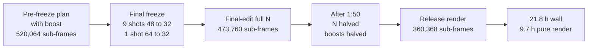
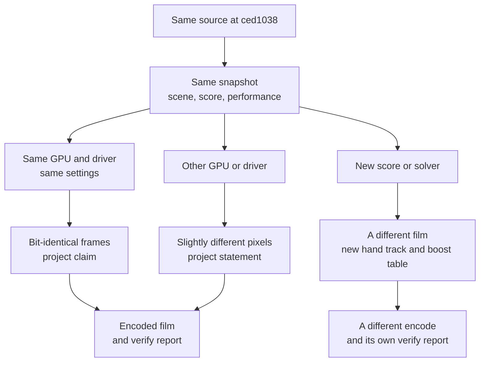

# 04 Limits and comparison: what this method buys, and what it cannot prove

This document records the limits of the afterglow package and compares the method with other
ways to make a film. It separates three kinds of statement. A source fact is in the checkout. A
project claim comes from the project documents and was not measured here. A judgement is this
exploration's reading. [`01-architecture.md`](01-architecture.md) gives the layers,
[`02-core-mechanism.md`](02-core-mechanism.md) gives the frame math,
[`03-workflow-and-quality.md`](03-workflow-and-quality.md) gives the gates, and
[`00-overview.md`](00-overview.md) gives the film and the numbers. The index is
[`README.md`](README.md).

## 1. The artifact boundary

The checkout is not the film. The repository holds the source, the score data, the pianist asset
and the documents. The generated files are excluded. Those files are the audio, the performance
tracks, the FFmpeg Video Codec 1 (FFV1) chunks, the encoded films and the snapshots. A snapshot
is a frozen copy of the input directories, not a still image. The film is a release download.

```text
# README.md:261-262
Not in the repository: `build/` (everything generated: audio, tracks, chunks, films, snapshots), the reference images
(`refs/`, licence unknown), the downloaded samples (`music/samples/`), `node_modules/` and `.venv/`.
```

Two assets are large. The pianist binary glTF (GLB) and the Detmold impulse response are Git
Large File Storage (LFS) files. A plain clone can give a text pointer instead of the 24-megabyte
GLB. The v1.0 GitHub release holds both files, and the release notes hold their Secure Hash
Algorithm 256 bit (SHA-256) hashes. The piano
sample set is not in the repository either. It is 1.35 gibibytes and needs a separate download.

The performance tracks are a release file. The project states that the solver code changed after
the released run. A fresh solve is therefore a different performance, not the film's performance.
The source does not itemise the solver change. At the pin, the released performance and the solver
version are fixed constants of the film. The quoted command reports quality control (QC) time.

```text
# README.md:200-204
`node perf/solve.mjs` re-solves the performance from the score (about 20 min, plus about 25 min of QC). The solver code
went on to later experiments after the released run, so a fresh solve is not the film's run (docs/PERFORMANCE.md
section 8). After any new solve, freeze a snapshot, which re-solves the hand track and the motion-blur table for it,
and render from that snapshot: `node render/snapshot.mjs --out build/snap/mine` and `$env:AG_SERVE_ROOT =
"$PWD\build\snap\mine"`.
```

The score is frozen at `music/final/`. The frozen score has 1,131 notes. Its `duration` field is
220.7512 seconds, the last note-off (`music/dsl.py:369`, `music/final/score.json:4`). Note
identifiers are zero-based, so the last note identifier is 1130 and the last release belongs to
identifier 1129. The score
file, in JavaScript Object Notation (JSON), also has `"lead_in": 0.0`. That is the score's own
time origin, not the film's 4.0-second music offset. The film is longer than the duration field,
because the edit ends after the final pedal release. A change to the composition invalidates the
performance, the hand track and the motion-boost table. The camera cuts are anchored to bars and
beats, so a tempo change also moves every cut.

```text
# music/final/score.json:1-6
{
"title": "Afterglow",
"lead_in": 0.0,
"duration": 220.7512,
"notes": [
{
```

The source describes no unit-test suite. The quality gates are scripts: the self test, the
determinism check, the performance QC, the integration checks and the encode verification. They
are strong scripts, but they are not a test framework. A reader who expects `npm test` will not find it.

## 2. The render budget

The film is 13,857 frames at 60 frames per second (fps). Four plan totals exist:

| Plan | N policy | Boost | Total | Change |
|---|---|---|---|---|
| Integration estimate | each shot's own N | no | 404,392 | none |
| Pre-freeze | each shot's own N | no | 517,536 | +113,144 |
| Pre-freeze | each shot's own N | yes | 520,064 | +2,528 |
| Final edit | frozen table | yes | 473,760 | -46,304 |
| Release render | halved after 1:50 | halved | 360,368 | -113,392 |

The final-edit average is 473,760 / 13,857 = 34.19 sub-frames per frame. The release average is
360,368 / 13,857 = 26.006, rounded to 26.0. The source gives no frame set behind 404,392 and does
not reconcile it with 517,536. The render took 21.8 hours of wall-clock time on one laptop, with
9.7 hours of pure render time (`README.md:131`). That is 5.66 seconds wall and 2.52 seconds pure
per frame. The project also estimates 13.4 hours on an idle graphics processing unit (GPU)
(`README.md:219`). The source does not reconcile the three figures. The 12.1-hour gap between
wall-clock time and pure render time is not split.

The final freeze explains the drop from 520,064 to 473,760: 46,304 sub-frames. It lowered the N
of nine shots from 48 to 32 and one shot from 64 to 32 (`scene/src/camera/shots.js:36-37`). The
final-freeze comment gives the exact shot list.

```text
# scene/src/camera/shots.js:36-37
// Final freeze 2026-10-24 (integrator, docs/INTEGRATION.md 10.1): N 48 -> 32 in S06 S08 S13 S15 S20b S20c S21 S22 S24
// and 64 -> 32 in S16b (deadline cap; the motion N boost table keeps fast hands <= 1 px per sub-frame); S10 / S11 / S16 keep 48.
```

The release cuts explain the drop from 473,760 to 360,368. The release render halves N after film
time 1:50, which is frame 6,600, with an exception for frames 6,900 to 7,199. The halved values
are 32 to 16, and 48 to 24 in the water shots. The release also halves the motion boost after that
point; halving the boost halves its N values, not the boosted-frame count.

```text
# README.md:109-110
The release render uses these values up to 1:50 (frame 6,600, plus frames 6,900-7,199) and half of them after that
(16, 24 in the water shots, boosts halved), so that the render finished on one laptop.
```

The release rule is one line in the project statement. It names the frame at which the cut starts
and the frames that keep the full N. The project gives no reason for the 300-frame exception from
frame 6,900 to frame 7,199.

The motion boost is a separate table. It replaces the shot N on 132 frames where a fast hand
would show separate motion copies, which are repeated images across the shutter. It does not add
to N. The maximum boosted N is 128. On the pre-freeze own-N plan the boost adds 2,528 sub-frames,
the difference between 517,536 and 520,064 (`docs/INTEGRATION.md:613-614`). On the final plan the
table adds 3,792 sub-frames: the sum over 132 frames of (boost N - edit N), inside the 473,760
total (`docs/INTEGRATION.md:907`). The release render halves the boost after 1:50, so it adds
fewer than 3,792. The table is keyed to the performance hash and to each shot's edit N. The page
ignores a stale table when the hash or the edit N differs.

```text
# scene/src/integration/motion_n.json:6-9
 "note": "per-frame N boost for fast hands (motion-blur copy spacing at the shot's own N > targetPx); applied by scene/src/main.js in final-quality renders when the session does not force N; void for a shot whose edit N differs from editN, or when perfSha differs from build/anim/perf.json sha256",
 "perfSha": "150017f65428f25c1101cb4764630b5d2c757d3539e2d8d011faca473263a5c9",
 "targetPx": 1,
 "maxN": 128,
```



The project states the visible cost. A/B means a side-by-side comparison. The capped close-ups
showed only sampling noise in an A/B test. The second half has a little more grain in defocused water, bokeh and glints. The switch
points were compared frame by frame and show no visible step. These are project claims, not
independent measurements.

```text
# README.md:286-289
- **Render budget**: to fit the render window, the close-up shots were rendered at N = 32 instead of 48; an A/B of all
  capped shots showed only sampling-noise differences, indistinguishable by eye. From 1:50 on (except 1:55-2:00) the
  film was rendered at half N: a little more grain in defocused water, bokeh and glints. The switch points were
  compared frame by frame and show no visible step.
```

**Aha:** the render budget is a look decision that is written as a performance decision. N sets
the sample count, but it also sets the gap-fill sigma, the motion-copy spacing and the noise
floor, which is the base level of sampling noise. The project could not lower N for free. It
paired each cut with a test or a boost table.
A reader who copies only the N values, without the pre-blur formula and the boost table, gets a
different look.

## 3. Limits the project states

The project is direct about its weakest images. Shot S14 is the only top-down shot, and it lasts
7.3 seconds. Free fingers are fingers that hover and do not touch a key. They splay and curl, and the water
near the bench shows hard black blotches.

```text
# README.md:268-270
- **S14, the one top-down shot (7.3 s), is the weakest.** From directly above, the hovering free fingers of both hands
  splay and curl and the left thumb points across at the right hand; the water around the bench shows hard-edged
  black blotches.
```

The hands are the main limit. Thumbs often stay stiff and stick out. Nine one-frame finger flicks
above 12 degrees remain in readable shots. Fast right-hand leaps in S04 travel about 100 pixels
per frame, but the motion blur is smooth. The nails in the S06 macro read as dark red polish
(`README.md:271-274`).

The world has limits. The far mountains are a uniform row with little layering. Some ranges read
as smooth pyramids. The clouds are smaller than the reference clouds. The water in the wides is
more mauve than warm orange. Shot S20 has a foil-like micro-pattern. Shot S25 has white keys that
barely read. Lacquer edges show thin dotted highlights that change from frame to frame, because
there is no specular anti-aliasing (`README.md:276-281`). Specular anti-aliasing filters
highlights against normal and roughness variation.

The encode has a visible limit. The 8-bit H.264 (Advanced Video Coding) shows faint
one-code-value bands in smooth sunset skies (`README.md:282`). A 10-bit encode would remove them. The project also notes that the shirt cuffs are
uniform and the S11 shoe is featureless. The probe samples 30 notes. The README says six of 30
probed hammers peak a fraction of a degree short of the string, so 24 of 30 reach it
(`README.md:285`). An integration document says seven of 30, so 23 of 30
(`docs/INTEGRATION.md:128`). Six of 30 is the final count; seven of 30 is an older record. The
source does not reconcile them. QC measures the written tracks at 60 hertz, so it cannot
see a peak between samples; that limit can explain the difference.

The reproducibility claim is scoped. The project tested one Windows machine and one GPU. Other
GPUs and drivers give slightly different pixels. The quotation below lists the lookup table (LUT) fitter.

```text
# README.md:290-293
- **Reproducibility**: tested on one Windows machine and GPU; other GPUs and drivers will give slightly different
  pixels. The reference images are not included. Several development tools (look-dev harnesses, the critics' check
  scripts, the LUT fitter, the shot-list generator) lived in the local working area and are not part of the release;
  the files they produced are committed.
```

The reference images are not included, and `refs/` has no known licence. A reader cannot repeat
the visual comparison that drove the look. The development tools that produced the comparison are
outside the release; the files that those tools produced are committed.

## 4. Limits inside the mechanism

Four limits are inside the mechanism. The first is motion-blur stepping. At N of 32, a fast hand
in an 85-millimetre close-up shows separate copies at its edges. The boost table raises N on the
affected frames. The project states that a velocity gap-fill pass is not implemented. It is the analogue of the
depth-of-field pre-blur, and it would need per-sub-frame motion vectors of the skinned hands. The
next quotation names the depth-of-field (DOF) pre-blur.

```text
# docs/RENDERING.md:449-455
- **Motion-blur stepping.** At N=32, a fast hand in an 85 mm close-up shows discrete copies at its edges. Since fix
  round 4 the motion N boost (section 4, `N`) raises N on exactly those frames: the table is solved from the perf FK
  fingertips/knuckles projected through the edit camera (`sandbox/integration/blurstep.mjs --boost-out`, target copy
  spacing 1 px), re-solved for every snapshot by `render/snapshot.mjs`, and keyed to the perf sha and each shot's N
  (a stale table is ignored by the page and fails integration wiring check 9). A velocity gap-fill pass (the
  analogue of the DOF pre-blur) is still not implemented: it would need per-sub-frame motion vectors of the skinned
  hands.
```

The second is the depth-of-field pre-blur. It uses the water surface depth, not the
reflected path length. A reflected path is longer than the surface depth, so its circle of
confusion is sized too small. Reflections in very shallow focus are under-filled. The lens
sampling is still correct. The error is in the depth used to size the blur, not in the aperture
pattern.

```text
# docs/RENDERING.md:456-457
- **The DOF pre-blur uses the water surface depth**, not the reflected path length, so it under-fills reflections in
  very shallow focus. The lens sampling itself is still correct (research/rendering.md section 4).
```

The third limit is in the hash coverage. The settings hash covers the image size, the init
options and the frame options. It is a fast skip test, not a provenance record. It does not cover
the code. The manifest covers every file that the page loaded for that chunk. A file that the
page never requested is not covered. A lazy asset that one chunk did not need is outside the
gate.

```text
# docs/RENDERING.md:458-462
- **Chunk validity and code changes.** The settings hash covers the size, the init options and the frame options,
  but not the code. The manifests record the content hash of every file the page loaded (code, shots.js, data such as
  `score.json` and `perf.bin`), render.mjs reports stale chunks, `--rerender-stale` re-renders them, and encode.mjs
  refuses to join chunks whose inputs differ. Files the page never requested (e.g. a module's lazily fetched asset
  that a given chunk did not need) are not covered.
```

The fourth limit is sampling at low N. The sub-frame sample table uses a two-dimensional correlated
multi-jittered (CMJ) pattern with one point per cell. It uses a deterministic local search for the
pairing of points to sub-frames (`scene/src/core/rng.js:61-76`; see
[`02-core-mechanism.md`](02-core-mechanism.md) section 8). Four points cannot decorrelate
every dimension.
The project gives a worst-case defocus-versus-motion asymmetry of 13 percent at N of 4. The
source gives no definition, and this exploration cannot settle it. It also
gives a ratio of 1.03 on its pan test, which is about 3 percent above one. The time-to-aperture
correlation is 0.08 and 0.12; the source gives the two values without labels
(`docs/RENDERING.md:464-466`). These measures use different scales, so they are not directly
comparable. Final renders use N of 16 or more. A preview at N of 4 is for wiring, not for a look
decision.

## 5. Limits in the performance

The performance is solved, not captured. The solution has measured errors. The last full run in
the performance document reports 382 joint-limit violations, all in the wrist; the source gives
the count, not the magnitude of each violation. It reports 108 keyframes with an unreachable
contact. An unreachable contact is a fingertip that cannot reach the key plane within the reach
limit. A keyframe is one solved palm pose per onset group (`docs/PERFORMANCE.md:94`). It reports
53,615 white-key and 78,936 black-key penetration samples above one millimetre. Penetration
samples are skinned-vertex by frame samples, not audio samples. It reports 6,337 finger pops above
12 degrees per film frame (`docs/PERFORMANCE.md:231`, `236-240`). A finger pop is a one-frame
angular jump above 12 degrees. The README counts visible one-frame flicks in readable hand shots;
this count sums every finger and film frame. It reports contact error at key bottom (defined in
[`03-workflow-and-quality.md`](03-workflow-and-quality.md) section 4). The 50th percentile is
0.050 millimetres, the 99th percentile is 0.309 millimetres and the maximum is 3.06 millimetres.
During hold, the 99th percentile is 0.31 millimetres and the maximum is 6.53 millimetres
(`docs/PERFORMANCE.md:227-228`). The 0.309 and 0.31 values are different metrics, at key bottom and
during hold. It reports 122 early key releases not covered by the pedal, with a median rise of 84
milliseconds before the designed release point (`docs/PERFORMANCE.md:238`). These are historical
measurements from the project's last full run, run C. Run C is the third full solver run of that
session and the shipped one (`docs/PERFORMANCE.md:221-223`). This exploration did not measure
them. They show the kind of residual a solver leaves.

```text
# docs/PERFORMANCE.md:221-223
Score `music/final/score.json` as of 2026-10-21 17:24 (1131 notes, 220.75 s; the composer is still revising it: re-run
`node perf/solve.mjs`). All numbers are measured on the written float32 tracks at 60 Hz over every film frame (13,888),
penetration counts are skinned-vertex x frame samples. Three full runs of this session; run C is in build/anim (solved into sandbox/perf/out/full4 and copied with its qc.json/qc.csv/qc renders, sha256 b24f8e5b...; perf.json records that command):
```

The quotation is a record from 2026-10-21, before the score freeze. Its 13,888 frames belong to
that run, not to the 13,857-frame film. The composer note is historical; `music/final/` is the
frozen score (`README.md:189`).

The open items list is longer than the fixed list. It names bar 22, octave passages, free-finger
spread, release ride, contact-sample jerk, the S14 crossing, the S02 leap pivot, soft-note
strokes and the pedal-foot gap. In the quotation, `LH` means left hand, `tUp` is the time a key
is released, and `I-37` is an issue identifier in the project issue list. In that list, MCP is
the metacarpophalangeal joint, the knuckle. Abduction is sideways spread away from the hand
midline, and adduction is motion toward it. Radial deviation is a wrist bend toward the thumb
side. A starfish spread is all fingers spread wide. A scissor is two fingers crossing. The drape
is the relaxed hand over the keys. Release ride is keeping the pad on the rising key until
release. The source does not define contact-sample jerk, the S02 leap pivot, soft-note strokes or
the pedal-foot gap. A reader must not read the film as a perfect performance. The project does not
claim one.

```text
# docs/PERFORMANCE.md:747-753
### Open items (next rounds)
- (after cycle 2 fix round 2) Bar 22 id322 (above); octave passages keep the thumb ~50-60 mm out (the span allowance:
  natural for octaves, still counted by the critic's pointer census, S22/S21/S20c); starfish spread and ring-little
  scissor (free 4 should follow a deeply flexed contact 5: MCP coupling, not only abduction); release ride (pad on the
  rising key until tUp); contact-sample jerk limiter (I-37); S14 LH crossing by radial deviation (keep |radial| <= 15 deg
  in the keyframe, curl and adduct the crossing index); S02 leap pivot; free-finger flesh vs the drape (re-check at
  30-60 Hz); soft-note stroke starts; pedal-foot gap.
```

## 6. Limits in the documents

The documents do not always agree. Two disagreements and one agreement follow.

First, the default sun arc in the constants file starts at +0.6 degrees. The edit starts at -0.8
degrees and ends at -4.5 degrees. Both arcs end at -4.5 degrees; the edit overrides the default,
so the film uses the edit arc. A reader who imports `DEFAULT_SUN_KEYS` without the edit gets the
old arc. The project statement follows the edit.

```text
# scene/src/core/constants.js:10-12
// Default sun elevation arc over film time [t (s), elevation (deg)], azimuth 0 = the sun (DESIGN.md section 2).
// The shot list or the world module may override it; per-shot sunElevationDeg overrides win.
export const DEFAULT_SUN_KEYS = [[0, 0.6], [110, -1.0], [215, -1.6], [235, -4.5]];
```

Second, the two final-freeze lists agree: nine shots at 48 to 32 and one shot at 64 to 32
(`docs/INTEGRATION.md:893-895`, `scene/src/camera/shots.js:36-37`). This document uses that count.
The two lists are the integration table and the edit comment.

Third, the performance document says 13,888 frames. The film is 13,857 frames. The performance
document describes a run against a score revision from 2026-10-21. The film length comes from the
edit, not from the score's `duration` field. The score ends at 220.7512 seconds. The final pedal
pair is `[221.4592, 0]`, where 0 is the pedal fully up (`music/final/score.json:18035`). The end
anchor is `pedalUp+5.5s`: add 5.5 seconds for the reverb tail and fade to get 226.9592 seconds.
Add the 4.0-second film lead-in to get 230.9592 seconds. The frame count is the floor of that time
times 60, which is 13,857 frames (`scene/src/camera/score.js:182-183`). The frame grid ends at
230.95 seconds, the last frame starts at 230.9333 seconds, and the edit end is 230.9592 seconds.
The older performance run is historical, not a second film.

The soundtrack has a related mismatch. The score ends at 220.7512 seconds. The soundtrack is
227.5 seconds, so it has about 6.75 seconds of tail. The film places it after a 4.0-second
lead-in, so the audio ends at 231.5 seconds. The film ends at 230.95 seconds on the frame grid.
The encoder trims the audio to that grid, so the last 0.55 seconds of tail are cut. The tail is
reverb, not a lost note. The project does not state a different rule.

## 7. The licence boundary

The licence is split. The MIT licence covers the code, the scripts, the documentation and the
data files that the code generates and reads, except the performance tracks and the other listed
parts. The musical composition and every file that encodes its notes are all rights reserved. The
list starts with the composition sources and the final score folder. The quotation below is
partial; `music/final/` appears at LICENSE line 20.

```text
# LICENSE:11-17
1. The musical composition "Afterglow" and every file that encodes its notes:
     music/afterglow_melody.py                  the tune, note by note
     music/afterglow_arr.py                     both hands' accompaniment, harmony timeline, pedal plan
     music/afterglow_score.py                   form, tempo map, dynamics and voice levels; assembles the score
     sandbox/music-research/sketch.py           the composition sketch (chord chart, form, melody, left-hand
                                                patterns, tempo map) with the score checks afterglow_score.py uses
     research/music.md                          the composition brief: the chorus hook note by note, the chord
```

The performance tracks, the film, the audio renders and the stills are also all rights reserved.
A reader may study them and rebuild the film and soundtrack locally for study. The licence grants
no other right. There is no right to copy, publish, perform, record or arrange the music. There
is no right to redistribute the film, the audio or the stills.

The `license` field in `package.json` says MIT. That field is narrower than the repository
licence. A reader must not treat the whole repository as MIT. The third-party assets keep their
own licences. The Salamander Grand Piano V3 samples use Creative Commons Attribution 3.0. The
Detmold impulse response uses Creative Commons Attribution 4.0. The MakeHuman and MPFB assets
use Creative Commons Zero 1.0. Meshoptimizer uses the MIT licence.

## 8. Comparison with other methods

The table compares the method with four other ways to make a moving image. The comparison is
about the properties that this project needs: deterministic output, true lens and shutter
sampling, a data-driven edit, and a cost that one person can pay. It is not a claim that one
method is better in general.

| Property | This project | Path tracer | Real-time engine | Live action | Generative video |
|---|---|---|---|---|---|
| Main cost | Sub-frame raster and readback | Light transport samples | Draw calls and shading | Set, crew, camera | Model inference |
| Depth of field | Thin lens, sampled aperture | Physical lens model | Screen-space or temporal | Real lens | Learned, not physical |
| Motion blur | 180-degree shutter, N samples | Physical shutter model | Temporal accumulation | Real shutter | Learned or absent |
| Noise | Sample noise, gap fill | Monte Carlo noise | Temporal artefacts | Sensor noise | Model artefacts |
| Determinism | Bit-identical on one machine | Seed-dependent | Hard to guarantee | None | Not guaranteed |
| Edit as data | 26 shots in one file | Scene and camera data | Scene and camera data | Reshoot | Prompt or image |
| Hardware | One laptop GPU | Render farm or GPU | Real-time GPU | Camera and lens | GPU cluster |
| Film licence | Split, film reserved | Depends on assets | Depends on assets | Depends on rights | Often unclear |

The two methods closest to this project are the path tracer and the real-time engine. A path
tracer solves light transport and traces reflections, refraction and shadows. It also
gives DOF and motion blur, but at a high sample cost. The source gives no path-tracer cost
measurement, so this comparison is qualitative. The afterglow renderer does not
solve global illumination per sub-frame. It uses a sky lookup table and a per-frame sky and cloud
cube bake: the sky is rendered into six cube faces. It captures a prefiltered mipmapped radiance
environment map (PMREM) for image-based lighting: the cube map is blurred for rough reflections.
It renders the lake with a planar reflector, which draws the scene as a mirrored copy
(`scene/src/world/index.js:7-8`, `105-114`, `336-345`). That choice makes 13,857 frames possible
on one laptop. It also limits the image: the world is a designed set, not a general light
simulation.

A real-time engine can also render 60 fps, and it can do it interactively. The afterglow method
gives up interactivity for sample quality and determinism. It renders one frame at a time, with
no frame-to-frame feedback except the small scene history. Every frame can take seconds. That is
too slow for a game and fast enough for a film.

Live action gives a real lens, a real shutter and a real performance. It does not give a
deterministic rebuild. It cannot change the sun arc by a few degrees and re-render the film. It
also needs a lake, a grand piano, a pianist and a sunset. The afterglow method trades physical
production for data and compute.

Generative video is the newest alternative. It can make plausible frames from text or images. It
does not give a frame-exact performance, a hashed lossless master or a split licence that a
viewer can inspect. This exploration makes no claim about its quality. The comparison is about
provenance and control, not about appearance.



## 9. What the gates do not prove

The gates are consistency checks. The self test proves its checks. It checks accumulation alpha
at every pixel and glare energy conservation. It checks an identity lookup table (LUT), which
changes no pixel by more than one code value. It checks that a lost context throws instead of
returning a stale frame. The determinism check proves that three sessions agree. The chunk
manifests prove that a chunk came from the recorded settings and inputs. The encode checks prove
that the output frames match the rendered frames and that the soundtrack sits at the recorded
offset.

They do not prove that the film is good. They do not prove that the performance is musical. They
do not prove that the sky matches the reference. They do not prove that the grade is correct on
a calibrated display. They cannot see a wrong thumb pose that is deterministic, hashed and
bit-identical. A gate can only test the property that it measures.

**Aha:** every quality gate in this project tests consistency, not truth. The strongest claim
the pipeline can make is that the delivered frames are the frames that the source, the settings
and the performance define. It cannot make the further claim that those frames are the right
frames. That second claim needs a human review. The project records that review in
`docs/INTEGRATION.md`, which names a `sandbox/integration/clipreview.py` script that the source at
`ced1038` does not contain.

## 10. When this method fits

The method fits a project with these properties. The image is planned, not captured. The camera
and the light can be data. The performance can be solved or keyed. The output must be repeatable.
The budget is one machine and a long overnight run. The film can trade interactive speed for
sample quality. The licence must separate code from composition.

The method does not fit a project with these properties. The output must be interactive. The
scene needs general global illumination that a lighting probe cannot approximate. The performance must be
captured from a real person. The schedule cannot wait for a 21.8-hour render. The team cannot
freeze the score and the scene for the length of the run. The licence must be a single open
licence for every file.

## 11. Where to go next

The limits are not defects in the reading. They are the price of the design. The renderer buys
determinism and true lens sampling with sample cost and a narrow hardware claim. The performance
solver buys control with residual contact error. The licence buys study with a reserved film. The
gates buy provenance with a blind spot for taste. [`03-workflow-and-quality.md`](03-workflow-and-quality.md)
gives the gates in order. [`02-core-mechanism.md`](02-core-mechanism.md) gives the mechanism
behind them. [`01-architecture.md`](01-architecture.md) gives the layers, and
[`00-overview.md`](00-overview.md) gives the film and the numbers. The index is
[`README.md`](README.md).
