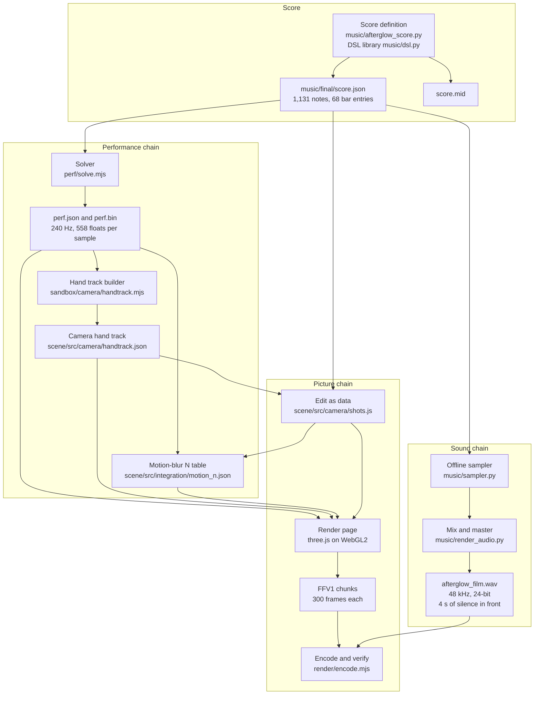

# Afterglow: a film as a function of a score, a time, and a camera

Afterglow is an offline film. Offline means that every frame is pre-rendered by a program, frame by frame. No frame
is captured live, and no frame is generated in real time. A pianist in a suit plays a concert grand piano that stands
in a shallow mountain lake at sunset.

The film is 230.95 seconds long, which is 3 minutes and 50.95 seconds. This document rounds that value to 3 minutes
and 51 seconds. The frame grid is the set of integer frame numbers `f = 0` through `13,856` at 60 frames per second
(fps). Film time is `t = f / 60`. The grid relation gives `13,857 / 60 = 230.95` seconds. The last frame is
`13,856 / 60 = 230.9333` seconds. Its frame interval ends at `230.95` seconds. The picture is 1920 by 1080 pixels.

The film has 26 shots in edit order. The identifiers run from S01 to S25, which is 25 identifiers. S07 and S12 are
unused, so 23 identifiers remain. The lettered shots S16b, S20b and S20c add 3 more. The sum is `25 - 2 + 3 = 26`.
Each lettered shot is a separate shot. It has its own camera set-up and its own frame range (`docs/SHOTLIST.md:59-84`).

## Vocabulary

These terms are used throughout the six documents.

- **Page**: the browser page that holds the three.js scene. It is not a web site and it has no user interface. A Node.js
  driver controls it.
- **Camera edit**: the shot data in `scene/src/camera/shots.js`. The edit gives the shot, the lens, the camera motion,
  the focus and the sun elevation at each time. The renderer reads the edit. The edit does not read the pixels.
- **Solver**: the performance solver in `perf/solve.mjs`. It turns the score into body, hand, key, hammer and damper
  motion.
- **Performance tracks**: the per-sample arrays in `perf.json` and `perf.bin`. The sample rate is 240 hertz (Hz). The
  tracks hold the solved motion of the pianist and the piano.
- **Sub-frame**: one sample of the shutter interval. One output frame is the unweighted arithmetic mean of N sub-frames.
- **N**: an integer for each shot. N is the number of sub-frames that are averaged to make one output frame. N varies
  by shot and by frame.
- **Onset**: the time at which a note starts to sound.
- **Fingering**: the choice of hand and finger for each note.
- **Palm pose**: the wrist position and orientation of one hand.
- **Pin**: the frozen commit `ced1038`. A pin is a fixed point in the source history, so a reader sees the same files.

## The thesis

The exploration has one thesis. **A film is a function of a score, a time, and a camera.** The score supplies the
notes and the musical time. The camera edit supplies the shot, the lens, the motion and the focus at each time. The
renderer evaluates that function at every sub-frame, and the driver writes the result to a lossless file.

A concrete example is output frame 2,280. Its film time is `2,280 / 60 = 38.0` seconds. Its music time is
`38.0 - 4.0 = 34.0` seconds. The camera edit gives the shot, the lens, the motion and the focus at 38.0 seconds. The
page reads the performance tracks at 34.0 seconds of music time. It renders N sub-frames inside the shutter interval
and averages them. The result is one frame of the film.

This design is the reason the film can be rebuilt, resumed, hashed and checked. The page never reads the score for
pixels. The camera edit reads the score for cut anchors. The solver turns the score into performance tracks, and the
page evaluates those tracks and the camera edit. The page keeps limited scene history. The piano module is the named
one-frame case. It keeps a small state from the frame before, so its pixels depend on that frame. Some water, sky and
material state lives longer. The driver pre-rolls frames to cover that history (`docs/INTEGRATION.md:154-168`).

The thesis holds at the pin. The released performance and the solver version are fixed constants of the shipped film.
A fresh solve changes the solver input, so it gives a different performance, not the film.

The first constants are the contract between sound and picture. `FPS` holds the frame rate. `MUSIC_OFFSET` holds the
film offset, which is the delay from film time to music time.

```text
# scene/src/core/constants.js:4-8
export const FPS = 60;                 // film time t = frame / FPS, exactly
export const MUSIC_OFFSET = 4.0;       // music time m = t - MUSIC_OFFSET (the film opens on the vista)
export const SENSOR_W_MM = 36;         // full-frame sensor width; focal lengths in mm refer to it
export const BASE_RIG_YAW_DEG = 120;   // rig.rotation.y: the pianist faces azimuth A = +60 deg (sun at his left-front)
export const DEFAULT_SHUTTER = 0.5;    // fraction of the frame interval: 180 deg = 1/120 s, centred on t
```

Film time is `t = frame / 60`. Music time is `m = t - 4.0`. The film offset is `MUSIC_OFFSET = 4.0` seconds. The film
opens on four seconds of vista before the first note. The source does not state why the lead-in is 4.0 seconds. It
states the constant and the effect.

Azimuth is measured clockwise from above. Azimuth zero points at the sun. In the rig rest pose the pianist faces
`+z`, and the source records that direction as azimuth 180 degrees. The base yaw turns the rig by 120 degrees, so the
pianist faces azimuth `180 - 120 = 60` degrees (`docs/DESIGN.md:69-71`). The source gives the two ends of that turn,
not a formula. The relation is linear: azimuth is 180 degrees minus the rig yaw. A yaw cheat is an extra rig yaw in
the same convention. A cheat of `c` degrees changes the rig yaw from 120 to `120 + c`. The pianist then faces
`180 - (120 + c) = 60 - c` degrees (`scene/src/camera/shots.js:13`). A positive cheat therefore turns the pianist
toward negative azimuth.

The shutter is 180 degrees. `DEFAULT_SHUTTER = 0.5` is the same fact in different units: 0.5 of the frame interval is
half of 1/60 second, which is 1/120 second. The interval is centred on film time `t`. A sub-frame sample is
`s.t` in [0, 1], and its time is `t + (s.t - 0.5) * shutter / FPS`.

## The sub-frame average

One output frame is the unweighted arithmetic mean of N sub-frames. N is an integer for each shot. It varies by shot,
and a selected frame can raise it. Each sub-frame has its own time inside the shutter, its own pixel jitter, and its
own point on a nine-blade aperture. Each sub-frame adds its result with the weight `1/N`.

```text
# scene/src/main.js:391-407
      // 3. sub-frames
      accum.clear();
      const N = st.N;
      const samples = RNG.subframeSamples(N, { blades: centreLens.blades ?? st.blades, bladeRotation: st.bladeRotation, aaFilter: st.aaFilter, aaSigma: st.aaSigma });
      const pre = accum.setupPreblur(camera, centreLens, N, { preblur: st.preblur, nearestDist: st.nearestDist, maxPreblurPx: st.maxPreblurPx, preblurKernel: st.preblurKernel });
      let lens = centreLens;
      for (const s of samples) {
        const tk = t + (s.t - 0.5) * st.shutter / FPS;
        // camera state is a pure function of t: pose it first (no aperture offset yet) so modules can read it
        lens = applyCameraState(S.director.stateAt(tk, shot, override), S.aspect);
        const sub = makeSub(s.k, N, tk, s, lens, frame);
        ctx.subframe = sub;
        for (const mod of S.modules) mod.inst.update?.(tk, sub);
        accum.applyLensAndJitter(camera, s, lens);   // thin-lens eye offset + focal-plane shear + pixel jitter
        for (const fn of S.hooks.pre) fn(sub);
        accum.renderSub(scene, camera, s.k, N);      // render() updates world matrices itself
      }
```

The table gives the roles of the identifiers in the block.

| Identifier | Role |
|---|---|
| `st` | The resolved state for the frame: N, shutter, lens and preblur values. |
| `accum` | The accumulation renderer. It holds the preblur and the RGBA32F sums. |
| `centreLens` | The lens at the centre of the shutter, before an aperture offset. |
| `applyCameraState` | Applies a camera state to the three.js camera. |
| `makeSub` | Builds the sub-frame record: index, N, time, sample, lens and frame. |
| `S.director` | The camera director, which returns the camera state at a time. |
| `S.modules` | The scene modules that can update their state at each sub-frame. |
| `S.hooks.pre` | Driver-provided callbacks that run before a sub-frame render. |

The term "full N" means N at each shot's own level through the film, with the motion boost and with no release
halving. The film was planned at several N policies. Under the full-N plan, N is 32 in most shots, 48 in three shots,
and up to 128 on 132 frames where a fast hand would otherwise show separate copies. Copy spacing is the distance in
pixels between those copies across the shutter. The 132 boosted frames are the frames where that spacing would exceed
one pixel. They are spread across the film. They are not frame numbers 0 to 131.

The release render halves N after film time 1:50, except for frames 6,900 to 7,199. Film time 1:50 is
`110 * 60 = 6,600`, so the halving starts at frame 6,600. The exception starts at `115 * 60 = 6,900` and ends at
frame 7,199. The halved values are 16 from 32, and 24 from 48 in the water shots. The water shots are S10, S11 and
S16, the three shots that keep 48 before the halving. S16b is a separate shot. The freeze lowered its N from 64 to
32. S16 keeps 48. The release uses 360,368 sub-frames in total. The full-N plan uses 473,760 sub-frames. The plan
history is in [`04-limits-and-comparison.md`](04-limits-and-comparison.md).

The driver never lets the page run its own loop. Node.js asks for a frame. The page renders it and sends the pixels
back. `RNG` in the block above is the random module, `scene/src/core/rng.js`.

## Pre-roll and determinism

The pre-roll is a small detail with a large effect. It makes a frame rendered at a chunk start equal a frame rendered
in a continuous pass. Without it, the piano keeps a little state from the frame before, and the pixels differ. That
state is the scene memory: a value that a module carries from one frame to the next. The piano module is the named
source of that state. The code comment cites shot S20 as a case with longer memory.

```text
# render/render.mjs:81-89
// PRE-ROLL (integration 2026-10-22): the integrated scene is history-dependent by one frame (a frame's pixels depend on
// the frame rendered just before it; sandbox/integration/MODULE_ISSUES.md I-11). A chunk that starts a session (or a
// retry) would otherwise follow the warm-up frame instead of its film predecessor and differ from a continuous render.
// So the frame before the chunk is rendered first, with the chunk's own settings, and discarded. With one-frame memory
// this makes chunked, resumed and continuous renders identical. Some shots showed a longer memory (S20 after a 1-frame
// pre-roll still depended on what came before), so the default pre-roll is 3 frames (1 % of a 300-frame chunk).
// --preroll K sets it, --no-preroll (or --preroll 0) turns it off.
let S = null, lastRendered = null;
const preroll = a['no-preroll'] ? 0 : Math.max(0, Math.round(+(a.preroll ?? 3)));
```

The default pre-roll is 3 frames, which is 1 percent of a chunk: 3 of 300 frames. The render driver defaults to three
pre-roll frames. The determinism checker has a different default. In
`render/determinism.mjs`, `prerollK = 0` when no pre-roll option is given. `--preroll` with no value gives K = 1.
`--preroll 3` matches the render default of 3.

```text
# render/determinism.mjs:26-27
const prerollK = a.preroll === true ? 1 : Math.max(0, Math.round(+(a.preroll || 0)));   // --preroll [K]
const usedN = {};
```

`docs/INTEGRATION.md:154-168` records the test result. Without pre-roll the check fails. With `--preroll 3` all three
test frames are bit-identical in sessions A, B and C. The chunked film render therefore reproduces. The piano module
is still not a pure function of time.

## The two chains

The score feeds two chains. The first is the sound chain. The second is the performance chain, and it makes motion
and pixels. The two chains meet only at encode time, where the soundtrack is placed at the film offset and checked
against the picture. The score uses a domain-specific language (DSL). The sampler holds the signal chain and writes
the music-time Waveform Audio File Format (WAV). The audio driver writes the film-aligned WAV. The renderer writes
FFmpeg Video Codec 1 (FFV1) chunks.



The score has 68 bar entries. A bar entry gives the bar number, its start time and its beat count. Bar 68 has no
notes, so 67 bars are played.

The sound chain is short. The performance chain is the long one. A score onset becomes a fingering, a palm pose,
finger inverse kinematics (IK), arm IK, body motion, key motion, hammer motion and damper motion. These are stages in
order: each stage consumes the result of the stage before. Separately, the solver groups note onsets and reads pedal
travel and body pitch rate; those values make the water-ripple events. Pedal travel is the pedal position change, on
a scale from 0 to 1. Body pitch rate is the body tilt rate, in radians per second. The solver writes the result as
per-sample tracks. The page reads the tracks, samples them at the frame and sub-frame times, and poses the pianist
and the piano.

## The six documents

| Document | Question it answers | Size |
|---|---|---|
| `README.md` | What is this film, what is the thesis, and where do I start? | Index, 5 snippets, 1 diagram |
| [`00-overview.md`](00-overview.md) | What is the film, what ships, what are the two chains, and what do the numbers mean? | 3,000 to 5,000 words, 10 or more snippets |
| [`01-architecture.md`](01-architecture.md) | Which layers exist, which module owns which state, and what are the data contracts? | 3,000 to 5,000 words, 10 or more snippets |
| [`02-core-mechanism.md`](02-core-mechanism.md) | How does one frame become an FFV1 chunk, and how does one score become both sound and motion? | 3,000 to 5,000 words, 10 or more snippets |
| [`03-workflow-and-quality.md`](03-workflow-and-quality.md) | How do I rebuild from the pin, and which gate stops a bad result? | 3,000 to 5,000 words, 10 or more snippets |
| [`04-limits-and-comparison.md`](04-limits-and-comparison.md) | What are the limits, what did the render budget cut, and how does this approach compare? | 3,000 to 5,000 words, 10 or more snippets |

Each deep dive has at least two Mermaid diagrams, at least one `**Aha:**` insight, and a cross-reference to the
other documents. Every source block names its source path and line range. The lines after that header match the
source byte for byte.

## Reading order

Read in this order:

1. `README.md` for the thesis, the map, and the vocabulary.
2. [`00-overview.md`](00-overview.md) for the film, the score, the performance, the scene, and the numbers.
3. [`01-architecture.md`](01-architecture.md) for the six layers and the data contracts.
4. [`02-core-mechanism.md`](02-core-mechanism.md) for one output frame end to end, and for the score-to-sound and
   score-to-motion split.
5. [`03-workflow-and-quality.md`](03-workflow-and-quality.md) for a clean rebuild and every gate.
6. [`04-limits-and-comparison.md`](04-limits-and-comparison.md) for the limits, the budget cuts, the licence
   boundary, and the comparison with other methods.

A reader who wants only the mechanism can read `00-overview.md`, then `02-core-mechanism.md`, then
`04-limits-and-comparison.md`. A reader who wants to rebuild the film should read `03-workflow-and-quality.md` after
`01-architecture.md`.

## The source and the pin

The source is a Git checkout at `/Users/darkvoid/GitSources/src.aidesign/src.leonnix/afterglow`. The pin is
`ced1038`. The checkout holds 351 tracked files, counted with `git ls-files` at the pin. The package version is
`0.1.0`. The release tag is `v1.0`. A release tag is not a package version: the tag names a published set of
release assets, and the package version is the version field in `package.json`. The source does not state which
commit the v1.0 release was built from, so the release assets are not proven to match `ced1038`.

The runtime is Node.js 22 or later. The renderer is three.js 0.186.1 on WebGL2. The browser driver is
puppeteer-core 25.15.0. The project ran on Windows 11 with headless Chrome on a Radeon 780M integrated graphics
processing unit (GPU).

The repository does not hold the film, the soundtrack, the samples, the performance tracks or the reference
images. The `build/` directory is excluded. The pianist binary glTF (GLB) and the Detmold impulse response are Git
Large File Storage (LFS) files. The released performance tracks are a release download.

The performance record has two values for the right foot. The final sync record gives a correlation of `-0.9995` and
9.5 millimetres (mm) of travel. An older probe gives `-1.000` and 12.1 mm. This exploration uses the final value and
names the older value when the source cites it.

## Licence boundary

The repository licence is split. The source code, the documentation and the data that the code generates are under
the MIT licence, except the performance tracks and the other listed parts. The main excluded classes are the musical
composition and every file that encodes its notes, the performance tracks, the film, the audio renders and the
stills. [`04-limits-and-comparison.md`](04-limits-and-comparison.md) section 7 gives the full list.

```text
# LICENSE:1-9
Afterglow: licence scope

The MIT licence below covers the source code of this repository (code, scripts, documentation and the data files
the code generates and reads), except the parts listed here.

NOT covered by the MIT licence: (c) 2026 Leonxlnx, all rights reserved. A listed file is excluded as a whole,
including any code in it. These parts are visible here for study: you may read them and rebuild the film and the
soundtrack locally for your own study, but no other right is granted (no copying, publishing, performing,
recording or arranging of the music, and no redistribution of the film, the audio or the stills).
```

The `license` field in `package.json` says `MIT`. That field is narrower than the repository licence. A reader must
not treat the whole repository as MIT. [`04-limits-and-comparison.md`](04-limits-and-comparison.md) gives the full
boundary.

## Non-claims

This exploration is a static reading of the source at `ced1038`. It makes these non-claims.

- No frame was rendered. No audio was sampled. No performance was solved. No Blender build was run. No browser,
  server or encoder was started.
- No runtime claim is verified. The render times, the sub-frame counts, the file sizes, the loudness values and the
  quality numbers come from the project documents. They were not measured again.
- The visual quality and the audio quality were not judged. The project states its own limits.
  [`04-limits-and-comparison.md`](04-limits-and-comparison.md) records them.
- The released film, the soundtrack, the samples and the reference images are not in the checkout. Their content is
  not inspected.
- The project README states that the build used a multiple-agent coding workflow. This exploration records that
  statement. It does not verify the process.
- A value that the source does not define is recorded as not defined. The exploration does not guess.
