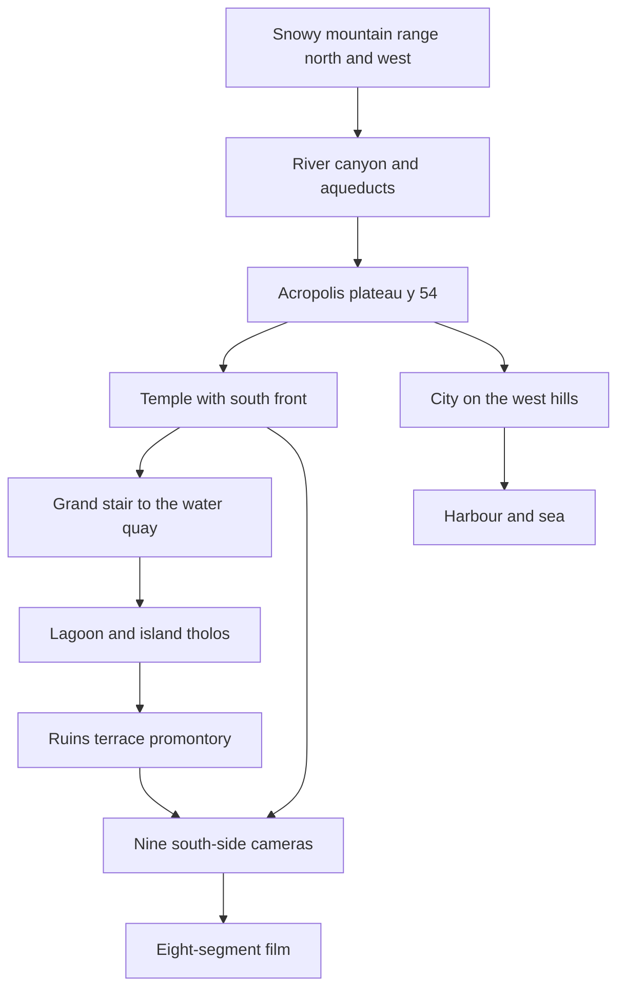
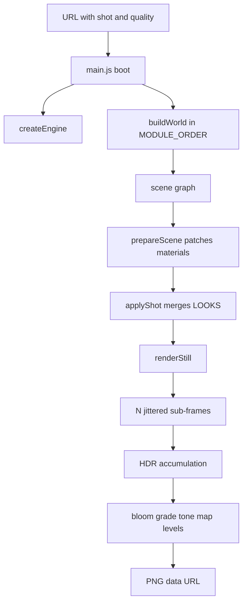

# Overview: the problem, the place and the parts

athenaion is a procedural ancient Greek world. It has no image, model or audio assets. Every mesh, material, tree, statue and waterfall comes from code. The project states that an artificial intelligence (AI) coding agent built the world over about two days, with 55 subagents. This document explains the problem, the place, the parts and one still render. It records what the source defines. It does not claim that a pixel was drawn.

## The problem

A hand-modelled ancient world needs an asset pipeline. Artists make meshes, textures and material graphs. The scene then needs a level editor, a lighting plan and a camera rig. The result can be excellent. The result also depends on many binary files and many hands.

A shader-only world takes the opposite path. It draws terrain and sky from noise and functions. The images can look rich. The images can also lack structure. A temple needs a plan, a column order, a stair and a relationship to the ground. Noise alone does not give a temple a front, a stylobate or a sight line.

athenaion chooses a third path. Code is the asset. The plan is the single source of truth. Every feature reads its position and size from one file. The ground is one analytic function. The same function shapes the terrain mesh, places the buildings, finds the waterfall lips and rejects vegetation. A change to the plan moves the terrain, the buildings and the cameras together.

This choice has a cost. The world exists only while the code runs. The project cannot ship a scene file that another engine can open. The world is rebuilt at every load. The build takes time. The code compensates with seeds, caches and a fixed module order.

## The place

The plan uses metres, a +Y up axis and sea level at y = 0. The compass convention is -Z north, +X east, +Z south and -X west. The temple faces south. Almost every camera stands south or south-east of the temple. The exception is the aerial view, which looks down into the west canyon from above.

The acropolis is a limestone massif. Its plateau top is at y = 54. The temple stands on a podium above the plateau. The plan comment gives 12 metres, but the same comment's stylobate and plateau values give 13.5 metres. The composition document gives 13 metres. The source does not reconcile the three values.

```text
# src/world/layout.js:37-39
export const ACROPOLIS = {
  center: [32, -72],
  top: 54,                       // plateau height; the temple stands on a 12 m podium wall above it (stylobate ≈ 67.5, refs 1, 3, 5, 9)
```

The main temple is an octastyle peripteral Doric building. It has eight columns across the front and seventeen along the side. The stylobate is 70 metres along the axis and 31 metres across the front. The columns are 10.4 metres high. The front faces south at compass heading 180.

```text
# src/world/layout.js:70-81
// ---------------------------------------------------------------- main temple (Athenaion)
// Octastyle peripteral Doric temple, Parthenon proportions. FRONT faces SOUTH (heading 180),
// toward the grand stair, the lagoon gorge and the camera viewpoints.
export const TEMPLE = {
  center: [20, 66, -64],
  heading: 180,           // compass heading the front faces
  rotY: Math.PI / 2,      // legacy: temple module uses headingToRotY(270) + rotY  (= heading 180)
  stylobate: [70, 31],    // length (along the axis) x width (front)
  columns: [8, 17],       // front x side
  columnHeight: 10.4,
  order: 'doric',
};
```

The grand stair runs down the south face. It starts at the plateau rim at z = -10 and ends at a water quay at z = 104. The top is at y = 54. The bottom is at y = 2. The plan gives a nominal 16 metre width. Only the vegetation scatter reads it, for exclusion. The stair planner uses the width list of 12, 14, 16, 18 and 21 metres, and the flights widen downward. The built profile is not a simple ramp. The acropolis module plans landings at every terrace level and splits long flights with half-landings.

```text
# src/world/layout.js:99-110
// ---------------------------------------------------------------- grand staircase on the south face
export const GRAND_STAIR = {
  x: 24,                // axis x (just east of the temple axis x=20: refs 2, 3, 4, 9 put the stair under the front centre/right)
  zTop: -10, yTop: 54,  // top landing (forecourt bastion) at the plateau rim, 14 m deep in front of the temple
  zBottom: 104, yBottom: 2,
  width: 16,
  // (acropolis module) the actual profile is computed from the terrain: landings at every terrace
  // level, long flights split by half-landings, ending on a water quay. The built plan is published
  // as engine.registry.acropolis.stair ({ segs: [{kind, z0, z1, y0, y1, w}] }) and .surface(z).
  riser: 0.23, tread: 0.33, landing: 7, midLanding: 2.8, flightRise: 8.5, // (acropolis r2) bigger steps, same slope (ref 6) // max rise per flight before a half-landing
  widths: [12, 14, 16, 18, 21],   // flight widths from the top flight down
};
```

Water surrounds the south face. The lagoon is an ellipse with centre [-40, 128] and radii [178, 104]. Its floor is at -8. A round tholos stands on a rock island at [-14, 128]. The island top is at 6.5 metres. A river comes from the north-west through a canyon. A channel carries the lagoon water south-west to the sea. A harbour sits on the south-west coast.

```text
# src/world/layout.js:112-116
// ---------------------------------------------------------------- water bodies
// Lagoon gorge along the foot of the south face, between the acropolis and the ruins promontory;
// it opens to the south-west (outflow to the sea) and receives the river from the canyon (west).
export const LAGOON = { center: [-40, 128], radii: [178, 104], floor: -8, basin: [-100, 72, 92, 84] };
export const ISLAND = { center: [-14, 128], radius: 17, top: 6.5 }; // round tholos on a rock island (bridge to the stair foot)
```

Other places complete the view. A hill temple stands on a crag at [-424, -284], with its top at 118 metres. A ruins terrace is a promontory at [170, 165], with a top at 52 metres. A city covers the west hills down to the harbour. Four aqueducts and bridges cross the canyon and the river mouth. A snowy mountain range fills the north and west background.

```text
# src/world/layout.js:184-187
// ---------------------------------------------------------------- other sites
// Hill temple: a limestone crag with a temple on its summit and a big waterfall below it, seen
// behind-left of the acropolis from every south viewpoint (bearing ~300-318° from the cameras).
export const HILL_TEMPLE = { center: [-424, -284], top: 118, notch: 128, facing: 128 }; // notch/facing: compass deg toward the viewpoints
```



## The nine shots

Nine fixed cameras frame the world. Each camera has a position, a target and a vertical field of view (FOV). The FOV is in degrees. Shots 8 and 9 have a near plane. Only shot 8 has a `dof` object, and its aperture is zero, so the depth-of-field blur is disabled. The cameras were first solved against the reference temple corners, then tuned by eye.

```text
# src/world/shots.js:1-14
// Camera shots matching the 9 reference images (refs/refN.png, 1672x941).
// fov = vertical field of view in degrees. Framing only: lighting/grading per shot lives in src/world/looks.js.
// dof = {focus: metres, aperture: metres (lens diameter)} — accumulated thin-lens depth of field.
// OWNER: director. Composition notes per shot: docs/COMPOSITION.md. Cameras were first solved against
// the reference temple corners (pinhole fit, temple front 31 m / columns 10.4 m), then tuned visually.
export const SHOTS = [
  {
    id: 1, name: 'Panorama from the high rocks',
    pos: [108, 66, 30], target: [15.1, 61.5, -6.7], fov: 40, // r4: 106 m from the temple front (was 123 m, fov 46): temple + colossus A large in the right third, city/port left
  },
  {
    id: 2, name: 'Lagoon and the island tholos',
    pos: [-19, 7, 227], target: [-13.6, 14.8, 127.4], fov: 28.5,
  },
```

| Shot | Name | Camera position | Target | FOV | What it shows |
|---:|---|---|---|---:|---|
| 1 | Panorama from the high rocks | [108, 66, 30] | [15.1, 61.5, -6.7] | 40 | Temple and colossus A on the right, city and harbour to the left |
| 2 | Lagoon and the island tholos | [-19, 7, 227] | [-13.6, 14.8, 127.4] | 28.5 | Lagoon water, island, round tholos, stair foot |
| 3 | From the ruined terrace | [122, 59, 154] | [60, 50.7, 76.3] | 35.6 | Olive foreground, ruins, temple across the gorge |
| 4 | Aerial over the canyon | [-20, 160, 230] | [-39.7, 101.9, 151] | 43 | Canyon, three crossings, west-face falls, stair, temple, island, colossus B |
| 5 | Temple facade, low angle | [75, 62, 66] | [32.73, 74.2, -24.23] | 18.5 | Doric front, pediment sculpture, colossus A, banners |
| 6 | Grand staircase | [24, 26.8, 50] | [-11.3, 60.2, -37.4] | 42 | Flights, landings, pedestals, propylon, temple above |
| 7 | River level, waterfalls and aqueduct | [70, 4, 125] | [27.1, 24.8, 37.1] | 40 | Rapids, falls, aqueduct arches, wet rocks |
| 8 | Fallen head | [134.4, 54, 145] | [83.2, 47.4, 59.5] | 34.7 | Giant marble head, ivy, ruins, depth-of-field setting present but disabled |
| 9 | Through the ruined portico | [151.56, 57.8, 139.41] | [83.16, 60, 66.41] | 36.5 | Broken columns, entablature, temple through the frame |

The camera distances are not the same. The composition document gives camera-to-temple distances of 210 to 240 metres for shots 3, 8 and 9. It gives about 100 to 110 metres for shots 1 and 6. It gives about 260 metres for shot 2. These are not camera-to-target distances. The shot 2 target is about 100 metres from its camera. A reader must not assume one camera rig for all shots.

## The parts

The build runs fifteen modules in a fixed order. The order is not alphabetical. The order follows dependencies. Terrain and water come first, because later modules need the ground and the water level. Architecture comes next, because it reserves space. Scatter and vegetation come late, because they must avoid that space.

Four shared channels connect the modules. The footprint grid records occupied ground. The slot lists hold anchor points for props. The registry holds data that one module publishes and another reads. A shot hook is a function that runs after each shot is applied.

```text
# src/world/index.js:4-20
export const MODULE_ORDER = [
  'terrain',      // ground mesh, cliffs, far mountains
  'water',        // sea, lagoon, river surfaces
  'temple',       // main Athenaion + other classical buildings at layout anchors
  'acropolis',    // terraces, retaining walls, grand stair, plazas, mosaics, balustrades
  'aqueducts',    // aqueducts & bridges
  'sets',         // shot-specific foreground sets (terraces, balustrades, props) — push slots for statues/banners
  'statues',      // colossi + statues on pedestals + pediment sculpture placement
  'city',         // town houses, harbour, boats
  'ruins',        // ruined portico, fallen columns, giant head (foreground sets)
  'banners',      // banners with owl emblem, braziers & fire, urns
  'vegetation',   // cypress, olive, pines, broadleaf trees, shrub masses
  'flora',        // ivy, grass, flowers, moss, hero foreground branches & rocks
  'waterfalls',   // waterfalls, foam, spray & mist
  'clouds',       // mountain clouds, valley mist banks
  'birds',        // seagulls
];
```

The fifteen modules do not hold all the code. Reusable generators live in their own folders. The architecture kit supplies orders, columns, entablature, temples, tholoi, stoas, propyla, pedestals, balustrades and ruins. The sculpture kit supplies signed distance functions (SDFs), a surface-nets mesher and a statue library. The terrain kit supplies the heightfield mesh, level of detail (LOD) chunks, a worker pool and the far-field bake. The water kit supplies height capture, fall tracing, sheets, strands, mist, foam, rapids and reflections. The materials folder supplies procedural marble, stone, metal and cloth.

The module files are the assembly layer. They read the plan, call the kits, place the results and publish data for other modules. This separation keeps the generators testable and keeps the world assembly readable.

## One still render from start to finish

The browser opens a page with a query string. A typical still Uniform Resource Locator (URL) is `index.html?shot=3&quality=preview&mode=still&w=1672&h=941`. The page loads `/src/main.js` as a module. The main script reads the query, selects the quality preset and creates the engine.

The engine owns the scene, the camera, the Web Graphics Library (WebGL) 2 renderer, the sky, the lighting and the render pipeline. It also owns the footprint grid, the slot lists, the registry and the quality settings. It does not build the world. The world build is a separate module.

`buildWorld` imports each module in `MODULE_ORDER`. It calls `await mod.build(engine)`. A failed import is logged and skipped. A build that throws is caught and logged. The next module still runs. After each module, the build loop records the new scene children under `engine.moduleRoots[name]`. That record lets the profiler hide one module at a time.

`prepareScene` then walks the scene. It patches every material with atmosphere and cascaded shadow code. It refreshes the shadow cascades and builds the environment map. The world is now ready for a shot.

`applyShot` sets the camera position, target, FOV and near plane. It merges the per-shot look under any explicit override. It sets the sun direction and colour. It applies grade, atmosphere and sky uniforms. It calls the shot hooks.

`renderStill` loops over the sample count. For each sample, `renderSample` applies a small camera jitter. It also applies depth-of-field aperture jitter when the shot defines it. It updates the lighting with a soft-shadow jitter. It calls `pipeline.addSample`. It then waits on a fence, so the graphics processing unit (GPU) queue stays short.

```text
# src/core/engine.js:240-264
  async renderStill(spp = this.quality.spp) {
    const t0 = performance.now();
    this.ensurePatched();
    this.pipeline.begin();
    const gl = this.renderer.getContext();
    for (let i = 0; i < spp; i++) {
      this.renderSample(i, { jitter: spp > 1 });
      // keep the GPU queue short (avoids driver timeouts on long renders): wait on a fence
      const sync = gl.fenceSync(gl.SYNC_GPU_COMMANDS_COMPLETE, 0);
      gl.flush();
      if (sync) {
        for (let k = 0; k < 20000 && gl.clientWaitSync(sync, 0, 0) === gl.TIMEOUT_EXPIRED; k++) await new Promise((r) => setTimeout(r, 2));
        gl.deleteSync(sync);
      } else await new Promise((r) => setTimeout(r, 0));
    }
    this.pipeline.resolve(null, 0);
    const info = this.renderer.info;
    this.stats = {
      spp, renderMs: Math.round(performance.now() - t0),
      calls: this.pipeline.sceneInfo?.calls, triangles: this.pipeline.sceneInfo?.triangles,
      geometries: info.memory.geometries, textures: info.memory.textures, programs: info.programs?.length,
    };
    window.__STATS = { ...(window.__STATS || {}), ...this.stats };
    return this.canvas.toDataURL('image/png');
  }
```

`addSample` renders the scene into a half-float high dynamic range (HDR) target. It then blends that target into an accumulation buffer with weight `1 / (count + 1)`. The weight gives every sub-frame the same influence.

```text
# src/core/pipeline.js:440-458
  /** render one sub-frame of the scene and fold it into the running average */
  addSample(scene, camera) {
    const r = this.renderer;
    r.setRenderTarget(this.sceneRT);
    r.clear(true, true, false);
    r.info.autoReset = false;
    r.info.reset();
    r.render(scene, camera);
    this.sceneInfo = { calls: r.info.render.calls, triangles: r.info.render.triangles };
    const src = this.acc[this.accIndex], dst = this.acc[1 - this.accIndex];
    this.copyMat.uniforms.tNew.value = this.sceneRT.texture;
    this.copyMat.uniforms.tPrev.value = src.texture;
    this.copyMat.uniforms.uW.value = 1 / (this.count + 1);
    this.quad.material = this.copyMat;
    r.setRenderTarget(dst);
    this.quad.render(r);
    this.accIndex = 1 - this.accIndex;
    this.count++;
  }
```

`resolve` runs the rest of the image path. It builds a seven-level bloom chain with a 13-tap downsample and a tent upsample. It applies local tone mapping. It runs the optional lens effects and measures a 128 by 72 log-luminance grid for auto exposure. It applies the vignette and AgX tone mapping. It applies the perceptual grade, the hue secondaries and auto levels. It adds grain and dither. It writes the result to the canvas. `renderStill` returns a Portable Network Graphics (PNG) data URL.



The main script exposes the render functions that the tools call. `__renderShot` applies a shot by id and calls `renderStill`. `__renderShotObj` does the same for an object. `__SHOTS` exposes the shot list. The session tool uses these functions to render many camera variants without rebuilding the world.

```text
# src/main.js:40-51
  window.__renderShot = async (id) => {
    const s = shotById(id);
    if (!s) throw new Error('unknown shot ' + id);
    engine.applyShot(s);
    return await engine.renderStill(quality.spp);
  };
  // used by tools/session.mjs (persistent render session for camera direction / look-dev)
  window.__SHOTS = SHOTS;
  window.__renderShotObj = async (s, spp) => {
    engine.applyShot(s);
    return await engine.renderStill(spp ?? quality.spp);
  };
```

## Quality presets

Three presets trade image quality against time and memory. The preview preset keeps the interactive view usable on an integrated graphics processing unit (GPU). The high preset is the normal offline setting. The ultra preset raises the sample count.

```text
# src/core/quality.js:3-24
export const QUALITY = {
  preview: {
    name: 'preview', spp: 1, msaa: 4,
    shadowMapSize: 2048, cascades: 3, shadowMaxFar: 1400, softShadows: false,
    terrainRes: 0.5,      // multiplier on terrain mesh resolution
    density: 0.45,        // vegetation / city / props instance density multiplier
    detail: 0.5,          // geometric detail multiplier (segments, sculpt resolution)
    cloudSteps: 16, bloom: true, ao: false,
  },
  high: {
    name: 'high', spp: 12, msaa: 4,
    shadowMapSize: 4096, cascades: 4, shadowMaxFar: 2400, softShadows: true,
    terrainRes: 1.0, density: 1.0, detail: 1.0,
    cloudSteps: 32, bloom: true, ao: true,
  },
  ultra: {
    name: 'ultra', spp: 48, msaa: 4,
    shadowMapSize: 4096, cascades: 4, shadowMaxFar: 3200, softShadows: true,
    terrainRes: 1.0, density: 1.0, detail: 1.0,
    cloudSteps: 64, bloom: true, ao: true,
  },
};
```

| Preset | Samples per pixel | Multisample | Shadow map | Cascades | Terrain resolution | Density | Detail | Cloud steps | Ambient occlusion |
|---|---:|---:|---:|---:|---:|---:|---:|---:|---|
| preview | 1 | 4 | 2048 | 3 | 0.5 | 0.45 | 0.5 | 16 | off |
| high | 12 | 4 | 4096 | 4 | 1.0 | 1.0 | 1.0 | 32 | on |
| ultra | 48 | 4 | 4096 | 4 | 1.0 | 1.0 | 1.0 | 64 | on |

The preset changes more than the sample count. It changes the terrain mesh resolution and the density of vegetation and props. It changes the geometric detail of sculptures. It changes the shadow distance and the cloud march steps. A preview build and a high build do not contain the same world. This is a central design choice. It lets one machine build a rough world quickly and a dense world slowly.

## What ships

The repository holds the code, the plan, the documents and the media. The media folder holds twelve files: nine shot images, one overview image, one comparison image and one teaser animation. The references folder holds nine PNG images. The generated folder holds one 23,809,636 byte far-terrain grid, `terrain-far-v11.bin`.

The repository has 220 tracked files. Of these, 168 are `.js` files. The repository holds 15 `.mjs` files: 11 in `tools` and 4 in `src`. The `.js` tree holds 43,797 lines. The module folder holds fifteen world modules. The tools folder holds eleven scripts. The docs folder holds four documents.

The film uses eight segments, not nine. The sequence header comment still says nine. The list holds eight entries. Shot 3 is absent. A comment records that shot 3 hung the GPU in the video path, so the cut dropped it. The film uses shots 1, 4, 2, 7, 6, 5, 8 and 9 in that order.

```text
# src/video/sequence.js:9-24
export const FPS = 30;
export const XFADE = 0.8;      // seconds of cross-dissolve between consecutive segments
export const SHUTTER = 0.5;    // 180° shutter: motion blur over half the frame interval

export const SEQUENCE = [
  { shot: 1, dur: 8.0, time: 10, move: { dolly: 6, pan: 1.6, crane: 1.0 }, ease: 'inout' },
  { shot: 4, dur: 7.0, time: 40, move: { dolly: 16, crane: -3, tilt: -0.5 }, ease: 'linear' }, // B's helmet sits at the top-left edge: no pan right
  { shot: 2, dur: 7.5, time: 70, move: { dolly: 3, crane: 0.3 }, ease: 'linear' }, // small: hero branches are anchored to the reference camera
  { shot: 7, dur: 7.0, time: 100, move: { dolly: 4.5, crane: 2.5, tilt: 0.8 }, ease: 'linear' },
  { shot: 6, dur: 7.5, time: 130, move: { dolly: 4, crane: 2.2, tilt: 0.6 }, ease: 'linear' },
  { shot: 5, dur: 7.5, time: 160, move: { dolly: 6, tilt: 1.2, zoom: -0.03 }, ease: 'linear' },
  // shot 3 dropped from the cut: from ~2.8 s into its move every frame hung the GPU in the video path
  // (it shares the ruins-terrace viewpoint with shots 8 and 9, which close the film)
  { shot: 8, dur: 7.0, time: 30, move: { truck: 0.9, pan: -0.6 }, ease: 'linear' },
  { shot: 9, dur: 8.4, time: 75, move: { dolly: 2.6, crane: 0.3 }, ease: 'out' },
];
```

The total film duration by the source formula is 54.3 seconds. The durations sum to 59.9 seconds. Seven cross-dissolves at 0.8 seconds remove 5.6 seconds. The project README rounds this to 54 seconds. This package uses the computed value.

## How the parts meet

The parts meet through the engine, not through direct imports. A producer pushes an anchor into `engine.slots`. A consumer reads that list later. A producer writes data into `engine.registry`. A consumer reads the registry by key. A producer registers a footprint. A scatter pass tests that footprint before it places a tree.

The waterfalls show the pattern. The water module traces every layout fall and publishes the water registry. The aqueducts module publishes spill points. The waterfalls module reads both sources, re-captures the ground with architecture included, and traces the final falls. The module does not import the aqueducts module. The registry is the only link.

```text
# src/modules/waterfalls.js:1-11
// WATERFALLS: every layout.WATERFALLS entry + every engine.registry.aqueductSpills entry.
//
// Each fall is traced against the real terrain (ballistic arc from the lip, draping over ledges,
// running across terraces to the next drop) as several parallel sub-streams; a sheet is stitched
// between them, thin detached strands are added in front, and spray / mist puffs are placed along
// the lower fall, at every hard landing and as a big churning cloud where it meets the water.
// Impacts on the lagoon/river are pushed into the water surface (foam rings, churn, trails).
//
// aqueductSpills (published by the aqueducts module, optional) — accepted shapes:
//   { pos|from|p: [x,y,z] | {x,y,z}, dir: compassDeg | dirVec|direction: [dx,dz] or [dx,dy,dz],
//     width|w: m, flow: 0..1, id }
```

**Aha:** The world is not stored. It is a recipe. The plan, the height function and the seed labels are the durable data. Every mesh is a temporary result of running that recipe. The one large binary in the repository, the far-terrain grid, is only a cache. The world still builds without it, because the terrain module falls back to an analytic mountain function.

## Verified counts

The reading verified these counts from the source tree. The repository has 220 tracked files. The repository has 168 `.js` files and 15 `.mjs` files, with 4 `.mjs` files in `src`. The module folder has fifteen files. The layout file lists 17 waterfalls. The film list has eight segments. The quality table has three presets. The shot list has nine cameras. The generated folder has one binary file. The media folder has twelve files. The references folder has nine images. The documentation folder has four files.
