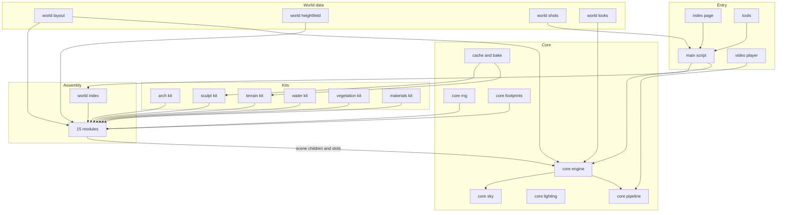
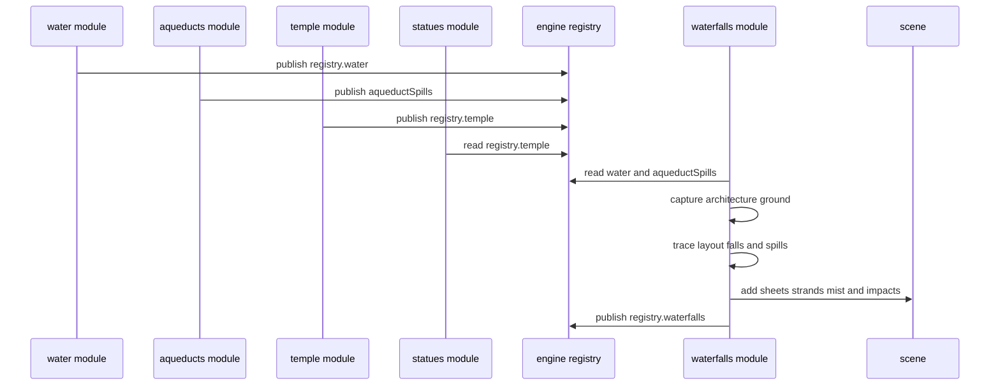

# Architecture: layers, contract and coordination

athenaion has a small runtime and a large set of generators. The runtime owns the scene, the renderer and the image pipeline. The generators build geometry from plans and seeds. Fifteen world modules assemble the generators into one scene. The modules do not import each other. They meet through the engine object, a set of slot lists, a free-form registry and a footprint grid.

This document maps the layers, the engine object, the module contract, the build order, the coordination channels, the kits, the cache and the determinism rules. It is a static reading. It does not claim that the project was run.

## The layer graph

The source divides into five layers. The data layer holds the master plan, the height function, the shot list and the per-shot look. The core layer holds the engine, the pipeline, the lighting, the sky, the random number generator and the footprint grid. The kit layer holds reusable generators for architecture, sculpture, terrain, water, vegetation and materials. The assembly layer holds the fifteen world modules and the build loop. The entry layer holds the page, the main script, the film player and the command-line tools.

The arrows follow the imports. The engine imports the plan for the default sun and the look file for per-shot values. The modules import the plan, the height function and the kits. The kits import core noise, core materials and the cache. The main script imports the engine and the shot list. The tools drive the page through a browser. They do not import the world.



The diagram shows the main paths, not every import. The graph shows one direction of dependency and one direction of runtime flow. The dependency arrows point from data and kits into the assembly. The runtime flow points from the assembly back into the engine, because each module calls `engine.add` and writes into the engine. This is not a circular import. It is a call-back through an object that the build loop passes to every module.

## The engine object

The engine constructor creates the scene, the camera and the Web Graphics Library (WebGL) 2 renderer. It also creates the footprint grid, the slot lists, the registry and the update list. It installs the atmosphere, the sky and the lighting. It creates the render pipeline. It sets the default sun from the master plan.

```text
# src/core/engine.js:19-33
export class Engine {
  constructor({ width, height, quality, params }) {
    this.width = width; this.height = height;
    this.quality = quality;
    this.params = params;
    this.time = 0;
    this.updates = [];
    this.footprints = new Footprints();
    // Slots: producers (architecture) push anchor points during build, consumers (banners, statues,
    // vegetation, braziers…) read them later. Slot = { pos:[x,y,z], facing: compass deg, size, tag, ... }
    this.slots = { banner: [], brazier: [], statue: [], ivy: [], urn: [], planter: [], lamp: [] };
    // Shared registry for cross-module data (e.g. registry.templeFrames for pediment sculpture)
    this.registry = {};
    this.envIntensity = 1.0;
    this.stats = {};
```

The renderer uses WebGL 2 through three.js. It disables antialiasing on the canvas, because the pipeline does its own accumulation. It preserves the drawing buffer, because the still path reads image data from the canvas as a Uniform Resource Locator (URL) in Portable Network Graphics (PNG) form. It turns off tone mapping, because the pipeline applies its own tone map. It enables shadow maps and disables automatic clear.

The camera starts with a 40 degree vertical field of view (FOV), a 0.5 metre near plane and a 60,000 metre far plane. The engine adds the camera to the scene. It creates a sky and adds the cloud step count from the quality preset.

The engine exposes a small application programming interface (API). The important members for a module are `scene`, `camera`, `renderer`, `quality`, `footprints`, `slots`, `registry`, `rng(label)`, `onUpdate(fn)`, `add(obj)`, `onShot(fn)` and `setTime(t)`. The render tools use `prepareScene`, `applyShot`, `renderStill`, `renderSample` and `stats`.

```text
# src/core/engine.js:78-90
  rng(label) { return new RNG(String(label)); }
  onUpdate(fn) { this.updates.push(fn); }

  add(obj, { castShadow = true, receiveShadow = true } = {}) {
    obj.traverse((o) => {
      if (o.isMesh || o.isInstancedMesh || o.isBatchedMesh) {
        if (o.userData.castShadow === undefined) o.castShadow = castShadow;
        if (o.userData.receiveShadow === undefined) o.receiveShadow = receiveShadow;
      }
    });
    this.scene.add(obj);
    return obj;
  }
```

`add` sets shadow flags on every mesh under the object. A mesh can opt out by setting `userData.castShadow` or `userData.receiveShadow` before the call. The method returns the object, so a module can keep a reference.

`patchMaterial` marks a material with `userData.__cgPatched`, so a second call does nothing. It adds the atmosphere uniforms to `onBeforeCompile`. For a lit material it sets the cascaded shadow maps (CSM) defines `USE_CSM` and `CSM_CASCADES`. It wraps the previous `onBeforeCompile` hook and calls it inside the new hook. `ensurePatched` walks the scene and patches materials that appeared after `prepareScene`, such as lazy meshes and level-of-detail swaps. `prepareScene` patches every material once, then refreshes the cascades and builds the environment map.

```text
# src/core/engine.js:129-149
  /** Patch every material in the scene (call after building, before rendering). */
  prepareScene() {
    this._prepared = true;
    const seen = new Set();
    this.scene.traverse((o) => {
      if (o.userData.noPatch) return;
      const mats = Array.isArray(o.material) ? o.material : o.material ? [o.material] : [];
      for (const m of mats) { if (!seen.has(m)) { seen.add(m); this.patchMaterial(m); } }
      if (o.customDepthMaterial) this.patchMaterial(o.customDepthMaterial);
    });
    this.lighting.refreshCSM();
    this.lighting.buildEnvironment();
  }

  setTime(t) {
    const dt = t - this.time;
    this.time = t;
    ATMO.uAtmoTime.value = t;
    SKY.uSkyTime.value = t;
    for (const fn of this.updates) fn(t, dt);
  }
```

`setTime` drives every animation from one clock. The time is a parameter, not a wall-clock reading. A still uses `shot.time` when a shot defines it. The nine shipped shots do not define a time, so the still uses the current engine time. That time is 0 at load. The film path calls it with a segment time plus a sub-frame offset. This is why the project can reproduce the same frame from the same code.

`applyShot` is the shot assembly point. It merges the per-shot look under explicit values on the shot object. It sets the camera and the sun. It restores the grade, atmosphere and sky defaults, then applies the shot overrides. It refreshes the shadows and the environment. It calls the shot hooks.

## The module contract

A world module lives in `src/modules/NAME.js`. It exports an asynchronous `build(engine)` function. It can also export a `test(engine)` function that builds an isolated scene near the origin. The export name is `test`. It may return `{ views: [{ pos, target, fov, sun? }] }`. When `views` is absent, `src/test/testScene.js` frames the added objects automatically. The contract requires a build function, not a class. It does not own a scene. It receives the engine and adds to the engine scene.

The engineering contract states the rule in two lines.

```text
# docs/CONTRACT.md:31-32
`src/world/index.js` runs modules in MODULE_ORDER; a throw is caught and logged (the rest still builds).
Put reusable generators in their own folder (`src/arch/`, `src/sculpt/`, `src/vegetation/`, ...).
```

The contract also lists the engine API that a module may use. The list is the practical boundary between the runtime and the world code.

```text
# docs/CONTRACT.md:34-40
Engine API (src/core/engine.js): `engine.scene`, `engine.camera`, `engine.renderer`,
`engine.quality` (preview/high/ultra: use `.density`, `.detail`, `.terrainRes` to scale work),
`engine.add(obj, {castShadow, receiveShadow})`, `engine.onUpdate((t, dt) => …)` for animation (time is
deterministic; never use Date/Math.random), `engine.rng(label)` seeded RNG, `engine.footprints`
(occupancy: addCircle/addRect/addPath/isFree), `engine.slots` (anchor points: banner, brazier,
statue, ivy, urn, planter, lamp — producers push `{pos:[x,y,z], facing:deg, size, tag}`, consumers read),
`engine.registry` (free-form shared data, e.g. `registry.temple`), `engine.onShot(fn(shot))`.
```

The module contract has three duties. The module must read positions from the plan. The module must scale its work with the quality preset. The module must add its objects through `engine.add`. A module can publish slots, registry data and footprints. It can register update and shot hooks. It must not depend on the order of its own imports for correctness.

## The build loop

`buildWorld` is the assembly loop. It reads two optional parameters, `skip` and `only`, from the query string. It then walks `MODULE_ORDER`. For each name, it imports `../modules/NAME.js` with a dynamic import. It checks that `build` is a function. It records the scene children before the build. It calls the build. It records the new children under `engine.moduleRoots[name]`.

```text
# src/world/index.js:22-46
export async function buildWorld(engine) {
  const skip = (engine.params.get('skip') || '').split(',').filter(Boolean);
  const only = (engine.params.get('only') || '').split(',').filter(Boolean);
  for (const name of MODULE_ORDER) {
    if (skip.includes(name) || (only.length && !only.includes(name))) continue;
    let mod;
    try {
      mod = await import(`../modules/${name}.js`);
    } catch (e) {
      if (String(e).includes('Failed to fetch') || String(e).includes('404')) { console.log(`[world] module ${name}: not present`); continue; }
      console.error(`[world] module ${name} failed to load:`, e.stack || e);
      continue;
    }
    if (typeof mod.build !== 'function') continue;
    const t0 = performance.now();
    const before = new Set(engine.scene.children);
    try {
      await mod.build(engine);
      (engine.moduleRoots ||= {})[name] = engine.scene.children.filter((c) => !before.has(c));
      console.log(`[world] ${name} built in ${Math.round(performance.now() - t0)} ms`);
    } catch (e) {
      console.error(`[world] module ${name} threw during build:`, e.stack || e);
    }
  }
}
```

The failure policy is local. A missing module is logged and skipped. A module that throws is logged and skipped. The loop continues. This policy keeps one broken feature from blanking the world. It also hides a broken feature unless the reader watches the console. The project uses the console log as part of the quality loop. The render tool prints page logs, so a build failure is visible in the command output.

The `moduleRoots` record has two uses. The profiler hides one module at a time and measures the time saved. The waterfall module uses the roots to capture a height map that includes only solid architecture. Both uses depend on the before-and-after set comparison.

## Why the order matters

`MODULE_ORDER` is a dependency graph written as a list. The order is not cosmetic. Several modules write data that later modules read.

Terrain and water come first. The terrain module builds the ground mesh and registers the far grid. The water module captures height maps, traces every layout waterfall and publishes the water registry. Later modules need the ground height and the water level.

Temple and acropolis come next. The temple publishes `registry.temple`. The acropolis builds its podium from `L.TEMPLE` through `buildPodium`. The acropolis publishes `registry.acropolis`, which includes the built stair plan and the wall runs. Later modules use the stair surface and the wall runs.

Aqueducts and sets come before statues. The aqueducts publish spill points for the waterfall module. The sets push statue and banner slots. The statues module consumes those slots.

Statues come before city and ruins. The city and the ruins add foreground content, but they do not produce statue slots. The banners module comes after the ruins. It consumes banner, brazier and urn slots. Vegetation and flora come after the architecture, because they query footprints. The waterfalls module comes after all solid architecture, because it captures the architecture height map. Clouds and birds come last. They do not need the ground.

```text
# src/world/index.js:4-20
export const MODULE_ORDER = [
  'terrain',      // ground mesh, cliffs, far mountains
  'water',        // sea, lagoon, river surfaces
  'temple',       // main Athenaion + other classical buildings at layout anchors
  'acropolis',    // terraces, retaining walls, grand stair, plazas, mosaics, balustrades
  'aqueducts',    // aqueducts & bridges
  'sets',         // shot-specific foreground sets (terraces, balustrades, props) — push slots for statues/banners
  'statues',      // colossi + statues on pedestals + pediment sculpture placement
  'city',         // town houses, harbour, boats
  'ruins',        // ruined portico, fallen columns, giant head (foreground sets)
  'banners',      // banners with owl emblem, braziers & fire, urns
  'vegetation',   // cypress, olive, pines, broadleaf trees, shrub masses
  'flora',        // ivy, grass, flowers, moss, hero foreground branches & rocks
  'waterfalls',   // waterfalls, foam, spray & mist
  'clouds',       // mountain clouds, valley mist banks
  'birds',        // seagulls
];
```

The order encodes three kinds of dependency. The first is a data dependency, as when the statues read the temple pediments. The second is an occupancy dependency, as when the vegetation avoids the building footprints. The third is a visual dependency, as when the waterfalls must see the architecture to pour over it.

## Slots and registry

Slots are typed anchor lists. The engine creates seven lists: banner, brazier, statue, ivy, urn, planter and lamp. A producer pushes an object with a position, a facing angle, a size and a tag. A consumer reads the list later and places its own object. The producer does not know which consumer will use the anchor.

The registry is a free-form object. A producer writes a key. A consumer reads the key. The registry has no schema and no type checks. The project uses it for structured data that does not fit a slot.

Common registry keys include `temple`, `acropolis`, `aqueductSpills`, `water` and `waterfalls`. The temple registry holds pediments, metopes, banners and statue anchors. The acropolis registry holds the stair plan, the terrace levels, the wall runs, the bastions, the buildings and a `surface(z)` function. The aqueduct registry holds the spill points. The water registry holds the water level, the height maps, the fall traces, the impact list and the surface functions. The waterfall registry holds the final fall list and the architecture shadow map.

The water module publishes a large registry object. This object is the contract between the water simulation and every module that needs water data.

```text
# src/modules/water.js:117-122
  engine.registry.water = {
    level, maps, ground, falls, depthAt, updateFlow,
    addImpact: water.addImpact, setImpacts: water.setImpacts, setRocks: water.setRocks,
    surface: water.surface, uniforms: water.uniforms, reflection, ocean,
    heightTexture: maps.near.tex, heightBounds: maps.near.bounds,
  };
```

The aqueduct module publishes spill points. The waterfall module reads them. This is the producer-consumer link that explains the runtime waterfall count.

```text
# src/modules/aqueducts.js:104-115
function publish(engine, res) {
  engine.add(res.root, { castShadow: true, receiveShadow: true });
  // water strips never cast
  res.root.traverse((o) => { if (o.name && o.name.startsWith('aqueduct-water')) o.castShadow = false; });
  engine.registry.aqueductSpills = (engine.registry.aqueductSpills || []).concat(res.spills);
  engine.registry.aqueducts = res.structures;
  for (const k of Object.keys(res.slots)) {
    if (!engine.slots[k]) engine.slots[k] = [];
    engine.slots[k].push(...res.slots[k]);
  }
  for (const f of res.footprints) engine.footprints.addPath([f.a, f.b], f.halfWidth, 'aqueduct');
}
```

The pattern has a clear benefit. The aqueduct module does not import the waterfall module. The waterfall module does not import the aqueduct module. A third producer can add spills later without a code change in either module. The pattern also has a cost. The registry is untyped. A missing key becomes a runtime warning or a silent skip. The reader must follow the keys by hand.



The diagram shows data flow, not build order.

The stair is another producer-consumer example. The acropolis module plans the stair from the terrain ledges. It publishes the plan and a surface function. The flora module uses the plan to place ivy on the cheek walls. The vegetation scatter uses the wall runs. The statue module uses the colossus bases.

```text
# src/modules/acropolis.js:333-333
  engine.registry.acropolis = { stair: plan, levels, wallRuns: ctx.wallRuns, bastions, buildings: built, precinctBuildings: precB, houses: houses ? houses.placed : [], podium, arcade, colossusBases, crackSpots: ctx.crackSpots || [], surface: (z) => stairSurface(plan, z) };
```

The engine header names `registry.templeFrames` as an example. The actual temple module publishes `registry.temple`. The statues module reads it at `src/modules/statues.js:597` for statue placement. The names in the comments and the names in the code do not always match. The reader must trust the code.

## Footprints

The footprint grid is an occupancy registry. It stops scattered objects from intersecting buildings. It uses a spatial hash with 24 metre cells. Each item stores a bounding radius. A circle or a rectangle is inserted into every cell that its bounds touch. A query walks the cells that the query circle touches and tests the stored items.

```text
# src/core/footprints.js:1-11
// Occupancy registry so scattered things (trees, houses, rocks) don't intersect buildings.
// Build order matters: architecture registers first, then the city, then vegetation queries.
//   fp.addCircle(x, z, r, 'temple')
//   fp.addRect(cx, cz, halfW, halfD, rotY, 'stair')
//   fp.isFree(x, z, r)  → true if a circle of radius r touches nothing registered
export class Footprints {
  constructor(cell = 24) {
    this.cell = cell;
    this.grid = new Map();
    this.items = [];
  }
```

The grid supports circles, rotated rectangles and polyline corridors. A path is a series of line segments with a half width. The aqueducts use paths for their footings. The stair uses rectangles. The temple uses circles or rectangles from its building footprint.

Footprints serve two purposes. They exclude later content, such as trees and rocks. They also reserve space for props that a later module will add, such as a statue pedestal. A reservation is a footprint with no mesh yet. The tag records the owner, so a debug query can name the blocker.

The footprints are not a physics system. They are a two-dimensional placement test. They do not handle slopes, overhangs or vertical clearance. The vegetation scatter also uses its own occupancy grid for spacing between plants. The two grids solve different problems.

## The kits

The kits are the reusable half of the architecture. A kit exposes functions that return geometry, a builder or a material. The module owns placement and world data. The kit owns proportion and construction.

The architecture kit is a domain-specific language for classical buildings. A `Building` object collects meshes and metadata. `finalize` turns it into a three.js group and computes an ambient occlusion volume. `publishSlots` pushes banner and statue anchors into the engine. The kit supplies Doric, Ionic and Corinthian orders, column geometry, entablature, roofs, peripteral temples, prostyle temples, tholoi, stoas, propyla, gate towers, pedestals, balustrades, ruins, ornaments and stone materials.

```text
# src/arch/index.js:71-83
export { MeshBuilder, box, boxC, quadOut, triOut, lathe, disk, surface, sweep, rectPath, extrudeOutline, tube, ellipsoid, cylinder, hash3, vnoise3, fbm3, lerp, clamp, smooth } from './geom.js';
export { ORDER_DEFAULTS, columnGeometry, columnInfo, buildColumn, flutedShaft, atticBase, doricCapital, ionicCapital, shaftRadius } from './orders.js';
export { corinthianCapital, leaf, concaveSquare } from './acanthus.js';
export { Run, doricRun, ionicRun, pediment, tiledRoof, triglyphFace } from './entablature.js';
export { antefix, palmetteOutline, palmetteAcroterion, griffinGeometry, victoryGeometry, rosette, wreath, shield, plaque, eggAndDart } from './ornament.js';
export { Building } from './build.js';
export { AOVolume } from './ao.js';
export { peripteralTemple, prostyleTemple, crepidoma, columnAxes, frontStairs, arcadeFacade } from './temple.js';
export { tholos } from './tholos.js';
export { pedestal, pedestalGeometry, balustrade, balustradeGeometry, stoa, propylon, gateTower } from './elements.js';
export { shaftSegment, brokenColumnGeometry, drumGeometry, roughBlock, roughBlockGeometry, entablatureFragmentGeometry, capitalGeometry } from './ruins.js';
export { marbleMaterial, setMaterialAO, MARBLE_DEBUG, BOUNCE } from '../materials/marble.js';
export { goldMaterial, bronzeMaterial, patinaBronzeMaterial } from '../materials/metal.js';
```

A module uses the kit through a builder. The temple module calls `A.peripteralTemple` with the plan values. It calls `place` to finalize the building, add it to the scene, publish slots and register the footprint.

```text
# src/modules/temple.js:31-42
/** register a finalised building in the world */
function place(engine, B, pos, rotY, o = {}) {
  const g = B.finalize({ position: pos, rotY, aoCell: o.aoCell, aoRays: o.aoRays });
  engine.add(g);
  B.publishSlots(engine);
  const fp = B.info.footprint;
  if (fp) {
    if (fp.r) engine.footprints?.addCircle?.(pos[0], pos[2], fp.r, o.tag || B.name);
    else addFootprint(engine, pos[0], pos[2], fp.hw, fp.hd, rotY, o.tag || B.name);
  }
  return g;
}
```

The sculpture kit is a different kind of language. It composes signed distance functions (SDFs) with union, subtraction and smooth union. It samples the field on a block-sparse narrow band. It extracts a surface with surface nets. The result is an indexed BufferGeometry with positions and normals. The same library serves a 21 metre colossus and a small ornament. The difference is the cell size and the detail level.

The terrain kit turns the analytic height function into meshes. It uses level-of-detail (LOD) chunks around the known cameras. It uses a worker pool for runtime meshing. It can load a baked far-field grid for the mountains. The water kit turns the layout falls into strands and sheets. It traces ballistic arcs, drapes them over ledges, adds mist and sends impacts to the water surface. The materials kit supplies procedural marble, limestone, metal and cloth through three.js material patching.

## Cache and bake

Some geometry is too expensive to build at every page load. The cache lets the project bake that geometry once in Node.js and load it in the browser. The interface is `loadOrBuild(name, build)`. In Node.js, it calls the build and records the geometry under the name. In the browser, it fetches `/generated/NAME.bin`. If the fetch succeeds, it deserializes the geometry. If the fetch fails, it logs a message and calls the build at runtime.

```text
# src/core/cache.js:60-71
/** geometries built while baking (node only): name → BufferGeometry */
export const bakeRegistry = new Map();

export async function loadOrBuild(name, build) {
  if (isNode) { const g = await build(); bakeRegistry.set(name, g); return g; }
  try {
    const res = await fetch(`/generated/${name}.bin`);
    if (res.ok) return deserializeGeometry(await res.arrayBuffer());
  } catch { /* fall through */ }
  console.log(`[cache] ${name} not baked, building at runtime`);
  return build();
}
```

The cache format is custom. It stores a JavaScript Object Notation (JSON) header and the raw attribute buffers. The first 32-bit word is the magic value `0x47454f31`. The second word is the header length. The format supports indexed and non-indexed geometry. It copies the typed arrays and computes the bounds on load.

The bake tool imports `src/bake/NAME.js`, calls its `bake()` function, and writes every geometry that passed through `loadOrBuild` during that call. It prints the file size in megabytes and the vertex count. `node tools/bake.mjs terrain` writes the far grid, `generated/terrain-far-v11.bin`. It also writes terrain mesh bakes named with the quality and a hash. The repository commits only the far grid. The statue and head bakes are not committed. The first load builds them at runtime, which the project README calls slow.

Cache names carry versions. The statue library uses `LIB_VERSION = 12` and `STATUARY_VERSION = 9`. The far field uses `FAR_VERSION = 'v11'`. The version is part of the file name, so a generator change should produce a new name. The cache function fetches the name from `/generated/` with no content version check (`src/core/cache.js:63-71`). A stale file with the same name would be accepted. The project relies on the author to bump the name.

The cache has a second role in the bake path. `serializeGeometry` and `deserializeGeometry` are the only bridge between the Node.js build and the browser load. The geometry must contain only typed arrays that the format supports. A custom attribute with an unusual type would fail.

## Determinism

The world must reproduce the same image from the same code. The project enforces this rule with a seeded random number generator. The random module states the rule at the top of the file. It uses a Fowler-Noll-Vo 1a string hash to turn a label into a 32-bit seed. It uses the mulberry32 generator to produce a stream. The `RNG` class adds helpers for ranges, integers, picks, chances, signs, Gaussian values, disks, spheres and forks. A fork creates a named sub-stream.

```text
# src/core/rng.js:1-11
// Seeded random number generation. Everything in the world must be deterministic so that
// stills and video frames are reproducible: never use Math.random() in world code.

export function hashString(str) {
  let h = 2166136261 >>> 0;
  for (let i = 0; i < str.length; i++) {
    h ^= str.charCodeAt(i);
    h = Math.imul(h, 16777619);
  }
  return h >>> 0;
}
```

The engine exposes `rng(label)`, which creates a new stream from a string. The modules use stable labels such as `acropolis`, `veg-scatter-v2`, `fall:acro-w1` and `spill:...`. A fork gives each sub-system an independent stream, so a change in one sub-system does not shift every later random value.

The pipeline uses the Halton low-discrepancy sequence for sub-pixel jitter, aperture sampling and shadow jitter. The sequence is deterministic by index. The camera jitter and the shadow jitter are functions of the sample number, not of a global random state. The film uses the same idea for sub-frame time.

The rule has one exception in the source. The stone material helper `createRock` falls back to `Math.random` when the caller supplies no random function. The world builders pass a seeded generator, so the fallback does not run in the normal build path. The claim "no `Math.random` in world builders" is true for the modules. The claim "no `Math.random` anywhere" is false.

## Coordination by contract

The project states that an artificial intelligence (AI) coding agent built the world over about two days. The contract supports that process. It assigns shared files to one owner. It tells other agents to make minimal additive edits only when their brief allows it. It defines a READY marker file for a stable API. It asks each agent to run a full preview render before finishing. It asks for a final report with build times, triangle counts and known gaps.

The READY markers are empty files such as `src/arch/READY`, `src/materials/STONE_READY`, `src/props/READY` and `src/vegetation/READY`. They are human coordination signals, not runtime code. The build does not read them.

The performance budget is also part of the contract. It sets a draw-call budget near 3,000 and a triangle budget near 25 million at the high preset. It sets a build-time budget near 10 seconds per module at the high preset. It asks modules to scale with `density`, `detail` and `terrainRes`. It allows baking for heavy geometry.

```text
# docs/CONTRACT.md:61-68
## Performance budget (whole world on the 780M)
- Instancing (InstancedMesh / BatchedMesh) or merged geometry for anything repeated. Draw calls ≤ ~3000
  total; triangles ≤ ~25 M total at `high`. Each module ≤ ~10 s build at `high` (log your time).
- Scale counts/resolution with `engine.quality.density / detail`. Distant things simpler (LOD by
  distance from the main viewpoints is fine — the cameras are known: src/world/shots.js).
- Heavy procedural geometry may be baked: `loadOrBuild(name, fn)` (src/core/cache.js) +
  `src/bake/<name>.js` + `node tools/bake.mjs <name>` → generated/*.bin. Bump the name when the
  generator changes. Runtime falls back to building if the bake is missing.
```

The contract is the closest thing to an architecture document in the repository. It does not include a module diagram. It does not define a formal interface beyond the function names. It relies on the code and on the shared plan.

**Aha:** The module contract is the architecture. The project does not gain its structure from a framework or a scene format. It gains structure from one function signature, one fixed order and two untyped channels, `engine.slots` and `engine.registry`. That small surface is enough to let fifteen modules meet without importing each other. It also explains why the order is load-bearing: the channels carry data forward, so a module that moves earlier can read an empty registry.

## Static limits of this reading

This document did not run the build. It did not open a browser. It did not compile a shader. It did not measure a draw call or a triangle. The build times and the budget values are project statements and source constants. The registry keys are read from the code, but their runtime contents are not observed. A key that is written in one module and read in another may still be absent at runtime if the producer fails or is skipped.

The comments contain stale names. The engine comment names `registry.templeFrames`, while the code publishes `registry.temple`. The heightfield header names a plateau top of 66 metres, while the plan uses 54. The reader must treat a comment as a hint and the code as the evidence.
