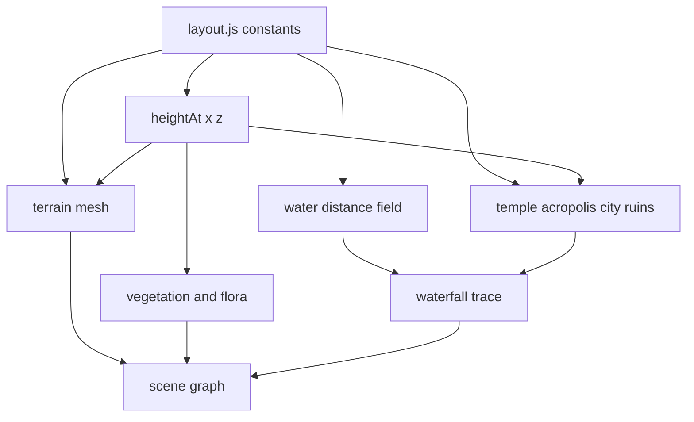

# Core mechanism: from plan to pixel

athenaion has two halves. The first half turns a plan and a height function into a scene graph. The second half turns that scene graph into an image. The halves meet at the render call. The geometry decides what the camera sees. The pipeline decides how much light reaches each pixel.

This document traces both halves end to end. It follows one ground point, one waterfall and one still sample through the code. It cites the source lines for each step. It does not claim that the code was run.

## Half A: the plan compiles the world

The master plan is a JavaScript module of constants. The constants use metres, a +Y up axis and sea level at y = 0. The compass convention is -Z north, +X east, +Z south and -X west. Every module reads positions from the plan.

```text
# src/world/layout.js:1-7
// =====================================================================================
//  MASTER PLAN of the world ("Athenaion"). Units: metres. +Y up. Sea level y = 0.
//  Compass convention: -Z = north (toward the snowy range), +X = east, +Z = south, -X = west.
//  OWNER: director (composition). See docs/COMPOSITION.md for why things are where they are.
//
//  Every module reads positions from here, so moving a feature moves everything attached
//  to it (terrain shaping, buildings, waterfalls, vegetation exclusion, cameras).
```

The plan holds the acropolis outline and four terrace drops. It holds the temple centre, heading, stylobate size and column count. It holds the colossi, the stair dimensions and the water bodies. It holds four aqueducts, seventeen waterfall entries, the hill temple, the ruins terrace, the city polygon and the mountains. It holds the default sun.



### The ground function

`heightAt` is the single source of truth for the ground. It is pure and deterministic. It takes an x and a z in metres. It returns a height in metres. It does not read a mesh. It does not depend on build order. Every builder that needs to sit something on the ground calls it. The function is the public application programming interface (API) for ground height.

```text
# src/world/heightfield.js:844-852
// ------------------------------------------------------------ public API
export function heightAt(x, z) {
  const fw = farWeight(x, z);
  if (fw <= 0) return nearHeight(x, z);
  let far = FAR ? farSample(x, z) : null;
  if (far === null) far = farHeightAnalytic(x, z);
  if (fw >= 1) return far;
  return lerp(nearHeight(x, z), far, fw);
}
```

The function computes a far-field weight. The weight is zero near the centre and one beyond a broad rectangle. The near field is always analytic. The far field can come from a baked grid or from the analytic mountain function. A blend zone joins the two.

```text
# src/world/heightfield.js:301-306
/** blend weight (0 near field … 1 far field) — the near field is always analytic */
export function farWeight(x, z) {
  const qx = Math.abs(x + 400) - 1450, qz = Math.abs(z + 150) - 1400;
  const d = Math.hypot(Math.max(qx, 0), Math.max(qz, 0)) + Math.min(Math.max(qx, qz), 0);
  return smoothstep(250, 900, d);
}
```

The near field is a stack of landforms. It starts with a coastal base and west hills. It carves water with a stepped gorge wall. It adds waterfall notches and a rapids bed. It raises the acropolis, the crag, the hilltops, the spur ridges, the ruins terrace and the island with smooth maximum operations.

```text
# src/world/heightfield.js:758-790
function nearHeight(x, z) {
  let h = baseLand(x, z);
  if (x < 100) h = smax(h, hillsWest(x, z), 30);
  h = hillLowland(x, z, h);

  // carve water: sheer canyon walls along the gorge, gentle banks elsewhere
  const w = waterSDF(x, z);
  if (w < 110) {
    const sm = seaFloorMix(x, z);
    const deep = lerp(L.RIVER.floor, L.SEA.floor, sm) - Math.max(0, -w) * lerp(0.04, 0.05, sm);
    const cf = canyonFactor(x, z);
    let bank;
    if (cf > 0) {
      // rocky shelf at the waterline, then a sheer wall up to the land
      const shelf = 3 + 3 * (0.5 + 0.5 * noiseE.noise2(x / 50, z / 50));
      // stepped gorge wall: lower cliff, a vegetated bench, upper cliff
      const bn = noiseF.noise2(x / 70, z / 70);
      const benchAt = 0.40 + 0.14 * bn, b0 = shelf + 16 + 8 * bn, b1 = b0 + 14 + 10 * (0.5 + 0.5 * bn);
      let wall = benchAt * Math.pow(smoothstep(shelf, b0, w), 0.8) + 0.06 * smoothstep(b0, b1, w) + (0.94 - benchAt) * Math.pow(smoothstep(b1, b1 + 22 + 8 * bn, w), 0.8);
      // (terrain-near) narrow ledges on the gorge walls: sine terracing of the wall fraction (≈ 5 benches)
      const kb = 5 + 1.5 * bn, ph = 0.3 * noiseE.noise2(x / 120, z / 120);
      wall = clamp(wall - 0.8 * Math.sin(6.2832 * (kb * wall + ph)) / (6.2832 * kb), 0, 1);
      const gentle = smoothstep(0, 45, w);
      bank = lerp(gentle, Math.max(wall, 0.06 * smoothstep(0, shelf, w)), cf);
      if (w > 0 && w < shelf) {
        const shelfH = lerp(-0.2, 1.4, w / shelf);
        h = Math.max(lerp(deep, h, bank), lerp(lerp(deep, h, gentle), shelfH, cf));
      } else h = lerp(Math.min(h, deep), h, bank);
    } else if (w < 70) {
      bank = smoothstep(0, 45, w);
      h = lerp(Math.min(h, deep), h, bank);
    }
  }
```

The water distance function defines the shore. It returns a signed distance. A negative value is inside water. A positive value is land. It combines the river, the lagoon, a second basin, the channel, the sea and the harbour bay. Noise moves the shore and the sea floor. The near height uses this distance to cut the ground.


The terraced south face is a separate profile. The plan gives four terraces with a cliff run, a drop and a ledge width. The function `terraceProfile(d, top, wk)` at `src/world/heightfield.js:317-321` drives this face. It reads `L.ACROPOLIS.terraces` and applies a per-ledge width multiplier. The terrace sector selects the stepped face. The profile walks outward from the rim. It drops by the terrace height, holds a ledge, and drops again into the lagoon. The cliff uses stepped bands and benches, which produce the limestone strata in the references.

The stair uses the same plan. The heightfield builds a spur so the terrain rises under the stair. The acropolis module plans the visible stair from the real ledges. The two profiles are deliberately similar: one holds the ground, the other builds the steps, walls, arcades, landings and quay.

```text
# src/world/heightfield.js:385-407
/** grand stair spur: the stair profile (mirrors acropolis/stair.js planStair: landings at every
 *  terrace level, flights of riser/tread split by half-landings, a quay at the bottom) */
export const STAIR_PROFILE = (() => {
  const GS = L.GRAND_STAIR, A = L.ACROPOLIS;
  const riser = GS.riser ?? 0.19, tread = GS.tread ?? 0.27, land = GS.landing ?? 7, mid = GS.midLanding ?? 2.8;
  const lv = [A.top]; let hh = A.top; for (const t of A.terraces) { hh -= t.drop; lv.push(hh); }
  lv.push(GS.yBottom ?? 2);
  const pts = [[GS.zTop - 30, A.top], [GS.zTop, A.top]];
  let z = GS.zTop, y = A.top;
  for (let k = 1; k < lv.length; k++) {
    const yN = lv[k];
    const parts = Math.max(1, Math.ceil((y - yN) / (GS.flightRise ?? 8.5)));
    for (let p = 0; p < parts; p++) {
      const yB = y - ((y - yN) * (p + 1)) / parts;
      const n = Math.max(1, Math.round(((y - yN) / parts) / riser));
      z += n * tread; pts.push([z, yB]);
      if (p < parts - 1) { z += mid; pts.push([z, yB]); }
    }
    y = yN;
    z += k === lv.length - 1 ? 9 : land; pts.push([z, y]);
  }
  return pts;
})();
```

The acropolis module plans the built stair from the actual ledges. `scanLedges` samples three parallel ground lines at x-5, x and x+5 in 0.5 metre steps. It averages the three heights. It marks a point flat when the heights 2 metres ahead and 2 metres behind differ by less than 0.9 metres. It keeps flat runs longer than six metres. `planStair` walks the levels from the top down. It splits a long flight, inserts a half-landing and ends with a quay. It stores each segment kind, z and y range, step count, riser and width.

```text
# src/acropolis/stair.js:41-71
export function planStair(levels, opts = {}) {
  const GS = L.GRAND_STAIR;
  const riser = GS.riser ?? 0.19, tread = GS.tread ?? 0.27, land = GS.landing ?? 7;
  const widths = GS.widths || [12, 14, 16, 18, 21];
  const segs = [];
  let z = levels[0].zEdge;
  let y = levels[0].y;
  segs.push({ kind: 'landing', z0: z - 14, z1: z, y0: y, y1: y, w: widths[0] + 8, top: true });
  const midLand = GS.midLanding ?? 2.8;
  for (let k = 1; k < levels.length; k++) {
    const yN = levels[k].y;
    const w = widths[Math.min(widths.length - 1, k - 1)];
    // long flights are split by a short half-landing (rhythm + pedestals), as in ref 6
    const parts = Math.max(1, Math.ceil((y - yN) / (GS.flightRise ?? 8.5)));
    for (let p = 0; p < parts; p++) {
      const yA = y - ((y - yN) * p) / parts, yB = y - ((y - yN) * (p + 1)) / parts;
      const n = Math.max(1, Math.round((yA - yB) / riser));
      const rr = (yA - yB) / n;
      segs.push({ kind: 'flight', z0: z, z1: z + n * tread, y0: yA, y1: yB, n, rr, t: tread, w });
      z += n * tread;
      if (p < parts - 1) { segs.push({ kind: 'landing', z0: z, z1: z + midLand, y0: yB, y1: yB, w, mid: true }); z += midLand; }
    }
    y = yN;
    const last = k === levels.length - 1;
    const wl = widths[Math.min(widths.length - 1, k)] + (last ? 10 : 4.6);
    const depth = last ? 9 : land;
    segs.push({ kind: last ? 'quay' : 'landing', z0: z, z1: z + depth, y0: y, y1: y, w: wl, level: k });
    z += depth;
  }
  return { x: GS.x, segs, zEnd: z };
}
```

The acropolis module publishes the plan and a surface function. The surface function is a stair height lookup at a given z. Later modules read it. The flora module places ivy on the stair cheek walls. The statue module reads the colossus bases. The vegetation scatter reads the wall runs.

```text
# src/modules/acropolis.js:333-333
  engine.registry.acropolis = { stair: plan, levels, wallRuns: ctx.wallRuns, bastions, buildings: built, precinctBuildings: precB, houses: houses ? houses.placed : [], podium, arcade, colossusBases, crackSpots: ctx.crackSpots || [], surface: (z) => stairSurface(plan, z) };
```

### Placement on the ground

Every placed object needs a ground height. The temple module samples the terrain over a rotated rectangle. `siteStats` takes 17 by 17 samples and returns the minimum, the 10th, 50th and 90th percentiles and the maximum. The main temple sets its base to the larger of the plan centre height and the 90th percentile. Its foundation depth is `Math.max(4, base - min + 2.5)`. The hill temple places its floor at the 90th percentile and its arcade bottom at the minimum. The values keep the temple off a slope and out of a corner.

The acropolis uses the same idea at a larger scale. It analyses the site into levels and contours. The stair planner uses the levels, the wall planner uses the contours, and the buildings sit on widened ledges that the terrain already provides.

A fall must pour over architecture that was built after the terrain. The module builds an allow list from five solid roots: terrain, acropolis, temple, aqueducts and ruins. It captures a new height map over a padded box around every lip and spill. The capture keeps an object only when `defaultTerrainFilter` accepts it, it is not water, and it is allowed. If the capture fails, the module logs a warning and uses the terrain only. It then traces every fall over the combined surface.

```text
# src/modules/waterfalls.js:69-81
  // ---- lips: snapped on the bare terrain (water module), or snap now
  const traced = new Map((W?.falls || []).map((f) => [f.id, f]));
  const lipSpecs = [];
  for (const spec of L.WATERFALLS) {
    let f = traced.get(spec.id);
    if (!f || f.spec !== spec) {
      try { f = traceFall(terrainGround, spec, engine.rng('fall:' + spec.id), { level }); } catch (e) { console.warn('[waterfalls] trace failed', spec.id, e.message); f = null; }
    }
    if (f) lipSpecs.push({ spec, lip: f.lip, terrainFall: f });
  }
  const spills = [];
  const spillsRaw = engine.registry.aqueductSpills;
  if (Array.isArray(spillsRaw)) spillsRaw.forEach((s, i) => { const sp = parseSpill(s, i); if (sp) spills.push(sp); });
```

The trace uses a ground object with a height lookup. The water module builds the first ground from the terrain. The waterfall module replaces it with a ground that includes architecture. The tracer starts at the lip, follows the flow, falls in an arc, runs across a ledge and drops again. It stops at the water level or at the end of its reach.

The module counts the final falls and the aqueduct spills. It logs the count with the triangle and mist counts. The count is a runtime value, not a plan constant. The plan has seventeen entries, and the aqueducts add more. The project README reports 57 from one run. This package cannot reproduce that number without a build.

```text
# src/modules/waterfalls.js:120-130
  let spillCount = 0;
  const skipped = [];
  spills.forEach((spec, i) => {
    try {
      const f = traceFall(ground, spec, engine.rng('spill:' + spec.id + ':' + i), { level });
      // an outlet buried in the hillside (ground ahead higher than the lip) cannot fall anywhere
      if (f.drop < 1.5) { skipped.push(spec.id); return; }
      falls.push(f); spillCount++;
      if (f.impact && W?.addImpact) W.addImpact(f.impact);
    } catch (e) { console.warn('[waterfalls] spill trace failed', spec.id, e.message); }
  });
```

The result is a scene graph. The terrain mesh holds the ground. The building groups hold the architecture. The instanced meshes hold the trees and the plants. The water meshes hold the surfaces. The fall meshes hold the sheets and strands. The mist system holds the spray. The scene graph is the output of half A.

## Half B: the pipeline accumulates light

The second half starts when the engine renders a sample. `renderSample` is the per-sample entry point. It applies the camera jitter and the depth-of-field aperture jitter. It updates the lighting with a soft-shadow jitter. It asks the pipeline to add one sample. It restores the camera.

```text
# src/core/engine.js:203-238
  _jitter(i, dof) {
    const cam = this.camera;
    this._savedPos = cam.position.clone();
    cam.updateProjectionMatrix();
    const P = cam.projectionMatrix.elements;
    // 2px-wide tent filter via Halton jitter (smoother than a box filter)
    const tent = (u) => (u < 0.5 ? Math.sqrt(2 * u) - 1 : 1 - Math.sqrt(2 - 2 * u));
    const jx = tent(halton(i + 1, 2)) * 0.9, jy = tent(halton(i + 1, 3)) * 0.9;
    P[8] += (2 * jx) / this.width;
    P[9] += (2 * jy) / this.height;
    if (dof && dof.aperture > 0 && dof.focus > 0) {
      const r = Math.sqrt(halton(i + 1, 5)) * dof.aperture * 0.5, a = halton(i + 1, 7) * Math.PI * 2;
      const dx = Math.cos(a) * r, dy = Math.sin(a) * r;
      const right = new THREE.Vector3().setFromMatrixColumn(cam.matrixWorld, 0);
      const up = new THREE.Vector3().setFromMatrixColumn(cam.matrixWorld, 1);
      cam.position.addScaledVector(right, dx).addScaledVector(up, dy);
      P[8] -= (P[0] * dx) / dof.focus;
      P[9] -= (P[5] * dy) / dof.focus;
    }
    cam.projectionMatrixInverse.copy(cam.projectionMatrix).invert();
    cam.updateMatrixWorld(true);
  }
  _unjitter() {
    const cam = this.camera;
    if (this._savedPos) cam.position.copy(this._savedPos);
    cam.updateProjectionMatrix();
    cam.updateMatrixWorld(true);
  }

  renderSample(i, { jitter = true, softShadows = this.quality.softShadows } = {}) {
    const dof = this.shot?.dof;
    if (jitter) this._jitter(i, dof);
    this.lighting.update(softShadows && jitter ? [halton(i + 1, 11), halton(i + 1, 13)] : null);
    this.pipeline.addSample(this.scene, this.camera);
    if (jitter) this._unjitter();
  }
```

The sub-pixel jitter uses a tent filter over the pixel. A uniform box jitter would give a slightly harsher edge. The tent filter weights the centre of the pixel more than the edge. The Halton sequence gives a well-spread set of sample positions without a random state.

The depth of field uses a thin-lens model. The sample point is a disk on the aperture. The camera position moves by that offset. The projection matrix shifts by the offset divided by the focus distance. The result is a circle of confusion that grows with distance from the focus plane. Shot 8 sets an aperture of 0.0, so the depth of field is disabled in the shipped camera. The code path exists.

The soft-shadow jitter moves the light sample within the sun disk. The light module uses the two Halton values to offset the sun direction. The shadow map is rebuilt for that sample. The average over many samples gives a soft penumbra. The preview preset turns soft shadows off, so a preview image has harder shadow edges.

`addSample` renders the scene into a half-float high dynamic range (HDR) target. It then blends the new target into the accumulation buffer with weight `1 / (count + 1)`. The buffer type is a float target when the graphics processing unit (GPU) supports colour buffer floats. Otherwise it is a half-float target. The blend is a full-screen pass. The code keeps two buffers and swaps them, so it does not read and write the same texture.

```text
# src/core/pipeline.js:440-458
  /** render one sub-frame of the scene and fold it into the running average */
  addSample(scene, camera) {
    const r = this.renderer;
    r.setRenderTarget(this.sceneRT);
    r.clear(true, true, false);
    r.info.autoReset = false;
    r.info.reset();
    r.render(scene, camera);
    this.sceneInfo = { calls: r.info.render.calls, triangles: r.info.render.triangles };
    const src = this.acc[this.accIndex], dst = this.acc[1 - this.accIndex];
    this.copyMat.uniforms.tNew.value = this.sceneRT.texture;
    this.copyMat.uniforms.tPrev.value = src.texture;
    this.copyMat.uniforms.uW.value = 1 / (this.count + 1);
    this.quad.material = this.copyMat;
    r.setRenderTarget(dst);
    this.quad.render(r);
    this.accIndex = 1 - this.accIndex;
    this.count++;
  }
```

The weight is a running average, not an exponential average. After N samples, every sample has weight 1/N. This is the correct average for a still. The film uses the same function per frame with a fixed sample count. The film does not blend frames over time in the pipeline. It relies on the shutter interval to create motion blur within a frame.

### Resolve: bloom, lens, meter, grade

`resolve` turns the accumulated HDR image into a display image. It first builds the bloom chain. The chain has seven levels. Each level is half the width and half the height of the previous level. The downsample uses a 13-tap filter. The first level uses a Karis average to reduce fireflies. A luminance clamp limits the sun disk. The upsample uses a tent filter and adds each level to the level above. The result is a soft bloom image.

The lens effects run at quarter resolution. They use the sky brightness near the sun. The code computes a mask, a radial blur and a glare. The result is added to the HDR image before grading. The lens ghost strength defaults to zero, because the ghosts read as coloured dots in the tests. A per-shot override can turn them on.

The exposure meter runs on the accumulated HDR image. It is a 128 by 72 grid. Each cell takes 16 bilinear taps. It computes the mean of the log luminance. The values are clamped, so a bright sun disk does not dominate the average. The meter is temporally smoothed in video with a weight of 0.25.

```text
# src/core/pipeline.js:501-531
    // exposure meter: 128x72 grid of mean log-luminance (16 bilinear taps per cell) of the accumulated HDR
    // r5b (video): taps are clamped (the sun disk / speculars no longer swing the log-average when leaves move across
    // the sun) and the meter is temporally smoothed (EMA, like the auto tone curve) on consecutive frames
    if (GRADE.uAutoExpo.value > 0) {
      this.meterRTs ||= [rt(128, 72, THREE.HalfFloatType), rt(128, 72, THREE.HalfFloatType)];
      this.meterMat ||= new THREE.ShaderMaterial({
        uniforms: { tSrc: { value: null }, tPrev: { value: null }, uW: { value: 1 } }, vertexShader: FS_VERT, depthTest: false, depthWrite: false,
        fragmentShader: /* glsl */ `
          uniform sampler2D tSrc; uniform sampler2D tPrev; uniform float uW; varying vec2 vUv;
          void main(){
            float s = 0.0; vec2 cell = vec2(1.0 / 128.0, 1.0 / 72.0);
            for (int i = 0; i < 4; i++) for (int j = 0; j < 4; j++) {
              vec2 uv = vUv + (vec2(float(i), float(j)) + 0.5 - 2.0) * 0.25 * cell;
              s += log(clamp(dot(texture2D(tSrc, uv).rgb, vec3(0.2126, 0.7152, 0.0722)), 1e-4, 48.0));
            }
            float m = s / 16.0;
            if (uW < 1.0) m = mix(texture2D(tPrev, vUv).r, m, uW);
            gl_FragColor = vec4(m, 0.0, 0.0, 1.0);
          }`,
      });
      const mp = this._meter, smooth = !!mp && frame === mp.frame + 1;
      const k = smooth ? 1 - mp.k : (this._meterK || 0);
      this.meterMat.uniforms.tSrc.value = this.hdr;
      this.meterMat.uniforms.tPrev.value = this.meterRTs[1 - k].texture;
      this.meterMat.uniforms.uW.value = smooth ? 0.25 : 1;
      this.quad.material = this.meterMat;
      r.setRenderTarget(this.meterRTs[k]);
      this.quad.render(r);
      this.meterRT = this.meterRTs[k];
      this._meter = { frame, k }; this._meterK = k;
    }
```

The grade shader reads the meter. It computes an automatic exposure factor. The factor is `(uAutoKey / meter) ^ uAutoExpo`, clamped to the range 0.5 to 2.0. The key is 0.17. The exponent is 0.9. The factor multiplies the shot exposure and the white balance.

```text
# src/core/pipeline.js:55-59
  // partial auto-exposure: centre-weighted geometric mean of the scene luminance (128x72 log-luminance meter
  // pass), exposure *= (uAutoKey / meter) ^ uAutoExpo, clamped to [0.5, 2]. Keeps every framing near the
  // refs' consistent mid-grey while the cameras change; uAutoExpo 0 = fixed exposure.
  uAutoExpo: { value: 0.9 },
  uAutoKey: { value: 0.17 },     // calibrated: brings all 9 framings to p50 ≈ 86–126 (refs 93–115)
```

The clamp is important. Shot 5 is a bright frame with a high exposure value. The look file sets a shot exposure of 0.46 and still notes that the auto exposure clamps on this frame. A clamp at 2.0 means the automatic factor can raise or lower the shot exposure by at most a factor of two. The artist can still choose a darker or brighter base.

After accumulation, the shader applies the local tone mapping, then the bloom veil, then the lens glare. The local tone mapping works on log-luminance bands. It adds soft-clipped detail and compresses the base by at most 2.5 stops. It applies exposure, automatic exposure and white balance. It applies a vignette. It applies the tone map, which is AgX by default. AgX compresses the highlights and desaturates the brightest colours. The code adds a punch value after the AgX curve to restore some saturation.

The rest of the grade runs in a perceptual, standard red green blue (sRGB) encoded space. The code applies gain, gamma and an S-curve around a pivot. It applies a highlight lift. It applies a shoulder that rolls off large bright areas below white. It adds a lift and split toning. It applies saturation, vibrance, shadow saturation and highlight saturation. It applies eight hue secondaries in the OkLCh colour space. It applies the auto-level curve. It adds film grain and dither.

### Auto levels

Auto levels is a second measured loop. It measures the graded frame at one quarter resolution. It reads the pixels back to the central processing unit (CPU). It computes five luminance percentiles: p02, p10, p50, p90 and p98. It then solves a monotone curve through the measured points and the target points. The curve is a Fritsch-Carlson monotone cubic. The segment slopes are limited to the range 0.35 to 2.8, so no tone band is crushed or posterised. The curve is sampled into a 32-entry lookup table.

```text
# src/core/pipeline.js:105-111
/**
 * Auto tone curve: measure the luminance percentiles (p02, p10, p50, p90, p98) of an RGBA8 frame and build a
 * monotone (Fritsch–Carlson) curve through (0,0), the 5 measured → target points and (1,1), blended with the
 * identity by strength s. Returns the curve sampled at LUT_N + 1 points (perceptual luminance in → out).
 * Segment slopes are limited to [0.35, 2.8] so no band is crushed or posterised.
 */
export const LUT_N = 32;
```

The resolve pass runs the grade once without the levels curve. It reads the reduced frame. It solves the curve. It then runs the grade again with the curve enabled. For a video frame that follows the previous frame, it blends the new curve with the old curve at a weight of 0.2. This reduces flicker when the camera moves.

The targets come from the look file. Each shot has a five-value target. Shot 1 uses 17, 39, 108, 203 and 235. Shot 5 uses 16, 38, 115, 198 and 228. The targets come from the reference image for that shot. The art bible gives the common range. The p02 value is about 3 to 17, p10 about 23 to 39, p50 about 93 to 115, p90 about 196 to 203, and p98 about 227 to 242.

```text
# src/world/looks.js:34-35
// r5: auto-levels targets = each reference's own sRGB luminance percentiles (p02, p50, p98)
const LV = (p02, p10, p50, p90, p98) => ({ uAutoLevels: 1.0, uLevelTarget: [p02, p10, p50, p90, p98] });
```

The two loops have different jobs. Auto exposure acts before the tone map. It keeps the scene luminance near a key. Auto levels act after the tone map. It matches the final percentile distribution to the reference. Auto exposure is a global gain. Auto levels is a shaped curve. The project uses both, because one is not enough to match nine framings with different skies, stone areas and shadow depths.

```mermaid
flowchart LR
  cam["Camera jitter and depth of field"] --> scene["Scene render to HDR"]
  scene --> acc["Weighted accumulation"]
  acc --> bloom["Seven-level bloom"]
  acc --> meter["128 by 72 log meter"]
  acc --> ltm["Local tone mapping"]
  meter --> ltm
  bloom --> lens["Lens glare"]
  ltm --> lens
  lens --> expo["Exposure and white balance"]
  expo --> vignette["Vignette"]
  vignette --> agx["AgX tone map"]
  agx --> perc["Perceptual grade and shoulder"]
  perc --> sec["OkLCh secondaries"]
  sec --> levels["Auto levels tone curve"]
  levels --> grain["Grain and dither"]
  grain --> out["Canvas image"]
```



### The film path

The film reuses the pipeline with a different camera and time per sub-frame. `setupVideo` maps each sequence entry to a frame count. It exposes the frame renderer. For each sub-frame, it computes a local time inside the shutter interval. The time is `(frame + SHUTTER * ((i + 0.5) / spp - 0.5)) / FPS`. The camera function evaluates the move at `tLocal / duration`. The script sets the camera, the shot depth of field, the scene time, the shadow cascades and the lens position. It then renders one sample and waits on a GPU fence.

```text
# src/video/player.js:27-45
    for (let i = 0; i < spp; i++) {
      // sub-frame time within the shutter interval (centred on the frame time)
      const tLocal = (frame + SHUTTER * ((i + 0.5) / spp - 0.5)) / FPS;
      const c = cameraAt(shot, seg, tLocal / seg.dur);
      cam.fov = c.fov; cam.position.set(...c.pos); cam.up.set(0, 1, 0); cam.lookAt(c.target[0], c.target[1], c.target[2]);
      if (shot.roll) cam.rotateZ((shot.roll * Math.PI) / 180);
      cam.updateProjectionMatrix(); cam.updateMatrixWorld(true);
      if (c.dof) engine.shot.dof = c.dof;
      engine.setTime(seg.time + tLocal + timeShift); // timeShift: retry knob for a frame that hung the GPU
      if (i === 0) engine.lighting.refreshCSM();
      engine.lighting.updateLens?.();
      engine.renderSample(i, { jitter: true });
      const sync = gl.fenceSync(gl.SYNC_GPU_COMMANDS_COMPLETE, 0);
      gl.flush();
      if (sync) {
        for (let k = 0; k < 20000 && gl.clientWaitSync(sync, 0, 0) === gl.TIMEOUT_EXPIRED; k++) await new Promise((r) => setTimeout(r, 2));
        gl.deleteSync(sync);
      }
    }
```

The shutter value is 0.5. The comment calls this a 180 degree shutter: motion blur over half the frame interval. A sub-frame at the start of the interval sees an earlier camera position. A sub-frame at the end sees a later one. The average is a motion-blurred frame. The camera jitter and the soft shadows vary in the same loop. The depth of field also varies when the shot has an aperture.

## Where the halves meet

The halves meet at the scene graph and the camera. Half A decides which triangles exist and where they sit. Half B decides how the camera samples them and how the samples combine. The plan and the height function influence both. They place the geometry. They also place the cameras and the sun through the shot and look files.

The exposure loops close the circle. A brighter stone material raises the meter value. The auto exposure lowers the gain. A larger shadow area lowers the meter value. The auto exposure raises the gain. Auto levels then moves the final percentiles toward the reference. The look file can still override the base exposure and the grade. The result is a measured loop with an artist override, not a fixed camera setting.

**Aha:** The plan is a compile-time contract, not a comment. A constant is an input to the same functions that shape the terrain, place the architecture and aim the cameras. The height function is the only ground truth for "where is the ground". That is why one number change can move a cliff, a stair, a waterfall lip and a shot together, and why the code can stay consistent across fifteen modules.

## What this trace does not prove

This trace follows the source. It does not run the world. The height values, the waterfall count, the triangle counts and the frame times are not observed. The shader math is read from the source, not compiled. The render targets and the meter behaviour are not tested on a GPU.

The trace also exposes stale comments. The heightfield header says the plateau top is 66 metres, while the plan uses 54. It says the hill temple top is 112 metres, while the plan uses 118. It says the island top is 8 metres, while the plan uses 6.5. The code path uses the plan values. The comments are older than the plan.
