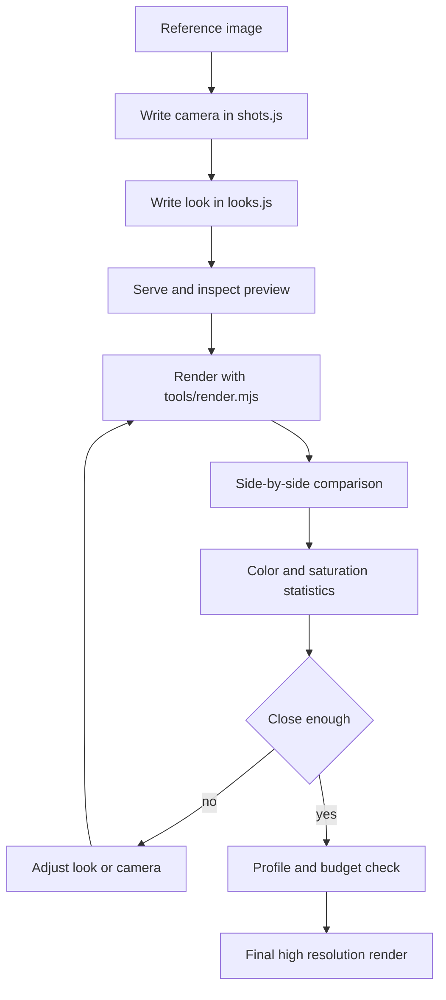
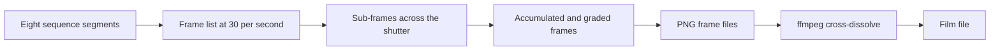

# Workflow and quality: from reference to accepted image

athenaion does not accept an image because it looks close. The project measures the image. It compares the image with a reference. It reads a percentile table. It profiles the scene. It then changes one input and repeats.

This document follows one still shot from a reference file to an accepted image. It follows one film from the sequence list to an encoded file. It follows the bake path that removes build cost. It lists the quality gates that the source defines. It marks every gate that the source does not enforce.

## The still loop

The still loop has nine steps. Steps one and two write data. Steps three and four run the renderer. Steps five and six collect evidence. Step seven changes data. Steps eight and nine check cost and produce the final image.



### Step one: read the reference and write the shot

The nine reference images are in `refs/refN.png`. Each image is 1672 by 941 pixels. A camera entry gives the shot id and name, the camera position, the target point, the vertical field of view (FOV), and optional near plane and depth of field. The camera is world-space data. The renderer does not solve it at load time.

```text
# src/world/shots.js:1-14
// Camera shots matching the 9 reference images (refs/refN.png, 1672x941).
// fov = vertical field of view in degrees. Framing only: lighting/grading per shot lives in src/world/looks.js.
// dof = {focus: metres, aperture: metres (lens diameter)} — accumulated thin-lens depth of field.
// OWNER: director. Composition notes per shot: docs/COMPOSITION.md. Cameras were first solved against
// the reference temple corners (pinhole fit, temple front 31 m / columns 10.4 m), then tuned visually.
export const SHOTS = [
  {
    id: 1, name: 'Panorama from the high rocks',
    pos: [108, 66, 30], target: [15.1, 61.5, -6.7], fov: 40, // r4: 106 m from the temple front (was 123 m, fov 46): temple + colossus A large in the right third, city/port left
  },
  {
    id: 2, name: 'Lagoon and the island tholos',
    pos: [-19, 7, 227], target: [-13.6, 14.8, 127.4], fov: 28.5,
  },
```

The header records the first method. The project solved a pinhole camera against the temple corners. It used a temple front of 31 metres and a column height of 10.4 metres. It then tuned each camera by eye. `docs/COMPOSITION.md` holds the camera table, the distance notes and the change log. A camera change is a composition change. It is not a renderer change.

The reference image is not copied into the world. It is a target for framing, light and palette. The shot entry holds only the camera. The look entry holds the light and the grade.

### Step two: write the look

The look file is separate from the camera file. A look entry can set the sun, the sky, the atmosphere, the clouds, the terrain uniforms and the grade. The merge order is fixed. Defaults come first. The look entry comes next. An explicit value on the shot object comes last.

The sun is art-directed relative to the camera heading. The helper adds an azimuth offset to the current shot heading. A negative offset puts the light on the left of the frame. This means the sun rotates in world space when the camera heading changes, and it keeps the same direction relative to the frame. The artist can keep a left-side key light while the camera moves. A separate helper places the visible sun disk.

```text
# src/world/looks.js:51-55
export const LOOKS = {
  // front-lit range (light from behind-left, low golden), visible sun at the left edge, hazy sea side
  1: { sun: sunRel(1, -125, 14), sky: { ...diskRel(1, -29.7, 10.8), ...SUN_GLOW, uCloudScale: 2.6, uCloudThick: 320, uCloudAmbient: 1.6, uCloudCover: 0.42, uCirrus: [0.6, 7500, 0.6] }, // r4: layered stratocumulus, sun above the hill town
    grade: { ...SUN_LENS, ...LV(17, 39, 108, 203, 235), uWhiteBalance: [0.943, 1, 1.112], uSaturation: 1.03 }, atmo: { uMie: [0.76, 1.1, 0.8], uHaze: [0.00002, 1600, 0] }, clouds: { uBankAlt: [-500, 1.2] } },
  2: { sun: sunRel(2, -90, 25), grade: { ...LV(10, 29, 93, 197, 233), uLift: [0.0, 0.002, 0.008], uContrast: 1.42, uExposure: 0.9, uWhiteBalance: [1.074, 1, 0.925], uSaturation: 0.96 } }, // deeper blacks (ref p02/p10 10/29)
```

The grade object carries the auto-level targets through `LV`. Shot 1 targets 17, 39, 108, 203 and 235. Shot 2 targets 10, 29, 93, 197 and 233. These values come from the reference percentiles. The look also sets a white balance and a saturation for each shot.

Shot 5 shows the interaction between the look and the automatic exposure. The comment says the automatic exposure clamps on this bright frame. The look sets a base exposure of 0.46. The comment also records a hue saturation change from 1.1 to 0.95. The change corrected a peach cast on the temple. This is the normal size of a look edit. It is a small measured correction, not a new art direction.

### Step three: serve and inspect

The project has no build step. The browser loads the source modules directly. `tools/serve.mjs` is a small static file server. It sends no-cache headers. It maps the common web file types. The default port is 8080.

```text
# tools/serve.mjs:26-46
export function startServer(port = 0, root = ROOT) {
  const server = http.createServer((req, res) => {
    try {
      const url = new URL(req.url, 'http://x');
      let p = decodeURIComponent(url.pathname);
      if (p === '/') p = '/index.html';
      const file = path.normalize(path.join(root, p));
      if (!file.startsWith(root)) { res.writeHead(403); res.end(); return; }
      fs.stat(file, (err, st) => {
        if (err || !st.isFile()) { res.writeHead(404); res.end('not found: ' + p); return; }
        res.writeHead(200, {
          'Content-Type': MIME[path.extname(file).toLowerCase()] || 'application/octet-stream',
          'Content-Length': st.size,
          'Cache-Control': 'no-store',
        });
        fs.createReadStream(file).pipe(res);
      });
    } catch (e) {
      res.writeHead(500); res.end(String(e));
    }
  });
```

The entry module reads the query string. `?shot=3&quality=preview` selects a shot and a quality preset. `?test=temple&view=0` loads one module in a neutral scene. The interactive page adds mouse orbit, number keys for the nine shots, and the P key to copy the camera position, target and FOV. The camera print is the bridge from a visual framing to a shot entry.

The preview preset is for inspection. It uses one sample per pixel, density 0.45 and no ambient occlusion. It does not show the final image. It shows the geometry, the framing and the approximate light in a few seconds on an integrated graphics processing unit (GPU).

### Step four: render with the harness

The render harness starts its own server. It starts a headless browser. It loads the page in still mode. It waits for the page ready flag. It calls the shot renderer. It writes a Portable Network Graphics (PNG) file.

```text
# tools/render.mjs:3-8
// Examples:
//   node tools/render.mjs --shot 3                       → out/shot3.png (+ out/shot3_cmp.png side-by-side with refs/ref3.png)
//   node tools/render.mjs --shot 1,2,3,4,5,6,7,8,9 --quality high --spp 16
//   node tools/render.mjs --test temple --view 0 --out out/test_temple.png
//   node tools/render.mjs --shot 5 --params "debug=normals&sunEl=25"
//
```

The defaults are a preview render at the reference size. The tool uses the preview preset unless `--quality` says otherwise. It uses a 900 second page timeout. It looks for a Chrome or Edge executable at two fixed Windows paths in the `CHROME` list at `tools/render.mjs:50-53`. There is no browser-path option. A reader on another operating system must edit that list.

```text
# tools/render.mjs:45-58
const args = parseArgs(process.argv);
const quality = args.quality || 'preview';
const W = Number(args.w || 1672), H = Number(args.h || 941);
const timeoutMs = Number(args.timeout || 900) * 1000;

const CHROME = [
  'C:/Program Files/Google/Chrome/Application/chrome.exe',
  'C:/Program Files (x86)/Microsoft/Edge/Application/msedge.exe',
].find((p) => fs.existsSync(p));

// ---------------------------------------------------------------- GPU lock
const LOCK_SLOTS = Number(process.env.GPU_SLOTS || 4);
let LOCK = path.join(OUT, '.gpu.lock.0');
const LOCK_STALE_MS = 20 * 60 * 1000;
```

The lock is a set of four slot files, from `out/.gpu.lock.0` to `out/.gpu.lock.3`. A process takes one slot. A lock older than 20 minutes is stale and can be replaced. The lock keeps two renders from competing for the same GPU. This matters because one high render can keep the GPU busy for minutes.

The harness builds the Uniform Resource Locator (URL) from the options. It sets the quality, the size, the mode and the sample count. It sets the first shot id. It loads the page. It waits for `window.__READY` or for a render error. The page sets the ready flag after it compiles all shaders. The compile step removes a first-sample stall.

```text
# tools/render.mjs:135-160
    const qs = new URLSearchParams(args.params || '');
    qs.set('quality', quality);
    qs.set('w', String(W)); qs.set('h', String(H));
    qs.set('mode', 'still');
    if (args.spp) qs.set('spp', String(args.spp));

    let jobs = [];
    if (args.test) {
      qs.set('test', args.test);
      if (args.view !== undefined) qs.set('view', String(args.view));
      const out = args.out ? path.resolve(args.out) : path.join(OUT, `test_${args.test}${args.view !== undefined ? '_v' + args.view : ''}.png`);
      jobs.push({ kind: 'test', out });
    } else {
      let ids = String(args.shot || '1');
      if (ids === 'all') ids = '1,2,3,4,5,6,7,8,9';
      for (const id of ids.split(',')) {
        const out = args.out && !ids.includes(',') ? path.resolve(args.out) : path.join(OUT, `shot${id}.png`);
        jobs.push({ kind: 'shot', id, out });
      }
      qs.set('shot', jobs[0].id);
    }

    const url = `http://127.0.0.1:${server.port}/index.html?${qs.toString()}`;
    console.log('[render] loading', url);
    await page.goto(url, { waitUntil: 'load', timeout: timeoutMs });
    await page.waitForFunction('window.__READY === true || !!window.__RENDER_ERROR', { timeout: timeoutMs, polling: 250 });
```

The shot loop applies the shot, renders the still and returns a data URL. The harness decodes the data URL and writes the PNG. The harness also builds a comparison image. It uses the external `ffmpeg` program to place the reference and the render side by side. The comparison is optional with `--nocompare`.

The `--test` path is separate. It renders one module in the neutral test scene. A module can export a `test(engine)` function that returns one or more views. `src/test/testScene.js` imports the module and calls that function. If the function returns no views, the camera frames the bounding box of the added objects. This isolates a module from the full world. It is the fastest way to check a new column, statue or water surface.

### Step five: compare side by side

The first check is visual. The render is at the reference size. The comparison image shows the reference on one side and the render on the other. The reader checks the silhouette, the horizon, the sun position, the shadow direction, the frame edges and the colour families. A large composition error is not a grade problem. It sends the work back to the camera or the plan.

The project keeps the references as the target. It does not treat its own earlier render as the target. The comparison image is evidence for a person. It is not an automatic pass.

### Step six: measure the colour

The second check is numeric. `tools/colorstats.mjs` reads two images. It divides each image into a four by three grid. It reports the mean red, green and blue values and the mean saturation for each cell. It also reports five luminance percentiles for the whole image.

```text
# tools/colorstats.mjs:16-36
function stats(img, gx = 4, gy = 3) {
  const cells = [];
  const lum = [];
  for (let cy = 0; cy < gy; cy++) for (let cx = 0; cx < gx; cx++) {
    let r = 0, g = 0, bl = 0, s = 0, n = 0;
    const x0 = Math.floor(cx * img.width / gx), x1 = Math.floor((cx + 1) * img.width / gx);
    const y0 = Math.floor(cy * img.height / gy), y1 = Math.floor((cy + 1) * img.height / gy);
    for (let y = y0; y < y1; y += 2) for (let x = x0; x < x1; x += 2) {
      const i = (y * img.width + x) * 4;
      const R = img.data[i], G = img.data[i + 1], Bv = img.data[i + 2];
      r += R; g += G; bl += Bv; n++;
      const mx = Math.max(R, G, Bv), mn = Math.min(R, G, Bv);
      s += mx ? (mx - mn) / mx : 0;
    }
    cells.push({ r: r / n, g: g / n, b: bl / n, s: s / n });
  }
  for (let i = 0; i < img.data.length; i += 4 * 7) lum.push(0.2126 * img.data[i] + 0.7152 * img.data[i + 1] + 0.0722 * img.data[i + 2]);
  lum.sort((x, y) => x - y);
  const pct = (p) => lum[Math.floor(p * (lum.length - 1))];
  return { cells, p: { p02: pct(0.02), p10: pct(0.1), p50: pct(0.5), p90: pct(0.9), p98: pct(0.98) } };
}
```

The art bible sets the target band. The band is the same across the nine references. The second percentile is about 3 to 17. The tenth is about 23 to 39. The median is about 93 to 115. The ninetieth is about 196 to 203. The ninety-eighth is about 227 to 242. The per-shot look targets are inside or near this band.

The tool prints the reference row, the render row and the delta. A positive delta means the render is brighter or more saturated. The reader uses the region grid to find a local error. A bright sky and a dark colonnade can have the same global median. The grid separates them.

`tools/satstats.mjs` reports saturation by region. It answers a narrower question: is one material family too saturated? The source does not define a numeric acceptance threshold for the mean delta luminance or the mean delta saturation. The project records the measurements and a person makes the decision.

### Step seven: adjust and repeat

A change belongs to the smallest input that explains the error. A framing error changes the shot. A light direction error changes the look. A palette error changes the grade or the material. A wrong position changes the plan. A mesh error changes the kit or the module.

The project records the reasons in `docs/COMPOSITION.md`. The change log notes camera distances, sun angles and reference details. This is important because a later change can undo an earlier correction. The document is the memory of the loop, not the code.

The loop can be short. A look-only change does not rebuild the world. The persistent session path serves this case. A plan change that moves the temple rebuilds the terrain and every attached feature. The cost of the change follows the layer that owns it.

### Step eight: profile and check the budget

`window.__profile` measures the cost of each module. It first renders a warm-up. It then measures a base time. It hides each module root in turn and measures again. The saved time is the cost of that module. The function also counts the triangles under each root. It reports draw calls, drawn triangles and a sorted table.

The render stats report the sample count, the render time, the draw calls, the triangles, the geometry count, the texture count and the program count. The result is stored on `window.__STATS`. These values are runtime values. This package did not produce them.

The contract gives the budget for the integrated GPU. The world should stay at or below about 3000 draw calls and 25 million triangles at the high preset. Each module should build in about 10 seconds or less at high. The module should log its build time. The contract uses level of detail (LOD) to simplify distant things.

```text
# docs/CONTRACT.md:61-68
## Performance budget (whole world on the 780M)
- Instancing (InstancedMesh / BatchedMesh) or merged geometry for anything repeated. Draw calls ≤ ~3000
  total; triangles ≤ ~25 M total at `high`. Each module ≤ ~10 s build at `high` (log your time).
- Scale counts/resolution with `engine.quality.density / detail`. Distant things simpler (LOD by
  distance from the main viewpoints is fine — the cameras are known: src/world/shots.js).
- Heavy procedural geometry may be baked: `loadOrBuild(name, fn)` (src/core/cache.js) +
  `src/bake/<name>.js` + `node tools/bake.mjs <name>` → generated/*.bin. Bump the name when the
  generator changes. Runtime falls back to building if the bake is missing.
```

The budget is a target, not an enforced limit. The source has no assertion that stops a build over 3000 calls. The profile table and the render stats are the evidence. The person compares them with the budget.

### Step nine: render the final image

The final still uses a higher preset and a larger size. The render tool accepts `--quality high` or `--quality ultra`, `--spp` and the width and height. The project README says the final stills are 4K. The source does not define the exact sample count or the exact final size for each of the nine stills. The tool defaults to 1672 by 941 and preview. A 4K final image is a command choice, not a default.

The ultra preset uses 48 samples per pixel, full density, ambient occlusion and 64 cloud steps. A 4K ultra render is a long GPU job. The lock and the timeout protect the job from a second process. The output is a PNG at the requested size.

## The session path

A full world build is slower than a camera or grade change. The project keeps a persistent session to avoid a rebuild for each variant. `tools/session.mjs` starts one browser page and builds the world once. It holds one GPU lock slot. It stops after 15 minutes without a request. It accepts requests over a local HyperText Transfer Protocol (HTTP) interface.

```text
# tools/session.mjs:1-9
// Persistent render session: builds the world ONCE, then renders any number of camera / look
// variants quickly (no rebuild per image). Ideal for camera direction and grading.
//
//   node tools/session.mjs --port 9400 [--quality preview] [--w 1672 --h 941] [--params "skip=birds"]
//     (keep it running in the background; it holds one GPU-lock slot; exits after 15 min idle)
//   node tools/snap.mjs --port 9400 --shot 3 --out out/me/s3.png                     render shot 3 as defined
//   node tools/snap.mjs --port 9400 --shot 3 --set '{"fov":38,"pos":[-300,40,420]}' --out out/me/s3b.png
//   node tools/snap.mjs --port 9400 --reload        reload the page with the latest code (rebuilds the world)
//   node tools/snap.mjs --port 9400 --quit
```

`tools/snap.mjs` is the client. It can ask for a shot as defined, a shot with overrides, a reload, a quit, the page logs or the shot list. It can also evaluate an expression in the page. The override path merges the requested fields over the shot. A camera experiment is one request. The client sends the camera overrides as JavaScript Object Notation (JSON).

```text
# tools/snap.mjs:24-28
else {
  const body = { shot: args.shot, out: args.out, spp: args.spp ? Number(args.spp) : undefined, compare: !args.nocompare };
  if (args.set) body.set = JSON.parse(args.set);
  const j = await call('/render', body);
  console.log(`wrote ${j.out}${j.cmp ? '  compare ' + j.cmp : ''} in ${(j.ms / 1000).toFixed(1)} s  stats ${JSON.stringify(j.stats)}`);
```

The session is a development tool. It is not a quality gate. It records the render time and the stats in its reply. A reader can use `--eval` to call `window.__profile` and get the module table.

## The film path

The film is a list of segments. Each segment names a shot, a duration, a time value and a camera move. The move is in metres and degrees relative to the shot camera. The move types are dolly, truck, crane, pan, tilt, zoom, orbit and focus. The segment passes through the reference framing at its middle.

```text
# src/video/sequence.js:9-28
export const FPS = 30;
export const XFADE = 0.8;      // seconds of cross-dissolve between consecutive segments
export const SHUTTER = 0.5;    // 180° shutter: motion blur over half the frame interval

export const SEQUENCE = [
  { shot: 1, dur: 8.0, time: 10, move: { dolly: 6, pan: 1.6, crane: 1.0 }, ease: 'inout' },
  { shot: 4, dur: 7.0, time: 40, move: { dolly: 16, crane: -3, tilt: -0.5 }, ease: 'linear' }, // B's helmet sits at the top-left edge: no pan right
  { shot: 2, dur: 7.5, time: 70, move: { dolly: 3, crane: 0.3 }, ease: 'linear' }, // small: hero branches are anchored to the reference camera
  { shot: 7, dur: 7.0, time: 100, move: { dolly: 4.5, crane: 2.5, tilt: 0.8 }, ease: 'linear' },
  { shot: 6, dur: 7.5, time: 130, move: { dolly: 4, crane: 2.2, tilt: 0.6 }, ease: 'linear' },
  { shot: 5, dur: 7.5, time: 160, move: { dolly: 6, tilt: 1.2, zoom: -0.03 }, ease: 'linear' },
  // shot 3 dropped from the cut: from ~2.8 s into its move every frame hung the GPU in the video path
  // (it shares the ruins-terrace viewpoint with shots 8 and 9, which close the film)
  { shot: 8, dur: 7.0, time: 30, move: { truck: 0.9, pan: -0.6 }, ease: 'linear' },
  { shot: 9, dur: 8.4, time: 75, move: { dolly: 2.6, crane: 0.3 }, ease: 'out' },
];

export function totalDuration() {
  return SEQUENCE.reduce((s, g) => s + g.dur, 0) - XFADE * (SEQUENCE.length - 1);
}
```

`cameraAt` at `src/video/sequence.js:37` computes one camera. It applies the eased value and shifts it by -0.5. The value e runs from -0.5 to +0.5, so e = 0 is the reference framing. The dolly, truck and crane moves are in metres. The pan, tilt and orbit moves are in degrees. The zoom move scales the field of view by `1 + zoom * e * 2`. The focus move interpolates the focus distance in metres.

The header says nine segments. The list holds eight. Shot 3 is in the shot list and has a look, but it is not in the film. The comment gives the reason: every frame hung the GPU in the video path from about 2.8 seconds into the move. The comment also says shots 8 and 9 share the ruins-terrace viewpoint. The film closes with those shots instead.

The durations are 8.0, 7.0, 7.5, 7.0, 7.5, 7.5, 7.0 and 8.4 seconds. They sum to 59.9 seconds. `totalDuration` subtracts 0.8 seconds for each of the seven boundaries. The result is 54.3 seconds. The project README says a 54 second film. The source arithmetic gives 54.3 seconds. This package uses the computed value.

The frame player divides each segment into frames at 30 per second. It renders each frame with the sub-frame time spread over the shutter. It uses the same accumulation pipeline as a still. It waits on a GPU fence after each sample. It checks for a blank frame and for a lost context.



`tools/render-video.mjs` renders the frames and encodes them. It defaults to 1920 by 1080, twelve samples per pixel and the high preset. It can resume a partly rendered film. It calls `ffmpeg` to join the segments. The cross-dissolve is an `xfade` filter. The offset of each join is the running duration minus the cross-dissolve.

```text
# tools/render-video.mjs:159-167
  // 2) cross-dissolves
  const inputs = parts.flatMap((p) => ['-i', p.p]);
  let filter = '', last = '[0:v]', acc = parts[0].dur;
  for (let k = 1; k < parts.length; k++) {
    const off = (acc - XFADE).toFixed(3);
    filter += `${last}[${k}:v]xfade=transition=fade:duration=${XFADE}:offset=${off}[v${k}];`;
    last = `[v${k}]`; acc = acc + parts[k].dur - XFADE;
  }
  const pictureDur = acc;
```

The encoder is external. The repository does not hold `ffmpeg`. The music is also external. The project README names the track: "Ascending the Vale" by Kevin MacLeod, licensed under Creative Commons Attribution 4.0 (CC BY 4.0). The track is not in the repository. The tool accepts a music path and an end title and credit. The audio path is optional.

The film is the same world as the stills. It uses the shot cameras and the shot looks. It adds a camera move and a shutter interval. The model time can change per segment through the `time` value. The quality preset can be high or preview, so a test cut and a final cut can show different density and shadow settings.

## The bake path

Some geometry is expensive to build. The project can write it to a binary cache. The cache function is `loadOrBuild(name, build)`. In a browser it fetches `/generated/NAME.bin`. If the fetch succeeds, it deserialises the geometry. If the fetch fails, it builds the geometry at runtime and logs a message. In Node it always builds and records the result for the bake tool.

```text
# src/core/cache.js:63-71
export async function loadOrBuild(name, build) {
  if (isNode) { const g = await build(); bakeRegistry.set(name, g); return g; }
  try {
    const res = await fetch(`/generated/${name}.bin`);
    if (res.ok) return deserializeGeometry(await res.arrayBuffer());
  } catch { /* fall through */ }
  console.log(`[cache] ${name} not baked, building at runtime`);
  return build();
}
```

The bake tool imports `src/bake/NAME.js`. It calls the module's `bake` function. It writes every geometry that went through `loadOrBuild` during that call. It logs the file size and the vertex count. The project README names three bake entries: terrain, statues and head.

```text
# tools/bake.mjs:11-25
const { serializeGeometry, bakeRegistry } = await import(pathToFileURL(path.join(ROOT, 'src/core/cache.js')).href);
const mod = await import(pathToFileURL(path.join(ROOT, 'src/bake', `${name}.js`)).href);
const t0 = Date.now();
const results = await mod.bake();
fs.mkdirSync(path.join(ROOT, 'generated'), { recursive: true });
// bake() may return { name: geometry } or rely on loadOrBuild registrations
const entries = results && typeof results === 'object' ? Object.entries(results) : [];
for (const [key, geo] of bakeRegistry) {
  if (!entries.find(([k]) => k === key)) entries.push([key, geo]);
}
for (const [key, geo] of entries) {
  const buf = Buffer.from(serializeGeometry(geo));
  fs.writeFileSync(path.join(ROOT, 'generated', `${key}.bin`), buf);
  console.log(`[bake] ${key}: ${(buf.length / 1e6).toFixed(1)} MB, ${geo.attributes.position.count} verts`);
}
```

The cache is optional. A missing file is not an error. The world falls back to a runtime build. The repository holds one baked file, `generated/terrain-far-v11.bin`. It is 23,809,636 bytes. The name carries a version number. The contract says to bump the name when the generator changes. `loadOrBuild` does not check a version inside the file. The name is the version.

The bake changes the start time, not the image. The same geometry is built or loaded. The random seeds and the plan are the same. This is why a baked file is safe for a render. It is not a second source of truth.

## The quality gates

The source defines several gates. Some are automatic. Some are targets for a person.

- The page ready flag. `window.__READY` becomes true after `compileAsync` finishes. The render harness waits for it before it calls the shot renderer. A shader compile error becomes `window.__RENDER_ERROR`.
- The per-sample fence. `renderStill` waits on a GPU fence after each sample. This keeps the GPU queue short and avoids a driver timeout on a long render.
- The render stats. The still returns the sample count, the render time, the draw calls, the triangles, the geometry count, the texture count and the program count. `window.__STATS` stores them.
- The exposure targets. The art bible gives the percentile band. The look file gives per-shot targets. `colorstats` measures the result.
- The performance budget. The contract gives about 3000 draw calls, about 25 million triangles at high, and about 10 seconds per module at high.
- The module contract. Each module exports `build(engine)`. A build error is caught and logged. The rest of the world still builds. This keeps one failure local.
- Determinism. The world code uses seeded random generators. `src/core/rng.js` says not to use `Math.random` in world code. The static check found one fallback use in a material function. The module seeds and the plan are fixed.

The source does not define a per-module timeout, an automated image difference threshold, a continuous integration (CI) job or a test suite. The `package.json` scripts are `serve` and `render`. There is no `test` script. The quality loop is a set of tools and a human decision.

**Aha:** Quality here is a measured loop, not an opinion. The reference sets the target. The percentile table and the region grid show the error. The profile table shows the cost. The loop changes one input and measures again. That is why the project can tune nine different framings without losing the common look.

## What this workflow does not prove

This document reads the tools and the data. It does not run them. No server was started. No browser was opened. No PNG was written. The render times, the draw calls, the triangle counts and the percentile results are not observed here.

The Windows browser paths mean the render harness does not run on this machine without a change. The final 4K size and sample count are a command choice. The source does not define them per shot. The film duration is 54.3 seconds by the source arithmetic.
