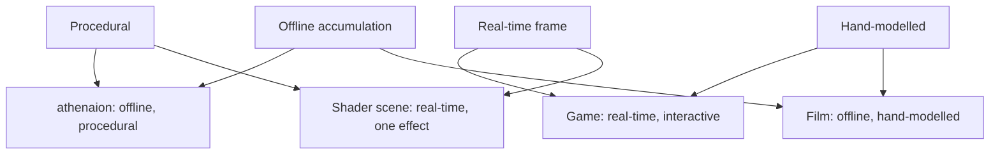
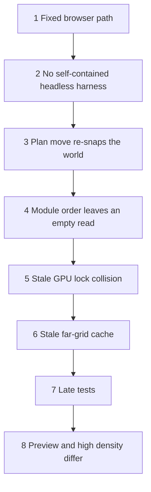

# Limits and comparison: what the code proves and what it does not

athenaion is a showcase. It aims at a small set of accepted images, not at a general engine. The project records a build process, a set of counts and a set of timings. Some of those numbers are constants. Some are runtime results. Some are statements about the process with no code behind them.

This document separates the three. It lists the static limits. It lists the failure modes that the source comments record. It lists the internal inconsistencies. It compares the project with four other ways to make a world. It ends with the choices that would break first under an extension.

The reading is static. No render was run. No browser was opened. The runtime numbers are not reproduced.

## The claim ledger

| Claim | Where the project states it | What the source shows |
|---|---|---|
| The world has no external image, model or audio asset | Project README | The source inventory holds no model, texture or audio file. The generated far grid is derived from code. The reference images are targets, not scene inputs. |
| 57 waterfalls | Project README | The plan holds 17 entries. The module adds runtime aqueduct spills. The final count is logged at runtime. |
| 149k trees | Project README | The scatter count uses the quality density and an optional density parameter. The count is runtime. |
| 54 second film | Project README | The sequence holds eight segments. The computed duration is 54.3 seconds. |
| 168 modules | Project README | The source holds 168 JavaScript files. The world module folder holds 15 files. The word module is broad. |
| About 45k lines | Project README | The source holds 43,797 `.js` lines and 1,123 `.mjs` lines, about 44,920 lines. |
| 45 hours, 55 subagents, about 147 agent-hours | Project README | No code records the process. The build is a project statement. |
| About 11M output tokens, 3.8B cache reads, 161M cache writes | Project README | No code records the token use. The figures are project statements. |
| About 1.8k to 2.3k United States dollars equivalent | Project README | No code records the cost. The figure is a project statement. |

The table is a ledger, not a score. The code supports the no-asset claim and the broad line count. It does not support the process numbers. The waterfall and tree counts need a run. This package does not run the project. It computes the film duration from the segment list.

## Runtime numbers

The plan is not the only input to the count of waterfalls. The plan lists seventeen waterfall specifications. The module adds one fall for each aqueduct spill. It also skips a spill when the drop is less than 1.5 metres. The final count therefore depends on the aqueduct build and on the terrain at each outlet.

```text
# src/world/layout.js:154-157
export const WATERFALLS = [
  // west face of the plateau into the canyon (shot 7 right, shot 4)
  { id: 'acro-w1', from: [-61, 53.5, -70], dir: 262, width: 13, flow: 1.0 },
  { id: 'acro-w2', from: [-53.5, 53.5, -50], dir: 240, width: 10, flow: 0.8 },
```

The module header states the two sources. It also states that each fall is traced against the real terrain. The trace uses parallel sub-streams and a stitched sheet. The count is a result of the trace, not a list length.

```text
# src/modules/waterfalls.js:1-11
// WATERFALLS: every layout.WATERFALLS entry + every engine.registry.aqueductSpills entry.
//
// Each fall is traced against the real terrain (ballistic arc from the lip, draping over ledges,
// running across terraces to the next drop) as several parallel sub-streams; a sheet is stitched
// between them, thin detached strands are added in front, and spray / mist puffs are placed along
// the lower fall, at every hard landing and as a big churning cloud where it meets the water.
// Impacts on the lagoon/river are pushed into the water surface (foam rings, churn, trails).
//
// aqueductSpills (published by the aqueducts module, optional) — accepted shapes:
//   { pos|from|p: [x,y,z] | {x,y,z}, dir: compassDeg | dirVec|direction: [dx,dz] or [dx,dy,dz],
//     width|w: m, flow: 0..1, id }
```

The tree count has the same character. The vegetation scatter reads a density value. The value is the quality density, with an optional parameter override. The preview preset uses 0.45. The high preset uses 1.0. The preview and the high render therefore do not hold the same number of trees, shrubs or city props.

```text
# src/core/quality.js:4-11
  preview: {
    name: 'preview', spp: 1, msaa: 4,
    shadowMapSize: 2048, cascades: 3, shadowMaxFar: 1400, softShadows: false,
    terrainRes: 0.5,      // multiplier on terrain mesh resolution
    density: 0.45,        // vegetation / city / props instance density multiplier
    detail: 0.5,          // geometric detail multiplier (segments, sculpt resolution)
    cloudSteps: 16, bloom: true, ao: false,
  },
```

This is a design choice, not a defect. A preview needs to start in seconds on an integrated graphics processing unit (GPU). A high render can spend more time. The consequence is that a preview image and a high image are different worlds. A tree that frames a shot in high may be absent in preview. A grade tuned on preview may not match the high image.

The film duration has a similar arithmetic limit. The sequence header says nine segments. The list holds eight. The durations sum to 59.9 seconds. The total function subtracts seven cross-dissolves of 0.8 seconds. The computed duration is 54.3 seconds.

## Static limits

The repository has no automated test suite. `package.json` has two scripts: `serve` and `render`. It has no `test` script. The source tree has a `src/test/testScene.js` file, but that file builds a neutral scene for isolated module renders. It is not a test runner. A search of the source and tools found no assertion calls. There is no continuous integration (CI) configuration directory.

```text
# package.json:6-9
  "scripts": {
    "serve": "node tools/serve.mjs",
    "render": "node tools/render.mjs"
  },
```

The render harness needs a browser. It uses `puppeteer-core`, which does not download a browser. The harness searches two Windows paths for Chrome or Edge. A reader on macOS or Linux must install a browser at one of those paths or edit the source. The tool does not read a browser path from an environment variable in the code shown.

```text
# tools/render.mjs:50-53
const CHROME = [
  'C:/Program Files/Google/Chrome/Application/chrome.exe',
  'C:/Program Files (x86)/Microsoft/Edge/Application/msedge.exe',
].find((p) => fs.existsSync(p));
```

The repository holds no audio file. The still comparison and the film encode call `ffmpeg` from the command path. The film music is not in the repository either. The project README names the track: "Ascending the Vale" by Kevin MacLeod, licensed under Creative Commons Attribution 4.0 (CC BY 4.0). A reader must supply both the encoder and the music file.

The far terrain cache is a binary file. `generated/terrain-far-v11.bin` is 23,809,636 bytes. This package did not decode it. Its format is the project's own serialisation, not a public interchange format. A reader cannot inspect the far heights without the project code.

The world has no gameplay loop. The interactive page gives orbit controls, number keys for the shots and a camera print. The source shows no collision, no physics, no user avatar, no inventory and no goal. The scene is a place to look at, not a place to play.

The world also has no general editor. A change goes through the plan, a module or a look file. There is no in-browser object placement, no material graph and no timeline editor beyond the sequence list.

## Failure modes recorded in comments

The comments are unusually honest. They record problems that the project hit and the workaround it chose. These are not hypothetical risks. They are visible costs of the final image.

Shot 3 hung the GPU in the video path. The shot remains in the still list and has a look. It is absent from the film. The comment says that from about 2.8 seconds into its move, every frame hung the GPU. The cut uses shots 8 and 9, which share the ruins-terrace viewpoint.

```text
# src/video/sequence.js:19-23
  { shot: 5, dur: 7.5, time: 160, move: { dolly: 6, tilt: 1.2, zoom: -0.03 }, ease: 'linear' },
  // shot 3 dropped from the cut: from ~2.8 s into its move every frame hung the GPU in the video path
  // (it shares the ruins-terrace viewpoint with shots 8 and 9, which close the film)
  { shot: 8, dur: 7.0, time: 30, move: { truck: 0.9, pan: -0.6 }, ease: 'linear' },
  { shot: 9, dur: 8.4, time: 75, move: { dolly: 2.6, crane: 0.3 }, ease: 'out' },
```

The automatic exposure clamps on shot 5. The look sets a low base exposure of 0.46. The comment records that the automatic factor reaches its limit on this bright frame. The clamp prevents a runaway exposure, but it also means the artist cannot rely on the automatic loop for this shot.

```text
# src/world/looks.js:64-67
  5: { sun: sunRel(5, -110, 28, { color: WARM_SUN }), sky: { ...PALE_SKY, uCloudCover: 0.3, uCirrus: [0, 7500, 0.6] },
    grade: { ...CREAM_MARBLE, ...LV(16, 38, 115, 198, 228), uExposure: 0.46, uContrast: 1.8, uWhiteBalance: [1.026, 1, 1.025], uSaturation: 0.82,
      uHueLum: [0, 0, -0.02, -0.06, -0.08, 0, 0.08, 0], uHueSat: [0.9, 0.95, 1.0, 0.85, 0.92, 1.1, 0.6, 0.75] }, // r5b: orange 1.1 → 0.95 (peach temple); auto-exposure clamps on this bright frame
    terrain: { uSnowLine: 2000 }, clouds: { uBankAlt: [100, 0.8], uBankAmount: 1.4 } },
```

The bloom source has a high dynamic range (HDR) luminance cap. The comment says the cap exists because the sun disk would otherwise flood the small mip levels. The result was a large disc with a visible rim. The cap is 60 in the default uniforms. The sun glow comes from the lens glare, not from the bloom chain.

```text
# src/core/pipeline.js:48-50
  uBloomClamp: { value: 60 },     // r5b: HDR luminance cap of the bloom source (sun disk; the sun glow comes from the lens glare)
  uToneMap: { value: 1 },        // 0 ACES fitted, 1 AgX (punchy), 2 Khronos neutral
  uAgxPunch: { value: 1.1 },      // AgX look saturation; r5: 1.05 → 1.1 (AgX bleaches warm mid-tone stone toward grey; refs' lit stone s 34-46 %)
```

The lens ghosts are off. The default strength is zero. The comment says the ghosts read as green or violet computer graphics dots. A per-shot look can turn them on, but the shipped looks keep them off. The same comment block sets the glare and the rays, so the sun still has a visible glow without the ghosts.

```text
# src/core/pipeline.js:60-63
  // lens effects (sun glare / god rays / ghosts), per-shot overridable like any grade uniform
  uLensGlare: { value: 0.55 },
  uLensRays: { value: 0.2 },
  uLensGhost: { value: 0.0 },     // r5: off (ghosts read as green / violet CG dots)
```

The local tone mapping uses a joint-bilateral upsample. The comment gives the reason: silhouettes against the sky must not halo. A simpler multi-scale sharpening would create bright or dark rings around every edge. The joint-bilateral filter uses a guide image to keep the edge. This is a direct record of a failure mode and its fix.

```text
# src/core/pipeline.js:15-19
// r5 (colour lead) additions:
//   * local tone mapping / multi-scale clarity on log-luminance (pyramid at 1/2 … 1/64 res, joint-bilateral
//     upsampling so silhouettes against the sky do not halo): uLtmFine / uLtmMid / uLtmLarge boost the
//     detail bands (soft-clipped at uLtmClip stops), uLtmBase compresses the large-scale base toward the key
//     → texture inside big bright walls / snow / waterfalls and inside large shadows survives the tone curve.
```

The AgX tone map bleaches warm mid-tone stone toward grey. The project compensates with a punch value of 1.1 and with hue secondaries. The comment records the problem and the partial fix. This is a colour-pipeline limitation, not a bug in the stone material.

These comments are a useful form of documentation. They show that the final look is a chain of compromises. A reader who wants to reuse the pipeline should read them before changing a default.

## Internal inconsistencies

The source and the documents disagree in several places. The disagreements are small, but a reader should not treat every number as exact.

| Topic | Values in the source | Status |
|---|---|---|
| Film segment count | Header says nine. The list holds eight. | The list is the code path. The header is stale. |
| Film duration | The project README says 54 seconds. The code computes 54.3 seconds. | The code arithmetic gives 54.3. The project README value is rounded. |
| Podium height | Plan comment says 12 metre podium and a stylobate about 67.5 above a 54 metre plateau. That is 13.5 metres. Composition document says about 13 metres. | The three values are not reconciled. |
| Heightfield anchors | Header says plateau 66, ledges 51/37/24/12, hill temple 112, island 8. Plan says 54, ledges 42/30/19/9, hill temple 118, island 6.5. | The code reads the plan. The header is stale. |
| Registry comment | Engine comment names `registry.templeFrames`. The temple module publishes `registry.temple`. | The comment does not match the published key. |
| Module count | Project README says 168 modules. The source holds 168 JavaScript files and 15 world modules. | The count is a file count under a broad label. |

The podium case is worth a closer look. The plan places the plateau top at 54 metres. The same comment says the temple stands on a 12 metre podium and that the stylobate is about 67.5 metres. The difference between 54 and 67.5 is 13.5 metres. The composition document chooses about 13 metres. The source does not state which value is the intended one.

```text
# src/world/layout.js:37-39
export const ACROPOLIS = {
  center: [32, -72],
  top: 54,                       // plateau height; the temple stands on a 12 m podium wall above it (stylobate ≈ 67.5, refs 1, 3, 5, 9)
```

```text
# docs/COMPOSITION.md:24-25
  → plateau `ACROPOLIS.top = 54`, temple stylobate 67.5 on a ≈ 13 m podium (temple module
  foundation), compact plateau outline whose south rim runs right in front of the temple (z ≈ -28),
```

The heightfield header has the same problem in a larger form. The header gives the old anchors. The plan gives the current anchors. The heightfield code imports the plan, so the plan wins at runtime. The comment is a trap for a reader who trusts it.

```text
# src/world/heightfield.js:9-12
// Anchors other modules rely on (all read from layout.js): acropolis plateau y = ACROPOLIS.top (66)
// inside ACROPOLIS.outline, terrace ledges at y ≈ 51 / 37 / 24 / 12 on the south face (sector
// ACROPOLIS.terraceSector), the grand-stair spur along x = GRAND_STAIR.x, water below y = 0,
// RUINS_TERRACE top (52) inside RUINS_TERRACE.outline, HILL_TEMPLE top (112), ISLAND top (8).
```

The registry comment mismatch is smaller but it matters for a module author. The engine comment gives an example key that the temple module does not publish. A consumer that follows the comment will read an undefined value.

```text
# src/core/engine.js:27-31
    // Slots: producers (architecture) push anchor points during build, consumers (banners, statues,
    // vegetation, braziers…) read them later. Slot = { pos:[x,y,z], facing: compass deg, size, tag, ... }
    this.slots = { banner: [], brazier: [], statue: [], ivy: [], urn: [], planter: [], lamp: [] };
    // Shared registry for cross-module data (e.g. registry.templeFrames for pediment sculpture)
    this.registry = {};
```

The film header is a simple stale comment. Its count is easy to check. The duration is another arithmetic check. The project README rounds 54.3 seconds to 54 seconds. A reader should use 54.3 seconds or the rounded 54 seconds.

The module count is a wording issue. The repository has 168 `.js` files under `src`, including helpers, bake entry points and preview scripts. The world build calls 15 modules. A reader who expects 168 world modules will be surprised. The number is accurate only as a file count.

## Comparison with other ways to make a world

athenaion is one point in a design space. The comparisons below use the choices in the source, not a benchmark. No comparison was rendered or timed.

### Against a game world

A game world must run at an interactive rate. It needs player collision, physics, character animation, gameplay input, streaming and a frame budget. athenaion has no gameplay layer. It has a fixed camera set, a fixed world and an offline render. A game can reuse the plan and module ideas, but it cannot reuse the accumulation pipeline as the main path. The project trades frame rate for image quality. That trade is rational only because the output is a still or a film.

The project also has no gameplay loop. The interactive page is a viewer. A game needs a reason for the player to move, and a system that reacts to the movement. The athenaion modules build a place, not a simulation.

### Against a single-technique shader scene

A shader scene can produce a striking image from one technique, such as ray-marched terrain or volumetric clouds. It is compact and fast to iterate. athenaion uses many techniques and many meshes. Its advantage is structure: a temple has a stylobate, columns, an entablature and a roof because the architecture kit knows the order. A single shader would have to encode all of that in one function.

The cost is more code and more failure points. The project has fifteen modules, several kits and a large material layer. The single-technique scene has one shader and one camera. The athenaion image can show a city, a harbour, a stair and a mountain range in one frame. The shader scene usually shows one effect well.

### Against a hand-modelled asset pipeline

A hand-modelled pipeline gives an artist direct control. The artist sculpts the hero rock, places the trees and paints the texture. The result can reach a visual level that procedural code struggles to match. athenaion has no modelled asset. The code is the asset. A change is a parameter or a function, not a brush stroke.

The advantage is reproducibility and scale. The plan can move a temple and every attached feature follows. The disadvantage is that some shapes are hard to author in code. The project uses signed distance functions, surface nets and architecture rules to close part of that gap. It still cannot match a skilled modeller on a hero prop without a lot of code.

### Against a real-time engine

A real-time engine targets a frame time. It uses temporal anti-aliasing, upscaling and a fast approximation of light. athenaion targets an accumulated image. It can spend 48 samples per pixel, rebuild shadow maps per sample and jitter the camera. It can run auto levels on the final frame. A real-time engine cannot afford these steps at 60 frames per second.

The cost is latency. A still waits for every sample. A film waits for every frame and every sample in it. The project accepts this cost. The GPU lock and the resume path exist because the cost is real.



The diagram is a trade-off map, not a score. athenaion sits at the procedural and offline corner. A game sits at the hand-modelled and real-time corner. A shader scene sits at the procedural and real-time corner. A hand-modelled film sits at the hand-modelled and offline corner. Each corner has a different cost and a different ceiling.

## What would break first

The project is tightly coupled through the plan and the registry. An extension will meet the coupling before it meets a performance limit. The risk map shows the likely order.



The first break is the browser path. On macOS, the harness finds no Chrome or Edge at the two Windows paths. The render does not start. This is a configuration break, not a world break, but it stops the workflow before any image exists.

The second break is the missing self-contained headless harness. The project has a render harness, but the repository does not ship a browser. `puppeteer-core` controls a browser but does not download one. A machine with no Chrome or Edge cannot render, even after a path edit.

The third break is a plan constant. The terrain, the architecture, the vegetation exclusion, the waterfall lips and the cameras all read the plan. A move can be correct for the temple and wrong for a waterfall lip. The waterfall module re-snaps the lip to the cliff edge, but the search is limited to about 40 metres. The plan comment at `src/world/layout.js:152-153` states that limit. A larger move can leave a fall in the air or inside a wall. The vegetation footprints also move, so a tree can appear in a new sight line.

The fourth break is the module order. Producers publish slots and registry keys. Consumers read them. If a consumer runs before a producer, it sees an empty list or an undefined key. The build loop catches and logs a thrown error and continues. A missing or empty producer value does not throw. Later modules still build, but the world is incomplete. This is the most dangerous failure because the image still renders.

The fifth break is the GPU lock. The lock has four slots and a 20 minute stale time. A long render can exceed the stale time if the process does not refresh the lock. A second process can then take the slot. The result is two jobs on one GPU, a slow render or a driver timeout. The source does not show a heartbeat that refreshes the lock.

The sixth break is the far-grid cache. The cache name carries a version, such as `terrain-far-v11.bin`. `loadOrBuild` fetches the name and does not check a version inside the file. A generator change without a name bump loads the old grid. The near field is still correct, so the error appears only in the far mountains.

The seventh break is late tests. The source has no automated test suite and no image difference threshold. A regression is found by eye or by statistics after a render. A broken module can pass the build loop and still produce a wrong image. The cost is the render time and the human check.

The eighth break is the density mismatch. A preview build and a high build hold different tree and prop counts. A camera or a grade tuned on preview can fail on high. The reverse is also true. The project uses the preview for speed, so this mismatch is a normal part of the loop, not an accident.

```text
# src/core/cache.js:63-71
export async function loadOrBuild(name, build) {
  if (isNode) { const g = await build(); bakeRegistry.set(name, g); return g; }
  try {
    const res = await fetch(`/generated/${name}.bin`);
    if (res.ok) return deserializeGeometry(await res.arrayBuffer());
  } catch { /* fall through */ }
  console.log(`[cache] ${name} not baked, building at runtime`);
  return build();
}
```

## The design logic

The source is consistent with one goal, as this package reads it: the best final image per GPU-hour on a weak integrated GPU. The source states the weak-GPU target and the offline goal. It does not state a per-GPU-hour target. This package infers that target from the choices. The accumulation path spends many samples on one frame. The bake path moves heavy geometry out of the load path. The per-shot look spends artist time on nine framings instead of one global setting. The density presets keep the interactive preview usable. The measured grade closes the loop with numbers.

This goal explains the choices that look strange in a game engine. There is no frame-rate target. There is no level-of-detail system for a moving camera, only for the known viewpoints. There is no physics. There is no asset pipeline. There is no editor. The project is closer to an offline renderer with a world generator than to a game engine.

The goal also explains the limits. A new shot needs a new camera and a new look. A new place needs a new plan entry and often a new module. A new runtime feature needs a new slot or registry key. The architecture is open to extension, but the extension must respect the build order and the plan.

**Aha:** The package reads the project as optimising accepted image quality per GPU-hour, not frames per second. The source states a weak integrated GPU and an offline image. It does not state the per-GPU-hour goal. The package infers it. Every major choice follows from the weak integrated GPU. The project uses accumulation instead of temporal shortcuts. It uses baked geometry instead of fast streaming. It uses nine per-shot looks instead of one global grade, and a measured loop instead of a real-time exposure. A real-time target would reject most of these choices, and a hand-modelled target would reject the rest.

## What this comparison does not prove

This document compares designs, not measured results. No image was rendered. No frame time was measured. No GPU was used. The claims about quality, cost and speed are statements about the design, not benchmark results.

The project's own numbers for hours, agents, tokens and cost are not verified. They are recorded as project statements. The still and film counts are not reproduced. The far-grid binary is not decoded. The reference and media images are not compared here.

The comparison also does not prove that the project meets its own targets. The art bible gives a percentile band. The contract gives a draw-call and triangle budget. The source defines the targets and the tools. It does not contain the final measurement record. A reader who needs that record must run the project on a supported machine.
