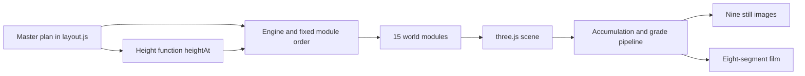

# athenaion: a procedural ancient Greek world

athenaion builds a complete ancient Greek landscape from code. One master plan holds every position and dimension. One analytic height function defines the ground. Fifteen world modules turn that plan into architecture, sculpture, water, vegetation, people-scale props and a mountain range. A browser renderer draws the scene many times per image. Each pass moves the camera by a small amount. The renderer averages the passes into one high dynamic range (HDR) image. The final image is a still or a frame of a short film. No image, model or audio file is an input to the world. The project states that an artificial intelligence (AI) coding agent built the world over about two days, with 55 subagents. This package reads the code only. It does not run the project.

## What this package explains

- The plan. A single file gives the acropolis, the temple, the stair, the lagoon, the city, the aqueducts and the mountain range.
- The heightfield. A pure function returns the ground height at any point. Every builder calls it.
- The module contract. Each world feature is a module with a small interface and a fixed place in the build order.
- The kits. Architecture, sculpture, terrain, water and materials generate meshes from parameters and seeds.
- The pipeline. Jittered sub-frames, motion blur, depth of field, bloom, tone mapping and colour grading produce the image.
- The film. Eight segments reuse eight of the nine shot cameras. Shot 3 is not in the film.

## System map



The plan and the height function are the two inputs. The engine runs the modules in a fixed order. The modules fill one scene graph. The pipeline converts that graph into pixels. The still and film paths share the same pipeline.

## Documents

| File | Role |
|---|---|
| [README](README.md) | This file: the thesis, system map, document table, reading orders, terms and non-claims |
| [Overview](00-overview.md) | The problem, the place, the nine shots, the parts and one still render from start to finish |
| [Architecture](01-architecture.md) | Layer graph, engine object, module contract, slots, registry, footprints, kits, cache and determinism |
| [Core mechanism](02-core-mechanism.md) | The plan and heightfield half, the sub-frame render half, and where the two meet |
| [Workflow and quality](03-workflow-and-quality.md) | One still from reference to accepted image, one film, the bake path and the quality gates |
| [Limits and comparison](04-limits-and-comparison.md) | Runtime claims, static limits, failure modes, internal inconsistencies and comparisons |

## Reading order

Newcomer: [Overview](00-overview.md), [Architecture](01-architecture.md), [Core mechanism](02-core-mechanism.md), [Workflow and quality](03-workflow-and-quality.md), [Limits and comparison](04-limits-and-comparison.md).

Renderer engineer: [Architecture](01-architecture.md), [Core mechanism](02-core-mechanism.md), [Workflow and quality](03-workflow-and-quality.md), [Overview](00-overview.md), [Limits and comparison](04-limits-and-comparison.md).

World builder: [Overview](00-overview.md), [Architecture](01-architecture.md), [Core mechanism](02-core-mechanism.md), [Limits and comparison](04-limits-and-comparison.md), [Workflow and quality](03-workflow-and-quality.md).

## Terms

- **Acropolis**: the raised limestone massif that carries the main temple.
- **Stylobate**: the top step of a temple platform. The columns stand on it.
- **Peripteral**: a temple with a column row on all four sides.
- **Octastyle**: a front with eight columns.
- **Tholos**: a round temple.
- **Propylon**: a gateway building at a sacred entrance.
- **Stoa**: a long colonnaded walk.
- **Colossus**: a very large statue.
- **Signed distance function (SDF)**: a function that returns the distance from a point to a surface.
- **Sub-frame**: one render pass with a small camera or time change.
- **Accumulation**: the weighted average of many sub-frames.
- **Auto levels**: a measured tone curve that moves image percentiles toward per-shot targets.

## Entry snippets

The page loads three.js through an import map. The map is HyperText Markup Language (HTML) and JavaScript Object Notation (JSON).

```text
# index.html:15-22
  <script type="importmap">
    {
      "imports": {
        "three": "/node_modules/three/build/three.module.js",
        "three/addons/": "/node_modules/three/examples/jsm/"
      }
    }
  </script>
```

The module order is the build spine. Each name maps to one file in `src/modules`.

```text
# src/world/index.js:4-20
export const MODULE_ORDER = [
  'terrain',      // ground mesh, cliffs, far mountains
  'water',        // sea, lagoon, river surfaces
  'temple',       // main Athenaion + other classical buildings at layout anchors
  'acropolis',    // terraces, retaining walls, grand stair, plazas, mosaics, balustrades
  'aqueducts',    // aqueducts & bridges
  'sets',         // shot-specific foreground sets (terraces, balustrades, props) — push slots for statues/banners
  'statues',      // colossi + statues on pedestals + pediment sculpture placement
  'city',         // town houses, harbour, boats
  'ruins',        // ruined portico, fallen columns, giant head (foreground sets)
  'banners',      // banners with owl emblem, braziers & fire, urns
  'vegetation',   // cypress, olive, pines, broadleaf trees, shrub masses
  'flora',        // ivy, grass, flowers, moss, hero foreground branches & rocks
  'waterfalls',   // waterfalls, foam, spray & mist
  'clouds',       // mountain clouds, valley mist banks
  'birds',        // seagulls
];
```

The render pipeline header states the whole image path in four lines.

```text
# src/core/pipeline.js:1-4
// Offline-quality render pipeline:
//   N sub-frames (jittered sub-pixel AA, thin-lens DOF, soft sun, motion blur) are rendered into a
//   HalfFloat HDR target and averaged into a Float accumulation buffer, then:
//   accumulated HDR → physically-based bloom (mip chain) → colour grade + tone map → canvas.
```

The plan itself starts with the unit and compass rules.

```text
# src/world/layout.js:1-7
// =====================================================================================
//  MASTER PLAN of the world ("Athenaion"). Units: metres. +Y up. Sea level y = 0.
//  Compass convention: -Z = north (toward the snowy range), +X = east, +Z = south, -X = west.
//  OWNER: director (composition). See docs/COMPOSITION.md for why things are where they are.
//
//  Every module reads positions from here, so moving a feature moves everything attached
//  to it (terrain shaping, buildings, waterfalls, vegetation exclusion, cameras).
```

## Non-claims

- No pixel was rendered for this package. No browser was opened.
- Runtime behaviour, shader compilation and frame times are not verified.
- The figures 57 waterfalls and 149k trees are runtime values. They change with quality and build. The figures 45 hours and 55 subagents are project process statements. The figure 168 modules counts JavaScript files under `src` only.
- The build process is a project statement. It is not reproduced here.
- The licence is Massachusetts Institute of Technology (MIT), from `LICENSE`.
- The source uses the Web Graphics Library (WebGL) 2 through three.js. The reading does not prove that a specific machine can run it.
