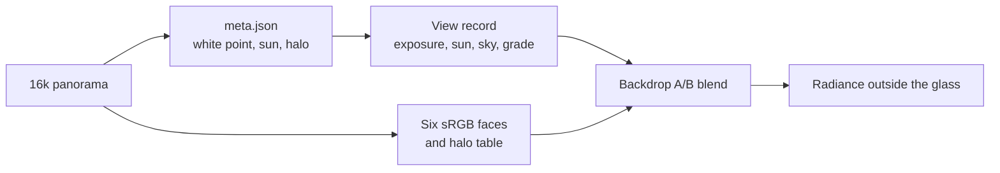
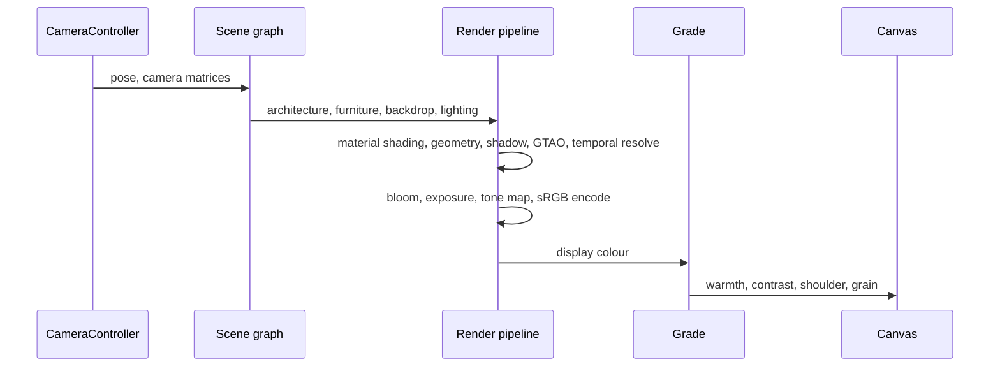

# Overview: one room, six skies, eight camera poses, one frame

Casa Ocaso is a small set with a large lighting problem. The set is one curved living room on a cliff. The problem is to make a real photograph outside the glass agree with a measured room inside the glass. Agree means the rendered image matches the reference renders in colour, light balance and shape. The project solves the problem twice. It solves it in data, through panorama measurements, baked probe light and a room plan. A probe is a sample of light in space. The project solves it in pixels, through a Web Graphics Processing Unit (WebGPU) render pipeline with temporal anti-aliasing. This document describes the set, the six skies, the eight cameras and the parts. It then traces one frame from a camera pose to the screen. The next documents explain the design.

The counts used in this document are these. The repository has 193 tracked files. The `src` tree has 31 files and 9,531 JavaScript lines. The `tools` tree has 30 files. The `public` tree has 122 files and is about 147 mebibytes. The 122 public files are 72 view files, 44 texture maps and 6 models (`git ls-files public`). The other 10 tracked files are `.gitignore`, `LICENSE`, `README.md`, `index.html`, `package.json`, `package-lock.json`, `vite.config.js` and three images under `docs` (`git ls-files`). There are 6 views. Each view has 12 files. There are 8 shots. These counts come from `git ls-files`, `wc -l` and `du` on the pinned checkout at `fcc3379`. Here `README.md` means the project README, not this document.

## 1. The room is a measured set

The room plan is one file. It uses metres as the unit. Positive Y is up. The sea and the setting sun lie towards -Z. An azimuth is an angle in degrees, measured from -Z towards +X. The plan defines the coffee table at the origin (`src/config.js:1-3`).

```text
# src/config.js:1-3
// Room layout. Units are metres, +Y is up, the sea (and the setting sun) lie towards -Z.
// Plan azimuths are in degrees, measured from -Z towards +X (clockwise seen from above).
// The coffee table sits at the origin.
```

The curved glass wall is an arc. Its centre is at x = 0.5 and z = 0.6. Its radius is 6.6 metres. It spans from -58 to 128 degrees. It has five panels (`src/config.js:8-14`). The roof slab is 0.46 metres thick and overhangs the glass by 1.15 metres (`src/config.js:17`). A circular skylight sits above the seating area. Its centre is at x = -0.8 and z = -1.0. Its radius is 2.08 metres. Its drum rises 0.75 metres above the ceiling (`src/config.js:20-24`).

```text
# src/config.js:8-14
export const GLASS = {
	cx: 0.5, cz: 0.6, r: 6.6,
	a0: - 58, a1: 128,
	panels: 5,
	mullion: { width: 0.02, depth: 0.03 },
	frame: { height: 0.03, depth: 0.04 }
};
```

The oculus comment carries a lighting constraint. The comment says the probe box in `src/world/lighting.js` ends at y = 3.9. A deeper drum would push the wall top and the lip out of the box. That area would then receive no bounce light (`src/config.js:21-24`). The ceiling is at 3.3 metres (`src/config.js:5`). The drum depth is 0.75 metres up from the ceiling (`src/config.js:24`). The current top is therefore 4.05 metres. The comment says 3.9 metres (`src/config.js:22`). That comment is stale, and its own limit is below the current top. The live box top is 4.5 metres (`src/world/lighting.js:17`), so the current drum fits. The design rule holds: check the drum depth and the box top together.

```text
# src/config.js:20-24
// upstand `wall` thick above the roof deck), a soft bullnose where it meets the ceiling and a
// top ledge reaching `ledge` inward that ends in a half-round lip of radius `lip`.
// depth: the GI probe box (lighting.js) ends at y = 3.9; a deeper drum pushes the top of the
// wall and the lip out of it (no bounce light: dark flecks there) unless the box grows too
export const OCULUS = { x: - 0.8, z: - 1.0, r: 2.08, depth: 0.75, fillet: 0.06, ledge: 0.25, lip: 0.06, wall: 0.18 };
```

A cylindrical plaster core holds the fireplace. Its centre is at x = -7.35 and z = 1.35. Its radius is 3.35 metres (`src/config.js:27`). The fireplace opening spans 34 degrees of the core. It has a slot from y = 0.78 to y = 1.02, a bench 0.42 metres high and a low opening (`src/config.js:30-35`). A structural column of radius 0.34 metres marks the start of the glass (`src/config.js:38`). A curved back wall runs from 128 to 236 degrees. It has a corridor door from 196 to 211 degrees, 2.7 metres high (`src/config.js:41`).

```text
# src/config.js:30-35
export const FIREPLACE = {
	a: 92, span: 34,          // degrees around the core
	slot: { y0: 0.78, y1: 1.02, depth: 0.32 },
	bench: { height: 0.42, depth: 0.52, span: 62 },
	low: { y0: 0.12, y1: 0.3, span: 26 }
};
```

The terrace is a narrow paved strip at radius 7.2 metres. Its sea-side edge follows a smooth function. The edge widens towards the dining terrace beyond the column (`src/config.js:45-64`). The seating group has a travertine coffee table at the origin, a round wool rug and a curved boucle sofa. Boucle is a looped yarn fabric. Travertine is a cream stone. The sofa centre is at x = 0.05 and z = 0.05. Its inner radius is 1.55 metres and its outer radius is 2.8 metres (`src/config.js:67-74`). The dining terrace is outside the glass line at x = -7.2 and z = -4.6 (`src/config.js:77`). The decor includes a vase, a bowl, books, a side bowl, a potted olive tree, a boulder and two bench stones (`src/config.js:80-88`). The cliff face starts at x = -11.5 and z = -6.5 (`src/config.js:91`).

```text
# src/config.js:67-74
export const SEATING = {
	table: { x: 0, z: 0, rx: 0.9, rz: 0.84, h: 0.4 },
	rug: { x: 0.18, z: 0.12, r: 2.3 },
	// as built by tools/assets/sofa.py (spiral C: +0.27 m offset and deeper seat toward the near end)
	sofa: { cx: 0.05, cz: 0.05, r: 1.55, rOut: 2.8, a0: - 18, a1: - 153, seatDepth: 0.9, seatH: 0.43, backH: 0.78, backT: 0.35 },
	chair: { a: 102, d: 2.25 },
	sideTable: { a: 120, d: 2.36 }
};
```

One helper converts a plan azimuth and radius into a world point. It uses a sine for x and a cosine for z. The negative cosine keeps zero degrees on -Z (`src/config.js:93-98`).

```text
# src/config.js:93-98
export function arcXZ( cx, cz, r, aDeg ) {

	const a = aDeg * Math.PI / 180;
	return { x: cx + r * Math.sin( a ), z: cz - r * Math.cos( a ) };

}
```

**Aha:** The room is not a mesh that a designer sculpted by hand in a modeller. It is a parametric set. Three centres, a handful of radii and a few angular spans generate the glass, the core, the back wall, the terrace, the rug and the sofa. The same numbers feed the JavaScript builders and the Python signed distance field (SDF) tools. A plan change needs a matching edit in the Python asset file. The exploration checks that the shared constants agree at the pin. It does not check a generation step. The Python sofa file repeats the sofa centre and radii from the plan (`tools/assets/sofa.py:29-31`).

## 2. Six views outside the glass

Each view is a high dynamic range image (HDRI) panorama. The panoramas are Creative Commons Zero (CC0) photographs from Poly Haven (`README.md:40-41`). The credits name Greg Zaal, Jarod Guest and Rico Cilliers (`README.md:90`).

A view record holds light values, backdrop values and a grade (`src/world/views.js:4-8`). The light values are exposure, sun scale, sky scale, neutralisation, elevation, cove, fill and bounce. Exposure scales the final image. Sun scale sets the directional light. Sky scale sets the panorama level. Neutralisation pulls the sun colour towards warm white. Elevation sets the key light angle. Cove sets the ceiling strip. Fill sets the soft interior light. Bounce scale sets the probe light (`src/world/views.js:9-21`). The record also controls the backdrop intensity, halo gain, contrast, saturation and tint. The grade controls warmth, shadow tint and saturation. Backdrop contrast, saturation and tint act on the photographed sky. Grade warmth, shadow tint and saturation act on the display stage (`src/world/views.js:9-21`). The first view is the sea view. It is the only view with an open ocean (`src/world/views.js:10-21`).

```text
# src/world/views.js:9-21
export const VIEWS = [
	{
		// low sun over open water: the closest real match to the references' sea sunset
		id: 'beach-sunrise', label: 'Golden Sea', place: 'Sky over Umhlanga, KwaZulu-Natal',
		credit: 'Greg Zaal · Poly Haven',
		// ocean: the sea-level surf and sand give way to open sea seen from the cliff (backdrop.js)
		// golden sunlit cream against soft, luminous shade (lit / shade ~3:1 like the references): a
		// strong sun with modest bounce, since the bake's bounce scales with the sun; at 12 deg
		// the sun reaches the fireplace core and lays the olive's leaf shadows on it (refs 1, 3, 4)
		exposure: 1.6, sun: 7.5, sky: 1.0, sunNeutral: 0.82, lightEl: 12, cove: 0.22, fill: 0.05, gi: 0.58, ocean: true,
		backdrop: { intensity: 0.56, haloGain: 0.12, contrast: 0.95, saturation: 1.12, tint: [ 1.09, 1.0, 0.69 ] },
		grade: { warmth: [ 1.02, 1.0, 1.01 ], shadowTint: [ 1.05, 1.0, 0.95 ], saturation: 0.87 }
	},
```

| View | Exposure | Sun scale | Bounce | Cove | Distinction |
|---|---:|---:|---:|---:|---|
| `beach-sunrise` | 1.6 | 7.5 | 0.58 | 0.22 | open ocean |
| `golden-hour` | 1.0 | 0.9 | 0.9 | 0.25 | sun neutral 0.75 |
| `sea-fog` | 1.0 | 0.9 | 1.0 | 0.25 | sun neutral 0.70 |
| `dusk` | 1.1 | 0.0 | 1.2 | 1.7 | no sun |
| `cliff-morning` | 1.2 | 1.0 | 1.0 | 0.12 | halo gain 0 |
| `night` | 0.6 | 0.0 | 1.2 | 3.2 | night flag |

The values come from `src/world/views.js:10-58`. Bounce is the `gi` scale. `golden-hour` and `sea-fog` share exposure and sun scale but differ in neutralisation, bounce, backdrop intensity and grade tint (`src/world/views.js:22-35`).

```text
# src/world/views.js:36-42
	{
		id: 'dusk', label: 'Dusk', place: 'Qwantani, after sunset',
		credit: 'Greg Zaal & Jarod Guest · Poly Haven',
		exposure: 1.1, sun: 0.0, sky: 1.0, cove: 1.7, fill: 0.03, gi: 1.2,
		backdrop: { intensity: 0.8, contrast: 1.15 },
		grade: { warmth: [ 1.02, 0.99, 1.0 ], shadowTint: [ 1.03, 0.98, 0.97 ], saturation: 0.98 }
	},
```

The six view folders each hold six cube faces, two high dynamic range (HDR) environment files, one thumbnail, `meta.json`, `gi.bin` and `gi.json` (`git ls-files public/views`). Each `meta.json` records the white point, the sun direction, the sun colour, the sun peak and the halo profile (`tools/process_hdri.py:183-191`). The direction is a unit vector. The sun colour, the peak and the halo levels are panorama radiance values. The white point is a luminance level, and the faces divide by it. The halo profile is a table of brightness against angle from the sun (`tools/process_hdri.py:124-140`). The peak is a Gaussian-smoothed luminance maximum, so it is lower than the red channel of the sun colour (`tools/process_hdri.py:75-89`). The six faces are cut from a 16,384 pixel wide panorama (`tools/process_hdri.py:25-27`). The `env_1k.hdr` and `env_2k.hdr` files are smaller copies of the same panorama (`public/views/beach-sunrise`). The loader `loadEnvironment` can read them (`src/world/views.js:109-113`), but it has no caller, so they are unused or reserved for debug. The beach view records a white point of 2.518668961524963, a sun direction of `[0.37339422195756605, 0.03531675621738099, -0.9270002598376044]`, a sun colour of `[9393.853515625, 2379.2275390625, 2.2394604682922363]` and a peak of 1280.3990478515625 (`public/views/beach-sunrise/meta.json:1-25`).

The `gi.bin` file is the baked probe atlas for that view (`src/world/lighting.js:186-195`). The `gi` prefix means global illumination (GI), which is light after one or more bounces. A bake renders the scene from each probe point. The grid has 1,728 probes: 18 along x, 6 along y and 16 along z (`src/world/lighting.js:17`). Each probe stores second-order spherical harmonics (L2 SH) for red, green and blue (`README.md:47`). Nine coefficients per colour channel describe the light, but do not fill the file alone. The probe render target is 18 by 6 by 126 (`src/world/lighting.js:190-195`). Export and upload use red, green, blue and alpha (RGBA) half floats (`src/world/lighting.js:197-230`). The beach `gi.bin` is 108,864 bytes: 18 × 6 × 126 × 4 × 2. The addon maps the 16 z probes to 126 depth slices, and the shader finds a probe from the surface position through the addon. Both parts are inside `LightProbeGrid`, not in the checkout. A dense 27-half-float layout would use 93,312 bytes. The extra 15,552 bytes are undocumented addon layout. A bake uses two bounces and a 16-pixel cube (`src/world/lighting.js:56-63`). The capture tools can bake again, but a normal session loads the file (`src/world/lighting.js:235-252`).

The renderer uses two face sets. Each set has six standard RGB (sRGB) encoded faces, a white point, a sun direction, a sun disk colour, a halo texture, an ocean flag and a halo gain (`src/world/backdrop.js:71-88`). A face stores panorama radiance divided by the white point and then sRGB encoded. The shader multiplies the white point back (`src/world/backdrop.js:19` and `150-162`). Two sets allow a crossfade between views. The blend uniform runs from 0 to 1 (`src/world/backdrop.js:278-296`). So a view change moves the sky without an upload stall at the cut.



## 3. Eight shots and a six-stop tour

The camera list has eight named poses. Five poses frame the five reference renders. A reference render is an image of the target design. Its maker and tool are not stated, and the five images are not tracked, so this exploration cannot check the fit. Agreement is judged by `tools/compare.py` and `tools/trace.py`, then by a human. No numeric tolerance is coded (`tools/compare.py:1-38` and `tools/trace.py:1-79`). A user must place the images at `refs/ref1.png` to `refs/ref5.png` for the comparison tool (`README.md:68-69`). The comments state that the five poses were solved by least squares against the reference positions of the sun, the table, the chair and the horizon (`src/camera/shots.js:1-3`). Each pose has a position in metres, a yaw, a pitch and a vertical field of view (FOV) in degrees. Yaw zero looks at -Z, and positive yaw turns right (`src/camera/shots.js:1`). The first pose is the sunset lounge. The last reference pose is the living view (`src/camera/shots.js:4-13`). The snippet lists all eight.

```text
# src/camera/shots.js:4-13
export const SHOTS = {
	ref1: { label: 'Sunset lounge', pos: [ - 0.15, 1.55, 4.85 ], yaw: - 5, pitch: - 7, fov: 64 },
	ref2: { label: 'Fireside', pos: [ 3.35, 1.0, 0.3 ], yaw: - 74, pitch: - 4.5, fov: 54 },
	ref3: { label: 'Fire & sea', pos: [ 0.6, 1.47, 5.15 ], yaw: - 17.5, pitch: - 4.5, fov: 53 },
	ref4: { label: 'Wide', pos: [ - 0.45, 1.43, 5.95 ], yaw: - 7.5, pitch: - 4.5, fov: 49 },
	ref5: { label: 'Living', pos: [ 4.6, 1.05, - 1.5 ], yaw: - 104, pitch: - 3, fov: 52 },
	oculus: { label: 'Oculus', pos: [ - 0.05, 0.9, 0.45 ], yaw: - 20, pitch: 52, fov: 60 },
	terrace: { label: 'Glass edge', pos: [ 3.6, 1.3, - 3.4 ], yaw: - 150, pitch: - 6, fov: 50 },
	corridor: { label: 'Arrival', pos: [ - 1.6, 1.5, 6.2 ], yaw: 18, pitch: - 6, fov: 52 }
};
```

The three extra poses are capture and inspection poses. `oculus` looks up at the skylight. `terrace` looks along the glass edge. `corridor` looks back from the arrival point (`src/camera/shots.js:10-12`). The film is a 45 second offline flythrough in `video/`. It uses its own path file, not these shots, and is not tracked (`README.md:74-86`). The tour has six stops. Each stop has two moves. The camera first flies to the stop's `from` pose in 3.5 seconds for the first stop or 5.5 seconds after that. It then glides to the `to` pose over the `hold` duration, 8 to 10 seconds. The tour has no cut (`src/camera/shots.js:15-25` and `src/main.js:213-220`).

A view and a shot are independent. A capture names one view for the sky and the light, and one or more shots for the camera (`tools/shoot.mjs:9-11`). The default view is `beach-sunrise` (`tools/shoot.mjs:10`). Its record comment names refs 1, 3 and 4 as its targets (`src/world/views.js:15-18`). The project does not map the other two reference shots to a view. The comparison tool pairs the render of `refN` with the reference image `refs/refN.png` (`tools/compare.py:22`).

```text
# src/camera/shots.js:18-25
export const TOUR = [
	{ from: SHOTS.ref4, to: SHOTS.ref3, hold: 10 },
	{ from: { pos: [ 3.7, 1.05, 0.7 ], yaw: - 80, pitch: - 4, fov: 54 }, to: SHOTS.ref2, hold: 9 },
	{ from: { pos: [ - 1.9, 0.75, 1.6 ], yaw: - 70, pitch: 2, fov: 50 }, to: { pos: [ - 1.7, 0.85, 0.4 ], yaw: - 88, pitch: 0, fov: 46 }, hold: 8 },
	{ from: { pos: [ - 0.25, 1.0, 0.05 ], yaw: - 30, pitch: 40, fov: 62 }, to: { pos: [ - 0.45, 1.0, - 0.35 ], yaw: 10, pitch: 55, fov: 62 }, hold: 8 },
	{ from: { pos: [ 4.9, 1.1, - 0.8 ], yaw: - 112, pitch: - 4, fov: 54 }, to: SHOTS.ref5, hold: 9 },
	{ from: { pos: [ 0.6, 1.4, 4.9 ], yaw: - 12, pitch: - 5, fov: 60 }, to: SHOTS.ref1, hold: 10 }
];
```

**Aha:** The camera is part of the measurement chain. The comments say the five reference poses were solved from four image features. The shot list is a calibration result, not a choice made after the render. The sun rotation in `tools/process_hdri.py` uses the same idea on the panorama side. Both the camera and the sky are moved to the reference frame, not the reference frame to the camera.

## 4. The parts

The source divides into layers. The entry module creates the renderer, the scene, the backdrop, the islands, the architecture, the furniture, the lighting, the pipeline, the camera, the interface and the sound (`src/main.js:1-15`). The room plan is data, not geometry. The geometry builders read it.

| Part | Files | JavaScript lines | Role |
|---|---:|---:|---|
| Root | 2 | 604 | Room plan and entry module |
| `core` | 1 | 218 | Renderer, pipelines and grade |
| `scene` | 5 | 1,955 | Architecture, cliff, limestone, materials and shader tools |
| `scene/furniture` | 10 | 3,298 | Nine lazy modules plus the assembly; three more come from `scene` and `scene/plants` |
| `scene/plants` | 2 | 1,628 | Olive toolkit and exterior planting |
| `world` | 5 | 1,058 | Backdrop, islands, lighting, reflections and views |
| `camera` | 2 | 297 | Controller and shot list |
| `geo` | 1 | 244 | Curved wall, annulus and revolve helpers |
| `audio` | 1 | 156 | Procedural sea, breeze and fire sound |
| `ui` | 2 | 73 | Overlay script and style sheet |

The architecture builder returns a group and a parts record. The parts are the floor, the glass, the oculus roof, the core, the back wall, the column and the planters (`src/scene/architecture.js:528-542`). Each part is a separate function, so a change to the glass does not touch the core.

The furniture assembly has twelve lazy modules, which load on demand. Nine live in this folder. Three come from other folders: `../cliff.js`, `../plants/olive.js` and `../plants/exterior.js`. The snippet lists all twelve (`src/scene/furniture/index.js:8-21`). The assembly calls `Promise.allSettled` (`src/scene/furniture/index.js:123`). A failed module is skipped with a warning (`src/scene/furniture/index.js:133-137`), and the rest of the room still renders.

```text
# src/scene/furniture/index.js:8-21
const MODULES = [
	() => import( './coffee-table.js' ),
	() => import( './rug.js' ),
	() => import( './seating.js' ),
	() => import( './lounge.js' ),
	() => import( '../cliff.js' ),
	() => import( './decor.js' ),
	() => import( './textiles.js' ),
	() => import( './fireplace.js' ),
	() => import( './curtains.js' ),
	() => import( './dining.js' ),
	() => import( '../plants/olive.js' ),
	() => import( '../plants/exterior.js' )
];
```

The materials are physically based rendering (PBR) node materials. The library holds plaster, boucle, linen, knit, travertine, ceramic, bronze and plinth. The albedos were fitted to the references under the golden key light (`src/scene/materials.js:14-31`). The comment states that the warmth was counted twice when the colours were picked by eye, so the palette uses a pinker cream than a direct eye match (`src/scene/materials.js:10-13`).

Soft furniture is a signed distance field (SDF) mesh. The Python tool kit polygonises the field with marching cubes, a meshing method that turns the field into triangles. It takes normals from the analytic gradient and bakes ambient occlusion into the vertex colour (`tools/assets/sdf.py:1-6`). The tool writes a Graphics Library Transmission Format Binary (GLB) model with one node per part (`tools/assets/sdf.py:277-300`). The runtime loader maps the custom colour attribute onto the standard vertex colour and swaps the material by name (`src/scene/furniture/index.js:93-109`).

The world parts add the outside. The backdrop is a sphere of radius 900 metres with the camera inside it (`src/world/backdrop.js:298-306`). The islands group holds low land strips and fog banks for views with open sea (`src/world/islands.js:111-188`). The lighting object holds the sun, the fill and the probe grid (`src/world/lighting.js:19-68`). The reflections module holds one room cube capture. The prefiltered mipmapped radiance environment map (PMREM) blurs that cube into mip levels, so a rougher surface reads a blurrier reflection (`src/world/reflections.js:7-21`). The travertine floor instead uses a planar reflection inside the architecture module (`src/scene/architecture.js:172-190`).

The sun uses a variance shadow map (VSM). VSM stores the mean and the mean square of the depth, then estimates variance to soften the edge. The shadow map is 4096 by 4096. The light sits 40 metres from the room centre. The near plane is 24 metres and the far plane is 58 metres. The blur radius is 5 texels with 16 blur samples (`src/world/lighting.js:25-41`). The probe grid has 18 by 6 by 16 samples. It spans from `[-10.8, -0.7, -7.6]` to `[8.6, 4.5, 9.6]` (`src/world/lighting.js:17`). The probe data is second-order spherical harmonics (L2 SH). A full bake uses two bounces and a cubemap size of 16 (`src/world/lighting.js:56-63`).

The capture application programming interface (API) is an object on `window.__api`. It exposes `shoot`, `videoFrame`, `stats`, `exportGI`, `rebake`, `view`, `set`, `info` and `profile` (`src/main.js:374-492`). `stats` returns triangle counts for furniture and architecture (`src/main.js:420-423`). `exportGI` returns the atlas as base64 plus the layout (`src/main.js:425-433`). `rebake` runs a full bake (`src/main.js:435-438`). `view` switches view instantly (`src/main.js:441-444`). `set` writes a dotted path into the grade, lighting, backdrop, controller, renderer, cove or floor reflection (`src/main.js:447-458`). `info` returns draw counts, frame time, shadow data and memory (`src/main.js:460-469`). `profile` measures frame time with parts hidden (`src/main.js:470-492`). A capture is one still image or one video frame from the tools, and the tools call this object (`tools/shoot.mjs:1-3` and `tools/render_video.mjs:1-5`).

The overlay uses Cascading Style Sheets (CSS) and HyperText Markup Language (HTML). The entry page is HTML and loads the module (`index.html:1-18`). The overlay is built from a template string (`src/ui/ui.js:5-23`). Each view carries JavaScript Object Notation (JSON) metadata and the loader reads it with `fetch` (`src/world/views.js:100-105`). The audio is procedural. It uses brown noise for the sea and pink noise for the breeze (`src/audio/ambience.js:1-36`).

## 5. One frame from camera to screen

The project has three session modes. An interactive session uses the high quality path, a dynamic resolution and a live camera (`src/main.js:52-59`). A still capture uses `?capture=1`, the ultra path and a fixed pose (`src/main.js:18-21`). A video capture adds `&video=1`. It advances a virtual clock and waits for the graphics processing unit (GPU) queue before it reads a frame (`src/main.js:392-416`).

A frame starts with a pose. In a normal session the controller damps the camera towards a goal. In a capture the controller is disabled and the pose is set directly (`src/main.js:255-257`). The controller stores position, yaw, pitch and FOV. It applies a small drift when the camera rests, unless drift is zero (`src/camera/controller.js:197-264`).

```text
# src/camera/controller.js:154-164
	/** Instantly place the camera. yaw/pitch in degrees (yaw 0 looks at -Z, positive turns right). */
	set( { pos, yaw, pitch, fov } ) {

		this.flight = null;
		this.pos.fromArray( pos ); this.goalPos.copy( this.pos );
		this.yaw = this.goalYaw = - yaw * D2R;
		this.pitch = this.goalPitch = pitch * D2R;
		if ( fov ) this.fov = this.goalFov = fov;
		this._apply();

	}
```

The camera is a perspective camera with a 46 degree base FOV, a near plane of 0.05 metres and a far plane of 2500 metres (`src/main.js:30`). A shot can override the FOV. The controller stores yaw with a negative sign, because a positive rotation about +Y turns left in three.js (`src/camera/controller.js:160`). The controller writes the camera position and quaternion each frame.

The entry module assembles the scene before the first frame. The entry module waits for every material texture to load. It then compiles every pipeline with `compileAsync` and `precompile` (`src/main.js:259-277`). This wait matters because a live probe bake, used when no valid atlas is present, must not capture black placeholder surfaces (`src/main.js:259-260` and `122-139`).

The pipeline draws the scene. Each material evaluates its surface. The directional light supplies the direct sun term. The fabric shader reads the `sunDirection` uniform near the terminator (`src/scene/materials.js:32` and `429-437`). A variance shadow map lookup follows. Vertex ambient occlusion and ground-truth ambient occlusion (GTAO) supply the ambient term. The probe grid supplies diffuse bounce. The interior probe supplies specular (`src/world/reflections.js:75-90`). The hemisphere fill adds soft light (`src/world/lighting.js:45-46`). The ultra path runs a pre-pass first. It writes depth, packed normals and motion. A GTAO pass then computes occlusion from the depth and normal buffers and denoises it (`src/core/renderer.js:113`). The main scene pass consumes that occlusion. A temporal reprojection anti-aliasing (TRAA) pass resolves the frame, and a light sharpen follows (`src/core/renderer.js:95-126`). TRAA reuses the last frame through motion vectors to lower noise. The high path uses one multi-render target (MRT) geometry pass. MRT is one draw that writes colour, normal and velocity (`src/core/renderer.js:100-103`). It applies GTAO in post at 0.55 weight, resolves with temporal anti-aliasing upscaling (TAAU) and sharpens at 0.25 (`src/core/renderer.js:127-153`). TAAU does the same temporal reuse while it reconstructs a lower internal resolution onto the output.

After the resolve, both paths meet. Bloom is clamped to 24, thresholded at 2.0 and added at strength 0.07. The result is multiplied by exposure, tone mapped with Academy Color Encoding System (ACES) filmic by default, then encoded to standard RGB (sRGB) (`src/core/renderer.js:155-164` and `src/main.js:56`). The grade then applies warmth, split tone, saturation, log-space contrast around pivot 0.42, lift, a soft shoulder at 0.94, vignette 0.15 and grain 0.003 (`src/core/renderer.js:166-205`). The grade is display referred. It works on the tone-mapped and encoded colour, not the HDR radiance.

The scene pass writes linear HDR colour. Exposure applies before the tone map. The grade works on the display values and clamps them to the 0 to 1 range (`src/core/renderer.js:158-205`).



The dynamic resolution loop runs only when the quality is not `ultra` (`src/main.js:315`). It lowers the scale by 0.05 above 21 milliseconds, raises it by 0.05 below 14 milliseconds, and raises it by 0.1 after 1.2 seconds idle (`src/main.js:319-334`). The scale stays between 0.5 and 1.0 (`src/main.js:58`).

```text
# src/main.js:315-341
	if ( QUALITY !== 'ultra' ) {

		// dynamic resolution: keep the frame under ~20 ms while moving, step gently to avoid
		// pumping; once the camera rests, climb to full resolution so stills resolve crisply
		dyn.t += dt;
		if ( dyn.t > 0.5 && ! lighting.baking ) {

			dyn.t = 0;
			let next = perf.avg > 21 ? dyn.scale - 0.05 : perf.avg < 14 ? dyn.scale + 0.05 : dyn.scale;
			if ( controller.idle > 1.2 ) next = dyn.scale + 0.1;
			else if ( dyn.scale > dyn.moving ) next = dyn.moving;
			const s = THREE.MathUtils.clamp( next, dyn.min, dyn.max );
			if ( s !== dyn.scale ) {

				dyn.scale = s;
				if ( controller.idle <= 1.2 ) dyn.moving = s;
				setScale( s );

			}

		}

		// the scene is static: refresh the sun shadow map at a low rate (foliage sway, view fades)
		lighting.sun.shadow.autoUpdate = false;
		if ( frames % 4 === 0 || state.fade ) lighting.sun.shadow.needsUpdate = true;

	}
```

The sun shadow map is refreshed every fourth frame, or during a view fade (`src/main.js:337-340`). The geometry is static. Foliage, fire, sea and fog move. The low rate saves work without a visible shadow lag on a still camera.

The renderer uses a half-float output buffer (`src/core/renderer.js:24`). The page sets the canvas size to the window size on every resize (`src/main.js:284-294`). The animation loop calls the pipeline, increments the frame counter and seeds the grain pattern (`src/main.js:299-344` and `src/core/renderer.js:199-201`).

## 6. What this overview leaves out

This document names the path. It does not prove it. The [architecture document](01-architecture.md) explains the layer boundaries, the module contracts, the asset flow and the failure isolation. The [core mechanism document](02-core-mechanism.md) derives the light from the panorama and walks every render pass. The [workflow document](03-workflow-and-quality.md) shows how one reference match is captured, compared and accepted, then how the film path is assembled. The [limits document](04-limits-and-comparison.md) separates static facts from runtime claims and compares the project with a procedural world and with a normal real-time scene.

Every runtime value in this document is a source constant or a project statement. No browser was opened. No frame was rendered. No probe was baked. The counts and paths come from the static checkout at `fcc3379`.
