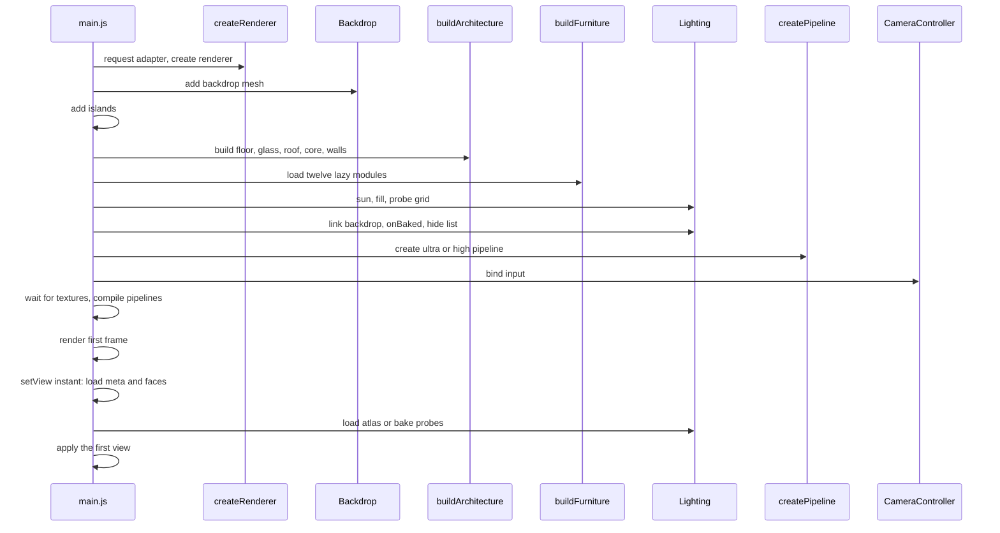
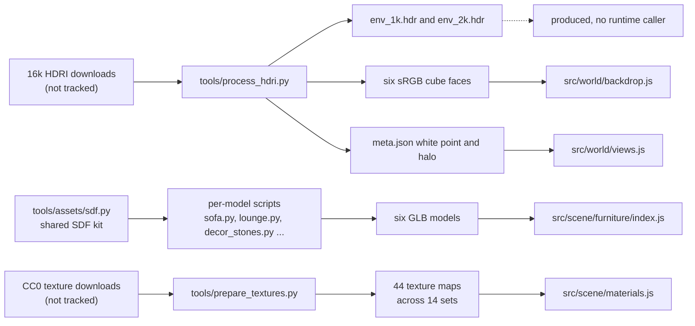

# Architecture: layers, contracts and ownership

Casa Ocaso separates measured data from drawn geometry and from the render pipeline. The entry module owns the order of assembly. The room plan owns the dimensions. The world layer owns the outside light. The scene layer owns the surfaces. The core layer owns the frame. The tools own the assets and the measurements. This document maps those layers, states the contract of each module, follows the asset and data flows, and shows how one failed module stays isolated.

Casa Ocaso is a browser scene of a coastal house. The page uses three.js with the Web Graphics Processing Unit (WebGPU) renderer. A view is a sky and light preset for one outside panorama. A shot is a stored camera pose. The islands are exterior landforms outside the room. A probe is a light sample at one point. A probe grid is a lattice of probes. A bake renders a cube map at each probe. A bounce is one light-transfer round that uses the previous result. The atlas packs every probe result into one texture. The pipeline also uses ambient occlusion (AO) and global illumination (GI). All behavioural statements below come from reading the source. None is verified at runtime.

The counts are these. The repository has 193 tracked files: 31 under `src`, 30 under `tools`, 122 under `public` and 10 at the root or under `docs`. The `src` tree has 9,531 JavaScript lines. The `public` tree is about 147 mebibytes. There are 6 views and 8 shots. Each view folder holds 12 files: two panorama files, six cube faces, a metadata record, an atlas pair and a thumbnail (`public/views/beach-sunrise`). All six shipped views include an atlas pair. These counts come from the pinned checkout at `fcc3379`. Here `README.md` means the project README, not this document.

## 1. Layer graph and ownership

The layer graph is a set of imports, not a framework. `src/main.js` imports the renderer, backdrop, islands, views, lighting, reflections, architecture, materials, furniture, controller, shots, interface and audio (`src/main.js:1-15`). No layer imports `src/main.js`. Every arrow points from a dependency to its consumer.

```mermaid
flowchart TB
  subgraph Entry
    main["src/main.js"]
    config["src/config.js"]
  end
  subgraph Core
    renderer["src/core/renderer.js"]
  end
  subgraph World
    views["src/world/views.js"]
    backdrop["src/world/backdrop.js"]
    lighting["src/world/lighting.js"]
    reflections["src/world/reflections.js"]
    islands["src/world/islands.js"]
  end
  subgraph Scene
    arch["src/scene/architecture.js"]
    floor["Planar floor reflection<br/>src/scene/architecture.js"]
    mats["src/scene/materials.js"]
    furn["src/scene/furniture/index.js"]
    plants["src/scene/plants/*"]
    cliff["src/scene/cliff.js"]
    geo["src/geo/arch.js"]
  end
  subgraph Input
    controller["src/camera/controller.js"]
    shots["src/camera/shots.js"]
  end
  subgraph Presentation
    ui["src/ui/ui.js"]
    audio["src/audio/ambience.js"]
  end
  config --> arch
  config --> furn
  config --> plants
  geo --> arch
  mats --> arch
  mats --> furn
  reflections --> arch
  reflections --> furn
  floor --> arch
  floor --> lighting
  views --> main
  lighting --> main
  arch --> main
  furn --> main
  shots --> main
  controller --> main
  renderer --> main
  ui --> main
  audio --> main
  backdrop --> main
  islands --> main
  reflections --> main
  mats --> main
```



The layer rule is one-way with two named exceptions. A layer may import shared data and three.js. It does not import `src/main.js`. A lower layer normally does not import a higher one. The two exceptions are visible in the diagram. The scene surfaces import the world reflection helper, so `reflections` feeds `arch` and `furn`. The world lighting imports the scene floor reflector only to hide it during a bake, so `floor` feeds `lighting`. The other imports follow the rule. `src/core/renderer.js` imports only three.js and its addons (`src/core/renderer.js:1-12`). `src/world/lighting.js` does not import the camera or the interface. `src/scene/furniture/index.js` imports the material library and the Graphics Library Transmission Format (glTF) Binary (GLB) loader. It does not import the renderer or the view table (`src/scene/furniture/index.js:1-3`).

`src/geo/arch.js` holds the arch and vault curves. `src/scene/cliff.js` holds the cliff mesh. `src/scene/plants/*` holds the olive and exterior plant modules. The floor node is a part of `src/scene/architecture.js`, not a second file.

The ownership table makes the boundary explicit.

| Concern | Owner | Evidence |
|---|---|---|
| Room dimensions | `src/config.js` | `src/config.js:5-91` |
| Assembly order | `src/main.js` | `src/main.js:25-281` |
| Frame path | `src/core/renderer.js` | `src/core/renderer.js:84-218` |
| Sun and bounce light | `src/world/lighting.js` | `src/world/lighting.js:19-68` |
| Outside photograph | `src/world/backdrop.js` | `src/world/backdrop.js:278-366` |
| View data | `src/world/views.js` | `src/world/views.js:9-59` |
| Interior reflection | `src/world/reflections.js` | `src/world/reflections.js:12-21` |
| Planar floor reflection | `src/scene/architecture.js` | `src/scene/architecture.js:14-17` and `172-190` |
| Architecture surfaces | `src/scene/architecture.js` | `src/scene/architecture.js:528-542` |
| Material library | `src/scene/materials.js` | `src/scene/materials.js:14-657` |
| Furniture modules | `src/scene/furniture/index.js` | `src/scene/furniture/index.js:8-163` |
| Camera pose | `src/camera/controller.js` | `src/camera/controller.js:19-272` |
| Shot list | `src/camera/shots.js` | `src/camera/shots.js:4-25` |
| Capture surface | `src/main.js` | `src/main.js:374-492` |
| Asset generation | `tools/*.py` | `tools/assets/sdf.py:1-301` and `tools/process_hdri.py:1-192` |
| Atlas bake and adapter report | `tools/bake_gi.mjs` and `tools/gpuinfo.mjs` | `tools/bake_gi.mjs:40-57` and `tools/gpuinfo.mjs:10-18` |

The two reflection systems are separate. The interior cube probe and its prefiltered mipmapped radiance environment map (PMREM) live in `src/world/reflections.js` (`src/world/reflections.js:7-21`). The planar floor reflection lives in `src/scene/architecture.js`. It calls `reflector` with half resolution, mipmaps and no extra bounce (`src/scene/architecture.js:172-190`). The floor reflection is not the cube probe.

## 2. Initialisation order

The order is part of the architecture. Each step depends on the one before.



The renderer is created first because it owns the adapter limits. It asks for a high-performance adapter. It reads `maxSampledTexturesPerShaderStage`. If the adapter offers more than 16 textures per stage, the renderer requests up to 32 (`src/core/renderer.js:14-27`). The backdrop holds two face sets, `a` and `b`, so a view change can crossfade them (`src/world/backdrop.js:75-86` and `297-366`). The source gives four backdrops as the reason for the limit: two six-face panoramas, a halo and a noise table. The probe atlas, the interior probe and the shadow maps add more. The exact count is not written down, so the request is a safety margin. The same limit controls the ocean view. The entry module enables the ocean only when the view asks for it and the adapter reports more than 16 textures (`src/main.js:68-69`).

The backdrop is added before the architecture. It is a sphere of radius 900 metres with a back-side material, depth write off and render order -10 (`src/world/backdrop.js:298-306`). The islands follow at render orders -9 and -8 (`src/world/islands.js:150-185`). The room geometry then draws over them.

The furniture assembly runs before the lighting. The assembly returns a group and an optional update function (`src/scene/furniture/index.js:111-163`). The camera enables the detail layer (layer 1) after the assembly returns (`src/main.js:44`). The lighting object then receives three links. It receives the backdrop, so it can tint the panorama during a bake. It receives an `onBaked` callback, so it can refresh the interior reflection. It receives the furniture and island groups as objects to hide during a bake (`src/main.js:46-50`).

```text
# src/main.js:46-50
const lighting = new Lighting( scene );
lighting.backdrop = backdrop;
lighting.onBaked = () => updateInteriorProbe( renderer, scene );
lighting.hideDuringBake = [ furniture.group, islands.group ];
lighting.sun.shadow.camera.layers.enable( DETAIL_LAYER );
```

The pipeline is created after the lighting, because it needs the scene and camera, not the light values. `createPipeline` is defined in `src/core/renderer.js:84`. It returns the pipeline, the ambient occlusion pass, the scale setter and the precompile function. The quality comes from the query string. A capture selects `ultra`. An interactive session selects `high` (`src/main.js:52-57`).

```text
# src/main.js:55-59
const { pipeline, aoPass, setScale, precompile } = createPipeline( renderer, scene, camera, {
	quality: QUALITY, aoEnabled: params.get( 'ao' ) !== '0', denoiseAO: params.get( 'aodn' ) !== '0', toneMapping: TONE[ params.get( 'tm' ) ] ?? THREE.ACESFilmicToneMapping
} );
const dyn = { scale: 0.8, moving: 0.8, t: 0, min: 0.5, max: 1.0 };
setScale( dyn.scale );
```

The entry module then waits for the loading manager. Every material texture must be resident before the probe bake. Otherwise the probes capture black placeholders (`src/main.js:259-270`). It also compiles every geometry pipeline before the first frame, to avoid a first-use stall (`src/main.js:273-277`). It renders one frame, then calls `setView` with `instant: true` (`src/main.js:278-281`).

## 3. Module contracts

A contract is the small surface that one module exposes to another. The contracts are stable even though the internals are large.

### Furniture module contract

Every furniture or decor module exports `async build(ctx)`. The function returns an object with an optional `object` and an optional `update(dt, t)` (`src/scene/furniture/index.js:5-7`). The context holds the scene, the group, `loadModel` and `ensureVertexAO` (`src/scene/furniture/index.js:117`). A module may ignore the context, as the seating module does when it loads a GLB directly (`src/scene/furniture/seating.js:17-31`).

```text
# src/scene/furniture/index.js:111-131
export async function buildFurniture( scene ) {

	const group = new THREE.Group();
	group.name = 'furniture';
	scene.add( group );
	const updaters = [];
	const ctx = { scene, group, loadModel, ensureVertexAO };

	// debugging: ?nofurn=1 skips all modules, ?mods=0,3,7 loads only those indices
	const q = new URLSearchParams( location.search );
	const only = q.get( 'mods' )?.split( ',' ).map( Number );
	const list = q.get( 'nofurn' ) === '1' ? [] : MODULES.filter( ( m, i ) => ! only || only.includes( i ) );
	const results = await Promise.allSettled( list.map( async ( load ) => {

		const mod = await load();
		const res = await mod.build( ctx );
		if ( res?.object ) group.add( res.object );
		if ( res?.update ) updaters.push( res.update );
		return res;

	} ) );
```

The contract has three failure rules. A rejected module does not stop the assembly. A module without an `object` adds nothing. A module with an `update` is registered in the update list.

```text
# src/scene/furniture/index.js:133-137
	results.forEach( ( r, i ) => {

		if ( r.status === 'rejected' ) console.warn( `[furniture] module ${ i } skipped:`, r.reason?.message ?? r.reason );

	} );
```

### Model loader contract

`loadModel(url)` loads one GLB. It walks every mesh. It adopts the baked colour attribute, swaps the material by name, ensures a vertex colour attribute, and enables cast and receive shadows (`src/scene/furniture/index.js:93-109`). The material swap is by name. The code reads `o.material.name`, so the material names in the GLB carry the intent.

```text
# src/scene/furniture/index.js:93-109
export async function loadModel( url ) {

	const data = await gltf.loadAsync( url );
	data.scene.traverse( ( o ) => {

		if ( ! o.isMesh ) return;
		adoptBakedColor( o.geometry );
		const lib = materialByName( o.material?.name );
		if ( lib ) o.material = lib;
		ensureVertexAO( o.geometry );
		o.castShadow = true;
		o.receiveShadow = true;

	} );
	return data.scene;

}
```

The colour path is a compatibility step. The Python exporter writes the baked ambient occlusion as `_color`, and the three.js loader exposes that name. The attribute holds unnormalised bytes. The runtime divides each channel by 255 or 65535 and maps it onto the standard float `color` attribute (`src/scene/furniture/index.js:66-90`). The material library reads the red channel as a grey multiplier (`src/scene/materials.js:35-39`). A mesh without the attribute gets a white default. The Python tool computes occlusion along the vertex normal at six distances up to 0.22, with a falling weight per step. The result is one value in [0, 1] per vertex (`tools/assets/sdf.py:253-263`).

### View record contract

A view record has an `id`, a `label`, a `place`, a `credit`, an `exposure`, a `sun` scale, a `sky` scale and a `sunNeutral` factor (`src/world/views.js:4-8`). Its optional fields are `lightEl`, `cove`, `fill`, `gi`, `grade`, `ocean`, `night` and `crispSun`. `cove` is the interior light strip scale. `exposure` scales the whole frame. `sun` scales the measured sun. `sky` scales the panorama. `sunNeutral` pulls the sun colour toward warm white. `lightEl` is the sun elevation in degrees. `fill` is the sky fill. `gi` scales the bounce light. `grade` holds warmth, shadow tint and saturation. `crispSun` keeps or drops the drawn sun disk. The record is data, so the entry module can apply it without knowing which view is active.

```text
# src/world/views.js:4-8
// Real panoramas (Poly Haven, CC0) seen through the glass. Each one is rotated by
// tools/process_hdri.py so its sun sits where the reference renders have theirs.
// exposure: global exposure for the view; sun: scale of the measured sun; sunNeutral: how far the
// sun colour is pulled towards warm white; cove / fill: interior LED cove and hemisphere fill;
// gi: bounce light scale (main.js GI_DEFAULT when absent).
```

### Backdrop contract

A face set loads six faces. The caller passes the metadata record and the options. The options are `sun`, `crisp` and `ocean`. `sun` controls whether the bright spot counts as a sun. `crisp` controls whether the shader redraws the sun. `ocean` controls whether the lower half becomes procedural sea (`src/world/backdrop.js:182-217`).

```text
# src/world/backdrop.js:187-217
	async load( dir, meta, loader, { sun = true, crisp = true, ocean = false } = {} ) {

		const textures = await Promise.all( FACES.map( ( f ) => loader.loadAsync( `${ dir }/${ f }.jpg` ) ) );
		for ( let i = 0; i < FACES.length; i ++ ) {

			const t = textures[ i ];
			t.colorSpace = THREE.SRGBColorSpace;
			t.flipY = false;
			t.wrapS = t.wrapT = THREE.ClampToEdgeWrapping;
			t.anisotropy = 8;
			t.generateMipmaps = true;
			t.minFilter = THREE.LinearMipmapLinearFilter;
			t.needsUpdate = true;
			this.nodes[ FACES[ i ] ].value = t;

		}

		for ( const t of this.textures ) t.dispose();
		this.textures = textures;

		this.white.value = meta.white;
		this.sunDir.value.fromArray( meta.sun.dir ).normalize();
		const hasSun = sun && meta.sun.peak > 200;
		this.hasSun.value = hasSun && crisp ? 1 : 0;
		this.ocean.value = ocean ? 1 : 0;
		const clampMax = 24000;
		const rgb = meta.sun.rgb.map( ( v ) => Math.min( v, clampMax ) );
		this.sunDisk.value.set( ...( hasSun ? rgb : [ 0, 0, 0 ] ) );
		this.fillHalo( meta.halo, hasSun );

	}
```

The face set stores the white point, the sun direction, the sun disk colour and the halo profile. The peak and the clamp use the panorama's relative radiance units. The clamp of 24000 is a safety limit. The code fills a 256-sample halo texture from the measured profile (`src/world/backdrop.js:219-274`).

### Lighting contract

The lighting object exposes `setSun`, `requestBake`, `update`, `loadAtlas`, `uploadAtlas`, `blendAtlas`, `bakeAll`, `exportAtlas`, `gridSignature`, `atlasDims` and the `baking` getter. `setSun` writes the sun colour, intensity and direction. `requestBake` starts a progressive bake and `update` advances it. `bakeAll` runs a bake in one call. `loadAtlas` and `uploadAtlas` move a stored atlas. `blendAtlas` mixes two atlases. `exportAtlas` reads the atlas back. `gridSignature` and `atlasDims` identify the layout. `baking` is true while a bake runs. The contract is stateful: a caller starts a bake, then calls `update` each frame, which returns progress or null.

```text
# src/world/lighting.js:130-140
	requestBake( { fast = false, perFrame = this.probesPerFrame, then = null } = {} ) {

		const res = this.probes.resolution;
		this.bake = {
			index: 0, pass: 0, total: res.x * res.y * res.z,
			bounces: fast ? 1 : this.bounces,
			cubemapSize: fast ? 8 : this.cubemapSize,
			perFrame, then
		};

	}
```

The defaults are two bounces, a 16-pixel cube map and 24 probes per frame (`src/world/lighting.js:58-63`). The atlas is a three-dimensional texture of half floats, 18 by 6 by 126 texels, or 108,864 bytes (`src/world/lighting.js:186-195`). The baked atlas is optional at run time. `loadAtlas` returns null when a file is missing. It also returns null when the dimensions or the grid signature do not match the live probe grid (`src/world/lighting.js:235-252`). The check detects a different layout. It never reads the binary length, so a corrupt binary of any length passes it. It does not detect a changed wall or material. A content change needs a new bake and a new atlas file.

```text
# src/world/lighting.js:235-252
	async loadAtlas( id ) {

		try {

			const [ meta, bin ] = await Promise.all( [
				fetch( `/views/${ id }/gi.json` ).then( ( r ) => ( r.ok ? r.json() : null ) ),
				fetch( `/views/${ id }/gi.bin` ).then( ( r ) => ( r.ok ? r.arrayBuffer() : null ) )
			] );
			if ( ! meta || ! bin || meta.dims.join() !== this.atlasDims.join() || meta.grid !== JSON.stringify( GRID ) ) return null;
			return new Uint16Array( bin );

		} catch {

			return null;

		}

	}
```

### Reflection contract

`envSpecular` adds a specular-only room reflection to a material. The caller gives a roughness, an optional Fresnel base, a strength, an optional direction and an occlusion flag (`src/world/reflections.js:79-90`). `pmremTexture` samples a prefiltered mipmapped radiance environment map (PMREM). `envBRDF` is the split-sum environment lookup. `specularOcclusion` reduces the reflection where the surface is occluded. Diffuse light does not come from this probe. It comes from the probe grid. This division prevents double counting. It also limits light leaking indoors.

```text
# src/world/reflections.js:79-90
export function envSpecular( { roughness, f0 = 0.04, strength = 1, dir = reflectVector, occlusion = true } ) {

	if ( DISABLED ) return vec3( 0 );
	const r = typeof roughness === 'number' ? float( roughness ) : roughness;
	const V = normalize( positionView.negate() );
	const NdotV = clamp( dot( normalView, V ), 0.001, 1 );
	const F0 = typeof f0 === 'number' ? vec3( f0 ) : f0;
	const so = occlusion ? specularOcclusion( NdotV, ambientOcclusion, r ) : float( 1 );
	const s = typeof strength === 'number' ? float( strength ) : strength;
	return pmremTexture( target.texture, dir, r ).rgb.mul( envBRDF( F0, r, NdotV ) ).mul( interiorProbe.strength ).mul( s.mul( so ) );

}
```

### Capture application programming interface (API) contract

`shoot` places a shot and waits for a number of frames and for the bake to finish. `videoFrame` installs a virtual clock and renders one frame at an exact pose and time. `exportGI` returns the atlas as base64 plus the layout. `set` walks a dotted path into the grade, lighting, backdrop, controller, renderer, cove or floor reflection (`src/main.js:374-492`).

```text
# src/main.js:374-388
window.__api = {
	shots: SHOTS,
	views: VIEWS.map( ( v ) => v.id ),
	async shoot( shot, { settle = 48 } = {} ) {

		controller.set( typeof shot === 'string' ? SHOTS[ shot ] : shot );
		const start = frames;
		await new Promise( ( r ) => {

			const check = () => ( frames - start >= settle && ! lighting.baking ? r() : requestAnimationFrame( check ) );
			check();

		} );
		return true;

```

## 4. The furniture module pattern

The pattern is small and defensive. The list holds twelve arrow functions, not twelve imports. Each arrow returns a dynamic `import` (`src/scene/furniture/index.js:8-21`). The browser fetches a module when its arrow function is called. A failure in one dynamic import or one `build` call becomes a rejected promise.

The assembly uses `Promise.allSettled`, not `Promise.all` (`src/scene/furniture/index.js:123`). This choice changes the failure mode. With `Promise.all`, one rejected module rejects the whole assembly promise, though the group is already in the scene with the modules that finished. With `allSettled`, the rejected module is skipped and the rest renders (`src/scene/furniture/index.js:133-137`). The console gets a warning with the index in the loaded list and the reason. With `?mods`, that index is not the original module index.

The pattern also has a debug surface. The query option `?nofurn=1` loads no modules. The option `?mods=0,3,7` loads only the listed indices (`src/scene/furniture/index.js:119-122`). This is a static fact; the exploration did not run it.

The detail layer is the cost control. After the assembly, a traversal marks two kinds of mesh. An instanced mesh with more than 40 instances moves to layer 1. A mesh whose name matches leaf, leaves, shrub, tuft, needle, bead, pebble, fringe, twig or sprig moves to layer 1 (`src/scene/furniture/index.js:25-26` and `139-152`). The main camera enables the layer. The shadow camera enables the layer. The probe captures and the floor reflection skip it (`src/scene/furniture/index.js:148-150`).

```text
# src/scene/furniture/index.js:139-152
	group.traverse( ( o ) => {

		if ( o.isMesh && o.material && ! o.userData.noAO ) {

			const mats = Array.isArray( o.material ) ? o.material : [ o.material ];
			if ( mats.some( ( m ) => m.aoNode ) ) ensureVertexAO( o.geometry );

		}

		// fine, high-poly detail lives on the DETAIL layer: the main and shadow cameras render it,
		// the GI probe captures (and the floor reflection) skip it
		if ( o.isMesh && ( ( o.isInstancedMesh && o.count > 40 ) || DETAIL_NAMES.test( o.name ) ) ) o.layers.set( DETAIL_LAYER );

	} );
```

**Aha:** The detail layer is a heuristic, not a manual list. It reads the mesh name and the instance count. A module can therefore add a thousand leaves and pay the probe cost only for the coarse form. The naming convention carries the performance contract. This is a low-ceremony design that keeps the twelve modules independent.

Three occlusion sources differ. The Python asset tool bakes per-vertex ambient occlusion into `_color`. `ensureVertexAO` adds a white `color` attribute when a mesh has none, so the material gets no vertex occlusion. The ground-truth ambient occlusion (GTAO) pass computes screen-space occlusion at render time.

The vertex colour path is another low-ceremony contract. The Python exporter writes ambient occlusion into `_color`. The loader maps it to `color`. The material library reads `attribute('color','vec4').r` as a multiplier (`src/scene/materials.js:35-39`). A mesh without the attribute gets a white default (`src/scene/furniture/index.js:52-64`).

## 5. Asset flow

The assets are built offline and stored under `public`. The runtime only loads them.



The high dynamic range image (HDRI) path starts from a 16k source under `.tools/downloads/hdri`. The source folder is not tracked (`tools/process_hdri.py:25-27`). The tool finds the sun by a blurred luminance maximum and a weighted centroid. It rolls the panorama so the sun lands at a target azimuth (`tools/process_hdri.py:75-113`). It writes two equirectangular high dynamic range (HDR) files, six cube faces and a metadata record (`tools/process_hdri.py:151-192`). The face sizes are 4096 for px, nx and nz, and 2048 for pz, py and ny (`tools/process_hdri.py:42`). The two HDR files have a loader, `loadEnvironment`, but no caller (`src/world/views.js:109-113`). They are produced and unused by the current runtime.

The model path starts from a Python signed distance field (SDF). The kit has primitives for spheres, boxes, capsules, cylinders and ellipsoids. It has smooth unions and subtractions. It polygonises with marching cubes and projects the decimated vertices back onto the zero level set (`tools/assets/sdf.py:212-250`). It writes the ambient occlusion as a vertex colour (`tools/assets/sdf.py:253-263` and `277-300`). The six tracked models are `cliff.glb`, `decor_stones.glb`, `dining_chair.glb`, `lounge.glb`, `sofa.glb` and `throw.glb` (`git ls-files public/models`). Six modules load one model each: seating (`sofa.glb`), lounge (`lounge.glb`), dining (`dining_chair.glb`), decor (`decor_stones.glb`), textiles (`throw.glb`) and cliff (`cliff.glb`). The other six modules build geometry in code.

The texture path copies and resizes downloaded Creative Commons Zero (CC0) maps (`tools/prepare_textures.py:1-43`). The public tree has 44 maps across 14 sets (`git ls-files public/textures`). The counts are bark 3, boucle 6, carpet 4, fleece 3, jacquard 2, jersey 2, knit 3 and linen 3. The rest are plaster_rough 3, plaster 3, rock 3, terry 2, travertine_floor 3 and travertine 4. The sets do not all hold the same channels. Some have no normal map and some have no ambient occlusion map. A set is a group of files, not a map of each kind.

The runtime never builds a stored asset. It fetches a metadata file, a cube face, a GLB, a texture or an atlas. It may bake light into an atlas at run time. It does not mesh a model or cut a cube face. It does decode the stored JPEG faces and texture maps when it loads them.

## 6. Data flow

There are six data paths. The light path has three parts: the sun, the `gi` query and the probe lookup. The paths meet in the entry module.

The plan path. `src/config.js` exports constants and helpers. The architecture builder imports the constants. The furniture modules import the seating, dining and decor records. The plants import the core and terrace records. The Python asset tools repeat a few constants in their own files (`tools/assets/sofa.py:29-31`). The plan is therefore duplicated at the asset boundary, not imported across languages.

The view path. `src/world/views.js` holds the six records. The entry module reads a record in `setView`. It calls `loadViewMeta` for the metadata. It computes the sun direction and the sun colour. It loads the atlas. It applies the grade (`src/main.js:106-148`).

The panorama path. The face set loads six faces from `/views/<id>`. It reads the white point, the sun direction, the sun disk and the halo from the metadata (`src/main.js:112-114` and `src/world/backdrop.js:187-217`). The entry module passes `sun`, `crisp` and `ocean` flags from the view record (`src/main.js:114`).

The light path. The lighting object receives the shared azimuth and the irradiance vector. The elevation comes from `keyDirection` (`src/main.js:97-104`). It sets the sun colour and intensity. It writes the direction into the shared uniform for the materials (`src/world/lighting.js:113-123`).

The second part is the `gi` query, which selects the atlas. A missing `gi` parameter loads the stored atlas. Any present `gi` value forces a live bake. `gi=fast` uses one bounce and 8-pixel probes. `gi=full` uses two bounces and 16-pixel probes (`src/main.js:51` and `122-137`; `tools/bake_gi.mjs`). The object uploads the atlas into the probe texture (`src/world/lighting.js:214-232`).

The third part is the probe lookup, which is addon code. The project controls the grid box, `this.probes.texture`, `this.probes.intensity`, `this.probes.visible` and the exclusion lists. The comment gives about 0.4 metres downward offset for downward-facing lookups (`src/world/lighting.js:10-13`).

The camera path. The shot list holds the poses. The controller receives a pose in `set` or `flyTo`. The entry module passes the start shot from the query string (`src/main.js:255-257`). The user interface (UI) calls the same controller through callbacks (`src/main.js:244-251`).

The crossfade path is the most complex. The entry module records the current grade, sun and view. It starts a 2.8 second ease. The ease is the smoothstep curve `t*t*(3-2*t)`. On each frame it blends the backdrop uniform, the sun direction, the irradiance, the numeric fields of the grade, the cove, the fill and the probe intensity. The direction uses a normalized linear mix. The irradiance uses a linear mix. If both views have an atlas, it blends the atlas on the central processing unit (CPU) and uploads the result (`src/main.js:152-198`). `blendAtlas` converts each half float, mixes the values and encodes them again (`src/world/lighting.js:260-269`). If the pair has no atlas, it starts a fast one-bounce bake during the fade (`src/main.js:160-164`).

## 7. Failure isolation

The source has four isolation mechanisms.

The first is the furniture `allSettled` rule. A failed module is a warning, not a fatal error (`src/scene/furniture/index.js:123-137`).

The second is the atlas validation. A missing or stale atlas returns null. The check reads file presence, dimensions and the grid string. A corrupt binary of the correct length would pass it. The entry module then falls back to a live bake (`src/world/lighting.js:235-252` and `src/main.js:122-139`). The fallback is slower but correct.

The third is the adapter limit. The backdrop shader needs more than 16 sampled textures when the ocean is active. The entry module checks the limit and disables the ocean on a small adapter (`src/main.js:68-69`). The rest of the view still loads.

The fourth is the tool-side catch. `tools/gpuinfo.mjs` prints the adapter limits. It opens `/tools-blank.html`, an untracked page with no scene. A catch keeps the tool running when that page fails (`tools/gpuinfo.mjs:10-18`).

Some points are unguarded. `loadViewMeta` does not catch a failed fetch (`src/world/views.js:100-105`). `Backdrop.load` does not catch a failed face load (`src/world/backdrop.js:187-202`). A missing view file would reject the `setView` promise and leave the loading state on. The source does not define a recovery path for that case.

## 8. Quality paths

The architecture has two frame paths and three session modes. A capture session sets `?capture=1` and uses `ultra`. A normal session uses `high` (`src/main.js:17-21` and `52-53`). A video session sets `?capture=1&video=1` and installs a virtual clock.

The ultra path owns a pre-pass, a full-resolution temporal resolve and a sharpen at 0.05 (`src/core/renderer.js:95-126`). The pre-pass adds one geometry draw into the normal and velocity targets. The high path owns a multi-render target (MRT) geometry pass, a half-resolution ambient occlusion pass, a temporal anti-aliasing upscaling (TAAU) resolve and a sharpen at 0.25 (`src/core/renderer.js:127-153`). The sharpen values are strengths, not distances. The entry module owns the high-path dynamic resolution loop. The loop lowers the render scale by 0.05 above 21 milliseconds and raises it below 14 milliseconds. It stays between 0.5 and 1.0. When the camera rests, it climbs to full resolution (`src/main.js:315-341`). The pipeline exposes `setScale` for that loop (`src/core/renderer.js:151`).

The capture path disables the controller and the drift, a slow automatic camera motion (`src/main.js:257`). It uses pixel ratio 1; the interactive path allows up to 1.5 (`src/main.js:26`). A capture uses the full atlas or a full bake. The interactive path uses a fast first bake, then a progressive refinement (`src/main.js:132-138`).

## 9. Boundaries and non-ownership

The core layer does not know a room exists. It receives a scene, a camera and a quality string. The world layer does not own the walls. It owns the outside and the light. The scene layer does not own the frame. It owns the surfaces and their materials. The camera layer does not own the scene. It owns the pose. The tools do not render the room. They drive a browser or process the files.

This boundary makes the static reading possible: a reader can follow the light path without the sofa, or the sofa without the renderer. The documents follow the same split.

## 10. Next

The [core mechanism document](02-core-mechanism.md) follows the two halves from panorama measurement to graded pixel. The [workflow document](03-workflow-and-quality.md) follows the tools. The [limits document](04-limits-and-comparison.md) lists where the static reading stops.

No runtime behaviour in this document is verified. The counts and the paths come from the checkout at `fcc3379`. The asset files were not decoded. The tools were not run.
