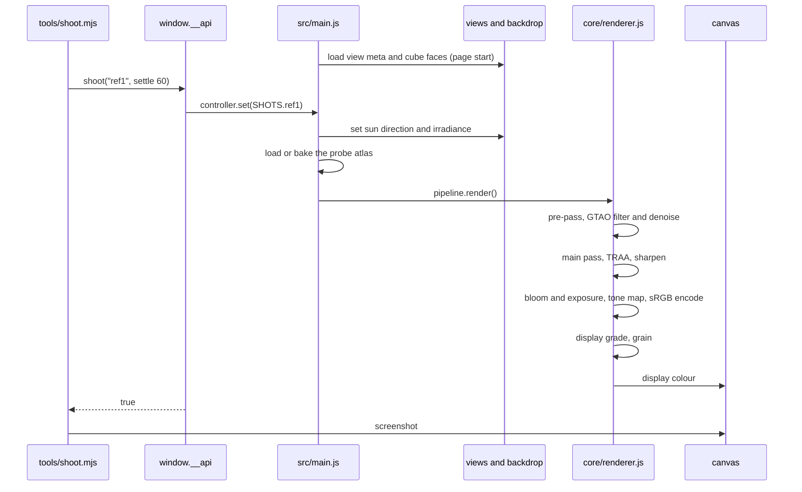
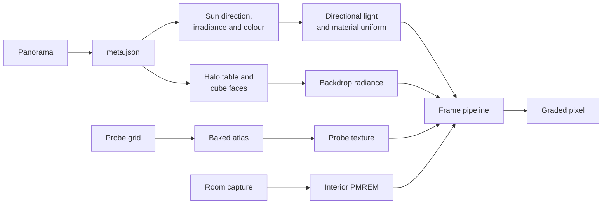

# Core mechanism: from six photographs to one pixel

The mechanism has two halves. The first half turns a real high dynamic range image (HDRI) panorama into light data. The data is a sun direction, a sun irradiance, a sun colour, a halo table, six cube faces, a procedural sea and an interior specular probe. It also turns the room into a baked probe atlas. The second half turns one camera pose and that light into one graded frame. The halves meet at two values for the current view: the sun azimuth and one linear red, green and blue irradiance. The elevation differs, so this document follows both halves to their meeting point.

A probe is a light sample at one point. A bake renders light at every probe and stores the results in the atlas. Radiance is light that leaves a surface. Irradiance is light that arrives at a point.

The shader code uses Three Shading Language (TSL) nodes on the Web Graphics Processing Unit (WebGPU) renderer. A view is a sky and light preset. A shot is a camera pose. The five reference images are not tracked.

The counts used in this document are these. The repository has 193 tracked files: 31 under `src`, 30 under `tools`, 122 under `public` and 10 at the root or under `docs`. The `src` tree has 9,531 JavaScript lines. The `public` tree is about 147 mebibytes. There are 6 views with 12 files each, and 8 shots. These counts come from the pinned checkout at `fcc3379`.

## Half A: from panorama to light

### A1. The sun measurement

`tools/process_hdri.py` reads a 16k panorama from an untracked download folder (`tools/process_hdri.py:25-27`) and downsamples it to 2048 by 1024. It finds the sun by blurring the luminance with a Gaussian of sigma 2, taking the brightest pixel and refining the position with a luminance-weighted centroid in a window (`tools/process_hdri.py:75-89`).

```text
# tools/process_hdri.py:75-89
def find_sun(img_small):
    L = lum(img_small)
    Lb = cv2.GaussianBlur(L, (0, 0), 2)
    y, x = np.unravel_index(np.argmax(Lb), Lb.shape)
    h, w = L.shape
    # refine with luminance weighted centroid in a window
    r = max(3, w // 256)
    ys, xs = slice(max(0, y - r), min(h, y + r + 1)), slice(max(0, x - r), min(w, x + r + 1))
    win = L[ys, xs]
    thr = win.max() * 0.5
    m = win >= thr
    yy, xx = np.mgrid[ys, xs]
    cy = (yy[m] * win[m]).sum() / win[m].sum()
    cx = (xx[m] * win[m]).sum() / win[m].sum()
    return (cx + 0.5) / w, 1 - (cy + 0.5) / h, float(Lb.max())
```

The tool converts the sun pixel to a direction, then computes a rotation about the vertical axis. The source calls this roll; it changes azimuth and not elevation. If the view gives a target azimuth, the angle is the difference between the target and the measured value. Otherwise it is a fixed yaw (`tools/process_hdri.py:101-110`). The tool rotates the panorama, measures again and records the new direction (`tools/process_hdri.py:111-115`).

The target azimuths are 24 degrees for `golden-hour`, 18 for `sea-fog`, 20 for `dusk`, 12 for `cliff-morning` and 22 for `beach-sunrise`. The night view keeps its measured direction and uses yaw 0 (`tools/process_hdri.py:31-38`). The beach metadata records a rolled direction of `[0.37339422195756605, 0.03531675621738099, -0.9270002598376044]`. That is an azimuth of 21.94 degrees and an elevation of 2.02 degrees (`public/views/beach-sunrise/meta.json:10-15`).

### A2. The white point and the cube faces

The cube faces are 8-bit standard RGB (sRGB) images. The tool divides each face by the white point and then applies the sRGB encode (`tools/process_hdri.py:160-166`). The renderer multiplies the decoded face colour by the same white point, so the linear scale returns. The white point is the 99.9th percentile of luminance outside 12 degrees of the sun, times 1.15 (`tools/process_hdri.py:145-149`). The beach value is 2.518668961524963 (`public/views/beach-sunrise/meta.json:6`). The sun and halo fields are not divided; they stay in panorama radiance units.

The six faces are cut from the equirectangular image with a direction-to-face mapping (`tools/process_hdri.py:42`). The tool writes the sRGB values with a small ordered dither (`tools/process_hdri.py:155-169`).

The shader samples six ordinary textures, not a cube map sampler. It maps a direction `d` to a face coordinate with `faceUV` and selects the face with `faceMask` (`src/world/backdrop.js:35-69`).

The mask returns 1 on the face with the largest absolute component and 0 on the others. The shader samples all six faces and multiplies each by its mask (`src/world/backdrop.js:150-158`). Six face samplers plus the halo, noise and probe samplers are why the renderer asks for more than 16 textures per shader stage (`src/core/renderer.js:15-19`).

```text
# src/world/backdrop.js:150-158
	radiance( d, withSun = true ) {

		let col = vec3( 0 );
		for ( const f of FACES ) {

			const uv = clamp( faceUV( d, f ), 0.0005, 0.9995 );
			col = col.add( this.nodes[ f ].sample( uv ).rgb.mul( faceMask( d, f ) ) );

		}
```

### A3. Sun irradiance and sun colour

The tool records the mean colour inside 0.3 degrees (`tools/process_hdri.py:142`); the runtime disk radius is 0.265 degrees (`src/world/views.js:61`). It records a radial profile, with outer radii 0.25, 0.5, 0.75 and 1.0 degrees, then 1.5 to 30 degrees (`tools/process_hdri.py:125`). The beach disk colour is `[9393.853515625, 2379.2275390625, 2.2394604682922363]`. The first halo bin at 0.25 degrees is `[12116.8447265625, 3096.13330078125, 1.8962962627410889]` (`public/views/beach-sunrise/meta.json:16-35`).

The runtime converts this record into an irradiance vector. It multiplies the disk colour by the solid angle of the cone from 0 to 0.265 degrees. It adds the halo bins up to 2 degrees, with each bin multiplied by the solid angle between the previous radius and its own radius (`src/world/views.js:65-82`). The integration starts at `max(prev, 0.265)`, so the 0 to 0.25 degree annulus is skipped and the crossing bin is clipped (`src/world/views.js:69-78`).

`peak` is the brightest blurred luminance from `find_sun`, in panorama units. The Gaussian spreads the tiny disk, so `peak` is smaller than the red channel of the disk colour. The 200 threshold is a source choice.

```text
# src/world/views.js:65-82
export function sunIrradiance( meta ) {

	if ( ! meta.sun || meta.sun.peak < 200 ) return new THREE.Vector3();
	const omega = ( a, b ) => 2 * Math.PI * ( Math.cos( a * Math.PI / 180 ) - Math.cos( b * Math.PI / 180 ) );
	const e = new THREE.Vector3().fromArray( meta.sun.rgb ).multiplyScalar( omega( 0, SUN_RADIUS_DEG ) );
	let prev = 0;
	for ( const [ r, , rgb ] of meta.halo ) {

		const a = Math.max( prev, SUN_RADIUS_DEG );
		if ( r > 2.0 ) break;
		if ( r > a ) e.add( new THREE.Vector3().fromArray( rgb ).multiplyScalar( omega( a, r ) ) );
		prev = r;

	}

	return e;

}
```

The result is a linear red, green and blue vector. It is the irradiance, the power per unit area that the sun delivers. The guard returns a zero vector when the metadata has no sun or a peak below 200 (`src/world/views.js:65-67`). The dusk and night views also set the view `sun` scale to 0, so their light is zero even when a measured sun passes the guard.

The measured sunset sun is deep orange. The reference renders light the room with a golden-cream key. `sunLightColor` scales warm white `[1.0, 0.82, 0.62]` to the luminance of the measured vector. It then blends the measured vector towards that warm vector by the view's `sunNeutral` factor. Both vectors have the same luminance, so the blend keeps it. It multiplies the result by the view's `sun` value (`src/world/views.js:84-98`).

### A4. The backdrop shader

The backdrop shader samples the six faces and adds the masked values. It computes a clipped factor from the maximum channel. The factor rises from 0 at 0.75 to 1 at 0.95 (`src/world/backdrop.js:160-162`). The face colour is multiplied by the white point to restore its linear scale (`src/world/backdrop.js:162`).

The shader then computes the angle between the view direction and the sun direction. It maps the angle to a square-root index into the 256-sample halo texture. The square root gives more samples near the sun (`src/world/backdrop.js:165-171`). The halo gain tightens the halo over a ramp from 0.27 to 0.8 degrees. The gain is fully applied beyond 0.8 degrees (`src/world/backdrop.js:168-171`).

The sun disk is drawn with a smoothstep from 0.29 to 0.24 degrees (`src/world/backdrop.js:172`). The final radiance is the maximum of the photograph or halo and the analytic disk (`src/world/backdrop.js:178`).

```text
# src/world/backdrop.js:165-178
		// analytic sun halo (HDR), only where it exceeds the clipped photograph
		const ang = acos( clamp( dot( d, this.sunDir ), - 1, 1 ) ).mul( 180 / Math.PI );
		const s = sqrt( clamp( ang.div( HALO_MAX_DEG ), 0, 1 ) );
		// the measured halo of this hazy sunset is wide; tighten it beyond the first degree so the
		// sun reads crisp like the references
		const tighten = mix( float( 1 ), this.haloGain, smoothstep( 0.27, 0.8, ang ) );
		const halo = this.halo.sample( vec2( s.mul( ( HALO_SAMPLES - 1 ) / HALO_SAMPLES ).add( 0.5 / HALO_SAMPLES ), 0.5 ) ).rgb.mul( this.sunScale ).mul( tighten );
		const disk = this.sunDisk.mul( smoothstep( 0.29, 0.24, ang ) );
		// the photograph clips to a flat white blob around the sun; inside ~1.5 degrees let the
		// measured (tightened) halo draw the sun instead, so the disc reads small and crisp
		// (views without a sun keep the photograph untouched)
		const near = float( 1 ).sub( smoothstep( 0.7, 1.8, ang ) ).mul( this.hasSun ).mul( clipped );
		const photo = mix( max( col, halo ), halo, near );
		return max( photo, disk );
```

**Aha:** The photograph supplies the broad sky and the horizon. The measured halo supplies the missing energy near the clipped sun. The shader takes the maximum of the photograph and the halo everywhere. It blends fully to the halo only inside about 1.8 degrees, and only when the view has a sun and the photograph is clipped there. This is why the sun reads small and crisp while the sky keeps the real cloud detail.

### A5. The halo table

The halo texture is built on the central processing unit (CPU) from outer radii and mean colours. Each bin becomes a centre point, and the code fills 256 texels. A texel angle is `s * s * 32` degrees, where `s` runs from 0 to 1. It interpolates in log space because the halo falls off roughly exponentially. It scales warm white `[1.0, 0.85, 0.65]` to the bin luminance and blends 70 percent towards it, which keeps the luminance. It clamps each channel to 24000 (`src/world/backdrop.js:219-274`).

```text
# src/world/backdrop.js:232-254
		for ( let i = 0; i < HALO_SAMPLES; i ++ ) {

			const s = i / ( HALO_SAMPLES - 1 );
			const ang = s * s * HALO_MAX_DEG;
			let c = [ 0, 0, 0 ];
			if ( hasSun ) {

				if ( ang <= pts[ 0 ].a ) c = pts[ 0 ].c;
				else if ( ang >= pts[ pts.length - 1 ].a ) c = pts[ pts.length - 1 ].c.map( ( v ) => v * Math.max( 0, 1 - ( ang - pts[ pts.length - 1 ].a ) / 4 ) );
				else {

					for ( let k = 0; k < pts.length - 1; k ++ ) {

						if ( ang >= pts[ k ].a && ang <= pts[ k + 1 ].a ) {

							// interpolate in log space, the halo falls off roughly exponentially
							const t = ( ang - pts[ k ].a ) / ( pts[ k + 1 ].a - pts[ k ].a );
							c = pts[ k ].c.map( ( v, j ) => Math.exp( Math.log( Math.max( v, 1e-4 ) ) * ( 1 - t ) + Math.log( Math.max( pts[ k + 1 ].c[ j ], 1e-4 ) ) * t ) );
							break;

						}

					}
```

The warm pull is a deliberate deviation; the source comment says an orange ring around a small white disk looked wrong in the room (`src/world/backdrop.js:260-264`).

### A6. The procedural open sea

The beach panorama is a sea-level photograph. Its lower half would show surf and sand at the wrong scale. The sea shader moves the viewpoint to 55 metres above the water and replaces that half with open sea (`src/world/backdrop.js:103-148`). The view record sets `ocean: true` (`src/world/views.js:18`).

The sea is a function of the view direction. The code computes the distance to the water at a height of 55 metres and projects the direction onto the water plane. Two noise fields move with time. The swell has crests about 150 metres long and 40 metres apart; the chop is shorter and less ordered (`src/world/backdrop.js:109-125`). Wave slopes fade when their pixel footprint is small, so unresolved waves become roughness (`src/world/backdrop.js:115-127`).

The water uses a Fresnel term, reduced by 0.4 so the sea reads darker than the sky it reflects (`src/world/backdrop.js:130-138`). The reflected ray samples the panorama's own sky, lifted a little at the horizon. The sun glitter uses a GGX distribution with an alpha that grows when the waves are unresolved (`src/world/backdrop.js:140-146`). GGX is a microfacet distribution.

The sea path is active only when the view has the ocean flag and the adapter has more than 16 sampled textures per stage (`src/main.js:68-69`). The shader path is defined but not verified here.

### A7. The probe grid and the atlas

The room receives bounce light from a `LightProbeGrid`. The grid is an 18 by 6 by 16 lattice. Its box runs from `[-10.8, -0.7, -7.6]` to `[8.6, 4.5, 9.6]` (`src/world/lighting.js:17`). The comment states that the box must enclose every visible surface. It extends below the floor and above the ceiling, because downward-facing surfaces offset their lookup by about 0.4 metres (`src/world/lighting.js:6-16`).

```text
# src/world/lighting.js:17-17
export const GRID = { min: new THREE.Vector3( - 10.8, - 0.7, - 7.6 ), max: new THREE.Vector3( 8.6, 4.5, 9.6 ), count: [ 18, 6, 16 ] };
```

The spacing is about 1.15 metres. The probes carry low-frequency bounce. Contact detail comes from signed distance field (SDF) vertex ambient occlusion, ground-truth ambient occlusion (GTAO) and the sun shadows (`src/world/lighting.js:14-16`). A full bake uses two bounces and a cubemap size of 16. A fast bake uses one bounce and a cubemap size of 8 (`src/world/lighting.js:56-63` and `130-140`).

The project does not implement the probe lookup; the `LightProbeGrid` addon does. The project controls the grid box, `this.probes.texture`, `this.probes.intensity`, `this.probes.visible` and the hide list (`src/world/lighting.js:17-30`).

The bake has three passes when two bounces are requested. The pass counter starts at 0. The source calls `this.probes.bake` with `pass: b.pass`. One group is one frame's batch of probes. The code adds the batch size to the probe index, and when the index reaches the total it resets the index and increments the pass (`src/world/lighting.js:158-178`). The loop stops when the pass counter is greater than the bounce count (`src/world/lighting.js:171`). Pass 0, pass 1 and pass 2 therefore make three passes for two bounces. The light transfer between passes is inside the addon. The capture path instead calls `bakeAll` once with the bounce count (`src/world/lighting.js:271-278`).

The bake hides the furniture and the islands. It sets the floor reflection strength to zero. It tints the backdrop amber and lowers its saturation to 0.45. It restores the hidden objects, the floor strength and the backdrop tint after each batch (`src/world/lighting.js:71-110`). The furniture detail would not fit a one-metre probe spacing. The amber tint keeps the bounce warm (`src/world/lighting.js:90-93`).

The bake is progressive. `update` bakes at most 24 probes per frame. It returns a progress value (`src/world/lighting.js:149-184`).

The probe render target is 18 by 6 by 126 (`src/world/lighting.js:190-195`). Export and upload use red, green, blue and alpha (RGBA) half floats (`src/world/lighting.js:197-230`). The file is therefore 18 × 6 × 126 × 4 × 2 = 108,864 bytes. The grid itself has 18 × 6 × 16 = 1,728 probes. The addon maps the 16 z probes to the 126 depth slices. That mapping is inside `LightProbeGrid`, not in this checkout, because `node_modules` is absent. A dense layout of 27 half floats per probe would use 93,312 bytes. The extra 15,552 bytes are undocumented addon layout. The probe stores second-order spherical harmonics (L2 SH): nine coefficients for each of three colour channels. They do not fill the file alone.

The upload creates a `Data3DTexture` with half-float RGBA and linear filtering. It copies the data into the texture and then copies that texture into the probe texture (`src/world/lighting.js:214-232`). The load path checks the dimensions and the grid signature (`src/world/lighting.js:235-252`). A mismatch returns null, and the caller bakes instead.

A view crossfade can blend two atlases on the central processing unit (CPU). The code converts every half float, blends by the ease value and uploads the result (`src/world/lighting.js:260-269`).

### A8. The interior reflection

The probe grid handles diffuse bounce. Polished stone, glazed ceramic, bronze and glass also need a specular reflection of the room. The reflection module holds one cube capture at (0.4, 1.25, 0.7). The capture is 256 pixels per cube face, half float, with mipmaps. It becomes a prefiltered mipmapped radiance environment map (PMREM) (`src/world/reflections.js:7-21`). The capture refreshes after each global illumination (GI) bake (`src/main.js:48`).

The travertine floor uses a second, separate reflection system. The architecture module creates a planar reflection with `reflector({ resolutionScale: 0.5, generateMipmaps: true, bounces: false })` (`src/scene/architecture.js:170-190`). The floor material adds that reflected image as an emissive term. The interior cube probe and its PMREM are not part of this floor term (`src/world/reflections.js:7-21`). The planar reflection renders a mirrored camera view of the scene. It is not a screen-space effect. The cube probe is a specular lookup for other materials.

The interior reflection material term is specular only. It uses Karis's split-sum environment bidirectional reflectance distribution function approximation, applies specular occlusion from the material's ambient occlusion and supports a parallax correction. The correction traces the reflected ray against a proxy of the glass drum, the floor and the ceiling, then looks up the hit point from the probe centre. This keeps the rug from floating in the middle of the glass (`src/world/reflections.js:35-59`).

```text
# src/world/reflections.js:42-59
export function parallaxReflect( { cx, cz, r, y0 = 0, y1 = 3.3, dir = reflectVector } ) {

	const p = positionWorld;
	const o = p.xz.sub( vec2( cx, cz ) ), d = dir.xz;
	const a = max( dot( d, d ), 1e-5 );
	const b = dot( o, d );
	const c = dot( o, o ).sub( r * r );
	// far root: the ray starts inside (or on) the drum
	const tWall = b.negate().add( max( b.mul( b ).sub( a.mul( c ) ), 0 ).sqrt() ).div( a );
	// floor or ceiling, whichever the ray is heading for
	const dy = select( dir.y.abs().lessThan( 1e-4 ), float( 1e-4 ), dir.y );
	const tCap = select( dy.lessThan( 0 ), float( y0 ), float( y1 ) ).sub( p.y ).div( dy );
	const t = max( min( tWall, select( tCap.greaterThan( 0 ), tCap, float( 1e6 ) ) ), 0 );
	const corrected = normalize( p.add( dir.mul( t ) ).sub( interiorProbe.centre ) );
	// a little slack (~4 cm) so the glass, which sits exactly on the proxy, is corrected too
	return select( c.lessThan( 0.5 ), corrected, dir );

}
```

The threshold `c < 0.5` is a squared-distance term in square metres. The source comment calls it about 4 centimetres of slack. The exact distance depends on the drum radius.

## Half B: from one pose to one frame

### B1. The ultra path

The ultra path is the capture and still path. Its pre-pass renders the scene with a multi-render target (MRT). It writes packed normals and velocity. It does not render transparent objects. Its output texture is 8-bit (`src/core/renderer.js:95-109`). The glass drum is transparent, so it has no pre-pass normal or velocity, but the main pass still draws it.

The main scene pass renders normally. If ambient occlusion is on, the pipeline builds a GTAO pass from the pre-pass depth and normal. It enables the temporal filter and an edge-aware denoise. It injects the result into the scene pass through `builtinAOContext` (`src/core/renderer.js:111-120`). The occlusion feeds only the ambient term. It does not darken the direct sun.

The temporal resolve is temporal reprojection anti-aliasing (TRAA). It uses the scene pass, the pre-pass depth and the pre-pass velocity. It disables subpixel correction. A light sharpen of 0.05 restores fabric loops and stone pores (`src/core/renderer.js:122-126`).

```text
# src/core/renderer.js:95-109
	if ( quality === 'ultra' ) {

		const prePass = pass( scene, camera );
		prePass.name = 'PrePass';
		prePass.transparent = false;
		prePass.setMRT( mrt( {
			output: packNormalToRGB( normalView ),
			velocity: velocity
		} ) );
		prePass.getTexture( 'output' ).type = THREE.UnsignedByteType;
		passes.push( prePass );

		const prePassNormal = sample( ( uv ) => unpackRGBToNormal( prePass.getTextureNode().sample( uv ) ) );
		const prePassDepth = prePass.getTextureNode( 'depth' );
		const prePassVelocity = prePass.getTextureNode( 'velocity' );
```

### B2. The high path

The high path is the interactive path. It draws one geometry pass with an MRT. The targets are colour, packed normal and velocity. It builds GTAO from the same pass's depth and normal at half resolution. It applies the occlusion in post by multiplying the colour with a mix from 1 to the occlusion value at 0.55 weight (`src/core/renderer.js:127-147`). The weight stays gentle because post ambient occlusion also darkens direct light (`src/core/renderer.js:144-145`).

The resolve is temporal anti-aliasing upscaling (TAAU). It uses the lit colour, the depth and the velocity. A sharpen of 0.25 follows. The scene pass exposes `setResolutionScale`, which the entry module uses for dynamic resolution (`src/core/renderer.js:149-152`).

```text
# src/core/renderer.js:127-153
	} else {

		scenePass.setMRT( mrt( {
			output: output,
			normal: packNormalToRGB( normalView ),
			velocity: velocity
		} ) );
		scenePass.getTexture( 'normal' ).type = THREE.UnsignedByteType;
		const color = scenePass.getTextureNode( 'output' );
		const depth = scenePass.getTextureNode( 'depth' );
		const vel = scenePass.getTextureNode( 'velocity' );
		const nrm = sample( ( uv ) => unpackRGBToNormal( scenePass.getTextureNode( 'normal' ).sample( uv ) ) );

		let lit = color;
		if ( aoEnabled ) {

			aoPass = setupAO( ao( depth, nrm, camera ), 0.5 );
			// post AO also darkens direct light, so keep it gentle
			lit = vec4( color.rgb.mul( mix( float( 1 ), aoPass.getTextureNode().sample( screenUV ).r, 0.55 ) ), 1 );

		}

		const taauPass = taau( lit, depth, vel, camera );
		resolved = sharpen( taauPass.getTextureNode(), 0.25 );
		setScale = ( s ) => scenePass.setResolutionScale( s );

	}
```

**Aha:** The two paths treat occlusion differently because they place it differently. In the ultra path, occlusion feeds the ambient context only, so it can be strong without dimming the sun. In the high path, occlusion multiplies the final lit colour, so it dims the sun too. The 0.55 weight is a compensation for that side effect. The same visual target therefore needs two different injection points.

### B3. The ambient occlusion settings

Both paths share one setup function. It sets the resolution scale, 16 samples, a radius of 0.6 metres, a scale of 1.25, a distance exponent of 1.4 and a thickness of 0.6 metres (`src/core/renderer.js:65-75`). The value is visibility, where 1 is open and 0 is blocked. The scale is applied as an exponent, so 1.25 deepens the contact shading.

### B4. Bloom and tone map

Bloom is fed by the resolved colour, clamped to 24. The clamp stops the sun disk from smearing a huge glare (`src/core/renderer.js:155-160`). The bloom threshold is 2.0. The smooth width is 2.0. The bloom weight is 0.07 (`src/core/renderer.js:61` and `158-160`). The resolved colour plus bloom is multiplied by `grade.exposure`. The result is tone mapped, then encoded to sRGB (`src/core/renderer.js:162-164`). The exposure is a linear-light scale. It is not a display-space value, although it lives in the grade object. ACES is the Academy Color Encoding System. AgX is another tone-mapping operator.

The pipeline disables the renderer's own output transform (`src/core/renderer.js:87`). It uses the operator passed by the entry module, which is ACES unless a query selects another (`src/main.js:54-56`). The AgX value at renderer creation does not reach the output (`src/core/renderer.js:34`). The limits document records the inconsistency.

### B5. The grade

The grade is display referred. It works after the tone map and the sRGB encode. It starts from the display colour and multiplies by the warmth vector. The grade computes the luminance. It makes a shadow weight with `smoothstep(0.55, 0.0, l)` and a highlight weight with `smoothstep(0.45, 1.0, l)`. It mixes towards a shadow tint and a highlight tint, then applies saturation around the luminance (`src/core/renderer.js:166-183`).

Contrast raises the ratio of the luminance to the pivot 0.42 by the contrast exponent, then rescales the colour. A lift of 0.04 follows (`src/core/renderer.js:180-184`). The soft shoulder starts at 0.94 and compresses values above it with an exponential curve, so the brightest cream rolls off instead of clipping (`src/core/renderer.js:186-191`).

The vignette is aspect aware. It darkens the frame by up to 0.15 from radius 0.45 to 1.25 (`src/core/renderer.js:193-196`). The grain is 0.003, weighted by luminance so highlights stay clean. Its seed uses the screen position and the frame counter (`src/core/renderer.js:198-201`).

The default grade has warmth `[1.04, 1.0, 0.93]`, saturation 1.12, contrast 1.0, pivot 0.42, lift 0.04, shoulder 0.94, shadow tint `[1.05, 1.0, 0.95]` and shadow amount 0.45. It also has highlight tint `[1.03, 1.0, 0.95]`, vignette 0.15 and grain 0.003 (`src/core/renderer.js:44-63`). The shadow amount is the weight of the shadow tint. A view overrides warmth, shadow tint, saturation and exposure (`src/main.js:71-89`).

### B6. One frame, traced

Use the shot `ref1`, the first of eight. The pose is `[-0.15, 1.55, 4.85]`, yaw -5, pitch -7 and vertical field of view (FOV) 64 (`src/camera/shots.js:5`). The camera has a 46 degree base FOV, but the shot overrides it to 64 (`src/main.js:30` and `src/camera/shots.js:5`).

The view is `beach-sunrise` by default in the capture tool (`tools/shoot.mjs:10`). The view record gives exposure 1.6, sun scale 7.5, neutralisation 0.82 and light elevation 12 (`src/world/views.js:18`). It takes the measured direction and raises it to 12 degrees with `keyDirection` (`src/main.js:97-104` and `119-120`). It computes the irradiance and the sun colour (`src/main.js:121`). It loads the baked atlas or bakes one (`src/main.js:122-139`). It applies the grade (`src/main.js:128-129`).

`setSun` sets the light colour to the irradiance divided by its largest channel. It sets the intensity to that largest channel. An optional scale argument multiplies the intensity; the entry module leaves it at 1 (`src/world/lighting.js:113-121`). It writes the raised direction to `sunDirection`.

The pre-pass feeds a GTAO pass, its temporal filter and its denoise. The main scene pass then consumes that occlusion through `builtinAOContext`. The directional light supplies the direct sun term. The fabric shader also reads `sunDirection` to fade the shadow near the terminator (`src/scene/materials.js:32` and `429-437`). Vertex ambient occlusion and GTAO supply the ambient term. The probe grid supplies diffuse bounce. The interior probe supplies specular (`src/world/reflections.js:75-90`). The hemisphere fill adds soft light (`src/world/lighting.js:45-46`). TRAA and sharpen follow the main pass. Bloom adds the low glow. The tone map maps HDR colour to the display. The display grade applies warmth, split tone, contrast, shoulder, vignette and grain.

The interactive loop calls `controller.update(dt)` and then `furniture.update?.(dt, clock.getElapsed())` (`src/main.js:308-309`). The video path calls `furniture.update?.(dt, t)` inside `videoFrame` (`src/main.js:412`).



### B7. Dynamic resolution

The high path does not render at a fixed resolution. It starts at 0.8 and clamps between 0.5 and 1.0 (`src/main.js:58-59`). Every 0.5 seconds it checks the average frame time. Above 21 milliseconds it lowers the scale by 0.05. Below 14 milliseconds it raises it by 0.05. When the camera is idle for 1.2 seconds, the idle branch overrides the frame-time result and raises the scale by 0.1 on each check (`src/main.js:319-334`).

```text
# src/main.js:315-326
	if ( QUALITY !== 'ultra' ) {

		// dynamic resolution: keep the frame under ~20 ms while moving, step gently to avoid
		// pumping; once the camera rests, climb to full resolution so stills resolve crisply
		dyn.t += dt;
		if ( dyn.t > 0.5 && ! lighting.baking ) {

			dyn.t = 0;
			let next = perf.avg > 21 ? dyn.scale - 0.05 : perf.avg < 14 ? dyn.scale + 0.05 : dyn.scale;
			if ( controller.idle > 1.2 ) next = dyn.scale + 0.1;
			else if ( dyn.scale > dyn.moving ) next = dyn.moving;
			const s = THREE.MathUtils.clamp( next, dyn.min, dyn.max );
```

The ultra path does not use this loop. A capture sets the pixel ratio to 1 and the quality to `ultra` (`src/main.js:26` and `53`), so the still is deterministic in resolution.

## Where the two halves meet

The meeting point is one shared azimuth and one shared irradiance. The backdrop uses the metadata elevation to draw the sun and the halo (`src/world/backdrop.js:165-176`). The key light uses `keyDirection` and the view `lightEl` (`src/main.js:97-104` and `119-120`). The irradiance is the measured vector pulled towards warm white by `sunNeutral` and scaled by the view `sun` (`src/world/views.js:88-98`).

**Aha:** The backdrop sun and the key light do not share one elevation. The photograph keeps its low sun at 2.02 degrees. The key light rises to 12 degrees. The code shares the azimuth and the irradiance, not the elevation. This is why the meeting point is two values, not one direction.



The two halves share one coordinate convention. Azimuth runs from -Z towards +X. The panorama tool, the room plan and the camera all use that convention (`tools/process_hdri.py:11-13`, `src/config.js:2-3` and `src/camera/shots.js:1-3`). This is why the measured sun can drive the room light without a conversion table.

The static reading stops at the shader. No shader was compiled. No pixel was sampled. No probe was baked. The formulas and the constants are source facts. Their visual result is not verified.
