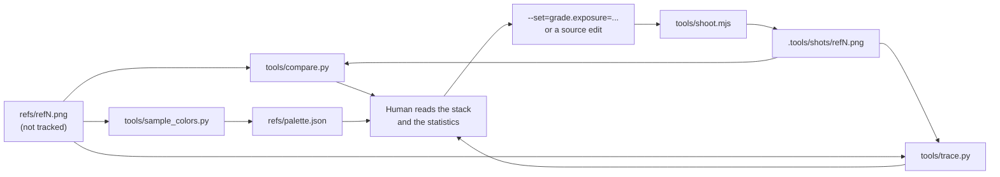
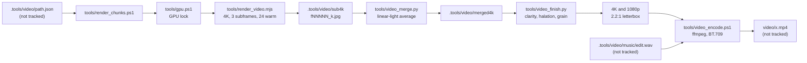

# Workflow and quality: from a reference image to an accepted frame

The project has no automated image test. It has a measurement loop and a human decision. This document follows one reference match from capture to acceptance, then the film path from camera path to encoded file. The loop and the film share one live scene and one renderer pipeline. They do not share one timeline, because the film needs a virtual clock and motion blur.

Casa Ocaso is a browser scene of a coastal room. The project matches five reference renders. A shot is a camera pose. A frame is one rendered image. A render is one captured image.

The counts used in this document are these. The repository has 193 tracked files: 31 under `src`, 30 under `tools`, 122 under `public` and 10 at the root or under `docs`. The `src` tree has 9,531 JavaScript lines. The `public` tree is about 147 mebibytes. There are 6 views with 12 files each, and 8 shots. The counts come from the pinned checkout at `fcc3379`. Here `README.md` means the project README, not this document.

## Part 1: the still and reference loop

### 1.1 The loop in one view

Run `npm install` once. Start the server with `npm run dev`. Capture with `node tools/shoot.mjs ref1`. The still loop then has six steps. Capture a shot. Stack the render over the reference. Measure the tonal and colour differences. Change one controlled value. Capture again. Accept or reject the pair.

The five reference images are the target images and are not part of the repository. The project does not state who made them. The reader must put them in `refs/ref1.png` to `refs/ref5.png` (`README.md:68-69`). The capture tool writes to `.tools/shots` by default (`tools/shoot.mjs:10`). Both `.tools` and `refs` are ignored by Git (`.gitignore:7-14`). The match output is therefore local and not tracked.



### 1.2 The capture tool

The capture tool is `tools/shoot.mjs`. It starts Chrome through Playwright. It asks for the Web Graphics Processing Unit (WebGPU) backend and the Windows Direct3D 11 angle backend with `--use-angle=d3d11` (`tools/shoot.mjs:24-28`). It opens a page at 1672 by 941 pixels by default (`tools/shoot.mjs:10` and `29`). This size matches the reference space used by the colour sampler (`tools/sample_colors.py:4`).

```text
# tools/shoot.mjs:24-28
const browser = await chromium.launch( {
	channel: 'chrome',
	headless: ! opts.headed,
	args: [ '--enable-unsafe-webgpu', '--enable-gpu', '--ignore-gpu-blocklist', '--use-angle=d3d11', '--enable-features=WebGPU', '--disable-gpu-watchdog', '--disable-background-timer-throttling', '--disable-renderer-backgrounding' ]
} );
```

The tool stubs the Vite hot-reload client before navigation (`tools/shoot.mjs:31-34`). A file edit in another process then cannot reload the page during a capture. It navigates to `?capture=1&shot=<first shot>&view=<view>` (`tools/shoot.mjs:40`). It waits for `window.__captureReady === true` (`tools/shoot.mjs:41`). The entry module sets that flag after the scene, the materials and the probe light are ready (`src/main.js:492`). Without a `gi` parameter, the capture loads the stored atlas.

The default view is `beach-sunrise`. The six views are `beach-sunrise`, `golden-hour`, `sea-fog`, `dusk`, `cliff-morning` and `night`. The default shot range is `ref1` to `ref5`. The shot table has eight entries: `ref1` to `ref5`, `oculus`, `terrace` and `corridor` (`tools/shoot.mjs:10` and `21`). The last three are inspection poses with no target image. A view is a panorama and light preset. A custom shot uses the form `cam:x,y,z,yaw,pitch,fov:name` (`tools/shoot.mjs:53-62`). The parser splits the numbers and gives a default vertical field of view (FOV) of 50 degrees when the field is absent.

The tool applies every `--set` value through the capture application programming interface (API) before the shot loop (`tools/shoot.mjs:44-51`). The value parser accepts a comma list, a number or a string. The API setter walks a dotted path and writes into a uniform node or a plain object (`src/main.js:447-458`). A uniform node is a shader value that the renderer uploads each frame. This is how a test changes exposure, warmth or a light value without a source edit. The grade is the display-space colour stage after the tone map. It holds the exposure, the warmth and the tint values.

The shot loop calls `window.__api.shoot(key, { settle })`. The capture tool default is 60 frames (`tools/shoot.mjs:10` and `68`). The capture API alone defaults to 48 frames (`src/main.js:377`). The tool passes 60 explicitly, so the tool default overrides the API default. The API sets the camera and waits until the frame counter has advanced by the settle count and no probe bake is active (`src/main.js:379-390`). It then takes a Playwright screenshot as a Portable Network Graphics (PNG) file and reads the scene information (`tools/shoot.mjs:69-73`).

A capture session always uses the ultra path. The entry module sets the quality to `ultra` when the capture parameter is present (`src/main.js:53`). The pixel ratio is 1 (`src/main.js:26`). The resolution is fixed by the viewport. The still is therefore not subject to the dynamic resolution loop.

### 1.3 The graphics processing unit (GPU) lock

The tools can run in parallel. Two Chrome processes on one integrated graphics processing unit (GPU) make each other slow and can exhaust memory. `tools/gpu.ps1` serialises them with a machine-wide lock file at `.tools/gpu.lock` (`tools/gpu.ps1:8-14`). It opens the file with no sharing. If the file is busy, the script waits 4 seconds and retries. It gives up after 45 minutes (`tools/gpu.ps1:16-19`). It runs Node from the repository root and releases the handle in a `finally` block (`tools/gpu.ps1:24-35`).

```text
# tools/gpu.ps1:12-22
while ( -not $fs ) {

	try { $fs = [System.IO.File]::Open( $lockPath, 'OpenOrCreate', 'ReadWrite', 'None' ) }
	catch {

		if ( ( Get-Date ) -gt $deadline ) { throw 'gpu.ps1: waited 45 min for the GPU lock' }
		Start-Sleep -Seconds 4

	}

}
```

The wrapper is a Windows PowerShell tool. The checkout was read on macOS, and the tool was not run here.

### 1.4 The comparison stack

`tools/compare.py` builds a stack image. The top half is the reference. The bottom half is the render, resized to the reference size with the Lanczos filter (`tools/compare.py:25-32`). The output is `.tools/compare_<name>.jpg` at quality 88 (`tools/compare.py:36`).

The script also prints seven numbers. The mean luminance is a linear combination of red, green and blue. The red-to-blue ratio shows the warmth. The red, green and blue means show a colour cast. The 5th and 95th luminance percentiles show the shadow and highlight spread (`tools/compare.py:14-18`). A reader can then say "the render is too dark at the top" or "the render is too blue" with a number.

```text
# tools/compare.py:21-38
for n in names:
    rp, sp = f'refs/{n}.png', os.path.join(shots, f'{n}.png')
    if not (os.path.exists(rp) and os.path.exists(sp)):
        continue
    ref = Image.open(rp).convert('RGB')
    shot = Image.open(sp).convert('RGB').resize(ref.size, Image.LANCZOS)
    W, H = ref.size
    s = 0.6
    w, h = int(W * s), int(H * s)
    out = Image.new('RGB', (w, h * 2 + 4), 'black')
    out.paste(ref.resize((w, h), Image.LANCZOS), (0, 0))
    out.paste(shot.resize((w, h), Image.LANCZOS), (0, h + 4))
    d = ImageDraw.Draw(out)
    d.text((8, 6), 'REFERENCE', fill=(255, 255, 255))
    d.text((8, h + 10), 'RENDER', fill=(255, 255, 255))
    out.save(f'.tools/compare_{n}.jpg', quality=88)
    print(n, 'ref  ', stats(ref))
    print(n, 'shot ', stats(shot))
```

The script silently skips a shot when the reference or the render is absent (`tools/compare.py:22-24`). It has no pass or fail result. The comment calls it a stacked comparison with colour statistics (`tools/compare.py:1-4`).

### 1.5 The tonal trace

`tools/trace.py` answers a narrower question. Where is the render brighter, darker, flatter or more contrasty than the reference? It converts both images to a perceptual luminance. It linearises the 8-bit values, applies the luminance weights and encodes with a power of 1/2.2 (`tools/trace.py:28-32`).

The tool resizes the luminance to a 32 by 18 grid for the difference map. It computes two Gaussian blurs on the full-resolution luminance, with sigma 2 and 8 in pixels. It takes their absolute difference as a band-pass energy, then resizes that energy to the grid (`tools/trace.py:35-36` and `46-52`). The difference and the log contrast ratio become heat maps. Red means the render is too bright or too contrasty. Blue means it is too dark or too flat (`tools/trace.py:54-69`).

```text
# tools/trace.py:39-52
for n in names:
    rp, sp = f'refs/{n}.png', os.path.join(shots, f'{n}.png')
    if not (os.path.exists(rp) and os.path.exists(sp)):
        continue
    ref = load(rp)
    shot = load(sp, (ref.shape[1], ref.shape[0]))
    yr, ys = lum(ref), lum(shot)
    gr = cv2.resize(yr, (GW, GH), interpolation=cv2.INTER_AREA)
    gs = cv2.resize(ys, (GW, GH), interpolation=cv2.INTER_AREA)
    d = gs - gr
    br, bs = band(yr), band(ys)
    cr = cv2.resize(br, (GW, GH), interpolation=cv2.INTER_AREA)
    cs = cv2.resize(bs, (GW, GH), interpolation=cv2.INTER_AREA)
    ratio = (cs + 1e-3) / (cr + 1e-3)
```

The printed line has seven measures. It gives the mean absolute luminance difference, the signed bias, the light-to-shade ratio of the reference and the shot, the local contrast ratio and the mean saturation of both (`tools/trace.py:71-79`). The light-to-shade ratio is the 90th percentile over the 10th percentile. A flat render has a low ratio. A contrasty render has a high ratio.

The trace uses OpenCV, imported as `cv2` (`tools/trace.py:14`). The tool needs numpy and OpenCV. The project README states that the asset tools need Python 3.11 with numpy, scipy, opencv and trimesh (`README.md:70-71`). No environment file is tracked.

### 1.6 The colour sample

`tools/sample_colors.py` is the most direct tool. It holds a table of named points for each of the five references in a 1672 by 941 space. The first reference has 20 points. The names cover the sofa, the floor, the ceiling, the wall, the column, the table top and the rug. They also cover the sun, the sky, the sea, the oculus, the chair, the throw and the pillow (`tools/sample_colors.py:5-11`).

The script takes a 16 by 16 pixel mean around each point. It writes the mean as a hexadecimal colour. It marks the points on a copy of the reference and writes `.tools/marked_<ref>.jpg` (`tools/sample_colors.py:13-22`). It prints a JavaScript Object Notation (JSON) table and writes the same table to `refs/palette.json` (`tools/sample_colors.py:22-23`).

The sampler reads only the reference, not the render. The operator reads the same named point in the capture by eye or with a separate sample. No tool compares both automatically.

```text
# tools/sample_colors.py:12-23
out = {}
for ref, pts in PTS.items():
    im = Image.open(f'refs/{ref}.png').convert('RGB'); a = np.asarray(im).astype(np.float32)
    d = ImageDraw.Draw(im); res = {}
    for k, (x, y) in pts.items():
        p = a[max(0,y-8):y+8, max(0,x-8):x+8].reshape(-1,3).mean(0)
        res[k] = '#%02x%02x%02x' % tuple(int(v) for v in p)
        d.rectangle([x-8,y-8,x+8,y+8], outline=(255,0,0), width=2); d.text((x+10,y-6), k, fill=(255,0,0))
    out[ref] = res
    im.save(f'.tools/marked_{ref}.jpg', quality=80)
print(json.dumps(out, indent=1))
json.dump(out, open('refs/palette.json','w'), indent=1)
```

This table is the colour target. A material or a grade value is changed until the same named point in the render agrees. The source does not define a tolerance. The reader decides.

### 1.7 The acceptance step

The project README says the colours, the light balance and the grade were fitted to the references numerically. It names `.tools/colorfit` and three measures: matched-region CIELAB, tonal distribution and albedo de-lighting (`README.md:50-51`). CIELAB is a perceptual colour space. Albedo de-lighting removes the light colour from the sampled surface. The `.tools` directory is ignored by Git (`.gitignore:7-8`). No colorfit script is tracked. The claim is therefore a project statement, not a tool that this exploration can inspect.

The same README says the camera poses were solved by least squares against four image features. The README does not name the four features. The comment in the shot list repeats the claim (`src/camera/shots.js:1-3`). The solver is not tracked. The shot values are the result. The exploration can check the values, not the solve.

Acceptance is a human judgement. The evidence is the stack image, the tonal trace, the colour table and the scene statistics. There is no threshold, no golden image test and no continuous integration file. A reader should not infer a formal quality gate from the tool names.

**Aha:** The quality system is a set of instruments, not a test suite. Each tool answers one question with a number or a picture. The `--set` hook makes the loop fast. The missing piece is the decision rule, and the source does not encode it. This is why the README can claim a numerical fit while the repository contains no fitted result.

### 1.8 The bake step

A change to the architecture, the materials, a panorama or the lighting needs a new bake. The atlas holds global illumination (GI): light after one or more surface bounces. A probe is one light sample; the atlas packs the samples of one view. The loader cannot detect such a change. It compares only the dimensions and the grid signature. The bake tool rebuilds the atlas. `tools/bake_gi.mjs` opens one page per view at 640 by 360 pixels. It requests `?capture=1&gi=full&view=<id>` and waits up to 30 minutes for `__captureReady` (`tools/bake_gi.mjs:17-22`). It calls `window.__api.exportGI()`. It writes the base64 payload to `public/views/<id>/gi.bin` and a small signature to `gi.json` with the dimensions, the grid signature and a timestamp (`tools/bake_gi.mjs:23-27`).

```text
# tools/bake_gi.mjs:21-27
	await page.goto( `http://127.0.0.1:5173/?capture=1&gi=full&view=${ id }` );
	await page.waitForFunction( () => window.__captureReady === true, null, { timeout: 1800000, polling: 1000 } );
	const res = await page.evaluate( () => window.__api.exportGI() );
	const buf = Buffer.from( res.b64, 'base64' );
	fs.writeFileSync( `public/views/${ id }/gi.bin`, buf );
	fs.writeFileSync( `public/views/${ id }/gi.json`, JSON.stringify( { dims: res.dims, grid: res.grid, baked: new Date().toISOString() } ) );
	console.log( `${ id }: ${ ( buf.length / 1024 ).toFixed( 0 ) } KB in ${ ( ( Date.now() - t0 ) / 1000 ).toFixed( 0 ) } s` );
```

The export path calls `lighting.exportAtlas` and converts the buffer to base64 in chunks of 32768 bytes (`src/main.js:406-416`). The full bake has two bounces and 16-pixel probes. The fast bake has one bounce and 8-pixel probes (`src/world/lighting.js:56-63`). The bake is the expensive part. The checked-in atlas makes a normal view load free of a bake (`src/world/lighting.js:186-188`).

The bake tool does not verify the atlas against a previous one. It overwrites the two files. A change to the grid count, the grid box or the atlas packing changes the signature. The signature is the JSON of the grid box and count. The loader rejects the old file when the dimensions or the signature differ (`src/world/lighting.js:235-252`). This is the closest thing to a regression check in the light path.

### 1.9 The profile tool

`tools/profile.mjs` measures frame time. It opens a page at 1672 by 941 pixels with `?capture=1&gi=fast`, sets a shot and a query, and calls `window.__api.profile(20)` (`tools/profile.mjs:15-18`). The 20 is the measured frame count. The settle is also 20 frames. The API measures the base frame time over those 20 frames. It then hides the probe light, disables the shadows, replaces the floor material with a plain standard material, hides the backdrop and hides the architecture. It measures each configuration and then measures the base again (`src/main.js:470-492`).

```text
# tools/profile.mjs:15-20
await page.goto( `http://127.0.0.1:5173/?capture=1&gi=fast&shot=${ shot }${ query }` );
await page.waitForFunction( () => window.__captureReady === true, null, { timeout: 600000, polling: 500 } );
console.log( 'ready', ( Date.now() - t0 ) / 1000 );
console.log( JSON.stringify( await page.evaluate( () => window.__api.profile( 20 ) ) ) );
const info = await page.evaluate( () => window.__api.info() );
console.log( JSON.stringify( { calls: info.calls, tris: info.triangles, mem: Math.round( info.memory.total / 1e6 ) + 'MB' } ) );
```

The result is a cost list. It separates the probe, the shadow map, the floor reflection, the backdrop and the architecture. It is not a GPU timer. It measures wall-clock frame time while frames advance. The base-again measurement shows drift.

### 1.10 The diagnostic tool

`tools/diag.mjs` is the startup tool. It loads the application in capture mode with a fast bake by default. It prints every console message, page error and failed request with a time stamp (`tools/diag.mjs:9-12`). It waits for the ready flag for a fixed number of seconds and prints either `READY` or `NOT READY` (`tools/diag.mjs:14-23`).

```text
# tools/diag.mjs:13-23
await page.goto( `http://127.0.0.1:5173/?${ query }` );
try {

	await page.waitForFunction( () => window.__captureReady === true, null, { timeout: seconds * 1000, polling: 500 } );
	console.log( 'READY after', ( Date.now() - t0 ) / 1000, 's' );

} catch ( e ) {

	console.log( 'NOT READY after', seconds, 's' );

}
```

This tool is the first check after a change that stops the page from starting. It shows which module failed and at what time. It does not show a render.

## Part 2: the film path

### 2.1 The film path in one view

The film path has four stages. Render frames. Merge motion-blur subframes. Finish the frames. Encode the file. A PowerShell chunk script drives the first stage on Windows.



The path file, the music and the film are not tracked. `.gitignore` ignores `.tools` (`.gitignore:7`), `video` (`.gitignore:11`) and `refs` (`.gitignore:14`). The project README describes a 45 second camera flight through the room in `video/` (`README.md:73-85`). No `.mp4` file is tracked. The exploration can read the machinery but cannot view the result.

### 2.2 The chunk driver

`tools/render_chunks.ps1` divides the film into chunks. The defaults are 150 frames, a 20 second cool-down between chunks and a total of 1350 frames (`tools/render_chunks.ps1:5-6`). The README states a 45 second film. A 30 frames per second film of 45 seconds has 1350 frames, so the default is consistent with that length. The source does not state the frame rate.

Before each chunk, the script checks free physical memory and GPU shared memory. It waits while free memory is below 8 gibibytes or GPU shared memory is above 7 gibibytes. It prints the reason and sleeps for 30 seconds (`tools/render_chunks.ps1:8-24`). It then calls `gpu.ps1` with `render_video.mjs`, a fixed 4K size, 3 subframes, 24 warm frames, quality 95 and the chunk range (`tools/render_chunks.ps1:27`). It keeps two log lines that match `frame`, `done`, `error` or `pageerror`, then cools down (`tools/render_chunks.ps1:28-29`). The two-line log can hide an earlier error.

```text
# tools/render_chunks.ps1:16-31
for ( $from = 0; $from -lt $Total; $from += $Chunk ) {

	$to = [math]::Min( $from + $Chunk, $Total )
	while ( ( Free-RamGB ) -lt 8 -or ( Gpu-SharedGB ) -gt 7 ) {

		Write-Output ( "[guard] waiting: free RAM {0:n1} GB, GPU shared {1:n1} GB" -f ( Free-RamGB ), ( Gpu-SharedGB ) )
		Start-Sleep -Seconds 30

	}

	Write-Output ( "[chunk] frames {0}-{1}  free RAM {2:n1} GB  GPU shared {3:n1} GB  {4}" -f $from, ( $to - 1 ), ( Free-RamGB ), ( Gpu-SharedGB ), ( Get-Date -Format HH:mm ) )
	& powershell -ExecutionPolicy Bypass -File ( Join-Path $PSScriptRoot 'gpu.ps1' ) render_video.mjs --path=.tools/video/path.json --out=$Out --w=3840 --h=2160 --sub=3 --warm=24 --quality=95 --from=$from --to=$to @Extra 2>&1 |
		Where-Object { $_ -match 'frame |done|error|pageerror' } | Select-Object -Last 2
	Start-Sleep -Seconds $Cool

}
```

A fresh browser per chunk bounds GPU memory growth. The renderer is resumable, so a stopped chunk does not lose completed subframes.

### 2.3 The frame renderer

`tools/render_video.mjs` is the heart of the film path. It flies a camera through the live scene. It writes every frame as a set of subframes. The defaults are 3840 by 2160 pixels, 3 subframes, a shutter of 0.5 frame and 24 warm frames (`tools/render_video.mjs:19`). A shutter of 0.5 frame is a 180 degree shutter at the frame rate.

The camera path is a JSON file with a frame rate and a list of shots, `{ fps, shots: [...] }`. A path shot is a timed camera move, not one of the eight still camera shots. Each shot has a name, a duration and keys. A key has a time, a position, a yaw, a pitch, a roll, a field of view and an optional hold flag (`tools/render_video.mjs:10-14`). The sampler interpolates the channels with a cubic Hermite spline. It uses Catmull-Rom tangents in time. A held key has a zero tangent. It unwraps the yaw so the camera never spins the long way (`tools/render_video.mjs:69-104`). An optional ramp is a monotone cubic time warp from real time to path time (`tools/render_video.mjs:41-67` and `92`). The warp maps real time to path time without overshoot.

Shot boundaries snap to whole frames. The comment states that cuts land exactly on the music hits chosen in frames (`tools/render_video.mjs:106-118`). The total frame count is the end of the last shot.

The tool installs a virtual clock before the page loads. It replaces `performance.now` with a value derived from `window.__vclock` when that value is defined (`tools/render_video.mjs:132-138`). This matters because the Three Shading Language (TSL) `time` node drives the sea swell and the fog drift. A wall clock would make two renders of the same frame differ.

```text
# tools/render_video.mjs:132-138
// virtual clock: TSL `time` (sea swell, fog drift) reads performance.now()
await page.addInitScript( () => {

	const real = performance.now.bind( performance );
	performance.now = () => window.__vclock === undefined ? real() : 1e7 + window.__vclock * 1000;

} );
```

The `1e7` offset keeps the fake time well above zero. `window.__vclock` is in seconds. `performance.now` returns milliseconds, so the code multiplies by 1000. The outer video loop sets `window.__vclock` for each frame and subframe.

The page opens with `?capture=1&video=1&view=<view>&shot=ref1` (`tools/render_video.mjs:143`). The video flag arms the video path. The capture flag also selects the ultra path (`src/main.js:53`). The API `videoFrame` returns false unless the flag is set (`src/main.js:394`). It sets the camera from the pose and clamps the time step to at most 1/20 second. It updates the furniture, increments the grain seed, renders one frame and waits for the GPU queue to drain (`src/main.js:392-423`). The wait stops the next pose from overwriting the frame before the capture.

A new shot gets 24 warm frames at the first pose. This lets the temporal reprojection anti-aliasing (TRAA) and the ground-truth ambient occlusion (GTAO) settle before the first captured frame (`tools/render_video.mjs:170-183`). The same happens after a resume in the middle of a shot.

Each captured frame takes `sub` subframes spread over the shutter. For subframe `k`, the time offset is `((k + 0.5) / sub - 0.5) * shutter / fps` (`tools/render_video.mjs:185-195`). The pose is sampled at that offset. The render is captured through the Chrome DevTools Protocol as a JPEG at quality 95 with speed-optimised encoding (`tools/render_video.mjs:148-155`). The tool skips a frame when all its subframes already exist (`tools/render_video.mjs:169`).

```text
# tools/render_video.mjs:163-195
for ( let f = opts.from; f < last; f += opts.every ) {

	const T = f / fps;
	const shot = shotAt( f );
	// fast shots carry more motion-blur subframes (shot.sub), so long streaks stay smooth
	const sub = Math.min( shot.sub ?? opts.sub, opts.maxsub ?? Infinity );
	if ( [ ...Array( sub ).keys() ].every( ( k ) => fs.existsSync( name( f, k ) ) ) ) { current = null; continue; }
	if ( current !== shot ) {

		// new shot (or resumed mid-shot): settle TRAA / AO on the first pose before capturing
		const u0 = Math.max( 0, T - shot.start - opts.warm / fps );
		for ( let w = 0; w < opts.warm; w ++ ) {

			const u = Math.min( T - shot.start, u0 + w / fps );
			await render( shot.sample( Math.max( 0, u ) ), shot.start + u );

		}

		current = shot;

	}

	for ( let k = 0; k < sub; k ++ ) {

		const off = ( ( k + 0.5 ) / sub - 0.5 ) * opts.shutter / fps;
		const u = Math.min( Math.max( T + off - shot.start, 0 ), shot.dur - 1e-4 );
		const a = Date.now();
		await render( shot.sample( u ), shot.start + u );
		const b = Date.now();
		await capture( name( f, k ) );
		timing.render += b - a; timing.capture += Date.now() - b; timing.n ++;

	}
```

The per-frame name is `f<frame>_<subframe>.jpg` (`tools/render_video.mjs:157`). The console line every 10 frames gives the render and capture time per subframe and an estimate of the remaining time (`tools/render_video.mjs:198-203`).

### 2.4 The merge

`tools/video_merge.py` averages the subframes. The average happens in linear light. The standard RGB (sRGB) values are decoded with a 256-entry table, summed and encoded back with a 4096-entry inverse table (`tools/video_merge.py:24-32`). The comment states that a real shutter integrates light, so bright highlights streak correctly (`tools/video_merge.py:1-5`). An average in display space would darken a bright streak.

The merge finds the subframes for a frame, requires at least the expected count, decodes each one, sums them and divides by the count. It writes a JPEG at quality 97 (`tools/video_merge.py:35-51`). It skips a frame that already exists. In watch mode it repeats every 10 seconds (`tools/video_merge.py:59-69`). It can run while the renderer is working. `sub` is a minimum, not an exact count, because a fast shot can write more subframes. The merge divides by the number present, so it averages every subframe (`tools/video_merge.py:41-56`). The renderer passes `shot.sub` when the shot sets it (`tools/render_video.mjs:167-168`). The watch loop does not revisit a written frame.

```text
# tools/video_merge.py:35-51
def merge(frame):
	out = os.path.join(dst, 'frame_%05d.jpg' % frame)
	if os.path.exists(out):
		return True
	# a frame has sub subframes, or more for fast shots: take every f<frame>_<k>.jpg present
	files = sorted(glob.glob(os.path.join(src, 'f%05d_*.jpg' % frame)), key=lambda p: int(p.rsplit('_', 1)[1][:-4]))
	if len(files) < sub:
		return False
	acc = None
	for f in files:
		im = cv2.imread(f, cv2.IMREAD_COLOR)
		if im is None:
			return False
		lin = TO_LIN[im]
		acc = lin if acc is None else acc + lin
	cv2.imwrite(out, to_srgb8(acc / len(files)), [cv2.IMWRITE_JPEG_QUALITY, quality])
	return True
```

### 2.5 The finish

`tools/video_finish.py` applies the finish. The finish is the per-frame image treatment before the encode. It works on display-referred sRGB values. It scales the effect sizes by the frame width over 1920 pixels (`tools/video_finish.py:43-47`).

The finish applies these operations in order. Clarity adds mid-frequency local contrast on the luminance, strongest in the mid-tones, at 0.32 strength. A fine sharpen at 0.38 strength restores the boucle loops, the stone and the rug pile (`tools/video_finish.py:49-55`). Halation is a warm red-orange bleed around strong highlights at quarter resolution. Glow is a separate, wider blur of the same highlights, not a red bleed. The weights are 0.06 and 0.10 (`tools/video_finish.py:57-66`).

The filmic shoulder compresses values above 0.8 with an exponential curve and encodes to sRGB through a 16384-entry lookup table (`tools/video_finish.py:34-36` and `68-69`). A vignette multiplies the corners by 0.86, which is a 14 percent darkening. A lateral chromatic aberration moves red slightly out and blue slightly in, about 0.6 pixels at 1080p (`tools/video_finish.py:71-92`).


The output sizes default to 3840 by 2160 and 1920 by 1080 (`tools/video_finish.py:22`). A smaller size uses the Lanczos filter. A larger size uses cubic interpolation (`tools/video_finish.py:120`). Grain is added per output size with a seed from the frame number and the width. The amplitude is 0.011, weighted to the mid-tones. The letterbox computes a bar height of `(h - w / 2.2) / 2` pixels at each edge and sets those rows to black (`tools/video_finish.py:95-108`). The default worker count is 6 (`tools/video_finish.py:24`).

### 2.6 The encode

`tools/video_encode.ps1` calls ffmpeg. It counts the frames and computes the duration from the frame rate, which defaults to 30 frames per second (`tools/video_encode.ps1:12` and `18`). It fades in from black over 0.5 seconds and out to black over the last 1.3 seconds (`tools/video_encode.ps1:16-21`). It tags the H.264 stream as BT.709 with the `h264_metadata` bitstream filter, because the comment states that the colour options alone did not reach the bitstream (`tools/video_encode.ps1:22-23`).

There are three modes. The `x` mode uses H.264 High profile at level 4.2, a target of 20 megabits per second, a maximum of 24 and a buffer of 40. The `master` mode uses High profile at level 5.1 and a constant rate factor of 14. The `preview` mode uses a fast preset and a constant rate factor of 23 (`tools/video_encode.ps1:25-31`). The audio is Advanced Audio Coding at 320 kilobits per second and 48 kilohertz when the file exists (`tools/video_encode.ps1:33-36`). The output uses a fast-start index (`tools/video_encode.ps1:37`).

The default audio path is `.tools/video/music/edit.wav` (`tools/video_encode.ps1:11`). That file is not tracked. The music is Creative Commons Attribution (CC BY) 4.0 and is not included in the repository (`README.md:90-91`). The encode still runs without audio, because the script tests the path first. That film is not the stated film.

### 2.7 The film claim limit

The film path is complete as source. It is incomplete as evidence. The path file, the music, the frame cache and the output are all ignored or absent. The default of 1350 frames is consistent with a 45 second film at 30 frames per second. The frame rate is not stated in the source. The chunk count of 9 fits 1350 frames. The finishing values are specific and plausible. None of them was exercised here.

**Aha:** The film is not a second renderer. It is the same live scene driven by a script. The virtual clock and the subframe loop turn a real-time renderer into an offline one. This is why the film can reuse the grade, the probe atlas and the shaders without a separate export path. It is also why the film inherits every capture-mode limit, such as the Windows graphics argument.

## Part 3: what the loop measures and what it does not

The loop measures luminance distribution, warmth, local contrast, saturation and a small set of named colours. It does not measure edge quality, temporal stability, material identity, geometry error or the shape of a highlight. A render can agree with every printed number and still show a wrong chair.

The capture tool records the call count, the triangle count and the memory use in its log (`tools/shoot.mjs:71-73`). The API info call also returns the shadow map size, the shadow camera extent and the frame time (`src/main.js:460-469`). These are cost facts, not quality facts.

The tools use a Windows graphics path. The capture arguments include `--use-angle=d3d11` (`tools/shoot.mjs:27`). The chunk and encode drivers are PowerShell. The checkout was read on macOS. No tool was run. No reference image was opened. The workflow above is a static reconstruction.

The [limits and comparison](04-limits-and-comparison.md) document records the limits, the internal inconsistencies and the comparisons. It separates what the source states from what a reader can verify without a browser.
