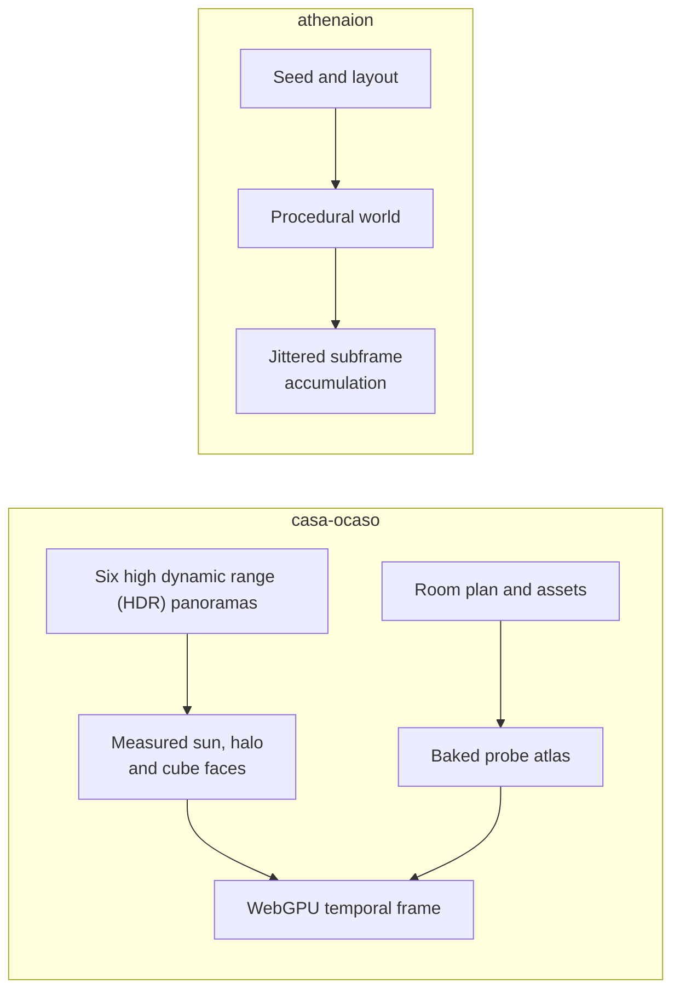
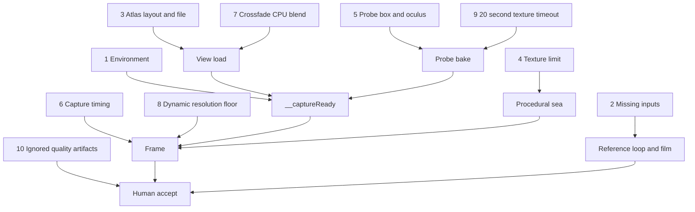

# Limits and comparison: what the source proves and what it does not

This document separates three kinds of statement. A static fact is visible in the checkout. A project statement is a claim in the project documents that the exploration did not reproduce. A runtime value needs a browser and a frame. The separation matters because the project has no test suite and no tracked result image set. A reader who mixes the three will overstate the evidence.

The counts used in this document are these. The repository has 193 tracked files: 31 under `src`, 30 under `tools`, 122 under `public` and 10 at the root or under `docs`. The `src` tree has 9,531 JavaScript lines. The `public` tree is about 147 mebibytes. There are 6 views with 12 files each, and 8 shots. A view is one sky and light preset with its own panorama and atlas. The pin is `fcc3379`. Here `README.md` means the project README, not this document.

This document uses these short forms. WebGPU means Web Graphics Processing Unit. TSL means Three Shading Language. GPU means graphics processing unit. iGPU means integrated graphics processing unit. GI means global illumination, the light that arrives after one or more bounces. WebGL means Web Graphics Library. GLSL means GL Shading Language. HDR means high dynamic range. API means application programming interface. GLB means Graphics Library Transmission Format (glTF) Binary. GTAO means ground-truth ambient occlusion. TRAA means temporal reprojection anti-aliasing. TRAA resolves at full resolution and does not upscale. TAAU means temporal anti-aliasing upscaling. TAAU reconstructs a lower internal resolution onto a larger output. MRT means multi-render target. CC0 means Creative Commons Zero. VSM means variance shadow map, the `THREE.VSMShadowMap` shadow type (`src/core/renderer.js:31-34`). ACES means Academy Color Encoding System. AgX is another tone-mapping operator. CIELAB is a perceptual colour space. L* is CIELAB lightness.

## 1. The claim ledger

| Claim | Where it is stated | Status |
|---|---|---|
| The package is at pin `fcc3379` | local checkout | Static fact |
| Version is 1.0.0 | `package.json:4` | Static fact; the lock root says 0.1.0 |
| three.js is 0.187.0 | `package-lock.json:736` | Static fact |
| Playwright is 1.64.1 and Vite is 8.3.5 | `package-lock.json:633-634` and `758-759` | Static fact |
| There are 31 source files and 9,531 JavaScript lines | `git ls-files`, `wc -l` | Static fact |
| There are 6 views with 12 files each | `git ls-files public/views` | Static fact |
| There are 8 shots | `src/camera/shots.js:4-13` | Static fact |
| The room plan uses metres and +Y up | `src/config.js:1-3` | Static fact |
| The interactive path is `high` and the capture path is `ultra` | `src/main.js:53` | Static fact |
| The ultra path uses a normal and velocity pre-pass and TRAA | `src/core/renderer.js:95-126` | Static fact |
| The high path uses MRT, post GTAO, TAAU and dynamic resolution | `src/core/renderer.js:127-153` | Static fact |
| Five reference images drove the build | `README.md:3-5` | Project statement |
| The shots were solved by least squares | `src/camera/shots.js:1-3` | Project statement |
| Colours were fitted with `.tools/colorfit` | `README.md:50-51`, `src/core/renderer.js:46` | Project statement; the tool is untracked |
| A 45 second film exists | `README.md:73-85` | Project statement; the film is untracked |
| The panoramas are CC0 from Poly Haven | `README.md:40-41` and `89-90` | Static credit statement; files are tracked |
| The six atlases match the six views | `public/views/*/gi.bin` | Static file presence; contents not decoded |
| The render matches the references | no tracked evidence | Not verified |
| The film plays | no tracked evidence | Not verified |
| Frame rate, bake time and memory use | no tracked measurement | Not verified |
| An artificial intelligence coding tool built the room | `README.md:3-5` | Project statement only |

The version row hides a second value. `package.json:4` states 1.0.0. `package-lock.json:3` and `9` state 0.1.0. The lock file also keeps the old package name `sunset-villa`, while `package.json:2` states `casa-ocaso`. A reader should trust `package.json` and treat the lock root as stale metadata.

The qualified status labels add the limit of the evidence. A credit statement or a file presence is static, but it does not prove the content. Five shots are named ref1 to ref5 and frame the five reference renders. The other three shots are inspection poses (`src/camera/shots.js:4-13`).

```text
# package.json:1-10
{
  "name": "casa-ocaso",
  "private": true,
  "version": "1.0.0",
  "type": "module",
  "scripts": {
    "dev": "vite --host 127.0.0.1 --port 5173",
    "build": "vite build",
    "preview": "vite preview --host 127.0.0.1 --port 4173"
  },
```

```text
# package-lock.json:1-14
{
  "name": "sunset-villa",
  "version": "0.1.0",
  "lockfileVersion": 3,
  "requires": true,
  "packages": {
    "": {
      "name": "sunset-villa",
      "version": "0.1.0",
      "dependencies": {
        "three": "^0.187.0"
      },
      "devDependencies": {
        "playwright": "^1.64.1",
```

## 2. Runtime-only values

These values cannot be checked from the source:

- The visual match to the five references.
- The frame rate on any device.
- The time to compile the shaders and pipelines.
- The time for a full probe bake.
- The memory use of the atlas, the cube maps and the textures.
- The stability of the temporal anti-aliasing in motion.
- The visibility of the grain, the bloom and the vignette.
- The correctness of the ocean shader on a real adapter.
- The quality of the film and the sync of the music.
- The behaviour of the Windows graphics path.

Neither is a measurement. This exploration marks every visual consequence as not verified.

## 3. Static limits

### 3.1 The set is small and static

The room is one fixed set, and the camera moves inside it. The only motion is foliage sway, the fire, the camera, the sea, the fog and the view fade. The code uses this fact. The sun shadow map refreshes every fourth frame and every frame during a view fade (`src/main.js:337-340`). Moving foliage can lag by up to three frames, and a still camera hides the lag. A full probe bake is stored. The film reuses the same scene.

A normal real-time scene cannot copy this pattern without a cost. A dynamic scene needs a shadow update every frame or a cached shadow with an invalidation rule. A large scene needs more probes or a streaming scheme. Casa Ocaso buys quality with stasis.

### 3.2 The probe box is tied to the architecture

The probe box runs from `[-10.8, -0.7, -7.6]` to `[8.6, 4.5, 9.6]` (`src/world/lighting.js:17`). It extends below the floor and above the ceiling because the lookup offsets the sample. The ceiling is at 3.3 metres and the oculus drum adds 0.75 metres (`src/config.js:5` and `24`). The current drum top is therefore 4.05 metres. The source comment gives the box top as 3.9 metres (`src/config.js:22`). The comment is stale, and its own limit is below the current drum top. The live box top is 4.5 metres, so the current drum fits. A deeper drum would still meet the live box limit, and that area would receive no bounce light (`src/config.js:21-24`).

```text
# src/world/lighting.js:17-17
export const GRID = { min: new THREE.Vector3( - 10.8, - 0.7, - 7.6 ), max: new THREE.Vector3( 8.6, 4.5, 9.6 ), count: [ 18, 6, 16 ] };
```

```text
# src/config.js:20-24
// upstand `wall` thick above the roof deck), a soft bullnose where it meets the ceiling and a
// top ledge reaching `ledge` inward that ends in a half-round lip of radius `lip`.
// depth: the GI probe box (lighting.js) ends at y = 3.9; a deeper drum pushes the top of the
// wall and the lip out of it (no bounce light: dark flecks there) unless the box grows too
export const OCULUS = { x: - 0.8, z: - 1.0, r: 2.08, depth: 0.75, fillet: 0.06, ledge: 0.25, lip: 0.06, wall: 0.18 };
```

This is a hard coupling. A depth change needs a new box and a new atlas. The comment records it; no assertion enforces it.

### 3.3 The atlas layout is not documented

The checked-in beach atlas records `dims` as `[18, 6, 126]` (`public/views/beach-sunrise/gi.json:1`). The grid count is `[18, 6, 16]` (`src/world/lighting.js:17`). The probe render target gives the atlas dimensions (`src/world/lighting.js:190-195`). Export and upload use red, green, blue and alpha (RGBA) half floats (`src/world/lighting.js:197-230`). The file is therefore 18 × 6 × 126 × 4 × 2 = 108,864 bytes. The grid has 18 × 6 × 16 = 1,728 probes. The addon maps 16 z probes to 126 depth slices. The addon is the three.js `LightProbeGrid` class, imported by `src/world/lighting.js`. Its mapping is not in this checkout, because `node_modules` is absent. A dense layout of 27 half floats per probe (nine coefficients for each of three colour channels) would use 93,312 bytes. The extra 15,552 bytes are undocumented addon layout. The 27 half floats do not fill the file.

```text
# public/views/beach-sunrise/gi.json:1-1
{"dims":[18,6,126],"grid":"{\"min\":{\"x\":-10.8,\"y\":-0.7,\"z\":-7.6},\"max\":{\"x\":8.6,\"y\":4.5,\"z\":9.6},\"count\":[18,6,16]}","baked":"2026-11-03T16:54:33.202Z"}
```

A reader must not compute a probe count from the atlas depth. A tool that assumes 16 slices will misread the file. The loader compares the stored dimensions and the grid signature, not the layout. It does not explain the layout. This is a real documentation gap.

**Aha:** The atlas depth is a storage layout, not a spatial axis. The probe count is 18 by 6 by 16, which is 1,728 probes. The 126 slices come from the addon layout, which the checkout does not show. The loader makes the safe check: the dimensions must match a known atlas, and the grid must match the current box.

### 3.4 The asset paths are fixed

The loader reads `/views/<id>` and `meta.json` (`src/world/views.js:100-105`). The models and textures use fixed paths under `/models` and `/textures`. There is no manifest and no fallback asset. A missing file shows a load error or a placeholder. The startup waits for the default loading manager, with a 20 second timeout (`src/main.js:259-271`). A slow file after 20 seconds can enter the probe bake as a black surface.

### 3.5 The ocean path needs more texture units

The shader samples six faces, a halo and the sea noise. The comment does not count the probe atlas, the interior probe or the shadow maps. The renderer asks for up to 32 sampled textures per stage when allowed (`src/core/renderer.js:25`). The ocean path needs more than 16 per stage (`src/main.js:68-69`), the WebGPU guaranteed minimum. The gate is conservative: on an adapter at that minimum, the beach view falls back to the photograph. The fallback is silent, so a reader cannot see the intended sea.

### 3.6 The tools are Windows-centric

The capture and bake tools pass `--use-angle=d3d11` to Chrome. ANGLE is the translation layer between WebGPU and Direct3D 11. The lock, chunk and encode drivers are PowerShell. The source defines no Metal or Vulkan path. A macOS or Linux reader can run Node and Python directly, but the stated graphics path is not the same. The project README recommends Chrome or Edge on a dedicated or recent integrated GPU (`README.md:20-21`).

```text
# tools/shoot.mjs:24-28
const browser = await chromium.launch( {
	channel: 'chrome',
	headless: ! opts.headed,
	args: [ '--enable-unsafe-webgpu', '--enable-gpu', '--ignore-gpu-blocklist', '--use-angle=d3d11', '--enable-features=WebGPU', '--disable-gpu-watchdog', '--disable-background-timer-throttling', '--disable-renderer-backgrounding' ]
} );
```

```text
# tools/gpu.ps1:1-4
# Run a GPU job (headless WebGPU capture / bake) under a machine-wide lock, so parallel workers
# queue for the laptop's iGPU instead of rendering at the same time.
# usage: powershell -ExecutionPolicy Bypass -File tools\gpu.ps1 shoot.mjs --out=... ref4 "cam:..."
#        powershell -ExecutionPolicy Bypass -File tools\gpu.ps1 bake_gi.mjs beach-sunrise
```

### 3.7 The film and its inputs are absent

`.gitignore` ignores `.tools` (`.gitignore:7`), `video` (`.gitignore:11`) and `refs` (`.gitignore:14`). The film path file, the music, the rendered frames and the output are all absent. The tools are present. The evidence is not.

```text
# .gitignore:10-14
# rendered film (large; published separately)
video

# reference images (not ours to redistribute)
refs
```

### 3.8 There is no test suite

The repository has no test runner and no assertion file for an image. The quality tools print numbers and write pictures. The decision is human. The project README describes numerical fitting, but the fitting tool is untracked. A change can pass every visible check and still regress the look.

## 4. Failure modes and isolation

### 4.1 Furniture modules fail alone

The furniture assembly calls `Promise.allSettled` (`src/scene/furniture/index.js:123`). A rejected module logs a warning and the rest of the room renders (`src/scene/furniture/index.js:133-137`). The group traversal then applies vertex occlusion and the detail layer to the modules that succeeded (`src/scene/furniture/index.js:139-152`).

```text
# src/scene/furniture/index.js:139-152
	group.traverse( ( o ) => {

		if ( o.isMesh && o.material && ! o.userData.noAO ) {

			const mats = Array.isArray( o.material ) ? o.material : [ o.material ];
			if ( mats.some( ( m ) => m.aoNode ) ) ensureVertexAO( o.geometry );

		}

		// fine, high-poly detail lives on the DETAIL layer: the main and shadow cameras render it,
		// the GI probe captures (and the floor reflection) skip it
		if ( o.isMesh && ( ( o.isInstancedMesh && o.count > 40 ) || DETAIL_NAMES.test( o.name ) ) ) o.layers.set( DETAIL_LAYER );

	} );
```

The isolation is good for startup. It is dangerous for quality. A missing sofa or a missing rug still gives a valid frame. A capture can succeed with a hole in the set. The warning is the only signal. A quality tool does not assert that all twelve modules loaded. The twelve are coffee table, rug, seating, lounge, cliff, decor, textiles, fireplace, curtains, dining, olive and exterior plants (`src/scene/furniture/index.js:8-21`).

### 4.2 The view load fails loudly

A view load awaits the metadata and the six faces. A bad path rejects the promise, and the entry module does not catch it. The capture ready flag is never set, and the tool times out. This is loud, but it stops the whole session.

### 4.3 A stale atlas is rejected

The atlas loader compares the dimensions and the grid signature (`src/world/lighting.js:235-252`). A mismatch returns null. A missing `gi` parameter loads the stored atlas. Any present `gi` value forces a live bake. `gi=fast` uses one bounce and 8-pixel probes. `gi=full` uses two bounces and 16-pixel probes (`src/main.js:51` and `122-137`). In an interactive session, the code starts a fast bake and then refines it (`src/main.js:130-139`). In a capture session, it bakes all probes before the ready flag (`src/main.js:132-133`). A layout change therefore costs time but does not give wrong light. A content change with the same signature passes the check and can give wrong light. A full bake is the most expensive step in the load.

### 4.4 The crossfade can blend on the CPU

If both views have atlases, the crossfade blends them on the central processing unit (CPU) every frame for 2.8 seconds (`src/main.js:200-201` and `src/world/lighting.js:260-269`). The atlas has 13,608 texels, each with four channels. The code chooses this path to avoid a second GPU texture and a shader branch.

### 4.5 The capture still does not drain the GPU

The video API waits for `queue.onSubmittedWorkDone` before it returns (`src/main.js:421-422`). The still `shoot` API waits for a frame count and the end of a bake (`src/main.js:379-390`). It does not wait for the GPU queue. The screenshot follows the API call (`tools/shoot.mjs:68-70`). Playwright may capture the compositor after the frame is presented. The source does not guarantee it.

### 4.6 The dynamic resolution has a floor

The scale is clamped between 0.5 and 1.0 (`src/main.js:58` and `326`). Between 14 and 21 milliseconds the loop holds the scale. If the frame time stays above 21 milliseconds at scale 0.5, the loop stops lowering the scale. It does not reduce the effects or the shadow map. The comment states the intent to keep the frame under about 20 milliseconds (`src/main.js:317`).

```text
# src/main.js:315-334
	if ( QUALITY !== 'ultra' ) {

		// dynamic resolution: keep the frame under ~20 ms while moving, step gently to avoid
		// pumping; once the camera rests, climb to full resolution so stills resolve crisply
		dyn.t += dt;
		if ( dyn.t > 0.5 && ! lighting.baking ) {

			dyn.t = 0;
			let next = perf.avg > 21 ? dyn.scale - 0.05 : perf.avg < 14 ? dyn.scale + 0.05 : dyn.scale;
			if ( controller.idle > 1.2 ) next = dyn.scale + 0.1;
			else if ( dyn.scale > dyn.moving ) next = dyn.moving;
			const s = THREE.MathUtils.clamp( next, dyn.min, dyn.max );
			if ( s !== dyn.scale ) {

				dyn.scale = s;
				if ( controller.idle <= 1.2 ) dyn.moving = s;
				setScale( s );

			}

```

### 4.7 The diagnostics page is missing

`tools/gpuinfo.mjs` navigates to `/tools-blank.html`. The page is not tracked. The navigation is caught. The tool still reads the adapter limits from the browser. A reader sees a failed request and a warning. The tool continues.

## 5. Internal inconsistencies

| Item | One statement | Another statement | Effect |
|---|---|---|---|
| Version | 1.0.0 in `package.json:4` | 0.1.0 in `package-lock.json:3` | Package identity is ambiguous to a tool that reads the lock |
| Package name | `casa-ocaso` in `package.json:2` | `sunset-villa` in `package-lock.json:2` | The lock keeps a former name |
| Tone map | ACES in `src/main.js:56` | AgX in `src/core/renderer.js:34` and `82` | The effective path is ACES because the pipeline owns the output, but the renderer field is stale |
| Default quality | `?q=ultra` presented as the path in `README.md:24` | Interactive default `high` in `src/main.js:53` | A reader can think ultra is the default |
| Fade time | Comment says about 2.6 seconds in `src/main.js:168` | Duration is 2.8 in `src/main.js:171` | Documentation drift |
| Atlas depth | 126 in `gi.json` | 16 probe slices in `lighting.js` | A packing layout is mistaken for a count |
| Oculus depth | 0.75 metre in the plan | Probe box top 4.5 metres; the comment gives 3.9 | The comment and the box disagree; the constraint is real but the number is stale |
| Sea view | Beach view is photographed | The lower half is procedural | The "six real panoramas" claim is true for the upper half only |
| Reference images | README tells the reader to use `refs/ref1.png` | No reference is tracked | The central quality loop cannot run as shipped |
| Film | README describes a 45 second film | No film or path is tracked | The film is a script, not an artifact |

The oculus row needs care. The comment says 3.9 (`src/config.js:22`). The live box says 4.5 (`src/world/lighting.js:17`). The current drum top is 4.05, so the comment is stale and the live box governs. The exploration records the mismatch.

The tone map row is the most consequential. `createRenderer` sets AgX (`src/core/renderer.js:34`). `createPipeline` defaults to AgX (`src/core/renderer.js:84`). The entry module passes ACES, so the pipeline tone map is ACES unless a query overrides it (`src/main.js:56`). The pipeline sets `outputColorTransform = false` (`src/core/renderer.js:87`), so the renderer adds no second transform, and the pipeline tone map reaches the display. The renderer field is inert for output. The comment block above the pipeline still says AgX (`src/core/renderer.js:82`). This is a documentation defect, not two active paths. The resolved colour and bloom are multiplied by exposure, tone mapped, then encoded to standard RGB (sRGB). The display-space grade runs after the encode (`src/core/renderer.js:162-166`).

```text
# src/core/renderer.js:31-35
	renderer.shadowMap.enabled = true;
	// VSM: smooth penumbrae; a 6 deg sun makes PCF stair-step badly on floors and curved walls
	renderer.shadowMap.type = THREE.VSMShadowMap;
	renderer.toneMapping = THREE.AgXToneMapping;
	renderer.toneMappingExposure = 1;
```

```text
# src/core/renderer.js:82-87
 * Both then: bloom -> AgX -> display-space grade (warmth, split tone, contrast, vignette, grain).
 */
export function createPipeline( renderer, scene, camera, { quality = 'ultra', aoEnabled = true, denoiseAO = true, toneMapping = THREE.AgXToneMapping } = {} ) {

	const pipeline = new THREE.RenderPipeline( renderer );
	pipeline.outputColorTransform = false;
```

```text
# src/main.js:52-58
// interactive sessions render at a dynamic resolution (TAAU); captures use the full 'ultra' path
const QUALITY = params.get( 'q' ) ?? ( CAPTURE ? 'ultra' : 'high' );
const TONE = { agx: THREE.AgXToneMapping, aces: THREE.ACESFilmicToneMapping, neutral: THREE.NeutralToneMapping };
const { pipeline, aoPass, setScale, precompile } = createPipeline( renderer, scene, camera, {
	quality: QUALITY, aoEnabled: params.get( 'ao' ) !== '0', denoiseAO: params.get( 'aodn' ) !== '0', toneMapping: TONE[ params.get( 'tm' ) ] ?? THREE.ACESFilmicToneMapping
} );
const dyn = { scale: 0.8, moving: 0.8, t: 0, min: 0.5, max: 1.0 };
```

## 6. Comparison with athenaion

The sibling package athenaion is a useful contrast. The citations in this section use `../athenaion/` from the casa-ocaso root.

Athenaion is a procedural ancient Greek world. It uses no image, model or audio asset as input. Every mesh, texture, shader and landform is built in code from a seed. It renders nine fixed shots and one 54 second film (`../athenaion/spec.md:32-35`). It runs on WebGL 2 through three.js 0.186.1 (`../athenaion/spec.md:25`). Its nine reference images are tracked (`../athenaion/spec.md:48`). Its 12 media files are nine shot images, an overview image, a comparison image and a teaser animation (`../athenaion/spec.md:47`). The 54 second film is stated but not tracked.

Casa Ocaso has the opposite input model. It has six real high dynamic range image (HDRI) panoramas, 44 texture maps across 14 sets and six GLB models (`git ls-files public/textures` and `public/models`). It has 31 source files and 9,531 JavaScript lines. Its five reference images are not tracked.

| Property | casa-ocaso | athenaion |
|---|---|---|
| World source | Measured photographs, textures, models and a room plan | Code and seeds |
| Renderer | WebGPU and TSL | WebGL 2 and GLSL |
| Temporal method | One frame with TRAA or TAAU | Jittered subframes accumulated |
| Light | Measured sun, halo, baked probe grid and one room probe | Generated sky, sun and atmosphere, no imported light |
| Views or shots | 6 views and 8 shots | 9 shots |
| Film | 45 seconds stated, absent | 54 seconds stated, not tracked |
| Reference images | 5, not tracked | 9, tracked |
| Source size | 9,531 JavaScript lines | 43,797 JavaScript lines |
| Distribution | 122 public files, 147 mebibytes | 12 media files and one 23 mebibyte generated grid (`../athenaion/spec.md:47` and `51`) |



The two systems solve different problems. Casa Ocaso asks how closely a small set can match five photographs. Athenaion asks how much coherent world can be generated from rules. Casa Ocaso spends on measured light and reference matching. Athenaion spends on procedural breadth and scale.

The render methods also differ. Casa Ocaso reconstructs one frame from a short history. The ultra path uses a pre-pass and TRAA. The high path uses TAAU and dynamic resolution (`src/core/renderer.js:95-153`). Athenaion accumulates jittered subframes into a high dynamic range image (`../athenaion/spec.md:99-102`). The first method suits interaction. The second suits a still or a film.

**Aha:** The reference images are the clearest measure of intent. Athenaion ships its nine references, so a reader can repeat the comparison. Casa Ocaso does not ship its five references, so a reader can repeat the capture and the measurement but cannot check the match. The quality claim with the most weight is the one with the least shipped evidence.

## 7. Comparison with a normal real-time scene

A normal real-time scene streams content, draws many dynamic objects, updates shadows every frame, culls and targets a range of devices. It often has physics, animation, networking and a save state. Casa Ocaso has only the camera, the foliage, the fire, the sea and the fog.

The differences in budget are large. Casa Ocaso uses one 4096 by 4096 variance shadow map (VSM) with a 5-texel blur and 16 samples (`src/world/lighting.js:25-41`). It bakes 1,728 probes with 16-pixel cube maps over three passes. It keeps a 256-pixel room cube reflection in a prefiltered mipmapped radiance environment map (PMREM) (`src/world/reflections.js:7-21`). It also draws a planar floor reflection at half resolution (`src/scene/architecture.js:172-190`). It can afford these because the set does not change and the visible area is one room.

The dynamic resolution loop is the main concession to weaker hardware (`src/main.js:315-334`). The detail layer is the second: furniture with more than 40 instances, or a name in the detail set, moves to render layer 1. The main and shadow cameras draw it, while the probe captures and the floor reflection skip it (`src/scene/furniture/index.js:150-151`). This is a targeted level of detail, not a general system.

A normal scene also needs collision, navigation, save and network policies. Casa Ocaso has one room and a free camera, so it has none of them.

The capture and film tools also assume a controlled machine. The GPU lock serialises work. The chunk driver splits the film into 150-frame groups and waits for free memory. The capture tool fixes the viewport and the pixel ratio. A normal real-time product cannot assume these conditions on a user device.

## 8. Break-first risk map



The diagram has one node per numbered risk below. The lower boxes are affected places, not extra risks. `__captureReady` is the flag that the capture tools wait for.

The order of fragility is this:

1. The environment. A different browser, adapter or operating system changes the graphics path. The tools name a Windows argument.
2. The missing inputs. The reference loop and the film cannot run as shipped.
3. The atlas. A layout change or a stale file forces a long bake.
4. The texture limit. The ocean path depends on a device limit above the guaranteed value.
5. The probe box. A geometry change can put a surface outside the light.
6. The capture timing. The still path does not drain the GPU.
7. The crossfade CPU blend. A view change can stall on a large atlas.
8. The dynamic resolution floor. A slow device stays at half resolution.
9. The 20 second texture timeout. A slow asset can enter the bake as black.
10. The ignored quality artifacts. The fit tool and the film are not tracked.

To reproduce the project, start with the environment and the inputs. To change the room, start with the probe box and the atlas. To change the look, start with the grade values and the reference loop in `03-workflow-and-quality.md`.

## 9. Design logic

The design follows from five constraints.

The first constraint is the reference match. The project needs a real sky, a measured sun and a display grade that matches a photograph. The panorama pipeline, the halo reconstruction and the display-space grade follow from this. The grade is a fit to a target image, not a physical light model (`src/core/renderer.js:44-63`). L* is CIELAB lightness.

```text
# src/core/renderer.js:44-63
export const grade = {
	exposure: uniform( 1.0 ),
	saturation: uniform( 1.12 ),
	// fitted to the references' tonal distribution (.tools/colorfit): no S-curve — at 1.2 it sank
	// every shade 10-16 L* below the references — a small lift so the darkest shade stays airy, a
	// gently warm shadow tint (a cool one greyed the white fabrics, a red one went salmon) and a
	// late, soft shoulder so sunlit cream still reaches its luminous top
	contrast: uniform( 1.0 ),
	pivot: uniform( 0.42 ),         // contrast pivot below mid grey: highlights open up, shadows sink
	lift: uniform( 0.04 ),
	shoulder: uniform( 0.94 ),       // highlights above this roll off softly instead of clipping
	warmth: uniform( new THREE.Vector3( 1.04, 1.0, 0.93 ) ),
	shadowTint: uniform( new THREE.Vector3( 1.05, 1.0, 0.95 ) ),
	shadowAmount: uniform( 0.45 ),
	highlightTint: uniform( new THREE.Vector3( 1.03, 1.0, 0.95 ) ),   // peach, not lemon
	vignette: uniform( 0.15 ),
	grain: uniform( 0.003 ),
	bloomStrength: uniform( 0.07 ),
	frame: uniform( 0 )
};
```

The second constraint is the small static set. The project can bake light and shadow once and reuse the result. The probe atlas, the 4K shadow map and the room reflection follow.

The third constraint is the browser. The project must fit in a page, load over the network and run on an integrated GPU. The dynamic resolution, detail layer, progressive bake and pre-baked atlas follow. The fog and sea are procedural because a second large photograph would add download cost.

The fourth constraint is reproducibility. The project pins its dependencies and stores the probe atlas with a grid signature. The GPU lock and the resumable film tools follow from this. The tools are less reproducible: the film path and the references are not tracked.

The fifth constraint is the offline film. It needs deterministic time and motion blur. The virtual clock replaces wall time, and the merge averages subframes in linear light. The film is the same scene, not a second renderer.

## 10. Final limits

This exploration did not run the project. It did not open a browser, render a pixel or run a tool. It read the source at the pin.

The strongest static claims are the counts, paths, constants and control flow. The weakest are the visual match, performance and film. The project states that an artificial intelligence coding tool built the room. The exploration records that statement only and verifies no part of it.

The next step for a reader with a Windows machine and the missing assets is the reference loop in `03-workflow-and-quality.md`. A reader without them should make a static change with a clear contract, such as a grade value or a probe box change.
