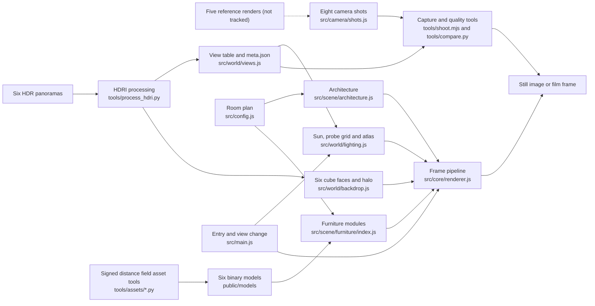

# casa-ocaso: a measured room at golden hour

Casa Ocaso is a reference-driven real-time room. A browser draws a cliffside living room at golden hour. The room geometry is fixed, though the sea, the fog and the camera animate. It is a set of curved surfaces and measured light values that aims at five reference renders. In this document a backticked path such as `README.md:3-5` means a file in the project source root. A bracketed link means a file in this markdown folder. The project states that an artificial intelligence coding tool built it (`README.md:3-5`). This exploration records that statement. It leaves out the name of that tool as a writing choice and does not verify the construction process.

The method has two halves. The first half measures light. Six source high dynamic range image (HDRI) panoramas supply a sun position, a sun colour, a halo profile and a white point. Each view derives six cube faces from one source panorama. A pre-baked probe grid, a lattice of 1,728 light samples in an 18 by 6 by 16 grid, supplies bounce light, which is light after one or more surface bounces. Each probe stores nine spherical harmonic coefficients for each colour channel. The second half draws one frame. A Web Graphics Processing Unit (WebGPU) renderer runs a temporal pipeline and a ground-truth ambient occlusion (GTAO) pass. It also runs bloom, a soft glow from bright areas. It runs a tone map that maps high dynamic range values to display values, and a display-space grade, a colour stage after the tone map and the standard RGB encode. On the ultra path the pass order is pre-pass, ambient occlusion, main pass, temporal resolve, bloom, exposure, tone map, encode and grade. The code that connects the halves is in `src/main.js:106-202`. The interface between the halves is the current view's sun azimuth and one irradiance vector. The azimuth is the sun angle in degrees. Irradiance is the light that arrives at a surface, held as a red, green and blue level in the panorama radiance scale. A view change loads a new view record. That record replaces the panorama, the sun, the grade and the global illumination (GI) atlas together. During the change the old and new atlases are blended on the central processing unit (CPU).

Paths in the document text are relative to the project source root, the checkout that holds `src`, `tools` and `public`. A citation to the project `README.md` means the README at that root. The links in this file are relative to this markdown folder, which is a copy outside the source checkout. The exploration only read the source.

## Short summary

The project checkout has 193 tracked files. The groups are 31 source files under `src`, 30 tool files under `tools`, 122 public asset files under `public` and 10 at the root or under `docs`. The 31 source files are 30 JavaScript files and one style sheet, with 9,531 JavaScript lines. The public tree is about 147 mebibytes: 86 mebibytes of view assets, 44 mebibytes of textures and 17 mebibytes of models. Six views each hold 12 files: `env_1k.hdr`, `env_2k.hdr`, `gi.bin`, `gi.json`, `meta.json`, six cube faces `nx.jpg` to `pz.jpg`, and `thumb.jpg`. `meta.json` holds the sun, the white point and the halo. `gi.json` holds the atlas dimensions, the grid signature and the bake timestamp. The runtime loads the six cube faces; the two high dynamic range (HDR) files have no caller. The camera list has 8 shots. One config file holds the room plan in metres, with +Y up and the sea towards -Z (`src/config.js:1-3`). The renderer selects quality `high` for an interactive session and `ultra` for a capture (`src/main.js:53`). A capture uses `?capture=1` and a video frame uses `?capture=1&video=1` (`src/main.js:18-21`). The project package file states ranges, not resolved versions: `^0.187.0` for three.js, `^8.3.5` for Vite and `^1.64.1` for Playwright (`package.json:12-19`). The lockfile records the resolved versions: three.js 0.187.0 (`package-lock.json:736`), Playwright 1.64.1 (`package-lock.json:633-634`) and Vite 8.3.5 (`package-lock.json:758-759`).

The 10 remaining files are `.gitignore`, `LICENSE`, `README.md`, `index.html`, `package.json`, `package-lock.json`, `vite.config.js`, `docs/detail_table.jpg`, `docs/hero.jpg` and `docs/shot_ref1.jpg` (`git ls-files`). The 122 public files are 72 view files, 44 texture maps and 6 models (`git ls-files public`). The counts come from two checks: `git ls-files` counts the files, and `wc -l` and `du` measure sizes on the pinned checkout at `fcc3379`. A mebibyte is 1,048,576 bytes.

## System map



The reference renders and the film are not tracked. The dashed arrow is a design relation: `ref1` to `ref5` are the target images for the five matched shots. The other three shots have no reference. The solid arrows from `shots` and `views` to the tools are data inputs: the tools take a shot name and a view name. The diagram is partial. It leaves out the sea, the fog, the post chain and the capture policy.

A shot and a view are independent. A shot is a camera pose with a name. A view is a sky and light record with a name. The five matched shots are named `ref1` to `ref5`, and each aims at the image `refs/refN.png` in the project source root. The other three shots are named `oculus`, `terrace` and `corridor`. A capture pairs one shot with one view, and the capture tool uses `beach-sunrise` by default (`tools/shoot.mjs:10`). With no shot argument, the tool captures `ref1` to `ref5` (`tools/shoot.mjs:20`).

## Documents

| File | Role | Words | Snippets | Mermaid | Aha |
|---|---|---:|---:|---:|---:|
| [README](README.md) | Thesis, map, document table, reading orders, terms and non-claims | 2,654 | 4 | 1 | 1 |
| [Overview](00-overview.md) | The room, the six views, the eight shots, the parts and one frame | 5,000 | 13 | 2 | 2 |
| [Architecture](01-architecture.md) | Layers, ownership, module contracts, asset flow, data flow, failure isolation and quality paths | 4,999 | 12 | 3 | 1 |
| [Core mechanism](02-core-mechanism.md) | From panorama to light, then from one camera pose to one graded frame | 4,998 | 10 | 2 | 3 |
| [Workflow and quality](03-workflow-and-quality.md) | One reference match from capture to accepted image, then the film path | 4,999 | 12 | 2 | 2 |
| [Limits and comparison](04-limits-and-comparison.md) | Claim ledger, runtime-only values, static limits, failure modes, comparisons and risk | 4,997 | 14 | 2 | 2 |

A deep dive is one of the five numbered documents, 00 to 04. Each one has at least 10 byte-exact source snippets, at least 2 Mermaid diagrams and at least 1 `**Aha:**` insight. A byte-exact snippet is a copy whose characters match the source lines. A review script compared each snippet with the source on the pinned checkout; the script is not part of this folder. Mermaid is a text diagram format that GitHub renders. An `**Aha:**` line states the one non-obvious connection in a section. Each snippet header gives the relative source path and the line range. Word counts come from `wc -w`.

## Reading orders

A newcomer reads [Overview](00-overview.md) for the room and the frame, then [Architecture](01-architecture.md) for the layers, then [Core mechanism](02-core-mechanism.md) for the light and pixel path. That reader then reads [Workflow and quality](03-workflow-and-quality.md) to see how a reference match is judged. That reader reads [Limits and comparison](04-limits-and-comparison.md) last.

A renderer engineer reads [Architecture](01-architecture.md), then [Core mechanism](02-core-mechanism.md), then [Workflow and quality](03-workflow-and-quality.md). That reader reads [Overview](00-overview.md) for the scene intent and [Limits and comparison](04-limits-and-comparison.md) for the static limits.

A technical artist or an asset builder reads [Overview](00-overview.md) for the room plan, then [Architecture](01-architecture.md) for the asset flow. That reader reads [Core mechanism](02-core-mechanism.md) for the panorama and probe bake. That reader reads [Workflow and quality](03-workflow-and-quality.md) for the tools. That reader reads [Limits and comparison](04-limits-and-comparison.md) for the absent assets.

## Terms

Room terms.

- **Azimuth**: an angle in degrees, measured from -Z towards +X, clockwise seen from above (`src/config.js:2-3`).
- **Oculus**: the skylight drum above the seating area (`src/config.js:20-24`).
- **Cove**: the warm light strip at the ceiling edge (`src/scene/materials.js:42-46`).
- **Boucle**: a looped yarn fabric. The sofa uses it (`src/scene/materials.js:381`).
- **Travertine**: the cream stone of the floor and tables (`src/scene/materials.js:567`).
- **Maquis**: the low Mediterranean shrub mass on the cliff (`src/scene/plants/exterior.js:11-14`).

Technical terms.

- **WebGPU**: Web Graphics Processing Unit. The browser interface that three.js uses here (`src/core/renderer.js:20`).
- **TSL**: Three Shading Language. The node shader language of three.js (`src/scene/materials.js:1-11`).
- **HDR**: high dynamic range. A value range wide enough to hold a dark shadow and a clipped sun. The panorama and the light values go above 1.0 (`src/world/backdrop.js:8-10`).
- **HDRI**: high dynamic range image. A panoramic photograph in HDR form (`src/world/views.js:109-115`).
- **GI**: global illumination. Light that arrives after one or more bounces (`src/world/lighting.js:6-17`).
- **SDF**: signed distance field. A function that returns the distance to a surface. The tools mesh it with marching cubes (`tools/assets/sdf.py:1-6`).
- **GLB**: Graphics Library Transmission Format Binary. The model container (`src/scene/furniture/index.js:93`).
- **VSM**: variance shadow map. The soft shadow method (`src/core/renderer.js:31-34`).
- **GTAO**: ground-truth ambient occlusion. The name of the screen-space contact shading pass. The name is conventional; the pass reads depth and normals, not a ground-truth solution (`src/core/renderer.js:113`).
- **TRAA**: temporal reprojection anti-aliasing. The full-resolution temporal resolve (`src/core/renderer.js:122`).
- **TAAU**: temporal anti-aliasing upscaling. The upscale resolve for the high path (`src/core/renderer.js:149`).
- **MRT**: multi-render target. One pass that writes several buffers (`src/core/renderer.js:100-103`).
- **PMREM**: prefiltered mipmapped radiance environment map. The blurred cube reflection (`src/world/reflections.js:7-12`).
- **L2 SH**: second-order spherical harmonics. The compact probe light representation (`README.md:47`).
- **CC0**: Creative Commons Zero. The panorama and texture licence (`README.md:90`).
- **CC BY**: Creative Commons Attribution. The film music licence, with the music absent (`README.md:91`).
- **API**: application programming interface. The capture surface at `window.__api` (`src/main.js:374`).
- **CSS**: Cascading Style Sheets. The overlay style sheet (`index.html:13`).
- **HTML**: HyperText Markup Language. The entry page (`index.html:1`).
- **JSON**: JavaScript Object Notation. The view metadata format (`src/world/views.js:100-104`).
- **UV**: texture coordinate. The two-value texture address (`src/world/backdrop.js:35-50`).
- **GPU**: graphics processing unit. The render device (`src/core/renderer.js:18`).
- **CPU**: central processing unit. The host processor that blends two atlases (`src/world/lighting.js:260-269`).
- **FOV**: field of view. The vertical camera angle in degrees (`src/camera/shots.js:1-3`).
- **PBR**: physically based rendering. The material model family (`src/scene/materials.js:178-204`).
- **Bloom**: a blurred bright pass, added back to the image (`src/core/renderer.js:155-164`).
- **Tone map**: a curve that maps high dynamic range values into display values. The renderer uses Academy Color Encoding System (ACES) filmic by default (`src/main.js:56`).
- **three.js**: the JavaScript scene and renderer library (`src/core/renderer.js:1-10`).
- **Vite**: the development server and build tool (`package.json:18`).
- **Playwright**: the browser driver that the capture tools use (`tools/shoot.mjs:1-10`).

Project terms.

- **Reference render**: one of five target images that the room aims to match. The project does not state who made them or what tool produced them. They are not tracked (`src/camera/shots.js:1-3`).
- **Capture**: one still image or one video frame written by the capture tools (`tools/shoot.mjs:1-3`).
- **Film**: a 45 second offline camera flight through the room, described by the project and not tracked (`README.md:74-86`).
- **View**: one of six light and sky records. A view supplies the sun, the sky and the grade (`src/world/views.js:4-8`).
- **Shot**: one of eight camera poses. A shot is independent of a view (`src/camera/shots.js:4-13`).
- **Bake**: a pre-computed light pass that fills the probe atlas (`src/world/lighting.js:130-140`).
- **Halo**: the measured radial profile of light around the clipped sun. The panorama supplies the profile, and the shader adds it where the photograph is clipped (`src/world/backdrop.js:219-274`).
- **White point**: the luminance level that the cube faces divide by, so it maps to full white. It is the 99.9th percentile of luminance outside 12 degrees of the sun, times 1.15 (`tools/process_hdri.py:145-148`).
- **Probe grid**: a three-dimensional lattice of light samples (`src/world/lighting.js:17`).
- **Grid signature**: the JSON of the grid box and count (`src/world/lighting.js:254-257`). A layout change gives a new signature, and an atlas with another signature is rejected.
- **Atlas**: the baked probe data file, `gi.bin`. The `gi.json` record holds its dimensions and grid signature (`src/world/lighting.js:236-245`).
- **Detail layer**: render layer 1, which the probe capture skips (`src/scene/furniture/index.js:25-26`).
- **Grade**: the display-space colour stage (`src/core/renderer.js:166-205`).
- **Virtual clock**: a scripted replacement for the page clock during video frames. It makes the sea swell and the fog drift repeatable (`src/main.js:395-401`).

## Entry snippets

The room plan fixes the units. Every builder reads the same axes.

```text
# src/config.js:1-3
// Room layout. Units are metres, +Y is up, the sea (and the setting sun) lie towards -Z.
// Plan azimuths are in degrees, measured from -Z towards +X (clockwise seen from above).
// The coffee table sits at the origin.
```

The entry module selects the quality path. A capture uses `ultra`. An interactive session uses `high`.

```text
# src/main.js:52-59
// interactive sessions render at a dynamic resolution (TAAU); captures use the full 'ultra' path
const QUALITY = params.get( 'q' ) ?? ( CAPTURE ? 'ultra' : 'high' );
const TONE = { agx: THREE.AgXToneMapping, aces: THREE.ACESFilmicToneMapping, neutral: THREE.NeutralToneMapping };
const { pipeline, aoPass, setScale, precompile } = createPipeline( renderer, scene, camera, {
	quality: QUALITY, aoEnabled: params.get( 'ao' ) !== '0', denoiseAO: params.get( 'aodn' ) !== '0', toneMapping: TONE[ params.get( 'tm' ) ] ?? THREE.ACESFilmicToneMapping
} );
const dyn = { scale: 0.8, moving: 0.8, t: 0, min: 0.5, max: 1.0 };
setScale( dyn.scale );
```

The ultra path starts with a pre-pass. The pre-pass writes packed normals and velocity for the temporal resolve.

```text
# src/core/renderer.js:95-109
	if ( quality === 'ultra' ) {

		const prePass = pass( scene, camera );
		prePass.name = 'PrePass';
		prePass.transparent = false;
		prePass.setMRT( mrt( {
			output: packNormalToRGB( normalView ),
			velocity: velocity
		} ) );
		prePass.getTexture( 'output' ).type = THREE.UnsignedByteType;
		passes.push( prePass );

		const prePassNormal = sample( ( uv ) => unpackRGBToNormal( prePass.getTextureNode().sample( uv ) ) );
		const prePassDepth = prePass.getTextureNode( 'depth' );
		const prePassVelocity = prePass.getTextureNode( 'velocity' );
```

The backdrop samples six cube faces. The snippet shows that loop. It adds the measured halo after the loop.

```text
# src/world/backdrop.js:150-158
	radiance( d, withSun = true ) {

		let col = vec3( 0 );
		for ( const f of FACES ) {

			const uv = clamp( faceUV( d, f ), 0.0005, 0.9995 );
			col = col.add( this.nodes[ f ].sample( uv ).rgb.mul( faceMask( d, f ) ) );

		}
```

## Non-claims

- This document set did not run the project. It did not start Vite, open a browser, render a pixel, bake a probe, build a model or play the film.
- The film and its music are not tracked. The five target images are not tracked; a reader must supply `refs/ref1.png` to `refs/ref5.png` in the project source root (`README.md:68-69`). The tracked `docs/shot_ref1.jpg` is a presentation image of the room, not the target file `refs/ref1.png`.
- The tools target a Windows graphics path with PowerShell wrappers (`tools/gpu.ps1:1-36`, `tools/render_chunks.ps1:1-33` and `tools/video_encode.ps1:1-40`). The capture tool also requests the Direct3D 11 backend (`tools/shoot.mjs:24-28`). That request does not prove that the backend works. The checkout was read on macOS and the tools were not run.
- WebGPU behaviour, shader compilation, timings, frame rates and memory use are not verified.
- The HDR panoramas, cube faces, GI atlases, GLB models and texture maps were not decoded.
- The construction process is a project statement. The exploration does not reproduce it.
- The project states that an artificial intelligence coding tool built the room. This exploration records that statement only. It does not verify the tool, the duration or the process.
