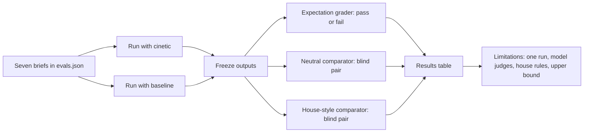
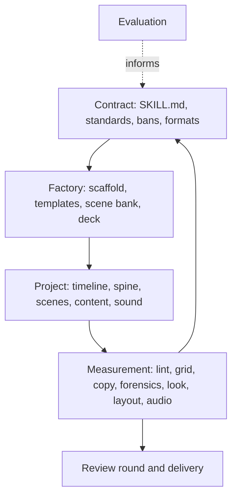

# Overview: what cinetic is and whom it serves

## The short answer

cinetic is an Agent Skill. An Agent Skill is a folder of instructions and tools that a coding agent loads for one kind of work. cinetic loads for film work. It makes the agent direct and render a short motion film from code. A citation with a slash starts at the cinetic source root, the checkout at commit `f4bbfc8`. The checkout is at `/Users/darkvoid/GitSources/src.aidesign/src.leonnix/cinetic`. A bare file name is shorthand for a file of that name under `skills/cinetic/`.

The source states the purpose in its first paragraph. The agent directs a film, not a web page. Picture, words and sound are one system. The system is driven by one timeline file. Nothing is finished until it is rendered, measured and reviewed once (`skills/cinetic/SKILL.md:8-11`).

```text
# skills/cinetic/SKILL.md:8-11
# cinetic

You are directing a short film, not animating a web page. Picture, words and sound are one system driven by one
timeline file; nothing is finished until rendered, measured and reviewed once against the standard below.
```

The project README gives the name's reading and the two main products. It says: "cinetic (cinema + kinetic) is an agent skill that makes your coding agent direct a short film instead of arranging animation components."

The two most common products are the launch film and the update video (`README.md:18`).

The skill is a production system. It is not a set of animation components. It supplies a script contract, a scene bank, a direction deck, a type-pairing deal, a music pipeline, a sound-effect kit, gates and a review pass. The agent supplies the product facts, the copy, the content and the creative judgement inside the dealt constraints.

A scene bank is a fixed set of house scenes (`skills/cinetic/assets/templates/launch-simple/src/bank.ts:45-102`). A deal is a seeded draw that fills the open scene slots from the bank (`bank.ts:176-200`). A film has one own scene at most. The agent writes that scene in `src/product.tsx`, and the deal leaves its slot open (`timeline.ts:193-197`). A direction deck is the set of eight creative choices a film starts from: space, light, camera language, cut grammar, type behaviour, story shape, lockup and signature shot (`skills/cinetic/scripts/deck.py:4-11`). A seed is a string that makes a pseudo-random draw repeatable. A spine is the agent's written plan: one sentence, one element, one case and three to five acts (`skills/cinetic/assets/templates/launch-simple/src/spine.ts:53-92`). A scene spec is one entry under an act: a form, a name, optional props, a handover and user-interface strings (`spine.ts:24-35`). A slot is one position in an act that the deal fills. For example, one search box becomes a result list. The element is the box, the case is a search, and the form changes from box to list. These scene lengths apply to dealt house scenes in a launch film. The UI walkthrough instead runs 17 bars and 35 seconds (`skills/cinetic/assets/templates/ui-walkthrough/README.md:5`).

## Whom it serves

The direct user is a coding agent. The agent reads `SKILL.md`, runs the scripts and writes the film project. The human user gives a brief. The brief names the product, the format, the length and any supplied brand. The film serves the product team that needs a launch film, an update video, a product or feature video, a feature loop, a logo sting or a user-interface (UI) walkthrough.

The skill is written for one agent to finish in one to two hours. The time plan says a run has a budget of one to two hours, or 90 minutes when the user gives no budget (`skills/cinetic/SKILL.md:104`). The default path is not a team workflow. It is a single-agent path with gates.

The skill assumes a capable agent. It assumes the agent can write TypeScript or HyperText Markup Language (HTML), run shell commands, read frames and follow a review checklist. It also assumes the agent will not invent product facts. The brief-claim rule in `copy-check.py` fails a line that states a price, figure, superlative or promise that `BRIEF.md` never gives (`skills/cinetic/scripts/copy-check.py:39-41`).

## What ships

The skill root is `skills/cinetic/`. At commit `f4bbfc8`, 939 of the 964 tracked files are under it. The root file is `SKILL.md`, which is 263 lines. The skill also ships a Massachusetts Institute of Technology (MIT) licence copy at `skills/cinetic/LICENSE.txt`. The Remotion engine has its own licence: free for individuals and companies of up to three people, a company licence from four people onwards. HyperFrames is Apache-2.0 (`README.md:195`).

`SKILL.md` has six main parts; the opening section runs before them:

1. The standard: eleven rules with numbers (`SKILL.md:21-79`).
2. The hard bans: words, type, colour, decoration, pictures, sound and credits (`SKILL.md:81-94`).
3. The time plan: checkpoints at 15 percent, 25 percent, 45 percent, 45-70 percent and 70 percent of the run (`SKILL.md:104-113`).
4. The eight-step simple path (`SKILL.md:115-181`).
5. The format table (`SKILL.md:183-197`).
6. The craft essentials: timing, motion, engine, sound and finishing (`SKILL.md:199-227`).

The first rule is a good example of the contract's form. It gives a claim, a percentage and the gate that measures it.

```text
# skills/cinetic/SKILL.md:22-25
1. **Words in the middle.** A statement is centred and sits in the middle band of the frame (its centre at 35-65 % of
   the height): centred for 80 % of the statement time or more, in the middle band for 85 % or more. Centred top or
   bottom only over a full-bleed picture. Never flush left at the top or the bottom. "Text on top, big picture below"
   at most once a film; a line beside, above or below a picture at most once per 30 s. (`layout-audit.sh` placement.)
```

The hard bans are a list of looks the skill removes when the agent invents the brand. The quoted part covers vague words, slogan shapes, serif faces and banned accent colours. The full section also bans decoration, drawn stand-ins for photographs, generated music and credits in the picture (`SKILL.md:81-94`).

```text
# skills/cinetic/SKILL.md:84-91
- **Words:** grey bars or "Placeholder" where words belong; vague, fancy or metaphor copy (unleash, reimagine,
  seamless, elevate, unlock, the future of, magic) and slogan shapes ("X, reimagined", "Less X. More Y."); keyword
  piles; two lines readable at once (a declared swap excepted); eyebrow labels, stacked taglines, "Introducing…";
  filler text, fake metrics.
- **Type:** serif faces, italic or oblique (or a skew faking one); a payoff word may take an italic accent face
  (`// cinetic:accent-face <family>`). One clean sans, plus a mono for code.
- **Colour:** orange, amber, beige, cream, tan or sand as an accent, a paper or a glow; neon; purple, violet or
  indigo; green in a brand you invent; a monochrome accent wash; glassmorphism as a UI style.
```

A supplied brand wins over the house taste, and therefore over these bans where the brand supplies the look (`SKILL.md:15`). The brand's paper, colours, typeface and logo are used as given. `BRIEF.md` records the exception, and a `// cinetic:brand-supplied` marker lets `lint-film.mjs` pass the code (`docs/evaluation.md:64`). This exception matters. Without it, a supplied cream paper or orange accent would fail the same gate that protects an invented look.

The assets folder holds the material the contract talks about. It has 510 files. The largest parts are `assets/remotion-starter` with 328 files and `assets/templates` with 157 files. It also holds `assets/hyperframes-starter` with 13 files, six critics, two direction data files, one library data file, one music data file and two root files. The templates are eight: `camera-teaser`, `capability-reel`, `launch-simple`, `prompt-run`, `social-ad`, `type-explainer`, `ui-walkthrough` and `update` (`skills/cinetic/assets/templates/`).

The scripts folder holds 334 files. Of these, 55 are root scripts, 14 are audio scripts and 265 are tests under `scripts/test/`. The working tools are therefore 69 script files, plus the tests. This ratio matters when a reader judges the project by file count. The test suite is most of the script tree.

The references folder holds 93 documents. Thirty are root references, 27 are device files, 27 are library files and nine are motion-library files. A device file is one page for a family of named devices; each of its entries gives the device's anatomy, timing, sound and build (`skills/cinetic/references/devices/INDEX.md:3-7`). A library file is one page for a family of libraries, and a motion-library file is one page for a family of motion techniques. For example, `skills/cinetic/references/devices/logo-and-end-card.md` covers end cards, and `skills/cinetic/references/motion-library/` holds the motion techniques. The root references are the deep guides: `spine.md`, `timing-grid.md`, `sound.md`, `music.md`, `copy-and-type.md`, `checks.md`, `review-loop.md`, `worked-example.md` and others (`skills/cinetic/references/`).

The critics folder holds six review lenses: `director.md`, `forensics.md`, `sound-sync.md`, `art-copy-ui.md`, `detail.md` and `verifier.md` (`skills/cinetic/assets/critics/`). A review lens is one critic's checklist. The director lens is the default one pass. The other five are optional deeper lenses (`skills/cinetic/assets/critics/director.md:1-4`). A long review can run more than one lens; the default review runs the director only (`review-loop.md:75-80`).

The evaluation material is split. `evals/evals.json` holds seven briefs. `docs/evaluation.md` holds the result report. The repository does not ship the harness that ran the rounds, or the judge prompts. The evaluation document says it ships the briefs and expectations only (`docs/evaluation.md:197`).

## The formats

The skill covers six formats. A format is a film type with its own length, template, script shape and deliverables. The format table gives all six. The `--template` flag belongs to `new-film.sh`, and it selects a folder under `assets/templates/` (`new-film.sh:15`, `new-film.sh:69-88`).

```text
# skills/cinetic/SKILL.md:183-197
## Formats

| Format | Length | Template | Script | Deliverables |
|---|---|---|---|---|
| Launch film | 15-30 s (to 45) | `launch-simple` | what it is, 2-5 things it does, the close | 16:9 master, 9:16 and 1:1 variants, poster |
| Update film ("vX is out") | 8-20 s | `update` | a line and a house scene per change; the mark pulls back | master, poster, 9:16 |
| Product or feature video | 8-30 s | `launch-simple` or `ui-walkthrough` | 3-6 lines | master, poster |
| UI walkthrough | 20-90 s | `ui-walkthrough` | what it is, one line per step | master, SRT captions |
| Feature loop | 4-15 s, whole bars | `--template none` | 1-2 lines, reads muted | MP4, WebM, GIF, seamless seam |
| Logo sting | 3-8 s | `--template none` | the name and at most one line | MP4, ProRes 4444 alphas, poster |

An update film: its lone line big, read whole in 1.2 s; no scene
over 3 s (a typed change 3 s); the lockup snaps once and keeps moving to the last frame; a plan outside `src/deal.ts` LIMITS fails: shorten the content, never raise a limit.
Films render at 30 fps (a move over 25 px a frame is smeared; `--fps 60` for fast camera travel);
a loop's last frame flows into frame 0 (`forensics.py --loop`, `render.sh --loop`).
```

The lines under the table matter. A lockup is the final arrangement of the name and the mark, and the mark is the logo symbol (`formats.md:94`). Whole bars means a whole number of musical bars (`formats.md:40`). A SubRip Text (SRT) file holds captions (`formats.md:269`). ProRes 4444 is a video codec with an alpha channel (`formats.md:233`). BT.709 is a colour standard (`finishing.md:11`). The default frame rate is 30 frames per second (fps). A 60 fps render is the exception for fast camera travel. The templates ship with `FPS = 60`, but the scaffold rewrites the constant to the chosen rate (`skills/cinetic/assets/templates/launch-simple/src/timeline.ts:23`, `skills/cinetic/scripts/new-film.mjs:260`). A reader who opens a template without scaffolding sees the template's own rate, not the delivered default.

The evaluation expects 60 fps when a brief gives no frame rate (`docs/evaluation.md:187`). That expectation conflicts with the 30 fps default in the contract (`SKILL.md:196`). The source does not reconcile the two rules.

## The two engines

cinetic supports two engines. Remotion 4.0.529 is the default. It uses React and renders each frame from a function of the frame number. HyperFrames 0.8.79 is the mirror for HTML projects. It uses a paused GreenSock Animation Platform (GSAP) timeline.

```text
# skills/cinetic/SKILL.md:13-16
- **Engines.** Remotion 4.0.529 (React, frame-driven) is the default. HyperFrames 0.8.79 (HTML, a paused GSAP timeline) mirrors the tokens and timeline contract for HTML projects ([hyperframes-engine.md](references/hyperframes-engine.md)).
- **Paths.** Scripts work from the skill root and in a film project (`new-film.sh` copies them in); each prints `--help` (not the helpers `brand-svg.ts`, `hf-preflight.cjs`).
- **Brand.** A supplied brand (logo, colours, fonts, screenshots, tone) wins over the house taste ([brand-kits.md](references/brand-kits.md)); record any banned look it brings in `BRIEF.md`.
- **Python.** Commands say `python3`: `node scripts/frames.mjs python` names the interpreter with `scripts/requirements.txt`; set `PYTHON` to it once.
```

The mirror is not complete. The source says HyperFrames "mirrors the tokens and timeline contract" (`SKILL.md:13`). A reader must not assume that every script supports both engines. The scaffold has an engine switch, `--engine remotion|hyperframes` (`new-film.sh:11`, `new-film.sh:46-50`). For Remotion, the timeline lives in `src/timeline.ts` (`new-film.sh:46-47`). For HyperFrames, the constants live in `motion.js` (`motion.js:22-27`), and the timeline and its `FILM` object live in `timeline.js` (`timeline.js:15`, `timeline.js:145-149`). The scaffold rewrites `motion.js` and `index.html` (`new-film.mjs:267-285`). The templates are engine-specific. The asset count shows one Remotion starter with 328 files and one HyperFrames starter with 13 files.

## Runtime and process boundaries

The skill has six actors: the agent and five outside tools. The outside tools are Node.js, Python, ffmpeg, a Chromium browser and the separate tool earshot. The README lists the requirements.

```text
# README.md:189-194
- **Node 22+** (Remotion 4; `music.mjs`, `logos.mjs`, `assets.mjs`, `font-match.mjs` and the checks)
- **ffmpeg 6+** with libx264, and ffprobe
- **Python 3.11+** with numpy, scipy, soundfile, pyloudnorm, opencv-python and librosa; fonttools, brotli and uharfbuzz for outlined SVG logos and supplied fonts; pillow for banding-free gradient PNGs
- **[earshot](https://github.com/Leonxlnx/earshot) 0.4+** in its own virtual environment, with `EARSHOT_PYTHON` pointing at its interpreter: it renders the film's sound kit (the `launch` preset, levelled over the music), ranks the sounds cast for each action and listens to the soundtrack. A film keeps its rendered takes in `audio/kit/`, so it rebuilds where earshot is not installed. Details: [Sound from earshot](docs/setup.md#sound-from-earshot).
- **A licensed music track per film.** The agent finds one with `music.mjs` in free catalogs whose licence needs no credit, or you choose it; it stays in the film's git-ignored `audio/music/` beside its licence record. Details: [Music](docs/setup.md#music).
- **Chromium or a Chrome headless shell.** Remotion downloads its own if allowed; set `REMOTION_BROWSER` or `CHROMIUM_PATH` to use a local one.
```

Node.js runs the Remotion render, the JavaScript tools and the TypeScript checks. Python runs the copy check, the pixel forensics, the look audit, the audio-video audit and the audio tools. ffmpeg muxes the soundtrack and probes the output. Chromium renders the frames. earshot renders and judges the sound kit (`skills/cinetic/scripts/audio/kit.py:1-8`).

earshot is a sibling checkout in the same workspace folder. cinetic calls it and does not vendor it (`README.md:192`). `EARSHOT_PYTHON` picks earshot's interpreter; `PYTHON` and `CINETIC_PYTHON` pick the project's Python (`README.md:192`, `py.mjs:1-12`). A film keeps its rendered takes in `audio/kit/`, so the film rebuilds where earshot is absent (`README.md:192`, `skills/cinetic/scripts/audio/kit.py:6-8`).

The Python packages are listed in one file.

```text
# skills/cinetic/scripts/requirements.txt:6-15
numpy                 # every check and measure
opencv-python         # forensics, look-audit, like, palette, brand, motion blur (opencv-python-headless works too; sheet.py draws with pillow without it)
scipy                 # the music, the sound, check-sync, measure-speed
soundfile             # reading and writing audio
pyloudnorm            # loudness (master.py, check-sync.py)
librosa               # the track's analysis (track.py, av-audit.py)
pillow                # brand.py, dither-gradient.py, sheet.py without opencv
fonttools             # outline-text.py (brand-kit.sh's SVG lockups)
brotli                # woff2 fonts for outline-text.py
uharfbuzz             # shaping for outline-text.py (the SVG lockups)
```

The quoted Python rule names a diagnostic command. `node scripts/frames.mjs python` asks candidate interpreters which of numpy, scipy, soundfile and cv2 they import. It names one that imports the most (`skills/cinetic/scripts/frames.mjs:52-53`) and caches the pick for a day in `~/.cinetic/python.json` (`frames.mjs:561-568`). The selector in `py.mjs` uses `$PYTHON` or `$CINETIC_PYTHON` first, then the active virtual environment, then `.venv` or `venv`, then the remembered pick in `~/.cinetic/tools.json`, then `python3`, `python` and `py -3`. It accepts Python 3.10 or later, while the README requires 3.11 or later (`README.md:191`). It prefers one that imports numpy, scipy and cv2, while the diagnostic also asks about soundfile (`skills/cinetic/scripts/py.mjs:1-12`, `py.mjs:36-60`, `frames.mjs:52-53`). The source does not reconcile the two versions or the two package lists. Set the `PYTHON` environment variable to that interpreter once.

## The film's shape

A launch film is not an arbitrary sequence of shots. It is one sentence played as three to five acts (`SKILL.md:129-131`). Each act does one verb of the sentence to one case. One element changes form from scene to scene. The case is the brief's request, names and numbers, and it repeats in every act. A lone line is the only line on screen at that moment.

The timeline enforces the shape. It imports the scene bank and deals the cast. It measures each scene against its band. It refuses a scene that runs longer than three seconds, and it refuses a lockup longer than 2.5 seconds (`skills/cinetic/assets/templates/launch-simple/src/timeline.ts:322-347`).

The scene bank holds the house scenes. Each entry gives an id, a name, a duration at 30 fps, an input box or none and an output box. It also gives a big flag, a ground, verbs, needs, lockup shares and an optional duration function (`skills/cinetic/assets/templates/launch-simple/src/bank.ts:26-40`). The timeline computes each scene's band from these values (`timeline.ts:350-352`). A house scene is a prebuilt shot in the bank. A ground is the film's background field. The deal rules keep most of the film on the bank.

```text
# skills/cinetic/assets/templates/launch-simple/src/bank.ts:140-141
/** The deal's rules: most of a film's scenes from the bank, one of its own at most, two shared with the last film at most. */
export const DEAL_RULES = { bankShare: 0.75, ownMax: 1, sharedMax: 2, ownSeconds: [1.5, 3] } as const;
```

The timeline converts these 30 fps durations to the film's frame rate with `f60` (`skills/cinetic/assets/templates/launch-simple/src/timeline.ts:47`). The seed makes the deal repeatable only when the name and the film history match (`bank.ts:151-154`). The scene seed is the deck's direction when one is dealt, otherwise the product name. The deal seed adds the scenes of the last three films (`bank.ts:154`). The history weight has four values, 0.08, 0.3, 0.55 and 0.8 (`bank.ts:158`), and the deal applies up to four films (`bank.ts:168`). The source does not explain why the seed looks back three films and the weight looks back four. The history weight pushes a scene down when a recent film used it.

```text
# skills/cinetic/assets/templates/launch-simple/src/bank.ts:151-160
/** The seed the film's look starts from: the deck's direction when one is dealt, else the product's name. */
export const SCENE_SEED = DEALT ? `direction:${DEALT.direction}` : DEAL_SOURCE;
/** The seed the scene deal draws from: SCENE_SEED with the films before this one (the same name after another film deals anew). */
export const DEAL_SEED = `${SCENE_SEED}#${HISTORY.slice(0, 3).map((f) => f.join('+')).join('|')}`;
/** What the unnamed scaffold plays, slot by slot (a named film is dealt). */
export const FLOOR_CAST = ['macro-type', 'page-fly', 'decode-title', 'toast-stack', 'blobs-to-mark'] as const;
/** How a scene's weight falls when one of the last films played it (the last film first). */
const RECENT_WEIGHT = [0.08, 0.3, 0.55, 0.8];
/** The pull of a scene whose verbs hold the act's verb, of one that hands on the spine's form, of a big one. */
const PULL = { verb: 3, form: 1.5, big: 1.8 } as const;
```

The type deal works the same way. `type-deal.ts` chooses a voice, text and mono pairing from `src/fx/TypePairs.ts`, seeds it by the product name and the mood, and avoids the last two films' pairings (`skills/cinetic/scripts/type-deal.ts:100-110`). It writes six type roles, `ui`, `caption`, `line`, `display`, `hero` and `giant` (`type-deal.ts:53`), the font stacks, the face set and a `// type pair:` line into `src/brand/tokens.ts` (`type-deal.ts:133-181`). It also writes the pair id into `film.json` (`type-deal.ts:195-206`).

The picture lives in a film project, not in the skill. `new-film.sh` copies the starter, overlays the template, writes `film.json`, sets the grid constants and copies every script into the project (`skills/cinetic/scripts/new-film.sh:132-140`, `new-film.mjs:192-204`). The project runs on its own copy of the scripts after the scaffold. It has its own `src/`, `scripts/`, `public/`, `audio/`, `out/`, `BRIEF.md`, `TREATMENT.md` and `CREDITS.md`. It does not carry the skill's tests or references, and it still needs the outside tools.

## The engine of quality

The skill does not trust the agent's eye alone. It measures. The gates cover these areas:

1. Static code bans (`lint-film.mjs`).
2. Grid, spine, copy timing and deal rules (`grid-check.ts`).
3. Copy clarity and claims (`copy-check.py`).
4. Rendered-frame artifacts (`forensics.py`).
5. Palette, contrast, camera and type on the rendered look (`look-audit.py`).
6. Pre-render import, case and fit failures (`precheck.mjs`).
7. Layout, safe zones, overlap and placement (`layout-audit.sh`).
8. Audio-video sync, loudness and clipping (`av-audit.py`, `check-sync.py`).

The gate list is also documented in `skills/cinetic/references/checks.md`. The skill calls the gates at different times. The static checks run before a render. The draft checks run on a half-size render. The master checks run on the final file. A failing gate changes the run: the agent fixes the cause and renders again.

The audio targets are numeric. A film with music masters to -14 Loudness Units relative to Full Scale (LUFS). A film of eight seconds or less masters to -16 LUFS. An effects-only film masters to -18 LUFS. The true peak ceiling is -1.5 decibels true peak (dBTP) (`skills/cinetic/scripts/audio/score.py:59-60`). `check-sync.py` holds the audio lag to 48 samples, which is 1 millisecond at 48 kilohertz (`skills/cinetic/scripts/check-sync.py:7-9`).

## The evaluation

The evaluation is a separate product from the gates. The gates ask whether the film meets the skill's rules. The evaluation asks whether people or judges prefer the film that follows the skill to a film made without it.

The report describes six judged rounds. The neutral blind judge was split. The house-style judge preferred the cinetic film in every house-style comparison. The cost was about three times the baseline.

```text
# docs/evaluation.md:114-122
| Round | Version tested | Comparisons | Expectations met (cinetic vs baseline) | Neutral judge: cinetic wins | House-style judge: cinetic wins |
|---|---|---|---|---|---|
| 1 | 0.1.0 | 3 | 97.7% vs 80.3% | 0 of 3 | n/a |
| 2 | 0.2.0 | invalidated | not reported | not reported | not reported |
| 3 | 0.3.0 | 4 | 100% vs 74.8% | 2 of 4 | 4 of 4 |
| 4 | 0.4.0 | 4 | 55/56 (98%) vs 39/56 (70%) | 0 of 4 | 4 of 4 |
| 5 | 0.5.0 | 4 | 54/56 (96%) vs 41/56 (73%) | 2 of 4 | 4 of 4 |
| 6 | 1.0.0, first snapshot | 4 | 53/56 (95%) vs 41/56 (73%) | 1 of 4 | 4 of 4 |
| 7 | 1.0.0, second snapshot | 4 | 54/56 (96%) vs 41/56 (73%) | 2 of 4 | 4 of 4 |
```

The headline number is 7 neutral wins in 23 comparisons, and the baseline won the other 16 (`docs/evaluation.md:5`). The 23 are the comparisons of the six judged rounds; round 2 was invalidated. The last judged version is 1.0.0. The shipped version is 1.5.1, so the results describe an earlier release. The released 1.0.0 is a little ahead of what was judged, because the fixes from round 7 shipped after the judged snapshot (`docs/evaluation.md:189`).

The limitations are as important as the results. The evaluation used one cinetic run per brief per round and one baseline run per brief in total. The judges are language models. The house-style judge scores against cinetic's own rules. The expectations favour the skill, because several check cinetic conventions that the baseline never received. Round 2 is missing because a harness problem invalidated it. The previous-version comparison reuses one film per brief. Only four of the seven briefs were judged.

```text
# docs/evaluation.md:184-191
- **One cinetic run per brief per round, and one baseline run per brief in total.** How much a film changes between runs of the same brief was not measured. Because the baseline films never changed, their movement between rounds is judge noise: the same films met 42, 39 and 41 of 56 expectations in rounds 3 to 5, and the neutral judge scored the same unchanged baseline film up to 7 points apart in different rounds, each time against a different cinetic film (the Ledgerly baseline scored 24 to 31). A margin like 35-31 or 30-34 is within that noise. The neutral results across rounds (0 of 3, 2 of 4, 0 of 4, 2 of 4, 1 of 4, 2 of 4) show no clear trend, and rounds this small could not establish one.
- **Language-model judges.** All the judges are language models, not a panel of viewers, and they may share tastes and blind spots with the agent that made the films. The persona and rubric shape what they reward.
- **The house-style judge scores against cinetic's own rules.** Its clean sweep shows that the skill follows its rules and the baseline does not. It is not independent evidence that viewers prefer the result.
- **The expectations favour the skill.** They were written alongside it, and several check cinetic conventions that the baseline was never given: the hard bans themselves, 60 fps when the brief does not state a frame rate, QA material in a subfolder, a brand kit, the `BRIEF.md` exception and the `lint-film.mjs` marker. The gap in expectations met is partly a gap in instructions, so read it as an upper bound.
- **Round 2 is missing.** A harness problem invalidated it, so 0.2.0 has no judged result.
- **The released 1.0.0 is a little ahead of what was judged.** Round 7 tested a snapshot; the fixes from its findings (the sound timing, the still-opening gate, the word test, the feed loudness) shipped after it without a judged round of their own.
- **The previous-version comparison reuses one film per brief.** The 0.5.0 films were made once, in round 5, so a 1.0.0 win against one of them is one draw, not a measured trend.
- **Short briefs, and only four judged.** No brief covers a UI walkthrough, a film longer than 25 s, or the social cut-downs, and the three briefs added since 1.1 have no judged results yet.
```



The evaluation's own summary states the split result and the cost. It is the best single paragraph to quote when a reader asks whether cinetic works.

```text
# docs/evaluation.md:5-6
In short: across six judged rounds, cinetic met more of the written expectations than the baseline every time and won every house-style comparison. The neutral blind judge was split: 7 wins in 23 comparisons over the six rounds, and 2 of 4 in the last, on a snapshot of 1.0.0. Against the films of 0.5.0, the last version whose films were judged, 1.0.0's films won 5 of 8 blind comparisons. A cinetic run costs about three times the time and tokens of the baseline.

```

The 5-of-8 result compares 1.0.0 with 0.5.0. It does not come from the neutral column in the table above. The eight are four briefs in round 6 and round 7. The phrase "the last version whose films were judged" means the last version with a judged round of its own before the 1.0.0 snapshots.

## Version and release state

The plugin manifest names version 1.5.1. The version string is on line 5 of the manifest.

```text
# .claude-plugin/plugin.json:1-6
{
  "$schema": "https://json.schemastore.org/claude-code-plugin-manifest.json",
  "name": "cinetic",
  "displayName": "cinetic",
  "version": "1.5.1",
  "description": "Direct and render launch films, update videos, product videos, feature loops, logo stings and UI walkthroughs with Remotion or HyperFrames: a direction per film, real imagery, brand kits and a licensed music track.",
```

The changelog has an `[Unreleased]` section above 1.5.1. The unreleased notes are not part of the tagged version.

```text
# CHANGELOG.md:27-31
## [1.5.1] - 2026-11-04

Three community contributions on top of 1.5.0: correct BT.709 tags on blurred masters with ffmpeg 9, a speed waiver that reaches the variants, line breaks owned by the layout, and style rules for the product as an object, a type voice and launch films in chapters.

### Added
```

The 1.5.1 entry is short. It says three contributions and then lists four items. The count and the list disagree in the source. It gives no metrics. The 1.5.0 entry below it holds the larger claims. A reader must not move the 1.5.0 claims into 1.5.1.

## What a reader should take away

cinetic is best understood as a production system with four layers:



The loop is the product. The contract defines what a film must be. The factory makes a project with a constrained set of choices. The project turns the choices into a timeline. The measurement layer turns the timeline and the rendered frames into pass or fail signals. The review round turns the signals into fixes. The evaluation tests the whole loop against a baseline.

**Aha:** the most important shipped artifact is not a React component. It is the contract plus the measurement loop. The components and the scene bank are replaceable. The contract, the single timeline and the gates are what make the output consistent across formats and across agents.

A reader who can explain the four layers, the two engines, the six formats, the state files and the split evaluation result can explain cinetic without opening the source. The first state files a reader meets are `film.json`, `out/cues.json`, `audio/kit.json` and the film history. The next document, `01-architecture.md`, gives ten main state locations and three more files.
