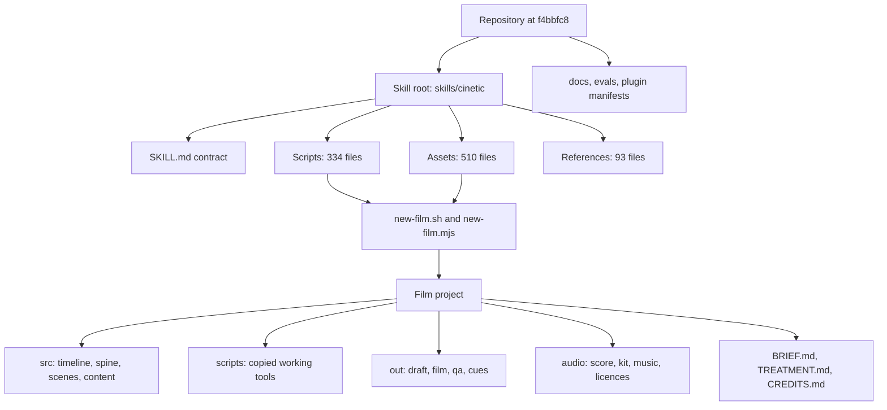
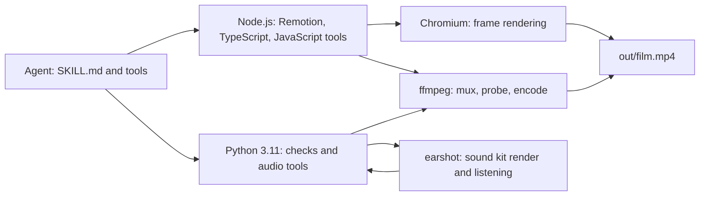

# Architecture: the factory, the project and the process boundaries

cinetic is an Agent Skill: a folder of instructions, assets and scripts that a coding agent loads for one kind of work. cinetic loads for short film work. It supplies a contract, a scene bank, a direction deck, a music pipeline, a sound-effect kit, gates and a review round. The agent supplies the product, the words and the judgement. This document names the parts and the boundaries between them.

## Three boundaries

cinetic has three boundaries. A reader who confuses them will misread the source.

1. The repository is the Git checkout at commit `f4bbfc8`. It has 964 tracked files. It holds the skill, the documentation, the evaluation and the plugin manifests.
2. The skill root is `skills/cinetic/`. It has 939 of the 964 files. It holds `SKILL.md`, `LICENSE.txt`, the assets, the scripts and the references. An agent loads this folder.
3. The film project is a new folder made by `scripts/new-film.sh`. It is not part of the repository. It has its own `src/`, `scripts/`, `public/`, `audio/`, `out/`, `BRIEF.md`, `TREATMENT.md` and `CREDITS.md`.

The factory makes the project. The project makes the film. The skill folder is not needed at render time, because the scaffold copies every working script into the project. The sound kit is the one part that can call an outside tool. That tool is earshot, which designs sounds in code and checks them by measurement. Rendered takes make the project independent of it (`kit.py:6-8`).



## The skill folder anatomy

The skill folder has five main areas. Each area has one job.

| Area | Files | Job |
|---|---:|---|
| `assets/` | 510 | Starters, templates, scene bank, critics, directions, libraries, music data |
| `scripts/` | 334 | Working tools and their tests |
| `references/` | 93 | Deep guides and indexes |
| `SKILL.md` | 1 | The contract the agent reads first |
| `LICENSE.txt` | 1 | The Massachusetts Institute of Technology (MIT) licence copy |

The counts total 939: 510, 334, 93, 1 and 1.

The asset area is the material. The script area is the machinery. The reference area is the detail the contract leaves out. `SKILL.md` is the entry point that names when to read each reference (`SKILL.md:229-253`).

The starting comment in `new-film.sh` explains the factory's design.

```text
# skills/cinetic/scripts/new-film.sh:4-8
# Copies assets/remotion-starter (or assets/hyperframes-starter) into <dir>, sets the frame rate,
# tempo, pace, size and name, copies every cinetic script into <dir>/scripts so the project runs on
# its own, then installs dependencies (or symlinks an existing node_modules with --link-modules) and
# deals the type pairing from the name (scripts/type-deal.ts). The work runs in scripts/new-film.mjs,
# one node process per stage, so a scaffold takes seconds even on a busy laptop.
```


The comment states the design goal. A scaffold takes seconds. The script makes six shell calls instead of about one hundred (`new-film.sh:124-125`). This matters on a busy Windows laptop, where the comment says a shell call costs one to four seconds (`new-film.sh:124-125`).

## The two starters

The skill has two starter projects.

1. The Remotion starter is `skills/cinetic/assets/remotion-starter/`. It has 328 files. It is a React and TypeScript project. Its entry point is `src/index.ts`, and its composition is `src/Film.tsx`. Its timeline is `src/timeline.ts`, its sound events are `src/sync.ts`, and its music grid is `src/music.ts`.
2. The HyperFrames starter is `skills/cinetic/assets/hyperframes-starter/`. It has 13 files. HyperFrames is a HyperText Markup Language (HTML) film engine that draws each frame from a paused GreenSock Animation Platform (GSAP) timeline (`skills/cinetic/references/hyperframes-engine.md:1-3`). Its files are `index.html`, `timeline.js`, `motion.js`, `music.js`, `setup.mjs`, `package.json` and the audio and font folders.

The Remotion starter has the full film machinery. The HyperFrames starter has the contract and the tokens. The source says HyperFrames "mirrors the tokens and timeline contract" (`SKILL.md:13`). The file counts show that the mirror is smaller. A reader must not assume feature parity.

## The eight templates

The template area has eight folders: `camera-teaser`, `capability-reel`, `launch-simple`, `prompt-run`, `social-ad`, `type-explainer`, `ui-walkthrough` and `update` (`skills/cinetic/assets/templates/`). A template is an overlay on a starter. It does not replace the starter. It copies its own files over the starter and removes the starter's files that do not apply (`new-film.mjs:195-204`).

`launch-simple` is the default for a launch film. It is the template this package studies in depth. It has its own `timeline.ts`, `spine.ts`, `bank.ts`, `deal.ts`, `dealt.ts`, `recent.ts`, `launch.ts`, `content.ts`, `palette.ts`, `world.tsx`, `product.tsx`, `sync.ts`, `Root.tsx`, `Film.tsx`, `template.json`, `floor.json` and `README.md`. `src/dealt.ts` ships as a placeholder with `DEALT = null` (`skills/cinetic/assets/templates/launch-simple/src/dealt.ts:1-5`). `deck.py` writes the real file when it deals a direction (`skills/cinetic/scripts/deck.py:2698-2699`). `floor.json` holds the fallback cast that an unnamed scaffold plays.

The template's `README.md` gives its shape in one paragraph. A launch film is one sentence played as three to five acts. Each act is one verb done to one case. One element changes form from scene to scene. The scenes are house scenes of 1.5 to 3 seconds. A house scene is one built scene from the bank; a big scene fills the frame. A film is 8 to 12 scenes, with at least two big scenes, and lasts about 15 to 25 seconds (`skills/cinetic/assets/templates/launch-simple/README.md:1-13`). The scene lengths alone do not imply that total. The music grid and the fit stage decide the final length.

The template's `template.json` is the machine-readable version. It gives the name, engine, pace, type family, tempo, ending hold, beats, deal slots, music, copy, keep and remove lists (`template.json:1-14`).

```text
# skills/cinetic/assets/templates/launch-simple/template.json:1-6
{
 "name": "launch-simple",
 "about": "The default launch film, 15-25 s, assembled from the scene bank (src/scenes: house scenes of 1.5-3 s, each one moment that shows a point and is understood) and played as a spine: one sentence as 3-5 acts, one case (the brief's request, names and numbers in every act), 8-12 scenes of 1.5-3 s (the lockup 2.5 s), two big at least, each dealt at random from the bank (src/bank.ts dealScene: the 28 house scenes that carry a point, the lockup from its four, a seeded weighted draw by the deck's direction or the name and the films before it, leaning to the act's verb; never a scene twice, two of the last film's at most, a scene that needs pictures, the site or street and room photographs only when the film has them; a slot redrawn by hand in src/spine.ts only with its reason), each point a big line on clean ground, read in 1.2 s, and then its scene, presses with a real pointer, one element handed on at every scene change (src/timeline.ts HANDOVER_PLAN, drawn by fx/Handover with the scene's own patch), a designed palette (src/palette.ts: one accent, white, near-black, the accent field) with one ground a film (src/timeline.ts FILM_GROUND, one flood at most), one subject 4.5 s at most, the lockup a house scene whole and alive to the last frame. The agent writes src/spine.ts first (the scenes' content in `props`), then src/content.ts for what the props leave out; the timeline, the handovers, the palette and the sound plan follow.",
 "engine": "remotion",
 "pace": "crisp",
 "type_family": "bold",
```


The `about` line says "28 house scenes that carry a point", while `bank.ts` holds more scene ids because it includes end scenes and scenes that need pictures (`skills/cinetic/assets/templates/launch-simple/src/bank.ts:49-102`). A reader must not treat the prose count as the total map size.

## The factory in two stages

`new-film.sh` runs two Node.js processes. The split keeps the shell work small. It also makes the expensive work resumable: a failed dependency install can repeat stage 2 without the starter copy.

```text
# skills/cinetic/scripts/new-film.sh:124-140
# The work is scripts/new-film.mjs: one node process per stage. A shell call (a subshell, sed, grep, node -e) costs one
# to four seconds on a busy Windows laptop, and the scaffold made about a hundred of them; it now makes six.
case "${BASH_SOURCE[0]}" in */*) HERE="${BASH_SOURCE[0]%/*}" ;; *) HERE=. ;; esac
cd "$HERE/.." || die "cannot find the skill folder from $HERE"
SKILL=$PWD
cd "$OLDPWD" || die "cannot return to $OLDPWD"
ST="${TMPDIR:-/tmp}/cinetic-new-film.$$"
export CINETIC_NF_T0="${EPOCHREALTIME:-}"
# stage 1: check the arguments, copy the starter and the template, the name, film.json, the grid, the data files
node "$SKILL/scripts/new-film.mjs" --stage 1 --state "$ST" "$@"
. "$ST"   # DIR, the project folder stage 1 made
# The project carries its own copy of every script, so npm scripts use local paths (not the
# skill's own tests in scripts/test/).
(cd "$SKILL/scripts" && tar --exclude=__pycache__ --exclude='*.pyc' --exclude=./test -cf - .) | (cd "$DIR/scripts" && tar -xf -)
# stage 2: node_modules, fonts, the type family and the pairing dealt from the name, a brand kit, a clip, the music,
# then the next steps
exec node "$SKILL/scripts/new-film.mjs" --stage 2 --state "$ST" "$@"
```


Stage 1 does the cheap and deterministic work. It checks the arguments, makes the folder, copies the starter, overlays the template, writes the name, writes `film.json`, sets the grid constants and writes the history into `src/recent.ts`. It also copies the data files (`new-film.mjs:182-325`). Stage 2 does the slow and variable work. It installs or links `node_modules`, vendors fonts, writes the type family, deals the type pairing, builds a brand kit and analyses a clip. It also adds and analyses the music and sets up the sound kit (`new-film.mjs:329-524`).

The starter copy leaves out installed and rendered folders. The filter is small and important.

```text
# skills/cinetic/scripts/new-film.mjs:192-205
  // the starter, leaving out anything installed or rendered
  const skip = new Set(['node_modules', 'out', '__pycache__']);
  fs.cpSync(SRC, DIR, { recursive: true, force: true, filter: (s) => !skip.has(path.basename(s)) || s === SRC });
  // a template: its files over the starter (its timeline, acts, film and sound), the starter's own acts removed
  if (TPL) {
    const keep = new Set(manifest.keep_if_present || []); // a brand already written into this folder (--force) stays
    for (const f of manifest.copy) {
      if (keep.has(f) && exists(path.join(DIR, f))) continue;
      fs.mkdirSync(path.dirname(path.join(DIR, f)), { recursive: true });
      fs.copyFileSync(path.join(TPL, f), path.join(DIR, f));
    }
    for (const f of manifest.remove) fs.rmSync(path.join(DIR, f), { force: true });
    say(`new-film: ${manifest.name} template: ${manifest.copy.length} files over the starter, ${manifest.remove.length} removed`);
  }
```


The `keep_if_present` rule lets a brand survive a forced scaffold. A user can copy a brand kit into a folder, run the scaffold again with `--force`, and keep the supplied brand files.

## The film project state

The project has ten main state locations that a reader must know. The list below uses the names from the source. Three more files sit outside the table: `src/recent.ts`, `src/music.ts` and `src/content.ts`. They hold the recent-film choices, the track grid and the agent's copy.

| State | Owner | What it holds |
|---|---|---|
| `film.json` | `new-film.mjs`, `type-deal.ts` | Template, start time, devices, allow list, recent films |
| `BRIEF.md` | The agent | Spec line, supplied material, hard bans, brand-supplied exceptions |
| `TREATMENT.md` | The agent | The idea, the script, the treatment |
| `src/timeline.ts` | The template and the agent | The film's constants, beat grid and cue plan |
| `src/deal.ts` | The template | The voice and ground slots and the name-seeded deal |
| `src/dealt.ts` | `deck.py` | The direction deal the deck wrote; the shipped placeholder is `null` |
| `src/spine.ts` | The agent | The sentence, element, case, acts, pictures and close |
| `out/` | The tools | Draft, master, quality-assurance (QA) reports, `cues.json`, stills, stems |
| `audio/` | The tools | `score.json`, `kit.json`, the music folder and its licence records |
| `CREDITS.md` | `credits.py` | Licence credits kept in the file, never on screen |

`film.json` is the small registry. `new-film.mjs` writes it only when it does not exist.

```text
# skills/cinetic/scripts/new-film.mjs:218-223
  const fj = path.join(DIR, 'film.json');
  if (!exists(fj)) {
    const devices = { ground: '', voice: '', emphasis: 'colour', signature: '', moves: [], seams: [], end: '', logo: '' };
    const recent = hist.map((h) => ({ name: h.name || null, template: h.template || null, devices: h.devices }));
    fs.writeFileSync(fj, `${JSON.stringify({ template: template || null, started: new Date().toISOString(), devices, allow: [], recent }, null, 1)}\n`);
  }
```


The `devices` object is empty at the start. It lists the creative choices this film declares: ground, voice, emphasis, signature, moves, seams, end and logo. The agent fills it from the catalogue, or the template's deal fills it through `src/deal.ts`. The comparison uses six of these fields: `ground`, `voice`, `emphasis`, `signature`, `end` and `logo`. It does not compare `moves` or `seams` (`film-diff.mjs:61-62`). The `recent` array comes from the film history. It holds the last three films' devices, so the next deal can avoid them. The history keeps twelve films; `film.json` copies the last three (`film-diff.mjs:64-65`).

`src/deal.ts` is the template's own deal. It is deliberately free of React and Cascading Style Sheets (CSS) imports, because the timeline and the sound code import it (`skills/cinetic/assets/templates/launch-simple/src/deal.ts:4-7`). It has two slots, voice and ground, and a seeded picker.

```text
# skills/cinetic/assets/templates/launch-simple/src/deal.ts:69-77
export const dealOf = (name: string): Deal => {
  const voice = pick(name, 'voice', DEVICES.voice, RECENT.voice ?? []);
  return { voice, ground: pick(name, 'ground', BUILT, [...(RECENT.ground ?? []), ...(voice === FLOOR.voice ? [FLOOR.ground] : [])]) };
};
/** The film's deal: the deck's, else from the name (never the last films' voice or ground while another is free). */
export const DEAL: Deal = {
  voice: valid('voice', dealt.voice) ? dealt.voice : /^\[/.test(seed) ? FLOOR.voice : dealOf(seed).voice,
  ground: valid('ground', dealt.ground) ? dealt.ground : /^\[/.test(seed) ? FLOOR.ground : dealOf(seed).ground,
};
```


`src/dealt.ts` is written by `deck.py` when a direction is chosen. The shipped file holds `null` until then (`dealt.ts:1-5`). A direction deck is the set of eight creative choices that the film starts from: space, light, camera language, cut grammar, type behaviour, story shape, lockup and signature shot (`deck.py:4-11`). The file is the bridge between the direction deck and the template. If the deck names a device the template does not have, `deal.ts` throws an error instead of falling back silently (`deal.ts:61-64`). This is a design choice: a wrong deal is a mistake to report, not a bug to hide.

`src/spine.ts` is the script. It is written before any picture work. The template ships a placeholder spine with `[Name]` and `[the request]` slots. The placeholder marker tells the agent to replace it.

```text
# skills/cinetic/assets/templates/launch-simple/src/spine.ts:52-57
// cinetic:placeholder - the template's stand-in spine: write the product's own sentence, case, acts and strings, then delete this line.
export const SPINE: FilmSpine = {
  sentence: '[Name] takes your request, makes the result, sends it and tells you who answered.',
  element: 'request',
  case: { request: '[the request, in the user\'s own words]', result: '[the result it makes]', names: ['[a person]'], numbers: ['[the count]'] },
  acts: [
```


`src/timeline.ts` is the contract. It computes the frame rate, the tempo, the beat grid, the scene lengths, the handovers, the cues, the copy windows and the plan. The beat grid is the frame position of every musical beat. A copy window is the frames a line must stay readable. The plan is the timed list of picture and sound events. The checks import it, and `export-cues.ts` turns it into a JavaScript Object Notation (JSON) document. The next document traces it in detail.

The project has a second set of files that are inputs to later steps. `public/` holds the plates, logos, fonts and audio. `audio/score.json` holds the music choice and the mastering settings. `audio/kit.json` holds the sound roles. The tools read both files as a record and as an input. `audio/music/` holds the licensed track and its licence record.

## The engine boundary

The timeline is engine-neutral in its contract, but the project is engine-specific. The shared contract is the constants and the cue shape; each engine implements them in its own file. A Remotion project uses `src/timeline.ts` and renders with Remotion. A HyperFrames project uses `timeline.js` and renders with a headless browser and a paused GSAP timeline. In the HyperFrames starter, the constants live in `motion.js` (`skills/cinetic/assets/hyperframes-starter/motion.js:22-27`). The timeline and its `FILM` object live in `timeline.js` (`timeline.js:15`, `timeline.js:145-149`).

The scaffold sets the constants in the right file. For Remotion it rewrites the frame rate (`FPS`), tempo (`BPM`), size (`W`, `H`) and pace (`PACE_NAME`) in `src/timeline.ts`. For HyperFrames it rewrites `motion.js` and the size, rate and duration attributes in `index.html` (`new-film.mjs:267-299`). The duration comes from `timeline.js` as `TOTAL / FPS` (`new-film.mjs:282-284`).

```text
# skills/cinetic/scripts/new-film.mjs:249-262
  // `const NAME = value;`: the FIRST such line only (timeline.ts derives `export const BPM = MUSIC?.bpm ?? GRID_BPM;`
  // from the grid line below it, which must stay as it is)
  const setConst = (file, name, value) => {
    const src = fs.readFileSync(file, 'utf8');
    const re = new RegExp(`^((?:export )?const ${name}(?:: [^=]+)? = )[^;]+;`, 'm');
    if (!re.test(src)) die(`${rel(file)} has no 'const ${name} = ...;' line to set`);
    fs.writeFileSync(file, src.replace(re, (m, head) => `${head}${value};`));
  };
  const pj = path.join(DIR, 'package.json');
  if (o.engine === 'remotion') {
    const tl = path.join(DIR, 'src', 'timeline.ts');
    setConst(tl, 'FPS', o.fps); setConst(tl, 'BPM', o.bpm); setConst(tl, 'W', o.W); setConst(tl, 'H', o.H);
    if (o.pace) setConst(tl, 'PACE_NAME', `'${o.pace}'`);
    fs.writeFileSync(pj, fs.readFileSync(pj, 'utf8').replace(/"name": "[^"]*"/, `"name": "${pkg}"`).replace(/\d+x\d+@\d+/g, `${o.W}x${o.H}@${o.fps}`));
```


The comment explains a subtle constraint. The setter replaces the first line that matches `const BPM = ...;` (`new-film.mjs:249-250`). In the template, that line is the inner `const BPM = 120;` inside `GRID_BPM` (`timeline.ts:29`). The `--bpm` option rewrites its value. The outer `export const BPM` derives from the track or from `GRID_BPM` (`timeline.ts:33`). It must not become the matched line, so the inner line must stay in its exact form.

```text
# skills/cinetic/assets/templates/launch-simple/src/timeline.ts:23-35
export const FPS = 60;
/**
 * This film's own grid tempo, used while src/music.ts carries no track. new-film.sh --bpm rewrites the
 * `const BPM = ...;` line inside, so keep that line as it is.
 */
const GRID_BPM = ((): number => {
const BPM = 120;
  return BPM;
})();
/** The tempo every helper and check uses: the track's when src/music.ts carries one, else GRID_BPM. */
export const BPM = MUSIC?.bpm ?? GRID_BPM;
export const W = 1920;
export const H = 1080;
```


The scaffold also rewrites the package name and every size-and-rate pattern in `package.json` (`new-film.mjs:262`). That is why the starter's QA script can contain `--spec 1920x1080@60` and still work for a 30 fps film. The pattern is replaced at scaffold time.

## The process boundaries

Six actors share the work: the agent, Node.js, Python, Chromium, ffmpeg and earshot. The boundaries are strict.



Node.js runs the scaffold, the Remotion render, the frame capture, the browser bundle, the film diff, the static lint and the grid check. The project's `package.json` shows the normal commands.

```text
# skills/cinetic/assets/remotion-starter/package.json:6-23
  "scripts": {
    "studio": "remotion studio",
    "stills": "remotion still Mark16 out/stills/mark-16.png --log=error && remotion still MarkSizes out/stills/mark-sizes.png --log=error && remotion still MarkLarge out/stills/mark-large.png --log=error",
    "check": "tsc --noEmit && node scripts/lint-film.mjs src && tsx scripts/grid-check.ts src/timeline.ts",
    "sound": "node scripts/sound.mjs",
    "cues": "tsx scripts/export-cues.ts",
    "music": "node scripts/py.mjs scripts/audio/track.py music",
    "kit": "node scripts/py.mjs scripts/audio/kit.py render",
    "plan": "node scripts/py.mjs scripts/audio/plan.py",
    "audio": "node scripts/py.mjs scripts/audio/plan.py --quiet && node scripts/py.mjs scripts/audio/score.py --cues out/cues.json --score audio/score.json --out public/audio/soundtrack.wav --stems out/stems --json out/qa/score.json",
    "credits": "node scripts/py.mjs scripts/audio/credits.py",
    "listen": "node scripts/py.mjs scripts/audio/listen.py",
    "render": "bash scripts/render.sh Film out/film.mp4 --blur --audio public/audio/soundtrack.wav",
    "render:preview": "bash scripts/render.sh Film out/preview.mp4 --preview --audio public/audio/soundtrack.wav",
    "render:draft": "bash scripts/render.sh Film out/draft.mp4 --draft --max-min 9",
    "gates": "node scripts/py.mjs scripts/forensics.py out/draft.mp4 --cues out/cues.json --grammar-only --json out/qa/forensics-draft.json; node scripts/py.mjs scripts/copy-check.py --ui src; node scripts/logos.mjs check",
    "qa": "mkdir -p out/qa && node scripts/py.mjs scripts/probe.py out/film.mp4 --spec 1920x1080@60 && node scripts/py.mjs scripts/forensics.py out/film.mp4 --cues out/cues.json --json out/qa/forensics.json && node scripts/py.mjs scripts/av-audit.py out/film.mp4 --cues out/cues.json --stems out/stems --json out/qa/av.json && node scripts/py.mjs scripts/sheet.py out/film.mp4 --out out/qa/sheet.png"
  },
```


The `py.mjs` wrapper is the Node-to-Python boundary. It tries `$PYTHON` or `$CINETIC_PYTHON` first, then the active virtual environment, then `.venv` or `venv`, then the remembered pick in `~/.cinetic/tools.json`, then `python3`, `python` and `py -3`. It accepts Python 3.10 or later, while the README requires 3.11 or later (`README.md:191`). It prefers one that imports numpy, scipy and cv2 (OpenCV). If no candidate imports all three, it uses one that imports numpy, or the first 3.10 or later with a warning. The source does not reconcile the two versions (`skills/cinetic/scripts/py.mjs:1-12`, `py.mjs:36-60`; the package scripts call it at `package.json:12-18`). The wrapper keeps the package commands uniform on macOS, Linux and Windows.

Python runs the copy check, the frame forensics, the look audit, the audio-video audit, the sync check and the audio tools. The audio tools are `track.py`, `kit.py`, `plan.py`, `score.py`, `credits.py` and `listen.py` (`package.json:12-18`). Bash drivers (`new-film.sh`, `render.sh` and `layout-audit.sh`) run the scaffold, the render and the layout audit. The packages are listed in one file.

```text
# skills/cinetic/scripts/requirements.txt:6-15
numpy                 # every check and measure
opencv-python         # forensics, look-audit, like, palette, brand, motion blur (opencv-python-headless works too; sheet.py draws with pillow without it)
scipy                 # the music, the sound, check-sync, measure-speed
soundfile             # reading and writing audio
pyloudnorm            # loudness (master.py, check-sync.py)
librosa               # the track's analysis (track.py, av-audit.py)
pillow                # brand.py, dither-gradient.py, sheet.py without opencv
fonttools             # outline-text.py (brand-kit.sh's SVG lockups)
brotli                # woff2 fonts for outline-text.py
uharfbuzz             # shaping for outline-text.py (the SVG lockups)
```


ffmpeg is the media boundary. It muxes the WAV soundtrack onto the muted picture. It probes the final file. It also encodes the variants and extracts frames. The render driver states the pipeline.

```text
# skills/cinetic/scripts/render.sh:15-38
# Modes:
#   (default)  sharp master: CRF 14, BT.709 tagged (--color-space=bt709), rendered in parts from a
#              pre-built bundle and joined losslessly (see Parts below). Its frames go through lossless PNG
#              (soft lit grounds band through JPEG intermediates; --jpeg for a faster master of a film without them).
#   --draft    the WHOLE film early, to look at and to fall back on: half size (-- --scale=S for another),
#              CRF 23 on x264 superfast, JPEG frames, parts of up to 450 frames (fewer browser starts), no blur
#              samples, the current soundtrack muxed when there is one (with a track picked and no mix yet, the track
#              alone: sound.mjs --bed-only; silent only with no track at all, said at the end and marked out/qa/SILENT), and
#              out/qa/draft-sheet.png (16 tiles cut from the video by ffmpeg). Look at the film through the draft
#              (frames.mjs sheet --from / grab --from), not through per-frame stills.
#   --from-draft DRAFT  the delivery when the final cannot finish in the time left: the whole draft scaled up to the
#              composition's size (lanczos, CRF 16), BT.709 tagged, the soundtrack muxed. A run never delivers a cut
#              film: a complete draft beats a final that stops halfway.
#   --preview  same pipeline, CRF 20 on x264 veryfast (about 3x faster to encode). Same tags as the
#              master, so colour and banding judgements carry over.
#   --blur     true motion blur, as the film declares it (--policy): sharp render -> measure-speed.py
#              writes out/samples.json (samples per frame from optical flow) -> the sub-frame
#              composition (<Comp>Sub, e.g. FilmSub)
#              renders every sub-frame with --props=out/samples.json -> accumulate.py averages
#              them in float, quantizes once (flat fields exact, dither only in smooth ramps) and
#              encodes BT.709 CRF 14. Before the sub-frame pass it prints the
#              sub-frame multiple and an estimate in minutes from the sharp pass's measured speed,
#              and it warns about moves too fast for clean blur. Typical films cost 3-8x a sharp
#              render; cap it with --budget. Render the blurred master once, after the last review.
```


Chromium renders the frames. Remotion uses it for the stills, the draft, the master and the blurred sub-frames. `frames.mjs` builds one bundle and reuses it, so a still does not pay the bundle cost on every call.

```text
# skills/cinetic/scripts/frames.mjs:20-27
// The bundle. `npx remotion bundle` costs from half a minute to several minutes on a laptop, and `npx remotion still
// src/index.ts` pays it on every call. Here the bundle lives in out/.bundle/<key>/, where the key hashes everything a
// bundle is made of: every file under the entry's folder (src/), remotion.config.ts, package.json, tsconfig.json, the
// Remotion version and public/ (path, size, mtime) but public/audio (the soundtrack is muxed by ffmpeg; frames render
// muted, so a new mix never rebuilds the bundle). An unchanged source reuses it in well under a second; any edit
// builds a new one (remotion.config.ts bundles with Rspack: seconds, where webpack took minutes on a busy laptop). The
// newest 3 bundles and any used in the last 2 hours stay; older ones are removed. render.sh takes its frozen copy from
// here (--copy-to). Build it once per state of the source: stills, sheets, the draft and the final all reuse it.
```


Rspack is a JavaScript bundler. Remotion's bundler uses it to build the film bundle (`skills/cinetic/assets/remotion-starter/remotion.config.ts:25-27`). `CINETIC_WEBPACK=1` switches to webpack for one command (`remotion.config.ts:27`).

earshot is the sixth actor. It is a separate checkout with its own virtual environment and its own interpreter (`README.md:192`). It is optional after the takes exist. `kit.py` renders the sound kit and measures every take. `score.py` builds the score and imports `master.py` for the mix bus and the mastering chain (`score.py:83`). `listen.py` and earshot's listening model judge the soundtrack. The rendered takes stay in `audio/kit/`, so a project can rebuild without earshot (`kit.py:6-8`).

## Storage and history

The skill keeps two histories outside the film project, plus one cache inside it.

1. The film history is `~/.cinetic/film-history.json` or the path in `CINETIC_FILM_HISTORY`. `film-diff.mjs --record` adds a film. It keeps 12 films (`skills/cinetic/scripts/film-diff.mjs:49`).
2. The music history is `~/.cinetic/music-history.json` or the path under `$CINETIC_HOME`. It stops the same track being offered first twice (`skills/cinetic/scripts/music.mjs:33-37`).
3. The bundle cache is `out/.bundle/<key>/`. It keeps the newest three bundles and any bundle used in the last two hours (`frames.mjs:26-28`).

The film history is the memory of the deal. `film-diff.mjs` reads `film.json` and the film's code. It checks the hard devices against the last three films and the soft devices against the last film, then records the result only with `--record` (`skills/cinetic/scripts/film-diff.mjs:61-65`). The hard devices are ground, voice, signature and end. The soft devices are emphasis and logo (`film-diff.mjs:61-62`).

```text
# skills/cinetic/scripts/film-diff.mjs:40-50
 * Usage (from the film project):
 *   node scripts/film-diff.mjs [<film dir>]              check the film
 *   node scripts/film-diff.mjs [<film dir>] --record     check, then add the film to the history (after the ship gate;
 *                                                        it prints the minutes since new-film.sh wrote film.json)
 *   node scripts/film-diff.mjs --history                 the last films' devices, newest first
 *   node scripts/film-diff.mjs --floor <template>        a template's floor; --write [--from <scaffold>] refreshes
 *                                                        floor.json from its deal.ts FLOOR (a deal that imports the
 *                                                        starter reads it from a fresh scaffold: new-film.sh --template)
 *   --allow slot,...    repeats the brief asks for     --json   machine-readable report
 *   --history-file F    the history (default $CINETIC_FILM_HISTORY, else ~/.cinetic/film-history.json; 12 kept)
 * Exit codes: 0 pass, 1 a check failed, 2 bad arguments or no film.
```


The history is not part of the repository. It belongs to the user's machine. A new machine starts with no history, so the first film has no "last three films" to avoid. The judged films in the evaluation are therefore not reproducible from the repository alone. The code is reproducible. The history-dependent choices are not.

The film project's Git ignore rules keep media out of version control. The starter ignores `out/*` except `out/cues.json`. It ignores `public/audio/*.wav`. It ignores `audio/music/*` except the JSON records and the README (`skills/cinetic/assets/remotion-starter/.gitignore:1-7`). The track is not committed. Its licence record and its analysis are committed as JSON.

## What the architecture assumes

The architecture assumes five things:

1. A capable coding agent can read a 263-line contract and follow references (`SKILL.md` has 263 lines at the pin).
2. The machine has the five runtime dependencies: Node.js 22 or later, ffmpeg 6 or later with libx264 and ffprobe, Python 3.11 or later with the listed packages, Chromium or a Chrome headless shell, and earshot 0.4 or later for a new sound kit (`README.md:189-194`).
3. The user can supply a licensed track, or the agent can find one with a no-credit licence.
4. The product has real content: screens, words, names, numbers and pictures.
5. The agent can render, look at frames and fix what the gates report.

The source does not define a fallback for a missing product. The brief-claim rule blocks invented facts (`copy-check.py:39-41`). The placeholder rule blocks unfinished content. A product with no screens and no real content is outside the skill's stated scope.

**Aha:** the project is the durable artifact. The skill is a factory that can be removed after the scaffold. The project carries the scripts, the gates, the templates' code and the state. That is why a film can be rebuilt on a machine that has only the project and its dependencies. It is also why the two machine-local histories are the parts of the system that a fresh machine cannot recover.

The next document, `02-core-mechanism.md`, follows the data through the timeline, the deal, the cues, the sound plan and the gates.
