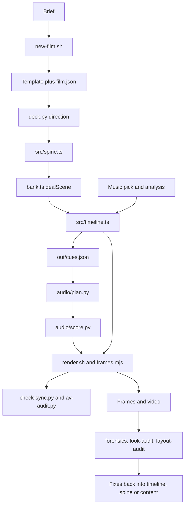
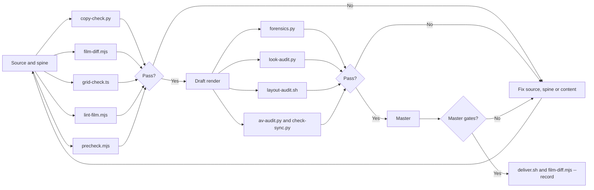

# Core mechanism: how a film is scaffolded, dealt, timed, sounded and checked

## The five chains

cinetic is an Agent Skill: a package of instructions and scripts that a coding agent loads. It works as five chains. The numbers give a reading order, not an execution order. A slash citation starts at the source root; a bare name means a file of that name under `skills/cinetic/`.

A deal is a seeded, weighted draw from a fixed set. The seed comes from the product name or the dealt direction. A device is a named creative choice, such as the ground, voice, signature or end card. A ground is the surface the film plays on. The spine is the film's one sentence, cut into 3 to 5 acts, with one element that changes form (`spine.ts:53-92`). A form is the shape that element takes in a scene, and a handover is the kind and frame of the change from one form to the next (`spine.ts:24-29`).

1. The scaffold chain turns a brief into a project with a template, a name, a grid and a type pairing.
2. The direction chain turns the brief into a direction, a spine and a set of house scenes.
3. The timeline chain turns the spine and the music into one clock, cues and frames.
4. The sound chain turns the cues into a track edit, a sound kit, a plan and a master.
5. The gate chain turns the code and the frames into pass or fail signals.



The chains are not a strict waterfall: music comes before the picture, and review comes after a complete draft (`SKILL.md:151-157`, `SKILL.md:173-177`). A failed gate sends the agent back to the timeline, spine or content.

## Chain 1: scaffold, template and type deal

The first chain starts with a folder name and a product name. `new-film.sh` checks the arguments, then stage 1 copies the starter and overlays the chosen template.

The copy skips installed and rendered folders: `node_modules`, `out` and `__pycache__` (`new-film.mjs:192-193`). The template overlay then copies its own files over the starter and removes the starter files the template does not use (`new-film.mjs:194-205`).

The template's `template.json` has three lists. `copy` names the files the template owns. `remove` names the starter files that would conflict. `keep_if_present` protects a brand that a user already wrote (`new-film.mjs:194-205`).

Stage 1 writes `film.json` if the file does not exist. The object has five fields when stage 1 writes it: template, start time, devices, allow list and recent films. The type deal later adds `devices.type` to the same object (`type-deal.ts:195-200`).

```text
# skills/cinetic/scripts/new-film.mjs:218-223
  const fj = path.join(DIR, 'film.json');
  if (!exists(fj)) {
    const devices = { ground: '', voice: '', emphasis: 'colour', signature: '', moves: [], seams: [], end: '', logo: '' };
    const recent = hist.map((h) => ({ name: h.name || null, template: h.template || null, devices: h.devices }));
    fs.writeFileSync(fj, `${JSON.stringify({ template: template || null, started: new Date().toISOString(), devices, allow: [], recent }, null, 1)}\n`);
  }
```

The `devices` object is the film's declared creative set. The `recent` array carries the last three films' devices.

Stage 1 rewrites the frame rate (`FPS`), tempo (`BPM`), size (`W`, `H`) and pace (`PACE_NAME`) in `src/timeline.ts`. The setter matches the first `const BPM = ...;` line, which is the inner `const BPM = 120;` inside `GRID_BPM` (`timeline.ts:29`). The outer `export const BPM` derives from the track or `GRID_BPM` (`timeline.ts:33`) and must not.

Stage 2 runs after the scripts are copied. It installs or links `node_modules`, vendors fonts, writes the type family and deals the type pairing. The type deal is seeded by the product name and the mood. It also avoids the last two films' pairings from the film history (`type-deal.ts:100-110`).

The type deal rewrites the token file. It sets six roles, the font stacks and the face list. The six roles are `ui`, `caption`, `line`, `display`, `hero` and `giant` (`type-deal.ts:53`). It also writes a comment line that records the pair.

The pair line is the audit trail. A later run of `type-deal.ts --check` reads it and reports drift (`type-deal.ts:183-186`). The deal also records the pair id in `film.json`, so `film-diff.mjs` can compare it with the last film's.

## Chain 2: direction, spine, house scenes and history

The second chain starts with the brief and ends with a cast of scenes and a history record.

`deck.py` deals three complete directions that fit the brief. It writes `out/OPTIONS.md`. The agent picks one with `--direction <id> --why "<one line>"`. The chosen direction writes `out/DIRECTION.md` and `src/dealt.ts` (`skills/cinetic/scripts/deck.py:26-31`, `deck.py:47-51`).

Left alone, the deck says, an agent makes keyword fragments on a plain ground, a push-in and an end card (`deck.py:4-6`). The deck replaces that default with a dealt space, light, camera language, cut grammar, type behaviour, story shape, lockup and signature shot (`deck.py:4-8`).

`src/deal.ts` reads the dealt direction first. The library is `src/deal.ts`; the chosen direction writes the generated data to `src/dealt.ts`. If no direction is dealt, it seeds from the product name. The validation loop throws an error when the deck names a device the template does not have.

The `pick` function removes the avoided values first. If every value is avoided, it falls back to the full list (`deal.ts:48-52`). The deal therefore never runs out of choices.

The spine is the agent's main creative work. It writes one sentence, one case, three to five acts and 8 to 12 scenes. Each scene names the element's form, optional props, optional handover and optional user interface (UI) strings. A scene is dealt only when it has no `bank` id, no `own` flag and a picture form. A scene with a `bank` id is pinned to that house scene, and it must give a reason in `why` (`spine.ts:24-29`). An own scene is written in `src/product.tsx`, and the timeline returns `null` for its slot (`timeline.ts:192-197`). A word scene also returns `null`, so the act draws the word, not a bank scene (`timeline.ts:198`).

The deal fills the scenes that the spine leaves open. The timeline calls `dealScene` once per open slot with the act, verb, form, needs, used ids and floor.

```text
# skills/cinetic/assets/templates/launch-simple/src/timeline.ts:186-205
export type CastEntry = { bank: string | null; own: boolean; props: Record<string, unknown>; ground: Ground; design: Ground; big: boolean; ff: boolean; subject: string };
const CAST0 = (() => {
  const named = FLAT.map((x) => x.def?.bank ?? '').filter(Boolean);
  const used: string[] = [];
  let slot = 0;
  return FLAT.map((s, i) => {
    if (s.def?.bank) return s.def.bank;
    if (s.def?.own) {
      const sec = s.def.seconds;
      if (s.form === 'word' || !(typeof sec === 'number' && sec >= DEAL_RULES.ownSeconds[0] && sec <= DEAL_RULES.ownSeconds[1]))
        throw new Error(`timeline: scene "${s.name}" is your own: give it a picture form and its seconds (${DEAL_RULES.ownSeconds.join('-')}), and draw it in src/product.tsx OWN`);
      return null;
    }
    if (s.form === 'word' && s.def) return null;
    const id = dealScene({ act: s.act, k: s.k, verb: SPINE.acts[s.act]?.verb ?? '', form: s.form, last: i === FLAT.length - 1, have: HAVE, used: [...named, ...used], floor: UNNAMED ? FLOOR_CAST[slot] : undefined });
    slot++;
    used.push(id);
    return id;
  });
})();
```

The `named` list holds the scenes the spine pinned. The deal receives `[...named, ...used]`, so it cannot choose a pinned or dealt scene (`timeline.ts:200`). The `used` list grows only with dealt ids (`timeline.ts:202`). The unnamed scaffold uses a fixed floor cast, so an untouched template still renders (`bank.ts:155-156`).

The draw filters the bank by needs, used ids and the shared-scene limit. It weights each candidate and computes a key. The largest key wins: a logarithm of a uniform value divided by the weight.

```text
# skills/cinetic/assets/templates/launch-simple/src/bank.ts:176-200
export const dealScene = (q: DealAsk): string => {
  const history = q.history ?? HISTORY;
  const stem = q.last ? 'end' : q.line ? 'line' : stemVerb(q.verb);
  const have = [...q.have, ...CONTENT_HAVE];
  const fits = (e: BankEntry) => (e.needs ?? []).every((n) => have.includes(n));
  const all = Object.values(BANK).filter((e) => fits(e) && (q.last ? e.verbs.includes('end') : !e.verbs.includes('end')));
  const lines = q.line && !q.last ? all.filter((e) => e.verbs.includes('line')) : all;
  const pool0 = lines.length ? lines : all;
  const free = pool0.filter((e) => !q.used.includes(e.id));
  const last = history[0] ?? [];
  const shared = q.used.filter((id) => last.includes(id)).length;
  const fresh = shared >= DEAL_RULES.sharedMax ? free.filter((e) => !last.includes(e.id)) : free;
  const pool = fresh.length ? fresh : free.length ? free : pool0;
  if (q.floor && pool.some((e) => e.id === q.floor)) return q.floor;
  const seed = q.seed ?? DEAL_SEED;
  let best = pool[0];
  let top = -Infinity;
  for (const e of pool) {
    // the weighted draw (log u / w, the largest wins): a scene of twice the weight wins about twice as often
    const u = (hash(`${seed}:${q.act}:${q.k}:${e.id}`) + 0.5) / 4294967296;
    const key = Math.log(u) / dealWeight(e, stem, q.form, history);
    if (key > top) [top, best] = [key, e];
  }
  return best.id;
};
```

The weight multiplies four factors; each absent factor is 1. The act's verb multiplies by 3. A matching output form multiplies by 1.5. A big scene multiplies by 1.8. A film that played the scene multiplies by 0.08, 0.3, 0.55 or 0.8, newest first (`bank.ts:158-168`). The deal seed adds the last three films (`bank.ts:154`), but the weight applies up to four (`bank.ts:168`). The source does not say whether the fourth value ever applies.

Four rules limit the film. At least 75 percent of picture scenes come from the bank. At most one scene is the film's own, at 1.5 to 3 seconds. At most two scenes are shared with the last film. No scene is dealt twice.

The history closes the chain. `film-diff.mjs` compares the film's devices with the last three films. The hard devices are ground, voice, signature and end. The soft devices are emphasis and logo (`film-diff.mjs:61-62`). It also checks overlap, floor, declared slots, type, creative set, hero shots and world (`film-diff.mjs:61-65`). `--record` adds the film to the history.

The overlap rule is the strongest anti-template rule. A film's move set shares at most 25 percent with each of the last three films. The Jaccard ratio is the shared count divided by the union count.

## Chain 3: one timeline, cues and frames

The third chain is the centre of the system. `src/timeline.ts` computes every time value, and the picture, `export-cues.ts` and the checks import it.

The timing code has five exports: two constants and three functions. `BEAT` is the number of frames in one beat. `BAR` is four beats. `b(bar, beat, sub)` returns the absolute frame of a grid position. `f60` and `f60x` keep a choreography's feel at another frame rate.

```text
# skills/cinetic/assets/templates/launch-simple/src/timeline.ts:40-49
/** Frames per beat (a whole number without a track: 60 fps -> 90, 100, 120, 144, 150 BPM). */
export const BEAT = (60 / BPM) * FPS;
export const BAR = BEAT * 4;
/** Absolute frame of a grid position: bar is 1-based, beat 0-3, sub = 16ths within the beat. */
export const b = (n: number, beat = 0, sub = 0) =>
  MUSIC ? Math.round(bar(n, beat, sub)) : Math.round(((n - 1) * 4 + beat) * BEAT + sub * (BEAT / 4));
/** A choreography length written in 60 fps frames, converted to this film's fps (rounded). */
export const f60 = (frames: number, fps: number = FPS) => Math.round((frames * fps) / 60);
/** The fractional twin of f60, for durations inside a move. */
export const f60x = (frames: number, fps: number = FPS) => (frames * fps) / 60;
```

Without a track, it uses the film's own `BEAT` and `BAR`. With a track, it calls `bar()` from `src/music.ts`, which follows the analysed downbeats (`timeline.ts:20-21`, `timeline.ts:44-45`). The picture is cut to the track.

The film's scenes are fitted to the music's eighths. Each scene has a natural length and a band. A dynamic program over the eighth grid tests every allowed end point. A length away from natural costs a squared logarithm, and a slower scene costs twice as much. A large penalty keeps a scene inside its band, and it adds no per-bar cost to a scene.

```text
# skills/cinetic/assets/templates/launch-simple/src/timeline.ts:411-435
  const cost = (i: number, len: number) => {
    const s = SPANS[i];
    const miss = len < s.min ? s.min - len : len > s.max ? len - s.max : 0;
    // slower than its own clock costs twice what faster does: a launch reads quick (the median shot 1.5-2.5 s)
    return s.w * Math.log(len / Math.max(1, s.nat)) ** 2 * (len > s.nat ? 2 : 1) + (miss ? 1000 + miss : 0);
  };
  const G = grid.length;
  let dp: number[] = new Array(G).fill(Infinity);
  const from: Int32Array[] = [];
  dp[0] = 0;
  for (let i = 0; i < n; i++) {
    const next: number[] = new Array(G).fill(Infinity);
    const back = new Int32Array(G).fill(-1);
    const s = SPANS[i];
    for (let g = 0; g < G; g++) {
      if (!Number.isFinite(dp[g])) continue;
      for (let h = g + 1; h < G; h++) {
        const len = grid[h] - grid[g];
        if (len < s.min * 0.5) continue;
        if (len > s.max * 1.6 + BAR) break;
        const c = dp[g] + cost(i, len) + (i + 1 < n && actStart[i + 1] && !down.has(grid[h]) ? ACT_OFF_BEAT : 0);
        if (c < next[h]) [next[h], back[h]] = [c, g];
      }
    }
    from.push(back);
```

The cost is a squared logarithm. A scene twice as long as its natural length costs `w * log(2)^2`, multiplied by two because it runs slower. A scene half as long costs `w * log(0.5)^2`, without the multiplier. The large penalty keeps a scene inside its band. The act-off-beat cost, 0.12, keeps act changes near a downbeat (`timeline.ts:396`, `timeline.ts:431`).

At the end, `barCost(h)` adds 0.1 per bar, so the film stays short (`timeline.ts:438-441`). The fit returns `{ bars, k, bounds }` (`timeline.ts:447-448`). `bars` is the bar count, `bounds` the scene boundaries and `k` the mean ease: the mean of each scene's fitted length divided by its natural length.

The cue export is the handoff to sound. It imports the timeline and `src/sync.ts`. It writes `out/cues.json` with these keys: `fps`, `bpm`, `total`, optional `width` and `height`, optional `pace`, `acts`, `cue`, `copy`, `events`, and optional `look`, `declared`, `salience`, `spine` and `music` (`export-cues.ts:340-402`).
The export validates first. A bad declaration or event fails the command, and nothing is written (`export-cues.ts:394`). The sound pipeline never reads a half-valid cue file.

The picture and the cues share the same clock because `sync.ts` computes events from the same constants, springs and easings that the acts animate with (`export-cues.ts:4-6`). A sound is not typed at a guessed time. It is computed at the frame where the picture's motion reaches its point.

## Chain 4: track, kit, plan, score and sync

The fourth chain starts with the cues and the music choice. It ends with a mastered WAV and a sync report.

Music is chosen before the timeline. `music.mjs pick` ranks a curated library; `music.mjs search` looks in free catalogues. It avoids the last film's track and writes the licence record. `track.py analyze` finds the tempo, bars, phrases, sections, entries, breaks and ending. `track.py fit` fits the edit to the film's beat plan, and `track.py grid` writes `src/music.ts` (`track.py:12-31`, `SKILL.md:151-157`).

The sound kit is rendered once per project. `kit.py init` writes `audio/kit.json` from an earshot preset. `kit.py cast` gives each action its own sound. `kit.py render` renders every take. `kit.py check` compares the rendered kit with the kit file and the cues (`kit.py:14-31`).

The plan fixes every event before the mix: its role, take, start time, gain and width, plus the stop-downs and hits that the track carries.
`score.py` renders them. A failed plan is cheap to change because no audio is mixed yet.

For a final mix, `score.py` has two modes: music-led or effects-only. It rejects synthetic music with exit code 1. A bed-only draft is a temporary third form.
The mix is mastered to fixed targets. A music-led film masters to -14 loudness units relative to full scale (LUFS). A film of eight seconds or less with music masters to -16 LUFS. An effects-only film masters to -18 LUFS. The true peak ceiling is -1.5 decibels true peak (dBTP) (`score.py:59`, `score.py:108`).
The sync check has two layers. The first layer decodes the audio from the muxed video and compares it with the source WAV. It fails when the lag exceeds 48 samples, which is one millisecond at 48 kilohertz. The second layer compares every placed effect with its cue frame. An effect must sit within one frame of its cue. The two tolerances measure different things: a mux lag and an edit placement.

```text
# skills/cinetic/scripts/check-sync.py:7-10
1. Lag against the source WAV. Cross-correlates the decoded audio with the source soundtrack at a few points
   and fails if any lag exceeds the tolerance (48 samples = 1 ms at 48 kHz). Remotion's own AAC mux leaves
   ~2048 samples of encoder priming in the stream, so an unchecked mux is typically 2-3 frames late; this
   catches that and any wrong-file or trimmed mux. It also measures the true peak of the decoded audio (4x
```

The audio-video audit is looser than the sync gate in one place and stricter in another. It looks for an onset within plus or minus two frames. With stems it requires a hit rate of 90 percent; without stems a low rate is a warning (`av-audit.py:32`). It also checks loudness, clipping and duration.

```text
# skills/cinetic/scripts/av-audit.py:19-21
  sync       each onset event has an audio onset within +-2 f (librosa backtracked onsets at hop
             128, delta 0.03, or a > 1 kHz 1 ms-envelope rise >= 4x); hit rate >= 90%     fail
             With --stems the sfx stem is searched (strict) and stray sfx onsets are listed.
```

`check-sync.py` is the mux and placement gate; it uses the plan and the source WAV. `av-audit.py` is the viewer's gate; it uses the decoded mix and frame measurements.

## Chain 5: gates and the reaction to a fail

The fifth chain closes the loop, and each gate answers a different question.

| Term | Meaning |
|---|---|
| Fragments | The word groups that build one line. A fragment holds 1 to 4 words in calm pace (`grid-check.ts:38-40`). |
| Concurrent copy | Film words on screen at the same time. Calm allows 8 film words, or 5 in replace mode (`grid-check.ts:42-45`). |
| Read-first rule | A second line arrives only after the first line has resolved and held its read (`grid-check.ts:46-48`). |
| Chain gap | The picture beat of 26 to 90 frames at calm pace between two fragments of one line (`grid-check.ts:52-57`). |
| Chain beat | A cue or a non-text sound event that happens between two fragments (`grid-check.ts:58-60`). |
| Anti-metronome | At most 60 percent of ordinary cuts land on downbeats, and cut intervals vary (coefficient of variation 0.25 or more) (`checks.md:121`). |
| Living ground | Something moves in the frame or the camera at least every 1.5 seconds, or 2 seconds inside a read (`look-audit.py:43-44`). |
| Luminance flip | The stage changes from light to dark or back on a hard cut, or flips twice in one bar (`look-audit.py:61-62`). |
| Arrival front-load | An arrival puts 20 percent or more of its change in its first 10 percent of time (`look-audit.py:65-68`). |
| Image develop | Imagery develops from a tint over 12 to 52 frames at 60 fps instead of arriving at full colour (`look-audit.py:69-70`). |
| Declared slots | The film names its ground, voice, signature, end and at least two moves in `film.json` (`film-diff.mjs:254-255`). |
| Hero shots | The hero shots a film played. The history records them, so the next deal weighs them down (`film-diff.mjs:30-32`). |
| World | The place the film stands in, with its hue. One of the last three films in the same world at a hue under 40 degrees away fails (`film-diff.mjs:33-38`). |
| Kit sample | Sample content from the kit that the film still shows, such as a sample product or person (`copy-check.py:63-65`). |

`lint-film.mjs` reads the source before a render. It catches code patterns that render wrong or read as generated. The list covers Cascading Style Sheets (CSS) animation, nondeterminism, `will-change` with a blur, frame-driven `left` and `top`, raw easing outside the animation library. It also catches unclamped interpolation, off-token colours, low-span gradients, clip text, Scalable Vector Graphics (SVG) text, in-browser blur, remote fonts, HyperFrames mistakes and placeholders.

```text
# skills/cinetic/scripts/lint-film.mjs:3-15
 * lint-film.mjs: static bans for a cinetic film (Remotion src/ or a HyperFrames project).
 *
 * Catches the code patterns that render wrong or read as generated before anything is rendered:
 *   css-animation     CSS transition/animation, @keyframes, animate-* classes (they do not render
 *                     frame-by-frame: everything must be a function of the frame)
 *   nondeterminism    Math.random, Date.now, performance.now, new Date() (renders must repeat)
 *   will-change-blur  willChange in a file that animates filter: blur() (stale ghost frames)
 *   frame-left-top    left/top/right/bottom driven by the frame (pixel-snapped stairs; use transform)
 *   raw-easing        Easing.bezier / cubic-bezier / Easing.spring|elastic|bounce|back outside lib/anim.ts
 *   spring-config     inline {damping, stiffness} spring configs outside lib/anim.ts (use SPR tokens)
 *   interpolate-clamp interpolate() without extrapolateLeft AND extrapolateRight 'clamp' (it extends)
 *   off-token-color   hex colours not declared in the tokens file; other colour literals (warning)
 *   gradient-low-span opaque gradients spanning < 30 code values (they band in 8 bit; use a dithered PNG)
```

`grid-check.ts` reads the timeline before a render. It checks the beat, the acts, the cue grid, the copy, the lone-line rule, the type size and the text hold. It also checks the script shape, the fragments, the concurrent copy, the read-first rule, the reveal rate, the chain gap, the chain beat and the anti-metronome rule. It also checks the cut-on-sound rule, the spine rules, the deal rules, the grounds, the subject run, the scene length and the lockup end.

```text
# skills/cinetic/scripts/grid-check.ts:4-17
 * Imports the project's src/timeline.ts (FPS, BPM, TOTAL, ACT, CUE, COPY; optional BEAT, BAR, TAIL,
 * PACE_NAME, PACE, READ), or a HyperFrames project's timeline.js (its FILM object; PACE_NAME and
 * PACE from the timeline or the motion.js beside it), and checks, with the 60 fps numbers scaled
 * to the film's fps:
 *   beat-whole     one beat is a whole number of frames (60*FPS/BPM)
 *   acts           acts are contiguous from 0 to TOTAL with positive lengths
 *   acts-on-bar    every act starts on a bar line (warning); in a spine film an act change the element carries may sit on
 *                  the music's 8th (so in music mode, structural-on-music)
 *   cue-grid       every CUE is a frame in [0, TOTAL) on the 16th grid, or its line carries a
 *                  trailing `// offgrid: <reason>` comment (or an entry in an exported OFFGRID map)
 *   copy           every COPY entry has in <= resolved <= out inside the film
 *   lone-line      a COPY entry marked `place: 'alone'` (a line alone on its ground): its declared `cap` (cap height as a
 *                  share of the frame height) at least 6 %, its `chunks` (the parts it arrives in) at most 3, on screen
 *                  1.2 s at most from its first chunk to its exit (errors); its text-hold is counted from its first chunk
```

`copy-check.py` reads the script. It is a stranger's reading, not a grammar check. It fails a line over seven words, a one-word line, a vague or fancy word, a metaphor, a slogan shape and more than one claim. It also fails a line with no verb, two lines at once, no line that names the product and no line that says what the product is by three seconds. The check's docstring says five seconds, so the source disagrees with itself; the code enforces three seconds (`copy-check.py:2`, `copy-check.py:105`). It also fails a fact the brief never gave, a placeholder, a repeat of the picture, a quantity claim, a case error and a scaffold string. It also fails a kit sample, a truncated phrase and an Optical Character Recognition (OCR) small line.

`forensics.py` reads the rendered frames. It computes the mean absolute change between frames and classifies the spikes. It checks the stall, the hold, the quiet window, the hook, the ghost frame, the border, the judder, the sharpness, the banding, the smear and the loop seam. It also checks the carried cut, the ghost cut, the camera wander, the seams, the spine track, the speck, the swap and the end blank.

```text
# skills/cinetic/scripts/forensics.py:15-31
  check        rule                                                                     result
  spike        d > 1.0 and d > 2.5 * median(d[f-4..f+4] without f) + 0.3 on the whole frame, or the
               same rule with a 1.5 floor inside one of 9 regions (small pops), then classified:
                 cut: overlaps a declared cut                                           info
                 burst: the change is spread over >= 3 f@60 (whip, flood, landing)      info
                 jump: optical flow explains it, but it is >= 8x the frames around it
                       (>= 3.0) and no seam is there: the picture moved in one step     fail
                       (within 2 f of a cue: warn)
                 motion: optical flow explains the change (residual < 0.5)            info
                 seam pop: 1-2 frame change on an act boundary, not motion            fail
                 hit: 1-2 frame change within 2 f of a cue or sound event             warn
                      (inside a region: info)
                 pop-in: a region hit >= 6x its neighbours (>= 3.0): a chip, pill or card
                      that arrives whole in one frame on its cue                       warn
                 busy: a region spike while the whole frame changes > 0.15x as much   info
                 pop: any other 1-2 frame change that motion does not explain         fail
  stall        d < 0.05 while d[f-1] > 0.8 and d[f+1] > 0.8 (a repeated frame)         fail
```

`look-audit.py` measures the look. It groups saturated pixels by hue, checks the banned hue regions, excludes official marks and measures the accent share, the second hue and the tinted ink. It also measures the negative space, the living ground, the camera lock, the clean finish, the small subject, the type size and the luminance flip. It also measures the blur policy, the first-frame word, the fade, the arrival front-load and the image develop (`look-audit.py:15-24`).

`precheck.mjs` runs before any render. It imports every act, the timeline and the content modules, and renders the first, middle and last frame of every act. It checks the kit parts, the case strings and the cast, and measures every on-screen string with the film's own font.
`layout-audit.sh` renders audit stills and measures every text box. It fails text outside the safe zone, overlapping boxes, readable text under 22 pixels, text covered by a moving element and too many words at once.
The gates react in a fixed order (`checks.md:11-18`). First the script copy check, the film diff, the grid check, the static lint and the precheck. Then the cues, the ending stills and the draft render. A static fail stops the run before a render. A precheck fail stops the run before an expensive still. A grid fail stops the run before the draft. A draft gate fail becomes a fix and a second draft. A master gate fail becomes a fix and a re-render. The time plan reserves the window from 45 to 70 percent for the soundtrack, the review round and the fixes (`SKILL.md:110`). The budget is the agent's wall-clock time, 1 to 2 hours, or 90 minutes when the user gives none (`SKILL.md:104`).



The gate chain is a control loop, not a test suite. The agent changes the source, spine or content, and the next render measures the change. The loop is affordable because a complete draft arrives at 45 percent of the budget.

## The core data structures

A reader who knows five central data structures can follow the whole mechanism.

1. `BANK` maps a scene id to a `BankEntry`. The entry holds the duration at 30 frames per second, the input box, the output box, the ground, the verbs, the needs and the lockup shares (`bank.ts:49-102`).
2. `SPINE` holds the sentence, the element, the case and the acts. Each act holds scenes, a line, strings, devices and a world step (`spine.ts:53-92`).
3. `SPANS` holds each scene's natural length, minimum, maximum and weight. The fit uses it (`timeline.ts:346-350`).
4. `SPINE_PLAN` holds the acts, scenes, changes with handovers, lines, world steps, devices and end (`timeline.ts:497-503`).
5. `doc` is the cue document. It holds `fps`, `bpm`, `total`, optional `width`, `height` and `pace`, `acts`, `cue`, `copy`, `events`, and optional `look`, `declared`, `salience`, `spine` and `music` (`export-cues.ts:402`).

`plan.py` reads `out/cues.json`, `audio/score.json` and `audio/kit.json`, and writes `out/qa/sfx_plan.json` and `out/qa/cues_sounded.json` (`plan.py:1-12`). `score.py` renders that plan to a WAV (`score.py:3-7`, `score.py:46-48`).

A type block declares blur policy, film type, texture, seam kind, stepped range, flash, camera blur range, end lock, colour range, declarations and salience (`timeline.ts:705-719`). It is the schema of the film's visual grammar.

**Aha:** every creative decision becomes a piece of data before a picture. A scene is a form, a name and props. A handover is a kind and a frame. A sound is a cue and a role. The data makes the gates possible, and the gates make the work reviewable.

The next document, `03-workflow-and-quality.md`, follows one brief through the eight steps and shows when each gate runs.
