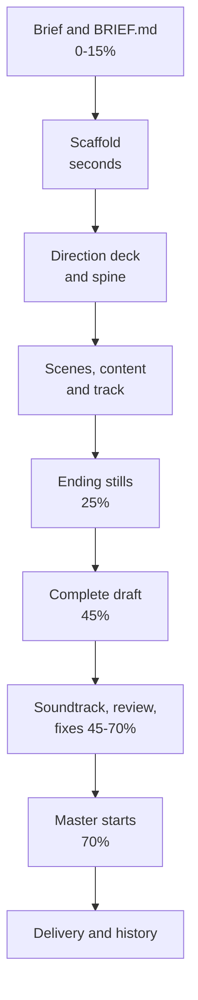
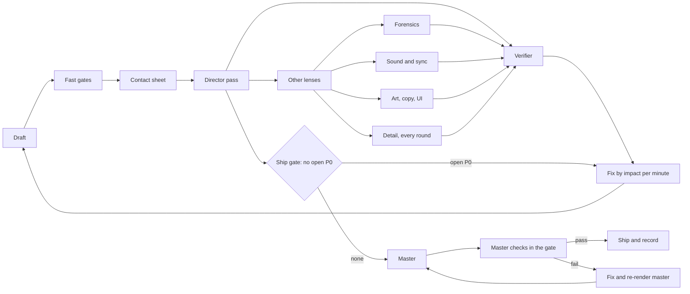

# Workflow and quality: one brief through eight steps

## The worked brief

cinetic is an Agent Skill: a package of instructions and scripts that a coding agent loads. `SKILL.md` is its 263-line contract, and the source is the cinetic checkout at `/Users/darkvoid/GitSources/src.aidesign/src.leonnix/cinetic`. This document follows the Kiln brief through the eight steps in `SKILL.md`. The brief is the second of the seven evaluation briefs. It asks for a 25-second launch teaser for a build cache that makes continuous-integration (CI) runs finish in seconds. The brand is invented. The film has sound. The brief asks for a brand kit as output. It asks that the result "feel like a well-funded company shipped it, not a template" (`docs/evaluation.md:41`).

The film needs audio and a true peak at or below -1.0 decibels true peak (dBTP). Integrated loudness must be -14 plus or minus 1.5 loudness units relative to full scale (LUFS). Hard cuts and the biggest moves must land on audio hits within about three frames. The brand needs a distinctive mark (the symbol) and a name lockup (the name set with it), plus a brand kit. The copy must be 35 on-screen words or fewer, outside product-user-interface strings. The motion blur must show no stepped or ghosted copies and no smear longer than about one fifth of the frame width (`docs/evaluation.md:42-46`).

```text
# docs/evaluation.md:42-46
- sound: an audio track, true peak at or below -1.0 dBTP after encoding, integrated loudness of -14 ±1.5 LUFS, and hard cuts and the biggest moves landing on audio hits within about 3 frames;
- brand: a distinctive mark (not a letter in a rounded square, not a block and a dot) and a name lockup in the final seconds, plus a brand kit with the logo as SVG (light and dark), transparent PNGs and a square avatar;
- idea: one clear idea told visually, showing what the product does that a simpler one would not, that a stranger could describe with the sound off;
- copy: 35 on-screen words or fewer outside product-UI strings, with no stacked taglines or eyebrow labels;
- motion blur: no stepped or ghosted copies, and no smear longer than about a fifth of the frame.
```

UI means user interface; SVG means Scalable Vector Graphics; PNG means Portable Network Graphics; JSON means JavaScript Object Notation.

No command in this document was run. The trace uses the source's commands and rules and does not claim that a Kiln film exists.

## The budget shapes the trace

A normal run has a budget of one to two hours. The default is 90 minutes when the user gives no budget (`SKILL.md:104`). The time plan names five checkpoints, plus long mode. Each percentage is a deadline on the budget, not a separate phase.

```text
# skills/cinetic/SKILL.md:102-113
## The time plan

A run has a budget (1-2 h; 90 min if none is given). Renders are slow: the whole film exists early, every later
look cut from it:
- **15 %:** brief, scaffold (seconds), direction, a script passing `copy-check`, the track picked and fitted: the
  picture is cut to it, never watched without its sound (a silent film fails `forensics.py` audio).
- **25 %:** the ending as stills: `node scripts/frames.mjs end` (the lockup, the name and the mark read).
- **45 %:** a complete draft with its ending: `render.sh Film out/draft.mp4 --draft --max-min 9` (the whole film at half size, fast encode, the current sound) and its sheet `out/qa/draft-sheet.png`.
- **45-70 %:** the soundtrack, the review round on the draft, fixes, the draft again.
- **Long mode.** Given hours (an ultra run), polish each dealt scene in its own pass against its recipe numbers, its
  stills beside the recipe's, before the next, instead of one pass over the film.
- **70 %:** the final starts: `bash scripts/render.sh Film out/film.mp4 --max-min 9` (parts resume: rerun until exit 0). If it cannot finish in time, deliver the draft scaled up (`--from-draft out/draft.mp4`).
```

For every render command, `Film` is the Remotion composition name. `--max-min 9` caps one render part at nine minutes.

For a 90-minute budget, 15 percent is 13.5 minutes. The 45 percent point is 40.5 minutes, when a complete draft must exist. The 70 percent point is 63 minutes, when the final render starts. The plan leaves 30 percent of the budget for the master render and delivery.

Every review look comes from the film, not from isolated stills. The ending stills at 25 percent are a construction check. The draft is the unit of review, because the draft has the ending and the sound. A film that is still changing can waste a blurred master render (`references/review-loop.md:94-95`).



## Step 1: brief and scaffold

The agent writes `BRIEF.md` first. The file holds the specification line, the supplied material, the hard bans and the brand-supplied exceptions (`SKILL.md:119-121`, `director.md:81-82`). The hard bans are forbidden words, type, colour, decoration, pictures and sound (`SKILL.md:81-94`). The specification line names the size, the frame rate, the duration, the format and the audio route. For Kiln, the line could read `1920x1080@30, 25s, format: launch, audio: licensed track + launch kit`. The source gives that exact shape as the example (`SKILL.md:119-120`).

The agent asks at most three questions. It asks only when the product, the format or the length is missing (`SKILL.md:121`). The Kiln brief gives all three, so the agent does not ask.

The scaffold command makes the project folder.

```text
# skills/cinetic/SKILL.md:119-121
**1. Brief and scaffold.** Write `BRIEF.md`: the spec line (`1920x1080@30, 25s, format: launch, audio:
licensed track + launch kit`), what is supplied (a brand kit, a clip to feel like, footage, the products it works
with), the hard bans. Ask at most 3 questions, only if the product, format or length is missing.
```

The scaffold command has the shape `bash scripts/new-film.sh films/<name> --name "<Product>" [--brand <kit>] [--like <clip>] [--music <file> + licence flags] [--link-modules <node_modules>]` (`SKILL.md:124`). A launch gets `launch-simple`. To deal is to draw from a fixed set with a seeded weighted choice. The scaffold writes `film.json` and deals the type pairing (`SKILL.md:126-127`).

For Kiln, the first two arguments become `films/kiln --name "Kiln"`. The optional flags stay out unless the brief supplies a brand kit, a clip to match or a music file. The scaffold takes seconds for the file copy; stage 2 may install dependencies, which can take longer (`new-film.mjs:182-325`, `new-film.mjs:329-524`).

The scaffold does five things that later steps rely on:

1. It copies the starter (the base project) and overlays `launch-simple` (the format's files over it), so the project has the launch timeline, the scene bank and the deal (`new-film.mjs:192-205`).
2. It writes `film.json` with the template name, the start time, an empty device set (a declared creative choice) and the last three films (`new-film.mjs:218-223`).
3. It sets frames per second (FPS), beats per minute (BPM), width and height (W and H) and the pace name (`PACE_NAME`) in `src/timeline.ts` (`new-film.mjs:249-262`).
4. It deals the type pairing from the product name and the mood (`type-deal.ts:100-110`).
5. It copies every working script into `<project>/scripts`, so the project runs without the skill (`new-film.sh:107-112`).

The type pairing matters to the brief's brand expectation. Kiln must not look like a template. The pairing chooses a voice, a text face and a mono face from `src/fx/TypePairs.ts`, seeded by the name and weighted by the mood. It avoids the last two films' pairings (`type-deal.ts:100-103`). The scene seed looks back three films, but the scene weight looks back four; the source gives no single lookback number (`bank.ts:154`, `bank.ts:168`). The scaffold records the pair in `film.json` (`type-deal.ts:195-206`).

## Step 2: direction, then the spine

The agent does not invent a direction alone. `deck.py` deals three directions that fit the brief. The deck writes `out/OPTIONS.md`. The agent picks one with `--direction <id> --why "<one line>"`, and the deck writes `out/DIRECTION.md`, `out/direction.json` and `src/dealt.ts` (`SKILL.md:129-131`, `deck.py:47-51`).

The deck exists because an agent left alone converges on the same film. The source names the default look: keyword fragments on a plain ground, a push-in and an end card (`deck.py:4-6`). The deck replaces that default with a dealt space, light, camera language, cut grammar, type behaviour, story shape, lockup and signature shot (`deck.py:4-8`).

The agent then writes the spine, before any picture. The spine is one sentence as three to five acts, one case (the product scenario in the brief's own strings), and one element that changes form in each act. The chain reads as "the word becomes the pill becomes the page becomes the count becomes the mark" (`SKILL.md:131-134`).

```text
# skills/cinetic/SKILL.md:129-136
**2. Direction, then the spine, first.** `python3 scripts/deck.py --brief "<one line>" --format launch [--have ui,photos]
[--brand brand/brand.json]` deals three directions into `out/OPTIONS.md`; pick one with
`--direction <id> --why "<one line>"`. Then the spine, before any picture ([spine.md](references/spine.md)): one
sentence as 3-5 acts, one case (the brief's request, names and numbers in every act), one element changing form act to
act, said as a chain ("the word becomes the pill becomes the page becomes the count becomes the mark"); lines alone
only for the promise and the claim. In launch-simple it is `src/spine.ts`: print its plan, pass `grid-check.ts --part
spine`. Its lines go in [TREATMENT.md](assets/TREATMENT.md) (the idea sentence fails with a competitor's name in it);
`copy-check.py TREATMENT.md` passes before any picture work ([copy-and-type.md](references/copy-and-type.md)).
```

The spine has rules that the checks enforce. Lines alone are allowed only for the promise and the claim. The element must carry every scene change. The case must keep the brief's request, names and numbers in every act. The spine also names the scenes, their forms, their props and their handovers (`spine.ts:53-92`).

No shell command prints the spine plan. The guide says to print `SPINE_PLAN.issues` and `chainSentence(SPINE_PLAN)` by importing the module in a console or a short script (`spine.md:259`). The agent also runs `grid-check.ts --part spine` (`SKILL.md:134`). The check reads the plan and reports missing acts, a break in the element chain, a line in the wrong place or a case that loses its data (`grid-check.ts:4-17`). The check does not judge taste. It proves that the spine is complete enough to build.

The script then goes into `TREATMENT.md`. `copy-check.py TREATMENT.md` must pass before any picture work (`SKILL.md:135-136`). The copy check reads the script as a stranger would read it with the sound off. It fails a vague word, a slogan shape, a metaphor, a claim without a source and a line that hides what the product is (`copy-check.py:1-16`).

For Kiln, the first line must say what the product is in plain words by three seconds. A line such as "Kiln is a build cache for teams." meets that shape. A line such as "Reimagine the build." fails. The hard-ban list names "reimagine" as a banned word (`SKILL.md:84-85`). The check's code uses three seconds; its docstring says five, and the code enforces three (`copy-check.py:2`, `copy-check.py:105`).

## Step 3: world and house scenes

The template deals the world (the film's place and hue) and the house scenes (built scenes from the bank). The agent fills them with the product's content (`SKILL.md:138-149`).

The launch template casts 8 to 12 scenes. Each scene lasts 1.5 to 3 seconds. The lockup lasts 2.5 seconds. At least two scenes are big (a scene that fills the frame). The deal draws from the bank, seeded by the name and the film history. It leans toward the act's verb and toward big scenes. It never deals a scene twice. It shares at most two scenes with the last film (`bank.ts:169-175`, `bank.ts:176-200`).

The deal's rules are numeric, not advisory. The bank share is at least 75 percent. The film may have at most one own scene (a scene the agent writes, not the bank). The own scene lasts 1.5 to 3 seconds. At most two scenes are shared with the last film (`bank.ts:140-141`). `grid-check.ts` reads these rules and fails a film that breaks them (`grid-check.ts:4-17`).

The agent has two jobs in this step. It fills each dealt scene's props with the case's own words. It fetches the real content and checks every picture (`SKILL.md:147-149`). A product with no real screens is outside the skill's scope, and `copy-check.py` blocks invented facts (`copy-check.py:39-41`).

A part is a screen-kit component: a screen, a panel or a card (`SKILL.md:158-161`). The phrase "update `src/deal.ts`" means a template other than `launch-simple` keeps its own deal in that file, and the agent edits it (`SKILL.md:142`).

A declared colour event is a colour range in `COLOUR`, with a start, an end and an id (`timeline.ts:717`). The launch template declares one: the world's turn, from its cut until the flood covers the frame (`timeline.ts:729`). The ground flood is that field. The film keeps one ground, and it returns to that ground after the flood (`timeline.ts:181-184`).

## Step 4: the track before the picture

The music comes before the timeline in the plan. The track is chosen, analysed and fitted, and then the picture is cut to it. The track is never re-timed to the picture (`track.py:5-7`).

```text
# skills/cinetic/SKILL.md:151-156
**4. Music.** The track is chosen before the timeline and the picture is cut to it
([music.md](references/music.md)): `node scripts/music.mjs pick --mood "<words>" --length <s>` (the curated library;
`music.mjs search` without one), `get '#n' --to audio/music` (never the last film's track), then `python3
scripts/audio/track.py analyze` and, once the script is written, `fit` (the timeline's bars, the entry on the lockup,
the track's own ending: never a cut), `check`. The track plays only through `score.py` (`--bed-only` before the kit
exists); never cut it by hand.
```

The `pick` command ranks the curated library by mood and length. The `search` command looks in free catalogues when the library has no fit. The `get` command copies a numbered pick into `audio/music` (`music.mjs:18`). It writes the licence record. The picker avoids the last film's track (`music.mjs:33-37`).

`track.py analyze` measures the tempo, the grid, the bars, the phrases, the sections, the entries, the breaks, the stops, the accents, the ending, the key and the loudness (`track.py:15-20`). `track.py fit` fits the edit to the timeline's bar plan. It puts the track's biggest entry on the lockup's bar and ends on a hit, not a cut (`track.py:26-32`). `track.py check` measures the joins on the edited bed and checks the licence record (`track.py:36-38`).

The track changes the timeline. With a track, `b(bar, beat, sub)` calls `bar()` from `src/music.ts`, and every cue (one timed event on the frame grid) follows the analysed downbeats (`timeline.ts:41-45`). A track chosen after the picture would force a re-time of every cue.

For Kiln, the mood words are the product's own: a build cache, speed and a serious engineering tone. The licence record goes into `audio/music/<name>.licence.json`. A licence that asks for a credit gets it in `CREDITS.md`, never in the picture (`SKILL.md:180-181`).

## Step 5: the product's scenes and the precheck

Step 5 writes the film's one own scene and runs the precheck. In `launch-simple`, the own scene goes in the exported `OWN` slot of `src/product.tsx`, from the screen kit. The rest of the content is each scene's `props` in `src/spine.ts`, plus `src/content.ts` (`SKILL.md:158-159`).

Three rules shape every scene. Something purposeful moves in every frame, and a still hold is only the landing tail of a move. The longest still stretch is 0.8 seconds, and the lockup also moves (`SKILL.md:159-160`). Cards are lit or glass, never plain slabs (`SKILL.md:160`).

The screen kit is not decoration. A screen-kit part with no content draws a dashed box and fails `precheck.mjs` (`SKILL.md:160-161`). The precheck imports every act and the content modules. It renders the first, middle and last frame of every act. It checks the cast, the case strings and the empty kit parts (`precheck.mjs:3-18`). The agent looks at the ending first. `node scripts/frames.mjs end` renders the lockup, the name and the mark as stills (`SKILL.md:163-164`). The agent then looks at several frames in one call with `still <frames>`.

## Step 6: the draft, the sound and the fast gates

The draft is the first complete film. The source defines the order: `npm run check`, then the draft, then `npm run sound`, then the draft again (`SKILL.md:166-168`).

```text
# skills/cinetic/SKILL.md:166-171
**6. Draft, sound and check.** `npm run check` (tsc, `lint-film.mjs`, `grid-check.ts`) clean, then the whole draft:
`bash scripts/render.sh Film out/draft.mp4 --draft --max-min 9` (rerun until exit 0; the picked track under it until
the mix exists). `npm run sound` (cues, kit and mix in one command; it ends PASS, FAIL or PARTIAL), the draft again.
The fast gates: `npm run gates` (`forensics.py out/draft.mp4 --grammar-only`, `copy-check.py --ui src`, `logos.mjs
check`), `look-audit.py
out/draft.mp4 --look` (no flat void or slab cards) and `bash scripts/layout-audit.sh Film --cues --scale 0.5` (text cut by the frame) ([checks.md](references/checks.md) §1).
```

`npm run check` runs three static checks. The TypeScript compiler checks types. `lint-film.mjs` checks the code for patterns that render wrong. `grid-check.ts` checks the timeline and the spine (`package.json:9`). A failure stops the step. The draft does not start until the three checks pass.

The draft render is `--draft`. It renders the whole film at half size with a fast encode and the current sound. It also writes `out/qa/draft-sheet.png` with 16 tiles (`render.sh:19-24`).

`npm run sound` runs the cue export, the sound kit and the mix. It ends PASS, FAIL or PARTIAL (`SKILL.md:168`). PASS means the soundtrack was written and its gate passed. FAIL means the mix failed its gate, and the soundtrack is written for preview. PARTIAL means the bed plays alone, because no rendered kit exists and earshot cannot render one (`sound.mjs:23`, `sound.mjs:211-212`). If takes are already rendered, they play as they are, and earshot is not needed (`sound.mjs:23`).

The fast gates measure different layers. `forensics.py --grammar-only` reads the draft's frames and checks the cuts, the stalls, the holds, the hook, the ghost frames, the seams and the audio presence. `copy-check.py --ui src` reads the on-screen copy and the user-interface strings. `logos.mjs check` checks other products' marks (`SKILL.md:169-170`). `look-audit.py --look` checks the hue count, the banned hues, the accent share, the negative space and the flat voids. `layout-audit.sh` checks the safe zone, the overlaps, the text size, the text on assets and the placements (`layout-audit.sh:1-10`).

The draft is the 45 percent checkpoint. The agent must have a complete film with its ending by that point.

## Step 7: one review round and six critics

The review round is one pass on the draft by default. A gate fail (a failed pass-or-fail check) or a fixed P0 opens a second round, and the default stops after three (`review-loop.md:73`). The agent makes a contact sheet with `node scripts/frames.mjs sheet --from out/draft.mp4`. The sheet has 16 labelled tiles. For one act, `--frames A-B --every N` gives a denser sheet. For full frames, `grab --from` (`SKILL.md:173-174`).

```text
# skills/cinetic/SKILL.md:173-176
**7. One review round.** `node scripts/frames.mjs sheet --from out/draft.mp4` (16 tiles; `--frames A-B --every N` for
an act, `grab --from` for full frames), then the director pass
([director.md](assets/critics/director.md)): read the picture beats with the words ignored first (what
does the product do in each?), then the standard above, item by item, with frames. Fix every P0 and the P1s time allows, then the draft again. A second round only when a gate fails ([review-loop.md](references/review-loop.md) §1).
```

The director pass has two stages. First, the agent reads the picture beats with the words ignored. For each beat, it writes one line: what the product does. A beat that reads "nothing happens" or "a screen sits there" gets the product acting in it before any new word (`director.md:26-29`). Second, the agent reads the checklist item by item, with frames. Every item is a yes or a no. A no is a P0 on the hook, a picture beat's core action, the end card or a hard ban. A no is a P1 elsewhere (`director.md:30-31`).

The severity table defines three levels, where P0 is priority 0, P1 priority 1 and P2 priority 2. P0 is visible on a key beat (hook, payoff, logo or end card), or it breaks the story, a fact or a hard ban. P1 is noticeable at normal viewing. P2 is visible only on pause (`review-loop.md:343-345`).

```text
# skills/cinetic/assets/critics/director.md:26-31
1. **The picture alone first.** Read the sheet with the words ignored (cover them with a hand, or read only the
   picture beats). For each picture beat write one line: what the product does in it. A beat that reads "nothing
   happens" or "a screen sits there" gets the product acting in it (a click, a result appearing, an object
   transforming) before any word is added. Target: every picture beat reads at least partly, half of them clearly.
2. **Then the checklist.** Every item is a yes or a no with frames. A no is a P0 on the hook, a picture beat's core
   action, the end card or a hard ban; a P1 elsewhere.
```

The checklist has 13 items. Six are words in the middle, line then picture, one voice and quiet emphasis, seams that flow, clean UI and marks. The other seven are its own film, words a stranger reads, less text, the picture tells it, colour, premium finish and time (`director.md:35-79`). The pass ends with the weakest three seconds and every hard ban (`director.md:81-82`).

The director is the default critic. Five more critics are available. The source calls them lenses. The table gives each run condition; the detail lens runs every round (`review-loop.md:232-239`).

```text
# skills/cinetic/references/review-loop.md:232-239
| Lens | Template | Reads | Owns (rubric) |
|---|---|---|---|
| Director | `director.md` | watch sheets first, then `out/direction.json`, the code and energy stats | idea, hook, picture, composition, motion, transitions, pacing |
| Forensics | `forensics.md` | `forensics.json`, flagged frames at full size, banding sheet | finish, motion |
| Sound and sync | `sound-sync.md` | `av.json`, `score.json`, `sync-*.json`, `audio/score.json` | sound |
| Art, copy, UI (round 1, or when these changed) | `art-copy-ui.md` | legibility sheet, grabs of every `COPY` line, layout-audit JSON | copy, color, composition, product |
| Detail (every round) | `detail.md` | the `detail-pair.py` sheets at 2x and `detail.json`, frame runs each side | picture, composition, finish |
| Verifier (§6) | `verifier.md` | one to five P0/P1 issues, their frames and their code | none |
```

The six critics have separate jobs:

1. The director owns the idea, the hook, the picture, the composition, the motion, the transitions and the pacing. It reads the watch sheets before the code, so it sees what the film shows, not what the agent meant (`review-loop.md:234`).
2. The forensics critic owns the finish and the motion. It triages every flag in `forensics.json`, then checks the flagged frames at full size. It hunts technical artifacts that read as broken, glitchy or cheap, even for one frame (`forensics.md:20-24`).
3. The sound and sync critic owns the sound. It cannot listen, so it measures and uses earshot. It judges whether the sound makes the picture feel locked, levelled, restrained, cut to the music and shaped as an arc (`sound-sync.md:20-22`).
4. The art, copy and user-interface critic owns the copy, the colour, the composition and the product truth. It runs in the first long round, or when those areas change. It reads the legibility sheet, a grab of every `COPY` line and the layout audit (`art-copy-ui.md:1-14`).
5. The detail critic owns the picture, the composition and the finish at the pixel level. It compares the film frame against a reference frame, whole and at two times, and lists every difference it sees (`detail.md:1-6`). The reference frame is the clip the user named as the bar, a template render, the brand's own frames or the last approved round (`detail.md:3-5`).
6. The verifier owns no rubric dimension. It tries to refute every P0 and P1 before anyone spends time on a fix. It rejects an issue when the claim is wrong, exaggerated, invisible at normal speed, already fixed, or its fix would cost more than the problem (`verifier.md:17-34`).

The verifier looks at the frames, watches at speed and reads the code the fix names. A rejected issue is not fixed. A real issue with a wrong fix stays, with a better fix (`verifier.md:28-34`).



The ship gate is the point where no P0 remains and the master checks pass. The default gate lists the fast gates, full `forensics.py` on the master, `probe.py`, `check-sync.py`, the sound gates and `credits.py` (`review-loop.md:352-357`). This creates a source tension: the review guide renders the master after the review round (`review-loop.md:74-77`), yet its default ship gate includes checks on the master. The gate is a condition that the master must also meet, not a separate review round.

The round ends with fixes, not with a score. The agent fixes every P0 and the P1s that the time allows. It re-renders only the parts whose source changed (`review-loop.md:71-72`). A second round follows a gate fail or a fixed P0, and the default stops after three (`review-loop.md:73`). The short step allows a second round only on a gate fail (`SKILL.md:176`). This trace follows the wider guide rule; this package reports the difference in `04-limits-and-comparison.md`.

For Kiln, the review round would test the brief's own expectations. The director asks whether the picture shows what a cache does. The forensics critic checks the motion blur around the hard cuts. The sound critic checks that the biggest moves land within three frames of a hit. The art critic checks that the copy is 35 words or fewer. The detail critic checks the mark and the lockup against the reference. The verifier kills any issue that a viewer would not see at normal speed.

## Step 8: master, delivery and history

The final render starts by 70 percent of the budget. The command renders the sharp master. The parts resume, so the agent reruns the command until it exits 0 (`SKILL.md:178-179`). The `--blur` flag is added when the film's blur policy asks for it (`SKILL.md:179`).

```text
# skills/cinetic/SKILL.md:178-181
**8. Master and delivery.** By 70 % of the budget: `bash scripts/render.sh Film out/film.mp4 --max-min 9` (PNG frames;
`--blur` when the blur policy asks). Full `forensics.py` on the master, then `bash scripts/deliver.sh out/film.mp4`
with the format's variants (it runs `credits.py`: credits go into `CREDITS.md`, never the picture), a short
`README.md`, and `node scripts/film-diff.mjs --record` (the film joins the history; the run's minutes print).
```

The master gets a check, not a review round. Full `forensics.py` runs on the master. `render.sh` also runs `probe.py` and `check-sync.py`, because the multiplexed file can introduce a lag or a true-peak change (`review-loop.md:74-77`). The delivery command makes the format's variants. For a launch film, the variants are a 16:9 master, a 9:16 cut, a 1:1 cut and a poster (`SKILL.md:187`).

`deliver.sh` runs `credits.py`. The credits go into `CREDITS.md`, never into the picture (`SKILL.md:180-181`). A credit that the licence asks for is delivered in the text, not drawn on the film.

`film-diff.mjs --record` adds the film to the history. The history is outside the project, at `~/.cinetic/film-history.json` or the path in `CINETIC_FILM_HISTORY` (`film-diff.mjs:49`). The record keeps 12 films. The next film's deal reads the last three and avoids their devices (`film-diff.mjs:17-24`).

The history closes the loop. The film that ships changes the next film's choices. The hard devices come from the last three films; the soft devices from the last one (`film-diff.mjs:61-62`). A film that repeats the last three films' ground, voice, signature and end card fails the repeat rule (`film-diff.mjs:17-18`).

## What the eight steps guarantee and what they do not

The steps are designed so that a film exists early, the ending is seen first and the track is cut before the picture. They also measure the sound, review the film once and check the master. They do not guarantee that the film is good. The director pass is a judgement. The evaluation measures the judgement separately from the gates (`docs/evaluation.md:11`).

The steps also give a failure a place to go. A bad argument stops the scaffold. A static check or precheck fail stops the render. A grid fail stops the draft. A draft gate fail becomes a fix and a second draft. A master gate fail becomes a fix and a re-render. The next document, `04-limits-and-comparison.md`, separates the measured gates from the judgement and compares cinetic with two sibling packages.

**Aha:** the review round spends its budget on refutation, not on praise. The director finds candidate problems, the optional lenses widen the search, and the verifier kills wrong ones before a render. A fix costs minutes. A wrong fix costs another edit, a re-review and a lost budget. The verifier is cheap because it runs before the render.

The quality system has a second property. Every critic finding names a frame and a concrete fix, never a general instruction. The verifier returns accept or reject. The director's rules state the point: "Improve the pacing" is not a fix, but `CUE.flyIn: b(5,2) -> b(5,1)` is (`director.md:86-88`). A fix that names a file, a value and a frame can be checked in the next draft. A fix that names a feeling cannot.

The eight steps leave one gap that the source admits. The evaluation uses four judged briefs, and three later briefs have no judged round (`docs/evaluation.md:15`). A film made from a later brief follows the same steps, but the project has no judged result for that shape. The next document treats this gap as part of the limits.
