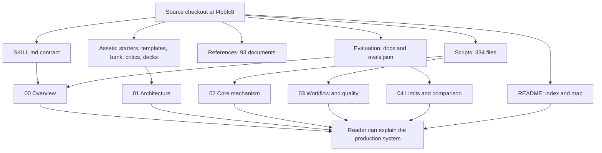

# cinetic: a production system for short films made from code

**Thesis.** cinetic is not an animation component library. It is an Agent Skill that makes a coding agent direct, build, score, render, measure and review a short motion film. An Agent Skill is a packaged set of instructions and files that a coding agent loads when a task matches it. The film is one of six formats: a launch film, an update video, a product video, a feature loop, a logo sting or a user-interface (UI) walkthrough. A feature loop is a repeating clip for a hero section, and a logo sting is a short branded end piece. A format runs from 3 seconds for a sting to 90 seconds for a walkthrough (`formats.md:24`, `formats.md:31-38`). The picture is built from React components or HyperText Markup Language (HTML) and rendered frame by frame (`SKILL.md:3`). The skill supplies a contract, a scene bank, a direction deck, a music pipeline, a sound-effect kit, gates and a review round. The agent supplies the product, the words, the content and the judgement.

The source is a Git checkout at commit `f4bbfc8`, at `/Users/darkvoid/GitSources/src.aidesign/src.leonnix/cinetic`. A citation with a slash starts at that folder. A bare file name is shorthand for a file of that name under `skills/cinetic/`, in the folder its context names. The checkout has 964 tracked files and version `1.5.1` (`.claude-plugin/plugin.json:5`, `CHANGELOG.md:27`). The licence is the Massachusetts Institute of Technology (MIT) licence (`LICENSE`). Most files, 939 of 964, are under `skills/cinetic/`. The rest are root files, `docs`, `evals` and plugin manifests.

This package is the six documents in this folder. It reads that source and does not run the skill. No film, render, gate, fetch or sound pass was performed. The reports come from the project's own documents and from a static reading of the source.

## Terms used here

The deep dives use a small set of terms. The table gives a working definition and a source line.

| Term | Meaning |
|---|---|
| Starter | The base film project that the scaffold copies (`new-film.mjs:192-205`). |
| Template | The overlay that adds one film format and its own timeline (`new-film.mjs:192-205`). |
| Scaffold | The two-stage script that copies a starter, overlays a template and writes the project (`new-film.sh:132-140`). |
| Brief | The written request: the product, the format, the length and any brand (`SKILL.md:119-121`). |
| Seed | A string that makes a pseudo-random draw repeatable (`bank.ts:153-154`). |
| Scene bank | The house library of scenes, each with a form, a natural length and a ground (`bank.ts:49-102`). |
| Deal | The seeded draw that chooses scenes from the bank for one film (`bank.ts:176-200`). |
| Device | A declared creative choice; the hard devices are ground, voice, signature and end, the soft devices are emphasis and logo (`film-diff.mjs:61-62`). |
| Lockup | The final arrangement of the name and the mark (`formats.md:94`). |
| Beat grid | The frame position of every musical beat (`timeline.ts:40-45`). |
| Cue | The frame where one timed event happens, listed in `out/cues.json` (`export-cues.ts:340-402`). |
| Reading window | The frames a line stays on screen long enough to read (`grid-check.ts:4-17`). |
| Track fit | The edit that cuts the music to the film's bar plan (`track.py:26-32`). |
| Score | The soundtrack design and mix, rendered by `score.py` (`score.py:3-7`). |
| Gate | A script that measures the film and returns pass or fail, where a fail stops the next step (`checks.md:11-18`). |
| Critic | A review instruction file, with the director as the default (`director.md:1`). |
| Director | The default critic, a checklist the agent reads to review the whole film (`director.md:1-4`). |
| Review round | One pass over a complete draft by a critic, followed by fixes (`review-loop.md:73`). |
| Contact sheet | A still image of labelled frames from the draft (`SKILL.md:173-174`). |
| Look | One viewing of the rendered film; a review round is the formal critic pass (`review-loop.md:94-95`). |
| World | The place the film stands in, with its hue (`film-diff.mjs:33-38`). |
| Type pair | The three faces a film uses: a voice, a text face and a mono face (`type-deal.ts:53`). |

## Three ideas

The first idea: one timeline file owns time in each project. `src/timeline.ts` computes the beat grid, the scene lengths, the cues and the reading windows. The picture, the sound pipeline and every timing gate import that file or the JSON (JavaScript Object Notation) document that `scripts/export-cues.ts` writes. A change to the music tempo or to one scene length moves the cues and every timing check that imports the file.

```text
# skills/cinetic/SKILL.md:8-11
# cinetic

You are directing a short film, not animating a web page. Picture, words and sound are one system driven by one
timeline file; nothing is finished until rendered, measured and reviewed once against the standard below.
```

The second idea: the film exists early, and every later look is cut from it. The time plan puts a complete draft with its ending at the 45 percent checkpoint. Each percentage is a deadline on the budget, not a separate phase. The last 30 percent covers the master render, the delivery variants and the history record (`SKILL.md:178-181`). In the render commands, `Film` is the Remotion composition name, and `--max-min 9` stops a render part after nine minutes (`render.sh:4-12`, `render.sh:124`).

```text
# skills/cinetic/SKILL.md:106-110
- **15 %:** brief, scaffold (seconds), direction, a script passing `copy-check`, the track picked and fitted: the
  picture is cut to it, never watched without its sound (a silent film fails `forensics.py` audio).
- **25 %:** the ending as stills: `node scripts/frames.mjs end` (the lockup, the name and the mark read).
- **45 %:** a complete draft with its ending: `render.sh Film out/draft.mp4 --draft --max-min 9` (the whole film at half size, fast encode, the current sound) and its sheet `out/qa/draft-sheet.png`.
- **45-70 %:** the soundtrack, the review round on the draft, fixes, the draft again.
```

The third idea makes each film differ from the three before it. The film history keeps 12 films, outside the project at `~/.cinetic/film-history.json` (`film-diff.mjs:49`). The next deal avoids the last three films' hard devices and the last film's soft devices (`film-diff.mjs:17-24`, `film-diff.mjs:61-62`). A seeded draw chooses the world, the voice, the type pair and most of the scenes. At most one scene is the film's own, and the agent writes it (`timeline.ts:193-197`). The world is the place and its hue, the voice is the film's one text tone, and the type pair is its three faces (`film-diff.mjs:33-38`, `type-deal.ts:53`). The agent does not choose scenes freely. The agent fills dealt scenes with the product's own content. The grid function below is the shared clock that the dealt lengths land on.

```text
# skills/cinetic/assets/templates/launch-simple/src/timeline.ts:43-47
/** Absolute frame of a grid position: bar is 1-based, beat 0-3, sub = 16ths within the beat. */
export const b = (n: number, beat = 0, sub = 0) =>
  MUSIC ? Math.round(bar(n, beat, sub)) : Math.round(((n - 1) * 4 + beat) * BEAT + sub * (BEAT / 4));
/** A choreography length written in 60 fps frames, converted to this film's fps (rounded). */
export const f60 = (frames: number, fps: number = FPS) => Math.round((frames * fps) / 60);
```

`MUSIC` is true when the film has a track, `bar` reads the analysed track's bars from `src/music.ts`, and `BEAT` is the frame count of one beat (`timeline.ts:20-21`, `timeline.ts:41`). A choreography is a move written at 60 frames per second, so it keeps its feel at any film rate.

The scaffold makes the project in two stages. Stage 1 checks the arguments, copies the starter, overlays the template and writes `film.json` and the grid. Stage 2 adds the modules, fonts, type family and brand (`new-film.sh:132-140`). The project receives every script but not the skill's own tests (`new-film.sh:132-135`).

```text
# skills/cinetic/scripts/new-film.sh:137-140
(cd "$SKILL/scripts" && tar --exclude=__pycache__ --exclude='*.pyc' --exclude=./test -cf - .) | (cd "$DIR/scripts" && tar -xf -)
# stage 2: node_modules, fonts, the type family and the pairing dealt from the name, a brand kit, a clip, the music,
# then the next steps
exec node "$SKILL/scripts/new-film.mjs" --stage 2 --state "$ST" "$@"
```

**Aha:** cinetic turns creative choice into a small number of constrained draws. The bank limits which scenes exist. The deal limits which scenes this film may use. The seed makes the result repeatable. The checks then measure the result. The agent's freedom is real, but it sits inside a constrained set of choices.

## Five deep dives and this index

| File | What it teaches | Target |
|---|---|---:|
| [README.md](README.md) | Thesis, map, reading order, non-claims | Index |
| [00-overview.md](00-overview.md) | What cinetic is, whom it serves, what it ships, how to read the evaluation | 3,000-5,000 words |
| [01-architecture.md](01-architecture.md) | Skill layout, film project, process boundaries, state and storage | 3,000-5,000 words |
| [02-core-mechanism.md](02-core-mechanism.md) | Timeline, scene deal, type deal, cues, sound plan and gates, end to end | 3,000-5,000 words |
| [03-workflow-and-quality.md](03-workflow-and-quality.md) | One brief through the eight steps, with every check and the review round | 3,000-5,000 words |
| [04-limits-and-comparison.md](04-limits-and-comparison.md) | Measured versus judged, failure modes, and comparison with taste-skill and tastecode | 3,000-5,000 words |

## Map of the package

The diagram gives each document one main source area. Each document reads several areas, and the arrows show the main one.



## Reading order

1. Start with `00-overview.md`. It names the user, the six formats, the shipped assets, scripts and references, and the evaluation. It also states the two engines and the runtime requirements. Remotion draws each frame from React components. HyperFrames draws the same film from HyperText Markup Language (HTML) with one paused timeline (`hyperframes-engine.md:4`).
2. Read `01-architecture.md` next. It separates the skill root from the film project, and it names every process boundary and every state file.
3. Read `02-core-mechanism.md` with the source open. It traces the scaffold, the deal, the timeline, the cues, the sound plan and the gates. It shows where a failure stops a run.
4. Read `03-workflow-and-quality.md` to see the eight steps in operating order. It uses the Kiln brief as a worked case and names the six critics: director, forensics, sound-sync, art-copy-ui, detail and verifier.
5. Read `04-limits-and-comparison.md` last. It separates what a script can measure from what a judge must decide. It also compares cinetic with the sibling packages `taste-skill` and `tastecode`, the other two packages in this exploration series.

A reader who wants the contract first can read `skills/cinetic/SKILL.md` directly. A reader who wants to operate the skill should read `03-workflow-and-quality.md` after `00-overview.md` and `01-architecture.md`, and use `02-core-mechanism.md` as the mechanism reference.

## What this package does not claim

- No command in this package was run against a film. The source was read only.
- The evaluation numbers are the project's own report. The other documents repeat them and do not confirm them (`docs/evaluation.md:1-15`).
- The full toolchain needs Node.js 22 or later, ffmpeg 6 or later, Python 3.11 or later, Chromium and the separate tool earshot; some gates need only Node.js or only Python (the source `README.md:189-194`). earshot is a separate tool that designs sounds in code and checks them by measurement (the source `README.md:300`). None of these was installed or exercised.
- A file count is not a quality measure. The 964 tracked files include 265 test files under `skills/cinetic/scripts/test/`.
- The source does not define a general harness or judge prompts for the evaluation. `docs/evaluation.md:197` says the repository ships the briefs and expectations only.
- The `CHANGELOG.md:9` section is `[Unreleased]`. Its notes are not part of version `1.5.1`.
- Three of the seven evaluation briefs have no judged round. `docs/evaluation.md:15` states this.

## Source and specification defects found

The package records these findings for the reader. Items 1 to 3 are source or specification defects; items 4 and 5 are reader cautions. The package does not modify the source.

1. The exploration specification, `../spec.md:172`, cites `.claude-plugin/plugin.json:4` for the plugin version. The file has `"version": "1.5.1"` on line 5. The value is right and the line is wrong. Line 23 of the same specification cites line 5 correctly.
2. `SKILL.md:196` says films render at 30 frames per second (fps). The templates ship with `FPS = 60`, and `new-film.mjs` rewrites that constant from `--fps`, whose default is 30 (`new-film.sh:21-28`, `new-film.mjs:251-262`). The scaffold resolves the template conflict. It does not resolve the evaluation's 60 fps expectation (`docs/evaluation.md:187`). A template file read alone does not show the final frame rate.
3. The starter `package.json` quality-assurance (QA) script names `--spec 1920x1080@60` while the scaffold defaults to 30 frames per second (fps). The scaffold rewrites the pattern to the chosen size and frame rate (`new-film.mjs:262`). A reader must not treat the shipped string as the default.
4. The `CHANGELOG.md:27` entry for 1.5.1 is short. It says three community contributions and then lists four, with no metrics. The larger 1.5.0 entry holds the detailed claims. The reader must not move those claims into 1.5.1.
5. The source `README.md:18` gives the name's reading as "cinema + kinetic". The string is prose, not an abbreviation contract. A reader must not treat it as a technical expansion.
