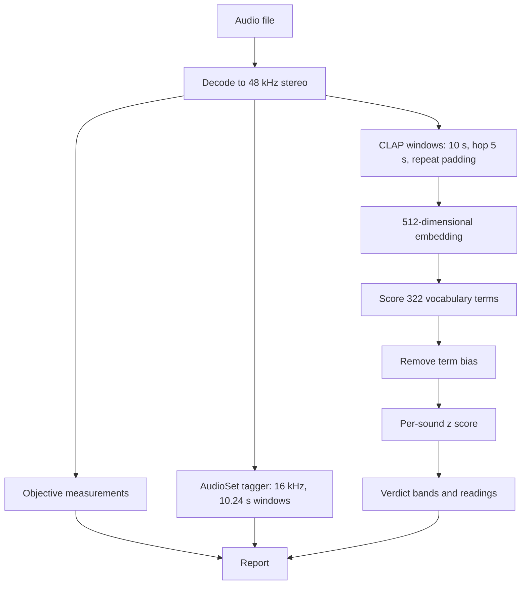
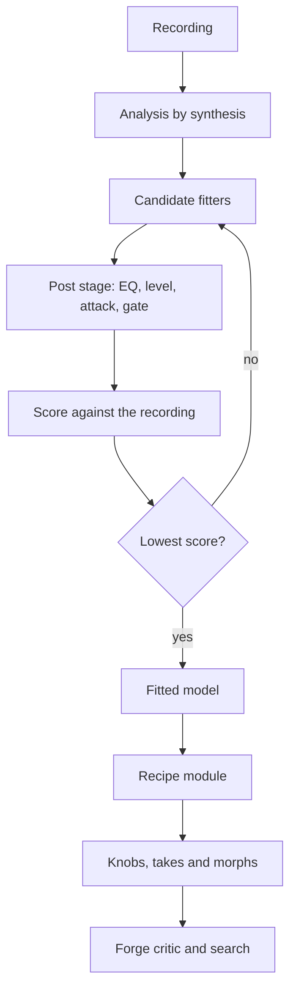

# earshot overview: from a file to evidence

This document gives the whole system in one pass. It explains the listening problem, the four kinds of evidence and
one listening pass from bytes to verdict. It also explains the vocabulary, the two making loops, the shipped bank and
kits, the interfaces and the project's quality claims. The deep dives then trace each part in code.

## The listening problem

A coding agent works with text and code. It can open an audio file, but the bytes do not tell it what the file sounds
like. The agent cannot tell a door knock from a keyboard press by reading a waveform. It cannot tell whether a hit
lands on a cut. It cannot tell whether a sound is a recording or a code-made imitation.

The agent needs evidence in a form it can use. A label alone is weak. A number alone is weak. A number with a stated
scale, a held-out error rate and a time is strong. Earshot tries to give that kind of evidence for each question.

The tool runs on a central processing unit (CPU). It does not require a graphics processing unit. It has three
interfaces: a command line interface (CLI), a Python application programming interface (API) and a Model Context
Protocol (MCP) server.

## Four kinds of evidence

Earshot mixes four evidence kinds.

| Kind | What it is | Where it appears | What can go wrong |
|---|---|---|---|
| Calibrated match | A text-audio similarity, corrected for term bias and sound difficulty, then mapped to a verdict | `describe`, `match`, `rank`, `find`, `timeline` tags | A close variant can pass; the base rate changes the precision |
| Timing | Onsets, attacks, peaks, offsets, cut and cue alignment | `timeline`, `sheet`, `critique`, `find`, `kit` | A soft swell can be missed; a visual cut can be false |
| Objective measurement | Loudness, true peak, spectrum, envelope, tempo | `measure`, all reports, `profile`, `critique` | The meter is right but the target range may not fit the style |
| Learned classification | AudioSet labels, realness probability, CLAP embedding neighbourhoods | `describe`, `realness`, `compare`, forge critic | The training domain is narrow; classes can be near or wrong |

The first kind uses a contrastive language-audio pretraining (CLAP) model. It maps a sound and a sentence into one
512-dimensional space. The fourth kind uses an audio spectrogram transformer (AST) trained on AudioSet, and a small
realness model trained inside earshot.

The second and third kinds do not need a large model. They use signal processing. This is deliberate. A loudness
number should not depend on a neural network. An onset time should come from an envelope, not from a classifier.

**Aha:** the strongest design idea in earshot is the separation of the model evidence from the meter evidence. When a
CLAP verdict and a loudness measurement disagree, the disagreement is informative. The model may be out of its domain.
The meter is still a meter. The forge critic uses the same separation to stop a search from pleasing a model while
making a worse sound.

## One listening pass at high level

The command `describe` is the shortest complete listening pass. It runs these steps:

1. Decode the file to 48 kilohertz, two channels, with a cache.
2. Measure the objective features.
3. Cut the sound into CLAP windows.
4. Embed each window.
5. Score every vocabulary term against the embedding.
6. Remove the term bias and compute a per-sound z score.
7. Turn the top terms into calibrated readings.
8. Add held-out AudioSet labels.

The other listening commands reuse these steps. `match` uses the same windows and scores. `find` adds candidate
windows and a trim rule. `timeline` adds events, sections and sync. `critique` adds a profile and a scorecard.



### Step 1: decode and cache

The loader is the gate to every path. It converts any supported format to one sample rate. It keeps the stereo image.
It rejects a not-a-number value and names the first bad sample. It caches the result under the earshot home folder.

```text
# earshot/audio.py:124-154
def load(path, sr=SR, mono=False, start=None, end=None, cache=True):
    """decode `path` to float32 (n, 2) or (n,) when mono; optional [start, end) in seconds"""
    if not os.path.exists(path):
        raise AudioError(f'no such file: {path}')
    ch = 1 if mono else 2
    x = None
    npy = None
    if cache:
        config.ensure_dirs()
        npy = os.path.join(config.DEC_CACHE, _key(path, sr, ch) + '.npy')
        if os.path.exists(npy):
            try:
                x = np.load(npy)
            except Exception:
                x = None
    if x is None:
        x = _decode(path, sr, ch)
        if npy:
            tmp = f'{npy}.{os.getpid()}.tmp.npy'
            np.save(tmp, x)
            replace_quietly(tmp, npy)
    bad = ~np.isfinite(x)
    if bad.any():   # one NaN / Inf sample breaks every analysis downstream (#12)
        bad = bad.any(axis=-1) if x.ndim == 2 else bad
        raise AudioError(f'{path}: {int(bad.sum())} NaN / Inf sample(s), first at {int(np.argmax(bad)) / sr:.3f} s: '
                         'the file is corrupt or the code that made it divided by zero')
    if start is not None or end is not None:
        a = max(0, int(round((start or 0.0) * sr)))
        b = len(x) if end is None else min(len(x), int(round(end * sr)))
        x = x[a:b]
    return x
```

The cache key matters for a later workflow. It uses the path, the size, the modification time and 16 sampled blocks
of 4 kilobytes. A file that changes only between those blocks can be read stale. The limits document explains this.

### Step 2: measure the physical facts

The measurement module computes the numbers that do not need a model. It reports integrated loudness in loudness
units relative to full scale (LUFS), true peak in decibels true peak (dBTP) and loudness range (LRA). It also reports
band levels, attack and decay times, brightness, bandwidth, flatness, tonal peak ratio, harmonic ratio and an
estimated fundamental frequency.

```text
# earshot/features.py:109-118
def integrated_lufs(x):
    t, L = loudness_curve(x, 0.4, 0.1)
    L = L[L > -70]
    if not len(L):
        return -70.0
    rel = 10 * np.log10(np.mean(10 ** (L / 10))) - 10
    L2 = L[L > rel]
    return float(10 * np.log10(np.mean(10 ** (L2 / 10)))) if len(L2) else float(rel + 10)


```

The module uses the BS.1770 loudness standard and a four-times oversampled true peak. It also separates a music
reading from a speech reading with an energy rule. The value is a meter, not a taste judgement.

The integrated loudness uses two gates. The first gate removes frames under -70 LUFS. The second gate removes frames
more than 10 LU below the mean of the first set. The mean of the remaining frames is the integrated value. The gates
stop silence and a quiet room from lowering the reading.

True peak is sampled four times per sample before the peak search. This catches inter-sample peaks that a sample peak
misses. Loudness range is the spread of short-term loudness after the same style of gating. A film mix and a single
impact use different windows, and the report states which one it used.

The meter path has no model and no random seed. Two runs on the same file give the same number. That property lets an
agent use a measurement as a gate. The agent can reject a file before it loads a model.

### Step 3 and 4: window and embed

CLAP expects a fixed input length. Earshot uses 10-second windows with a 5-second hop. A short sound is padded by
repeating it. A long sound becomes several windows. The vocabulary module decides the spans.

```text
# earshot/vocab.py:137-148
def spans_for(start, end, max_win=MAX_WIN):
    """CLAP windows [(s, e)] covering [start, end): one span if <= 10 s, else 10 s windows hop 5 s (last one flush with
    the end), at most max_win of them evenly spaced"""
    n, w, h = int(round((end - start) * audio.SR)), int(WIN * audio.SR), int(HOP * audio.SR)
    if n <= w:
        return [(start, end)]
    st = list(range(0, n - w + 1, h))
    if (n - w) % h:
        st.append(n - w)
    if max_win and len(st) > max_win:
        st = [st[int(round(i))] for i in np.linspace(0, len(st) - 1, max_win)]
    return [(start + s / audio.SR, start + (s + w) / audio.SR) for s in st]
```

Each span becomes one embedding. The wrapper holds the model in memory for the process and caches embeddings on disk.

```text
# earshot/models/clap.py:240-254
    def embed_file(self, path, start=None, end=None, pad='repeatpad'):
        """(512,) for a file or a [start, end) segment of it; cached on disk"""
        k = hashlib.sha1(f'{audio.file_id(path)}|{start}|{end}|{pad}'.encode()).hexdigest()[:24]
        f = os.path.join(self.dir, 'a_' + k + '.npy')
        if os.path.exists(f):
            try:
                return np.load(f)
            except Exception:
                pass
        x = audio.load(path, mono=True, start=start, end=end)
        e = self.embed_audio([x], pad=pad)[0]
        tmp = f'{f}.{os.getpid()}.tmp.npy'
        np.save(tmp, e)
        audio.replace_quietly(tmp, f)
        return e
```

The cache is keyed by the file identity and the span. A second call on the same file does not run the model again.

### Step 5 and 6: score and calibrate

The vocabulary is a list of 322 short descriptions in 16 categories. Earshot embeds every description with five
prompt templates and averages the results. The score of a term is the cosine between the sound embedding and the term embedding. That raw cosine has a bias. Some terms sit closer to all sounds than others. The stored term bias is the mean cosine of each term over the reference recordings. A query has its own bias: its mean cosine over the same recordings. The calibration removes the bias and divides by the spread of the terms on the same sound. The result is a z score.
A z score of 3 means the term is three standard deviations above the average term for that sound.

```text
# earshot/vocab.py:271-290
    def calibrate(self, A, Q=None, method='both'):
        """A (n, 512) audio, Q (m, 512) query embeddings -> dict of (n, T) term arrays and (n, m) query arrays:
        cos, u (bias removed when method is 'center' / 'both'), z (per-sound z when 'sound' / 'both', else u),
        pct (share of vocab terms the query beats)"""
        A = np.atleast_2d(A)
        C = A @ self.E.T
        U = C - self.mu_E if method in ('center', 'both') else C
        r = {'cos_t': C, 'u_t': U}
        if method in ('sound', 'both'):
            mu, sd = U.mean(1, keepdims=True), U.std(1, keepdims=True) + 1e-9
        else:
            mu, sd = 0.0, 1.0
        r['z_t'] = (U - mu) / sd
        if Q is not None:
            Q = np.atleast_2d(Q)
            Cq = A @ Q.T
            Uq = Cq - self.bias(Q) if method in ('center', 'both') else Cq
            r['cos_q'], r['u_q'], r['z_q'] = Cq, Uq, (Uq - mu) / sd
            r['pct_q'] = (U[:, None, :] < Uq[:, :, None]).mean(-1)
        return r
```

The calibration also returns a percentile for each query: the share of vocabulary terms that the query beats. The `scores` method then reports a rank. The rank is the number of terms that beat the query, plus one. The rank is easy for an agent to read: "this term would rank second among 322 descriptions".

### Step 7: verdict

The match module maps the z score to a verdict. The thresholds are 3.0 for strong, 2.5 for plausible and 2.0 for
weak. A lower score is no match.

```text
# earshot/match.py:50-54
def verdict(z):
    for t, name in VERDICTS:
        if z >= t:
            return name
    return 'no match'
```

The verdict is not a probability. It is a band on a calibrated scale. The held-out record gives the precision at a
stated base rate. The strong band is reliable for the kind of sound. It is less reliable for the exact variant.

`describe` adds a second reading for each top term. It shows the closest alternative categories. This helps an agent
see when two descriptions are nearly tied.

```text
# earshot/describe.py:123-130
def _tags(v, a, top):
    """(validated top tags, unvalidated hints, best 3 per category)"""
    rows = v.top_terms(a, k=len(v.names), exclude=SKIP_CATS)
    best = [dict(term=t, category=c, z=z, cosine=cos, verdict=verdict(z))
            for t, c, z, cos in rows if c not in vocab.UNVALIDATED][:top]
    hints = [dict(term=t, category=c, z=z, cosine=cos) for t, c, z, cos in rows if c in vocab.UNVALIDATED][:top]
    per = {cat: [dict(term=t, z=z, cosine=cos) for t, _, z, cos in v.top_terms(a, k=3, cats=(cat,))] for cat in v.cats}
    return best, hints, per
```

### Step 8: AudioSet labels

The AST model gives 527 AudioSet class probabilities. It uses independent sigmoid outputs, not a softmax. The model
sees 16 kilohertz audio, so its ceiling is 8 kilohertz. The labels are useful for broad classes. A one-shot under half
a second often gets an unsure or near class.

The overview keeps the labels as a second opinion. The calibrated vocabulary is the main reading.

## Vocabulary and calibration in more detail

The vocabulary has 322 descriptions. The count is the sum of 16 category lists in `earshot/data/vocab.json`. The
categories separate sound families such as impacts, whooshes, clicks, keys, UI sounds, water, voice and music. Five
prompt templates wrap each description. The templates are variants such as the bare phrase, "the sound of ..." and
"a recording of ...".

The calibration has two parts. The first part removes the term bias. The bias of a term is its mean cosine over a set
of reference recordings. The second part computes the per-sound mean and standard deviation over all terms. The z
score is the corrected cosine minus the sound mean, divided by the sound standard deviation.

This design has three consequences:

- A sound with a strong match to one term still gets a high z score only if the term stands out from the other terms.
- A sound with no strong match gets low z scores for every term.
- The scale is local to the sound. Two files can have the same z score with different raw cosines.

The last point is the main limit. A z score is not a global probability. It is a rank-like measure inside one sound.
The base rate of true matches in the user's library still controls precision.

The vocabulary also marks four categories as unvalidated: music genre, music mood, instruments and voice. The project's evaluation found that genre and mood can be wrong. Instruments and voice are usually right, but they stay hints.
## The two making loops

Earshot is not only a listener. It makes sound in code and improves the sound by listening to it.

### Forge: recipe to waveform to critic

A forge recipe is a Python module. It exposes a render function. The function takes a parameter dictionary and a
random generator. It returns a waveform. The recipe can use modal sources, noise, air, sweeps, bells, frequency
modulation, filters, reverb, saturation and transient shaping.

The forge loop does these steps:

1. Resolve the recipe and the reference set.
2. Build a search space from the recipe's parameter declarations.
3. Render a population of candidates.
4. Pre-screen the candidates with cheap model-free checks.
5. Score the survivors with the critic.
6. Update the search distribution.
7. Repeat until the budget is spent.
8. Re-render the best candidates on new seeds.
9. Keep a diverse shortlist.
10. Write the report, the comparison image and the audition file.

The reference set is split by source. The forge side is visible to the search. The bench side is held out for the
fixed benchmark. This stops the search from tuning on the files that judge it.

```text
# earshot/forge/__init__.py:109-136
def pick_refs(refs=None, refset=None, recipe=None, log=None):
    """(reference files, refset category used) for a run: `refset` (a category of earshot.forge.refsets, its 'forge'
    split only: the 'bench' split stays held out), else `refs` (files / folders), else the recipe's REFSET when this
    machine has a registry with refs in it, else the recipe's REFS that exist here. Held-out files (a registry bench
    ref anywhere, or for the recipe's REFS a kit file cut from a bench source: refsets.held_out) are dropped."""
    from . import refsets as _rs

    def keep(paths, kit):
        bad = set(_rs.held_out(paths, kit=kit))
        if bad and log:
            log(f"dropped {len(bad)} held-out reference(s) (benchmark side): "
                + ', '.join(sorted(os.path.basename(p) for p in bad)))
        return [p for p in paths if p not in bad]

    if refset:
        return _rs.refset(refset, split='forge'), refset
    if refs:
        return keep(audio.list_media(refs, exts=audio.AUDIO_EXTS), kit=False) or None, None
    cat = getattr(recipe, 'REFSET', None)
    if cat:
        try:
            rr = _rs.refset(cat, split='forge')
            if rr:
                return rr, cat
        except (_rs.RefsetsMissing, KeyError):
            pass
    rr = keep([p for p in (getattr(recipe, 'REFS', None) or []) if os.path.exists(p)], kit=True)
    return rr or None, None
```

The critic is more than a CLAP score. It combines the match z, the margin over alternative descriptions, the realness probability and the typicality against real references. It subtracts five model-free penalties: a feature penalty for measurements outside the reference spread, tone, envelope, artifacts and polish. The total is a weighted sum with negative penalties.

The search defaults to an evolution strategy. A separable covariance matrix adaptation evolution strategy is also
available. The measured record says the evolution strategy was as good or better at the tested budgets. The search
saves good parameter sets in a seed bank. A later run can start from them.

### Fit: recording to model to code

The fit loop inverts a recording. It fits a synthesis model by analysis by synthesis. The model kinds are modal,
sines, spectral, gesture and hybrid. A modal model fits struck or ringing sounds with damped modes and band noise. A
sines model fits tonal sounds with tracked partials. A spectral model fits noisy sounds with a time-varying band
gesture. A hybrid fits layers in order.

The engine measures the recording, names a class, orders candidate fitters, fits each candidate, applies a post stage
and scores the render against the original. The post stage corrects the spectral balance, the level, the attack and
gated stops. The lowest score wins.

```text
# earshot/forge/fit/auto.py:318-335
def plan(c, max_candidates=None):
    """ordered candidate kinds for a character (first = the expected best); hybrids as 'hybrid:<a>+<b>[+<c>]'.
    The measured quality decides among them; the class orders them and prunes the slow fits of long sounds: under
    1 s every candidate is tried (each fit takes 0.5-4 s; the gesture 3-60 s), longer sounds the class's four
    (LONG_PLANS: a long struck sound: modal, sines, modal + spectral, spectral; the three-layer hybrid alone took
    147 s on a 4.5 s impact). A long gesture, mixed, glide or ringing sound gets the gesture model (fit/gesture.py:
    tones + air) second, in place of the spectral one (0.4). 'gesture' always comes after 'sines' (it takes the sines
    candidate's partials as its tones)."""
    long_ = c['dur_s'] >= 1.0
    order = list((LONG_PLANS if long_ else PLANS)[c['class']])
    order += [k for k in ALL if k not in order]
    if max_candidates is None:
        max_candidates = 4 if long_ else len(ALL)
    order = order[:max_candidates]
    if 'gesture' in order and 'sines' in order and order.index('gesture') < order.index('sines'):
        order.remove('gesture')
        order.insert(order.index('sines') + 1, 'gesture')
    return order
```

The fitted model becomes a readable recipe module. The module holds the model as Python literals, a search space and
the default parameters. The default parameters re-render the fit. A search can vary the knobs. Two fits of the same
kind can morph.

The fit quality is measured with a score function. The score combines the multi-resolution mel distance, the tone
balance, the envelope correlation, the onset error, the excess and missing energy, the stereo width and the tail
correlation. Each term has a weight. The score is a lower-is-better number for choosing between fits.



The two loops meet at the recipe contract. A fitted recipe and a hand-written recipe both expose `render(params, rng)`.
The forge critic can search a fitted recipe with no special case.

## The bank and the kits

The forge's delivered sounds ship as a bank. The bank holds 252 sounds. The count is a sum of four files.

| Bank file | Sounds | What they are |
|---|---:|---|
| `forge_v2.json` | 183 | Forge version 2 finals in 34 categories |
| `forge04.json` | 51 | Sounds made in version 0.4 for music-led launch films |
| `fit.json` | 15 | Sounds fitted from Creative Commons Zero (CC0) recordings |
| `pluck.json` | 3 | Tuned kalimba voices |

A bank entry is not a seed. It is the exact render block of the delivered sound, at full precision. A build step
refuses an entry whose block does not re-render its delivered waveform within one 24-bit step. This makes the bank a
reproducible library, not a folder of files.

```text
# earshot/forge/bank.py:311-341
def render(sound_id, seed=None, dur=None, apex=None, pitch=None, peak_db=PEAK_DB, sr=SR, weight=None, checks=True):
    """one take of a bank sound: (y float32 (n,) or (n, 2), meta). seed None = the entry's own seed (the delivered
    final); dur / apex (s), pitch ('E5' or Hz) aim it through the recipe's own parameters (earshot.forge.knobs);
    peak_db = its sample peak (0 dBFS or less); weight scales that by 6 dB per doubling (1 = peak_db, 0.5 = 6 dB
    down; a level over 0 dBFS is refused: level()). sr (one of SRS) != 48000 resamples the finished take (soxr).
    checks=False skips the model-free audit (meta['checks'] None)."""
    lv = level(peak_db, weight)
    sr = check_sr(sr)
    e = sound_id if isinstance(sound_id, dict) else get(sound_id)
    sid = e.get('id')
    run = renderer(e, seed)
    from . import knobs
    if any(v is not None for v in (dur, apex, pitch)):
        x, edits = knobs.apply(e, run, dur=dur, apex=apex, pitch=pitch)
    else:
        x, edits = run(), {}
    level_db = lv
    if weight is not None:
        edits['weight'] = {'weight': float(weight), 'peak_db': round(level_db, 2)}
    y = normalize(x, level_db).astype(np.float32)
    meta = {'id': sid, 'seed': int(e['seed'] if seed is None else seed), 'sr': int(sr), **measure(y),
            'edits': edits, 'checks': None}
    if checks:
        from . import sfx
        meta['checks'] = sfx.check(y, category=e.get('category'), sound=sid)
        add_warning(meta['checks'], knobs.pitch_warning(edits))
    if int(sr) != SR:
        import soxr
        y = np.asarray(soxr.resample(y, SR, int(sr)), np.float32)
        meta['dur_s'] = round(len(y) / int(sr), 4)
    return y, meta
```

A kit maps roles to bank sounds. A role is a film job such as hit, click, riser, swell, bell or whoosh. The kit file
declares takes, edits, pitches, alignment points and mix keys. A render writes the takes and a lock file. The lock
holds the measured onset, peak and end of every take. A mixer can place the take on the cue by the measured point.

The launch preset adds bed-relative mixing. It states how far the effect sits over the music bed. It states where the
sync point sits against the picture event. It also sets a minimum gap between cues of one role. The bank and kit path
does not load a model. A film pipeline can render its sounds in seconds.

## The interfaces

The CLI has 20 commands. Each command is a thin layer over a Python function. The Python API exposes 22 functions
through lazy imports. The MCP server exposes 16 of the operations as tools for an agent.

```text
# earshot/api.py:15-29
    'find': ('search', 'find'), 'compare': ('compare', 'compare'), 'ab': ('compare', 'ab'),
    'realness': ('realness', 'realness'), 'realness_many': ('realness', 'realness_many'), 'timeline': ('timeline', 'timeline'), 'sheet': ('sheet', 'sheet'),
    'critique': ('critique', 'critique'), 'profile': ('profile', 'profile'), 'measure': ('features', 'measure'),
    'llm_critique': ('llm', 'critique'), 'doctor': ('doctor', 'check'),
    # the sound bank and film kits (no models): earshot.forge.sfx / earshot.forge.kit
    'sfx_list': ('forge.sfx', 'sfx_list'), 'sfx_render': ('forge.sfx', 'sfx_render'),
    'sfx_check': ('forge.sfx', 'sfx_check'), 'kit_init': ('forge.kit', 'kit_init'),
    'kit_render': ('forge.kit', 'kit_render'), 'kit_check': ('forge.kit', 'kit_check'),
    'kit_audition': ('forge.kit', 'kit_audition'),
}


def _fn(name):
    mod, fn = _FUNCS[name]
    return getattr(importlib.import_module(f'earshot.{mod}'), fn)
```

The MCP server registers 16 tools at this pin. The base list has 13 tools. Three bank tools are added: `sfx_list`,
`sfx_render` and `kit_render`. The validation record still says 13. The record predates the bank tools. This
exploration states both counts and does not pick one silently.

Two agent skills ship with the project. The `earshot` skill is one file. The `real-sound` skill has 33 files,
including scripts and prompts. The skills teach an agent how to call the tool for a film sound job. This exploration
reads the files but does not run the skill.

The optional `llm` command sends audio to a hosted audio language model. It runs only when the user sets a key and
consents to the upload. The project never called it live. Every path was tested against a fake Hypertext Transfer
Protocol (HTTP) layer. The command is a second opinion in words, not a measurement.

## Project quality claims

The project records these numbers. This exploration did not run the commands.

| Area | Claim | Source |
|---|---|---|
| Calibration | Pooled area under the receiver operating characteristic curve (ROC-AUC) 0.966 on the tuning library | `docs/VALIDATION.md` |
| Held-out match | Strong band 98 percent right kind, 61 percent exact variant, at a 3 percent base rate | `docs/VALIDATION.md` |
| `find` | 16 usable trims on 16 distinct key presses; each starts 5 to 54 milliseconds before the attack | `docs/VALIDATION.md` |
| Realness | ROC-AUC 0.922 with a whole category or generator family held out | `docs/VALIDATION.md` |
| Timeline | 93.2 percent event recall against 147 placed effects | `docs/VALIDATION.md` |
| Sync | 84 percent within 5 milliseconds and 96 percent within one frame (41.7 milliseconds at 24 frames per second) | `docs/VALIDATION.md` |
| Launch scorecard | 120 of 140 reference-range checks in range, 86 percent | `docs/VALIDATION.md` |
| Forge | Picks pass a held-out benchmark and re-render from their report | `docs/FORGE_V2.md` |
| Fit | Median CLAP 0.921 on the development set; held-out numbers in the record | `docs/FIT.md` |
| Tests | 128 passed, 14 skipped fast; the 14 slow tests also pass | `docs/VALIDATION.md` |

The numbers have caveats. The tuning library is optimistic because 67 vocabulary terms were added after the project
saw its classes. The held-out strong band rests on only 3 wrong pairs. The realness bands were chosen on the same
held-out predictions that report their accuracy. The timeline tags are right about half the time for exposed events.
The launch profile describes seven films from one style.

## Map from a user need to a command

| The agent needs | The command | The evidence it gets |
|---|---|---|
| To know what a file sounds like | `describe` | Tags with z scores, AudioSet labels, measurements |
| To test a description | `match` | A verdict, a z score, a rank among 322 terms |
| To choose among downloads | `rank` | A sorted list with scores |
| To cut one sound from a recording | `find` | Start and end times, with attack-safe trims |
| To compare against real recordings | `compare` | Distance, typicality and the words for the differences |
| To know whether a sound is real | `realness` | Realness probability, a band and per-window evidence |
| To hear a whole film | `timeline` | Events, sections, loudness, beats and sync |
| To show a film's sound to an agent with vision | `sheet` | One annotated portable network graphics (PNG) image |
| To judge a launch film | `critique` | A scorecard, a verdict and timestamped fixes |
| To build a house style | `profile` | A reference profile from chosen films |
| To make a new sound | `forge` | Recipe code, final sounds and a report |
| To turn a recording into code | `fit` | A recipe module with knobs and takes |
| To place a bank sound on a cue | `sfx render` | A take with measured sync points |
| To sound a whole film | `kit render` | Takes and a lock file for the mixer |
| To connect an agent | `mcp` | The operations as MCP tools |

The table is the practical summary of the six documents. Read [README.md](README.md) for the map and the non-claims.
Read [01-architecture.md](01-architecture.md) for the module graph. Read [02-core-mechanism.md](02-core-mechanism.md)
for the code paths. Read [03-workflow-and-quality.md](03-workflow-and-quality.md) for the commands and tests. Read
[04-limits-and-comparison.md](04-limits-and-comparison.md) before trusting a number.
