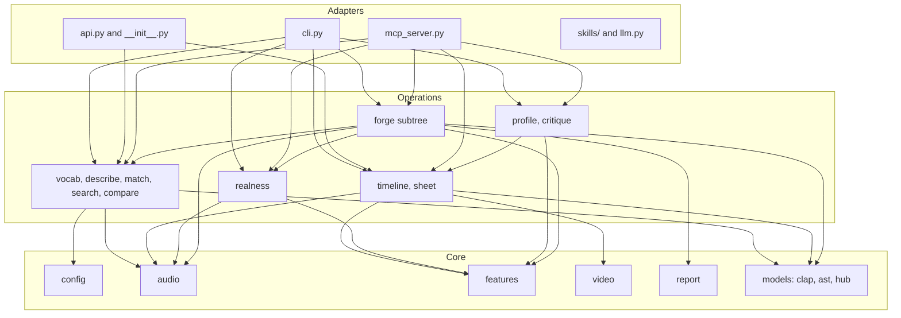
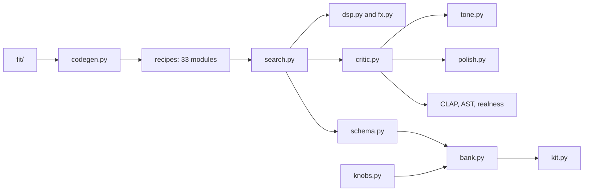
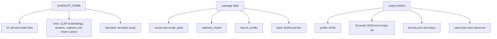

# earshot architecture: modules, layers and state

This document explains how the package is built. It covers the module graph and its dependency direction. It then
covers the core layer, each operation module, the forge subtree, the fit subtree, the bank and kits. It ends with the
interfaces, the data files, the caches, the ownership boundaries and the public contract.

The source is 287 tracked files at pin `4ac3d2a`. The Python package has 115 files. The package has 24 root modules, 4 model files, 4 data files and the forge package. The forge package has 14 root files, 31 recipe modules, 2 recipe support files, 19 seed files, 9 fit files, 4 bank files and 4 kit presets.

## The tree and the dependency direction

The package is a set of layers. A lower layer never imports an upper layer. The direction is visible in the imports.



The direction has two important exceptions. The launch scorecard uses the timeline sync function. `critique` imports `timeline` for that measurement. The forge critic uses the vocabulary calibration, the realness model and the feature measurements. The fit quality report can call `describe` for a CLAP score. These calls are library uses, not dependency cycles.

The forge subtree has two internal routes. The recipe, critic, bank and kit route uses `audio`, `report`, `features`, `compare`, `realness`, the vocabulary calibration and the model wrappers. The fit route also uses `describe` for its optional CLAP score. The bank uses the forge recipes and the fit renderer. The kit uses the bank and the knobs module. The no-model film path stays separate, because it never loads a model.

## The core layer

The core layer holds the shared base. The ownership table in `docs/DESIGN.md` marks it read-only for the builders of
the operation modules. A builder who needs a change works around it in the builder's module and reports the change.

### Configuration

`config.py` defines the cache root, the model identifiers and the thread limits. The model identifiers are pinned to
exact commits. The pin protects a caller from a silent model change on the model hub.

```text
# earshot/config.py:53-61
PINS = {
    'laion/larger_clap_general': {
        'revision': '16c8cc3159a3c8a31e8ff5ef1f66b0d9ab3667db', 'weights': 'model.safetensors',
        'files': ('config.json', 'preprocessor_config.json', 'merges.txt', 'special_tokens_map.json',
                  'tokenizer.json', 'tokenizer_config.json', 'vocab.json'),
        'legacy': {'revision': 'ada0c23a36c4e8582805bb38fec3905903f18b41', 'weights': 'pytorch_model.bin'}},
    'MIT/ast-finetuned-audioset-10-10-0.4593': {
        'revision': 'f826b80d28226b62986cc218e5cec390b1096902', 'weights': 'model.safetensors',
        'files': ('config.json', 'preprocessor_config.json')},
```

The default cache root is `<repo>/.cache` in a source checkout, else `~/.cache/earshot`. The root holds `hf` for model
files, `emb` for embeddings and other derived data, and `decoded` for decoded audio.

The thread rule is `min(4, cores // 2)`. The command line and the server also give the Basic Linear Algebra
Subprograms (BLAS) library the same limit. The library otherwise starts one worker per logical central processing unit
(CPU) and uses memory for no speed gain. The heavy work is the torch path, which already has a limit.

### Audio input

`audio.py` decodes every supported media file to 48 kilohertz. It uses ffmpeg through soundfile and soxr. A mono load
duplicates the single channel at unity, so a later stereo measure sees the same power as the mono file. The module
also lists media, probes a file, computes a peak in decibels relative to full scale (dBFS) and provides the file
identity for caches.

The sample rate is a project constant, not a user setting. Every model, feature and forge render assumes 48
kilohertz. A file at another rate is resampled once at the door. A video file is opened for its audio track. The video
picture goes through `video.py` instead.

The decoder cache is the first state store. Its key uses the path, the size, the modification time and 16 sampled
4-kilobyte blocks. The limits document records the weakness of that sample.

### Objective features

`features.py` computes the meter values. The module has no model and no random seed. It provides the BS.1770 loudness
curve, integrated loudness, loudness range (LRA), true peak in decibels true peak (dBTP), onset times, a key estimate,
brightness and the full `measure` dictionary. Every operation that needs a physical number uses this module.

### Video input

`video.py` wraps ffmpeg and ffprobe. It reads a grey thumbnail of each frame, computes a frame difference and turns the
difference into visual cuts. The frames feed `timeline`, `sheet` and `critique`.

```text
# earshot/video.py:86-100
def cuts(path, method='diff', threshold=0.3, min_gap=0.2, cache=True):
    """times (s) of picture cuts / big visual changes; method 'diff' (default) or 'scene' (ffmpeg scene score).
    cache=False recomputes rather than reusing a saved decode or scene scan."""
    if method == 'diff':
        fps, d = frame_diff(path, cache=cache)
        return [round(float(i) / fps, 3) for i in diff_events(d, fps)]
    k = hashlib.sha1(f'{audio.file_id(path)}|{threshold}|{min_gap}|v2'.encode()).hexdigest()[:20]
    f = _cache(f'cuts_{k}.json')
    if cache and os.path.exists(f):
        return json.load(open(f))
    p = subprocess.run(['ffmpeg', '-hide_banner', '-nostdin', '-i', path, '-an', '-vf',
                        f"scale=320:-2,select='gt(scene,{threshold})',showinfo", '-f', 'null', '-'],
                       capture_output=True, text=True, errors='replace')
    if p.returncode != 0:
        raise audio.AudioError(f'cannot decode the picture of {path}: {audio._ffmpeg_reason(p.stderr)}')
```

The cut detector is deliberately simple. A large change counts as a cut. A blinking cursor can produce a false cut. A
slow crossfade can be missed. The limits document names both errors.

### Report format

`report.py` is the output contract. Every public function returns a JSON-serialisable dictionary with a `summary`
string. The emitter writes text by default. With `--json`, it writes an ASCII-safe JavaScript Object Notation (JSON)
document. With `--out`, it writes the document to a file.

```text
# earshot/report.py:55-85
def emit(result, args, text=None):
    """print the result for a CLI call (text unless --json) and write --out if given"""
    if getattr(args, 'out', None):
        d = os.path.dirname(os.path.abspath(args.out))
        os.makedirs(d, exist_ok=True)
        with open(args.out, 'w', encoding='utf-8') as fh:
            fh.write(to_json(result))
    if getattr(args, 'json', False):
        # ASCII escapes: valid JSON whatever the console code page (a piped Windows stdout is often cp1252)
        sys.stdout.write(json.dumps(_clean(result), indent=1, ensure_ascii=True) + '\n')
    else:
        t = text if text is not None else (result.get('text') or render_text(result))
        try:
            sys.stdout.write(t + '\n')
        except UnicodeEncodeError:
            enc = sys.stdout.encoding or 'ascii'
            sys.stdout.write(t.encode(enc, 'backslashreplace').decode(enc, 'replace') + '\n')
    return result


def error_line(cmd, msg):
    """the one-line error every command prints on stderr: 'earshot <cmd>: error: <msg>'"""
    msg = ' '.join(str(msg).split()) or 'unknown error'
    print(f'earshot {cmd}: error: {msg}', file=sys.stderr)


def fmt_t(t):
    """seconds -> m:ss.ss (agent-readable timestamps)"""
    if t is None:
        return '-'
    m = int(t // 60)
```

The contract is small. That is why the command line, the Python application programming interface (API) and the Model
Context Protocol (MCP) server can share one function layer.

### Model wrappers

The `models` package has four files. The package `__init__.py` has no model code. `hub.py` resolves and fetches the pinned model files. `clap.py` loads the contrastive language-audio pretraining (CLAP) model and embeds text and audio. `ast.py` loads the audio spectrogram transformer (AST) tagger and returns AudioSet probabilities.

The hub uses a custom download pattern. It fetches only the files that the model needs, at the pinned revision, and it
accepts safetensors weights. It can load a local model folder with no network. The offline flags stop every network
call.

## The semantics layer

The semantics layer answers "what is this sound" and "which moment is the one I want".

### Vocabulary

`vocab.py` owns the 322 descriptions in 16 categories. It embeds the text with five prompt templates, loads the
calibration statistics, scores a sound against every term, removes the term bias and computes the per-sound z score.
It also builds the statistics file when the project prepares a release.

```text
# earshot/vocab.py:338-361
def build_stats(A, paths, meta=None, path=STATS_PATH, templates=None):
    """reference statistics from audio embeddings A (n, 512) of `paths`: the folder-balanced mean embedding (all the
    calibration uses) + the resulting mean / std cosine of every vocab term (derived, for inspection); written to
    `path` unless it is None"""
    A = np.asarray(A, np.float64)
    w = group_weights(paths)
    w /= w.sum()
    m = (w[:, None] * A).sum(0)
    v = Vocab(templates, stats=False)
    C = A @ v.E.T.astype(np.float64)
    mu = (w[:, None] * C).sum(0)
    sd = np.sqrt((w[:, None] * (C - mu) ** 2).sum(0))
    res = dict(meta or {}, model=config.CLAP_MODEL, precision=config.PRECISION, pad=PAD, templates=v.templates,
               logit_scale=round(float(_clap().logit_scale), 4), n_ref=len(A),
               n_folders=len({os.path.dirname(os.path.abspath(p)) for p in paths}),
               mean=[round(float(x), 5) for x in m],
               term_cos={t: [round(float(a), 4), round(float(b), 4)] for t, a, b in zip(v.names, mu, sd)})
    if path:
        lines = [f' {json.dumps(k)}: {json.dumps(x)}' for k, x in res.items() if k != 'term_cos']
        lines.append(' "term_cos": {' + ','.join(f'\n  {json.dumps(t)}: {json.dumps(x)}'
                                                 for t, x in res['term_cos'].items()) + '\n }')
        with open(path, 'w', encoding='utf-8') as fh:
            fh.write('{\n' + ',\n'.join(lines) + '\n}\n')
    return res
```

The statistics file is data, not a model. It holds the reference mean and the vocabulary mean. A change to the
vocabulary needs a new statistics file. The file is versioned by its content and by the project release.

### Describe and match

`describe.py` runs the full listening pass. It loads the audio, measures it, embeds the spans, scores the vocabulary,
adds AudioSet labels and formats the readings. It also handles the near-silence guard and the music share.

`match.py` is the smaller operation. It takes one query and optional alternatives. It returns the cosine, the z score,
the percentile, the rank in the vocabulary and a verdict. The optional alternatives use a softmax with the model's
logit scale.

### Search

`search.py` has two functions with two jobs. `rank` sorts many files by one description. `find` searches inside one
long recording for the best moments.

```text
# earshot/search.py:88-123
def rank(paths, query, top=None):
    """files (or folders / globs) sorted by how well they match `query` (calibrated z); a given path that yields no
    media file raises audio.AudioError"""
    audio.check_paths(paths)
    files, bad = vocab.readable(audio.list_media(paths))
    skipped = f" Skipped {len(bad)} unreadable file(s): {', '.join(os.path.basename(b['path']) for b in bad[:3])}." \
        if bad else ''
    if not files:
        return {'summary': f'no readable media files found in {paths}.' + skipped, 'query': query, 'n_files': 0,
                'results': [], 'skipped': bad}
    v = vocab.get()
    A = vocab.embed_files(files)
    r = v.calibrate(A, v.embed_text([query]))
    z, cos, pct = np.round(r['z_q'][:, 0], 2), r['cos_q'][:, 0], r['pct_q'][:, 0]
    silent = np.array([vocab.peak_db(p) < SILENT_DBFS for p in files])
    order = sorted(range(len(files)), key=lambda i: (silent[i], -z[i]))
    res = []
    for i in order[:top] if top else order:
        bt = v.top_terms(A[i], k=1, exclude=('quality', 'production'))[0]
        res.append({'path': files[i], 'name': os.path.basename(files[i]), 'z': round(float(z[i]), 2),
                    'cosine': round(float(cos[i]), 3), 'vocab_percentile': round(100 * float(pct[i]), 1),
                    'verdict': 'no match' if silent[i] else verdict(float(z[i])), 'near_silent': bool(silent[i]),
                    'sounds_most_like': f'{bt[0]} (z {vocab.zf(bt[2])})'})
    counts = {n: sum(1 for i in order if not silent[i] and verdict(float(z[i])) == n) for _, n in VERDICTS}
    head = ', '.join(f"{x['name']} (z {vocab.zf(x['z'])}, {x['verdict']})" for x in res[:3] if not x['near_silent'])
    s = (f"Ranked {len(files)} files for '{query}'. Best: {head or 'none (all near-silent)'}. "
         f"{counts['strong']} strong, {counts['plausible']} plausible, {counts['weak']} weak match(es).")
    if res and not res[0]['near_silent'] and res[0]['verdict'] in ('weak', 'no match'):
        s += f" Even the best is {_weakly(res[0]['verdict'])}: it sounds more like {res[0]['sounds_most_like']}."
    if counts['strong'] > 1:
        ev = VERDICT_EVIDENCE['strong']
        s += (f" In a held-out test 'strong' was right {100 * ev['precision_library']:.0f}% of the time, "
              f"{100 * ev['precision_library_strict']:.0f}% when a close variant (a mouth pop for a cork pop) counts as wrong.")
    if silent.any():
        s += f' {int(silent.sum())} near-silent file(s) (peak < {SILENT_DBFS:.0f} dBFS) ranked last: their scores mean nothing.'
    return {'summary': s + skipped, 'query': query, 'n_files': len(files), 'results': res, 'skipped': bad}
```

`find` builds candidate windows, scores them, snaps the edges to the sound and applies the head and tail rules. The
core mechanism document traces the rules.

### Compare

`compare.py` measures a sound, measures a set of reference recordings, reports the nearest references and computes a
typicality score. The score is a robust z of the sound's distance to its nearest references against the references'
own leave-one-out distances.

```text
# earshot/compare.py:133-135
def measure_path(p, start=None, end=None):
    x = audio.load(p, start=start, end=end)
    return feats(features.measure(x, light=True), x)
```

The module also has the `ab` operation. It reports which of two sounds is closer to a query or a reference set. It also
writes the measured differences in words.

## Timeline, sheet, realness and launch

### Timeline

`timeline.py` is the largest operation module. It detects events, measures their attack and level, tags them with the
vocabulary and AST, finds sections, measures loudness and the beat grid, reads cue frames and computes sync.

The module caches each stage. A timeline cache is keyed by the file identity, the range, the detail level, the cues
and a code identity. The code identity is a hash of the timeline module. A code change therefore invalidates the old cache. The snippet below shows the per-span cache, a separate cache under the model folder. Its key holds the file identity, the span, the kind and a span version.

```text
# earshot/timeline.py:763-783
def _cached(model, fid, spans, kind, compute, reuse=True):
    """per-span model outputs cached on disk next to the model's own cache (reuse=False recomputes and rewrites)"""
    keys = [hashlib.sha1(f'{fid}|{a:.3f}|{b:.3f}|{kind}|tl{SPAN_VERSION}'.encode()).hexdigest()[:24] for a, b in spans]
    files = [os.path.join(model.dir, f'tl_{k}.npy') for k in keys]
    out, todo = [None] * len(spans), []
    for i, f in enumerate(files):
        if reuse and os.path.exists(f):
            try:
                out[i] = np.load(f)
                continue
            except Exception:
                pass
        todo.append(i)
    if todo:
        res = compute([spans[i] for i in todo])
        for i, v in zip(todo, res):
            out[i] = v
            tmp = f'{files[i]}.{os.getpid()}.tmp.npy'
            np.save(tmp, v)
            audio.replace_quietly(tmp, files[i])
    return np.stack(out) if out else None
```

### Sheet

`sheet.py` draws an annotated portable network graphics (PNG) image. It reuses the timeline result and adds video
frames, labels, a spectrogram, a waveform, loudness lanes, beat marks and sync marks. The image is the path for an
agent that can read images but cannot hear.

### Realness

`realness.py` has two heads. The signal head measures the physical features. The embedding head uses CLAP. A small
logistic fusion layer combines them. The shipped model JSON has the weights and the thresholds.

The signal head covers level, envelope, spectral shape, harmonicity and noise. The embedding head covers the learned
character that the physical features miss. The training groups the data by source family, so a test fold never sees a
family from its training fold. The validation record reports the grouped result.

The module also has a pure-tone guard. A steady sine can read as real to the model. The guard catches that case with a
deterministic rule. The limits document gives the measured false-positive record.

### Launch profile and critique

`profile.py` measures a set of reference films. It builds a JSON profile of 33 metrics. Each metric has a median, a
10th percentile, a 90th percentile, a minimum and a maximum across the references.

`critique.py` compares one film to the profile. It checks each metric against a practice range. It turns each failure
into an action with a timestamp. The scorecard weights critical, major and minor metrics. It can run leave-one-out for
one of the reference films.

```text
# earshot/critique.py:508-520
def cut_sync(path, f):
    """each visual event matched to the sound that answers it with earshot.timeline's matcher (onset, whoosh / riser
    peak, level peak), so critique and timeline name the same unsounded cuts; None without picture events"""
    vis = f['events'].get('visual') or []
    if not vis:
        return None
    try:
        from . import timeline as T
        x = audio.load(path)
        fps = f.get('fps')
        return T.sync(vis, T.detect_events(x), None, 1.0 / fps if fps else None, T.level_envs(x))
    except Exception:  # noqa: BLE001  (the onset-based list is the fallback)
        return None
```

## The forge subtree

The forge subtree makes sound from code. It has its own internal layers.



### Recipes and the render contract

A recipe is a module with a `render` function, a description, alternatives and a search space. The recipe loader
imports it by name. The loader returns a module, not a class. The render function takes parameters and a random
generator. It returns a waveform at 48 kilohertz.

```text
# earshot/forge/__init__.py:71-73
def recipes():
    pkg = _recipes_pkg
    return sorted(m.name for m in pkgutil.iter_modules(pkg.__path__) if not m.name.startswith('_'))
```

The recipe collections are a family of named characters. The folder has 33 files: 31 public recipe modules, the package `__init__.py` and a shared `_tonal` helper. The forge version 2 record lists 34 categories: 18 from real recordings and 16 designed categories. It also lists the measured benchmark.

### Search and the critic

`search.py` renders, normalises and scores candidates. Every render is peak-normalised to -1 dBFS before the critic
sees it.

```text
# earshot/forge/search.py:187-202
def render(recipe, params, seed):
    """render one candidate, peak-normalised to -1 dBFS; None if it fails or is silent. The first exception of each
    recipe is printed to stderr (a recipe bug must not look like 'render failed or silent' candidates)."""
    try:
        x = np.asarray(recipe.render(dict(params), dsp.rng(seed)), np.float64)
    except Exception as e:
        name = getattr(recipe, '__name__', type(recipe).__name__)
        if name not in _failed:
            _failed.add(name)
            tb = traceback.extract_tb(e.__traceback__)[-1]
            sys.stderr.write(f'forge: recipe {name} raised {type(e).__name__}: {e} ({tb.filename}:{tb.lineno}); '
                             'later failures of this recipe are not printed' + chr(10))
        return None
    if not len(x) or not np.isfinite(x).all() or np.abs(x).max() < 1e-7:
        return None
    return dsp.normalize(x, -1.0).astype(np.float32)
```

The search has three stages. A cheap pre-screen removes clear failures. The critic scores the survivors. The optimiser
moves the distribution. The default optimiser is an evolution strategy. A separable covariance matrix adaptation
evolution strategy is available but did not beat the default at the tested budgets.

`critic.py` combines the model terms and the model-free terms. The model terms are the CLAP match z, the margin over
alternatives, the realness probability and the typicality. The model-free terms are a feature penalty for measurements outside the reference spread, tone, envelope, artifacts and polish. The weights differ by mode.

### Model-free checks

`tone.py` measures a third-octave balance against real references. It also measures the spectro-temporal envelope.
`polish.py` measures clicks, foldover, direct current, resonances, spectral evolution, ringing, truncation, silence,
clipping, attack, tail and body. These checks exist because the models saturate after a search.

### Report schema, bank and knobs

`schema.py` stores a render block for every final. The block holds the recipe, the function, the full parameter
dictionary, the seed, the mode, the peak level and the gain. A re-render from the block matches the delivered Waveform Audio File Format (WAV) to one 24-bit step. One step is 2 to the power -23, about 1.19e-7 of full scale.

`bank.py` loads the four bank files. Each entry is a render block or a fitted model. The bank renders by identifier
with no model and no network.

```text
# earshot/forge/bank.py:164-179
def _load():
    key = tuple(_files())
    if _STATE.get('key') == key:
        return _STATE
    entries, cats, versions, where = {}, {}, [], {}
    for p in key:
        d = _read(p)
        versions.append(str(d.get('version') or os.path.splitext(os.path.basename(p))[0]))
        for c, info in (d.get('categories') or {}).items():
            cats.setdefault(c, dict(info))
        for i, e in d['entries'].items():
            entries[i] = e
            where[i] = p
    _STATE.clear()
    _STATE.update(key=key, entries=entries, categories=cats, version='+'.join(versions), where=where)
    return _STATE
```

`knobs.py` aims a bank sound at a film's numbers. It changes the recipe's own parameters and never resamples the
audio. It supports duration, apex, pitch, decay, onset, brightness and width. Each landed value is measured and
corrected.

`kit.py` maps roles to bank sounds. It renders takes, audits them, writes a lock file and offers mix keys for bed
level and sync offset.

```text
# earshot/forge/kit.py:343-370
def plan(kit):
    """the takes a kit renders: [{role, file, sound, seed, pitch, edits, max_s, k}]. KitError when two takes would
    share a file (case-insensitively)"""
    from . import bank
    dup = _name_problems(kit)
    if dup:
        raise KitError('invalid kit: ' + '; '.join(dup))
    out = []
    for role, spec in kit['roles'].items():
        if not spec:
            continue
        e = bank.get(spec['sound'])
        base = int(spec['seed']) if spec.get('seed') is not None else int(e['seed'])
        n = int(spec.get('takes', 1))
        stem = role.replace('.', '-')
        ed = dict(spec.get('edits') or {})
        pitches = spec.get('pitches') or [ed.pop('pitch', None)]
        ed.pop('pitch', None)
        for p in pitches:
            for k in range(1, n + 1):
                name = stem + (f'_{_label(p)}' if spec.get('pitches') else '') + (
                    f'_{k}' if (n > 1 or not spec.get('pitches')) else '')
                t = {'role': role, 'file': name + '.wav', 'sound': spec['sound'], 'seed': base + k - 1,
                     'pitch': p, 'edits': ed, 'max_s': spec.get('max_s'), 'k': k}
                if spec.get('width') is not None:
                    t['width'] = float(spec['width'])
                out.append(t)
    return out
```

## The fit subtree

The fit subtree is analysis by synthesis. `auto.py` is the entry point. It measures the recording, names a class,
plans candidates, fits each candidate, applies the post stage and scores the result. The fitters are `modal.py`,
`sines.py`, `spectral.py` and `gesture.py`. A hybrid fits layers in sequence. `space.py` handles stereo and the active
span. `quality.py` measures the fit. `codegen.py` writes the recipe module.

The fit is not a copy. It is a model with readable parameters. The code generator writes the model as Python literals
and adds a search space and default values.

```text
# earshot/forge/fit/codegen.py:231-238
def write_recipe(path, model, **kw):
    """to_recipe() written to `path` (the module name defaults to the file stem); returns the path"""
    kw.setdefault('name', re.sub(r'\W', '_', os.path.splitext(os.path.basename(path))[0]))
    d = os.path.dirname(os.path.abspath(path))
    os.makedirs(d, exist_ok=True)
    with open(path, 'w', encoding='utf-8') as fh:
        fh.write(to_recipe(model, **kw))
    return path
```

The generated module is a normal forge recipe. The forge search can vary it. Two fits of the same kind can morph. The
recipe stores the structure, not the samples.

## Interfaces

### Command line

`cli.py` holds the command table. Each command maps to a module. The dispatcher imports only the requested module. A
broken module does not break the others, because each registration is guarded.

The common options are `--json`, `--out` and `--threads`. The first two are added by `cli.common`. The thread option
is read before numpy loads, because the BLAS limit only works before the first import. The command modules use the
common options through the same helper, so their output shape stays equal.

```text
# earshot/cli.py:71-82
def _register(sub, modules):
    failed = {}
    done = set()
    for mod in modules:
        if mod in done:
            continue
        done.add(mod)
        try:
            importlib.import_module(f'earshot.{mod}').add_cli(sub)
        except Exception as e:  # a broken module must not break the others
            failed[mod] = f'{type(e).__name__}: {e}'
    return failed
```

### Python API

`api.py` and `__init__.py` expose the functions through lazy imports. The models load on first use and stay warm in
the process. `__init__.py` also exposes the callable modules such as `earshot.describe`.

### MCP server

`mcp_server.py` registers the tool functions. The base list has 13 tools. Three bank tools are appended after it.

```text
# earshot/mcp_server.py:529-534
TOOLS = [  # (function, read-only, talks to the internet)
    (tool_measure, True, False), (tool_describe, True, False), (tool_match, True, False), (tool_rank, True, False),
    (tool_find, True, False), (tool_compare, True, False), (tool_ab, True, False), (tool_realness, True, False),
    (tool_timeline, True, False), (tool_sheet, False, False), (tool_critique, True, False),
    (tool_doctor, True, False), (tool_llm_critique, False, True),   # uploads audio: clients should ask first
]
```

```text
# earshot/mcp_server.py:607-607
TOOLS += [(tool_sfx_list, True, False), (tool_sfx_render, False, False), (tool_kit_render, False, False)]
```

The code count at this pin is 16. `docs/VALIDATION.md` still says 13. The record predates the bank tools. This
exploration states both values and does not pick one silently.

Each tool declares whether it is read-only and whether it uses the internet. The optional language model tool is the
only one that uploads audio. The server compacts large results and can return an image as a Joint Photographic
Experts Group (JPEG) image for an agent with vision.

### Skills and gallery

The two agent skills are documentation plus scripts. The `earshot` skill is one file. The `real-sound` skill has
33 files. The gallery is a separate static page generator. It reads forge output folders and writes one HTML file. It
does not need a server and does not call the network when it embeds audio.

## Data files, caches and state

The package has four data files: `vocab.json`, `vocab_stats.json`, `realness_model.json` and `launch_profile.json`.
The forge package also ships the bank JSON, the kit presets, the recipes and the seed banks.



The state has three homes:

- The package holds read-only data that ships with the tool.
- The cache root holds derived data that a run can rebuild.
- The output folder holds the user's results, recipes and locks.

No audio or video is committed to the repository. The project commits derived numbers, profiles, model coefficients and tables.
The bank is the exception: it stores render blocks, not audio. A re-render from a block reproduces the delivered WAV.

Each bank file carries its own version tag. The bank module combines the tags into one version string. A kit lock
records the bank version and the earshot version, so a later render can tell whether a take still matches its inputs.
A mismatch is visible before a mixer uses the file.

The bank files are package data. A user can add a bank file with the `EARSHOT_BANK` environment variable. The path
list uses the platform separator. A missing or unreadable file raises an error with the file name.

## Ownership boundaries

`docs/DESIGN.md` assigns one owner per file for the build. The table groups the core, semantics, timeline, realness,
launch, interfaces and real-sound areas. Tests belong to the owner of the module they test. The lead owns the top
documents.

The owner rule is a project statement. This exploration reads the table and records it. It does not verify the build
process.

The test suite follows the module split. A fast test uses synthetic fixtures and no network. A slow test loads a model
or runs an end-to-end path. The release record says 128 tests passed and 14 were skipped in the fast run. The same 14
passed in the slow run.

The practical boundaries are visible in the code. Each boundary keeps a change local and keeps a test narrow.

- The core modules are read-only for the operation builders.
- The operation modules return the common dictionary contract.
- The forge critic imports the semantics layer. The recipe render path does not.
- The bank depends on the recipes and the fit renderer.
- The kit depends on the bank and the knobs.
- The adapters are thin.

The common dictionary is the real contract. A public function returns a `summary` string and a set of typed keys. A
caller can ignore the keys it does not need. A new key does not break an old caller. A missing file or a bad range
becomes a plain error line and exit code 1. The JSON mode keeps the error on standard output for a caller that parses
it.

**Aha:** the package has no central engine object and no plugin registry. The contract is a plain dictionary with a
`summary` string, and every operation is a pure function over paths and arrays. That is why three adapters, a test
suite, a gallery and an MCP server can all share the same code without a framework. The cost is that every caller must
know the function name and the dictionary keys. The benefit is that a static reader can trace any command to its
function in a few jumps.

## What this architecture does not show

The module graph shows imports, not runtime cost. A cold command pays the model load even when the file is cached. The
MCP server and a long Python process avoid that cost. The workflow document records the timings.

The graph also hides the evaluation and skill folders. The evaluation scripts are outside the package. They read
licensed data from environment variables. The skills are outside the package and call the command line.

Read [00-overview.md](00-overview.md) for the system in one pass. Read [02-core-mechanism.md](02-core-mechanism.md)
for the formulas behind these modules. Read [03-workflow-and-quality.md](03-workflow-and-quality.md) for the
workflow. Read [04-limits-and-comparison.md](04-limits-and-comparison.md) for the failure modes. Read
[README.md](README.md) for the map and the non-claims.
