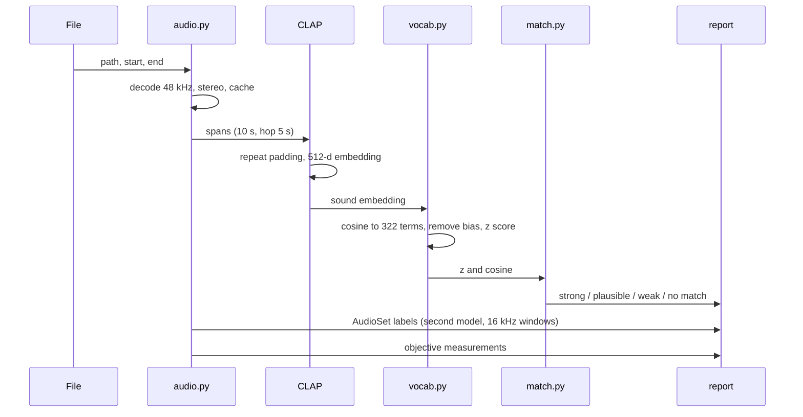
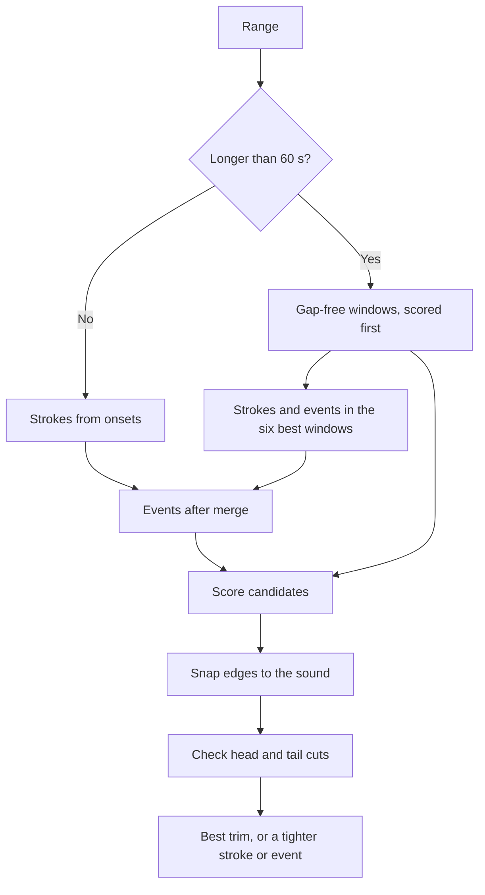

# earshot core mechanism: bytes to evidence

This document traces the mechanisms. It follows one file from bytes to a calibrated verdict. It then follows the find
search, realness, timeline and sync, forge and fit. Every snippet comes from source at pin `4ac3d2a`. The source is
read only.

## The shape of the evidence path

All listening paths share one calibration. A sound becomes a contrastive language-audio pretraining (CLAP) embedding.
That embedding is compared to a vocabulary. The comparison is corrected for term bias and for the sound's own spread.
A fixed band turns the resulting z score into a verdict.



## Trace A: one file to a calibrated verdict

### Decode and file identity

The decoder converts every format to 48 kilohertz. A mono source loaded as stereo is duplicated at unity. The decoder
rejects any not-a-number or infinite sample, because one such sample breaks every later analysis.

The cache key uses the absolute path, the size, the modification time and a hash of 16 evenly spaced 4-kilobyte
blocks. The first and last blocks are always included.

The sampled hash catches a same-size file swapped in with its old timestamp kept. It does not catch a change between
the sampled blocks. The limits document records that gap.

### Windows and padding

CLAP expects a 10-second input. Earshot uses 10-second windows with a 5-second hop. A long sound is split, and the
window embeddings are averaged. A short sound is repeat-padded by the model processor, as in training. The option
`pad='zero'` pads with silence instead, which is better for judging one hit.


The front end produces a 512-dimensional vector, divided by its length. Every embedding lies on the unit sphere, so a
cosine is a dot product. The text side uses the same space and normalisation.

### Score the vocabulary

The vocabulary has 322 descriptions in 16 categories. Each description is embedded through five prompt templates, and
the embeddings are averaged. The model logit scale is near 38.7. Earshot uses a calibrated z score, not that scale.

The calibration has two corrections. The first is the term bias. A query's bias is its mean cosine over the reference
recordings. Some phrases sit close to every sound, so their raw cosine is high without being informative. The second
is the per-sound spread. The corrected term scores for one sound are standardised by their own mean and standard
deviation.

```text
# earshot/vocab.py:271-290
    def calibrate(self, A, Q=None, method='both'):
        """A (n, 512) audio, Q (m, 512) query embeddings -> dict of (n, T) term arrays and (n, m) query arrays:
        cos, u (bias removed when method is 'center' / 'both'), z (per-sound z when 'sound' / 'both', else u),
        pct (share of vocab terms the query beats)"""
        A = np.atleast_2d(A)
        C = A @ self.E.T
        U = C - self.mu_E if method in ('center', 'both') else C
        r = {'cos_t': C, 'u_t': U}
        if method in ('sound', 'both'):
            mu, sd = U.mean(1, keepdims=True), U.std(1, keepdims=True) + 1e-9
        else:
            mu, sd = 0.0, 1.0
        r['z_t'] = (U - mu) / sd
        if Q is not None:
            Q = np.atleast_2d(Q)
            Cq = A @ Q.T
            Uq = Cq - self.bias(Q) if method in ('center', 'both') else Cq
            r['cos_q'], r['u_q'], r['z_q'] = Cq, Uq, (Uq - mu) / sd
            r['pct_q'] = (U[:, None, :] < Uq[:, :, None]).mean(-1)
        return r
```

In formula form:

- `C = A @ E.T`: cosine of every audio row against every term.
- `U = C - mu_E`: remove the mean term bias of the vocabulary.
- `z = (U - mean(U)) / (std(U) + 1e-9)`: standardise each sound.
- For a query, `u_q = cos(a, q) - m . q`: remove the query's own mean over the reference recordings.
- `z_q = (u_q - mean(U)) / std(U)`: place the query on the same scale as the terms.

The function also returns the percentile: the share of vocabulary terms that the query beats. The `scores` method then counts the terms that beat the query and adds one. That count is the rank. A rank of 1 means that no term beats the query.

**Aha:** the z score is a local scale, not a global probability. It compares a query to the other 322 descriptions
for the same sound. Two files with the same z score can have different raw cosines. One file can score high for a term
that is weak in absolute terms. The held-out precision table turns this local scale into a base rate.

### Verdict bands

The verdict is a threshold on the z score. The thresholds are 3.0, 2.5 and 2.0.

```text
# earshot/match.py:50-54
def verdict(z):
    for t, name in VERDICTS:
        if z >= t:
            return name
    return 'no match'
```

The held-out record gives the meaning of each band:

| Band | z | Precision at a 3 percent base rate | Note |
|---|---:|---:|---|
| strong | 3.0 or more | 0.98 right kind, 0.61 exact variant | The ratio rests on 3 wrong pairs |
| plausible | 2.5 to 3.0 | 0.41 | A hint, not a decision |
| weak | 2.0 to 2.5 | 0.28 | A weak hint |
| no match | under 2.0 | 0.008 | Usually not the sound |

Half of the true matches reach the strong band. Three quarters reach at least the weak band. The exact variant is
harder, because an Enter key and a spacebar count as different variants.

### The second model and the meters

The audio spectrogram transformer (AST) gives 527 AudioSet class probabilities. The outputs are independent sigmoids,
not a softmax. The input is 16 kilohertz, so the useful ceiling is 8 kilohertz. The top label is a second opinion on
the broad class.


The objective measurement path runs beside the models. It reports loudness in loudness units relative to full scale
(LUFS), true peak in decibels true peak (dBTP), loudness range (LRA) and band levels. It also gives attack and decay,
brightness, bandwidth, flatness, tonal peak ratio and harmonic ratio. It reports fundamental frequency, onsets, tempo
and key. These numbers do not depend on a training set. A sound designer can check them by hand.

`describe` combines the tags, AST labels and measurements. It applies a near-silence guard at minus 70 decibels
relative to full scale (dBFS) and a music-share rule. The report starts with a summary, then the detailed keys.

## Trace B: the find search

`find` answers a different question. A long recording must yield the best moment for a description. The result is a
sample trim, not a label.

### Candidate windows

The window path covers the whole range with no gaps. The default window is the duration divided by six, clamped to 1
to 5 seconds. The hop is half a window. For a long file the window grows to 10 seconds, then the hop grows, so the
count stays near 40.

```text
# earshot/search.py:300-317
def window_candidates(dur, win=None, hop=None, t0=0.0):
    """sliding windows covering [t0, dur) without gaps; with defaults about MAX_WINDOWS of them at most (the window
    grows up to 10 s, then the hop up to the window length, before the count grows)"""
    span = dur - t0
    if not win:
        win = float(np.clip(span / 6, 1.0, 5.0))
        while win < MAX_WIN_S and (span - win) / (win / 2) + 1 > MAX_WINDOWS:
            win = min(MAX_WIN_S, win * 1.25)
    if span <= win:
        return [(t0, dur, 'window', 0.0)]
    if not hop:
        hop = win / 2
        if (span - win) / hop + 1 > MAX_WINDOWS:
            hop = min(win, (span - win) / (MAX_WINDOWS - 1))
    st = list(np.arange(t0, dur - win + 1e-6, hop))
    if dur - win - st[-1] > 1e-3:
        st.append(dur - win)
    return [(float(s), float(s + win), 'window', 0.0) for s in st]
```

The onset path builds strokes and events. A stroke runs from an onset until the sound decays by 35 decibels, and never
into the next onset. An event joins strokes with a gap under 0.25 seconds, at most 2 seconds in total, and never
across an edit gap. An edit gap is at least 10 milliseconds of exact digital silence at or below minus 100 dBFS. It
marks a take boundary in a sample pack.



Up to 60 seconds, the search keeps at most 48 strokes or events, picked round-robin over 2-second stretches. Above
60 seconds, it uses two stages. It scores windows first, then builds strokes and events inside the six best windows.
The first build never looked past about 95 seconds; this is the fix.

### Snap the edges

A fixed window can start after an attack or end before a decay. For a one-shot query, the search snaps each edge to
the sound. A start inside a rising sound moves back to where the sound is quiet. A start inside an earlier tail moves
forward past it. An end inside a decay follows the decay. An end at a new attack moves back before it. Each move is
limited to 1 second.

The quiet level is 40 decibels under the window peak, or 6 decibels over the noise floor if higher. The decay level
is 35 decibels under the peak. The trim starts one 5-millisecond frame before the sound and ends at the last frame
above the decay level.

### Trim rules

A stroke starts 5 milliseconds before its attack. An event does the same for its first stroke. A snapped window starts
5 milliseconds before its sound and ends 20 milliseconds after the decay. The trim is a sample time in seconds.

The search checks for a cut. The head is the first 5 milliseconds against the segment peak. The tail is the last
10 milliseconds against the peak. A level above minus 15 dBFS is a cut into a sound. The flag is `head cut` or
`tail cut`, and the score drops by 0.5 z.

A window with two or more separate sounds is never returned for a one-shot query. The check uses a quiet gap of
0.25 seconds or an edit gap. A winning window is replaced by a better stroke or event within 0.5 z, for a tighter
trim.

The search also guards silence. A near-silent stretch is never an answer. A near-silent file gets a warning, because
every score on it is meaningless.

## Trace C: realness

The realness question is not acoustic against electronic. It is real or professionally produced audio against
amateur procedural code. A professional electronic track counts as real. A clean synthesized interface tone counts as
code-synthesized, even when a professional library sells it.

### Two heads and one fusion

The model is a small JavaScript Object Notation (JSON) file, not a pickle. It has two evidence families. The CLAP head
describes what the clip sounds like. The signal head measures what a synthesizer leaves behind: no noise floor, energy
in a few pure lines, a steady pitch, smooth envelopes, Gaussian noise and exact digital silence.

The fusion is a logistic layer over the standardised head outputs. The fitted signal weight is zero. The signal head
adds no held-out accuracy, so CLAP decides. The signal measurements remain as evidence in words.

```text
# earshot/realness.py:188-190
def fuse(fusion, logits):
    s = fusion['intercept'] + sum(w * logits[k] for k, w in zip(fusion['heads'], fusion['coef']))
    return 1 / (1 + math.exp(-s)), s
```

A clip is stronger evidence than a long file. A sound up to 6 seconds uses the clip thresholds. A longer file is cut into 4-second windows with a 4-second hop, and the mean of the window probabilities is judged. The file thresholds
come from a small set of synthesized long files, so the project calls that calibration weak.

```text
# earshot/realness.py:193-195
def thresholds_of(m, file=False):
    """verdict thresholds: per clip, or for the mean of a long file's windows (file-level held-out thresholds)"""
    return m.get('file_thresholds', m['thresholds']) if file else m['thresholds']
```

The clip high value is 0.77 and the low value is 0.17. The file low threshold is 0.40. The verdict is "real or
pro-produced" at or above the high value, "likely code-synthesized" at or below the low value, and "uncertain" between
them. A source below minus 30 dBFS root mean square (RMS) is raised to that level first. This removes a level cliff.

### The pure-tone rule

A pure test tone sits outside the training data. The model gives a 30-second 440-hertz sine a probability of 0.48. The
rule overrides that to 0.03 or less. It is deterministic: nearly all energy in one line in every frame, a crest factor
at or below 4.5 decibels, and no pitch drift.

```text
# earshot/realness.py:252-259
def pure_tone(f):
    """a pure, dead-steady tone (test tone / bare oscillator): nearly all energy in one spectral line in every frame,
    a flat level (crest <= 4.5 dB) and no pitch drift. Out of the models' training distribution, so it is decided by
    rule; it fired on none of 4741 audible clips of the 345 real licensed recordings (eval/realness/tone_guard.json;
    closest: a wine-glass tap, tonal but crest 20 dB)"""
    w = f.get('pitch_wobble', float('nan'))
    return (f.get('tonal_frames', 0) >= 0.95 and f.get('line_share', 0) >= 0.9 and f.get('crest_db', 99) <= 4.5
            and (not np.isfinite(w) or w <= -1.0))
```

## Trace D: timeline and sync

`timeline` builds a second-by-second transcript of a soundtrack or film. It detects events, measures level, tags them,
finds sections, measures loudness and beats, and compares sound to picture.

### Events and attacks

The onset detector uses 5-millisecond frames and a spectral-flux novelty curve. A positive mean increase in the log-mel
spectrum is summed after a maximum filter. The novelty is standardised against the surrounding 2 seconds. A peak above
3 robust standard deviations is a candidate.

The detector refines the attack on a 1-millisecond envelope. It chooses the band where the event stands out most: full
band, low band under 200 hertz, or high band over 2 kilohertz. It walks back to the first millisecond within
20 decibels of the peak above the bed.

```text
# earshot/timeline.py:186-208
def _attack(envs, tc):
    """refine a detector frame time to the attack: find the band where the event stands out most above its bed,
    then walk back from the event's peak to the first millisecond within 20 dB of it (above the bed); the timing
    comes from the full-band envelope whenever the event rises 12 dB there too (filtered bands smear time)"""
    ic = int(round(tc * 1000))
    res = {}
    for band, e in envs.items():
        a, b = max(0, ic - 15), min(len(e), ic + 50)
        if b - a < 5:
            continue
        ip = a + int(np.argmax(e[a:b]))
        pre = e[max(0, ic - 160): max(0, ic - 40)]
        bed = max(float(np.median(pre if len(pre) >= 20 else e[: ic + 250])), BED_FLOOR)
        thr = bed + 0.1 * (e[ip] - bed)
        j, lo = ip, max(0, ic - 40)
        while j > lo and e[j - 1] >= thr:
            j -= 1
        res[band] = (e[ip] / bed, band, j, ip, bed)
    if not res:
        return None
    best = max(res.values())
    timing = res['full'] if 'full' in res and res['full'][0] >= 4.0 else best
    return best[0], best[1], timing
```

The event carries time, shape, band, contrast, z score, length, prominence, bed level, peak level, local loudness and
spectral centroid. A lead event marks a file that starts with sound. Swell events mark build-ups.

### Loudness, sections and beats

The loudness path follows BS.1770. It reports momentary loudness over 0.4 seconds, short-term loudness over 3 seconds,
integrated loudness, loudness range, true peak and silences. A silence runs at least 0.25 seconds. A silence at the
start or end is a lead-in or tail, not a stop-down.

Sections come from CLAP windows. Neighbouring windows merge while their mean cosine is at least 0.84 and no strong
novelty block lies between them. Novelty comes from a Foote checkerboard kernel on 0.5-second log-mel frames, with a
robust z threshold of 3. A section is at least 4 seconds. Its label lists genre, mood, instruments, ambience and voice,
with AST extras. A weak genre gets a question mark.

The beat grid uses an autocorrelation period estimate and a dynamic-programming tracker. The period estimate uses a
soft 120 beats-per-minute prior. A clarity score separates a clear pulse from a weak one.

### Sync to picture

A cue is a picture time. It can come from a JSON file, a list of seconds or a frame list. A cut is a visual change
from `video.py`. Each cue or cut gets the event that answers it.

The answer order is fixed:

1. Any onset within one frame, or 40 milliseconds without a frame rate. Status `OK`.
2. The nearest strong onset within 100 milliseconds. Status `near`.
3. Any onset within 100 milliseconds. Status `near`.
4. A detected swell that peaks within 300 milliseconds. Status `swell`.
5. A level peak within 150 milliseconds. Status `peak`.
6. A strong onset within 250 milliseconds. Status `off`.
7. Nothing. Status `no sound`.

```text
# earshot/timeline.py:610-624
def _answer(t, events, ts, strong, st, swells, sw, tol1, levels=None):
    """the event that answers a cut / cue at t: any onset within tol1 (OK), else the nearest strong one within
    100 ms, else any within 100 ms (near), else a detected build-up (whoosh / riser) peaking within 300 ms (swell),
    else a level peak within 150 ms that the onset detector misses (peak: a soft whoosh / swell?), else a strong
    onset within 250 ms (off); None = no sound"""
    for evs, arr, rad, status in ((events, ts, tol1, 'OK'), (strong, st, 0.1, 'near'), (events, ts, 0.1, 'near'),
                                  (swells, sw, 0.3, 'swell')):
        e = _nearest(t, evs, arr, rad)
        if e is not None:
            return e, status
    pk = level_peak(levels, t) if levels else None
    if pk is not None:
        return {'t': pk['t'], 'prominence_db': pk['rise_db'], 'shape': 'peak', 'band': pk['band']}, 'peak'
    e = _nearest(t, strong, st, SYNC_S)
    return (e, 'off') if e is not None else (None, 'no sound')
```

The offset is sound time minus picture time. A negative offset means the sound leads the picture. The statistics
report the share within one frame, the share within 100 milliseconds, the median absolute offset, answers by swell and
level peak, unanswered cues, accents and beat alignment.

The chance value is the share of random edit times that fall within tolerance at this event density. A 60 percent hit
rate means little when chance is 50 percent. The report shows both.

## Trace E: the forge loop

The forge loop renders a recipe, scores it and searches the parameters. The score is a weighted sum of model evidence
and model-free measurements.

### Recipe to waveform

A recipe declares a search space and a render function. The space can be a range, a logarithmic range, an integer
range or a choice list. The render function takes a parameter dictionary and a random generator. Every candidate is
peak-normalised to minus 1 dBFS, so level never decides the score.

```text
# earshot/forge/search.py:187-202
def render(recipe, params, seed):
    """render one candidate, peak-normalised to -1 dBFS; None if it fails or is silent. The first exception of each
    recipe is printed to stderr (a recipe bug must not look like 'render failed or silent' candidates)."""
    try:
        x = np.asarray(recipe.render(dict(params), dsp.rng(seed)), np.float64)
    except Exception as e:
        name = getattr(recipe, '__name__', type(recipe).__name__)
        if name not in _failed:
            _failed.add(name)
            tb = traceback.extract_tb(e.__traceback__)[-1]
            sys.stderr.write(f'forge: recipe {name} raised {type(e).__name__}: {e} ({tb.filename}:{tb.lineno}); '
                             'later failures of this recipe are not printed' + chr(10))
        return None
    if not len(x) or not np.isfinite(x).all() or np.abs(x).max() < 1e-7:
        return None
    return dsp.normalize(x, -1.0).astype(np.float32)
```

A failed render returns `None`, not an exception. A silent or non-finite render also returns `None`. One bad candidate
does not stop a generation.

### The critic

The critic has four model inputs: match z, margin over alternative descriptions, realness probability and typicality
against the references. It has five model-free penalties: a feature penalty for measurements outside the reference spread, tone, envelope, artifacts and polish. The total combines these terms.

```text
# earshot/forge/critic.py:272-284
def total_v2(r, W=None, mode='real'):
    """the v2 total and pass verdict from a row's components (pure; rows from Critic.score carry every input)"""
    W = {**W2, **(W or {})}
    mz, margin, p, typ = r['match_z'], r['alt_margin'], r['p_real'], r.get('ref_typ_z')
    real = W['real'] if mode == 'real' else 0.0
    total = (W['match'] * min(mz, 6.0) + real * (2 * p - 1) + (W['typ'] * float(np.clip(typ, -3, 2)) if typ is not None
             else 0.0) - W['feat'] * r['feat_pen'] - W['alt'] * max(0.0, 0.5 - margin)
             - W['tone'] * r.get('tone_pen', 0.0) - W['env'] * r.get('env_pen', 0.0)
             - W['art'] * r.get('art_pen', 0.0) - W['polish'] * r.get('polish_pen', 0.0))
    passes = bool(mz >= 3 and margin > 0 and (mode != 'real' or p >= 0.77) and (typ is None or typ >= -2)
                  and r['feat_pen'] <= 1.0 and not r.get('hard') and r.get('env_pen', 0.0) <= ENV_PASS
                  and r.get('polish_pen', 0.0) <= POLISH_PASS and not r.get('tone_far', False))
    return float(total), passes
```

The weights are 1.0 for match, 2.0 for realness, 0.5 for typicality and 0.7 for feature penalty. They are 1.0 for
alternative margin, tone, envelope and artifacts, and 0.75 for polish. The match term is capped at 6. Typicality is
clipped to minus 3 to 2.

A candidate passes only on several conditions. Match z must be at least 3. The alternative margin must be above zero.
In real mode the realness probability must be at least 0.77. The feature penalty must be at most 1. Tone, envelope and
polish must stay inside their pass values. A hard artifact fails the candidate.

The realness term is doubled and scales as `2p - 1`, so it runs from minus 1 to plus 1. A false "real" result is
expensive. The model-free terms are the counterweight, because model checks saturate after a search.

### Search and re-check

The default optimiser is an evolution strategy. Elites are mutated with a step that shrinks from 0.22 to 0.04, and a
few fresh random points are added. The alternative is a separable covariance matrix adaptation evolution strategy in
the unit cube, with mirrored bounds and restarts. The record says the evolution strategy was as good or better at 96
to 240 scored candidates. The pre-screen raised passing candidates from 10.5 to 36.5 of 96, and the top-five mean from
5.77 to 6.17.

A final is not the best single render. The search re-renders finalists on new seeds, keeps a diverse shortlist and
stores parameter sets in a seed bank. This avoids the winner's curse of one lucky noise draw.

## Trace F: the fit loop

Fit is the inverse problem. A recording goes in, and a model with readable parameters comes out. The model renders the
sound and can vary it.

### Measure, classify, plan

The engine measures duration, attack, decay, crest factor, tonal share, partial persistence, glide, flatness and
strikes. It names a class: glide, ringing, struck, gesture or mixed. The class orders the fitters.

```text
# earshot/forge/fit/auto.py:318-335
def plan(c, max_candidates=None):
    """ordered candidate kinds for a character (first = the expected best); hybrids as 'hybrid:<a>+<b>[+<c>]'.
    The measured quality decides among them; the class orders them and prunes the slow fits of long sounds: under
    1 s every candidate is tried (each fit takes 0.5-4 s; the gesture 3-60 s), longer sounds the class's four
    (LONG_PLANS: a long struck sound: modal, sines, modal + spectral, spectral; the three-layer hybrid alone took
    147 s on a 4.5 s impact). A long gesture, mixed, glide or ringing sound gets the gesture model (fit/gesture.py:
    tones + air) second, in place of the spectral one (0.4). 'gesture' always comes after 'sines' (it takes the sines
    candidate's partials as its tones)."""
    long_ = c['dur_s'] >= 1.0
    order = list((LONG_PLANS if long_ else PLANS)[c['class']])
    order += [k for k in ALL if k not in order]
    if max_candidates is None:
        max_candidates = 4 if long_ else len(ALL)
    order = order[:max_candidates]
    if 'gesture' in order and 'sines' in order and order.index('gesture') < order.index('sines'):
        order.remove('gesture')
        order.insert(order.index('sines') + 1, 'gesture')
    return order
```

The fitters are:

| Fitter | Model | Good for |
|---|---|---|
| modal | Strikes of damped sinusoids, contact modes, band noise | Struck and ringing sounds |
| sines | Tracked partials with glides, strike atoms, third-octave noise | Tonal sounds |
| spectral | A time-varying 48-band noise gesture, stereo, texture, ridges | Noisy sounds |
| gesture | A smooth band-power gesture with texture | Long evolving sounds |
| hybrid | Layers fitted in order on the residual | Mixed sounds such as a pop with a body and air |

Each candidate is fitted and rendered on seed 0, then passed through a post stage. The stage applies a smooth
third-octave equalisation to the original balance, the level, an attack clamp and an optional gate. The gate cuts only
where the render stands over the original after the onset. It keeps gated pulses and hard stops that the model cannot
represent.

### Score the fit

The quality score is a lower-is-better sum. It is the same score for every fitter.

```text
# earshot/forge/fit/quality.py:307-321
def score(q):
    """one number to choose between fits of one recording (lower is better): mel dB + 0.3 x tone dB
    + 8 x (1 - envelope r) + 1 x onset error (octaves, capped at 2) + 1.5 x excess dB + 1 x missing dB
    + 0.04 x width dB (capped at 20) + 1 x tail correlation error [+ 20 x (1 - CLAP cos) when measured].
    On the 12 validation refs (in-sample) the model-free part alone chose fits with a mean CLAP cos of 0.927 (the best
    candidates: 0.944); without excess / missing it chose 0.856. The stereo terms (0.4) cost a mono re-make of a wide
    recording (width 15 dB, tail correlation off by 0.6) about 1.2, what 0.06 of CLAP costs: they decide between
    candidates that sound alike, not over a clearly closer one (on 29 wide-category dev clips of the replication
    benchmark they changed no winner). Mono recordings: both are 0"""
    s = (q['mel_db'] + 0.3 * q['tone_db'] + 8.0 * (1.0 - q['env_corr']) + 1.0 * min(q['onset_err'], 2.0)
         + 1.5 * q.get('excess_db', 0.0) + 1.0 * q.get('missing_db', 0.0)
         + WIDTH_W * min(q.get('width_db', 0.0), WIDTH_CAP_DB) + TAIL_CORR_W * q.get('tail_corr_err', 0.0))
    if q.get('clap_cos') is not None:
        s += 20.0 * (1.0 - q['clap_cos'])
    return float(s)
```

The terms are the multi-resolution mel distance, 0.3 times the tone distance, 8 times one minus the envelope
correlation, and the onset error in octaves, capped at 2. They add 1.5 times the excess energy, the missing energy,
0.04 times the stereo width error capped at 20 decibels, and the tail correlation error. A CLAP term of 20 times one
minus the cosine is added when enabled.

The score aligns both sounds at the original onset and levels each to its loudest 50 milliseconds. A timing error still
counts, because the trim uses the original onset. A level offset is reported separately.

### Model to code

The winning model becomes a recipe module. The module holds a docstring, the target and alternatives, the reference
set, a search space, default parameters, the model as Python literals and a render function.

```text
# earshot/forge/fit/codegen.py:231-238
def write_recipe(path, model, **kw):
    """to_recipe() written to `path` (the module name defaults to the file stem); returns the path"""
    kw.setdefault('name', re.sub(r'\W', '_', os.path.splitext(os.path.basename(path))[0]))
    d = os.path.dirname(os.path.abspath(path))
    os.makedirs(d, exist_ok=True)
    with open(path, 'w', encoding='utf-8') as fh:
        fh.write(to_recipe(model, **kw))
    return path
```

The default parameters re-render the measured fit. The space varies size, damping, brightness, hardness, noise, width,
room, vary, stretch, decay and the knobs of the model kind. A morph model adds a morph knob between two recordings. The
file is self-contained apart from the fit engine import.

The 0.4 replication record is a proxy, not a listening test. On the development set the median CLAP cosine is 0.921,
with 40 high-grade fits. On the first held-out set it is 0.909, with 14 high. On the fresh held-out set it is 0.851
median and 0.860 mean, and the mel gap is 0.58 decibels. Takes pass less often than in the earlier engine. The limits
document records the weak points.

## What the six traces share

Each trace turns a signal into a number with a stated unit and scale. Each trace keeps model evidence apart from meter
evidence. Each trace records the time or sample range that produced the number.

Calibration is the common trick. The vocabulary z score, realness probability, timeline tag score and forge typicality
all compare a value to a background distribution. That comparison makes a raw score readable. It also makes the score
local: the background changes with the sound, the reference set and the file length.

**Aha:** the second common trick is to keep a model-free path beside every model path. The meter path catches the
model when the model leaves its domain. The forge critic, the realness evidence, the timeline loudness and the fit
quality all follow this rule. A model can be pleased. A meter still measures.

Read [00-overview.md](00-overview.md) for the system in one pass. Read [01-architecture.md](01-architecture.md) for
the module layout. Read [03-workflow-and-quality.md](03-workflow-and-quality.md) for the commands and tests. Read
[04-limits-and-comparison.md](04-limits-and-comparison.md) for the failure modes. Read [README.md](README.md) for the
map and the non-claims.
