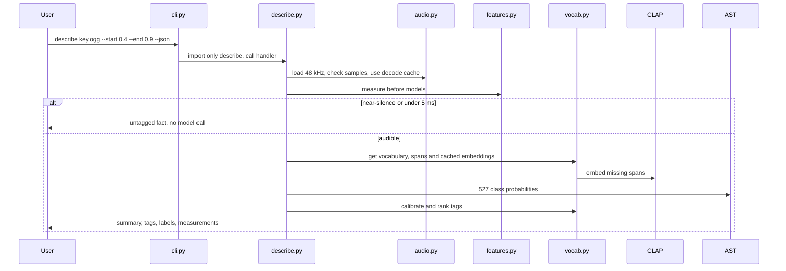
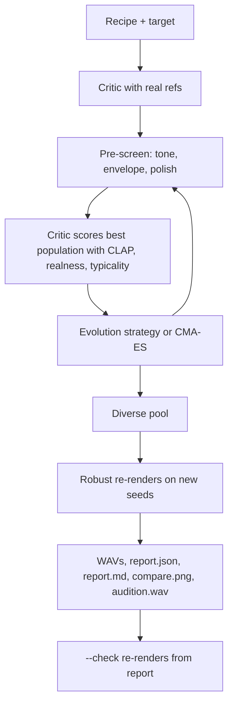

# earshot workflow and quality: from one command to a release claim

This document follows the work, not the theory. It starts with one `describe` request and shows every step that touches
the result. It then follows one `forge` run. It shows how the models load and how the caches work. It lists the
evaluation suites, the tests, the doctor checks and the release gate. It ends with the failure modes that a user will
meet first. Every command is recorded in the project documents. This exploration ran none of them.

## One `describe` request, end to end

The example request is a key press with a trim:

`earshot describe key.ogg --start 0.4 --end 0.9 --json`

The command is short. The path behind it has eleven steps.

### Step 1: the shell entry point

The console script calls `earshot.cli.main`. Before any command module loads, the function caps the OpenBLAS thread
pool. A separate Basic Linear Algebra Subprograms (BLAS) pool in numpy and scipy starts one worker per logical central
processing unit (CPU). It spends memory for no gain, because the heavy work is in torch. The function sets
`OPENBLAS_NUM_THREADS` from `--threads` or `EARSHOT_THREADS`. It does this before numpy is first imported.

```text
# earshot/cli.py:48-68
def _hold_blas(argv):
    """numpy and scipy each bundle an OpenBLAS that starts a worker thread per logical CPU and, on Windows, commits a
    buffer for each when first imported: ~0.4 GB per process on 12 CPUs before any audio is read, ~0.9 GB once a tool
    has loaded scipy, for no speed-up (the heavy work is torch, already held to EARSHOT_THREADS). Give BLAS the same
    limit, from --threads or EARSHOT_THREADS, unless OPENBLAS_NUM_THREADS is set. It only counts before numpy is
    first imported, so main() calls this before any command module loads."""
    if 'OPENBLAS_NUM_THREADS' in os.environ or 'numpy' in sys.modules:
        return
    n = None
    for i, a in enumerate(argv):  # the last one wins, as in argparse
        if a == '--threads' and i + 1 < len(argv):
            n = argv[i + 1]
        elif a.startswith('--threads='):
            n = a.split('=', 1)[1]
    from . import config
    try:
        n = int(n or 0)
        n = n if n > 0 else config.threads()   # --threads 0 means the default, as in main()
    except ValueError:  # a bad value: argparse (or the first model load) reports it
        return
    os.environ['OPENBLAS_NUM_THREADS'] = str(n)
```

The parser then reads the command name from the first argument that is not a flag. Only that command module is
imported. A cold `describe` does not import forge, timeline or the MCP server. A broken module cannot break another
module, because the import is guarded.

The common flags are `--json`, `--out` and `--threads`. The command module adds its own flags. In this example they are
`path`, `--start`, `--end` and `--top`.

### Step 2: the command handler and the error contract

The handler calls `vocab.run_cli`. That wrapper catches the expected errors: a missing or undecodable file, a bad time
range, or an input/output error. It prints one line on standard error. With `--json` it also writes a small JSON error
object on standard output, so a caller that parses JSON still gets an answer. Any other exception goes back to
`cli.main`, which prints a one-line error unless `EARSHOT_DEBUG` is set.

```text
# earshot/vocab.py:120-133
def run_cli(fn, a, text=None):
    """run a CLI handler: expected problems (missing / undecodable file, bad range) as one plain line, also as JSON
    with --json, exit 1; anything else is left to earshot.cli"""
    from .report import emit, error_line
    try:
        r = fn()
    except (audio.AudioError, ValueError, OSError) as e:
        msg = ' '.join(str(e).split()) or type(e).__name__
        error_line(getattr(a, 'command', None) or '', msg)
        if getattr(a, 'json', False):  # the JSON error stays on stdout for a caller parsing --json
            sys.stdout.write(json.dumps({'summary': f'error: {msg}', 'error': msg}) + '\n')
        return 1
    emit(r, a, text(r) if text else r['summary'])
    return 0
```

### Step 3: input checks and decode

`describe` first calls `vocab.check`. That function reads the duration and rejects a negative start, a start at or past
the end, and an end that is not after the start. It raises a named error, not a stack trace.

`audio.load` then decodes the range. It asks ffmpeg for 48 kilohertz and two channels. It decodes the whole file, then cuts the requested range from the decoded array. It uses the decoded-audio cache for the whole file. The cache key is the absolute path, the size, the modification time, a hash of sampled blocks, the sample rate, the channel count and the decode version. Every sample is checked for not-a-number or infinity. One bad sample stops the call with a
message that names the first bad sample.

### Step 4: measurement before models

`features.measure` runs before any model. For a sound longer than 60 seconds it uses `light=True`, which skips the slow
onset, harmonic and fundamental-frequency parts. For a short key press it runs the full path. The result includes
loudness, true peak, loudness range, band levels, attack, decay, brightness, bandwidth, flatness, harmonic ratio,
fundamental frequency, onsets, stereo width and clipping.

The measure path has its own guards. A file shorter than 5 milliseconds returns an error key instead of numbers. The
caller turns that into a plain message.

### Step 5: two early exits

`describe` stops before the models in two cases. A peak below minus 70 decibels relative to full scale (dBFS) is
near-silence. The model tags of silence are meaningless, so the function returns an untagged result with the reason.
A file too short to measure also returns untagged.

```text
# earshot/describe.py:156-158
def _untagged(res, why):
    res.update(shape=why, top_tags=[], music_hints=[], tags={}, audioset=[], character=[], summary=why)
    return res
```

These exits are important for an agent. A silence file does not become a weak match. It becomes a stated fact.

### Step 6: the vocabulary and the model

`vocab.get()` returns a process-wide vocabulary object. It loads 322 descriptions in 16 categories from
`earshot/data/vocab.json`. It embeds every description through five prompt templates, averages the template vectors,
renormalises them and caches the text embeddings on disk. A repeated query on a warm cache needs no model load.

The audio side is a singleton. `clap.get()` builds the model once per process. The MCP server and the Python API keep
that object warm. A command line call does not, because every call is a fresh process.

```text
# earshot/models/clap.py:282-288
def get(model_id=None):
    """process-wide singleton (the MCP server keeps it warm between calls)"""
    global _inst
    with _lock:
        if _inst is None or (model_id and _inst.model_id != model_id):
            _inst = Clap(model_id)
        return _inst
```

### Step 7: windows and embedding cache

For a sound up to 10 seconds, one window covers the range. For a longer sound, `spans_for` builds 10-second windows
with a 5-second hop. A long `describe` uses at most six evenly spaced spans and averages their embeddings. The same
spans feed the second model.

Each span embedding is cached in a file. The key contains the file identity, the rounded start and end, and the
padding mode. The directory name contains the model name and the precision, so an fp32 embedding never mixes with a
bf16 embedding.

```text
# earshot/vocab.py:75-80
def _cache_dir():
    from .models import hub   # filesystem only: another CLAP revision or a local folder gets its own cache
    d = os.path.join(config.EMB_CACHE, 'semantics',
                     hub.cache_name(config.CLAP_MODEL, config.CLAP_REVISION) + '--' + config.PRECISION)
    os.makedirs(d, exist_ok=True)
    return d
```

```text
# earshot/vocab.py:151-155
def _pad_key(pad, dur):
    """cache key of the padding actually applied to a span of `dur` seconds"""
    if dur >= WIN - 1e-3:
        return '-'
    return 'repeatpad' if pad == 'spaced' and dur >= SPACED_S - 1e-3 else pad
```

The cache is a convenience, not a content-addressed store. A file that changes between the sampled blocks and keeps
its size and modification time can return a stale embedding. `doctor` and the limits document state this.

### Step 8: calibrate and choose tags

The embedding is compared to the vocabulary with a matrix product. The calibration removes the term bias and
standardises by the sound's own spread. The result is a z score for every term. The `_tags` function separates
validated sound descriptions from unvalidated hints. Music genre, music mood, instrument and voice descriptions are
hints, because they were never validated.

The verdict band comes from the z score. The bands are strong at 3.0, plausible at 2.5 and weak at 2.0. The report
quotes the held-out precision for the top band, not the likelihood ratio, because the ratio rests on three wrong pairs.

### Step 9: the second model

`ast.get()` loads the AudioSet tagger. The input is resampled to 16 kilohertz and read in 10.24-second windows. The
output is 527 independent class probabilities. `describe` keeps labels at or above 0.05, and always keeps the first
label. A top probability below 0.2 is written as an unsure tagger, not as a fact.

### Step 10: assemble the summary

`describe` builds one paragraph. It starts with the duration and shape. It adds the top three calibrated tags with
their z scores and the reading. It adds other categories as alternative readings. It adds the music hint only when the
music probability is at least 0.5. It adds the character words, the AudioSet line and the measurement line.

For a long file it also finds up to three windows that read differently. The windows must not overlap, and each must
have a different top tag. This gives the agent a short map of a long recording without a full timeline.

### Step 11: output

The text output prints the summary, then the tags with z scores and cosines, then the per-category best tags, then the
AudioSet labels, then all measurements. The `--json` output returns the full dictionary. `--out` also writes that
dictionary to a file.

The whole call follows one order:



### What the call costs

The validation record gives the times on the development laptop, with the models loaded. Model load is 27 seconds once per process.
`describe` of a 0.56-second key takes 17 seconds. `match` with a new query on a cached file takes 2.0 seconds. `find`
on an 18-second file takes 29.9 seconds for a new file and 1.2 seconds for a new query on a cached file. `rank` takes
2.8 seconds per new file.

Every command line call pays the model load again. For a loop, the MCP server or one Python script
(`from earshot import api`) keeps the models warm. `doctor` without `--load` imports nothing heavy.

## How the models load

### Pins and snapshots

Both models load from a complete snapshot folder inside earshot's own Hugging Face cache. Transformers receives a
folder path, never a repository identifier. A cached load cannot ask the network. A damaged cache is an error that
names the folder.

`hub.resolve` is filesystem only. It reports one of four states: cached, legacy, incomplete or missing. The legacy
state is a cache made before earshot 0.2.1. It holds pickle weights of the same tensors. Earshot loads it from the
local cache and never downloads it.

`hub.ensure` adds one download when nothing local can load. The download uses the pinned commit and the safetensors
weights. It refuses to run while an offline flag is set, and it never writes into a folder that the user named.

```text
# earshot/models/hub.py:215-219
def ensure(model_id, revision=None):
    """the Spec to load from: what the cache (or a local model folder) holds, or the wanted revision downloaded now
    when nothing local can load (one download, never while an offline flag is set, never into a local folder)"""
    spec = resolve(model_id, revision)
    return spec if spec.local else fetch(spec)
```

### Precision and threads

The default precision is bf16. It is used only when the CPU has native bf16 instructions, such as AVX512-BF16 or
Advanced Matrix Extensions (AMX). Elsewhere the model runs in 32-bit floating point. The record says bf16 emulation
was 16 times slower. On the development laptop bf16 agreed with fp32 to a cosine of at least 0.9993 on 12 real clips.

```text
# earshot/models/clap.py:102-115
def _set_precision(model, torch):
    """bf16 weights when the CPU has native bf16 (AVX512-BF16 / AMX; on the Zen 4 dev laptop 1.4x faster than fp32,
    embeddings within cosine 0.9993 of it: eval/semantics/precision.json); fp32 otherwise, and always with
    EARSHOT_PRECISION=fp32"""
    if config.PRECISION != 'bf16' or not native_bf16(torch):
        return torch.float32
    try:
        model.to(torch.bfloat16)
        with torch.inference_mode():
            torch.ones(2, 2, dtype=torch.bfloat16) @ torch.ones(2, 2, dtype=torch.bfloat16)
        return torch.bfloat16
    except Exception:
        model.to(torch.float32)
        return torch.float32
```

The thread default is `min(4, cores // 2)`. The command line and the MCP server also give numpy and scipy's BLAS the
same limit.

```text
# earshot/config.py:78-81
def threads():
    if os.environ.get('EARSHOT_THREADS'):
        return max(1, int(os.environ['EARSHOT_THREADS']))
    return max(1, min(4, (os.cpu_count() or 2) // 2))
```

### Cache layers

There are four cache layers:

| Layer | Location | Key |
|---|---|---|
| Model snapshot | `EARSHOT_HOME/hf/models--.../snapshots/<sha>` | model identifier and pinned commit |
| Decoded audio | `EARSHOT_HOME/decoded` | path, size, modification time, sampled block hash, sample rate, channels |
| Audio embeddings | `EARSHOT_HOME/emb/semantics` and `emb/clap` | model name, precision, file identity, span, padding mode |
| Text embeddings | `emb/semantics` and `emb/clap` | template list and phrase, or one hash per phrase |

The model cache is separate from the audio caches because the weights are large and shared. The embedding caches are
separate because an embedding from another checkpoint or another precision must never be used with the pinned model.

## One `forge` run, end to end

The example run makes a key press:

`earshot forge keypress --refset typing_key --variants 4 --dir made/keypress`

### Step 1: the recipe and the target

The recipe module is `earshot/forge/recipes/keypress.py`. It declares a search space, default parameters, a target
description and alternative descriptions. The target is the sentence that the critic will test. The alternatives are
the confusions that the sound must not resemble.

The critic is built from those values. It also receives real reference recordings. The `--refset typing_key` option
selects the forge split of that reference set. The bench split stays held out and never reaches a search.


### Step 2: the search

The command line default is the version 2 setup. It uses the evolution strategy, a pre-screen of three times the
population, the seed bank, three robust re-renders and a shortlist of two. The Python default still reproduces version
1, so older scripts stay comparable.

The pre-screen ranks many renders by model-free measurements: tonal balance, envelope, artifacts and polish. The critic then
scores only the best population slice. This raised passing candidates from 10.5 to 36.5 of 96 and the top-five mean
from 5.77 to 6.17. The alternative optimiser is a separable covariance matrix adaptation evolution strategy. The
record says it did not beat the evolution strategy at 96 to 240 candidates.

### Step 3: diversity and robust re-renders

The search returns a pool of scored candidates. The `diverse` function keeps sounds whose parameters and sound differ.
The best single render is not trusted, because one lucky noise seed can win. The chosen picks are re-rendered on new
seeds. With a shortlist above one, more candidates are re-rendered, and the best robust means are kept.

### Step 4: the output folder

The run writes four final WAV files by default, plus the audition WAV and the report files. The output contains:

| File | Content |
|---|---|
| `<recipe>_NN.wav` | The final sounds |
| `report.json` | Every pick, parameters, seed, scores, history, generation statistics, timing and reference scores |
| `report.md` | The request, the budget, the per-generation best and the critic's words |
| `compare.png` | Each pick's spectrogram, envelope and third-octave balance next to the nearest reference |
| `audition.wav` | Made, reference, made, reference, peak-matched for a listening test |

Each pick carries a render block. The block names the recipe module, the render function, the family member, the
complete parameter dictionary, the seed, the critic mode and the peak or gain. The block is what makes a final
reproducible from its report alone.

```text
# earshot/forge/__init__.py:80-92
def render_block(rec, params, seed, member=None, mode=None, gain=None):
    """a pick's render block (earshot.forge.schema: recipe module, render function, member, complete params, seed,
    critic mode, peak / gain) for a recipe module or stand-in object; a variant_recipe() pick names its member's own
    params and render function. None when the render function cannot be named (a driver's lambda: the driver adds
    the block itself, schema.make_block)."""
    from . import schema
    members = getattr(rec, 'MEMBERS', None)
    if members is not None and set(params) == {'variant'}:
        v = int(params['variant'])
        names = getattr(rec, 'MEMBER_NAMES', None) or [None] * len(members)
        return schema.make_block(getattr(rec, 'RENDER_FN', None), members[v], seed,
                                 member=names[v] if member is None else member, mode=mode, gain=gain)
    return schema.make_block(rec.render, params, seed, member=member, mode=mode, gain=gain)
```

### Step 5: the re-render check

`earshot forge --check DIRS` re-renders every pick from `report.json` and compares it with the delivered WAV. The
default tolerance is 1e-6. All 183 picks of the version 2 delivery re-rendered within 1.19e-7. This check separates a
real sound from a file that no longer matches its report.

```text
# earshot/forge/schema.py:206-236
def check_final(report, folder=None, tol=TOL, workers=None):
    """re-render every pick of a final (a folder, a report.json path or a report dict + folder) from its report and
    compare with the delivered WAV. Returns rows {'name', 'file', 'err', 'ok', 'recipe', 'fn', 'member', 'source'}
    ('source': 'block' = the report's own render block, 'legacy' = inferred); err inf = shape differs / missing."""
    import soundfile as sf
    from .search import _workers
    report, f0 = _load(report)
    folder = folder or f0

    def one(pk):
        row = {'name': pk.get('name'), 'file': os.path.basename(_wav(folder, pk)),
               'source': 'block' if isinstance(pk.get('render'), dict) else 'legacy'}
        try:
            b = block(report, pk)
            row.update(recipe=b['recipe'], fn=b['fn'], member=b.get('member'))
            if not os.path.exists(_wav(folder, pk)):
                row.update(err=float('inf'), ok=False, why='WAV missing')
                return row
            y, _ = sf.read(_wav(folder, pk), always_2d=True)
            row['err'] = compare(rerender(b), y)
        except NotReproducible as e:
            row.update(err=float('inf'), why=str(e))
        row['ok'] = bool(row['err'] <= tol)
        return row
    picks = list(report.get('picks') or [])
    w = _workers(workers)
    if w > 1 and len(picks) > 1:
        from concurrent.futures import ThreadPoolExecutor
        with ThreadPoolExecutor(w) as ex:
            return list(ex.map(one, picks))
    return [one(pk) for pk in picks]
```

The forge run has this shape:



The critic is not a judge of taste. It is a set of filters. A candidate must reach a match z of 3, a positive
alternative margin, a realness probability of 0.77 in real mode and no hard artifact. The model-free terms add up to more weight than the model terms: 4.45 against 3.5. Model checks saturate after a search.

## Evaluation suites and what each measured

The evaluation data is licensed and absent from the repository. Each suite reads it from an environment variable or a
local ignored path file. The numbers below are records, not live results.

### Matching, ranking and finding

Command: `eval/semantics/run_eval.py analyze` and `heldout`, with `EARSHOT_THREADS=2`.

What it measured: the calibration on a tuning library and on a held-out library. The pooled area under the receiver
operating characteristic curve (ROC-AUC) was 0.966 with calibration and 0.951 with a raw cosine on the tuning library.
The held-out library has 125 files labelled from their file names before scoring. The strong band reached 0.98
precision for the right kind at a 3 percent base rate and 0.61 for the exact variant. Recall was 0.51 for strong and
0.76 for weak or better.

The same suite measured `find` on real recordings. It found 16 usable trims on 16 distinct key presses, 9 of the top 10 trims on a board of 32 presses, and 8 of 8 on a 44-second scene. Every planted event in a 300-second scene was found as a tight
trim.

It also measured real sound effects in job context. Asked by its own title, a real effect passed at weak or better 168
times of 195, with 124 strong. Asked by job words alone, real pops and logo hits passed none. The lesson is to describe
the sound, not the job.

### Realness

Command: `eval/realness/run_eval.py --stage report`.

What it measured: 1,484 clean clips, 691 real or professionally produced and 793 synthesized. The grouped
cross-validation never tested on a trained group. The headline ROC-AUC was 0.922 when a whole real category or synth
family was held out. A retired score that the model never saw reached 0.948. The score plus the retired engine reached
0.909. A zero-shot CLAP baseline reached 0.858.

The selected thresholds reached about 92 percent precision on a pool that was 47 percent real, but the thresholds
were chosen on the same predictions. The base-rate-free errors were 6.7 percent of real clips called synthesized and
5.5 percent of synthesized clips called real. Long files used thresholds read from only 23 synthesized long files.

### Timeline

Command: `eval/timeline/run_eval.py`.

What it measured: event detection against 147 placed sound effects. Recall was 93.2 percent, 96.4 percent for events
louder than the bed and 89.1 percent for events under it. Sync against picture cue frames was within 5 milliseconds for
84 percent and within one frame for 96 percent. The beat grid found 120.0 beats per minute on a 120 beat-per-minute
score. Event tags were right for about half of exposed events and a quarter of events under music.

### Launch scorecard

Command: `eval/launch/run_eval.py`.

What it measured: leave-one-out scoring of seven professional launch films against a profile of the other six. The
scorecard put 120 of 140 reference-range checks in range, 86 percent. The no-overfit baseline for min-max ranges of six
films is about 71 percent. The test was not blind, because some rules changed after the first run. The profile
describes that film style, not every good film.

### Interfaces

Command: `python -m pytest tests/test_interfaces.py -q`, then `--slow`.

What it measured: every registered MCP tool over a real standard input and output connection, on real files. The
record says 13 tools. The pin registers 16: the same 13 plus `sfx_list`, `sfx_render` and `kit_render`. The record is
stale, and the code count is 16. The tests checked readable errors for bad input, valid JSON parts, and models that stay
loaded between calls. The optional Gemini critique was never called live. Every path ran against a fake HTTP layer.

### Forge and fit

The forge benchmark measured 34 categories and 183 sounds. It found 0 artifact flags on the held-out benchmark. It
also found thin reference coverage in several categories, and it found that model checks and model-free checks
disagree. The clean blind test for version 2 was built but not scored. The version 1 blind test had 8 of 15 correct
with one listener, which is not proof.

The fit replication benchmark measured 116 clean one-gesture clips in 24 categories. On the development split of 78
clips the median CLAP cosine was 0.921, with 40 high-grade fits. On the first held-out split of 38 clips it was 0.909,
with 14 high. On the fresh held-out split of 28 clips it was 0.851 median and 0.860 mean, with a mel gap of 0.58 decibels. The fresh split is a separate later set and is not part of the 116 clips. Takes pass less often than the model score suggests.

### The real-sound skill

Command: the `mix.py` script with a film project, design file, cue file, output and cache. It rebuilt the Clawd
soundtrack bit for bit. The SHA-1 of the output was
`b48c5e8872fe96765624f88db18a0b49a0a05d68`, and the mix report was byte-identical. This is a reproducibility result,
not a quality result.

## Tests, doctor and the release gate

### The test suite

The fast suite uses synthetic fixtures and no network. At release it reported 128 passed and 14 skipped in about
65 seconds. The 14 skipped tests are the slow set. They load the models or run long end-to-end paths, and all 14 pass
in about 3 minutes with `--slow`.

The tests are a regression gate, not a proof of quality. They do not reproduce the licensed evaluation numbers. They
check that reports re-render, errors are readable, the bank loads and the interface contract holds.

**Aha:** the 128 tests prove that commands run and reports re-render. They do not prove a verdict is right. That claim rests on the held-out records.

### `doctor`

`earshot doctor` checks the install without loading a model. It reports the Python version, the earshot home, the
thread count, the precision setting and both model identifiers. It lists 13 Python packages and their installed
versions. It finds ffmpeg and ffprobe. It reports each model's pinned revision, cache state and load folder. It checks
the four data files. It reports the sound bank version, sound count and type counts, including any extra bank from
`EARSHOT_BANK`. It reports whether a Gemini key is present, without printing the key.

`--load` also loads both models and times one window. The output also names the revision, weights file and
precision. `--fetch` downloads the pinned files that are missing, about 1.1 gigabytes the first time, and
refuses while an offline flag is set.

```text
# earshot/doctor.py:85-105
def _load(r):
    """load both models, time one window each and record what loaded (revision, weights file, precision)"""
    import numpy as np
    from .models import ast, clap
    t = time.time()
    c = clap.get()
    r['clap_load_s'] = round(time.time() - t, 1)
    t = time.time()
    c.embed_audio([np.zeros(48000, np.float32)])
    r['clap_one_window_s'] = round(time.time() - t, 2)
    r['clap_precision'] = c.precision
    r['clap_revision'], r['clap_weights'] = c.revision, c.weights
    t = time.time()
    a = ast.get()
    r['ast_load_s'] = round(time.time() - t, 1)
    t = time.time()
    a.probs([np.zeros(48000, np.float32)])
    r['ast_one_window_s'] = round(time.time() - t, 2)
    r['ast_revision'], r['ast_weights'] = a.revision, a.weights
    import torch
    r['native_bf16'] = clap.native_bf16(torch)
```

The doctor is the first command for a new install. It answers "why did describe fail" before a user reads a traceback.

### The release gate

The project records a merge checklist in `docs/FORGE_V2.md`. It applies to the version 2 forge branch, and it is the
clearest release gate in the repository. It has seven parts:

1. Listen to the gallery and run the blind test. Publish the result with the listener count and trial count.
2. Confirm that no audio or video media is tracked.
3. Confirm that no machine path appears in a result file.
4. Run the fast test suite on the final tree, then the slow suite.
5. Confirm that the Python defaults still reproduce version 1 and that the changed command line defaults are in the
   release notes.
6. Decide the scope of results files, seed banks and study categories.
7. Make the README, the forge document and the log agree on the final numbers.

The validation record adds the measured numbers and the exact commands. A release claim must name the command and the
record. A number without a command is not a claim.

## Failure modes

The first failure modes are input problems. The wrapper reports them as one line, and with `--json` as one object:

| Symptom | Cause | Result |
|---|---|---|
| `no such file` | Path is wrong | Named error, exit 1 |
| `start is at or past the end` | Trim is outside the file | Named error, exit 1 |
| `NaN / Inf sample` | Corrupt file or a division by zero upstream | Named error with the first bad sample |
| `too short to measure` | Under 5 milliseconds | Untagged result, no model |
| `near-silence` | Peak under minus 70 dBFS | Untagged result, no model |

The second group is model and cache problems:

- The model is missing and the network is off. `hub.ensure` raises an error that names the missing files. `doctor`
  reports the same state before the call.
- The model loads a legacy snapshot. The result is valid, and `doctor` recommends `--fetch`.
- The decode cache is stale. The file changed between sampled blocks and kept its size and timestamp. Touch the file. `timeline` also has `--fresh`, which recomputes that command.
- The embedding cache is cold. The first call on a new file pays the model and the span cost.
- The process is cold. Every command line call pays the model load. Use the MCP server or the API for a loop.

The third group is evidence problems, not errors:

- A strong match is a statement about a kind, not a licence or a quality judgement.
- A plausible or weak match is a hint.
- An uncertain realness result means "sounds designed", not "fake".
- A missing hit in the "cuts without a hit" list can be a soft whoosh that the onset detector does not see.
- An event tag in a busy mix is a guess. The time and level are the reliable parts.
- The audio spectrogram transformer hears up to 8 kilohertz. Air and hiss above that need `measure`, not the tagger.
- Music genre and mood remain unvalidated hints.
- The optional Gemini critique is a second opinion from a reduced mono copy. It is not a measurement.

## The workflow in one sentence

The loop is measure, decide, change, measure again. Earshot makes each turn cheap enough for an agent and honest
enough for a person to check. The next document records what the loop cannot do and how it compares with other tools.

Read [00-overview.md](00-overview.md) for the system in one pass. Read [01-architecture.md](01-architecture.md) for
the module layout. Read [02-core-mechanism.md](02-core-mechanism.md) for the formulas. Read
[04-limits-and-comparison.md](04-limits-and-comparison.md) for the failure modes in depth. Read [README.md](README.md)
for the map and the non-claims.
