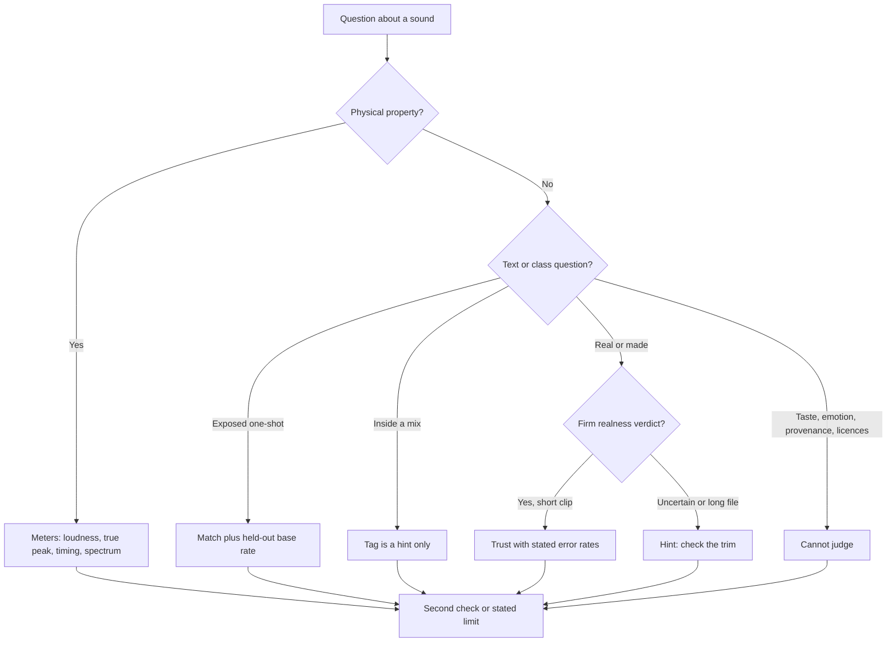
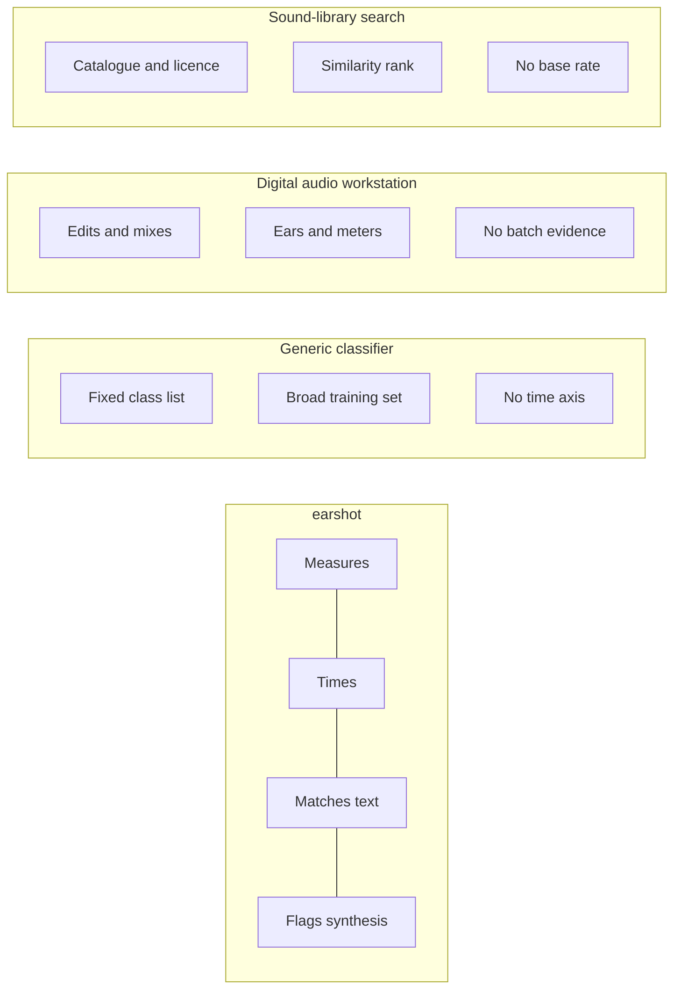

# earshot limits and comparison: what the evidence proves

This document records the edges. It states what a user may trust, what is only a hint and what earshot cannot judge.
It explains the model bands, the calibration caveats and the domain limits. It records the weak points that the forge
and fit documents admit. It compares earshot with three other ways to work with sound. It ends with what the release
gates do not prove. Every number is a project record. This exploration ran no command and heard no sound.

## The trust ladder

The `docs/LIMITS.md` page divides the output into three levels. The division is the most useful page in the repository,
because it stops a number from becoming an opinion.

| Level | Meaning | Examples |
|---|---|---|
| Trustworthy | A meter or a held-out result with a stated base rate | Loudness, true peak, timing, levels, spectrum, envelope, clipping, silence, strong match on an exposed sound, find, hard-hit sync |
| Hint only | A useful signal that needs a second check | Event tags in a mix, music genre and mood, realness "uncertain", launch ranges, cuts without a hit |
| Cannot judge | Outside the model or the method | Taste, emotion, hidden layers, provenance, content above 14 kilohertz, speech words, licences |

An exposed sound stands alone and is not buried in a mix. A hard hit is a loud transient with a fast attack. A hidden layer is a part of the mix masked by louder sounds.



### What is trustworthy

The meters are checkable. Loudness follows the International Telecommunication Union (ITU) BS.1770 standard, and true peak uses four times oversampling. Loudness range, band levels, envelope and clipping come from the signal.

A strong match on an exposed single sound is very reliable on held-out recordings. At a 3 percent base rate, the
strong band reached 0.98 precision for the right kind. A key press is a good test. A busy mix is not.

`rank` and `find` work on real recordings. The find record found 16 usable trims on 16 key presses, 9 of 10 on a
32-press board, and 8 of 8 in a 44-second scene. Every planted event in a 300-second scene was a tight trim.

Obvious code-synthesized sources are flagged with about 92 percent precision when the verdict is firm. The error rates
are 6.7 percent of real clips called synthesized and 5.5 percent of synthesized clips called real. With the beep family held out, accuracy was 0.71.

Sync of hard hits to cuts is reliable. The record reports a median offset of 0 milliseconds and 96 percent within one
frame. A soft swell is a different case. The same report gives a chance value, so a 60 percent hit rate means little
when chance is 50 percent.

```text
# earshot/timeline.py:40-47
  sync       each cut / cue -> the onset that answers it: offset_ms = sound - picture (negative = sound early);
             OK = within a frame (or 40 ms), near = within 100 ms, swell = a detected build-up peaks within 300 ms,
             peak = no onset, only a level peak within 150 ms (a soft whoosh / swell, or just the bed: check it),
             off / no sound = 'without a hit'. Build-ups are hard: on Clawd 2 sounded whooshes are still listed
             without a hit and 1 unsounded cue is answered by a level peak. 'chance' = what random edit times would
             score with this event density, so a 60% hit rate means little when chance is 50%. accent_* = the same
             for strong accents only (top 20% by prominence and >= 6 dB over the bed): the number to read for a
             dense mix, where some onset is always near.
```

### What is only a hint

An event tag inside a busy mix is a guess. The time and the level are right. The label is right about half the time
for an exposed event and a quarter of the time under music. Whooshes scored 56 percent and keyboard presses 58 to
82 percent. Grass footsteps under music scored 0 percent.

Music genre and mood are often wrong. On 45 upbeat library tracks, the top mood tag was a dark, sad or tense one for
18 percent. Instrument, rain, bird and voice tags are usually right. Genre, mood, instrument and voice are unvalidated.

An "uncertain" realness result on a designed library sound means "sounds designed". A magic chime, a celesta or a
motion whoosh can sit between real and synthesized. The launch scorecard ranges come from seven films that the author picked. They describe modern product launch films. A cinematic short or a quiet piano piece can break
rules that do not apply to it.

The "cuts without a hit" list is weak for soft build-ups. On the Clawd film, both cues that it named were sounded
whooshes. The list is a prompt to look at the sheet, not a finding.

The critique onset share counts only new attacks within 100 milliseconds. A whoosh that swells through a cut does not count. The fixes name only cuts with no sound at all.

A realness verdict depends on length. A sound up to 6 seconds uses the clip thresholds, with a low value of 0.17. A
longer file uses the mean of 4-second windows and the file thresholds, with a low value of 0.40. The file calibration
is weak, so judge the trim that you will use, not a multi-take file.

AudioSet labels on one-shots under about 0.5 seconds are often "unsure" or a near class. A zipper for a swish and
finger snapping for a click are common. Only an outright different class, such as speech, music or engine, is a red
flag.

### What earshot cannot judge

Taste and emotion are outside the tool. Earshot can say that a sound is a strong match for a deep thocky key press,
with a 3-millisecond attack and a landing 4 milliseconds after the cut. It cannot say that the film feels premium.

A code-made layer under a louder real mix is usually missed. The evidence path hears the dominant sound. Judge source
files and stems, not only the final mix.

Provenance is outside the model. Realness hears synthesis, not licences. A professionally made licensed synthetic
interface sound can read as code-synthesized. A code-made rain bed can read as real.

Speech content is outside the model, and so is a licence decision. Earshot detects a voice but does not transcribe
words, and it never decides whether a file may be used.

## Model bands and sample-rate ceilings

The two models have hard frequency limits.

The contrastive language-audio pretraining (CLAP) front end covers 50 hertz to 14 kilohertz at a 48-kilohertz sample
rate. The model is deaf to air above 14 kilohertz. The audio spectrogram transformer (AST) input is resampled to
16 kilohertz. By the sampling theorem its ceiling is 8 kilohertz.

```text
# earshot/models/clap.py:1-16
"""CLAP (contrastive language-audio pretraining) on CPU: one embedding space for sounds and text.

    from earshot.models import clap
    c = clap.get()
    a = c.embed_file('whoosh.wav')                 # (512,) unit vector, cached on disk
    t = c.embed_text(['a fast air whoosh'])        # (1, 512)
    cos = a @ t.T

Model: laion/larger_clap_general (Apache-2.0) by default, at a pinned revision with safetensors weights, loaded from
earshot's cache only (earshot.models.hub: fetched once when missing, never while an offline flag is set). Its mel
front end covers 50 Hz - 14 kHz at 48 kHz, so it is deaf to "air" above 14 kHz (use earshot.features for bandwidth /
lowpass checks). Inputs longer than 10 s are embedded as deterministic 10 s windows (hop 5 s) and averaged; the
model's own random crop is never used, so results are reproducible. Short sounds are repeat-padded to 10 s like in
CLAP's training (pad='repeatpad'); pad='zero' pads with silence instead (better for judging a single hit's character
in isolation).
"""
```

```text
# earshot/models/ast.py:1-12
"""AudioSet tagger (Audio Spectrogram Transformer) on CPU: 527 sound classes with independent probabilities.

    from earshot.models import ast
    t = ast.get()
    t.top_file('beep.wav', k=5)   # [('Beep, bleep', 0.71), ('Sine wave', 0.33), ...]

A second, independent "ear" next to CLAP: it was trained supervised on AudioSet, so its probabilities are calibrated
per class (CLAP's cosine scores are not). Useful classes for film sound: 'Synthesizer', 'Sine wave', 'Beep, bleep',
'Whoosh, swoosh, swish', 'Typing', 'Computer keyboard', 'Click', 'Boom', 'Music', 'Speech', 'Silence' ...
Input is resampled to 16 kHz (so it hears up to 8 kHz only) and read in 10.24 s windows; longer audio is split into
windows and the per-class maximum (or mean) is taken.
"""
```

The measurement path does not share that ceiling. The band table extends to 24 kilohertz, and the bandwidth measure is
the highest third-octave band within 60 decibels of the loudest band. That is the path for hiss, air and codec
cut-offs.

```text
# earshot/features.py:31-32
BANDS = {'sub': (20, 60), 'low': (60, 250), 'lowmid': (250, 1000), 'mid': (1000, 4000), 'presence': (4000, 8000),
         'air': (8000, 16000), 'top': (16000, 24000)}
```

The models also have time limits. CLAP reads 10-second windows with a 5-second hop, and AST reads 10.24-second
windows. A long file is split, and the per-class maximum or mean is taken.

A short one-shot is described well, and a long evolving texture can lose detail. The window is not a substitute for a timeline, which has a 5-millisecond detector.

## Calibration and base rates

The z score is a local scale. It says how far a description stands out among the 322 vocabulary descriptions for one
sound. It is not a probability. A user must combine it with a base rate. A base rate is the share of candidate pairs in a search that are true matches. A search over a large library has a low base rate. A forced choice between two files has a base rate of one half.

The held-out table gives that combination. At a 3 percent base rate, a strong match is the right kind of sound 98
percent of the time and the exact variant 61 percent of the time. At even odds the same match is right almost always.

**Aha:** The z score is a local scale. The same 3.1 is near certainty in a forced choice and a 0.98 chance at a 3
percent base rate. The base rate decides what the number means.

```text
# earshot/match.py:33-45
VERDICTS = [(3.0, 'strong'), (2.5, 'plausible'), (2.0, 'weak')]
# held-out library, shipped configuration (eval/semantics/heldout.json): 248 true / 7614 wrong pairs (lenient),
# 8222 wrong (strict); base rate 3.2%
VERDICT_EVIDENCE = {
    'strong': {'z': '>= 3', 'lr': 1289, 'precision_library': 0.98, 'precision_even_odds': 1.0,
               'lr_strict': 51, 'precision_library_strict': 0.61, 'recall_at_or_above': 0.51},
    'plausible': {'z': '2.5 - 3', 'lr': 21, 'precision_library': 0.41, 'precision_even_odds': 0.95,
                  'lr_strict': 9.1, 'precision_library_strict': 0.22, 'recall_at_or_above': 0.63},
    'weak': {'z': '2 - 2.5', 'lr': 12, 'precision_library': 0.28, 'precision_even_odds': 0.92,
             'lr_strict': 6.6, 'precision_library_strict': 0.17, 'recall_at_or_above': 0.76},
    'no match': {'z': '< 2', 'lr': 0.25, 'precision_library': 0.008, 'precision_even_odds': 0.2,
                 'lr_strict': 0.25, 'precision_library_strict': 0.008},
}
```

The strong band rests on a small count. The ratio of 1,289 to 1 rests on 126 true pairs and 3 wrong pairs, against 248 true pairs and 7,614 wrong pairs in the library. The ratio is (126 / 248) / (3 / 7,614). The 95 percent range for that wrong count is about 440 to 1 to 6,000 to 1. The tuning library gave 170 to
1. The text output quotes precision, not the ratio, for this reason.

The held-out library has an unresolved size. `docs/VALIDATION.md` says 125 files, while `docs/DESIGN.md` and `eval/README.md` say 126. This exploration names both values and chooses neither. The 126 true pairs in the table are a different quantity and are not evidence for either count.

The verdict thresholds were chosen on 219 labelled recordings by a fixed rule. The evidence table was measured on a
separate library that nothing was tuned on. That separation is good. The tuning library is still optimistic, because
67 of the 322 vocabulary terms were added after seeing its classes.

The realness thresholds have a weaker separation. The high and low values were chosen on the same held-out
predictions that report the 92 percent figure. The 92 percent is therefore in-sample for that choice. The error rates do not depend on the base rate, so they are the stronger numbers.

```text
# earshot/realness.py:198-200
def verdict_of(p, m, file=False):
    t = thresholds_of(m, file)
    return 'real or pro-produced' if p >= t['hi'] else 'likely code-synthesized' if p <= t['lo'] else 'uncertain'
```

The long-file calibration is weaker still. The file thresholds come from 23 synthesized long files. A long-file
verdict can be milder than a clip verdict on the same audio. The tool says so in its own output.

The launch ranges have a different problem. The leave-one-out result is 120 of 140 checks in range, 86 percent. The
no-overfit baseline is about 71 percent. The test was not blind, because some rules changed after the first run. The
number shows that the ranges are not pure noise. It does not show that a new film will score well.

## Domain shift

The models were evaluated on a narrow set. The validation record lists one sound library, one film project, seven
launch films and three synthesis code bases. The realness set has 1,484 clips from libraries and synth families. The
fit benchmark has 116 private clips in 24 categories.

These are not the whole world. Orchestral recording sessions, field recordings from other climates and other synth
engines are untested. A new domain can move the embedding distribution. 

The launch profile is a domain of its own. It describes modern product films. A trailer, a documentary or a game
cinematic can use a different mix balance and a different dynamic range.

The forge references are thin in several categories. Impact has 2 forge references and 1 bench reference. Riser has
1 and 2. Logo sting has no real stings. Downlifter, glitch and sub drop have no references and run in designed mode, where the critic reports realness but does not require it.
Most designed categories rest on 1 to 10 events, mostly from one film. A number from that set describes those few
sounds, not the category.

The fit benchmark has its own shift. The development split was used for tuning. The first held-out split was opened
by a check and then became a reference. A fresh held-out set was drawn and frozen. Both held-out sets are now open, and only 25 of the 28 fresh clips remain eligible under the fresh set's rule. The next held-out set needs more source material.

## Engineering limits

The first limit is the cold start. Every command line call is a fresh process. It loads the models in about 20 to 40
seconds on a busy laptop, even when the audio is cached. The MCP server or one Python script loads once. The difference
is large for an agent that makes many calls.

The second limit is precision. The default is 16-bit brain floating point (bf16), but it is used only on a central processing unit (CPU) with
native bf16 instructions. On
other CPUs earshot runs in 32-bit floating point. The record says bf16 emulation was 16 times slower. The precision is
reported by `doctor --load`, and the embedding cache is separate for each precision.

```text
# earshot/config.py:15-16
EARSHOT_PRECISION  bf16 (default; used only on CPUs with native bf16, AVX512-BF16 / AMX, else fp32: on the dev laptop
                 1.4x faster, embeddings within cosine 0.9993 of fp32, eval/semantics/precision.json) | fp32
```

The third limit is the cache. The decode key samples 16 blocks of 4 kilobytes. A render that changes only between
those blocks and keeps the old size and timestamp can read stale audio. Touch the file when in doubt. `timeline` also has `--fresh`, which recomputes that command.

The fourth limit is cut detection. It marks large visual changes. A blinking cursor counts as a cut. A slow crossfade
is missed. The cut list is evidence, not the final edit decision list.

The search also has caps. `find` keeps at most 48 events and 40 windows, treats a candidate as at most 2 seconds long,
and uses one stage for a file up to 60 seconds.

```text
# earshot/search.py:51-69
FRAME = 0.005
PRE_ROLL = 0.005
MARGIN = 0.1
CAP_S = 2.0
MERGE_GAP = 0.25
DECAY_DB = 35.0
MAX_EVENTS = 48
MAX_WINDOWS = 40
MAX_WIN_S = 10.0
SINGLE_STAGE_S = 60.0
TOP_WINDOWS = 6
BUCKET_S = 2.0
REFINE_DZ = 0.5
WEAK_DB = 15.0
CUT_DB = -15.0
TAIL_PENALTY = 0.5
EDIT_DB, EDIT_S = -100.0, 0.01   # an edit gap: >= 10 ms at or below -100 dBFS (exact digital silence between takes)
SNAP_S = 1.0                     # how far a window edge may move to reach the sound's start / decay
QUIET_DB = 40.0                  # 'quiet' = 40 dB under the window's peak (or 6 dB over the floor, if higher)
```

The fifth limit is scope. Earshot never uses a graphics processing unit (GPU). It does not mix, edit or master. It
does not host plugins. It does not write a delivery file with a broadcast standard. It measures and reports.

The sixth limit is the optional language model critique. It needs a key and explicit consent, because the audio
leaves the machine. The record says it was never called live. It is an opinion, not a measurement.

```text
# earshot/llm.py:24-27
Trust: an opinion from a general model, not a measurement, and not deterministic. Gemini hears a reduced copy (its docs:
downsampled to 16 kbps, one channel), so fine top-end detail and stereo are beyond it. Timestamps are approximate (a
few seconds off is common); loudness numbers in the answer come from earshot's own measurements, passed in as context.
Verify every suggested fix with earshot timeline / ab before and after.
```

## Forge weaknesses

The forge has a Goodhart problem. A Goodhart problem is the failure where a measure becomes the target, so optimising the measure stops improving the thing it measures. The critic is a set of models and meters. A search can please them without making a
better sound. The project states this in its own forge documentation.

The evidence is direct. Version 1 of the forge sat above real recordings on CLAP typicality and phrasings. The models were pleased. An independent judge still found the key press 8 to 13 decibels away from the real tonal balance. Version 2
added model-free penalties and a pre-screen, and the model checks fell on purpose.

```text
# earshot/forge/critic.py:92-97
W2 = {'match': 1.0, 'real': 2.0, 'typ': 0.5, 'feat': 0.7, 'alt': 1.0, 'tone': 1.0, 'env': 1.0, 'art': 1.0,
      'polish': 0.75}
DESIGNED_WORDS = ('glitch', 'stutter', 'sub drop', 'sub-drop', 'subdrop', 'blip', 'beep', 'bleep', 'synth', 'riser',
                  'downlifter', 'uplifter', 'stinger', 'logo sting', 'braam', 'laser', 'zap', 'notification', 'shimmer',
                  'bitcrush', 'digital')
ENV_PASS, POLISH_PASS, TONE_PASS = 1.5, 1.5, 1.25
```

The models and the measurements still disagree. AST hears "Door" or "Knock" in a fast whoosh whose balance, tail and
envelope sit inside the real limits. CLAP checks fell in two categories after fixes that the model-free checks liked.
The project's trust order is a choice: model-free checks first, models as held-out hints.

The critic pass counts mean little across rounds. The counts were 58 of 183, 55 of 183 and 60 of 168 while the critic
changed. A pass rate from one round is not comparable with another round.

The held-out discipline was good but not perfect. Each area ran the benchmark once at the end, but the user-interface area ran it four times in one round, and another area ran it twice later. The seed banks still hold version 1 finals that
were partly tuned against references that are now bench references. The project calls that a soft leak.

Reproducibility improved over time. At one point 31 of 34 categories re-rendered from their report. Round 6 added one
report schema, and all 34 categories and 183 picks now re-render within 1.19e-7. Older reports still show schema
history.

The blind test is the missing gate. The version 1 test had 8 of 15 correct with one listener. The version 2 test kit
was built, with 20 trials and a chance value of 10. No version 2 score is published. Until that test is run, the forge
has measurements and no listening proof.

The code shape is a maintenance limit. Family preset names differ across recipes, and some modules carry several
rounds of history. The project recommends a consolidation pass before this becomes a public interface.

## Fit weaknesses

Fit is close, not identical. The CLAP target of about 0.95 is reached on 4 of 12 validation clips. The mel distance
stays 0.1 to 2.9 decibels above each model's own floor on 11 of 12. The worst pop is 6.1 decibels against a 3.2
decibel floor.

Onsets are noisy. Even with the attack match, the measured onset sharpness differs by 0.6 to 1.5 octaves on 6 of 12.
Different seeds of one model ranged from 23 to 140 decibels per millisecond on a key. The noise sets the crossings on
0.125-millisecond frames.

Noise models fill spectral valleys. A noise band is flat within its band. The thock key's tone sits at 4.4 decibels
even after equalisation. The modal key fits have high floors at 2.5 to 3.3 decibels.

A fast whoosh can be fitted as modes or partials. That model is a sinusoidal decomposition of noise, with about 600
modes and a 274-kilobyte recipe. Its knobs may sound metallic. The spectral fitter is the generative choice, but it
lost on two references.

Morphs have structural limits. Strikes pair by index, so a two-strike key and a four-strike key pair crudely. Partials
more than an octave apart do not pair and fade instead of gliding. Pole copies that stop a ring in a later strike stop
cancelling once morphed.

The post stage pins the attack to the original contour. The hardness knob changes the attack colour, not its envelope.
The equalisation is static under pitch knobs.

Choosing between fits is a limit of its own. The quality weights were set on the same 12 references used to check them.
The engine was tuned on the development split and checked once on each held-out set. A candidate 0.02 to 0.03 higher
on seed 0 can still lose if the confirm seeds do not agree.

The bed check decides by score alone. On the fresh held-out set it dropped a bed whose plain fit had 0.087 less CLAP.
A plain fit of a bedded clip keeps the bed in its sound, which costs its takes.

The takes are the weak part. On the fresh held-out set, takes passing fell from 12 to 7. The onset error grew from
0.53 to 1.00 octave. A loud grain can remain inside an air-only key attack. The loudness spread and the comb ring
borderlines need their own round.

Speed is moderate. A default fit takes 10 to 100 seconds for short sounds and minutes for long impacts.  The search is not real time.

## The four tools at a glance



## Comparison with a generic audio classifier

A generic audio classifier answers one question: which class is this? A supervised tagger such as AST returns a
probability for each class in its training taxonomy. That is useful. It is also a different product.

Earshot adds four things that a generic classifier does not have:

1. A free-text vocabulary. The user writes a description, and the calibrated z score places it against 322 alternatives
   for the same sound.
2. A stated base rate. The held-out table gives precision at a library base rate and at even odds.
3. A time axis. `find` returns a sample trim. `timeline` returns events, sections, loudness and sync offsets.
4. A model-free path. The meters stand beside the models and catch a result that has left the model's domain.

A generic classifier also has advantages. It has a broad taxonomy, often 527 classes or more.  It can name a class that earshot's vocabulary lacks. It may be the better tool for a question such as "is this
speech or music".

The trade is control and evidence. A classifier label is hard to calibrate against a user's own library. Earshot's
vocabulary is small, but its calibration is measured on a held-out set, and the two tools should not be swapped
without a test.

## Comparison with a digital audio workstation

A digital audio workstation (DAW) is an editor. It shows waveforms, spectra and meters. A skilled person can hear the result and make a judgement.

Earshot does not edit. It has no timeline editor, no fader, no plugin host and no undo. It cannot replace a DAW for
making a soundtrack. It also cannot replace the ears of the person at the DAW.

Earshot does two things that a DAW does not do well. It measures the same property across many files and returns
machine-readable evidence. It places a sound against a picture cut and reports an offset in milliseconds. A DAW can
show both, but a person must drive it and read it.

The meters are not identical. A DAW may use a different loudness implementation, a different true-peak oversampling
factor or a different gate. Earshot follows BS.1770 and reports its method. A delivery decision should still use the
mastering meter that the delivery spec names.

A DAW also hears the whole result. Earshot judges files and stems. A mix decision that depends on the interaction of
music, dialogue and effects is outside its evidence. 

## Comparison with a sound-library search

A sound-library search finds a file in a catalogue. It uses metadata, tags, curated categories and audio similarity.
It knows the licence of each item. It is the right tool for "find me a whoosh in this library".

Earshot does not search a catalogue. `rank` orders files that the user already has. `find` searches inside one
recording for a moment. `match` tests one description against one sound or a set of sounds. The vocabulary is small
and fixed, and it is not a library taxonomy.

Earshot has one advantage over a library search. It calibrates the text-to-sound comparison against its own vocabulary
and reports a base rate. A library search usually returns a similarity rank without a calibrated probability. The rank
can be useful and still be hard to compare across queries.

Earshot has one large disadvantage. It does not know licences, attribution or catalogue coverage. A strong match says
nothing about whether the file may be used. The real-sound skill checks a manifest, but the licence itself must be read
on the item's page.

The two tools compose. Search a library, then use earshot to check the candidate. The library supplies the catalogue and the licence. Earshot supplies the evidence.

## What the gates do not prove

The fast suite passed at release. That proves the code paths run, the reports re-render and the errors are readable. It does
not prove that a verdict is right.

The evaluation numbers are records from a development laptop with a stated thread count. This exploration did not
rerun them, and the evaluation data is absent from the repository.

The launch scorecard is not blind. Some rules changed after the first leave-one-out run. The score measures the
consistency of the reference set, not the quality of a new film.

The forge has no published version 2 blind test. The fit has a separate mini blind test with one listener and 12 trials, and the listener
could not tell the recordings from the renders. That is a small test.

The optional language model critique was never called live. Its paths were tested against a fake interface. A live
call can behave differently.

The domain is narrow. One library, one film project, seven launch films and three synthesis code bases do not cover
orchestral sessions, field recordings or every synth engine.

The interface count is inconsistent. The validation record says 13 Model Context Protocol (MCP) tools. The pin
registers 16: the same 13 plus `sfx_list`, `sfx_render` and `kit_render`. The code count is 16, and the record is
stale.

The held-out library count is inconsistent in the same way. It is 125 files in some documents and 126 in others. This
exploration names both.

The ownership and build process is also a record. `docs/DESIGN.md` describes a multi-agent build process. This
exploration read the result and did not verify the process.

## How to use the evidence

Use the meter when the question is physical. Use a strong match when the sound is exposed and the base rate is known.
Use `find` and `timeline` when the question is about time. Treat a tag in a mix, a mood, a launch range and an
uncertain realness result as a hint. Do not ask earshot for taste, provenance or a licence decision.

The safest pattern is to check the same claim two ways. A strong match plus a measurement is stronger than a strong
match alone.

Read [00-overview.md](00-overview.md) for the system in one pass. Read [01-architecture.md](01-architecture.md) for
the module layout. Read [02-core-mechanism.md](02-core-mechanism.md) for the formulas. Read
[03-workflow-and-quality.md](03-workflow-and-quality.md) for the commands and tests. Read [README.md](README.md) for
the map and the non-claims.
