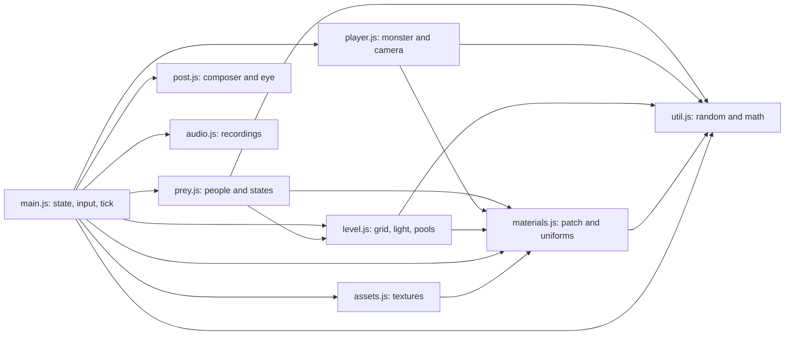
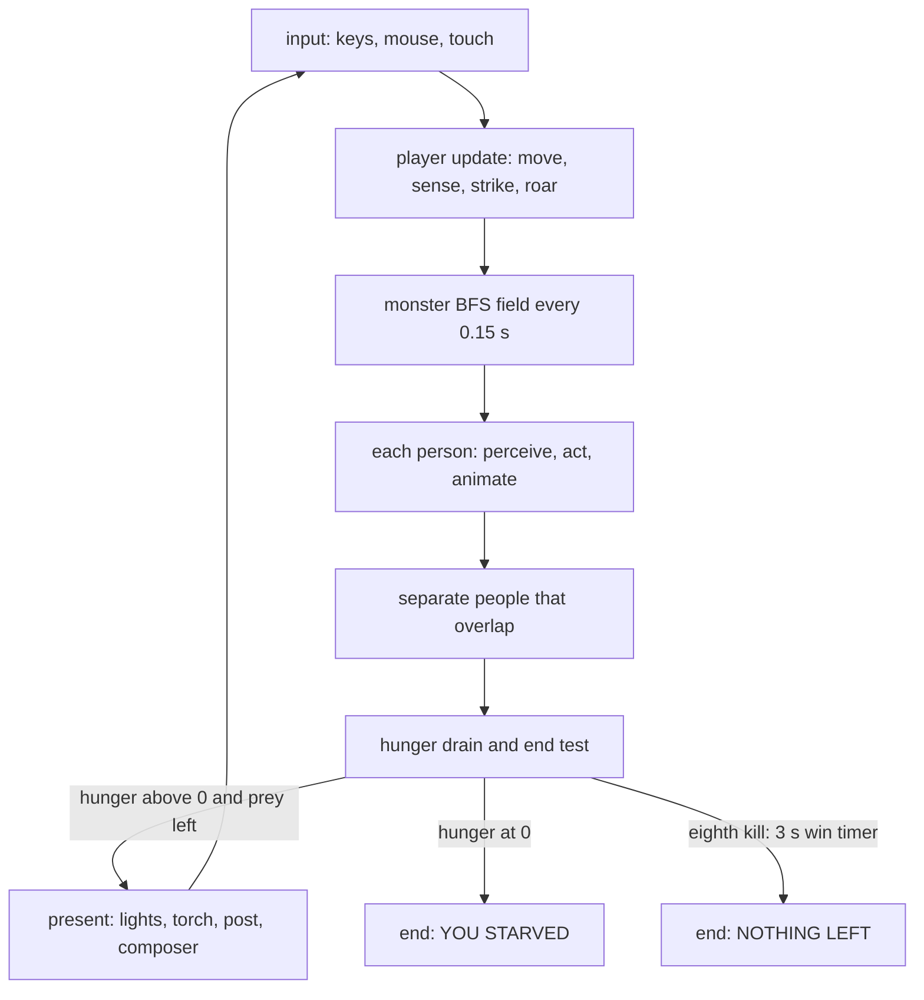

# 00 Overview: the fiction, the play loop and one frame

FEED is a first-person horror game. The player is the monster. Eight people enter a Backrooms
building with torches. The player must catch all eight before hunger reaches zero. That sentence
is the whole game. The rest of the code serves it. This document gives the fiction, the controls,
the play loop, the building, the eight people, the three senses and one frame at a high level. It
does not explain the level generator or the shader. Document [02](02-core-mechanism.md) does that.

The [README](README.md) gives the package map. This document assumes no code knowledge. It gives
the terms that the later documents use. Document [01](01-architecture.md) gives the module graph.
Document [02](02-core-mechanism.md) gives the mechanism. Both assume the terms in this file.

## Terms

| Term | Meaning |
|---|---|
| Backrooms | the shared fictional maze of yellow office rooms |
| monster | the player, a tall creature with antlers and clawed arms |
| prey, person | one of the eight people in the building |
| hunger | the player resource from 0.8 to 0; zero ends the run |
| stamina | the player resource that limits running |
| fear | a person value from 0 to 1; it drives the face and the tremor |
| cell | one level square of 2 metres |
| macro cell | a block of 4 by 4 cells |
| macro graph | the 12 by 12 grid of macro cells |
| union-find | a structure that tracks separate groups and merges them |
| fixture | one ceiling light panel |
| light grid | the baked light table, two texels per cell |
| texel | one pixel of the light grid, one metre across |
| sense, smelling | the player mode that reveals heat through walls |
| sense value | a smoothed number from 0 to 1 that rises while the player smells |
| roar | the player action that freezes nearby people |
| shader | a small program that runs on the graphics processing unit |
| panic | the alert that a scream sends to other people within 15 metres |
| state machine | the named states and the rules that move a person between them |
| BFS | breadth-first search; a grid distance field in cell steps |
| LOS | line of sight; a grid traversal that stops at walls |
| HUD | heads-up display; the hunger bar, stamina bar, tally and message |
| FOV | field of view; the camera angle in degrees |
| PBR | physically based rendering; the texture and material model |
| URL | uniform resource locator; the page address |

## The fiction and the inversion

The fiction is simple. People fall out of the normal world into the Backrooms. They carry torches
and they do not know the building. The player was already there. The player is hungry. The project
README calls the player "the thing in the rooms". The title screen says "they wandered in. you
were already here." The source states the same inversion in the game state. The player object has
hunger, not health. The people have fear, not weapons.

The inversion is not a skin over a normal horror game. It changes the information flow. A normal
horror game hides the monster and shows the player's fear. FEED shows the monster and shows the
people's fear. The people's faces, screams and panic are the player's feedback. A normal horror
game gives the monster the initiative. FEED gives the people a state machine that wanders, sees,
startles, flees, freezes and cowers. The player reads that machine and uses it.

The inversion also changes the failure condition. No person can kill the player. The source has no
person attack and no player health. The run ends when hunger reaches zero or when all eight people
fall. The game is therefore a hunt against a clock, not a fight against an enemy. The eight people
are the clock. Each kill adds 0.36 hunger, so a good player can extend the run. A slow player
starves.

## The controls

The game supports a desktop with keyboard and mouse, and a phone or tablet held sideways. The
source detects touch with three checks. The first check is a query flag. The second check is a
media query. A media query is a Cascading Style Sheets condition on device properties. The query
matches a device with no hover and a coarse pointer, which is a touch input with low precision.
The third check needs both a touch point count above zero and a mobile user agent. The `?touch=1` query parameter forces the touch
path. The desktop controls use the keyboard
and the mouse. The four movement keys W, A, S and D move the monster. The shift keys run. The left
mouse button strikes. The right mouse button or the E key smells. The R key or the space bar roars.
The 1 and 2 keys change the internal render resolution.

The key handler sets a queue for the roar. The mouse handler sets a flag for the attack. The update
step reads the current key state and clears the queue after one tick.

```text
# src/main.js:444-455
addEventListener('keydown', (e) => {
  if (e.repeat) return;
  keys[e.code] = true;
  if (G.state === 'playing' && (e.code === 'KeyR' || e.code === 'Space')) roarQ = true;
  if (e.code === 'Digit1' || e.code === 'Digit2') {
    userBoost = clamp(userBoost * (e.code === 'Digit2' ? 1.35 : 1 / 1.35), 0.3, 4);
    autoScale = false; scaleDown = 1;
    resize();
    say(`${canvas.width} × ${canvas.height}`, 1.4);
  }
  if (['Space', 'ArrowUp', 'ArrowDown', 'ArrowLeft', 'ArrowRight', 'Tab'].includes(e.code)) e.preventDefault();
});
```

In that handler, `userBoost` is the manual resolution multiplier, `autoScale` says whether
automatic lowering is allowed, and `scaleDown` is the current automatic factor (`src/main.js:51`).
`say` is the message helper (`:80-86`).

The update step builds the input object from the key map, the mouse flag and the touch state. The
player object never reads the keyboard. It receives one input object. This split lets the trailer
recorder write the same key state.

```text
# src/main.js:585-590
  inp.fwd = (keys.KeyW || keys.ArrowUp ? 1 : 0) - (keys.KeyS || keys.ArrowDown ? 1 : 0) + touch.fwd;
  inp.strafe = (keys.KeyD || keys.ArrowRight ? 1 : 0) - (keys.KeyA || keys.ArrowLeft ? 1 : 0) + touch.strafe;
  inp.sprint = !!(keys.ShiftLeft || keys.ShiftRight) || touch.sprint;
  inp.sense = rmb || !!keys.KeyE || touch.sense;
  inp.attack = attackQ; inp.roar = roarQ;
  attackQ = roarQ = false;
```

The phone path uses a thumb stick on the left and a look area on the right. A quick tap on the
right thumb is a strike. Three buttons cover strike, roar and hold-to-smell. The touch layout is
in `index.html` and the handlers are in `src/main.js:488-558`. The phone path also hides the HUD
differences behind a body class named `touch`.

## Starting, pausing and ending a run

The page opens on a loading state. The audio loader reports a fraction, and the title button text
counts up as "waking" plus one to five dots. When the loader finishes, the game state becomes
`title`. The button then says "click to wake" on a desktop or "tap to wake" on a phone. The title
screen holds the name FEED, the line "they wandered in. you were already here.", the controls and
the wake button.

A click or tap on the title calls `startGame`. That function resumes the audio context. This is
necessary because a browser can block sound until a user gesture. The function starts four sound
loops, with volume 0.42 for the room hum, 0.2 for a low drone, 0.22 for the monster breath and
zero for the heartbeat. It plays one whisper. It sets `G.state = 'playing'` (`src/main.js:390`)
before it hides the title, shows the heads-up display (HUD), and asks for pointer lock on a
desktop. On a phone it goes fullscreen and shows the touch controls.

Two messages follow. The first says "you can smell them." after 0.9 seconds. The second says "find
them before the hunger finds you." after 4.6 seconds. Both messages check that the game is still
playing, so a fast pause does not leave a late message on a paused screen.

A lost pointer lock pauses the game. The pause screen waits for a click. The click returns the
state to `playing` and asks for pointer lock again. The browser may refuse the second request
without a fresh gesture, so the pause screen is also the gesture.

The run ends by starvation or by the win timer that follows the eighth kill. The end function sets
the state to `ended`,
releases pointer lock, hides the HUD and the touch layer, and stops the breath and heart loops. A
loss plays a stinger, a sound that also marks a spotted person or a kill. A win gives "NOTHING
LEFT", and starvation gives "YOU STARVED" (`src/main.js:429-432`). A win subtitle gives the
total and the elapsed time in minutes and seconds. A loss subtitle gives the kill count and the
total. A click on the end screen reloads the page, so
a new run gets a new seed unless the uniform resource locator (URL) holds a fixed seed.

## The HUD and the messages

The HUD has four parts. The hunger bar is a horizontal fill from 0 to 1. The stamina bar is a
second fill, and it hides while stamina is at or above 0.995. The tally is a row of eight vertical
strokes; each kill draws a strike through one stroke. The message line holds one short sentence
and fades after a set time.

The message line is the game's only text feedback during play. A kill picks one of five short
lines, such as "warm." or "one left.". The game shows a spotted message at most once every 20
seconds. The message is one of three short lines, and "it saw you." is one of them. The
starvation warning says "you are starving." once below 0.25 and resets above 0.45. The title
and end screens hold the longer text, so the play area stays clean.

The bars are written every update from the live values. The hunger bar uses the clamped hunger.
The stamina bar uses the player stamina. The code does not animate the bars with a separate
tween. The fill follows the value at the frame rate.

The tally is the only progress counter. The player does not see a compass, a map or a distance to
the nearest person. The player must build that picture from the senses. This choice supports the
fiction, because a monster does not need a map of its own building. It also makes the eight
strokes a clear clock: each stroke is one less person and one more meal.

## The sound stage

The audio system holds a manifest of 15 sound keys (`public/assets/sfx/manifest.json`). The sound
folder holds 38 recordings, and some keys have more than one recording. The sound system picks one recording for a key when it plays
the sound. The choice uses `Math.random`, so a repeated call can pick a different take. The sound
calls fall into three groups: non-positional effects, positional effects and loops.

The non-positional group covers the monster's own body and the interface. The monster step plays
at 0.42 volume when walking and 0.7 when running. The growl plays at the start of a strike. The
roar plays at full volume. Gore and the stinger mark a kill. The whisper plays at the start of a
run.

The positional group places a sound in the three-dimensional scene. The reference distance is the
distance at which the sound has its stated volume. Each person voice uses a reference distance of
5 metres. A step uses 3 metres. A death uses 6 metres. When the person has no line of sight (LOS)
to the monster, the voice volume drops to 0.55 of its normal value. The step volume drops to 0.25,
which is half of its normal 0.5. The distance and the occlusion (blocking by a wall) together tell
the player where a sound comes from without a visual marker.

The loop group follows the player state. The heartbeat volume rises with the nearest person and
with the smell mode, and its playback rate rises with the nearest fear (`src/main.js:635-639`). The breath volume rises while
running and while stamina is low. Its playback rate also rises as stamina falls. A flicker sound
plays near a working panel that flickers, at a random interval from 2.5 to 7.5 seconds. The game
finds the nearest such panel within 16 metres.

The sound stage is not a separate simulation. A scream plays a voice through one callback, and the
same state update can call a second callback that spreads the alert. A step sound is only an audio
call. The people do not hear the audio event. Their hearing test reads the monster distance and the
sprint state. In a flee, the player hears the scream and nearby people receive the panic from the
same event.

## The monster's body and camera

The player is taller than the people. The eye height is 2.14 metres. The camera carries a set of
first-person arms with clawed fingers. The body is invisible to the camera but casts a shadow. The
silhouette includes antlers, arms and legs. Only the shadow appears on the wall, so the player sees
the monster's shape without seeing its body.

```text
# src/player.js:26-28
const EYE = 2.14; // it is taller than they are
const ease = (x) => x * x * (3 - 2 * x);
const IVORY = new THREE.Color(0xcfc3a4), GORE = new THREE.Color(0x6a0404);
```

`ease` is the smoothstep used by the claw keyframes (`src/player.js:27`). IVORY and GORE are the
clean and bloody claw colours used by `setBlood` (`:28`, `:166-169`).

The movement is smooth. The velocity is damped toward the target speed. The helper
`damp(a, b, lambda, dt)` returns `a + (b - a) * (1 - exp(-lambda * dt))` (`src/util.js:14`).
Lambda is a rate in reciprocal seconds, so a larger value is faster. The circle push-out
collision keeps the player out of walls. Running costs stamina. Smelling slows the player and
prevents a strike. The exhausted flag starts at zero stamina and clears only at 0.3 stamina, so a
player cannot run again immediately.

```text
# src/player.js:199-221
    const sensing = inp.sense && this.attackT < 0;
    this.sense = damp(this.sense, sensing ? 1 : 0, 7, dt);

    let f = inp.fwd, s = inp.strafe;
    const len = Math.hypot(f, s);
    if (len > 1) { f /= len; s /= len; }
    this.moving = len > 0.1;
    if (this.stamina <= 0) this.exhausted = true;
    if (this.stamina > 0.3) this.exhausted = false;
    this.sprinting = inp.sprint && this.moving && inp.fwd > 0 && !sensing && !this.exhausted;
    this.stamina = clamp(this.stamina + dt * (this.sprinting ? -0.16 : 0.12), 0, 1);

    let speed = this.sprinting ? 7.2 : 3.5;
    if (sensing) speed *= 0.42;
    const sn = Math.sin(this.yaw), cs = Math.cos(this.yaw);
    const wx = (-sn * f + cs * s) * speed, wz = (-cs * f - sn * s) * speed;
    this.vx = damp(this.vx, wx, 9, dt);
    this.vz = damp(this.vz, wz, 9, dt);
    this.lungeV = damp(this.lungeV, 0, 7, dt);
    this.pos.x += (this.vx - sn * this.lungeV) * dt;
    this.pos.z += (this.vz - cs * this.lungeV) * dt;
    g.level.resolveCircle(this.pos, 0.42);
    this.speed = Math.hypot(this.vx, this.vz);
```

The attack has a wind-up, a hit point and a recovery. The hit check runs once, at 0.42 of the
animation. The cooldown is 0.72 seconds (`src/player.js:235`). The attack timer rises by
`dt / 0.5`, so one swing lasts 0.5 seconds, and the hit at 0.42 lands 0.21 seconds after the
start (`:239-240`). The lunge starts at 8 metres per second and decays. The roar sets an 11 second
cooldown and calls the game callback.

```text
# src/player.js:234-245
    if (inp.attack && this.attackCd <= 0 && !sensing) {
      this.attackT = 0; this.attackCd = 0.72; this.hitDone = false; this.lungeV = 8;
      g.onAttackStart();
    }
    if (this.attackT >= 0) {
      this.attackT += dt / 0.5;
      if (!this.hitDone && this.attackT > 0.42) { this.hitDone = true; g.tryKill(); }
      if (this.attackT >= 1) this.attackT = -1;
    }
    // roar
    this.roarCd -= dt; this.roarT += dt;
    if (inp.roar && this.roarCd <= 0) { this.roarCd = 11; this.roarT = 0; g.onRoar(); }
```

The camera field of view (FOV) starts at 80 degrees. It rises by 13 degrees while running, falls by
12 while smelling, rises by 6 during an attack and rises by 8 for 0.8 seconds after a roar
(`src/player.js:264`). Trauma is the accumulated shake amount. It decays at 1.5 per second
(`:248-249`), and the camera offset scales with its square (`:249-262`).

## The kill test and the hunger clock

A strike does not kill the nearest person without checks. The game starts with the nearest live
person within 2.9 metres. It rejects a person beyond 0.9 metres whose direction is more than
about 66 degrees from the forward direction. It rejects a person without a grid line of sight
(LOS). The nearest person that passes all checks dies.

```text
# src/main.js:258-271
G.tryKill = () => {
  const fx = -Math.sin(player.yaw), fz = -Math.cos(player.yaw);
  let best = null, bd = 2.9;
  for (const p of G.prey) {
    if (!p.alive) continue;
    const dx = p.pos.x - player.pos.x, dz = p.pos.z - player.pos.z, d = Math.hypot(dx, dz);
    if (d > bd) continue;
    if (d > 0.9 && (dx * fx + dz * fz) / d < 0.4) continue;
    if (!level.los(player.pos.x, player.pos.z, p.pos.x, p.pos.z)) continue;
    best = p; bd = d;
  }
  if (!best) return;
  kill(best, fx, fz);
};
```

The kill callback does more than the snippet shows (`src/main.js:275-304`). It marks the person
dead, adds one kill and adds 0.36 to hunger, capped at 1. It sets a 0.13 second hit stop
(`:279`), which scales the simulation step to 5 percent (`:683`). It sets the blood screen value
and the camera kick. It plays sounds, spawns blood and a decal, draws the tally, alerts live people
within 18 metres who are still wandering, and writes a message. At the eighth
kill it sets the 3 second win timer.

```text
# src/main.js:275-278
function kill(p, fx, fz) {
  p.die();
  G.kills++;
  G.hunger = Math.min(1, G.hunger + 0.36);
```

Hunger falls every tick while the win timer is negative. The warning appears below 0.25 and resets
above 0.45. Zero hunger ends the run as a loss. A positive win timer counts down after the eighth
kill and ends the run as a win.

```text
# src/main.js:624-629
  // hunger
  if (G.winT < 0) G.hunger -= dt / 150;
  if (G.hunger < 0.25 && !G.warned) { G.warned = true; say('you are starving.', 3.5); }
  if (G.hunger > 0.45) G.warned = false;
  if (G.hunger <= 0) return endGame(false);
  if (G.winT > 0) { G.winT -= dt; if (G.winT <= 0) return endGame(true); }
```

The numbers give a 120 second base run. Hunger starts at 0.8, and the drain is 1/150 per second.
A player who catches nobody starves at 120 seconds. The eight kills would add 2.88 in total, but
the cap holds the stored value at 1. The win timer is the real end. The source sets the win
timer to 3 seconds at the eighth kill, so the win screen appears 3 seconds after the last kill.

## The building

The building is one square of 98 metres. The level grid has 49 cells each side, and each cell is 2
metres. The 49 value is 12 macro cells times 4 cells, plus one closing row and column. A 12 by 12
macro graph sets the room partitions. Each interior partition is open, a solid wall, or a wall with
a doorway. A union-find pass tracks groups of macro cells. It reopens one closed wall for each
merge that joins two separate groups, so every macro region is reachable. A sealed pair is two
neighbouring macro cells whose shared edge is closed and whose groups differ. The generator is the
subject of [02](02-core-mechanism.md). This document gives only the shape and the player
experience.

The player moves through yellow corridors, open rooms and free-standing concrete pillars. A
baseboard trim runs along every wall. A floor plane and a ceiling plane close the box. Ceiling
panels give the only steady light. Some panels are dead. Some panels flicker. A fine scrawl on the
wall carries short messages such as "NO EXIT", "DON'T RUN" and "IT WAS HERE FIRST". The source
generates at most 46 scrawls, with the cap `Math.min(46, wallFaces.length)`, and places dried blood
decals on the carpet.

## The eight people

The game creates eight people at load. It collects the macro cell centres that are more than 22
metres from the player start, shuffles them, and places the eight people on the first eight
centres. Each person gets a small random offset. The same seed gives the same placement.

```text
# src/main.js:332-342
  // prey: scattered, never right on top of the monster
  const spots = [];
  for (let mz = 0; mz < level.M; mz++) for (let mx = 0; mx < level.M; mx++) {
    const c = level.macroCenter(mx, mz);
    if (Math.hypot(c.x - start.x, c.z - start.z) > 22) spots.push(c);
  }
  for (let i = spots.length - 1; i > 0; i--) { const j = Math.floor(rng() * (i + 1)); [spots[i], spots[j]] = [spots[j], spots[i]]; }
  for (let i = 0; i < TOTAL_PREY; i++) {
    const c = spots[i];
    G.prey.push(new Prey(G, c.x + (rng() - 0.5) * 2, c.z + (rng() - 0.5) * 2, rng, i));
  }
```

Each person is a group of low-poly primitives. The parts are a five-sided limb cylinder, a
six-sided torso, an icosahedron head (a 20-sided solid), a one-metre box, an eight-sided tube and
an open cone. The cone is the torch beam. The person has skin, shirt, pants, hair and shoe colours.
Most people carry a torch. A person has a working torch when `flashOn` is true, which is set with
75 percent chance at load (`src/prey.js:118`). Every person has eyes, pupils, brows and a mouth that move with fear.
Each person also has a thermal ghost copy (a body copy for the smell mode), a beating heart and a
body-heat halo.

The fear face is a small set of scale and rotation changes. The eyes grow to 1.75 times their base
size. The pupils shrink to 0.6 of their base size. The brows tilt by 0.55 radians, and they rise a
little. The mouth opens in a shape that also pulses when fear is above 0.6 (`src/prey.js:553-564`).
These changes cost no
new geometry, because they move parts that already exist. The player reads fear from a distance
without a bar or a label.

The body language uses the same fear value. The torso, arms and head receive a small sine tremor
whose amplitude is the fear value, multiplied by 2.2 in the cower and frozen states
(`src/prey.js:542`). The torso
leans back in a cornered flee and the hands come out. The walk cycle bends the knees and swings
the arms. A dead person changes to a fall pose and holds it.

A person has seven states. The states are wander, alert, startle, flee, frozen, cower and dead.
Perception runs every 0.1 seconds. The brain runs every frame. The animation runs every frame. A
dead person plays a fall animation for 3 seconds.

The visible torch cone is a mesh, not a texture (`src/prey.js:25-45`). Most people carry it in the
right hand. The real light comes from a small shared pool of spotlights that follows the nearest
working torches (`src/main.js:562-580`). The shader therefore sees a fixed light count at all
times. A torch beam is also a long visible signal in a dark corridor. The
player can see the beam before the person, and the person can see the monster if the beam falls on
it. The same object serves as a person tool, a player cue and a level light.

## The three senses

The monster has three ways to find a person. Sight is the normal view. Smell is a temporary mode.
Hearing is the sound mix plus a short-range test on each person. Each sense gives different
information. Only smell costs something.

Sight is free. The player sees the lit world through the camera. The player does not get a
monster-only outline or a minimap. A person in the dark is hard to see against the yellow wall.
The player can find a person by watching a torch beam or by hearing a step.

Smell costs speed. It multiplies the move speed by 0.42 and prevents a strike. It also hides the
normal world. The world dims, the panel colour drops and the full-screen post-process drains colour
to cold grey-blue. Hot things keep their colour: body heat, scent trails, hearts and halos. These
items draw with depth testing off. The depth test normally hides a pixel behind a nearer surface.
With the test off, a wall does not hide them.

```text
# src/main.js:690-696
  // smelling: the lit world sinks into cold dark so only body heat is left glowing
  const dim = 1 - 0.86 * player.sense;
  G.dim = dim;
  shared.uGridIntensity.value = dim;
  shared.uNightVision.value = 0.55 + player.sense * 0.75;
  shared.uNVColor.value.copy(NV_WARM).lerp(NV_COLD, player.sense);
  level.panels.material.color.setScalar(dim);
```

Here `shared` is the one uniform object that every patched material references
(`src/materials.js:5-12`). `uGridIntensity` scales the baked light, `uNightVision` scales the
distance lamp, and `uNVColor` is that lamp's colour. `NV_WARM` and `NV_COLD` are its two ends
(`src/main.js:653`).

The post shader does the colour drain. It measures the red-minus-blue difference. A hot pixel
keeps its colour. A cold pixel goes to a blue-grey luminance.

```text
# src/post.js:46-54
      float l = dot( col, vec3( 0.299, 0.587, 0.114 ) );
      // smelling: the room drains to cold grey-blue, anything hot (body heat, scent) keeps its colour
      float hot = smoothstep( 0.04, 0.22, col.r - col.b );
      vec3 sc = vec3( l ) * vec3( 0.62, 0.74, 1.0 );
      col = mix( col, sc, uSense * ( 1.0 - hot ) );

      float v = smoothstep( 0.1, 0.6, r2 );
      col *= 1.0 - ( uVig + uSense * 0.2 ) * v;
```

`r2` is the squared distance from the screen centre, and `uVig` is the vignette strength
(`src/post.js:37-40`, `:52-53`).

Hearing is automatic. The game plays a positional step sound for each running person. The game
also plays screams, whimpers, growls, the heartbeat and the room hum. The people hear the monster
by a distance test. The base range is 2.4 metres. A running monster is heard at 9.5 metres. A
scream spreads panic to people within 15 metres, and the panic can start a chain.

The people see the monster by a light test. A person needs a LOS. The person then computes a range
from the baked light at the monster's position. The light value is scaled by 3.2 and clamped to 0
to 1. The range is 6.5 metres plus 15 metres times that factor. The normal maximum is 21.5 metres.
A working torch raises the range to at least 15 metres when the monster is within 0.42 radians of
the person's facing direction. Fleeing and cowering people add 6 metres, but the LOS test stops at 26 metres.
The effective maximum is therefore 26 metres for those people. The person also needs the monster
inside a view cone of 1.3 radians from the facing direction. Within 3 metres, the cone test is
skipped, but LOS is still required.

```text
# src/prey.js:259-277
  _perceive() {
    const p = this.g.player, L = this.g.level;
    const dx = p.pos.x - this.pos.x, dz = p.pos.z - this.pos.z;
    const dist = Math.hypot(dx, dz);
    this.dist = dist;
    this.angTo = Math.atan2(dx, dz);
    this.hasLos = dist < 26 && L.los(this.pos.x, this.pos.z, p.pos.x, p.pos.z);
    let sees = false;
    if (this.hasLos) {
      const off = Math.abs(angleDiff(this.heading + this.lookYaw, this.angTo));
      const lit = L.lightAt(p.pos.x, p.pos.z);
      let range = 6.5 + 15 * clamp(lit * 3.2, 0, 1); // the dark hides you
      if (this.flashOn && off < 0.42) range = Math.max(range, 15);
      if (this.state === 'flee' || this.state === 'cower') range += 6;
      if (dist < 3 || (off < 1.3 && dist < range)) sees = true;
    }
    this.sees = sees;
    this.hears = dist < 2.4 || (p.sprinting && p.moving && dist < 9.5);
  }
```

The light value comes from the baked light grid. The query reads one texel. The source states the
purpose in the comment: the light is "used by prey vision".

```text
# src/level.js:101-107
  // baked light level (0..~1) at a world position, used by prey vision
  lightAt(x, z) {
    const R = this.gridRes;
    const tx = clamp(Math.floor((x / this.size) * R), 0, R - 1);
    const tz = clamp(Math.floor((z / this.size) * R), 0, R - 1);
    return this.lightLum[tz * R + tx];
  }
```

**Aha:** The baked light grid is the same data in two systems. It shades the wall and the floor in
the material shader. It also sets how far a person can see the monster. The player therefore plays
against the lighting, not only inside it. A dark corridor hides the monster from a person. A lit
room exposes it from 21.5 metres. The game does not need a separate "stealth" value, because the
visual light already is the stealth value. That is why the light bake is worth its load-time cost
and why a flickering panel is a gameplay event, not only a decoration.

## The roar and the panic chain

The roar is the only group-control action. A roar within 14 metres freezes a person for 1.3 to 2.4
seconds. The frozen person faces the monster and screams. A roar outside 14 metres only alerts a
wandering person. The game also plays the roar sound, sets the camera trauma to 1 and sends a
vibration on a phone.

```text
# src/prey.js:301-313
  roared(dist) {
    if (!this.alive) return;
    if (dist < 14) {
      this._set('frozen');
      this.frozenDur = 1.3 + this.rng() * 1.1;
      this.fear = 1; this.mouth = 1;
      this.g.preyVoice(this, 'prey_scream', 1, this.rng() * 0.5);
      this.screamCd = 3;
    } else if (this.state === 'wander') {
      const p = this.g.player.pos;
      this.alert(p.x, p.z, 0.8);
    }
  }
```

A scream is not only a sound. A spotted person calls `spreadPanic`. That function alerts every
person within 15 metres with a fear value of 0.8. The third argument of `alert(x, z, fear)` is
that fear value, and its default is 0.6. The alert duration is a separate random 0.9 to 2.2
seconds (`src/prey.js:291-299`). The chain can move a group without the player seeing the group.
This is the main way that the monster's presence travels through the building.

## The smell picture

The smell mode draws four layers. The scent trail is a point cloud of 44 points per person. Each
point lives 32 seconds and drifts upward. The thermal ghost is a copy of every shadow-casting body
mesh, drawn with a hot core and white-hot edges. The heart is a small additive icosahedron that
beats faster with fear. The halo is a soft sprite that grows with distance so a far person is still
findable.

The ghost material is additive and has depth testing off. It draws after the world. The source sets
the three.js `renderOrder` field to 999 for the ghost, 1000 for the heart, 997 for the halo and
998 for the trail (`src/prey.js:228`, `:237`, `:247`, `src/main.js:189`). All four layers disable
the depth test, so the order only decides their layering.

```text
# src/prey.js:602-621
  setSense(sense, d, t) {
    const on = sense > 0.02 && this.alive;
    if (on !== this.ghostOn) {
      this.ghostOn = on;
      for (const gm of this.ghosts) gm.visible = on;
      this.heart.visible = on;
      this.halo.visible = on;
    }
    if (!on) return;
    const beat = Math.pow(0.5 + 0.5 * Math.sin(t * (5 + this.fear * 7) + this.id * 1.7), 6);
    const fade = 1 - smoothstep(42, 68, d);
    this.ghostMat.uniforms.uOpacity.value = sense * fade * (0.8 + 0.35 * beat);
    this.ghostMat.uniforms.uBeat.value = beat;
    this.heart.material.opacity = sense * fade;
    this.heart.scale.setScalar((0.075 + beat * 0.06) * (1 + d * 0.045));
    // the halo grows a little with distance so far-off prey are still findable
    this.halo.material.opacity = sense * fade * (0.22 + 0.2 * beat);
    const hs = 1 + d * 0.02;
    this.halo.scale.set(2.3 * hs, 3.0 * hs, 1);
  }
```

The arguments are the sense value from 0 to 1, the distance to the monster in metres, and the time
in seconds (`src/prey.js:601-621`). `fade` falls from 1 at 42 metres to 0 at 68 metres. `beat` is
a sharpened sine pulse whose rate rises with fear. `uOpacity` drives the ghost, and `uBeat` adds
the pulse.

## One frame from input to screen

One frame starts at the browser animation callback. The frame function measures the real time
since the last frame. It clamps the step to 0.05 seconds, so a long pause does not teleport the
player through a wall. It calls the tick function. The tick function updates the game clock and
applies the hit stop. While the hit stop timer is positive, it scales the step to 5 percent.

The tick then runs the update path if the game is playing. The update path reads the input. It
updates the player. It rebuilds the monster BFS field every 0.15 seconds. It updates each person.
It pushes people apart if they overlap. It drains hunger. It updates the blood. It updates the
heartbeat, the breathing and the flicker sound. It writes the HUD bars.

After the game update, the tick sets the shared shader values (uniforms), moves the light pool,
moves the torch pool and writes the post uniforms. It calls the composer. The composer is the
post-processing chain. A pass is one full-screen render step. The chain runs the render pass, the
bloom pass, the output pass and the monster-eye pass. The result goes to the canvas.

The player does not see a raw three-dimensional image. The image goes through barrel distortion, a
lens bend that pushes points away from the centre. It also goes through radial chromatic
aberration, a cold drain while smelling, a vignette (a darkening at the edge), a blood tint, a
starvation tint and film grain. The source calls the shader `MonsterEye`. The name states the
fiction: the screen is the monster's view.

The render order is fixed. Bloom runs before the eye pass. The eye pass therefore distorts the
bloomed image. The output pass applies the tone map and the colour space before the eye pass. The
tone map maps high-range colour to the display range. Display space is the final 0 to 1 colour
range of the screen. The eye pass works in display space.

## The module map

The game has nine source modules. `main.js` owns the setup, the game state, the input, the HUD and
the frame tick. `level.js` owns the grid, the generator, the queries, the light bake and the light
pools. `prey.js` owns the people, their bodies, their senses, their state machine and their
animation. `player.js` owns the monster movement, the camera, the arms and the shadow body.
`materials.js` owns the shared uniforms, the material patch and the procedural masks. `post.js`
owns the composer and the monster-eye shader. `audio.js` owns the sound loader and the positional
sound calls. `assets.js` owns the texture load. `util.js` owns the random stream, the clamp, the
damp, the smoothstep and the angle difference.



The diagram shows the import direction. `main.js` imports all modules except itself. `prey.js`
imports the cell size from `level.js` and the material patch. `player.js` imports the material
patch. `assets.js` imports `materials.js` for the fallback colour texture. `materials.js` imports
only the utility module. No lower module imports `main.js`. The game
state object `G` is the runtime seam. Document [01](01-architecture.md) gives the full graph and
the initialization sequence.

## The game loop

The loop has four phases: input, simulation, presentation and end test. The simulation phase is
the only phase that changes the game state. The presentation phase reads the state and writes the
graphics processing unit (GPU) state. The end test runs at the end of the simulation.



The tick is 60 steps per second in the trailer and the real frame time in the browser. The source
clamps the browser step to 0.05 seconds. A frame at 20 frames per second or slower gets a shorter
step than the real time. The game slows down instead of jumping.

## What this overview does not explain

This document does not explain how the level grows a connected building from a random macro graph.
It does not explain how the light bake computes occlusion, how the material patch injects a world
position lookup, or how the people choose a path with a BFS field. Those are the subjects of
[02](02-core-mechanism.md). This document also does not explain the trailer recorder or the
performance scale. Those are the subjects of [03](03-workflow-and-quality.md).

The numbers here come from the source. The source does not state a frame rate target for a player
machine. It states an adaptive resolution rule with a 0.0185 second frame-time threshold. Document
03 gives that rule. This document does not claim that the game holds a frame rate on any device.

[Next: the module graph and the shared state](01-architecture.md).
