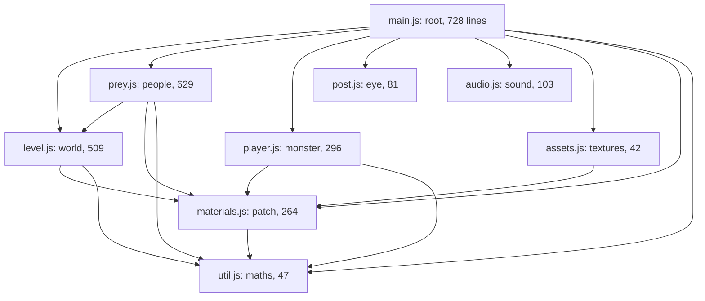
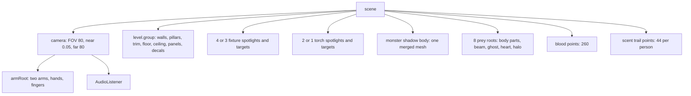

# 01 Architecture: nine modules, one world

FEED has nine source modules and one page. The modules are small enough to read in one sitting.
The largest is `main.js` at 728 lines. The smallest is `assets.js` at 42 lines. The source total
is 2,699 lines, or 3,136 lines with the trailer recorder. The project uses no game engine. It uses
three.js for the renderer, the scene graph and the maths. Every other system is local code.

This document describes the module boundaries and the import graph. It describes the game state
object, the scene graph and the shared uniforms. It describes the light pool, the callback seams,
the entity model and the initialization order. It gives the structure that the mechanism in
[02](02-core-mechanism.md) runs inside. It does not explain the level generator, the light bake or
the shader maths in depth.

## The nine modules

The table gives the role and the measured size of each module. The line counts come from the
pinned checkout.

| Module | Lines | Role |
|---|---:|---|
| `src/main.js` | 728 | page setup, game state, input, heads-up display (HUD), callbacks, frame loop |
| `src/prey.js` | 629 | person geometry, perception, state machine, animation |
| `src/level.js` | 509 | grid, generator, queries, meshes, light bake, light pool |
| `src/player.js` | 296 | monster movement, camera, arms, shadow body |
| `src/materials.js` | 264 | shared uniforms, material patch, procedural textures |
| `src/audio.js` | 103 | sound manifest load, positional playback, recorder tap |
| `src/post.js` | 81 | composer chain and monster-eye shader |
| `src/util.js` | 47 | seeded random, clamp, damp, smoothstep, angle difference |
| `src/assets.js` | 42 | texture manifest load and fallback colours |

The split follows the runtime cost and the ownership of state. `main.js` owns the frame. `level.js`
owns the static world. `prey.js` owns the eight people. `player.js` owns the monster. The other
modules are services: materials, audio, post, assets and maths. No module is a general-purpose
framework. Each module solves one problem for this game.

## The import graph

The import graph is acyclic. `main.js` is the root. It imports every other module. `level.js`,
`prey.js` and `player.js` import `materials.js` and `util.js`. `prey.js` also imports `CELL` from
`level.js`. `materials.js` imports `util.js`. `assets.js` imports `materials.js` for the fallback
colour texture. `post.js` imports only three.js and
its add-on passes, which are the extra render passes from the three.js examples.

```text
# src/main.js:1-10
import * as THREE from 'three';
import { inject } from '@vercel/analytics';
import { Level, CELL } from './level.js';
import { Prey } from './prey.js';
import { Player } from './player.js';
import { AudioSys } from './audio.js';
import { makePost } from './post.js';
import { loadTextures } from './assets.js';
import { shared, makeGrimeTexture } from './materials.js';
import { mulberry32, clamp, damp, smoothstep } from './util.js';
```

The `inject` import is the Vercel Analytics page-view call (`src/main.js:13`). `CELL` appears in
the import list of `main.js`, but the file uses it in the level bounds and the
camera setup. The value is 2 metres. `main.js` also imports the `shared` uniform object and the
grime texture maker. It does not import the patch function, because it does not create a patched
material itself. The level, the people and the player do that.



The graph has three leaves: `util.js`, `audio.js` and `post.js`. `util.js` is the shared leaf,
because five modules import it. The random stream is the most important export from it. The
`mulberry32` function turns one 32-bit seed into a repeatable stream. `main.js` creates one stream
and passes it to the level constructor and to every person. The blood system and the scent trail
call `Math.random` directly, so they are outside the seeded stream. The seeded stream is therefore
a single sequence. The order of calls sets the result, which document 04 discusses.

```text
# src/util.js:1-10
export function mulberry32(seed) {
  let a = seed >>> 0;
  return function () {
    a = (a + 0x6d2b79f5) >>> 0;
    let t = a;
    t = Math.imul(t ^ (t >>> 15), t | 1);
    t ^= t + Math.imul(t ^ (t >>> 7), t | 61);
    return ((t ^ (t >>> 14)) >>> 0) / 4294967296;
  };
}
```

The import graph does not show the runtime dependency. At runtime, the people and the player call
back into `main.js` through the game state object. The next two sections explain that object and
that seam.

## The game state object

`G` is one plain object. It holds the scene, the camera and the random stream. It holds the clock
and the game state. It holds the people array, the kill count and the total. It holds the hunger,
the hit stop, the blood amount, the camera kick and the win timer. It also receives the audio
system, the textures, the level, the player and several callbacks after creation.

```text
# src/main.js:66-74
const G = {
  scene, camera, rng, time: 0, elapsed: 0, state: 'loading', prey: [], kills: 0, total: TOTAL_PREY,
  hunger: 0.8, hitstop: 0, blood: 0, caKick: 0, winT: -1, warned: false,
};
window.__G = G;
const audio = new AudioSys(camera, scene);
G.audio = audio;
let player, level;
const loops = {};
```

`loops` holds the four running audio loops: the room hum, the low drone, the monster breath and
the heartbeat (`src/main.js:385-388`, `:436`).

The object is the service locator for the game. A service locator is a shared object that holds
the services that other objects need. `Prey` and `Player` receive `G` in the constructor and store
it as `this.g`. They read the level, the player, the textures and the callbacks from it. They do
not import `main.js`, because that would make a true import cycle. They call methods on the object
instead. The object is also on `window.__G`, so a developer can inspect the live state in the
browser console.

This design has a clear cost. The type of `G` is not defined anywhere. A reader must search
`main.js` to learn which fields exist. The fields are added in three places: the literal, the
`init` function and the callback block. Document 04 lists the absence of a type checker as a
limit.

The design also has a clear benefit. One object holds the whole mutable world. The trailer
recorder can drive the same object and the same callbacks. There is no second game class and no
headless mode. The recorder sets `G.dev.manual` and calls `G.dev.tick`, so the real game runs one
step at a time.

`G` does not own all state. The level owns its grid and its light table. Each person owns a path
field, a pose and a set of cooldowns. The player owns its stamina, its attack timer and its camera
trauma. The object `G` holds the links and the shared numbers. It does not copy the world. This is
why a change to a person field needs no write back to `G`, and why a bug in one person does not
corrupt the others.

The object also carries the values that more than one module needs in one frame. The hunger is
read by the HUD and the end test. The hit stop is read by the tick. The blood amount is read by the
post shader. The camera kick is read by the post shader. The win timer is read by the end test.
These values are small scalars, so the shared object is a cheap way to pass them.

## The scene graph

The scene is a normal three.js tree. The camera is a child of the scene. The level group, the
monster shadow body, the people roots, the blood points and the scent trail points are also
children. The spotlights and their targets are children too. The arms are a child of the camera,
so they follow the view without a separate transform.

```text
# src/main.js:25-37
const renderer = new THREE.WebGLRenderer({ antialias: false, powerPreference: 'high-performance' });
renderer.shadowMap.enabled = true;
renderer.shadowMap.type = THREE.PCFShadowMap;
renderer.toneMapping = THREE.ACESFilmicToneMapping;
renderer.toneMappingExposure = 1.05;
document.body.prepend(renderer.domElement);
const canvas = renderer.domElement;

const scene = new THREE.Scene();
scene.background = new THREE.Color(0x040302);
scene.fog = new THREE.FogExp2(0x040302, 0.052);
const camera = new THREE.PerspectiveCamera(80, innerWidth / innerHeight, 0.05, 80);
scene.add(camera);
```

`PCFShadowMap` is percentage-closer filtering for the shadow edges, and `ACESFilmicToneMapping`
is a filmic tone curve (`src/main.js:27-28`).

The scene has an exponential fog with density 0.052 and a near-black background. The camera has a
field of view (FOV) of 80 degrees, a near plane of 0.05 metres and a far plane of 80 metres. The
near plane and the far plane are the closest and farthest distances that the camera draws. The
fog fades distant surfaces to the background colour. The far plane is a hard cut at 80 metres.
Together they keep the 98 metre square from showing a hard boundary.



The diagram gives the count on a desktop. On a phone, the fixture pool is 3 lights and the torch
pool is 1 light. The blood system preallocates 260 points. The 260 is the constant `BMAX`, and the
system reuses a point when its life ends, so it never allocates during play. The level group holds
the static world as merged geometry and one instanced mesh
for the ceiling panels. An instanced mesh draws one geometry many times with one draw call. The
people are separate groups, because each person moves. The scent trail is one points object for
all people, not one per person.

The camera carries the audio listener. The audio listener is the point that hears positional
sound. The camera also carries the two first-person arms. The monster body is not a child of the
camera. It is a separate merged mesh in the scene, with colour write and depth write disabled.
Colour write controls whether the mesh writes colour. Depth write controls whether it writes
depth. It casts a shadow but does not draw in the main pass. This is why the player sees the shadow
but not the body.

## The shared uniform object and the material patch

The material patch adds three terms to a standard material: baked light ambient, a distance-based
night-vision term and optional grime. Night vision is a brightness term with a warm or cold colour.
Grime is a procedural dirt overlay. Every tunable is a uniform. A uniform is a shader value that
stays the same for every pixel in one draw. The shared values live in one object, and every patched
material receives a reference to the same uniform objects.

```text
# src/materials.js:4-12
// uniforms shared by every patched material (same object references, updated once per frame)
export const shared = {
  uLightGrid: { value: null },
  uGridInv: { value: 1 },
  uGridIntensity: { value: 1.0 },
  uNightVision: { value: 0.55 },
  uNVColor: { value: new THREE.Color(0.5, 0.2, 0.16) },
  uGrime: { value: null },
};
```

`uGridInv` is 1 divided by the level size, so it converts world metres to texture coordinates
(`src/level.js:263`). `uGridIntensity` scales the baked light (`src/materials.js:96`).

The `patchMaterial` function sets `onBeforeCompile`. That callback runs when three.js first
compiles the material. It assigns the shared objects to the shader uniform table. It also assigns
the per-material uniform objects, which hold the grime amount, the wet amount, the grid scale, the
grid offset, the wall flag and the night-vision strength. That per-material object is `own`,
built at `src/materials.js:23-26`.

```text
# src/materials.js:27-34
  mat.onBeforeCompile = (shader) => {
    shader.uniforms.uLightGrid = shared.uLightGrid;
    shader.uniforms.uGridInv = shared.uGridInv;
    shader.uniforms.uGridIntensity = shared.uGridIntensity;
    shader.uniforms.uNightVision = shared.uNightVision;
    shader.uniforms.uNVColor = shared.uNVColor;
    shader.uniforms.uGrime = shared.uGrime;
    Object.assign(shader.uniforms, own);
```

The fragment patch inserts a block before the ambient occlusion include. Ambient occlusion is a shading term for
light blocked in corners. `vGridPos` and `vGridN` are the world position and world normal written
by the vertex shader (`src/materials.js:36-51`); document 02 shows that shader. The new block
computes a world position from the interpolated position and normal. It pushes the lookup point off the wall along the normal, so a wall does not sample the
light inside itself. It reads the light texture. It adds a height term for walls. It then adds the
night-vision term. The term falls off with camera distance and uses a facing factor.

```text
# src/materials.js:91-105
      .replace(
        '#include <aomap_fragment>',
        `{
          vec3 gN = normalize( vGridN );
          vec2 gUv = ( vGridPos.xz + gN.xz * uGridOffset ) * uGridInv;
          vec3 gL = texture2D( uLightGrid, gUv ).rgb * uGridIntensity * uGridScale;
          gL *= mix( 1.0, mix( 0.7, 1.25, clamp( vGridPos.y / 3.0, 0.0, 1.0 ) ), uWall );
          float gCam = length( vViewPosition );
          float gNV = uNightVision * uNV * exp( -gCam * 0.085 ) * ( 0.3 + 0.7 * max( dot( normal, normalize( vViewPosition ) ), 0.0 ) );
          reflectedLight.indirectDiffuse += ( gL + uNVColor * gNV ) * diffuseColor.rgb;
        }
        #include <aomap_fragment>`
      );
  };
  mat.customProgramCacheKey = () => (useGrime ? 'grid-grime' : 'grid');
```

The cache key is the important line. `useGrime` is `opt.grime > 0 || opt.grimeVariant`
(`src/materials.js:22`). The key returns only `grid` or `grid-grime`. Two materials with
different grime amounts, grid scales or wall flags get the same program. Their differences are
uniform values. Three.js therefore compiles at most two programs in total for all patched
materials in the scene. The same texture object is in `shared.uLightGrid`, so the light bake can finish after the
materials are created and still reach every shader.

The patch is used by the level surfaces, the people and the monster arms. The claws and the skin
use the concrete texture set, so they cost no extra texture load. The material patch is the main
reason the scene has a small shader count despite many surface types.

## The light pool

The level builds 144 ceiling fixtures from the macro grid. It does not create 144 real lights.
It creates a fixed pool of spotlights, then hands each free light to the nearest working fixture.
The pool size is 4 on a desktop and 3 on a phone. The single call passes 3 on a touch device and 4
otherwise (`src/main.js:324`); the default 5 in the function is never used. The shadow map is a
texture that holds the depth from the light. It is 1024 pixels on a desktop and 512 on a phone.

```text
# src/level.js:431-450
  initLights(scene, count = 5, mapSize = 1024) {
    this.pool = [];
    for (let i = 0; i < count; i++) {
      const l = new THREE.SpotLight(0xffe2a8, 0, 14, 1.08, 0.9, 1.7);
      l.castShadow = true;
      l.shadow.mapSize.set(mapSize, mapSize);
      l.shadow.camera.near = 0.2;
      l.shadow.camera.far = 14;
      l.shadow.bias = -0.0008;
      l.shadow.normalBias = 0.03;
      l.shadow.autoUpdate = false; // re-rendered only when something that casts a shadow is under it
      l.shadow.needsUpdate = true;
      l.position.set(0, WALL_H - 0.1, 0);
      scene.add(l, l.target);
      this.pool.push({ light: l, fixture: null, dirty: true });
    }
    this._working = this.fixtures.filter((f) => f.state !== 0);
    this._flickers = [];
    this.fixtures.forEach((f, i) => { if (f.state === 2) this._flickers.push([f, i]); });
  }
```

Fixture state 0 is dead, state 1 is steady, and state 2 is flickering (`src/level.js:193`).

The spotlights have a distance of 14 metres, an angle of 1.08 radians, a penumbra of 0.9 and a
decay of 1.7. The penumbra is the soft edge of the cone. The decay is the falloff with distance.
Shadow auto-update is off. This saves a shadow pass when nothing moves under the light. The source
starts the light at the ceiling height minus 0.1 metres.

The update step sorts the working fixtures by squared distance to the camera. The loop at
`src/level.js:465-468` writes `_d2`, and the sort at `:469` reads it. The sort runs above the
lines shown below, so `want` is already in nearest-first order. The step keeps the nearest
ones that the pool can hold. A fixture that leaves the set gives its light back to the pool. A new
fixture takes a free light and moves the light and its target. The light intensity uses the
fixture value and a fade from 9 to 15 metres. The caller passes `46 * dim` as `baseIntensity`,
where `dim` is the smell dim value. The base intensity is therefore 46 in normal play.

```text
# src/level.js:470-498
    const want = this._working.slice(0, this.pool.length);
    for (const s of this.pool) if (s.fixture && !want.includes(s.fixture)) s.fixture = null;
    for (const f of want) {
      if (this.pool.some((s) => s.fixture === f)) continue;
      const free = this.pool.find((s) => !s.fixture);
      if (!free) break;
      free.fixture = f;
      free.dirty = true;
      free.light.position.set(f.x, WALL_H - 0.1, f.z);
      free.light.target.position.set(f.x, 0, f.z);
      free.light.target.updateMatrixWorld();
    }
    for (const s of this.pool) {
      if (!s.fixture) { s.light.intensity = 0; continue; }
      const f = s.fixture, d = Math.sqrt(f._d2);
      const fade = 1 - smoothstep(9, 15, d);
      s.light.intensity = baseIntensity * f.value * fade;
      s.light.color.copy(f.color);
      // the cone only reaches ~5.5 m out on the floor, so only nearby movers can change its shadow map
      let dirty = s.dirty;
      s.dirty = false;
      if (!dirty) {
        for (const m of movers) {
          if ((m.x - f.x) ** 2 + (m.z - f.z) ** 2 < 56) { dirty = true; s.dirty = true; break; } // one extra frame after they leave
        }
      }
      if (dirty) s.light.shadow.needsUpdate = true;
    }
  }
```

The shadow update uses a squared distance of 56, which is about 7.48 metres. A mover inside that
radius marks the light dirty. A mover is the player, a living person, or a person who died less
than 3 seconds ago. A mover outside the radius does not mark the light. The comment says the cone
reaches about 5.5 metres on the floor. The source does not explain why the radius is 7.48 metres,
which is larger than that reach. The game adds one extra frame after a mover leaves, because the
last position still matters (`src/level.js:488-496`).

The torch pool is separate and lives in `main.js`. It has 2 lights on a desktop and 1 on a phone.
The intensity is 95 times a fade from 24 to 34 metres, times the smell dim value. The game hands
these lights to the nearest working torches. The people's torch beams are visible cones, but the
real light is from the pool. A distant torch therefore costs no extra light.

The two pools follow the same idea with different owners. The level pool follows the camera,
because the ceiling lights matter near the viewer. The torch pool follows the people, because a
torch matters near the person who holds it. Both pools keep a fixed light count, so the shader
program and the shadow map count do not change as the player moves. The level pool changes a light
position when a fixture enters the set. The torch pool changes a light position when a torch
enters the set. Neither pool creates or destroys a light.

The fixed count is the important property. A new light in three.js changes the number of active
lights, and that changes the shader defines and the program. A shader define is a preprocessor
constant that changes the compiled program. A fixed count avoids a recompile
during play. The game can add 144 visible panels and eight torches without 152 real lights.

## The callback layer

`main.js` assigns functions to `G`. The people and the player call them. The callbacks own the
cross-module effects: sound, panic spread, message text, camera shake, blood and the kill. This is
the runtime edge that the import graph cannot show.

```text
# src/main.js:219-238
G.preyVoice = (p, key, vol = 1, delay = 0) => {
  if (p.dist > 40) return;
  if (p.voice && p.voice.isPlaying) {
    if (key === 'prey_whimper') return; // still gasping from the last one
    p.voice.kill();
  }
  vTmp.set(0, 1.5, 0);
  p.voice = audio.playAt(key, vTmp, vol * (p.hasLos ? 1 : 0.55), { ref: 5, delay, parent: p.root });
};
G.preyStep = (p) => {
  if (p.dist > 22) return;
  vTmp.set(p.pos.x, 0.1, p.pos.z);
  audio.playAt('prey_step', vTmp, 0.5 * (p.hasLos ? 1 : 0.5), { ref: 3, rateVar: 0.12 });
};
G.spreadPanic = (src) => {
  for (const q of G.prey) {
    if (q === src || !q.alive) continue;
    if (Math.hypot(q.pos.x - src.pos.x, q.pos.z - src.pos.z) < 15) q.alert(src.pos.x, src.pos.z, 0.8);
  }
};
```

The callback layer has three rules. First, a callback may read any part of `G`. Second, a callback
may call a method on a person or on the player. Third, a callback should not start a new frame or a
new loop. The functions are small and do one effect each. This keeps the coupling visible in one
block of `main.js`.

Both callbacks discard a sound when `p.dist` is past a cutoff: 40 metres for a voice and 22 metres
for a step. `_perceive()` refreshes that distance every 0.1 seconds (`src/prey.js:263`,
`:595-596`). The source does not give a reason for the two different cutoffs.

`vTmp` is one shared three.js vector. The voice, step and death callbacks write a position into it
and pass it to `playAt`. Because the call copies the position synchronously, one vector serves all
callers without a new allocation. The options object of `playAt` has five fields. `ref` is the
reference distance at which the sound keeps its stated volume. `rolloff` sets how fast the volume
falls with distance. `delay` is a start delay in seconds. `parent` makes the sound ride on a moving
object, and the position is then local to that object. `rateVar` is the random spread of the
playback rate. The defaults are a reference distance of 4 metres, a rolloff of 1.5, a delay of zero
and a rate spread of 0.07. The voice height is 1.5 metres, which places it near a person's head.
The source does not comment on that height (`src/main.js:225-226`).

The full set is `preyVoice`, `preyStep`, `spreadPanic`, `onPreySpotted`, `monsterStep`,
`onAttackStart`, `onRoar` and `tryKill`. The people call `onPreySpotted`, `spreadPanic`,
`preyVoice` and `preyStep`. The player calls `monsterStep`, `onAttackStart`, `onRoar` and
`tryKill`. The names use a weak convention rather than a base class.

## The entity model

There is no entity base class and no component system. An entity base class is a shared parent
class for game objects. A component system builds an object from small parts. The game has two
entity classes, one player and eight people. The level is a third class. Each class owns its own
fields and builds its own meshes.

The player fields cover the transform, the view, the resources, the action timers and the camera
state. The constructor also builds the arms and the shadow body. The arms are a child of the
camera. The shadow body is a scene child.

```text
# src/player.js:54-66
    this.cam = camera;
    this.pos = new THREE.Vector3(x, 0, z);
    this.yaw = 0; this.pitch = 0;
    this.vx = 0; this.vz = 0;
    this.stamina = 1; this.exhausted = false;
    this.sprinting = false; this.moving = false;
    this.bob = 0; this.speed = 0;
    this.attackT = -1; this.attackCd = 0; this.hitDone = true;
    this.roarCd = 0; this.roarT = 9;
    this.sense = 0; this.trauma = 0; this.lungeV = 0; this.dip = 0;
    camera.rotation.order = 'YXZ';
    this._buildArms();
    this._buildShadowBody();
```

In these fields, `bob` is the step-distance accumulator and `dip` is the camera dip after a step.
`roarT` starts at 9, so the roar wobble is inactive at the start. `hitDone` stops a second hit in
one swing. `rotation.order = 'YXZ'` applies yaw, then pitch, then roll (`src/player.js:60-64`).

The person fields cover the transform, the state, the fear, the stamina, the waypoint, the path
field, the perception results, the sound cooldowns, the animation pose and the thermal layer. Each
person owns a full path field of the same size as the level grid. That is 49 by 49 signed 16-bit
values, or 4,802 bytes per person. A signed 16-bit value can hold a positive or negative step
distance. Eight people hold about 38 kilobytes of path data.

```text
# src/prey.js:94-120
    this.pos = new THREE.Vector3(x, 0, z);
    this.heading = rng() * Math.PI * 2;
    this.state = 'wander';
    this.stateT = 0;
    this.fear = 0;
    this.stamina = 1;
    this.speed = 0;
    this.phase = rng() * 6;
    this.wp = null; this.wpCell = -1; this.prevCell = -1; this.wpT = 0;
    this.field = new Int16Array(game.level.n * game.level.n);
    this.hasTarget = false;
    this.idleT = rng() * 2.5;
    this.nervous = 0;
    this.screamCd = 0;
    this.whimperCd = 2 + rng() * 4;
    this.lastSeenT = 99;
    this.cowerSafeT = 0;
    this.mouth = 0;
    this.lookYaw = 0;
    this.flail = rng() < 0.4;
    this.alive = true;
    this.deadT = 0;
    this.thinkT = rng() * 0.15;
    this.sees = false; this.hears = false; this.hasLos = false; this.dist = 99; this.angTo = 0;
    this.flashOn = rng() < 0.75;
    this.pose = {}; this.poseT = {};
    for (const k of POSE_KEYS) { this.pose[k] = 0; this.poseT[k] = 0; }
```

Here `flail` is a wide-arm run variant that is true for 40 percent of people. `nervous` counts the
seconds left of heightened caution. `cowerSafeT` counts the seconds since the monster was last
seen while cowering. `thinkT` is the perception timer. `wpCell` and `prevCell` are the current and
previous path cells (`src/prey.js:102-118`, `:441-484`).

The perception fields are re-used each think step. The pose object holds the current joint values,
and the pose target object holds the values that the current state asks for. `POSE_KEYS` is a
list of 14 joint names: the lean, the body height, two legs, two knees, four arm angles, two
elbows and two head angles. The animation damps
the current pose toward the target. This is a small, direct animation system. There is no clip
player and no skeleton.

The level object holds the grid, the fixtures, the wall faces, the light texture, the light pool,
the panel mesh and the level group. It also holds query methods such as `isWall`, `resolveCircle`,
`los`, `bfs` and `lightAt`. The people use those queries. The player uses `resolveCircle`. The game
uses `lightAt` and `los` for the kill test.

The ownership rule is simple. A field lives in the object that changes it every frame. The player
position is in the player. The person position is in the person. The light pool is in the level.
The hunger is in `G`, because the kill callback and the tick both change it. The kill count is in
`G`, because the HUD, the kill callback and the end subtitle read it.

The rule has one exception. The people copy a few `G` values into local fields each think step.
They copy the player position into a distance and an angle. They copy the line-of-sight result.
They copy the light value at the player position. This copy turns a set of world reads into one
small record. The brain can then use the record without another query. The copy is refreshed every
0.1 seconds, so it can be stale for up to six frames at 60 frames per second. The source accepts
that delay.

## The initialization order

The `init` function is asynchronous. It loads the textures and the sound in parallel, then builds
the world in a fixed order. The order matters, because each step reads the result of the earlier
step.

```text
# src/main.js:307-330
async function init() {
  const go = $('go');
  const [tex] = await Promise.all([
    loadTextures(renderer),
    audio.load((f) => { go.textContent = 'waking ' + '.'.repeat(1 + Math.floor(f * 5)); }),
  ]);
  shared.uGrime.value = makeGrimeTexture();
  // the classic sickly yellow, layered over whatever wallpaper / carpet was sourced
  tex.wall.tint = new THREE.Color(2.15, 1.75, 0.72);
  tex.carpet.tint = new THREE.Color(0.6, 0.47, 0.3);
  tex.ceiling.tint = new THREE.Color(0.8, 0.75, 0.6);
  tex.ceiling.tile = 3.6; // 6x6 tiles of 60cm per repeat

  G.tex = tex;
  level = new Level(rng, 12);
  G.level = level;
  level.build(scene, tex);
  level.initLights(scene, TOUCH ? 3 : 4, TOUCH ? 512 : 1024);
  G.monsterField = new Int16Array(level.n * level.n);

  const start = level.macroCenter(6, 6);
  player = new Player(G, camera, start.x, start.z);
  player.yaw = rng() * Math.PI * 2;
  G.player = player;
```

The sequence is:

1. Load four of the seven texture sets in the manifest and the sound manifest. Document 04 explains
   the spare sets.
2. Build the grime texture and set the colour tints.
3. Create the level. The constructor runs the generator, places the fixtures and bakes the light.
4. Build the level meshes and add the group to the scene.
5. Create the light pool and the working and flicker lists (`src/main.js:321-324`).
6. Allocate the monster path field.
7. Create the player at macro cell (6, 6) and give it a random yaw from the shared stream.
8. Create the eight people on shuffled macro cell centres.
9. Create the two torch lights.
10. Build the scent trail points. The blood points are already built at module load.
11. Warm the shaders (`src/main.js:339-371`).

The shader warm step is unusual. The code uploads every texture, then calls `setSense` on each
person with a value of 1 so the thermal materials become visible. It updates the matrix world. It
calls `renderer.compileAsync(scene, camera)`. It then sets the sense back to zero and hides the
trail. The goal is to compile every program before the title screen. A first-time compile during
play would cause a visible hitch.

The warm step has a second effect. It forces every texture upload before the first visible frame.
A texture that loads during play would stall the pipeline. The source states the intent in a
comment: "build every shader now, so nothing hitches the first time it swings into view". The
scent trail is made visible for the compile and hidden again. The thermal ghost materials are
made visible and hidden again. The game pays the cost once, at load, and not at the first scare.

The init function is asynchronous, so the page can paint the title screen before the world is
ready. The button text reports the audio load fraction. The state stays `loading` until the warm
step ends. The frame function returns early in that state, so no game logic runs on a half-built
world. The promise chain calls `frame()` only after `init()` resolves.

## The developer hooks

```text
# src/main.js:667-679
G.dev = {
  keys, canvas, post, manual: false, noRender: false,
  tick: (dt = 1 / 60) => tick(dt, dt),
  setSize: (w, h) => {
    autoScale = false;
    removeEventListener('resize', resize);
    renderer.setPixelRatio(1);
    renderer.setSize(w, h, false);
    post.resize(w, h, 1);
    camera.aspect = w / h;
    camera.updateProjectionMatrix();
  },
};
```

`setSize` removes the resize listener and pins the pixel ratio to 1, so every recorder frame is
exactly the requested size (`src/main.js:670-678`).

`G.dev` is the developer and recorder hook. It exposes the key map, the canvas, the post object,
the manual flag, the no-render flag, a fixed-step tick and a fixed-size setter. The trailer recorder
uses these hooks. The game itself uses `G.dev.manual` in the frame function, so a manual session
does not advance twice.

## The frame loop and the module roles

The frame function measures the real time and clamps the step to 0.05 seconds. A long pause
therefore cannot move a body through a wall. The `tick` function applies the hit stop, updates the
game, updates the smell uniforms and the light pools, writes the post uniforms and renders the
composer.

`main.js` owns the frame and the state machine. `level.js` owns the static world and the light
pool. `prey.js` owns the people and their path fields. `player.js` owns the monster. The services
do one job each. This is a clear separation for a small game.

```text
# src/audio.js:6-12
export class AudioSys {
  constructor(camera, scene) {
    this.listener = new THREE.AudioListener();
    camera.add(this.listener);
    this.scene = scene;
    this.buf = {};
  }
```

The audio system attaches the listener to the camera. A positional sound therefore uses the camera
as the ear. The buffers are filled from the manifest. The recorder tap is a single field, `this.rec`
(`src/main.js:380`). When the recorder sets that field, every sound call goes to the offline mixer
instead of the live audio graph. The three sound entry points test it at `src/audio.js:56`, `:69`
and `:95`.

```text
# src/post.js:68-80
  const bloom = new UnrealBloomPass(new THREE.Vector2(256, 256), 0.42, 0.7, 0.9);
  composer.addPass(bloom);
  composer.addPass(new OutputPass());
  const eye = new ShaderPass(MonsterEye);
  composer.addPass(eye);
  return {
    composer, bloom, u: eye.uniforms,
    resize(w, h, pr) {
      composer.setPixelRatio(pr);
      composer.setSize(w, h);
      eye.uniforms.uRes.value.set(w * pr, h * pr);
    },
  };
```

The post chain is fixed: render pass, bloom pass, output pass, eye pass. The three bloom arguments
are strength 0.42, radius 0.7 and threshold 0.9 (`src/post.js:68`); document 02 explains the pass.
The eye pass is last, so its distortion and grain apply to the tone-mapped image. The post object returns the composer, the
bloom pass and the eye uniforms. `main.js` writes the eye uniforms every frame and calls the
composer.

## Where the boundaries leak

The structure is clean at the import level, but three boundaries leak.

The first leak is `G`. It removes the need for a dependency injection framework, but it also lets
any module read any field. Dependency injection passes services in from outside instead of reading
a global. The people read `G.level` and `G.player`. The callbacks read `G.prey` and `G.audio`. The
object has no access control.

The second leak is the level query set. `prey.js` imports `CELL` from `level.js` and calls
`los`, `lightAt` and `bfs`. `main.js` calls `resolveCircle`, `los` and `macroCenter`. The level is
therefore a world service, not only a data holder. The name `Level` covers both roles.

The third leak is the shared uniform object. It is global state in the graphics layer. A change in
`main.js` reaches every patched shader at once. That is the point, but it also means a bug in one
uniform write can change the look of the whole scene.

## The page as an output surface

The page has a second module boundary. The HyperText Markup Language (HTML) file holds the title
screen, the pause screen, the end screen, the HUD, the touch controls and the
canvas container. `main.js` finds these elements by identifier with a small helper, `$`. It writes
text, classes and style transforms. It does not create the layout in code.

The state changes are class changes. The title element gets the class `hidden` when the run
starts. The HUD element loses the `hidden` class. The pause element gains it when pointer lock is lost. The end
element gains it when the run ends. The touch element is shown only on the phone path. A body
class named `touch` selects the phone layout. The game logic does not read the layout.

The per-frame HUD update is two scale transforms and one opacity change. The hunger bar and the
stamina bar scale on the horizontal axis. The tally is rebuilt at load and when a person dies. It
writes eight strokes with a strike element on the dead ones. The message line writes one string and
sets an opacity when a message appears. The browser does the layout work.
The game does not measure the elements.

This split has a benefit and a cost. The benefit is that the page can show a loading message and a
title before the three.js scene exists. The cost is that the state is spread across the game code
and the page code. A reader who wants the full screen flow must read `index.html` and `main.js`
together.

**Aha:** The import graph is a directed acyclic graph whose local leaves are three modules, but the
runtime graph is a cycle. The people and the player do not import `main.js`. They call functions on
`G` that
`main.js` assigned. So the architecture has two directions at once: a clean acyclic build graph and
a mutable global call graph. The global object is not a short cut. It is the seam that lets the
level, the people and the player share one world without a framework. The cost is that no compiler
checks the seam, and the benefit is that one object can be handed to the trailer recorder and
stepped by hand.

## What this document leaves to the others

This document does not follow the generator, the light bake or one simulation tick. Document
[02](02-core-mechanism.md) does that. It also does not cover the development server, the build, the
phone path or the trailer pipeline. Document [03](03-workflow-and-quality.md) does that. The
[README](README.md) gives the thesis and the package map. Document [00](00-overview.md) gives the
fiction and the play loop.

[Previous: the fiction and the play loop](00-overview.md) · [Next: one seed, one building, one
tick](02-core-mechanism.md).
