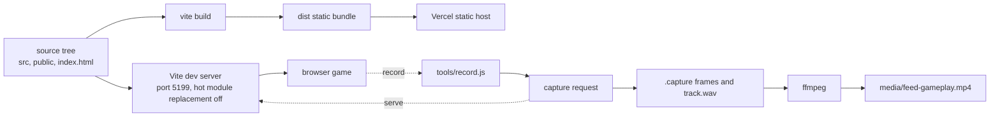
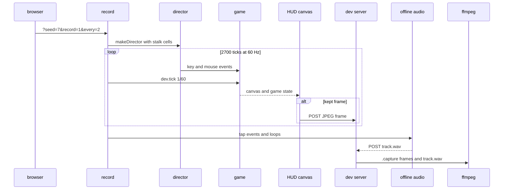

# 03 Workflow and quality: source to screen

This document follows a change from the source tree to the browser, the phone and the trailer. It
covers the development server and the capture middleware, which is a small request handler on the
development server. It covers the production build, the deployment settings, the phone path, the
performance budget, the load-time warm-up and the trailer recorder. It ends with the checks that
exist and the checks that do not exist. The document uses the terms from the [README](README.md)
and [01](01-architecture.md).

The project uses Vite 8 as the development server and the build tool. The game runs in a Web
Graphics Library version 2 (WebGL2) browser. The deployment is a static site on Vercel. The trailer is a separate development-only
path. No part of the trailer path is in the production build.

## The two paths

The source has two paths to a screen. The development path serves the modules to a local browser.
The production path writes a static bundle. The capture path is a branch of the development path.



The capture endpoint belongs to the development server. The endpoint is absent from the
production bundle. The recorder is also absent. The production path therefore contains the game
and its assets only. The next sections follow each path in turn.

## The local development loop

The development server runs on port 5199 with a strict port. If the port is busy, the command
fails instead of moving to another port. The project fixes the port because the recorder command
in `tools/record.js` names it. The capture endpoint lives on the same server, so a recorded take
and the game must use the same port. The source does not give a separate reason.

Hot module replacement (HMR) is off. A file save does not reload the page and does not patch a
module in place. The developer reloads with the browser refresh key. The source comment gives the
reason: a save must not pull the player out of a running game. A horror game depends on a
continuous run, so a surprise reload is worse than a manual refresh.

The scripts are `dev`, `build` and `preview`. The `dev` script runs `vite --port 5199 --strictPort`.
The `build` script runs `vite build`. The `preview` script runs `vite preview --port 5199`. There
is no `test` script, no `lint` script and no `typecheck` script. The package manifest has two
runtime dependencies and one development dependency.

```text
# package.json:12-18
  "dependencies": {
    "@vercel/analytics": "^2.0.1",
    "three": "^0.187.0"
  },
  "devDependencies": {
    "vite": "^8.3.7"
  }
```

The dependency set is small. three.js supplies the renderer, the scene graph, the audio objects and
the maths. Vite supplies the development server, the module graph and the production bundle. The
Vercel analytics package sends page views. The game source uses no other library.

The source does not set an environment variable for the game. The seed comes from the uniform
resource locator (URL) query string or from a random number. The touch path comes from a query flag
or a device test. The recorder path comes from a query flag and the development mode. These are the
only switches that the game reads. The recorder reads two more, described below.

## The capture middleware

The development server has one custom plugin. The plugin is a capture endpoint. It accepts a
Hypertext Transfer Protocol (HTTP) POST request and writes the request body to a file under
`.capture/`. The plugin runs only in the
serve mode, because it has `apply: 'serve'`. A production build does not include it.

```text
# vite.config.js:5-29
// Dev-server only: tools/record.js POSTs rendered frames / the mixed soundtrack here and they land in
// .capture/ (git-ignored), ready for ffmpeg. Nothing of this exists in a production build.
const capture = {
  name: 'feed-capture',
  apply: 'serve',
  configureServer(server) {
    server.middlewares.use('/__capture', (req, res) => {
      if (req.method !== 'POST') { res.statusCode = 405; return res.end(); }
      const q = new URL(req.url, 'http://x').searchParams;
      const clean = (s, d) => (s || d).replace(/[^a-z0-9_-]/gi, '');
      const ext = ['jpg', 'png', 'wav', 'json'].includes(q.get('e')) ? q.get('e') : 'jpg';
      const dir = path.resolve('.capture', clean(q.get('d'), 'misc'));
      fs.mkdirSync(dir, { recursive: true });
      const chunks = [];
      req.on('data', (c) => chunks.push(c));
      req.on('end', () => {
        fs.writeFileSync(path.join(dir, clean(q.get('n'), 'shot') + '.' + ext), Buffer.concat(chunks));
        res.end('ok');
      });
    });
  },
};

// hmr off: the page only reloads when you press F5, so saving a file never yanks you out of a run
export default defineConfig({ plugins: [capture], server: { hmr: false } });
```

The endpoint has four limits. First, it accepts only a POST request; any other method gets status
405. Second, the directory and the file name are cleaned to the characters `A-Z`, `a-z`, `0-9`,
underscore and hyphen. Third, the extension must be one of `jpg`, `png`, `wav` or `json`. Fourth,
the path is resolved under `.capture`, so a name cannot escape the capture folder.

The endpoint has no authentication and no size limit in the source. It is a development tool on a
local port. The source does not claim that it is safe to expose. The `.gitignore` file excludes
`.capture`, and the `.vercelignore` file also excludes it.

The middleware is the bridge between the browser and the file system. A browser cannot write a
frame file by itself. The recorder sends each frame to the local server, and the server writes the
file. The trailer command then reads the folder sequence.

## The production build

The production build is a normal Vite build. Vite reads `index.html`, follows the module imports,
and writes a bundle to `dist`. The `public` folder is copied as static files. The texture and sound
assets therefore keep their paths under `/assets/`. The icons and the manifest keep their paths at
the site root.

The `vercel.json` file sets the framework, the build command and the output directory. It does not
set a base path, a rewrite rule, a header or a function. The deployment is a static file set.

```text
# vercel.json:1-5
{
  "framework": "vite",
  "buildCommand": "vite build",
  "outputDirectory": "dist"
}
```

The `.vercelignore` file removes five paths from the upload: `media/`, `tools/`, `.capture/`,
`.claude/` and `README.md`. The media folder holds the trailer and the stills. The tools folder
holds the recorder. Neither is needed by the game. The capture folder is local output. The
`.claude/` folder belongs to a local tool and is not part of the project. The README is not part of
the site.

The production bundle therefore contains the page, the game code bundled from the nine source
modules, three.js, the Vercel analytics package, the textures, the sounds, the icons and the
manifest. It does not contain the trailer recorder or the capture plugin. The recorder import is
behind a development check, so Vite does not include it in a production build.

The analytics call is at the top of `main.js` (`src/main.js:13`). It runs with the mode `development` or `production`
and sends page views. The call is part of the bundle, so the deployed page contacts the analytics
service. The source does not state a consent flow or a data policy. This package does not test the
service.

The project README gives a live address. This package did not open the address, did not download
the bundle and did not verify the deployment. The evidence for the deployment is the
configuration file, the README text and the build script.

## The phone path

The game supports a phone or tablet held sideways. The build is the same build. The phone path
changes the input layer, the render budget, the light pool, the shadow map and the layout. The
detection uses three tests: a query flag, a media query for a coarse pointer with no hover, and a
touch point count with a mobile user agent. A media query is a browser style test. A coarse
pointer is a finger. A device with no hover has no mouse.

```text
# src/main.js:18-22
// phones and tablets get thumb controls, a lighter renderer and a fullscreen layout (?touch=1 forces it)
const TOUCH = new URLSearchParams(location.search).has('touch')
  || matchMedia('(hover: none) and (pointer: coarse)').matches
  || (navigator.maxTouchPoints > 0 && /Android|iPhone|iPad|iPod|Mobile/i.test(navigator.userAgent));
document.body.classList.toggle('touch', TOUCH);
```

The result is one boolean. The boolean sets a body class, chooses the light pool size, chooses the
shadow map size, chooses the render budget and chooses the input handlers. The presence of the
`touch` query parameter forces the phone path on a desktop, whatever its value, which helps a
developer test the layout.

The page declares the install path. The manifest gives the name, the short name, the start address,
the fullscreen display mode and the landscape orientation. It also gives the background colour,
the theme colour and two icons.

```text
# public/manifest.webmanifest:1-14
{
  "name": "FEED",
  "short_name": "FEED",
  "description": "Backrooms horror. You are the monster.",
  "start_url": "/",
  "display": "fullscreen",
  "orientation": "landscape",
  "background_color": "#000000",
  "theme_color": "#000000",
  "icons": [
    { "src": "/icon-192.png", "sizes": "192x192", "type": "image/png", "purpose": "any" },
    { "src": "/icon-512.png", "sizes": "512x512", "type": "image/png", "purpose": "any" }
  ]
}
```

The page header links the manifest, the icon and the Apple touch icon. The file
`public/icon-180.png` exists and is the Apple touch icon. The viewport meta tag disables user
scaling and sets the viewport to cover the screen. The Apple meta tags request a
fullscreen web application with a translucent status bar.

```text
# index.html:4-15
<meta charset="utf-8">
<meta name="viewport" content="width=device-width, initial-scale=1, maximum-scale=1, user-scalable=no, viewport-fit=cover">
<meta name="description" content="Backrooms horror. You are the monster.">
<meta name="theme-color" content="#000000">
<meta name="mobile-web-app-capable" content="yes">
<meta name="apple-mobile-web-app-capable" content="yes">
<meta name="apple-mobile-web-app-status-bar-style" content="black-translucent">
<meta name="apple-mobile-web-app-title" content="FEED">
<link rel="manifest" href="/manifest.webmanifest">
<link rel="icon" type="image/png" href="/icon-192.png">
<link rel="apple-touch-icon" href="/icon-180.png">
<title>FEED</title>
```

The phone input uses a thumb stick on the left and a look area on the right. A quick tap on the
right thumb is a strike. Three buttons cover strike, roar and hold-to-smell. The start function
calls the browser fullscreen request on the phone path. A portrait phone shows a full-screen TURN
overlay from a CSS media query (`index.html:74`, `:106-109`); the overlay asks the viewer to hold
the phone sideways. The tick does read the orientation. When the device is a touch device and the
window is taller than it is wide, `update(dt)` is skipped, so the hunt waits behind the overlay
(`src/main.js:686-687`). An orientation change calls the resize function after 250 milliseconds
(`src/main.js:557`).

The phone path also changes the shadow and light cost. The fixture pool drops from four lights to
three. The fixture shadow map drops from 1024 to 512 pixels. The torch pool drops from two lights
to one. The render budget drops from 2.3 or 1.1 megapixels to 0.55 megapixels. These values are in
the source, and the next section gives the full budget.

## The performance budget

The renderer draws a full-screen image with several shadowed lights, bloom and a post pass. The
source treats pixels as the main cost. The budget sets a maximum pixel count, then caps the device
pixel ratio and the scale factor. The source comment uses MP for megapixel. It reads the graphics
processing unit (GPU) name to set the budget.

```text
# src/main.js:40-52
// internal resolution budget: the picture is shaded per pixel by several shadowed lights, so pixels are what
// cost frame rate. Integrated GPUs get ~1.1 MP, discrete cards ~2.3 MP; grain + bloom hide the upscale.
function gpuName() {
  try {
    const gl = renderer.getContext(), ext = gl.getExtension('WEBGL_debug_renderer_info');
    return ext ? String(gl.getParameter(ext.UNMASKED_RENDERER_WEBGL)) : '';
  } catch { return ''; }
}
const FAST_GPU = /RTX|GTX|Radeon RX|Radeon Pro|Arc\(TM\) [AB]\d|Quadro|Apple M\d/i.test(gpuName());
const MAX_PIXELS = TOUCH ? 0.55e6 : FAST_GPU ? 2.3e6 : 1.1e6;
let scaleDown = 1; // lowered automatically when frames run long
let userBoost = 1, autoScale = true; // keys 1 and 2 trade sharpness for speed by hand
let pixelRatio = 1;
```

The GPU name comes from a Web Graphics Library (WebGL) debug extension. A short regular
expression tests for common discrete cards and Apple silicon. A match gives 2.3 megapixels. A
non-match gives 1.1 megapixels. A touch device gives 0.55 megapixels. If the extension is missing
or the call fails, the code uses the 1.1 megapixel path.

The resize function computes the pixel ratio from three values and one multiplier. It takes the
minimum of the device pixel ratio, the constant 1.5, and the square root of the budget divided by
the window area. It then multiplies that minimum by the scale-down factor.

```text
# src/main.js:53-60
function resize() {
  pixelRatio = Math.min(window.devicePixelRatio || 1, 1.5, Math.sqrt((MAX_PIXELS * userBoost) / (innerWidth * innerHeight))) * scaleDown;
  renderer.setPixelRatio(pixelRatio);
  renderer.setSize(innerWidth, innerHeight);
  post.resize(innerWidth, innerHeight, pixelRatio);
  camera.aspect = innerWidth / innerHeight;
  camera.updateProjectionMatrix();
}
```

The square root converts a pixel budget into a ratio. For example, a 1920 by 1080 window has about
2.07 million pixels. A 2.3 million pixel budget gives a ratio of about 1.05. A 1.1 million budget
gives about 0.73. The 1.5 cap prevents a high-density screen from asking for more pixels than the
budget.

The game also changes the scale while it runs. It samples the real frame time and counts frames.
When the sampled time total passes 2.5 seconds, it computes the mean frame time. If the mean is
above 0.0185 seconds, the game multiplies the scale by 0.87 and resizes. The check stops when the scale is at or below 0.55. The
last step can take it lower. The check runs only in the playing state and only when the page is
visible.

```text
# src/main.js:717-722
  // drop internal resolution a notch whenever the machine cannot hold ~55 fps
  if (real < 0.25) { fpsT += real; fpsN++; }
  if (fpsT > 2.5) {
    if (autoScale && fpsT / fpsN > 0.0185 && scaleDown > 0.55 && G.state === 'playing' && document.visibilityState === 'visible') { scaleDown *= 0.87; resize(); }
    fpsT = 0; fpsN = 0;
  }
```

The threshold 0.0185 seconds is about 54.05 frames per second (FPS). The comment calls it about 55
FPS. A frame longer than 0.25 seconds is not sampled, so a tab switch does not trigger a drop. The
scale changes by 13 percent each step. A machine that stays slow reaches the floor in about five
steps. The last step lands just below 0.50, because the check allows any value above 0.55. The source
does not state a time to reach the floor.

The player can also change the budget by hand. The 1 key multiplies the boost by 1 / 1.35. The 2
key multiplies it by 1.35. The boost is clamped from 0.3 to 4. A manual change sets the automatic
scale off and resets the scale-down to 1. The game then shows the new canvas size as a message.

The source gives code values, not a benchmark. It does not contain a frame rate result, a GPU list
or a device test. The comment gives an estimate for integrated and discrete cards. This package
did not run the game, so it does not confirm the estimate.

## The load-time warm-up

The init function warms the renderer before the title screen. It uploads every texture. It makes
the thermal layers visible for one compile. It updates the player with one fixed 0.016 second step
and a neutral input object named `titleInp`. `titleInp` has zero movement, no actions and zero look
delta. It updates the world matrices. It calls
`renderer.compileAsync`. It then hides the thermal layers and sets the title state.

```text
# src/main.js:361-371
  // upload every texture and build every shader now, so nothing hitches the first time it swings into view
  for (const set of Object.values(tex)) for (const k of ['color', 'normal', 'roughness']) if (set[k]) renderer.initTexture(set[k]);
  scene.traverse((o) => { if (o.material && o.material.map) renderer.initTexture(o.material.map); });
  player.update(0.016, titleInp);
  for (const p of G.prey) { p.setSense(1, 5, 0); p.root.updateMatrixWorld(true); }
  trail.pts.visible = true;
  const t0 = performance.now();
  try { await renderer.compileAsync(scene, camera); } catch (e) { console.warn(e); }
  console.log(`[feed] shaders ready in ${Math.round(performance.now() - t0)} ms (page ${document.visibilityState})`);
  for (const p of G.prey) p.setSense(0, 5, 0);
  trail.pts.visible = false;
```

The warm-up has a fallback. If `compileAsync` fails, the code logs a warning and continues. The
game can still start, but the first draw may compile a program. The console line records the warm
time in milliseconds. The line includes the page visibility state, because a hidden page may
throttle the compile.

The init chain has a second fallback. The promise catch writes "it would not wake — see console" to
the wake button and logs the error. The frame loop starts only after the init promise resolves. A
failed load therefore leaves the title screen visible and a console error.

The warm-up is a quality measure, not a test. It reduces a first-use hitch. It does not prove that
a frame meets a time budget.

## The trailer pipeline

The trailer is a 45 second film. The recorder plays the real game through an autopilot. The game
runs at a fixed 60 ticks per second. The recorder keeps every second frame, so the film is 30
frames per second. The render size is 1600 by 900. The output size is 1280 by 720. The larger
render is scaled down, which gives a free anti-alias effect.

The recorder is a development module. The page imports it only when `import.meta.env.DEV` is true
and the URL has `record=1` (`src/main.js:378-380`). The command in the file header uses the seed 7 and `every=2`. The take in
the media folder used that command, according to the header. The recorder composites each kept
frame with a heads-up display (HUD) canvas. Before the title click, it places the player in a lit
room near the level centre and turns the view down the longest open line. That opening is staged.

```text
# tools/record.js:1-18
// Films the trailer: an autopilot plays the monster while the game is stepped frame by frame, every frame is
// composited with the HUD and sent to the dev server, and the same sound calls the game makes are mixed offline.
//
//   npm run dev, then open  http://localhost:5199/?seed=7&record=1&every=2
//   (the take in media/ used exactly that: seed 7, every second frame = 30 fps). It writes
//   .capture/frames/f00000.jpg, f00002.jpg, ... and, when the last frame is done, .capture/audio/track.wav.
//   Renumber the frames without gaps, then:
//     ffmpeg -framerate 30 -i seq/s%05d.jpg -i .capture/audio/track.wav -c:v libx264 -crf 23 \
//            -pix_fmt yuv420p -c:a aac -b:a 160k -shortest media/feed-gameplay.mp4
//   Rehearse without rendering from the console:  (await import('/tools/record.js')).record({ dry: true })
//
// Keep the window in the foreground: a browser throttles a hidden or covered window and the take crawls.
// Progress lives in window.__rec.

const G = window.__G, D = G.dev;
const FPS = 60, DT = 1 / FPS, DURATION = 45;
const OUT_W = 1280, OUT_H = 720, RENDER_W = 1600, RENDER_H = 900; // rendered big, scaled down = free anti-aliasing
const MAX_KILLS = 3;
```

The autopilot is a director with six phases (`tools/record.js:302-310`). Intro looks around for
3.3 seconds. Smell holds the
smell control for 2.4 seconds and turns toward the nearest person. Stalk follows the path toward
the person. Chase runs and strikes. Feed stands over the body for 2.2 seconds. Outro turns to the
nearest survivor. The director sets the key state and writes the look angles. It uses the level
breadth-first search field to find a path. It sets `G.dev.keys.KeyW`, `ShiftLeft` and `KeyE`
directly, and the game reads them through the normal input path. It dispatches real keyboard and
mouse events for the roar and the strike. For the look, it writes `player.yaw` and `player.pitch`
directly. The trailer therefore drives the real input state for movement and the real event
handlers for roar and strike. It does not exercise the mouse look path.

The director stages each victim at a set path distance. The stalk list gives the path distance in
cells at which each hunt starts. The default list is 13, 17, 17 and 16 cells for the four hunts (`tools/record.js:374`). A
cell is 2 metres, so the path distances are 26, 34, 34 and 32 metres. The staging moves a person to
a cell at the wanted distance, out of sight and preferably lit. The director then walks the monster
toward the person.

The chase has three scripted actions. The roar runs when the person is in sight, closer than 11
metres, farther than 4.5 metres, and the roar cooldown is ready. The strike runs when the person is
within 2.7 metres, the view angle is within 0.45 radians, and the attack cooldown is ready. The
third rule is the ending: after three kills, the director stops striking and only chases. The film
ends on the chase, not on a fourth kill. `MAX_KILLS` is a recorder constant, not a game rule
(`tools/record.js:18`); the game has eight people (`src/main.js:65`).

In the snippet, `S` is the director state. `P` is the player. `los` is the line-of-sight result.
`dist` is the distance to the target. `noticed` is the alert flag. `hunting` is the kill-budget
flag. `setPhase` changes the director phase. `followPath` returns the next path point. `sway` is
the small view drift. `toPrey` is the angle to the person. `keepOff` holds the monster back when
the kill budget is spent. `S.pt` is the phase timer, `next()` ends the current victim and `note()`
writes a log line. `alive` tests the current victim. `turn` and `rate` are the maximum look turn
per second and the look smoothing rate. `keys` is the held-key map, `pitch` is the look-down angle,
and `p` is the target person. `S.t` is the take time, `S.hold` is the hold timer, `S.roared` marks
the mid-chase roar, and `S.endRoar` marks the closing roar. `opts.endRoarAt` is its trigger time,
`yawTo` returns the angle to a point, and `angleDiff` returns the signed angle difference.

```text
# tools/record.js:314-350
        const hunting = G.kills < MAX_KILLS; // after the last allowed kill it only prowls toward the next one
        if (hunting && los && (dist < 11 || (noticed && dist < 15))) { setPhase('chase'); break; }
        const w = followPath();
        if (w) { S.yawGoal = yawTo(w.x, w.z) + sway; keys.KeyW = Math.abs(angleDiff(P.yaw, S.yawGoal)) < 1.0 && (hunting || dist > 7) && S.hold <= 0; }
        keys.ShiftLeft = noticed && hunting; // they bolted: run them down
        // closing beat: it stops and roars down the corridor at whoever is left
        if (!hunting && !S.endRoar && S.t > opt.endRoarAt && P.roarCd <= 0) {
          S.endRoar = true; S.hold = 9;
          window.dispatchEvent(new KeyboardEvent('keydown', { code: 'KeyR' }));
          note('END ROAR');
        }
        pitch = -0.05 + Math.sin(S.t * 0.5) * 0.03;
        break;
      }
      case 'chase': {
        if (!alive) { next(); break; }
        if (!S.roared && los && dist < 11 && dist > 4.5 && P.roarCd <= 0 && G.kills < MAX_KILLS) {
          S.roared = true; S.hold = 0.35;
          window.dispatchEvent(new KeyboardEvent('keydown', { code: 'KeyR' }));
          note(`ROAR at ${dist.toFixed(1)} m`);
        }
        let tx = p.pos.x, tz = p.pos.z;
        if (!los) { const w = followPath(); if (w) { tx = w.x; tz = w.z; } }
        S.yawGoal = yawTo(tx, tz);
        const off = Math.abs(angleDiff(P.yaw, S.yawGoal));
        // after the last allowed kill the next one is only hunted, never touched: the film ends on the chase
        const keepOff = G.kills >= MAX_KILLS && dist < 4.5;
        keys.KeyW = off < 1.0 && S.hold <= 0 && !keepOff;
        keys.ShiftLeft = true;
        turn = 8; rate = 9;
        pitch = los ? Math.max(-0.5, Math.atan2(1.2 - 2.14, Math.max(dist, 0.8))) : -0.06;
        if (los && dist < 2.7 && Math.abs(angleDiff(P.yaw, toPrey)) < 0.45 && P.attackCd <= 0 && G.kills < MAX_KILLS) {
          window.dispatchEvent(new MouseEvent('mousedown', { button: 0 }));
        }
        if (S.pt > 13) { note('lost them'); next(); }
        break;
      }
```

The recorder steps the game one fixed tick at a time. The recorder starts with `D` bound to `G.dev`,
the developer hook object. It sets `D.noRender` on a frame that it does not keep. It calls
`D.tick(DT)`. On a kept frame, it composites the canvas with a HUD canvas and sends the Joint
Photographic Experts Group (JPEG) bytes to the capture endpoint. It keeps at most four POST
requests in flight, then waits for them. On a skipped frame, it yields to the browser every 240
frames.

In the snippet, `st` is the run state. `tap` is the audio tap. `dir` is the director. `seconds` is
the take length. `dry` is the rehearsal flag. `pending` is the request list. `hud` draws the HUD
overlay. `G.onSay` is the message function, and the recorder replaces it with a collector.
`st.total` is the frame count, `st.frame` is the current frame and `tap.t` is the capture time.

```text
# tools/record.js:404-423
    // the simulation always runs at 60 Hz (so a rehearsal and the take match tick for tick);
    // ?every=2 keeps every second frame (a 30 fps film), ?resume=N re-uses frames below N from an earlier take
    const q = new URLSearchParams(location.search);
    const every = Number(q.get('every')) || 1, resume = Number(q.get('resume')) || 0;
    for (let f = 0; f < st.total; f++) {
      const t = (tap.t = f * DT);
      if (f === Math.round(3.7 * FPS)) G.onSay('you can smell them.', 2.4);
      if (f === Math.round((seconds - 2.1) * FPS)) G.audio.play('stinger', 0.55, 0.7, 0);
      dir.step(DT);
      G.hunger = Math.max(G.hunger, 0.2);
      const keep = !dry && f >= resume && f % every === 0;
      D.noRender = !keep;
      D.tick(DT);
      if (keep) {
        pending.push(fetch(`/__capture?d=frames&n=f${String(f).padStart(5, '0')}&e=jpg`, { method: 'POST', body: hud(t) }));
        if (pending.length >= 4) { await Promise.all(pending); pending.length = 0; }
      } else if (f % 240 === 0) await new Promise((r) => setTimeout(r));
      st.frame = f + 1;
    }
    await Promise.all(pending);
```

The two URL switches are `every` and `resume` (`tools/record.js:406-407`). Two events are
scheduled by frame number: the smell caption at 3.7 seconds and the closing stinger 2.1 seconds
before the end (`tools/record.js:410-411`). The stinger arguments are volume 0.55, rate 0.7 and
rate variation 0. The source does not comment on why these times were chosen.

The HUD canvas is separate from the game canvas. It redraws the tally, the hunger bar, the stamina
bar, the captions and the title cards onto a 1280 by 720 canvas. It draws the game canvas first,
then the overlay. A caption comes from `G.onSay`, which the recorder replaces with a collector.
This is how the trailer shows the same messages as the game.

The sound is not recorded from the speaker. The recorder installs a tap on the audio system. The tap
captures every one-shot with a time, a buffer, a volume, a rate and a pan. It captures every loop
with a start time, a set of volume changes and a set of rate changes. A
one-shot is a sound that plays once. A loop is a sound that repeats. Pan is the left-right position
in the stereo field. It then renders the mix in an `OfflineAudioContext` at 48 kHz with two
channels. The compressor uses a threshold of -14, a knee of 10, a ratio of 5, an attack of 0.004
seconds and a release of 0.22 seconds. The compressor is a standard dynamics compressor. The
threshold is the level where gain reduction starts. The knee is the width of the soft transition.
The ratio is the amount of reduction above the threshold. The attack and release are the reaction
times. The master gain is the final volume. It fades in to 0.85 over 1.2 seconds and fades out near
the end.

```text
# tools/record.js:57-65
async function mix(tap, duration) {
  const sr = 48000, ctx = new OfflineAudioContext(2, Math.ceil(sr * duration), sr);
  const master = ctx.createGain(), comp = ctx.createDynamicsCompressor();
  comp.threshold.value = -14; comp.knee.value = 10; comp.ratio.value = 5; comp.attack.value = 0.004; comp.release.value = 0.22;
  master.connect(comp); comp.connect(ctx.destination);
  master.gain.setValueAtTime(0, 0);
  master.gain.linearRampToValueAtTime(0.85, 1.2);
  master.gain.setValueAtTime(0.85, duration - 2.3);
  master.gain.linearRampToValueAtTime(0, duration - 0.1);
```

The mix writes a 16-bit stereo Waveform Audio File Format (WAV) file. The code writes the Resource
Interchange File Format (RIFF) header by hand, then writes each sample as a signed 16-bit integer.
The left and right channels are interleaved, so the left and right samples alternate. The file goes
to the capture endpoint as `track.wav`.

```text
# tools/record.js:88-100
  const buf = await ctx.startRendering();
  // 16-bit stereo WAV
  const n = buf.length, out = new DataView(new ArrayBuffer(44 + n * 4));
  const str = (o, s) => { for (let i = 0; i < s.length; i++) out.setUint8(o + i, s.charCodeAt(i)); };
  str(0, 'RIFF'); out.setUint32(4, 36 + n * 4, true); str(8, 'WAVEfmt '); out.setUint32(16, 16, true);
  out.setUint16(20, 1, true); out.setUint16(22, 2, true); out.setUint32(24, sr, true); out.setUint32(28, sr * 4, true);
  out.setUint16(32, 4, true); out.setUint16(34, 16, true); str(36, 'data'); out.setUint32(40, n * 4, true);
  const l = buf.getChannelData(0), r = buf.getChannelData(1);
  for (let i = 0; i < n; i++) {
    out.setInt16(44 + i * 4, clamp(l[i], -1, 1) * 32767, true);
    out.setInt16(46 + i * 4, clamp(r[i], -1, 1) * 32767, true);
  }
  return new Blob([out.buffer], { type: 'audio/wav' });
```

The final step is outside the code. The header gives an ffmpeg command. It reads a renumbered
frame sequence and the WAV file. It encodes H.264 video at Constant Rate Factor (CRF) 23 with the
yuv420p pixel format. H.264 is a video compression standard. The Constant Rate Factor trades file
size against quality. The yuv420p format stores colour at half resolution. It encodes Advanced
Audio Coding (AAC) audio at 160 kilobits per second. The result is the media file. The recorder
does not run ffmpeg. A person runs it.

The recorder can run in a dry mode. The dry mode steps the director and the game but sends no
frames and mixes no audio. It reports a log, a frame count, a kill count, the elapsed time and a
done flag. It also catches an error and stores the text. It does not compare the kill count with a
target and does not fail on a low count. The report is evidence, not a check. It is the closest
thing to a test in the project.



The pipeline is a loopback through the development server. The browser produces the frame, the
server writes it, and ffmpeg reads it later. Nothing in the pipeline needs a second renderer or a
video editor.

## The checks that exist

The project has runtime guards and development guards. They are not tests, but they stop some
failures.

The capture endpoint rejects a non-POST method with status 405. It cleans the directory and file
names. It whitelists four extensions. It resolves the path under the capture folder.

The recorder checks the game state before it starts (`tools/record.js:377`). If the state is not
`title`, it throws an error that tells the user to reload. After the title click, it checks that
the state became `playing` (`:400`). If not, it throws again.

The init promise has a catch that writes a visible error to the wake button and logs the error
(`src/main.js:725-728`). The shader warm-up has a catch that logs a warning and continues
(`src/main.js:337`). The audio loader catches a failed manifest fetch and runs with no sound
(`src/audio.js:17-19`). The texture loader falls back to a generated colour texture when a map is
missing (`src/assets.js:11-13`, `:38`).

The frame loop samples the frame time and lowers the scale when the mean is slow. This is a
closed-loop control, not a test. It reacts to the machine that runs the game.

The source also has a console line for the shader warm time. It prints the time in milliseconds and
the page visibility state. The value is useful for a developer, but no code reads it.

## The checks that do not exist

The checkout has no test file. A search for a file with `test` or `spec` in the name returns
nothing. The package manifest has no test script. The checkout has no `.github` folder, so there is
no continuous integration (CI) workflow. It has no linter configuration and no type checker
configuration. It has no `tsconfig.json`.

The project has no unit test for the generator, the union-find repair, the light bake, the
perception maths or the kill test. It has no integration test for the page. It has no visual
regression test for the trailer frames. It has no performance test that records a frame time.

The source has no assertion that the level is connected after generation. The union-find code is
the proof, but no runtime check confirms it. The source has no assertion that all eight people
spawn on a walkable cell. The placement uses macro centres and random offsets, and the macro
centres are open by construction. The source does not state a test for that property.

The source has no licence file for the code. The README gives the asset licences only. Document
[04](04-limits-and-comparison.md) covers that limit and the unused assets.

The deployment has no health check in the repository. The Vercel configuration has no rewrite,
header or function. The source does not state a rollback plan or a version tag. The Git history has
five commits, and the package reads one pin.

## The quality claim

The project's quality claim is narrow. The code is small, the modules are readable and the game
runs in a browser with no engine. The trailer path exercises the real tick, the real input state
and the real sound calls. The capture path is development-only, so it cannot leak into production.

The project does not claim a test suite, a benchmark, a compatibility matrix or a licence for the
code. It does not claim that the phone path works on every device. It does not claim that the
adaptive scale reaches a target frame rate. It gives code values and a live address.

**Aha:** The trailer is not a separate render. The motion, the roar, the strike, the kill and the
sound calls are the live game, stepped by the same tick that a player uses. The recorder sets the
same key state for movement and dispatches the same mouse and key events for the roar and the
strike. Four parts are staged. The recorder places the player at the opening and turns the view
down the longest line. The director stages each victim at a chosen path distance. The recorder
holds hunger at or above 0.2. A scripted end roar runs at `seconds - 3.9` (`tools/record.js:386-401`,
`:320-324`, `:413`). The only new code parts are the director that sets the key state and the HUD
canvas that redraws the overlay. The capture plugin
is `apply: 'serve'`, so the recording path cannot exist in the production bundle. This makes the
trailer a strong end-to-end exercise of the game loop. It does not make the trailer a test of fun,
balance or visual quality. Those need a person to play the game.

## What this document leaves

This document does not cover the fiction, the controls or the play loop. Document
[00](00-overview.md) covers those. It does not cover the module graph, the scene graph or the
shared uniform object. Document [01](01-architecture.md) covers those. It does not cover the
generator, the light bake or one tick in depth. Document [02](02-core-mechanism.md) covers those.
Document [04](04-limits-and-comparison.md) covers the unused assets, the determinism gaps, the
licence limit and the comparison with four sibling worlds.

[Previous: one seed, one building, one tick](02-core-mechanism.md) · [Next: limits and
comparison](04-limits-and-comparison.md).
