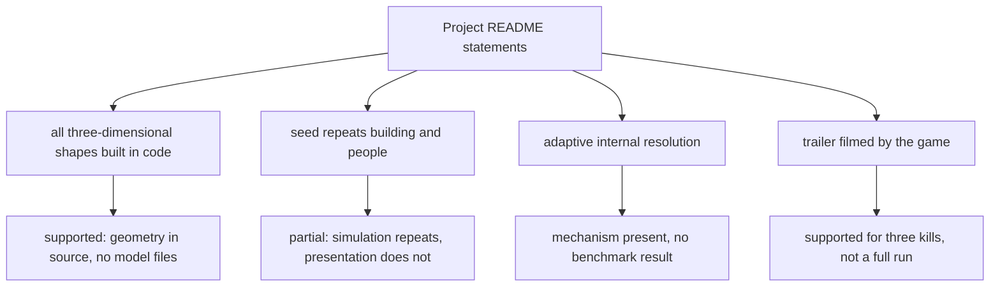
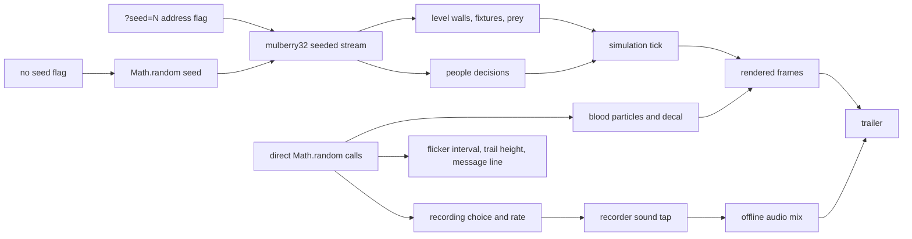

# 04 Limits and comparison: what the build does not claim

This document records the limits of FEED. It checks the statements in the project README against
the source. It lists the assets that ship but never load. It explains why the trailer is not a
complete run. It separates the deterministic part of the game from the random part. It records the
absent tests, the absent code licence and the unmeasured performance. It ends with a comparison
against four sibling packages in this container.

The reading is static. No game, browser, build, recorder or audio mixer was run. The project source
is at Git pin `81cdb6a`. The four sibling facts come from their published package READMEs only.
This document does not compare the sibling source trees.

## The claims and the evidence

The project README makes five kinds of statement. It makes a construction claim, a repeatability
claim, a performance claim, a trailer claim and a credit claim. The source supports the
construction claim. The source partly supports the repeatability claim. The performance claim is a
mechanism claim with no measured result. The trailer claim is true for the staged excerpt. The
credit claim is a record of asset sources, not a licence for the code.



The first claim is direct. It says that every three-dimensional (3D) shape is built in the source.

```text
# README.md:46-48
## What is in here

Everything 3D is built in code. There are no model files.
```

The source supports this claim. The level, the people, the clawed arms, the torch cones and the
monster body are built from three.js primitives and custom geometry. Three checks support the
"no model files" part. The file inventory lists no model file. The manifest lists three
packages, and none is a model loader. The nine modules import no model loader. No model file type
appears in the checkout. The package reads nine source modules of 2,699 lines and the recorder
of 437 lines, 3,136 lines in all. The level module is 509 lines and the people module is 629 lines.
The project uses downloaded images for surface colour, surface normal and surface roughness. It
uses downloaded recordings for sound. The claim is about three-dimensional shapes, so the image
files and the sound files do not contradict it.

The performance claim is a mechanism claim. The claim names the graphics processing unit (GPU) as
the device that sets the budget.

```text
# README.md:65-66
Performance: the game picks an internal resolution from your GPU (integrated chips get fewer pixels) and lowers it
further if frames run long. `1` and `2` override it.
```

The source contains that mechanism. It reads the GPU name through a Web Graphics Library (WebGL)
debug extension. It sets a pixel budget of 2.3 million, 1.1 million or 0.55 million pixels.
It lowers the scale by 13 percent when the mean frame time is above 0.0185 seconds. It stops at a
scale of 0.55. The source does not contain a frame rate result, a device list or a benchmark
script. The README does not give a play frame rate. It gives the trailer rate of 30 frames per
second. The claim is therefore true as a description of the
code. It is not evidence of a target frame rate on a named machine. Document
[03](03-workflow-and-quality.md) gives the full budget.

The credit claim names the asset libraries. The assets use Creative Commons Zero (CC0) terms and
the Mixkit Sound Effects Free License.

```text
# README.md:77-86
## Credits

Code and procedural geometry are original. The assets come from free libraries:

- **Textures**: Poly Haven and ambientCG, all CC0. See [public/assets/textures/CREDITS.md](public/assets/textures/CREDITS.md).
- **Sound effects**: recordings from freesound.org (CC0) and Mixkit (Mixkit Sound Effects Free License).
  Nothing was synthesized. Every file, author and source is listed in
  [public/assets/sfx/CREDITS.md](public/assets/sfx/CREDITS.md). The Mixkit files are included as part of this game;
  if you want them for something else, get them from Mixkit.
- **Engine**: [three.js](https://threejs.org).
```

The word "original" describes the authorship of the code and the geometry. It does not grant a
reuse licence. The README gives the asset terms. The texture files are CC0. The sound files are
CC0 or under the Mixkit Sound Effects Free License. The source contains
no licence file for the code. The package manifest has no licence field. The next sections treat
that absence as a limit.

The repeatability claim is narrower than it first appears. The README says that `?seed=7` gives
the same building and the same people every time (`README.md:44`). The source supports that narrow
claim. The seed drives one random stream. The level and the people read that stream. The same seed
therefore rebuilds the same walls, the same fixtures and the same eight people. The claim does not
cover the sound mix, the blood particles or the message choice. Those use a separate random
source. The section on determinism gives the lines.

| Claim | Source evidence | Verdict |
|---|---|---|
| All 3D is built in code | geometry calls in nine modules; no model folder | supported |
| No model files | no model loader; no model asset folder | supported |
| Seed repeats building and people | one seeded stream for level and people | supported, narrow |
| Adaptive internal resolution | GPU test, pixel budget, frame-time check | mechanism present |
| Frame rate result | no benchmark, no result in source or README | not stated |
| Asset licences | README credits and two CREDITS files | recorded, not verified |
| Code licence | no licence file, no manifest field | absent |

The table is the claim ledger. A supported claim is a statement about the source. It is not a
statement about a browser session. This package did not observe a session.

## The limits of the game

FEED is one small game with one building. The building is a square of 98 metres. The level grid is
49 cells each side. Each cell is 2 metres. The source has one level constructor call
(`src/main.js:321`) and no level table. The level data is generated at load, not stored in a table.
The source does not contain a second map, a chapter system or a level editor. A new level
needs a new seed or a code change. The README offers only a seed switch.

The cast is fixed at eight people. The constant `TOTAL_PREY` is 8 (`src/main.js:65`). The spawn
loop creates one person per free macro-cell spot. The source does not read a difficulty value and
does not scale the count. The hunger rate, the vision range and the hearing range are constants.
The page has no difficulty switch.

```text
# src/main.js:339-342
  for (let i = 0; i < TOTAL_PREY; i++) {
    const c = spots[i];
    G.prey.push(new Prey(G, c.x + (rng() - 0.5) * 2, c.z + (rng() - 0.5) * 2, rng, i));
  }
```

The loop reads the seeded stream for the spawn offset. The same seed therefore gives the same
eight positions. The loop does not test the result. The macro centres are open by construction.
The source does not assert that every spawn cell is walkable.

The game has no persistence. A search of all nine modules finds no `localStorage`, no
`sessionStorage` and no `indexedDB` call. These are browser storage interfaces. A reload starts a new run with a
new hunger value. It also gets a new random seed unless the uniform resource locator (URL) holds a
fixed seed. With a fixed seed, the building and the people repeat. The source has no save format,
no resume file and no run history. The record of a run is the tally during play and the end screen.
Nothing survives a page unload.

The install path is a progressive web application (PWA) path. The page links a manifest. The
manifest gives the name, the start address, the fullscreen display mode, the landscape orientation
and two icons. The package inventory lists no service worker file. The nine modules register no
service worker. A service worker is a background browser script that can cache files. The install path therefore
gives a fullscreen home-screen entry, not an offline cache. A user without a network connection
cannot rely on the game starting after a first visit.

The player cannot die from a person. The source has no damage path from a person to the player.
The people run, scream, freeze and cower. They do not attack. The run ends when hunger reaches zero
or three seconds after the eighth person falls. The source gives no second life and no health value
for the player. This is a design limit, not a missing branch. It follows from the inversion: the player is
the threat, so the fear is the feedback and hunger is the clock.

The page has no settings screen. The source contains no key binding editor, no volume control and
no difficulty switch. The only manual quality control is the `1` and `2` key pair. That pair
changes the resolution boost. The source does not contain a gamepad path. The phone path is the
second input path. The desktop path is the keyboard and mouse path.

These limits are small in code and large in reach. The game is a single encounter in a single
building. It has no progression beyond the eight kills. It has no reason to replay a solved seed
except to see a different generated building or to play the same hunt again. The source keeps no best time,
no score and no results table. The win screen shows the elapsed time. The loss screen shows the
kill count. The source does not keep a run history. The win timer is three
seconds.

## The assets that ship but do not load

The texture manifest lists seven sets. The loader loads four. The loader reads three maps from
each set. The manifest also lists an ambient occlusion map for five sets. Ambient occlusion is
shading for light blocked in corners. The loader never asks for that map. The texture folder holds
26 image files in the Joint Photographic Experts Group (JPEG) format. The game loads 12 of them.
The other 14 files ship in the deployment but never reach the GPU.

```text
# public/assets/textures/manifest.json:1-9
{
  "wall": { "maps": ["color", "normal", "roughness", "ao"], "source": "decrepit_wallpaper (Poly Haven)", "tileMeters": 2.5 },
  "carpet": { "maps": ["color", "normal", "roughness", "ao"], "source": "Carpet011 (ambientCG)", "tileMeters": 2 },
  "ceiling": { "maps": ["color", "normal", "roughness", "ao"], "source": "OfficeCeiling001 (ambientCG)", "tileMeters": 2 },
  "concrete": { "maps": ["color", "normal", "roughness", "ao"], "source": "dirty_concrete (Poly Haven)", "tileMeters": 3 },
  "tiles": { "maps": ["color", "normal", "roughness"], "source": "Tiles036 (ambientCG)", "tileMeters": 2 },
  "metal": { "maps": ["color", "normal", "roughness", "ao"], "source": "PaintedMetal013 (ambientCG)", "tileMeters": 2 },
  "wall_alt": { "maps": ["color", "normal", "roughness"], "source": "Wallpaper002B (ambientCG)", "tileMeters": 2 }
}
```

The loader names its four sets in one line. The comment states that the manifest lists spare sets.
The code and the manifest therefore agree on the intent.

```text
# src/assets.js:4-5
const SETS = ['wall', 'carpet', 'ceiling', 'concrete']; // the manifest lists a few spare sets too
const FALLBACK = { wall: '#b9a55c', carpet: '#7d6c45', ceiling: '#b5b09c', concrete: '#77736a', tiles: '#b9b9b0', metal: '#5a4a3c' };
```

The loader loop reads the manifest entry for each named set. It builds a set record with a tile
size and three map slots. It loads the colour map as a colour-space texture. It loads the normal
map and the roughness map as linear textures. It never reads the `ao` entry. A missing colour map becomes
a generated colour texture. A missing normal or roughness map stays null.

```text
# src/assets.js:26-40
  await Promise.all(SETS.map(async (name, i) => {
    const m = manifest[name];
    const set = { tile: (m && m.tileMeters) || 2, color: null, normal: null, roughness: null };
    if (m) {
      const maps = m.maps || ['color', 'normal', 'roughness'];
      const [c, n, r] = await Promise.all([
        maps.includes('color') ? load(`/assets/textures/${name}/color.jpg`, true) : null,
        maps.includes('normal') ? load(`/assets/textures/${name}/normal.jpg`, false) : null,
        maps.includes('roughness') ? load(`/assets/textures/${name}/roughness.jpg`, false) : null,
      ]);
      set.color = c; set.normal = n; set.roughness = r;
    }
    if (!set.color) set.color = fallbackColorTexture(FALLBACK[name], 100 + i);
    out[name] = set;
  }));
```

The count follows from the code. Four loaded sets supply three maps each, so 12 files load. The
manifest lists 26 map names. The unused 14 files are the four ambient occlusion maps for the four
loaded sets, the three tiles maps, the four metal maps and the three wall_alt maps. The fifth
ambient occlusion map belongs to the metal set, so it is one of the four metal files. The fallback
table also names tiles and metal. That table is a colour fallback, not a load path. A fallback
colour appears only when a loaded set has no colour map.

The files still reach the browser build. Vite copies the whole `public` folder into `dist`. The
deployment is a static file set. The unused files are therefore part of the upload and of the
deployed file set. The game does not request them, so they do not enter the download of a play
session and do not consume GPU memory. The source does not state their byte size.
This package did not measure the deployment size.

**Aha:** The texture manifest is a catalogue, not a load list. The loader's `SETS` array is the
real load list, and the manifest only supplies the tile size and the map names for those four
entries. The seven-set manifest and the 26 files suggest a larger material library than the game
uses. The source comment admits the spare sets. The loader does not request them. The spare
files are not a broken reference. A reader who counts manifest entries will overstate the shipped material set by
three sets and 14 files.

This limit has a small cost and a clear fix. A build step could copy only the 12 used files. The
checkout has no such step. A developer who wants a smaller deployment must add one or move the
unused files out of `public`. The source gives no reason for the spare files. This package records
the fact and does not guess the intent.

## The trailer stops at three kills

The README makes the trailer claim in one paragraph.

```text
# README.md:70-75
`media/feed-gameplay.mp4` (1280×720, 30 fps, 45 s) was filmed by the game. `tools/record.js` is an autopilot that
plays the monster while the simulation is stepped one tick at a time: each kept frame is rendered at 1600×900, scaled
to 1280×720, composited with the HUD and posted to the dev server, and every sound call the game makes is replayed
into an offline mix. ffmpeg then joins the frames and the soundtrack. The comment at the top of that file has the
exact steps. The autopilot stages where the next person is standing so the film keeps its pace; the stalking,
the panic, the roar and the kills are the real game.
```

The game asks the player to catch eight people. The trailer recorder stops the hunt at three
kills. The cap is a constant in the recorder, not a game rule. The recorder also holds hunger at
a minimum of 0.2. The drain over 45 seconds is 0.3 hunger. Each kill adds 0.36 hunger. A take that
starts at 0.8 therefore cannot fall below 0.5. The film cannot show a starve-out even without the
floor. It also cannot show a complete win, because the cap is three kills.

```text
# tools/record.js:18
const MAX_KILLS = 3;
```

The director reads the cap in the chase phase. When the kill count reaches the cap, the director
stops pressing the strike control near a person. It keeps the movement keys on and continues the
chase. The film ends on that chase beat.

```text
# tools/record.js:340
        const keepOff = G.kills >= MAX_KILLS && dist < 4.5;
```

The recorder sets the hunger floor inside the tick loop. The line is in the block that document
[03](03-workflow-and-quality.md) quotes, so this document cites it without a second copy. The
value is `G.hunger = Math.max(G.hunger, 0.2)`. The start hunger is 0.8. The drain is 1/150 per
second. A standard 45 second take therefore drains 0.3 hunger and cannot fall below 0.5. Each kill
adds 0.36 and can raise the value to the cap of 1. The 0.2 floor does not bind in that take. The
value stays at or above 0.5, which is above the 0.25 warning value, so the warning never appears.
The floor matters only for a longer take or a lower start. The source does not state why the
recorder adds it. The recording is still a staged excerpt, because the recorder places the opening
position and the director places each victim.

The recorder stages the opening. It places the player in a lit room near the level centre and turns
the view down the longest open line. The autopilot stages the people. It moves the next person to a chosen path distance from the
monster. The default stalk list is 13, 17, 17 and 16 cells, which is 26, 34, 34 and 32 metres.
The staging picks a cell that is out of sight and preferably lit. The director then walks the
monster toward that cell. Movement sets the real key state, and the roar and the strike go through
the real event handlers. The kill follows from the strike in the real simulation. The look
direction and the setup of each victim do not.

The arithmetic is simple. Eight people enter. The cap permits three kills in 45 seconds. At least
five people remain alive when the film ends. The film cannot show the win condition. It cannot
show the hunger failure either. A 45 second take drains 0.3 hunger from 0.8, and each kill adds
0.36. The value stays at or above 0.5. The film is too short to starve. The trailer is a
demonstration of the hunt loop, not a proof of a complete run.

**Aha:** The trailer cannot show a win, and the constants show why. The game
needs eight kills. The recorder permits three. The recorder also raises hunger to at least 0.2 on
every tick, but the standard take cannot fall below 0.5 and does not reach that floor. A viewer sees a real
chase, a real roar, a real strike and a real kill. A viewer does
not see a full run, a starve-out or the win timer. The recorder is an authoring tool with a staged
storyboard, not a playthrough. The README describes it as an autopilot that plays the monster, and
that description is accurate for the part it films.

The cap is not a defect in the film. The 45 second timeline holds four stalk distances (13, 17, 17
and 16 cells) and three kills. The director has six named phases: intro, smell, stalk, chase, feed
and outro (`tools/record.js:301-364`, `:374`). The last beat is a roar down a corridor at the people
who remain. The result is a complete short film with an open ending. The
cost is that the film is weak evidence for the end state of the game. A reader who wants evidence
for the win path must read the game code, not the trailer.

The same limit applies to the sound mix. The recorder taps the real sound calls and mixes them
offline. The mix is the sound of the staged take. It is not the sound of a complete run. The
source does not state a loudness target or a listening test. Document
[03](03-workflow-and-quality.md) gives the mix values.

## Determinism is split in two

The seed controls the building and the people. It does not control every random choice. The
source has one seeded stream and several direct calls to the browser random function. The split is
the main repeatability limit.

```text
# src/main.js:15
const SEED = Number(new URLSearchParams(location.search).get('seed')) || (Math.random() * 1e9) | 0;
```

The line has two paths. A numeric `seed` query value other than zero becomes the seed. A missing,
zero or non-numeric value falls back to `Math.random`. The default page load therefore builds a different level on each load. The
README tells the reader to add `?seed=7` for a repeated building. That instruction is necessary,
not optional.

The seeded stream is `mulberry32(SEED)`. The level reads it for the wall choices, the doorway
choices, the pillar choices, the fixture states and the prey placement. The people read it for
wander targets and other decisions. Document [02](02-core-mechanism.md) gives the generation
chain. The same code and the same seed give the same building and the same people.

The direct calls are outside that stream. The sound system picks a recording from a list with
`Math.random`. It also varies the playback rate with `Math.random` (`src/audio.js:55`, `:68`).

```text
# src/audio.js:44-48
  _pick(key) {
    const a = this.buf[key];
    if (!a || !a.length) return null;
    return a[Math.floor(Math.random() * a.length)];
  }
```

The blood system uses `Math.random` for the start position, the direction, the speed and the
upward velocity of each particle. The blood decal rotation and the decal size also use it
(`src/main.js:289-292`).

```text
# src/main.js:123-131
function spawnBlood(x, y, z, dx, dz, n = 80) {
  for (let i = 0; i < n; i++) {
    const j = bNext; bNext = (bNext + 1) % BMAX;
    bPos[j * 3] = x; bPos[j * 3 + 1] = y + (Math.random() - 0.5) * 0.5; bPos[j * 3 + 2] = z;
    const a = Math.random() * Math.PI * 2, s = Math.random() * 3.2;
    bVel[j * 3] = Math.cos(a) * s + dx * 2.2; bVel[j * 3 + 1] = 1 + Math.random() * 4.2; bVel[j * 3 + 2] = Math.sin(a) * s + dz * 2.2;
    bLife[j] = 1.6;
  }
}
```

The flicker sound interval also uses `Math.random`. The smell trail adds a random height to each
trail point (`src/main.js:203`). The message picker chooses a line with `Math.random`
(`src/main.js:273`).

```text
# src/main.js:640-645
  zapT -= dt;
  if (zapT <= 0) {
    zapT = 2.5 + Math.random() * 5;
    const f = level.nearestFlicker(player.pos.x, player.pos.z, 16);
    if (f) { vTmp.set(f.x, 2.9, f.z); audio.playAt('flicker', vTmp, 0.5, { ref: 3 }); }
  }
```

The split matters because the recorder taps the sound calls. A different recording and a
different playback rate produce a different offline mix. The mix is not bit-identical between two
takes. The blood particles can differ in a kept frame. The flicker sound can occur at a different
time. The message line can differ. The simulation state can still follow the same path when the
seed is fixed, because these calls do not feed the level, the people or the player.

The source does not record a hash of a take. It does not compare two takes. The dry mode of the
recorder is a rehearsal that renders no frame and mixes no sound. It reports a kill count and a
log, but it does not compare them with a stored result. A
developer who wants a repeatable film must fix the sound choices and the visual particles as well
as the seed. The source does not offer a switch for that.



**Aha:** The seed protects the simulation, not the film. The level and the people repeat because
they read one seeded stream. The sound mix and the blood particles do not repeat because they read
the browser random function. A recorded take is therefore repeatable in its motion and not
repeatable in its surface. The README's promise is exact: the same building and the same people.
It does not promise the same recording.

The split has a visible effect. Sound variety and blood variety keep repeated actions from looking
and sounding identical. The cost is that the trailer pipeline cannot claim a byte-identical output. The
source does not claim one. This package records the gap because a reader may assume that a seed
makes the whole run repeatable.

## The checks that are absent

The package manifest has three scripts. It has no test script, no lint script and no type check
script. The scripts start the development server, build the bundle and preview the bundle.

```text
# package.json:7-11
  "scripts": {
    "dev": "vite --port 5199 --strictPort",
    "build": "vite build",
    "preview": "vite preview --port 5199"
  },
```

The checkout has no test file. A file name search for `test` or `spec` returns nothing. The
checkout has no `.github` folder, so it has no continuous integration (CI) workflow. It has no
linter configuration. It has no `tsconfig.json` and no type checker configuration. It has no
visual regression tool. It has no performance test.

The source has runtime guards, but a guard is not a test. Document
[03](03-workflow-and-quality.md) lists them. They stop some failures. They do not prove a
property. The source has no assertion that
the level is connected after generation. The union-find repair is the proof in the code, but no
runtime check confirms the result. The source has no assertion that all eight people spawn on a
walkable cell. The source has no assertion that a kill is reachable. The source has no assertion
that the win timer fires.

The closest check is the dry mode of the trailer recorder, described in document
[03](03-workflow-and-quality.md). It reports a log, a frame count and a kill count. It does not
compare the kill count with a target and does not fail on a low count. A developer can read the
number. The tool does not judge it.

The absence of tests is a real limit for a small game. The generator, the union-find repair, the
light bake, the perception maths and the kill test have no unit test. The page has no integration
test. The trailer has no frame comparison. The adaptive scale has no recorded benchmark. A change
to a constant can alter the balance with no check. The source is small enough to read, and this
package reads it. A team that changes the game has no test to catch a regression.

## The missing code licence and the unmeasured performance

The checkout has no licence file. The tracked root files are `.gitignore`, `.vercelignore`,
`README.md`, `index.html`, `package-lock.json`, `package.json`, `vercel.json` and `vite.config.js`.
No `LICENSE` file is in that list. The package manifest has no `license` field. It gives the name,
the version, the description, the module type, the scripts and the dependencies.

The README says that the code and the procedural geometry are original. It gives the asset
licences. It does not state the terms for reuse of the code. A reader therefore has no stated
permission to copy, modify or redistribute the code. This package does not give legal advice. It
records the absence of a stated licence. A person who wants to reuse the code must ask the author.

The performance position is similar. The source has a careful budget and a feedback loop. It has
no measured result. The README describes the mechanism and gives no play frame rate. The source has
no benchmark script and no recorded frame time. The console prints the shader warm time. That value
is a load time, not a frame time. The source does not print a frame rate.

The package therefore cannot claim a frame rate on any device. It cannot claim that the phone
path holds a playable rate. It cannot claim that the scale floor is enough on a slow machine. It
can claim that the code reacts to slow frames. The reaction is a design, not a result.

The deployment position is also unverified. The README gives a live address. The `vercel.json`
file gives a static build. The package did not open the address. The source does not contain a
health check, a rollback plan or a version tag. The Git history has five commits at the time of
this reading. The package reads one pin.

## Comparison with four sibling worlds

The container holds four sibling packages. Each one builds a world in a browser. Each one has a
published package README. The comparison uses those READMEs only. It does not read the sibling
source. The sibling counts and paths below come from their READMEs. The FEED counts come from the
pinned checkout. The table gives the published facts that matter for this comparison. The table uses five short forms.
WebGL2 means Web Graphics Library version 2. WebGPU is the newer web graphics interface. PBR means
physically based rendering. MIT means the Massachusetts Institute of Technology licence. HDR means
high dynamic range. A tracked file is a file in the Git index. A world module is one source module
that builds part of a world. A shot is one rendered still. A light probe is a sample point that
stores the light that arrives at one place. FEED's 94 tracked files are the `git ls-files` count in
the pinned checkout.

| Project | Form | Renderer | Published scale | Asset policy | Code licence | Verification path |
|---|---|---|---|---|---|---|
| FEED | first-person horror game | WebGL2 | 94 tracked files, nine modules, 3,136 lines with the recorder | code geometry, downloaded CC0 textures, CC0 or Mixkit sounds | none stated | recorder dry mode only |
| [athenaion](../../athenaion/markdown/README.md) | procedural ancient Greek world, stills and film | WebGL2 | 15 world modules, 168 JavaScript modules under `src` | no image, model or audio input | MIT | static reading, no run |
| [casa-ocaso](../../casa-ocaso/markdown/README.md) | measured real-time room | WebGPU | 193 tracked files, eight shots, 1,728 light probes | six HDR panoramas, 44 texture maps, six models | `LICENSE` file present | capture and compare tools |
| [valle-morta](../../valle-morta/markdown/README.md) | first-person zombie shooter | WebGL2 | 524 tracked files, 39 source files, 250 tool files | all visual assets from code, 22 PBR sets | MIT | playtest and performance tools |
| [unsung-vale](../../unsung-vale/markdown/README.md) | third-person role-playing game | WebGL2 | 239 tracked files | every mesh and texture from code, audio outside | MIT for code | world bake and browser tools |

The first difference is the asset policy. Athenaion takes no image, model or audio input. Valle
Morta builds every visual asset from code. Unsung Vale builds every mesh and texture from code,
and takes its audio from outside. FEED builds every three-dimensional shape in code, but takes its
surface maps and its sounds from free libraries. Casa Ocaso is the most asset-driven of the five:
it measures six high dynamic range panoramas and ships six models and 44 texture maps.

FEED therefore sits between the pure code worlds and the measured room. Its geometry is
procedural. Its surfaces are photographic. Its sound is recorded. The README is honest about that
mix. The texture files are CC0 and the sound files are CC0 or Mixkit. The split is a practical
choice for a small game. It also means that FEED cannot claim that every pixel comes from code.

The second difference is the renderer. All five published READMEs name three.js. FEED, athenaion,
valle-morta and unsung-vale run it on WebGL2. Casa Ocaso runs it on WebGPU. The four WebGL2
projects share the same broad platform constraint. Casa Ocaso targets the newer browser interface.
The published READMEs give a frame rate or a target for two of the five. Unsung Vale records
about 60, 52, 45 and 39 frames per second on its four presets
(`unsung-vale/markdown/README.md:163`). The figures come from the sibling README, not from FEED
source. The record assumes an idle machine.
Valle Morta gives a design target
of 60 frames per second at 1280 by 720. The target names the high preset and an integrated
graphics device. No measurement was made.
The Casa Ocaso exploration records no verified frame rate. Athenaion gives no rate. FEED gives no
play frame rate. A smoothness comparison across the five is therefore not possible.

The third difference is scale. FEED has the fewest tracked files of the four packages that publish
a count: 94, against 193 for Casa Ocaso, 239 for Unsung Vale and 524 for Valle Morta. It has nine
source modules and 3,136 lines with the recorder, against 39 source files and 250 tool files in Valle Morta and 168 JavaScript
modules under `src` in Athenaion. The file count is not a quality measure. It does show the scope
difference.
FEED is a single encounter. The siblings build a landscape, a room, a valley or a role-playing
journey.

The fourth difference is the bake. FEED bakes a two-dimensional light grid at load. Casa Ocaso
bakes an 18 by 6 by 16 probe grid before the run. Valle Morta bakes terrain heights to
files. Unsung Vale bakes height maps with a Node.js builder, which is a build script that runs
outside the browser. Athenaion uses an analytic height function and accumulates render passes,
which are separate drawing stages that together make one frame. FEED generates its whole level in
the browser at load. Its bake is a light bake
over a generated level, not a world file. That choice keeps the
checkout small. It also means that every page load pays the generation cost. The source prints the
shader warm time, not the generation time.

The fifth difference is verification. Valle Morta publishes a playtest tool and a performance
tool. Unsung Vale publishes a world bake and browser tools. Casa Ocaso publishes capture and
compare tools. Athenaion publishes a film path. FEED publishes a trailer recorder with a dry
mode. The five READMEs name different verification paths, and FEED names the smallest set. FEED
also has no code licence. Its source splits the seed between simulation and presentation.

The sixth difference is the game form. FEED is a first-person horror game with an inversion: the
player is the monster. Valle Morta is a first-person shooter. Unsung Vale is a third-person
role-playing game. Athenaion is a still and film renderer. Casa Ocaso is a real-time room study.
The inversion is not a technical feature. It shapes the systems. The light grid is a visibility
value. The people's fear is the feedback. Hunger is the only clock. The four sibling READMEs
describe no such loop.

The comparison gives FEED a clear place. It has the fewest tracked files of the four packages that
publish a count, and its loop is a single hunt. It names one verification tool: the recorder dry
mode. Its architecture is coherent for its size.
Its limits are scope, repeatability of presentation, absent tests and absent code terms. The
siblings show what a larger budget buys: more world, more tools, more assets and a stated
licence. They do not show that FEED's core loop is wrong. They show how small it is.

## What this document does not claim

This document does not claim that the game is fun, scary or balanced. It does not claim that the
phone path works on a named device. It does not claim that the deployment is live. It does not
claim that the asset licences are valid. It does not claim that the trailer is a full run. It does
not claim a frame rate.

It does not read the sibling source trees. The sibling facts come from their package READMEs. A
sibling README may simplify its project. This document treats each README as the published
statement of that package. It does not verify the statement.

The limits above are not a defect list. Some are deliberate design choices. The fixed cast, the
single building and the protected hunger in the trailer are choices. The unused texture sets are
unused by the loader. The absent code licence and the absent tests are gaps. The difference matters. A choice
can be judged as a design. A gap needs a decision.

[Previous: source to screen](03-workflow-and-quality.md) · [Back to the index](README.md).

Document [00](00-overview.md) gives the fiction and the play loop. Document
[01](01-architecture.md) gives the module graph and the shared state. Document
[02](02-core-mechanism.md) gives the generator, the light bake and one tick. Document
[03](03-workflow-and-quality.md) gives the development path, the build and the trailer.
