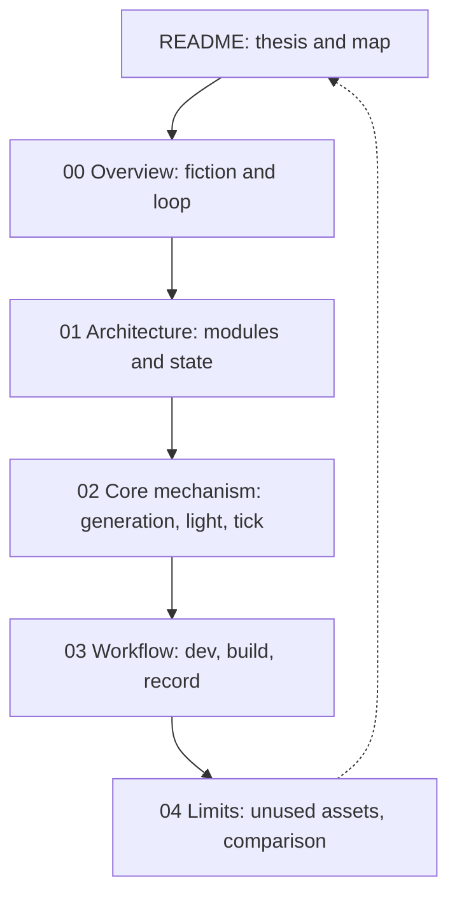

# FEED: the player is the monster

FEED is a first-person horror game in a Backrooms building. The inversion is the whole design.
The player is not a person who runs from a monster. The player is the monster. Eight people enter
the building. Most carry torches. The player must catch all eight before hunger reaches zero. The source
states this in `index.html` and in the game state at `src/main.js:65-69`. The title screen says
"they wandered in. you were already here."

The inversion changes every system. The lighting is not only a look. The baked light value also
sets how far a person can see the monster. The people are not only targets. Their fear, their
screams and their panic spread are the feedback that tells the player the hunt is working. The
monster's three senses are not a menu. Sight is the camera. Hearing is the sound mix. Smell is a
rendering mode that draws body heat and scent trails through walls. Hunger is the only clock.
No person can kill the player. The run ends when hunger reaches zero, or three seconds after the
eighth person falls.

This package reads the source at Git pin `81cdb6a`. It does not run the game. It does not build
the bundle. It does not open a browser. It does not play the trailer or listen to the audio. Every
claim below comes from the source, the manifests or the project README. Where the source gives no
value, this package says so.

## Terms

| Term | Meaning |
|---|---|
| Backrooms | the endless yellow office space of the fiction |
| monster | the player character, a tall antlered creature |
| prey, person | one of the eight people who enter the building |
| cell | one square of the level grid, 2 metres across |
| macro cell | a 4 by 4 block of cells |
| macro graph | the 12 by 12 grid of macro cells |
| fixture | one ceiling light panel |
| light grid | the baked table of light values, two texels per cell |
| texel | one pixel of the baked light grid, one metre across |
| union-find | a structure that tracks separate groups and merges them |
| sense value | a smoothed number from 0 to 1 that rises while the player smells |
| hunger | the player resource that falls from 0.8 to 0 and ends the run |
| stamina | the player resource that limits running |
| fear | a value the states raise; it sets the face, the tremor and the heartbeat |
| panic | the alert that a scream sends to other people within 15 metres |
| smelling, sense | the player mode that reveals body heat through walls |
| roar | the player action that freezes nearby people |
| bake | a value computed once at load, not each frame |
| shader | a small program that runs on the graphics processing unit |
| BFS | breadth-first search; here a grid distance field in cells |
| LOS | line of sight; here a grid traversal between two points |
| DDA | digital differential analyser; the grid traversal method |
| PBR | physically based rendering; the texture and material model |
| HUD | heads-up display; the hunger bar, stamina bar and tally |
| FOV | field of view; the camera angle in degrees |
| GPU | graphics processing unit; the render device |
| HTML | HyperText Markup Language; the page |
| CSS | Cascading Style Sheets; the page style |
| JSON | JavaScript Object Notation; the asset manifests |
| URL | uniform resource locator; the page address |
| API | application programming interface; here the development hooks |
| DOM | document object model; the page tree |
| WAV | Waveform Audio File Format; the trailer soundtrack |
| JPEG | Joint Photographic Experts Group; the trailer frame format |
| MP3 | MPEG-1 Audio Layer III; the sound effect format |
| CC0 | Creative Commons Zero; the texture and sound licence |
| PWA | progressive web application; the phone install path |
| FPS | frames per second; the render rate |
| three.js | the JavaScript three-dimensional scene library |
| Vite | the development server and build tool |

## Package map



The map follows the reader's path. The overview gives the fiction and the play loop. The
architecture gives the modules and the shared state. The core mechanism follows one tick through
generation, light, movement and the kill test. The workflow follows a developer from local play to
the trailer. The limits document records what the project does not do and compares it with four
sibling worlds in this container. The dotted arrow closes the loop: the limits show where the
mechanism stops.

## Documents

| Document | Question it answers |
|---|---|
| [00-overview.md](00-overview.md) | What is the fiction, what does the player do, and what is one frame? |
| [01-architecture.md](01-architecture.md) | How do the nine modules, the scene graph and the shared state fit together? |
| [02-core-mechanism.md](02-core-mechanism.md) | How does the game turn a seed into a lit building and one simulation tick? |
| [03-workflow-and-quality.md](03-workflow-and-quality.md) | How does a change reach the browser, the phone and the trailer? |
| [04-limits-and-comparison.md](04-limits-and-comparison.md) | What does the project not do, and how does it compare with four siblings? |

Each deep dive repeats the terms it needs. Documents 00 and 01 give the fiction, the module map and
the game state. The term table is above. A reader who starts at document 02 should keep the term
table at hand and read the module map in document 01 first.

## What the source states

The project manifest gives the name, the version and the scripts.

```text
# package.json:1-9
{
  "name": "feed",
  "private": true,
  "version": "0.1.0",
  "description": "Backrooms horror where you are the monster. three.js, everything 3D built in code.",
  "type": "module",
  "scripts": {
    "dev": "vite --port 5199 --strictPort",
    "build": "vite build",
```

The game state holds the prey count and the starting hunger.

```text
# src/main.js:65-69
const TOTAL_PREY = 8;
const G = {
  scene, camera, rng, time: 0, elapsed: 0, state: 'loading', prey: [], kills: 0, total: TOTAL_PREY,
  hunger: 0.8, hitstop: 0, blood: 0, caKick: 0, winT: -1, warned: false,
};
```

The title screen gives the controls in the words that the player sees.

```text
# index.html:111-119
  <div id="title" class="screen">
    <h1>FEED</h1>
    <p class="sub">they wandered in. you were already here.</p>
    <p class="go" id="go">waking</p>
    <div class="keys" id="keys">
      <b>W A S D</b> stalk &nbsp;·&nbsp; <b>shift</b> run them down &nbsp;·&nbsp; <b>click</b> tear<br>
      <b>hold right click</b> smell their fear &nbsp;·&nbsp; <b>R</b> roar &nbsp;·&nbsp; <b>1 / 2</b> faster / sharper
    </div>
  </div>
```

The project README gives the short pitch and the asset rule.

```text
# README.md:3-8
A Backrooms horror game where **you are the thing in the rooms**.

**▶ Play it: https://feed-backrooms.vercel.app** (desktop with keyboard and mouse, or a phone held sideways)

They noclipped in with torches and no idea where they are. You were already here, and you are hungry.
Stalk the yellow corridors, smell their body heat through the walls, and catch all eight before you starve.
```

The project states that every three-dimensional object is built in code. It states that there are
no model files. The nine JavaScript modules total 2,699 lines. The package total is 3,136 lines
with `tools/record.js`. The level is one 98 metre square. The source does not state a different
level size.

## Reading order

1. Read this file. It gives the thesis, the map, the terms and the non-claims.
2. Read [00-overview.md](00-overview.md). It describes the fiction, the controls, the play loop,
   the eight people, the three senses and one frame at a high level.
3. Read [01-architecture.md](01-architecture.md). It describes the nine modules, the import graph,
   the scene graph, the shared uniform object, the light pools and the initialization order.
4. Read [02-core-mechanism.md](02-core-mechanism.md). It follows the seed into the macro graph,
   the micro walls and the fixtures. It then follows the light bake, the material patch, movement
   and perception. It ends with the kill test, the smell rendering and the post stack. It is the
   centrepiece.
5. Read [03-workflow-and-quality.md](03-workflow-and-quality.md). It follows local development,
   the production build, the phone path, the performance budget and the trailer pipeline. It
   states which checks exist and which do not.
6. Read [04-limits-and-comparison.md](04-limits-and-comparison.md). It lists the hard limits, the
   unused assets, the determinism gap, the absent tests and the sibling comparison.

## The play loop in one minute

The player starts at the centre of macro cell (6, 6). The four movement keys W, A, S and D move
the monster. The mouse turns the view. A held
shift key runs. Running drains stamina at 0.16 per second, and walking restores it at 0.12 per
second. Exhaustion starts at zero stamina and ends at 0.3 stamina. Smelling multiplies the move
speed by 0.42, so the player must choose between speed and information.

A left click winds up a claw strike. The strike lands after 0.42 of a 0.5 second animation and
adds a forward lunge of 8 metres per second. The cooldown is 0.72 seconds. A roar has an 11 second
cooldown. It freezes every person within 14 metres. Beyond 14 metres, only a person who is
wandering becomes alert to the player's position. The roar also raises the
camera field of view (FOV) by 8 degrees for 0.8 seconds and adds a shake.

Hunger starts at 0.8. It falls at 1/150 per second, so it reaches zero after 120 seconds from the
start. Each kill adds 0.36 and is capped at 1. A warning message appears below 0.25. The run ends
in one of two ways. Hunger reaches zero, or all eight people fall. The source does not give the
player a second life and does not give the people a way to hurt the player.

## The building and its eight people

The building is one square of 98 metres. The level grid is 49 cells each side, and each cell is 2
metres. The 49 value is 12 macro cells times 4 cells, plus one closing row and column. A 12 by 12
macro graph sets the room walls. Each interior partition is open, a wall, or a wall with a
doorway. A union-find pass tracks groups of macro cells. It reopens one closed wall for each merge
that joins two separate groups, so every room is reachable. A sealed pair is two
neighbouring macro cells whose shared edge is closed and whose groups differ. The source states
this guarantee in `src/level.js:148-153`. The generator is the subject of
[02](02-core-mechanism.md), so this file gives only the shape.

One ceiling panel sits over each macro cell, so the level has 144 panels. A panel is dead, steady
or flickering. The dead probability rises with a separate low-frequency dark field. A field is a 5
by 5 lattice of random values with smooth interpolation. The generator builds a second 5
by 5 lattice, the density field, which sets each wall probability. Each panel feeds the baked light
grid. A
small pool of real spotlights follows the nearest working panels, so the shader light count never
changes.

Eight people enter the building. Each person uses shared low-poly shapes, which are shapes with
few faces. The shapes are a five-sided limb cylinder, a six-sided torso, an icosahedron head
(a 20-sided solid), boxes, a tube and an open cone for the torch beam. Each person gets a skin,
shirt, pants and hair colour from short palettes. Most people carry a torch in the right hand.
Every person has a thermal ghost copy (a second copy of each body mesh drawn hot and through
walls), a beating heart and a body-heat halo for the smell mode. A state machine is the named state and
the rules that move a person between states. Fear shows on the face: the eyes grow, the pupils
shrink, the brows tilt and the mouth opens. Fear also adds a tremor to the limbs.

## The three senses

Sight is the camera and the people's vision. The player sees the world through a warped lens with
grain and colour fringing. Each person sees the monster only if three tests pass. The person needs
a grid line of sight (LOS) to the monster. The monster must lie inside the view cone. The cone
half-angle is 1.3 radians on each side of the person's facing direction. The monster must also lie
inside a range. The range is 6.5 metres plus 15 metres times a light factor from 0 to 1. A lit
monster is visible from up to 21.5 metres. A monster in the dark is visible from 6.5 metres. A
working torch raises the range to at least 15 metres when the monster is within 0.42 radians of the
person's facing direction. Fleeing and cowering people add 6 metres, but the LOS test stops at 26 metres. The effective
maximum is therefore 26 metres for those people. Within 3 metres, the cone test is skipped, but LOS
is still required. The dark therefore hides the player, and the level light grid is a gameplay
value.

Smell is a rendering mode. The world dims to `1 - 0.86 * sense`. The value `sense` is a smoothed
number from 0 to 1 that rises while the player holds the smell control. The light grid intensity,
the panel colour and the post-process colour all follow the same value. Thermal ghosts, hearts,
halos and scent trails draw with depth testing off. The depth test normally hides a pixel behind a
nearer surface. With the test off, a wall does not hide these layers. The player can track a person
through a wall. Scent trails keep 44 points per person (`src/main.js:152`), live 32 seconds
(`:168`) and appear only above sense 0.02 (`:212`).

Hearing is two systems. The game plays positional sounds for people's steps and screams. It plays
other sounds for the monster, the interface and the looped heartbeat. The people also have a
hearing test. A person hears the monster at 2.4 metres. A
person hears a running monster at 9.5 metres. A scream spreads panic to other people within 15
metres. A scream drives both the sound mix and the panic spread from one function.

## Why the package is worth reading

The project is small, but it joins several mechanisms without a game engine. One material patch
serves walls, floors, people and claws. Two shader variants cover every surface, and the
differences are uniforms. One baked light grid serves both the visual light and the gameplay
visibility. The game holds one monster breadth-first search (BFS) field for fleeing. Each person
holds a separate BFS field for its wander target. A fixed pool of lights moves between fixtures,
so the shader program count stays fixed. The trailer recorder films the real game one tick at a
time and mixes the real sound calls after the take. The deep dives show how each mechanism works
and where it stops.

## Non-claims

This package is a static reading. It does not run the game, the development server, the production
build, the trailer recorder or the audio mixer. It does not open the trailer file or the three
still images. It does not use the network. It does not install a dependency.

No frame was rendered for this package. The visual descriptions come from the shader source, the
material source and the project README. The project README calls the player controls and the
visual effects, and this package quotes that text as the project's own statement. It does not
verify the look.

No sound was played. The audio description comes from `src/audio.js` and
`public/assets/sfx/manifest.json`. The trailer mix is read from `tools/record.js`. The loudness,
the pan and the final waveform were not measured.

The performance values are code values. The render budget, the pixel-ratio cap, the frame-time
threshold and the scale-down factor come from `src/main.js`. The source does not include a
benchmark result. No script in the checkout measures frame rate. The section "The limits of the game" in document 04 states this limit.

The checkout has no licence file for the code. The project README gives the asset licences only.
The textures are Creative Commons Zero (CC0) and the sounds are Creative Commons Zero (CC0) or
Mixkit Sound Effects Free License. This package does not give legal advice and does not verify
those licences.

The determinism claim is narrow. One seed drives the level and the people. A take is deterministic
in motion only while the order of random calls stays fixed. Several presentation systems call
`Math.random` directly: the sound pick and rate, the blood sparks and decal, the flicker interval,
the scent trail height and the message choice. Those details differ between takes. Document 04
gives the lines.
