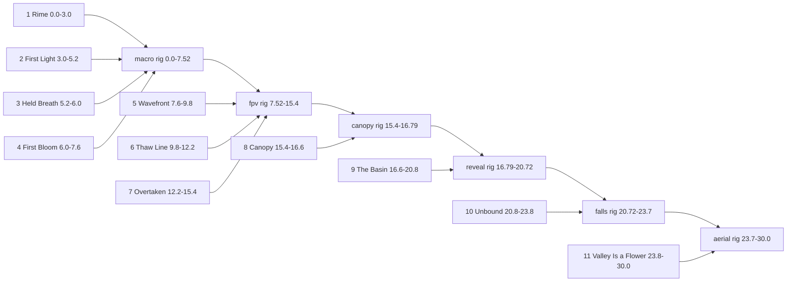
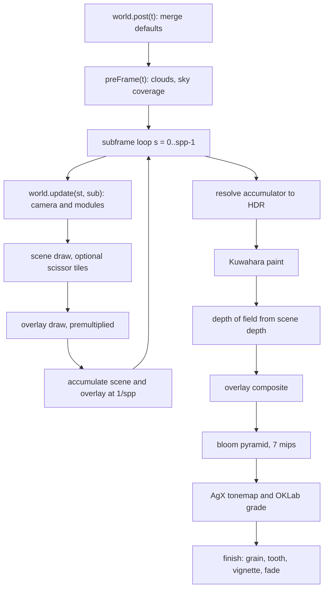

# Overview: eleven beats, six rigs, one frame

## Thesis

The film is a 30 second sequence at 30 frames per second (fps). It has eleven story beats in the concept document (`CONCEPT.json:6-93`). It has six camera rigs in the timeline (`src/world/timeline.js:26-33`). The two counts are not the same list. Several beats share one rig, and one rig can cross a beat boundary.

The world is evaluated one frame at a time. A frame is an average of several subframes. Each subframe has a time inside the shutter and a small projection offset. The engine then runs a fixed post chain over the averaged image (`src/engine.js:456-592`). The chain paints, blurs, composites particles, blooms, grades and finishes the image.

This document follows three views of the same film. First it follows the eleven beats as story events. Then it follows the six rigs as camera machines. Last it follows one output frame through the engine. The camera and the beat are different kinds of object, and the source keeps them separate.

**Aha:** The eleven beats are a writing structure. The six rigs are a render structure. The film feels continuous because the camera paths and the wave clock are locked to the same music times. A beat boundary does not force a cut, and a cut does not start a new beat.

## The eleven beats

The concept document gives each beat a start time, an end time, a camera note, a content note and a sound note. The times are in seconds. The list below quotes the start and end of each entry.

| Beat | Start | End | Name |
|---|---:|---:|---|
| 1 | 0.0 | 3.0 | Rime (`CONCEPT.json:6-13`) |
| 2 | 3.0 | 5.2 | First Light (`CONCEPT.json:14-21`) |
| 3 | 5.2 | 6.0 | Held Breath (`CONCEPT.json:22-29`) |
| 4 | 6.0 | 7.6 | First Bloom (`CONCEPT.json:30-37`) |
| 5 | 7.6 | 9.8 | Wavefront (`CONCEPT.json:38-45`) |
| 6 | 9.8 | 12.2 | Thaw Line (`CONCEPT.json:46-53`) |
| 7 | 12.2 | 15.4 | Overtaken (`CONCEPT.json:54-61`) |
| 8 | 15.4 | 16.6 | Canopy (`CONCEPT.json:62-69`) |
| 9 | 16.6 | 20.8 | The Basin (`CONCEPT.json:70-77`) |
| 10 | 20.8 | 23.8 | Unbound (`CONCEPT.json:78-85`) |
| 11 | 23.8 | 30.0 | The Valley Is a Flower (`CONCEPT.json:86-93`) |

The table is a reading aid. The source of truth is the concept file. The timeline file holds the times that the render uses. The two sets are close but not identical. For example, the concept cuts the macro take at 7.6 seconds. The timeline cuts at 7.52 seconds (`src/world/timeline.js:13`). The timeline file states that its times are snapped to the music edit (`src/world/timeline.js:8-11`). The source does not record the exact change from 7.6 to 7.52 seconds. It does not record a camera-solve change.

```text
# CONCEPT.json:6-13
   "start": 0,
   "end": 3,
   "name": "1 Rime",
   "camera": "Shots 1-3 are one continuous macro take. 100 mm-equivalent macro about 6 cm from the bud, thin depth of field (f/2 look, about 1 cm in focus), slightly low angle so the bud stands against the pale horizon. Locked off with a slow 3% push-in and 0.2-degree micro-drift noise.",
   "content": "Blue hour before sunrise. A single closed pasque-flower bud (six furled violet tepals sheathed in silky silver hairs, about 12 cm tall) stands out of a snowy meadow on a small knoll at the centre of the basin. Every hair is furred with rime, so the bud looks spun from frost. Frosted grass blades sit in soft foreground blur, the snow crust glitters as bokeh, and a few snowflakes drift slowly through focus. Background: a periwinkle snowfield and a lavender sky under a flat overcast deck, with one thin warm dawn slot on the horizon. The frame is almost monochrome; the only colour is deep violet showing in the seams between the frosted tepals. BUILD: parametric tepal mesh with shell/fin fuzz for the hairs, rime made of instanced ice-needle cards grown along the surface normals, analytic sky gradient, DOF.",
   "sound": "Near silence: thin cold wind room tone, distant ice creaks, snow-crust ticks. Music: a single high string harmonic or glass tone fades in from 0.5s."
  },
  {
```

Beat 1 sets the place and the scale. The bud is about 12 centimetres tall. It has six furled tepals and silver hairs. It stands on a knoll at the centre of the basin. The sky is a flat overcast deck with one warm dawn slot. The only colour is deep violet in the seams between the tepals.

```text
# CONCEPT.json:22-29
   "start": 5.2,
   "end": 6,
   "name": "3 Held Breath",
   "camera": "Same take. The push-in stops dead and time ramps down to 30%, so the snowflakes almost hang in the air.",
   "content": "Total stillness. The tepals strain apart by a hair, and a seam of hot gold light glows from inside the bud. One dew drop trembles at the tip. The frame holds.",
   "sound": "The music drops to silence at 5.20s. All that remains is a soft reverse inhale swell, one low heartbeat-like thump at 5.60s and a tiny ice 'tink' at 5.85s."
  },
  {
```

Beat 3 is a held breath. The camera push stops. Time ramps down to 30 percent. The tepals strain apart by a hair. A gold seam glows inside the bud. The sound drops to silence. The beat exists to make the hit land. It shows that a pause can carry more force than a move.

```text
# CONCEPT.json:30-37
   "start": 6,
   "end": 7.6,
   "name": "4 First Bloom (HIT)",
   "camera": "6.00-6.70s: the macro holds as time snaps back to 100%, with a 4-frame impact shake of 1-2 px. 6.70-7.60s: a fast pull-back and lift at ground level (0.1 m to 6 m, eased), with the field of view widening from a 100 mm look to a 24 mm look, until the flower is a single violet spark in a vast snowfield.",
   "content": "HIT at exactly 6.00s. In 10 frames the six tepals snap open with an overshoot wobble and fling their dew off in a sparkling spray. The backlit, translucent violet tepals glow around a crown of gold stamens, and a pulse of golden pollen and light blasts outward. During the pull-back the pulse becomes a low ring of gold light racing out across the snow. Behind it the snow turns to glitter mist and a ring of emerald grass spikes up around the flower. The overcast sky is still pale lavender. BUILD: the global wave clock starts here (T=0 at 6.00s). Close to the knoll an analytic radial distance blends into the baked arrival-time field.",
   "sound": "HIT: a sub boom under the orchestral tutti downbeat. Layered on top: an organic petal-unfurl 'whoomp' (a cloth snap and a damp paper pop, pitched down), a crystalline burst shimmer, a dew-spray sparkle and an outward pollen whoosh. During the pull-back: an air whoosh and the rising sizzle of snow evaporating."
  },
  {
```

Beat 4 is the first bloom. The hit is at 6.0 seconds. The six tepals snap open in about 10 frames. They throw off dew. A gold pollen pulse leaves the flower. The camera pulls back from ground level to 6 metres. The field of view (FOV) widens from a 100 millimetre look to a 24 millimetre look. The concept states the look as focal lengths. The render rig does not use focal lengths. It animates the vertical FOV from 22 to 42 degrees (`src/world/timeline.js:141`). The source gives no sensor size and no conversion. On a full-frame 36 by 24 millimetre sensor, a 100 millimetre lens gives about 20.4 degrees horizontal and 13.7 degrees vertical. A 24 millimetre lens gives about 73.7 degrees horizontal and 53.1 degrees vertical. The rig values are therefore art-directed look values, not a lens conversion. The flower becomes a violet spark in a snowfield.

```text
# src/world/timeline.js:12-24
export const TIMES = {
  firstLight: 3.03, held: 5.18, hit: 6.0, pullStart: 6.7,
  cut2: 7.52,       // FPV wavefront (beat)
  creek: 9.55, catchUp: 11.58, sunBreak: 12.09, swift: 14.16,
  cut3: 15.4,       // canopy pull-up (suspension begins)
  whiteout: 16.4,
  cut4: 16.79,      // basin reveal (swell; white-out clears on the 17.31 arrival)
  arrival: 17.31,
  cut5: 20.72,      // waterfall shatter (accent)
  rainbow: 21.21,
  cut6: 23.7,       // aerial (descent)
  resolve: 25.5, glint: 27.5, fadeOut: 29.0, end: 30.0,
};
```

`TIMES` is the shared clock. Every module reads these values. The hit is 6.0. The pull starts at 6.7. The second cut is 7.52. The creek beat starts at 9.55. The sun breaks at 12.09. The white-out is 16.4. The reveal starts at 16.79. The falls cut is 20.72. The rainbow starts at 21.21. The aerial cut is 23.7. The resolve is 25.5. The glint is 27.5. The fade runs from 29.0 to 30.0.

Beat 5 adds the wavefront. A low flight follows one petal axis. The camera rides 3 to 6 metres behind the front. The front crosses the lower third of the frame. The concept asks for 4 to 8 jittered subframes on shots 5 to 8 (`CONCEPT.json:41`). The engine accumulates more samples at the render stage.

Beat 6 is the wrong reflection. The camera drops to 0.4 metres and follows a frozen creek. A crack runs ahead of the flight. The ice parts. The open water shows a deep cyan summer sky with cumulus. The real sky above is still lavender overcast. The concept calls this the main surprise (`CONCEPT.json:46-53`).

Beat 7 is the overtake. The front passes under the lens. The overcast tears open at the sun. The frame flips to full spring. A swift crosses close to the lens at 14.16 seconds (`src/world/timeline.js:15`). Beat 8 is the canopy. The camera climbs over a grove. The crowns flush green and shed snow. A white-out hides a cut and a 160 degree turn (`CONCEPT.json:62-69`).

Beat 9 is the basin reveal. The wave crosses the floor in six lobes. The lake ice breaks into plates. The river ice breaks in a chain. Forest belts turn green in waves. The far rim still holds a frozen waterfall (`CONCEPT.json:70-77`). Beat 10 is the waterfall. The ice curtain shatters. A spray plume rises. A double rainbow draws itself through the mist (`CONCEPT.json:78-85`). Beat 11 is the final aerial. The basin resolves into one flower. The river is the stem. A glint marks the heart (`CONCEPT.json:86-93`).

## Six rigs carry eleven beats



The diagram and the rig windows do not use the same boundaries. The concept beats are rounded to 0.1 second. The render cuts come from `TIMES`. The macro rig runs from 0.0 to 7.52 seconds. The flight rig runs from 7.52 to 15.4. The canopy rig runs from 15.4 to 16.79. The reveal rig runs from 16.79 to 20.72. The falls rig runs from 20.72 to 23.7. The aerial rig runs from 23.7 to 30.0 (`src/world/timeline.js:26-33`). Beats 1 to 3 end inside the macro window. Beat 4 starts inside it and crosses the macro cut: it ends at 7.6, but the flight rig starts at 7.52. Beats 5 and 6 end inside the flight window. Beat 7 ends at 15.4, on the canopy cut. Beat 8 is the only canopy beat. Beat 9 starts at 16.6, before the reveal cut at 16.79, and crosses the falls cut at 20.72; it ends at 20.8. Beat 10 starts at 20.8 and crosses the aerial cut at 23.7; it ends at 23.8. Beat 11 runs to the end. Three beats cross a cut: beat 4, beat 9 and beat 10. A beat can cross a cut because a beat is a story unit and a rig is a camera. The camera changes at the cut. The story beat can start before or end after it.

```text
# src/world/timeline.js:26-33
export const SHOTS = [
  { id: 'macro', start: 0, end: () => TIMES.cut2 },
  { id: 'fpv', start: () => TIMES.cut2, end: () => TIMES.cut3 },
  { id: 'canopy', start: () => TIMES.cut3, end: () => TIMES.cut4 },
  { id: 'reveal', start: () => TIMES.cut4, end: () => TIMES.cut5 },
  { id: 'falls', start: () => TIMES.cut5, end: () => TIMES.cut6 },
  { id: 'aerial', start: () => TIMES.cut6, end: () => TIMES.end + 1 },
];
```

The shot table has six entries. Each entry has an identifier and a start and end function. The functions read `TIMES`. The table does not store a duration. It derives the end from the music clock. The first shot ends at the second cut. The last shot ends one second after the film end, so the final frame stays inside a shot.

```text
# src/world/timeline.js:35-38
export function shotAt(t) {
  for (const s of SHOTS) if (t >= val(s.start) && t < val(s.end)) return { id: s.id, t0: val(s.start), t1: val(s.end), local: t - val(s.start) };
  return { id: 'aerial', t0: TIMES.cut6, t1: TIMES.end, local: t - TIMES.cut6 };
}
```

`shotAt(t)` scans the table. It returns the identifier, the start, the end and the local time. The local time is the time from the start of the shot. A render driver can call this function for any frame, in any order. The function has no state.

```text
# src/world/timeline.js:118-150
  function macro(t) {
    const T = TIMES;
    // look up at the bud against the dawn sky; the sun (fixed reference at the
    // hit) sits ~3 deg right of the bud head so it peeks out beside it
    const sd = sunAt(T.hit).clone().applyAxisAngle(new THREE.Vector3(0, 1, 0), 3.2 * DEG);
    const toSun = new THREE.Vector3(sd.x, 0, sd.z).normalize();
    const push = key([[0, 0.135], [T.held, 0.126], [T.hit, 0.126]], Math.min(t, T.hit));
    const pull = easeInOut(clamp01((t - T.pullStart) / (T.cut2 - T.pullStart)));
    const pullE = Math.pow(pull, 1.6);
    const dist = lerp(push, 6.5, pullE);
    // pull-back stays fairly low and level (no tiny-planet look): the expanding
    // ring of spring reads against the snow beyond
    const lift = lerp(-dist * Math.tan(7.5 * DEG), 2.6, Math.pow(pull, 1.7));
    out.pos.copy(budHead).addScaledVector(toSun, -dist); out.pos.y += lift;
    // side drift + micro jitter
    const side = new THREE.Vector3(-toSun.z, 0, toSun.x);
    // drift and look-ahead ease in late (pow): the camera is only ~0.13 m from the bud
    // when the dolly starts, so linear terms swung the view ~20 deg in 2 frames.
    // pull = 0 / 1 give the same pose as before (bud frames and the cut2 framing unchanged)
    out.pos.addScaledVector(side, 0.004 * Math.sin(t * 0.7) + Math.pow(pull, 2.0) * 1.2);
    out.target.copy(budHead).addScaledVector(new THREE.Vector3(0, 1, 0), lerp(0.002, -0.05, pull)).addScaledVector(toSun, Math.pow(pull, 2.5) * 3.0);
    const sk = shake(t, 1); const hitShake = Math.exp(-Math.max(0, t - T.hit) * 9) * (t >= T.hit ? 1 : 0);
    out.target.x += (sk[0] * 0.00015 + sk[0] * hitShake * 0.0012); out.target.y += sk[1] * 0.00015 + sk[1] * hitShake * 0.0012;
    out.fov = lerp(22, 42, easeInOut(pull));
    out.near = lerp(0.004, 0.08, pull); out.far = 60000;
    out.roll = 0;
    // focus on the bud from the first frame (the scroll-stopper), a slight breath of
    // focus drift at first light
    out.focus = lerp(dist * (1 + 0.04 * Math.sin(clamp01((t - T.firstLight) / 1.2) * Math.PI)), out.pos.distanceTo(budHead), pull);
    out.cocK = lerp(80, 6, easeOut(pull));
    return out;
  }
```

The macro rig is a close camera with a slow push and a pull-back. It places the camera near the bud head. It aims slightly below the head and looks toward the dawn sun. The pull-back changes the FOV from 22 to 42 degrees. The focus follows the distance to the bud head. The rig also adds a small deterministic shake. The shake uses a seeded random source, not `Math.random()`.

```text
# src/world/timeline.js:151-190
  function fpv(t) {
    const T = TIMES;
    // progress along path (fraction) — speed ~30 m/s, slowing to ~20
    const u = key([[T.cut2, 0.0], [T.creek, 0.28], [T.catchUp, 0.50], [T.sunBreak, 0.565], [T.cut3, 0.93], [T.cut3 + 0.2, 0.95]], t);
    fpvCurve.getPointAt(clamp01(u), tmp);
    const ahead = fpvCurve.getPointAt(clamp01(u + 0.03), tmp2.clone());
    const clear = key([[T.cut2, 1.2], [T.creek - 0.4, 1.0], [T.creek + 0.3, 0.45], [T.catchUp, 0.4], [T.sunBreak, 0.9], [T.sunBreak + 1.4, 2.5], [T.cut3, 2.3]], t);
    out.pos.set(tmp.x, H(tmp.x, tmp.z) + clear, tmp.z);
    const sk = shake(t * 1.4, 3);
    out.pos.x += sk[0] * 0.05; out.pos.y += sk[1] * 0.04; out.pos.z += sk[2] * 0.05;
    // the sun break: tilt up and yaw a touch right so the sun tears through the clouds in the
    // upper-left third (12.1-13.3), then settle back to the meadow
    const pitch = key([[T.cut2, -4], [T.creek, -7], [T.catchUp, -5], [T.sunBreak - 0.1, 0], [T.sunBreak + 0.45, 3], [T.sunBreak + 0.8, 3], [13.3, -1], [T.cut3, -1]], t) * DEG;
    const yawOff = key([[T.catchUp, 0], [T.sunBreak, 0], [T.sunBreak + 0.45, 12], [T.sunBreak + 0.8, 12], [13.4, 0]], t) * DEG;
    const dir = new THREE.Vector3(ahead.x - tmp.x, 0, ahead.z - tmp.z).normalize().applyAxisAngle(new THREE.Vector3(0, 1, 0), -yawOff);
    out.target.copy(out.pos).add(dir.multiplyScalar(10)); out.target.y += Math.tan(pitch) * 10;
    // bank from curvature
    const a0 = fpvCurve.getTangentAt(clamp01(u)), a1 = fpvCurve.getTangentAt(clamp01(u + 0.02));
    const turn = Math.atan2(a0.x * a1.z - a0.z * a1.x, a0.x * a1.x + a0.z * a1.z);
    out.roll = THREE.MathUtils.clamp(turn * 3, -0.07, 0.07) + sk[2] * 0.008;
    out.fov = 62; out.near = 0.05; out.far = 60000;
    out.focus = 6; out.cocK = 2.5;
    // THE WRONG REFLECTION: ride the ESE creek just above its water (water.js keeps
    // it at bed + 0.5), keeping the rig's pace along the lobe
    const w = smoothstep(T.creek - 0.25, T.creek + 0.25, t) * (1 - smoothstep(T.catchUp + 0.17, T.catchUp + 0.67, t));
    if (w > 0) {
      const sC = Math.hypot(out.pos.x, out.pos.z) - creekR0;
      const a = creekAt(sC), b = creekAt(sC + 10);
      const px = a.x - a.tz * 0.7, pz = a.z + a.tx * 0.7;
      const py = Math.max(H(px, pz) + 0.3, H(a.x, a.z) + 1.0);
      const cdir = new THREE.Vector3(b.x - px, 0, b.z - pz).normalize().applyAxisAngle(new THREE.Vector3(0, 1, 0), -6 * DEG);
      const rigLook = out.target.clone().sub(out.pos).normalize().multiplyScalar(10);
      const creekLook = cdir.multiplyScalar(10); creekLook.y = Math.tan(-6 * DEG) * 10;
      out.pos.set(lerp(out.pos.x, px, w), lerp(out.pos.y, py, w), lerp(out.pos.z, pz, w));
      out.target.copy(out.pos).add(rigLook.lerp(creekLook, w));
      out.roll *= 1 - 0.6 * w;
    }
    return out;
  }
```

The flight rig is the longest move. It flies along a curve at a low height. It has a 62 degree FOV and a near plane of 0.05 metres. The roll comes from the turn rate and a shake term. The rig damps the roll near the creek beat. That damping keeps the water line stable while the camera looks down.

```text
# src/world/timeline.js:246-267
  function aerial(t) {
    // never static: a continuous rise + pull-back with a slow ~10 deg orbit and a
    // tilt-up that brings the horizon, peaks and sky into the top quarter; the
    // flower ends ~half the frame wide, lower-centre, the river stem from the bottom
    const T = TIMES;
    const u = clamp01((t - T.cut6) / (T.end - T.cut6));
    const s = 1 - Math.pow(1 - u, 2.2);                       // long ease-out, still moving at the end
    const orbit = (112.5 + lerp(-4, 6, easeInOut(u))) * DEG;
    // final round: shorter pull-back / rise and less tilt-up, so the flower stays large
    // (~56% of frame width at the end) and the busy rim peaks stay out of frame
    // (start pose at cut6 unchanged)
    const back = lerp(1450, 2300, s), alt = lerp(1300, 1480, s);
    out.pos.set(Math.cos(orbit) * back, alt, Math.sin(orbit) * back);
    const pitch = lerp(-44, -27, Math.pow(s, 0.9)) * DEG;
    const look = new THREE.Vector3(-Math.cos(orbit), 0, -Math.sin(orbit)).applyAxisAngle(new THREE.Vector3(0, 1, 0), lerp(2, -1.5, s) * DEG);
    out.target.copy(out.pos).addScaledVector(look, 1000); out.target.y += Math.tan(pitch) * 1000;
    out.roll = lerp(-0.012, 0.0, s); out.fov = lerp(50, 47, s); out.near = 2; out.far = 80000; out.focus = 3000; out.cocK = 0;
    return out;
  }

  const rigs = { macro, fpv, canopy, reveal, falls, aerial };
  return { budBase, budHead, fpvCurve, groveCurve, at: t => rigs[shotAt(t).id](t) };
```

The aerial rig is the final camera. It starts high above the basin and rises. The FOV goes from 50 to 47 degrees. The near plane is 2 metres and the far plane is 80,000 metres. The focus is 3,000 metres. The rig has almost no roll. The slow values keep the last shot calm, so the flower pattern can resolve.

The canopy rig climbs at a steep pitch. It has a 64 degree FOV and a focus of 8 metres (`src/world/timeline.js:203`). The reveal rig cranes from 20 to 95 metres above the ground at the grove point (`src/world/timeline.js:218-219`). The developer guide states 20 to 165 metres (`DEV_GUIDE.md:131`). The source does not reconcile the two values. The reveal rig narrows its FOV from 55 to 45 degrees (`src/world/timeline.js:223`). The falls rig uses a 24 to 22.1 degree FOV and a focus of 900 metres (`src/world/timeline.js:240`). The falls are far away, so the long lens compresses the cirque and the plume.

### How the ground paths are built

The flight path is a Catmull-Rom curve. A Catmull-Rom curve passes through its control points and stays smooth between them. The code uses the centripetal form. The centripetal form avoids loops and cusps when the points are close together. The curve has nine points (`src/world/timeline.js:95`). The points run from a radius of 14 metres to a radius of 222 metres. The angle runs from 21 to 55 degrees. The path therefore follows one petal axis and then bends toward the grove.

The height is not in the curve. The curve is flat in the ground plane. The rig reads the terrain height at the current point and adds a clearance value (`src/world/timeline.js:161`). The clearance is a key list. It starts at 1.2 metres, drops to 0.45 metres at the creek and rises to 2.5 metres after the sun break. This design keeps the camera above the ground even when the terrain changes. It also lets the creek beat fly low without a special curve.

The forward speed comes from a progress key. The key maps time to a fraction of the path (`src/world/timeline.js:153-154`). The fraction reaches 0.28 at the creek, 0.50 at the catch-up, 0.565 at the sun break and 0.93 at the canopy cut. The comment states a speed of about 30 metres per second, slowing to about 20. The source does not derive the speed in the code. The key values produce the timing.

The canopy path is a second curve. It has five points over the grove (`src/world/timeline.js:99`). The rig climbs from 2.3 metres to 19 metres above the ground. It pitches up to 25 degrees and then down to minus 2 degrees (`src/world/timeline.js:203-205`). The move ends just before the white-out, so the hidden cut can turn the camera around.

### How the rigs protect the frame

Each rig solves a different framing problem. The macro rig must keep the bud large and the dawn sun beside it. It computes a sun direction at the hit time and rotates it by 3.2 degrees (`src/world/timeline.js:120-123`). That small offset puts the sun just to the right of the bud head. The camera sits on the opposite side of the bud, so the bud is backlit. The push distance is 0.135 metres at the start and 0.126 metres at the hold (`src/world/timeline.js:124`). The hit shake decays with a factor of 9 per second (`src/world/timeline.js:139`). The shake is therefore strong for a few frames and then gone.

The flight rig protects the water line. It blends toward a creek-following camera between the creek time and the catch-up time (`src/world/timeline.js:180-188`). The blend weight rises over half a second and falls over half a second. During the blend the camera height is the larger of two values (`src/world/timeline.js:180`). One value is 0.3 metres above the local ground. The other is 1.0 metre above the creek bed. The rig therefore stays above the low creek water.

The reveal rig looks from the grove toward the waterfall. It starts 30 metres behind a point at radius 600 and moves forward 68 metres (`src/world/timeline.js:213-221`). It rises from 20 to 95 metres above the ground. The FOV narrows from 55 to 45 degrees. The comment states the intent. The crowns fill the foreground at the start. The basin, lake and falls open as the camera rises.

The falls rig sits about 900 metres from the waterfall. It is 4.5 degrees off the waterfall axis (`src/world/timeline.js:230-235`). The camera height is 68 to 72 metres above the ground. The target is at the falls. The FOV narrows from 24 to 22.1 degrees. The long lens makes the plume large without moving the camera close. The concept document states that no shot shows close water (`CONCEPT.json:138`). This rig is the reason that rule is possible.

The aerial rig uses a polar orbit. The orbit angle is 112.5 degrees plus a value from minus 4 to plus 6 degrees. It therefore runs from 108.5 to 118.5 degrees (`src/world/timeline.js:253`). The distance goes from 1,450 to 2,300 metres. The height goes from 1,300 to 1,480 metres. The pitch goes from minus 44 to minus 27 degrees. The comment states that the flower stays about 56 percent of the frame width at the end. The source does not give a measured width. The value is an author note in the code.

### One frame near a cut

A cut is a hard change of rig. If a frame samples across the cut, it would show two cameras in one image. The film world prevents that. It returns a shot window from the current shot (`src/worlds/film.js:93`). The engine reads that window when the subframe count is greater than one (`src/engine.js:470`). The engine clamps the shutter interval to the window. It then spreads the subframes inside the clamped interval.

The clamp has a second effect. A frame near a cut has a shorter effective shutter. The motion blur is therefore shorter at the cut. The engine records the slice length in the subframe object (`src/engine.js:476`). The particle systems use that slice to place their samples (`src/fx.js:1-35`). Without the slice, a particle streak could cross the cut and appear on the wrong side.

The cuts also fall on music events. The second cut is at 7.52 seconds. The third is at 15.4. The fourth is at 16.79. The fifth is at 20.72. The sixth is at 23.7 (`src/world/timeline.js:13-24`). The white-out covers the fourth cut. The snow puffs from the canopy fill the frame, and an opaque white hold straddles the cut (`src/worlds/film.js:159-162`). The viewer sees a continuous white field, not a cut.

## One output frame



The diagram is the actual order in `src/engine.js:456-592`. The header at the top of the file gives a different order (`src/engine.js:1-5`). The header says depth of field, bloom, grade, paint, finish. The code paints before depth of field and blooms after the overlay. The README and the code agree (`README.md:24`). This package follows the code.

```text
# src/engine.js:456-471
  async renderFrame(world, t, frameIndex) {
    const { renderer: r, W, H, spp } = this;
    this.timing = {};
    const post = { ...POST_DEFAULTS, ...(world.post ? world.post(t) : {}) };
    const shutter = post.shutter / this.fps;
    const hasOverlay = !!world.overlay;
    if (world.preFrame) this.time('preFrame', () => world.preFrame(t, this));

    // ---- accumulate subframes (base scene + optional particle overlay)
    r.setClearColor(0x000000, 0);
    r.setRenderTarget(this.accumRT); r.clear();
    if (hasOverlay) { r.setRenderTarget(this.overlayAccum); r.clear(); }
    // a frame centred on a cut would blend both shots: clamp its shutter to the current shot
    let lo = t - shutter / 2, hi = t + shutter / 2;
    if (world.shotWindow && spp > 1) { const [a, b] = world.shotWindow(t); lo = Math.max(lo, a); hi = Math.min(hi, b); }
    const clamped = lo > t - shutter / 2 || hi < t + shutter / 2;
```

The frame starts by merging the post defaults with the world overrides. The world `post(t)` function returns a parameter object for this time. The shutter is a fraction of a frame. The default is 0.5 (`src/engine.js:368`). The frame then calls `preFrame` once. The sky module uses this hook to render its cloud coverage map. The hook runs before any subframe, so the map is shared by every sample.

```text
# src/engine.js:472-499
    for (let s = 0; s < spp; s++) {
      const st = spp > 1 ? (clamped ? lo + ((s + 0.5) / spp) * (hi - lo) : t + ((s + 0.5) / spp - 0.5) * shutter) : t;
      const jx = spp > 1 ? halton(s + 1, 2) - 0.5 : 0, jy = spp > 1 ? halton(s + 1, 3) - 0.5 : 0;
      const sub = { sub: s, spp, engine: this, frameTime: t };
      if (clamped) sub.slice = (hi - lo) / spp;
      this.time('update', () => world.update(st, sub));
      const cam = world.camera;
      cam.setViewOffset(W, H, jx, jy, W, H);
      this.time('scene', () => {
        const tiles = world.sceneTiles || 1;
        const tw = Math.ceil(W / tiles), th = Math.ceil(H / tiles);
        for (let y = 0; y < tiles; y++) for (let x = 0; x < tiles; x++) {
          this.sceneRT.scissor.set(x * tw, y * th, tw, th); this.sceneRT.scissorTest = tiles > 1;
          r.setRenderTarget(this.sceneRT); r.render(world.scene, cam); this.sync();
        }
        this.sceneRT.scissorTest = false;
      });
      if (hasOverlay) this.time('overlay', () => {
        r.setRenderTarget(this.overlayRT); r.render(world.overlay, cam); this.sync();
      });
      cam.clearViewOffset();
      this.pAccum.u.tSrc.value = this.sceneRT.texture; this.pAccum.u.weight.value = 1 / spp;
      this.time('accum', () => this.drawPass(this.pAccum, this.accumRT));
      if (hasOverlay) {
        this.pAccumPM.u.tSrc.value = this.overlayRT.texture; this.pAccumPM.u.weight.value = 1 / spp;
        this.drawPass(this.pAccumPM, this.overlayAccum);
      }
    }
```

The subframe loop is the core. The time of a subframe is `st`. If the frame is near a cut, the loop clamps the shutter to the current shot window. The clamp prevents one frame from mixing two shots. The projection offset comes from a Halton sequence. A Halton sequence is a low-discrepancy sequence that spreads points evenly. The offset is small and moves the view by a fraction of a pixel.

The loop calls `world.update(st, sub)`. That call moves the camera to the subframe time and updates every module. The scene is then drawn. If the world declares `sceneTiles`, the engine draws the scene in scissor rectangles and calls `sync()` after each tile. A sync reads one pixel and drains the graphics processing unit (GPU) queue. This limits the length of one GPU submission. The overlay is drawn into a separate target with premultiplied alpha.

Each subframe is added to two float targets. The scene accumulator gets weight `1 / spp`. The overlay accumulator gets the same weight. The weight is a mean. The sum of the weights is one. The resolve pass then reads the scene accumulator.

```text
# src/engine.js:501-521
    this.pResolve.u.tSrc.value = this.accumRT.texture;
    this.drawPass(this.pResolve, this.rtA);
    let hdr = this.rtA;
    const other = () => (hdr === this.rtA ? this.rtB : this.rtA);

    // ---- painterly (anisotropic Kuwahara on the HDR base, Reinhard-encoded)
    if (post.paint > 0.001) this.time('paint', () => {
      const sc = this.tensorScale;
      this.pTensor.u.tSrc.value = hdr.texture; this.pTensor.u.texel.value.set(1 / W, 1 / H);
      this.drawPass(this.pTensor, this.tensorA);
      this.pGauss.u.sigma.value = Math.max(0.5, post.paintTensorSigma * (H / 2160) * 2 * sc);
      this.pGauss.u.tSrc.value = this.tensorA.texture; this.pGauss.u.dir.value.set(1 / this.tensorA.width, 0); this.drawPass(this.pGauss, this.tensorB);
      this.pGauss.u.tSrc.value = this.tensorB.texture; this.pGauss.u.dir.value.set(0, 1 / this.tensorA.height); this.drawPass(this.pGauss, this.tensorA);
      const k = this.pKuwa.u, dst = other();
      k.tSrc.value = hdr.texture; k.tTensor.value = this.tensorA.texture;
      k.radius.value = post.paintRadius * (H / 2160); k.hardness.value = post.paintHardness; k.sharpness.value = post.paintSharpness;
      k.alpha.value = post.paintAlpha; k.mixAmt.value = post.paint;
      k.tDepth.value = this.sceneRT.depthTexture; k.uNF.value.set(world.camera.near, world.camera.far); k.uDepthMix.value.fromArray(post.paintDepth);
      this.drawPass(this.pKuwa, dst, Math.max(2, Math.round(4 * H / 2160)));
      hdr = dst;
    });
```

The resolve pass writes the averaged scene into `rtA`. The world can run a `postFrame` hook before this pass. The paint pass then runs on the high dynamic range (HDR) base. The pass computes a structure tensor. It blurs the tensor. It uses the tensor to steer an anisotropic Kuwahara filter. A Kuwahara filter compares the variance of several neighbourhoods and keeps the flattest one. The anisotropic form follows the local edge direction, so it paints along shapes instead of across them.

The paint pass reads the scene depth texture. It passes the near and far planes and a three-part depth mix. The pass is drawn in at least two tiles. The tile count grows with the frame height. At 2,160 pixels it uses four tiles per side. The tile split and the sync keep each submission short.

```text
# src/engine.js:524-547
    if (post.cocK > 0.01) this.time('dof', () => {
      const cam = world.camera;
      for (const p of [this.pDof, this.pDofComp]) {
        p.u.tDepth.value = this.sceneRT.depthTexture;
        p.u.near.value = cam.near; p.u.far.value = cam.far;
        p.u.focus.value = post.focus; p.u.cocK.value = post.cocK * (H / 2160); p.u.maxCoc.value = post.maxCoc * (H / 2160);
      }
      this.pCopy.u.tSrc.value = hdr.texture;
      this.drawPass(this.pCopy, this.dofSrc);
      this.pDof.u.tColor.value = this.dofSrc.texture;
      this.pDof.u.texel.value.set(1 / this.dofSrc.width, 1 / this.dofSrc.height);
      this.drawPass(this.pDof, this.dofRT, 2);
      const dst = other();
      this.pDofComp.u.tSharp.value = hdr.texture; this.pDofComp.u.tBlur.value = this.dofRT.texture;
      this.drawPass(this.pDofComp, dst, 2);
      hdr = dst;
    });

    // ---- particle overlay (self-blurred sprites), premultiplied over
    if (hasOverlay) this.time('overComp', () => {
      const dst = other();
      this.pOver.u.tBase.value = hdr.texture; this.pOver.u.tOver.value = this.overlayAccum.texture;
      this.drawPass(this.pOver, dst); hdr = dst;
    });
```

Depth of field (DOF) runs after the paint. It reads the base scene depth, not the painted image. That order matters. If the paint ran after DOF, the Kuwahara filter would treat every blur disc as image structure. It would sharpen the disc edges and destroy the soft out-of-focus look. The paint must run first because it needs the sharp scene edges to steer the filter. The DOF pass must run second because it needs the same unpainted colour and depth to form a clean circle of confusion (CoC). The pass computes the CoC from the focus distance, the near and far planes and the depth. It blurs a quarter-size copy and composites the sharp and blurred images.

The particle overlay is composited after DOF. The overlay bypasses the DOF pass. Each overlay sprite is blurred by its own CoC inside its shader. The compositor uses premultiplied alpha. The overlay therefore sits over the painted, defocused base without a second depth solve.

```text
# src/engine.js:550-588
    this.time('bloom', () => {
      let src = hdr;
      this.bloomMips.forEach((m, i) => {
        this.pBloomDown.u.tSrc.value = src.texture;
        this.pBloomDown.u.texel.value.set(1 / src.width, 1 / src.height);
        this.pBloomDown.u.karis.value = i === 0 ? 1 : 0;
        this.drawPass(this.pBloomDown, m); src = m;
      });
      for (let i = this.bloomMips.length - 1; i > 0; i--) {
        const from = this.bloomMips[i], to = this.bloomMips[i - 1];
        this.pBloomUp.u.tSrc.value = from.texture;
        this.pBloomUp.u.texel.value.set(1 / from.width, 1 / from.height);
        this.pBloomUp.u.radius.value = post.bloomRadius;
        this.drawPass(this.pBloomUp, to);
      }
    });

    // ---- tonemap + grade
    this.time('grade', () => {
      const g = this.pGrade.u;
      g.tSrc.value = hdr.texture; g.tBloom.value = this.bloomMips[0].texture;
      g.exposure.value = post.exposure; g.bloomStrength.value = post.bloomStrength;
      g.saturation.value = post.saturation; g.vibrance.value = post.vibrance; g.contrast.value = post.contrast; g.hueShift.value = post.hueShift;
      g.lift.value.fromArray(post.lift); g.gain.value.fromArray(post.gain);
      g.shadowTint.value.fromArray(post.shadowTint); g.highTint.value.fromArray(post.highTint); g.splitAmt.value = post.splitAmt;
      g.tFlare.value = this.bloomMips[2].texture; g.tStreak.value = this.bloomMips[3].texture;
      g.flare.value = post.flare; g.streak.value = post.streak; g.flareThresh.value = post.flareThresh;
      g.blackPoint.value = post.blackPoint; g.shoulder.value = post.shoulder;
      this.drawPass(this.pGrade, this.ldrA, 2);
    });

    // ---- finish to canvas
    this.time('finish', () => {
      const f = this.pFinish.u;
      f.tSrc.value = this.ldrA.texture; f.frame.value = frameIndex ?? Math.round(t * this.fps);
      f.vignette.value = post.vignette; f.grain.value = post.grain * (H / 2160 < 0.75 ? 0.6 : 1); f.ca.value = post.ca; f.fade.value = post.fade;
      f.letterbox.value = post.letterbox; f.sharpen.value = post.sharpen; f.fadeColor.value.fromArray(post.fadeColor); f.canvas.value = post.canvas;
      this.drawPass(this.pFinish, null, 2);
    });
```

The bloom pass builds seven mip levels. A mip is a half-size copy of the image. The first downsample uses a Karis average. A Karis average weights bright samples less, which reduces fireflies. The upsample adds each mip back into the one above it. The grade reads the first bloom mip and the base image. It applies exposure, bloom strength, saturation, vibrance, contrast, lift, gain, split tone, lens ghosts and an anamorphic streak. The ghosts come from the third bloom mip. The streak comes from the fourth. The grade writes a low dynamic range (LDR) image.

The finish pass writes to the canvas. It adds grain, canvas tooth, vignette, chromatic aberration, letterbox, sharpen and fade. It also applies the dither. The engine returns the canvas as a base64 Portable Network Graphics (PNG) string. The render driver writes that string to a file (`render.mjs:141-146`).

```text
# src/worlds/film.js:132-155
      const p = {
        // DOF only where it is meaningful (macro, falls/aerial focus pulls); the fast low
        // shots get their softness from true motion blur
        focus: c.focus, cocK: (shot === 'fpv' || shot === 'canopy') ? 0 : c.cocK, maxCoc: shot === 'macro' ? 70 : 30,
        // aerial is gated by shot (not new keys: key() is monotone cubic and would bend reveal/falls)
        exposure: shot === 'aerial' ? AERIAL.exposure : key([[0, 0.7], [TIMES.firstLight - 0.3, 0.74], [TIMES.firstLight + 0.9, 0.9], [TIMES.hit, 1.0], [TIMES.cut2, 0.92], [13.8, 0.95], [14.6, 1.12], [TIMES.cut3, 1.12], [TIMES.cut4, 0.74], [TIMES.end, 0.76]], t),
        shutter: shot === 'canopy' ? 0.3 : 0.5,
        // black point by shot: bright hazy daylight shots get more, the backlit grove approach much less
        blackPoint: { macro: 0.07, fpv: lerp(0.06, 0.0, smoothstep(13.8, 14.6, t)), canopy: 0.02, reveal: 0.11, falls: 0.12, aerial: 0.11 }[shot], shoulder: 0.88,
        paint: fast ? 0.5 : 1.0,
        saturation: key([[0, 1.05], [TIMES.hit, 1.14], [TIMES.cut4, 1.12], [TIMES.rainbow, 1.18], [TIMES.end, 1.15]], t),
        vibrance: 0.22, contrast: shot === 'macro' ? 1.26 : shot === 'aerial' ? AERIAL.contrast : 1.24,
        bloomStrength: 0.022,
        // warm highlights only once spring light arrives (keeps the violet blue-leaning in the macro)
        shadowTint: [0.88, 0.9, 1.14], highTint: [1.06, 1.0, 0.9], splitAmt: shot === 'macro' ? 0.1 : 0.3,
        lift: [-0.008, -0.008, 0.002],
        fade: Math.max(1 - smoothstep(0.0, 0.9, t), smoothstep(TIMES.fadeOut, TIMES.end - 0.05, t)),
        fadeColor: [0, 0, 0],
        grain: 0.03, vignette: shot === 'aerial' ? AERIAL.vignette : 0.32,
        // lens: flare ghosts + anamorphic streak (strong on the dawn sun and the sun break)
        flare: shot === 'macro' ? 0.3 : shot === 'fpv' ? 0.06 + 0.24 * smoothstep(TIMES.sunBreak - 0.2, TIMES.sunBreak + 0.5, t) : shot === 'canopy' ? 0.0 : 0.05,
        streak: shot === 'macro' ? 0.35 : shot === 'fpv' ? 0.1 + 0.25 * smoothstep(TIMES.sunBreak - 0.2, TIMES.sunBreak + 0.5, t) : shot === 'canopy' ? 0.0 : 0.08,
        flareThresh: 6.0,
      };
```

The film world sets the post parameters for each time. It chooses focus and CoC by shot. It sets exposure with a key list, except for the aerial shot. The aerial shot uses the separate grade constant. It sets the shutter to 0.3 on the canopy shot and 0.5 elsewhere. It sets the paint mix to 0.5 on the fast shots and 1.0 elsewhere. It sets black point by shot. It builds the fade from the start fade and the end fade. It adds a white-out hold and veil around the hidden cut.

The module overrides run last. Each module can return a partial post object. The film merges those overrides into the parameter set (`src/worlds/film.js:163`). A query parameter can override any post key for look development (`src/worlds/film.js:165`).

## What one frame contains

A frame at 6.35 seconds shows the bud just after the hit. The macro rig is still close. The paint pass follows the tepal edges. The DOF pass keeps the near hairs soft and the stamens sharp. The overlay adds pollen and dew. The bloom pass spreads the gold interior into the violet. The grade lifts the blue shadows and keeps the highlights warm. The finish adds grain and a slight vignette.

The same code path draws a frame at 27.6 seconds. The aerial rig is high above the basin. The paint pass follows the petal boundaries in the terrain colour. The DOF is off because the shot has no close focus. The overlay adds a few petals and sparkles. The bloom pass softens the sunlit cumulus. The grade uses the aerial exposure and vignette. The frame is the same kind of object as the macro frame. Only the world inputs change.

That is the design in one sentence. The engine knows nothing about flowers, ice or rainbows. It knows how to average samples and how to run a fixed image chain. The world modules supply every visible thing.
