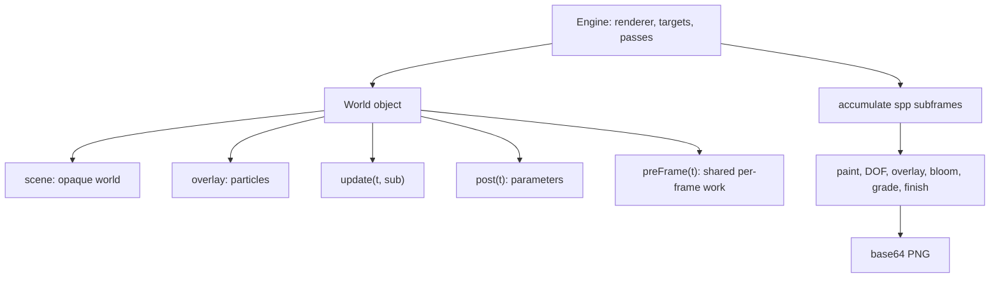

# Architecture: a small engine, a large world, offline tools

## Thesis

The project has three layers. The engine layer owns the renderer, the frame loop and the post chain. The world layer owns the scene content, the materials and the timed animation. The tool layer owns the bake, the render, the mix, the checks and the encode. Each layer has a narrow contract with the layer above it.

The engine knows nothing about flowers, ice or mountains. It accepts a world object and a time. It draws that world `spp` times and averages the results (`src/engine.js:456-499`). It then runs a fixed image chain. The world supplies a scene, an overlay, an update function and a post parameter function. That is the whole contract.

The world is split into modules. Each module exports an asynchronous `create(ctx)` function. The function returns a set of scene objects and optional hooks (`DEV_GUIDE.md:63-73`). The film world loads seven modules in a fixed order (`src/worlds/film.js:11`). The terrain is not one of them. The world creates the terrain before the module loop.

The tool layer turns source into artefacts. A bake writes float arrays. A render driver writes Portable Network Graphics (PNG) frames. A mix writes a waveform audio file. A finalise script writes the Moving Picture Experts Group 4 Part 14 (MP4) files. No tool runs inside the browser except the render page itself.

**Aha:** The architecture is a pure function pipeline. The bake compiles the world layout into arrays. The page loads the arrays and evaluates a function of time. The render driver calls that function frame by frame. Nothing in the chain needs a hidden state, a cursor or a previous frame.

## Layer one: the engine



### The page entry point

The browser entry is small. `src/main.js` reads four query values. The values are width, height, subframes and frame rate. The defaults are 1,920 by 1,080, 4 subframes and 30 frames per second (`src/main.js:4-5`). The page creates the engine and passes the multisample count (`src/main.js:8`). It then imports the world module named by the `world` query, with `film` as the default (`src/main.js:9`).

The page exposes one function on `window.__film`. The function is `renderFrame(t)`. It calls `engine.renderFrame(world, t, Math.round(t * fps))` and returns the base64 PNG string (`src/main.js:12-16`). It also copies the engine timing values into `window.__film.stats` (`src/main.js:14`). The page sets `window.__film.info` to the size, the sample count and the WebGL renderer name (`src/main.js:18-20`). It sets `ready` to true only after the world loads (`src/main.js:22`).

The render driver waits for that flag. It polls the page until `ready` is true or `error` is set (`render.mjs:128-130`). If the page reports an error, the driver stops and prints it (`render.mjs:131-132`). This handshake is the only control channel between Node.js and the scene.

The driver also passes query values to the page. The `only` query limits the module list (`src/worlds/film.js:38`). The `cam` query overrides the camera with six numbers (`src/worlds/film.js:104-109`). The `post` query overrides post keys (`src/worlds/film.js:164-165`). These queries are look-development tools. They do not change the production path.

### The engine owns every render target

The engine owns every render target. The constructor creates the scene target with a depth texture (`src/engine.js:388`). It also creates two accumulators, several colour targets and an overlay pair (`src/engine.js:389-394`). It adds a depth-of-field pair and a tensor pair (`src/engine.js:395-399`). Last, it adds seven bloom mip levels (`src/engine.js:400-402`). A mip is a half-size copy of the image. The bloom pyramid uses seven of them.

```text
# src/engine.js:371-402
  constructor({ W, H, spp = 8, fps = 30, msaa = 4, tile = 2 }) {
    this.W = W; this.H = H; this.spp = spp; this.fps = fps; this.tile = tile;
    const canvas = document.createElement('canvas');
    canvas.width = W; canvas.height = H;
    document.body.appendChild(canvas);
    const renderer = new THREE.WebGLRenderer({ canvas, antialias: false, preserveDrawingBuffer: true, powerPreference: 'high-performance', alpha: false });
    renderer.setPixelRatio(1);
    renderer.setSize(W, H, false);
    renderer.outputColorSpace = THREE.LinearSRGBColorSpace;
    renderer.toneMapping = THREE.NoToneMapping;
    renderer.shadowMap.enabled = true;
    renderer.shadowMap.type = THREE.PCFShadowMap;
    renderer.shadowMap.autoUpdate = false;
    renderer.autoClear = true;
    this.renderer = renderer;
    this.gl = renderer.getContext();

    this.sceneRT = rt(W, H, { depthBuffer: true, samples: msaa, depthTexture: new THREE.DepthTexture(W, H, THREE.FloatType) });
    this.accumRT = rt(W, H, { type: THREE.FloatType });
    this.rtA = rt(W, H); this.rtB = rt(W, H); this.rtC = rt(W, H);
    this.overlayRT = rt(W, H, { depthBuffer: true });
    this.overlayAccum = rt(W, H, { type: THREE.FloatType });
    this.ldrA = rt(W, H); this.ldrB = rt(W, H);
    this.dofScale = 0.25;
    const dw = Math.round(W * this.dofScale), dh = Math.round(H * this.dofScale);
    this.dofSrc = rt(dw, dh); this.dofRT = rt(dw, dh);
    this.tensorScale = 1.0;
    const tw = Math.round(W * this.tensorScale), th = Math.round(H * this.tensorScale);
    this.tensorA = rt(tw, th); this.tensorB = rt(tw, th);
    this.bloomMips = [];
    let bw = W, bh = H;
    for (let i = 0; i < 7; i++) { bw = Math.max(1, bw >> 1); bh = Math.max(1, bh >> 1); this.bloomMips.push(rt(bw, bh)); }
```

The default sample count is 8. The default multisample count is 4. The default tile count is 2. These are defaults, not the final values. The render driver passes its own values (`render.mjs:24-26`). The film timeline can change the shutter and the paint mix per shot.

The engine uses a linear colour pipeline. It sets the output colour space to linear sRGB and turns off the renderer tone mapping (`src/engine.js:378-379`). The grade pass performs the tone map. The renderer keeps a drawing buffer so the page can read the canvas as a PNG (`src/engine.js:375`). The shadow map does not update on its own. The world updates it once per output frame (`src/worlds/film.js:126`).

The engine draws heavy full-screen passes in scissor tiles. A scissor rectangle limits the draw to one part of the target. After each tile the engine calls `sync()`. The sync reads one pixel and forces the graphics processing unit (GPU) queue to drain (`src/engine.js:424-430`). This pattern limits one GPU submission to a short piece of work. The comment names the Windows Timeout Detection and Recovery (TDR) watchdog as the reason (`src/engine.js:4`).

## Layer two: the module contract

A world module is one file under `src/world/`. It exports `create(ctx)`. The function is asynchronous. It returns an object with up to five fields. `objects` go into the main scene. `overlay` goes into the particle scene. `update` runs every subframe. `preFrame` runs once per output frame. `post` returns parameter overrides.

```text
# DEV_GUIDE.md:75-76
- **Stateless and deterministic.** Everything must be a pure function of `t`; frames are rendered out of order and resumed. Never use `Math.random()`; use `rng(seed)` from common.js or hashes in GLSL. Animate in shaders from `uTime` where possible.
- **Materials.** Use `worldMaterial({vertexShader, fragmentShader, uniforms, ...})`. It prepends `WORLD_GLSL` and returns `{material, depthMaterial}`. Your vertex shader must compute a world position and write `gl_Position = projectionMatrix * viewMatrix * vec4(worldPos, 1.0)`. Do not use modelViewMatrix unless your mesh has an identity transform, so the same code works for the sun's shadow camera. Inside the depth pass the define `DEPTH_PASS` is set. For alpha-tested cards pass `alphaTestInDepth: true` and `discard` under `#ifdef DEPTH_PASS`. Shadow casters call `castShadow(mesh, depthMaterial)`.
```

The contract has two hard rules. First, the module must be stateless and deterministic. Every visual value must be a pure function of time. The render can run frames out of order and resume after a stop (`DEV_GUIDE.md:75`). Second, a module must not use `Math.random()`. It uses the seeded `rng(seed)` helper or a hash in the shader (`DEV_GUIDE.md:75`). These rules are what make the resume path safe.

The film world builds the context object once. The context holds the renderer, the engine, the camera, the scene, the overlay, the world data and the rig. It also holds the shared uniform object, the timeline functions and the query parameters (`src/worlds/film.js:39`). Modules read from this context. They do not import each other.

```text
# src/worlds/film.js:39-49
  const ctx = { THREE, scene, overlay, camera, renderer, engine, data, rig: layoutRig, U, TIMES, shotAt, bloomD, W, H, q, shot: null, t: 0 };
  const mods = [];
  for (const name of MODULES) {
    if (only && !only.split(',').includes(name)) continue;
    let mod;
    try { mod = await import(`../world/${name}.js`); } catch (e) { if (!String(e).includes('Failed to fetch') && !String(e).includes('404')) console.warn('module', name, e.message); continue; }
    const inst = await mod.create(ctx);
    if (inst.objects) inst.objects.forEach(o => scene.add(o));
    if (inst.overlay) inst.overlay.forEach(o => overlay.add(o));
    mods.push({ name, ...inst });
  }
```

The loader imports each module by name. It catches a failed import and prints a warning unless the failure is a fetch error (`src/worlds/film.js:44`). A missing module therefore does not stop the film. The fallback sky is a sphere with a gradient shader (`src/worlds/film.js:51-56`). This fallback is useful for look development with `only=`.

The module list is an order, not a dependency graph. The sky loads first. The vegetation and the trees load next. The hero, water, effects and glint load last. The order affects creation only. Every module reads the same baked data and the same timeline.

| Module | Main output | Source |
|---|---|---|
| sky | dome, cloud decks, coverage map, god rays | `src/world/sky.js:677-1002` |
| vegetation | grass, flowers, reeds, far carpet | `src/world/vegetation.js:784-1236` |
| trees | hero grove, forest, flush animation | `src/world/trees.js:944-1061` |
| hero | bud, tepals, hairs, rime, dew, stamens | `src/world/hero.js:1012-1555` |
| water | creeks, lake, river, falls, mist, rainbow | `src/world/water.js:1-1528` |
| fx | snow, sparkles, pollen, petals, birds | `src/world/fx.js:1-1608` |
| glint | final heart glint overlay | `src/world/glint.js:1-60` |

The film world also owns the per-frame hooks. `preFrame` sets the time, the shot and the environment. It then calls every module's `preFrame` (`src/worlds/film.js:94-98`). `update` sets the camera from the rig, calls every module's update, computes the shadow focus point and renders the shadow cascades (`src/worlds/film.js:99-127`). `post` builds the parameter object, adds the white-out and merges the module overrides (`src/worlds/film.js:128-167`).

```text
# src/worlds/film.js:89-127
  const world = {
    scene, overlay, camera,
    info: { modules: mods.map(m => m.name) },
    // engine clamps a frame's shutter to this window so no frame blends two shots
    shotWindow: t => { const s = shotAt(t); return [s.t0, s.t1 - 1e-4]; },
    preFrame(t, eng) {
      ctx.t = t; ctx.shot = shotAt(t);
      applyEnv(t);
      for (const m of mods) m.preFrame && m.preFrame(t, ctx);
    },
    update(t, sub) {
      ctx.t = t; ctx.shot = shotAt(t); ctx.sub = sub;
      U.uFrame.value = (sub?.sub ?? 0) + Math.round(t * 30) * 17;
      applyEnv(t);
      const c = rig.at(t);
      // look-dev override: ?cam=px,py,pz,tx,ty,tz,fov
      if (q.get('cam')) {
        const v = q.get('cam').split(',').map(Number);
        c.pos.set(v[0], v[1], v[2]); c.target.set(v[3], v[4], v[5]); if (v[6]) c.fov = v[6]; c.roll = 0;
        c.near = Math.max(0.05, c.pos.distanceTo(c.target) * 0.0005);
      }
      camera.position.copy(c.pos);
      camera.up.set(0, 1, 0);
      camera.lookAt(c.target);
      camera.rotateZ(c.roll || 0);
      camera.fov = c.fov; camera.near = c.near; camera.far = c.far;
      camera.updateProjectionMatrix(); camera.updateMatrixWorld(true);
      ctx.cam = c;
      for (const m of mods) m.update && m.update(t, ctx);
      // shadow cascades around a point a little in front of the camera
      const fwd = new THREE.Vector3(); camera.getWorldDirection(fwd);
      const shot = ctx.shot.id;
      const reach = { macro: 0.12, fpv: 12, canopy: 20, reveal: 150, falls: 300, aerial: 2500 }[shot];
      c.focusPt = camera.position.clone().addScaledVector(fwd, reach);
      if (shot === 'macro') c.focusPt.copy(rig.budHead);
      const [c0, c1] = SHADOW[shot](c, t);
      // shadows once per output frame (first subframe): within a half-shutter they don't move visibly
      if (!sub || !sub.sub) shadows.render(scene, c0, c1);
    },
```

The shadow focus point is a little in front of the camera. The reach depends on the shot. It is 0.12 metres in the macro shot and 2,500 metres in the aerial shot (`src/worlds/film.js:121`). In the macro shot the focus point is the bud head (`src/worlds/film.js:123`). Two shadow cascades cover a small radius and a large radius. The radii come from a per-shot table (`src/worlds/film.js:80-87`).

### Why the boundary is narrow

The engine does not import a world module. The dependency points one way. `src/engine.js` imports three.js, the noise shader text and its own pass shaders (`src/engine.js:1-35`). It never imports `src/world/`. The film world imports the engine types only through the context object. The modules import shared helpers and three.js. They do not import the film world.

This direction has three effects. First, a module can fail to load without stopping the engine. The loader catches the import error and continues (`src/worlds/film.js:44`). Second, a reader can run one module with `only=`. The page still loads the terrain and the fallback sky. Third, the engine can render a benchmark world with no film modules. `src/worlds/bench.js` returns a scene, a camera and an update function (`src/worlds/bench.js:1-67`). The same engine renders it.

The cost is that shared state lives in one place. The uniform object `U` is a module-level export (`src/world/common.js:8-47`). Every world material reads it. The timeline function `applyEnv` writes it once per update (`src/worlds/film.js:58-78`). A module must not keep its own copy of the sun direction or the bloom clock. It reads the shared uniform. That rule keeps every module on the same clock.

The overlay split is the other important boundary. Objects in `objects` are opaque or alpha-tested. They go through the paint and the depth of field. Objects in `overlay` are particles and sprites. They are drawn into a separate premultiplied target and composited after the depth of field (`src/engine.js:543-547`). A module chooses the list by the visual role of the object, not by its material.

This section states the same rule from the module side. A module may read the context and the shared uniforms. It may add objects to two scenes. It may return post overrides. It may not change the engine pass order, the render targets or another module's objects.

The narrow boundary makes the film inspectable. A reader can list the modules and know the complete set of visible systems. The list has seven names (`src/worlds/film.js:11`). The terrain is the eighth system, and the world creates it outside the list (`src/worlds/film.js:35-36`). There is no hidden render path behind a material flag.

The boundary also makes the sample budget visible. The developer guide gives a per-subframe budget. The whole scene should stay under about 450 milliseconds. Vegetation gets under 180 milliseconds. Trees get under 100. The other modules get under 60 each (`DEV_GUIDE.md:94-100`). The engine prints a timing table. The render driver can print the stats (`src/engine.js:458`, `render.mjs:148`).

## Layer three: pure layout and baked data

The world layout is a separate file with pure functions. It has no three.js objects and no render state. It returns numbers. The functions define the basin shape, the petal field, the river, the creeks, the lake, the waterfall, the grove and the forest mask (`DEV_GUIDE.md:54`).

```text
# src/world/layout.js:179-215
export function height(x, z) {
  const r = Math.hypot(x, z), phi = Math.atan2(z, x);
  // floor rises gently toward the rim, except along the outlet (SSW) where it stays low
  const dOut = Math.abs(wrapAngle(phi - STEM_PHI));
  const outlet = Math.exp(-Math.pow(dOut / (24 * DEG), 2));
  let h = -5 + 0.017 * r * (1 - 0.92 * outlet);
  h += (fbm(x * 0.0035, z * 0.0035, 4) - 0.5) * 16 * smooth(60, 400, r);
  h += (fbm(x * 0.03 + 7, z * 0.03, 3) - 0.5) * 1.6;
  // knoll (the stage for the bud)
  h += 5.2 * Math.exp(-(r * r) / (2 * 22 * 22)) + 1.2 * Math.exp(-(r * r) / (2 * 70 * 70));
  // swales along each petal axis + creek channels (midveins)
  const d = lobeDelta(phi), lat = r * Math.sin(d);
  const along = smooth(30, 140, r) * (1 - smooth(1000, 1250, r));
  h -= along * (2.6 * Math.exp(-(lat * lat) / (2 * 48 * 48)));
  h += along * 1.2 * smooth(0.5, 0.95, Math.abs(d) / (30 * DEG));
  const cd = creekDist(x, z);
  if (cd.d < 30) h -= 0.85 * Math.exp(-(cd.d * cd.d) / (2 * 1.5 * 1.5)) + 0.35 * Math.exp(-(cd.d * cd.d) / (2 * 4 * 4));
  // the grove rise
  const gd2 = (x - GROVE.x) ** 2 + (z - GROVE.z) ** 2;
  h += 6.5 * Math.exp(-gd2 / (2 * 45 * 45));
  // rim: a ring of sharp snowy peaks (with an outlet gorge to the SSW)
  // in the waterfall sector the mountains start right behind the cliff
  const dw = wrapAngle(phi - WF_PHI);
  const wfSector = Math.exp(-Math.pow(dw / (14 * DEG), 2));
  const rim0 = 1480 + 210 * wfSector, rim1 = 2500 - 560 * wfSector;
  const rimT = smooth(rim0, rim1, r);
  // domain-warped ridged noise: big clean masses with sharp ridgelines
  const wx = x + 380 * (fbm(x * 0.0006 + 1, z * 0.0006, 3) - 0.5), wz = z + 380 * (fbm(x * 0.0006, z * 0.0006 + 5, 3) - 0.5);
  const peaks = ridged(wx * 0.0010 + 4, wz * 0.0010 - 2, 4);
  const farPeaks = ridged(wx * 0.00042, wz * 0.00042 + 7, 4);
  // a broad saddle in the ESE rim: the dawn sun rises through this pass behind the bud
  const saddle = Math.exp(-Math.pow(wrapAngle(phi - 25 * DEG) / (15 * DEG), 2));
  const rimH = (Math.pow(rimT, 1.45) * (300 + 600 * peaks) * (1 + 0.25 * wfSector) + smooth(2300, 7000, r) * (260 + 820 * farPeaks)) * (1 - 0.85 * outlet) * (1 - 0.6 * saddle);
  h += rimH;
  // a far, hazy ridge behind the falls notch (fills the gap in the skyline)
  h += Math.exp(-Math.pow(dw / (13 * DEG), 2)) * smooth(2800, 4300, r) * (700 + 400 * farPeaks);
  // the waterfall: a narrow cliff headwall at the foot of the mountains, with a
```

`height()` adds several terms. The floor term sets the base level. The knoll raises the centre. The swales cut shallow channels along the petal axes. The creek channels cut deeper lines. The grove rise lifts the tree area. The rim term raises the outer ring. The saddle term lowers one part of the rim. The cirque term cuts the waterfall bowl. The river and lake terms carve the water paths.

The grid is not uniform. The mapping uses a hyperbolic sine warp (`src/world/layout.js:274-279`). The warp puts more cells near the centre and fewer cells at the rim. The centre holds the hero flower and the creek. The rim holds the waterfall and the peaks. A uniform grid at the same cell count would waste cells on the far rim.

```text
# bake.mjs:21-30
const N = L.GRID.N;
const H = new Float32Array(N * N);
const xs = Array.from({ length: N }, (_, i) => L.gridX(i)), zs = Array.from({ length: N }, (_, j) => L.gridZ(j));
for (let j = 0; j < N; j++) {
  for (let i = 0; i < N; i++) H[j * N + i] = L.height(xs[i], zs[j]);
  if (j % 256 === 0) log('heights row', j);
}
writeAtomic(path.join(OUT, 'terrain_h.f32'), Buffer.from(H.buffer));
log('terrain heights written');
const hAt = L.makeSampler(H);
```

The bake writes the terrain height first. It writes the main grid and a separate patch around the waterfall. The patch is 1,024 by 1,024 cells over 760 metres (`bake.mjs:27-30`). The main grid cannot resolve the waterfall face at 16 kilometres across. The patch gives the face enough cells for the water sheet.

The bake then builds the arrival field. An arrival field is a map of the time at which the spring wave reaches each position. The field comes from a shortest-path solve on the grid. The solver is Dijkstra's algorithm. The cost of a step depends on the terrain and the land cover.

```text
# bake.mjs:43-52
function costAt(x, z) {
  let c = 0.75 + 0.5 * L.fbm(x * 0.012 + 40, z * 0.012 - 7, 4);
  const r = Math.hypot(x, z);
  { const ps = L.petalSD(x, z); c *= 0.6 + 0.8 * smooth(-40, 40, ps); }  // petals carry spring faster
  c *= 0.4 + 0.6 * smooth(2, 25, L.creekDist(x, z).d);       // creeks fastest (midveins)
  c *= 0.45 + 0.55 * smooth(10, 60, L.riverDist(x, z).d);
  if (L.lakeDist(x, z) < 0) c *= 0.5;
  if (r < L.HEART_R) c *= 0.7;
  return c;
}
```

`costAt` sets the local speed multiplier. Open ground has a base cost with a noise term. A petal is faster than the meadow. A creek is faster than a petal. A river is faster again. A lake is slower. The heart is slower. The wave therefore runs along the swales and the creeks. It slows on the rim and in the heart. This is why the bloom pattern is a flower and not a circle.

```text
# bake.mjs:85-105
  for (let oj = -2; oj <= 2; oj++) for (let oi = -2; oi <= 2; oi++) {
    if (!oi && !oj) continue;
    if (Math.abs(oi) === 2 && Math.abs(oj) === 2) continue; if ((Math.abs(oi) === 2 && oj === 0) || (Math.abs(oj) === 2 && oi === 0)) continue;
    nb.push([oi, oj, Math.hypot(oi * dx, oj * dz)]);
  }
  while (heap.n) {
    const u = heap.pop(), du = heap.popKey;
    if (du > dist[u]) continue;
    const ui = u % nx, uj = (u - ui) / nx;
    for (const [oi, oj, len] of nb) {
      const vi = ui + oi, vj = uj + oj;
      if (vi < 0 || vj < 0 || vi >= nx || vj >= nz) continue;
      const v = vj * nx + vi;
      const dh = hh[v] - hh[u];
      const slope = dh / len;
      const k = 1 + 2.6 * Math.max(0, slope) - 0.35 * Math.min(1, Math.max(0, -slope));
      const nd = du + len * 0.5 * (cc[u] + cc[v]) * k;
      if (nd < dist[v]) { dist[v] = nd; heap.push(nd, v); }
    }
  }
  return dist;
```

The solver uses a 5 by 5 neighbourhood. The code removes the four corner steps and the four two-cell straight steps. It keeps the eight one-cell neighbours and the eight knight-like offsets of two cells along one axis and one cell along the other (`bake.mjs:85-88`). The step cost is the mean of the two cell costs. It is multiplied by a slope factor. The slope factor rises on an uphill step and falls a little on a downhill step. The wave therefore prefers a downhill path and avoids a steep climb. The result is an arrival array in cost-weighted metres, not a time array. One unit is one metre at cost 1.0. The shader relates it to seconds through the `bloomD` key list.

The far field covers 8,192 metres with 1,024 cells (`bake.mjs:108`). The near field covers 512 metres with 1,024 cells (`bake.mjs:113`). The near field has a finer cell size. The data loader blends the two fields near the knoll. The blend uses a 0.02 to 0.08 ramp at the edge of the near field (`src/world/data.js:45-51`). This keeps the macro area sharp without a huge global grid.

```text
# src/world/data.js:11-30
  t.generateMipmaps = false; t.needsUpdate = true;
  return t;
}

export async function loadWorldData() {
  const meta = await (await fetch('/data/meta.json')).json();
  const [H, far, near, info, info2, patch] = await Promise.all([
    f32('/data/terrain_h.f32'), f32('/data/arrival_far.f32'), f32('/data/arrival_near.f32'), f32('/data/info_far.f32'), f32('/data/info2_far.f32'), f32('/data/patch_falls.f32'),
  ]);
  const PATCH = meta.PATCH;
  const patchTex = tex(patch, PATCH.n, PATCH.n, THREE.RedFormat, THREE.NearestFilter);
  const N = L.GRID.N;
  const { FAR, NEAR } = meta;
  const heightTex = tex(H, N, N, THREE.RedFormat, THREE.NearestFilter);
  const arrFar = tex(far, FAR.nx, FAR.nz, THREE.RedFormat, THREE.LinearFilter);
  const arrNear = tex(near, NEAR.nx, NEAR.nz, THREE.RedFormat, THREE.LinearFilter);
  const infoTex = tex(info, FAR.nx, FAR.nz, THREE.RGBAFormat, THREE.LinearFilter);
  const info2Tex = tex(info2, FAR.nx, FAR.nz, THREE.RGBAFormat, THREE.LinearFilter);
  U.tArrival.value = arrFar;
  U.uArrivalBounds.value.set(FAR.minX, FAR.minZ, FAR.sizeX, FAR.sizeZ);
```

The loader fetches six arrays and one metadata file. The arrays are the height, the far arrival, the near arrival, the first info map, the second info map and the falls patch (`src/world/data.js:16-19`). It wraps each array in a data texture. It sets the arrival texture to linear filtering and the height texture to nearest filtering. The filter choice matches the data. The arrival field is smooth. The height field is exact at the cell centres.

```text
# src/world/data.js:40-58
    const a = D[j * G.nx + i], b = D[j * G.nx + i + 1], c = D[(j + 1) * G.nx + i], d = D[(j + 1) * G.nx + i + 1];
    return (a * (1 - u) + b * u) * (1 - v) + (c * (1 - u) + d * u) * v;
  };
  // CPU-side arrival (same blend as the GLSL arrival())
  const arrivalAt = (x, z) => {
    const nu = (x - NEAR.minX) / NEAR.sizeX, nv = (z - NEAR.minZ) / NEAR.sizeZ;
    const fa = sampleGrid(far, FAR, x, z);
    if (nu > 0.02 && nu < 0.98 && nv > 0.02 && nv < 0.98) {
      const w = Math.min(1, Math.min(nu - 0.02, 0.98 - nu, nv - 0.02, 0.98 - nv) / 0.08);
      return fa + (sampleGrid(near, NEAR, x, z) - fa) * w;
    }
    return fa;
  };
  return { meta, H, heightTex, patchTex, PATCH, heightAt, arrivalAt, info, FAR, NEAR, sampleInfo: (x, z, ch) => {
    const fx = Math.floor((x - FAR.minX) / FAR.sizeX * FAR.nx), fz = Math.floor((z - FAR.minZ) / FAR.sizeZ * FAR.nz);
    if (fx < 0 || fz < 0 || fx >= FAR.nx || fz >= FAR.nz) return 0;
    return info[(fz * FAR.nx + fx) * 4 + ch];
  } };
}
```

The loader exposes a central processing unit (CPU) height sampler and a CPU arrival sampler. The height sampler uses the same triangle rule as the mesh. The arrival sampler uses the same near and far blend as the shader (`src/world/data.js:45-52`). Modules can place objects and time events on the CPU with the same values the shader uses.

### The second info map

The second info map is a four-channel texture. The channels are the petal field, the radius, the lobe delta and a variety noise (`DEV_GUIDE.md:84`). `bake_info2.mjs` builds it on the far grid (`bake_info2.mjs:40-50`). A debug flag can write a contour image every 150 units (`bake_info2.mjs:1-50`).

The petal field is a signed value. It is negative inside a petal. The terrain shader uses the sign to choose the petal colour. The vegetation module uses the same field on the central processing unit to place flowers inside petals. The radius gives the distance from the knoll. The lobe delta gives the angular position between petal axes. The noise breaks up hard edges.

The second map is separate from the first info map. The first map holds the river distance, the creek distance, the lake distance and the forest mask (`DEV_GUIDE.md:82`). The split keeps each texture to four channels. It also lets the bake write the two maps at different times. The first map depends on the arrival solve. The second map depends only on the layout functions.

## The offline tool layer

The tools are Node.js scripts. They share a few conventions. They lower their own priority. They call `ffmpeg` or `ffprobe` through `execFileSync` or `spawn`. They write output under `out/` or a frame directory. They do not import the browser world.

| Tool | Role | Source |
|---|---|---|
| `bake.mjs` | write height, arrival and info arrays | `bake.mjs:1-142` |
| `bake_info2.mjs` | write petal field, radius, lobe delta, noise | `bake_info2.mjs:1-50` |
| `render.mjs` | drive headless Chrome for a frame range | `render.mjs:1-169` |
| `render_all.mjs` | split the film into sample-count segments | `render_all.mjs:1-74` |
| `rerender_v2.mjs` | re-render only the fixed ranges | `rerender_v2.mjs:1-46` |
| `review.mjs` | render review stills and motion strips | `review.mjs:1-53` |
| `finalize.mjs` | check frames, encode, make posters | `finalize.mjs:1-64` |
| `mix.mjs` | mix the cues to a 30 second waveform | `mix.mjs:1-88` |
| `qa_v2.sh` | build contact grids at the joins | `qa_v2.sh:1-35` |

The render split is a quality decision. Each segment has its own subframe count. The burst and the swift pass get 32. The pull, the first flight part and the second flight part get 16. The canopy gets 20. The shatter gets 28. The macro, the reveal and the falls get 12. The aerial gets 10 (`render_all.mjs:26-38`). The list has no creek segment. The creek window is a separate re-render range in `rerender_v2.mjs:15-46`. The counts follow motion. A fast segment gets more samples.

```text
# render_all.mjs:26-38
const SEGMENTS = [
  ['macro', 0, f(TIMES.hit - 0.1), 12],
  ['burst', f(TIMES.hit - 0.1), f(TIMES.pullStart), 32],
  ['pull', f(TIMES.pullStart), f(TIMES.cut2), 16],
  ['fpv', f(TIMES.cut2), f(TIMES.swift - 0.16), 16],
  ['swift', f(TIMES.swift - 0.16), f(TIMES.swift + 0.24), 32],
  ['fpv2', f(TIMES.swift + 0.24), f(TIMES.cut3), 16],
  ['canopy', f(TIMES.cut3), f(TIMES.cut4), 20],
  ['reveal', f(TIMES.cut4), f(TIMES.cut5), 12],
  ['shatter', f(TIMES.cut5), f(TIMES.cut5 + 0.55), 28],
  ['falls', f(TIMES.cut5 + 0.55), f(TIMES.cut6), 12],
  ['aerial', f(TIMES.cut6), f(TIMES.end), 10],
];
```

The second fix round is a range list. It names the frames to re-render and the sample count for each range (`rerender_v2.mjs:19-27`). The list covers the aerial, the shatter, the falls, the creek window, the reveal, the pull and the canopy. The driver moves the first-cut frames once, then renders the new ranges over them (`rerender_v2.mjs:29-46`). The untouched frames stay byte-identical.

## The audio layer

The audio layer is separate from the picture render. A cue sheet lists every sound event. Each cue has a file, a start point in the file, a duration, a timeline position, a target level and optional filters (`audio/cues.mjs:11-69`). The music is one entry with a level of minus 19.5 decibels full scale root mean square (`audio/cues.mjs:10`).

```text
# audio/cues.mjs:8-10
export const DURATION = 30;
export const TARGET_LUFS = -14;
export const MUSIC = { file: 'audio/edit/edit_1.wav', at: 0, anchor: 'start', level: -19.5 };
```

The cue sheet imports `TIMES` from the timeline. Every cue that lands on a picture event uses a `TIMES` key. For example, the bloom hit uses `T.hit`. The sun break uses `T.sunBreak`. The rainbow uses `T.rainbow` (`audio/cues.mjs:11-69`). The audio therefore follows the same clock as the picture.

```text
# mix.mjs:63-73
  if (c.fadeIn) ch.push(`afade=t=in:st=0:d=${c.fadeIn}`);
  if (c.fadeOut) ch.push(`afade=t=out:st=${Math.max(0, len / (c.rate || 1) - c.fadeOut).toFixed(3)}:d=${c.fadeOut}`);
  ch.push(`adelay=${Math.round(delay * 1000)}|${Math.round(delay * 1000)}`);
  filters.push(`[${n}:a]${ch.join(',')}[s${n}]`);
  labels.push(`[s${n}]`);
  console.log(`${isMusic ? 'MUSIC' : 'cue  '} ${path.basename(c.file).padEnd(52)} at ${String(c.at ?? 0).padEnd(6)} anchor ${anchor.toFixed(2)} gain ${gain.toFixed(1)} dB (seg rms ${a.rmsDb.toFixed(1)})`);
  n++;
}

if (MUSIC) addSource(MUSIC, true);
for (const c of CUES) addSource(c);
```

The mixer measures each source. It decodes a segment to mono at 12 kilohertz. It computes the root mean square level. It finds a peak and an onset in a smoothed envelope (`mix.mjs:27-41`). It then computes a gain that brings the segment to its target level. The gain is capped at 12 decibels (`mix.mjs:60`). The anchor places the peak, the onset or the start of the segment on the timeline time.

The final mix uses two passes. The first pass measures loudness. The second pass applies a linear loudness normalisation to minus 14 loudness units relative to full scale. It also sets a true-peak limit of minus 1 decibel and a loudness range of 11 loudness units (LU) (`mix.mjs:83-86`). A 0.6 second fade closes the file (`mix.mjs:75`).


The diagram has one important detail. The mix does not synthesise sound. Every cue is a recorded file. The tree does not hold the files. `audio/fetch_audio.mjs` downloads them from a manifest (`audio/fetch_audio.mjs:1-34`). The licences do not allow redistribution (`README.md:41`).

### The delivery boundary

The render and the encode are separate commands. The render writes one PNG per frame. The finalise script reads that sequence and writes two MP4 files. It checks that all 900 frames exist (`finalize.mjs:17-25`). It also scans every third frame for a black or blown image outside the fade zones (`finalize.mjs:28-38`).

The master encode uses the H.264 codec through libx264. It sets the constant rate factor to 16 and caps the bit rate at 120 megabits per second (`finalize.mjs:48`). The share encode uses a constant rate factor of 17 and a cap of 40 megabits per second (`finalize.mjs:51`). Both use the BT.709 colour matrix (`finalize.mjs:41-42`). The audio is Advanced Audio Coding (AAC) at 320 kilobits per second (`finalize.mjs:45`).

The posters are frame copies, not new renders. The script copies the frame at 27.2 seconds and the frame at 6.35 seconds (`finalize.mjs:55-56`). It builds a contact sheet from one frame per second (`finalize.mjs:57-60`). This is why the `docs/` JPEG files are presentation images, not measurement data.

## What the architecture does not contain

The tree has no `data/` directory. The loader fails with an error that names `bake.mjs` when a file is missing (`src/world/data.js:6`). The tree has no audio candidates. The cue sheet refers to paths under `audio/candidates/`, and the fetch tool fills them. The tree has no MP4 file. The release holds the films and the README links to it (`README.md:9-17`).

The tree has no licence file. `package.json` declares the Internet Systems Consortium (ISC) licence (`package.json:11`). The media licences are in `CREDITS.md`. The music is "The Light Between Moments" by MoonpetalMedia under the Pixabay Content License (`README.md:44`). The sound effects are Creative Commons Zero (CC0) or Mixkit recordings (`README.md:45`).

The architecture keeps these absences visible. The bake, the fetch and the render are separate commands in the rebuild list (`README.md:31-38`). A reader can see which step produces which file. No step hides a network download inside a render.
