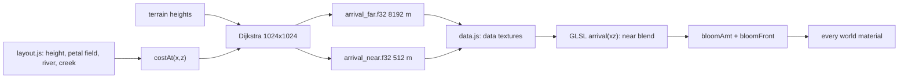
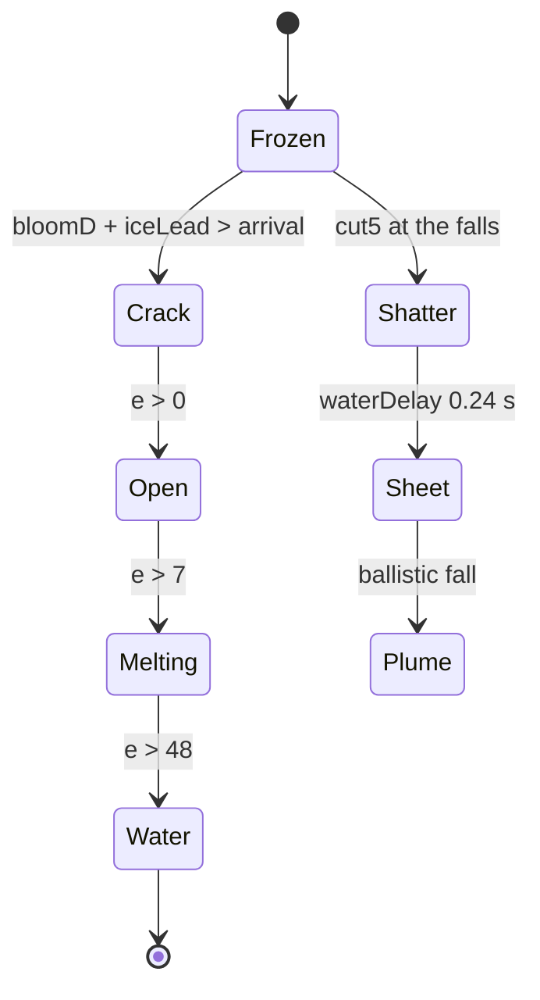

# Core mechanism: how one wave becomes a world

## Thesis

The film has one controlling number. `bloomD(t)` returns a clock in arrival units. One arrival unit is one cost-weighted metre. One metre of path at cost 1.0 adds 1.0 to the arrival value. The clock starts at zero on the musical hit and reaches 7,500 at the end (`src/world/timeline.js:41-53`). The world has a baked arrival value for every ground position. A material computes the difference between the clock and the local arrival value. The sign of that difference selects winter or spring. Arrival is not a time. The source relates arrival to time through the `bloomD` key list.

The comparison has a width. `bloomAmt` uses `smoothstep(0.0, uBloomWidth, uBloomD - a)` (`src/world/common.js:87-90`). The width is not constant. It is 2.5 arrival units plus 0.035 times the current clock (`src/world/timeline.js:54`). The band therefore widens as the wave travels. The source does not state the reason for the growth. The effect is a soft edge at every scale.

A second function marks the front itself. `bloomFront` returns a narrow band around the exact arrival point (`src/world/common.js:92-96`). Materials use it for glow, growth overshoot and sparkles. The band is separate from the main mask. A surface can be fully spring behind the front and still receive a bright edge at the front.

This document follows the wave through every system. It starts at the baked field. It then covers the terrain, the sky, the meadow, the trees, the hero flower, the water and the effects. Each system reads the same two functions. Each system adds its own motion and its own visual language.

**Aha:** The wave is not a simulation. It is a shortest-path distance that is computed once and stored. The frame loop only compares that distance with a clock. This is why the wave can cross a three kilometre basin in seconds and still be deterministic.

## The arrival field

The arrival field is built by `bake.mjs`. The bake samples the terrain height and a cost value at every cell. The cost function is the local speed model for the wave.

```text
# bake.mjs:43-52
function costAt(x, z) {
  let c = 0.75 + 0.5 * L.fbm(x * 0.012 + 40, z * 0.012 - 7, 4);
  const r = Math.hypot(x, z);
  { const ps = L.petalSD(x, z); c *= 0.6 + 0.8 * smooth(-40, 40, ps); }  // petals carry spring faster
  c *= 0.4 + 0.6 * smooth(2, 25, L.creekDist(x, z).d);       // creeks fastest (midveins)
  c *= 0.45 + 0.55 * smooth(10, 60, L.riverDist(x, z).d);
  if (L.lakeDist(x, z) < 0) c *= 0.5;
  if (r < L.HEART_R) c *= 0.7;
  return c;
}
```

Open ground has a base cost of 0.75 plus half a fractal noise term. A petal is faster. A creek is faster than a petal. A river is faster than a creek. A lake is twice as slow as open ground. The heart is slower again. The wave therefore follows the six petal swales and the creek channels. It slows at the centre and on the rim.

The solver is Dijkstra's algorithm with a binary heap. Dijkstra's algorithm finds the lowest-cost path from a seed to every cell. The seed is the knoll at the origin with distance zero (`bake.mjs:108-113`). The neighbourhood is 5 by 5. The code removes the four corner steps and the four two-cell straight steps (`bake.mjs:85-88`). The remaining steps are the eight one-cell neighbours and the eight knight-like offsets. A knight-like offset is two cells along one axis and one cell along the other.

```text
# bake.mjs:85-105
  for (let oj = -2; oj <= 2; oj++) for (let oi = -2; oi <= 2; oi++) {
    if (!oi && !oj) continue;
    if (Math.abs(oi) === 2 && Math.abs(oj) === 2) continue; if ((Math.abs(oi) === 2 && oj === 0) || (Math.abs(oj) === 2 && oi === 0)) continue;
    nb.push([oi, oj, Math.hypot(oi * dx, oj * dz)]);
  }
  while (heap.n) {
    const u = heap.pop(), du = heap.popKey;
    if (du > dist[u]) continue;
    const ui = u % nx, uj = (u - ui) / nx;
    for (const [oi, oj, len] of nb) {
      const vi = ui + oi, vj = uj + oj;
      if (vi < 0 || vj < 0 || vi >= nx || vj >= nz) continue;
      const v = vj * nx + vi;
      const dh = hh[v] - hh[u];
      const slope = dh / len;
      const k = 1 + 2.6 * Math.max(0, slope) - 0.35 * Math.min(1, Math.max(0, -slope));
      const nd = du + len * 0.5 * (cc[u] + cc[v]) * k;
      if (nd < dist[v]) { dist[v] = nd; heap.push(nd, v); }
    }
  }
  return dist;
```

Each step has a length. The cost is the mean of the two cell costs times that length. A slope factor multiplies the cost. The factor is 1 plus 2.6 times the uphill slope. It subtracts up to 0.35 for a downhill slope (`bake.mjs:95-98`). The wave prefers a downhill path across a saddle. It avoids a steep climb up the rim.

The arrival equation is `A(v) = min over paths Σ [len(e) * 0.5 * (c_u + c_v) * k(e)]`. `A(v)` is the arrival value at cell `v`. `len(e)` is the edge length in metres. `c_u` and `c_v` are the dimensionless costs at the two cells. `k(e)` is the slope factor (`bake.mjs:99-101`). The result therefore has the unit of cost-weighted metres, not seconds.

A worked cell shows the mapping. The far grid has 8 metre cells and a minimum corner at minus 4,096 metres (`bake.mjs:108`). The seed at the origin lands in the cell whose centre is 4 metres east and 4 metres south of the origin. Its arrival value is 0 (`bake.mjs:79-82`). The clock is also 0 at the 6.0 second hit (`src/world/timeline.js:47-48`). That cell is therefore exactly at the front at 6.0 seconds. As a second illustration, the clock is 60.6 at 10.02 seconds (`src/world/timeline.js:49`). A cell whose arrival value is 60.6 reaches the front at that time. The clock uses a monotone cubic interpolation between keys, not a linear one (`src/world/keys.js:1-3`, `29-33`).

The bake runs the solver twice. The far field covers 8,192 metres with 1,024 cells (`bake.mjs:108`). The near field covers 512 metres with 1,024 cells (`bake.mjs:113`). The near field has a cell size of 0.5 metres. The far field has a cell size of 8 metres. The near field keeps the macro area and the first metres of the wave sharp.



The data loader uploads both fields as textures. The shader `arrival0` samples the far field. It computes the normalised position in the near field. If the point is inside the near field by more than 0.02 of its width, it blends the near value over the far value (`src/world/common.js:63-69`). The blend ramps over 0.08 of the near width. The same blend exists on the central processing unit in `data.js` (`src/world/data.js:45-52`).

```text
# src/world/common.js:62-96
// ---------------- bloom wave
float arrival0(vec2 xz) {
  float fa = texture2D(tArrival, (xz - uArrivalBounds.xy) / uArrivalBounds.zw).r;
  vec2 nu = (xz - uArrivalNearBounds.xy) / uArrivalNearBounds.zw;
  float e = min(min(nu.x - 0.02, 0.98 - nu.x), min(nu.y - 0.02, 0.98 - nu.y));
  if (e > 0.0) fa = mix(fa, texture2D(tArrivalNear, nu).r, min(1.0, e / 0.08));
  return fa;
}
float arrival(vec2 xz) {
  float fa = arrival0(xz);
  // a few baked cells are unreachable (inf) and would stay white winter forever;
  // in the far shots take the lowest finite neighbour 16 m away instead
  if (uFarK > 0.5 && !(fa < 1e6)) {
    float m = 1e6;
    m = min(m, arrival0(xz + vec2(16.0, 0.0))); m = min(m, arrival0(xz - vec2(16.0, 0.0)));
    m = min(m, arrival0(xz + vec2(0.0, 16.0))); m = min(m, arrival0(xz - vec2(0.0, 16.0)));
    fa = m;
  }
  return fa;
}
// baked terrain info: x riverDist, y creekDist, z lakeDist(signed), w forest
vec4 infoAt(vec2 xz) { return texture2D(tInfo, (xz - uInfoBounds.xy) / uInfoBounds.zw); }
// x petalSD (<0 inside petal), y radius, z lobe delta (rad), w variety noise
vec4 info2At(vec2 xz) { return texture2D(tInfo2, (xz - uInfoBounds.xy) / uInfoBounds.zw); }
// 0 = frozen winter, 1 = full spring. Ragged, organic front.
float bloomAmt(vec2 xz) {
  float a = arrival(xz) + (fbm(xz * 0.11) - 0.5) * uBloomNoise * 2.0 + (vnoise(xz * 0.9) - 0.5) * 0.6;
  return smoothstep(0.0, uBloomWidth, uBloomD - a);
}
// localized band right at the wavefront (for glow / sparkles / growth overshoot)
float bloomFront(vec2 xz) {
  float a = arrival(xz) + (fbm(xz * 0.11) - 0.5) * uBloomNoise * 2.0 + (vnoise(xz * 0.9) - 0.5) * 0.6;
  float d = (uBloomD - a) / max(uBloomWidth, 1e-3);
  return exp(-d * d * 2.0) * step(-1.5, d);
}
```

The `arrival` wrapper handles a defect in the bake. A few cells are unreachable. Their distance stays at infinity. A surface at such a cell would stay winter forever. In the far shots the shader replaces the value with the lowest finite neighbour 16 metres away (`src/world/common.js:70-81`). The `uFarK` gate limits this repair to the reveal, falls and aerial shots (`src/worlds/film.js:73`).

`bloomAmt` adds two noise terms to the arrival value. The first is a fractal noise at 0.11 cycles per metre. The second is a value noise at 0.9 cycles per metre. The noise scale comes from `uBloomNoise`. The film world sets it to 1.2 plus 0.012 times the bloom clock (`src/worlds/film.js:76`). The noise moves the effective threshold. The comparison is therefore not a pure function of position. The baked field is fixed, but the effective arrival field changes every frame. The front becomes rougher as it grows. It does not read as a perfect circle.

The vegetation module repeats the exact noise expression in `vegArrival` (`src/world/vegetation.js:110`). The comment states the reason. The meadow must erupt exactly where the snow melts. If the two expressions diverged, a flower could open on frozen ground.

```text
# src/world/timeline.js:41-55
export function bloomD(t) {
  const T = TIMES;
  if (t < T.hit) return -10;
  // FPV section solved from desired front offsets (out/fpvarr.mjs): front ~9 m
  // ahead -> camera overtakes at the creek -> front catches up and passes under
  // the lens on the sun break -> races ahead to the grove during the canopy climb
  return key([
    [T.hit, 0], [T.pullStart, 2.5], [T.cut2, 20.8], [8.02, 31.5], [8.52, 43.7], [9.02, 54], [9.52, 58.5],
    [10.02, 60.6], [10.52, 62.8], [11.02, 65.9], [11.52, 71.7], [12.02, 81.8], [12.52, 97.4], [13.02, 112.5],
    [13.52, 128.5], [14.02, 143.3], [14.5, 155], [T.cut3, 166], [16.0, 185], [T.whiteout, 205], [T.cut4, 225],
    [T.cut4 + 1.0, 340], [T.cut5, 1270], [T.cut6, 1950], [T.resolve, 5200], [T.end, 7500],
  ], t);
}
export function bloomWidth(t) { return 2.5 + Math.max(0, bloomD(t)) * 0.035; }
```

The clock is a monotone cubic key list. A monotone cubic curve does not overshoot between keys. The wave therefore never moves backward. The key values are small at the start. They grow to 20.8 at the first cut and 71.7 at the catch-up. They jump to 340 one second after the fourth cut. They reach 1,270 at the falls cut and 1,950 at the aerial cut. The final keys are 5,200 and 7,500. The clock returns minus 10 before the hit, so every material stays in winter.

## The terrain

The terrain is a warped grid. The grid has 2,048 by 2,048 cells over 16 kilometres (`src/world/layout.js:274`). The grid coordinates are not linear. A hyperbolic sine warp moves the cells toward the centre (`src/world/layout.js:276-279`). The centre cell size is small. The rim cell size is large.

```text
# src/world/layout.js:179-248
export function height(x, z) {
  const r = Math.hypot(x, z), phi = Math.atan2(z, x);
  // floor rises gently toward the rim, except along the outlet (SSW) where it stays low
  const dOut = Math.abs(wrapAngle(phi - STEM_PHI));
  const outlet = Math.exp(-Math.pow(dOut / (24 * DEG), 2));
  let h = -5 + 0.017 * r * (1 - 0.92 * outlet);
  h += (fbm(x * 0.0035, z * 0.0035, 4) - 0.5) * 16 * smooth(60, 400, r);
  h += (fbm(x * 0.03 + 7, z * 0.03, 3) - 0.5) * 1.6;
  // knoll (the stage for the bud)
  h += 5.2 * Math.exp(-(r * r) / (2 * 22 * 22)) + 1.2 * Math.exp(-(r * r) / (2 * 70 * 70));
  // swales along each petal axis + creek channels (midveins)
  const d = lobeDelta(phi), lat = r * Math.sin(d);
  const along = smooth(30, 140, r) * (1 - smooth(1000, 1250, r));
  h -= along * (2.6 * Math.exp(-(lat * lat) / (2 * 48 * 48)));
  h += along * 1.2 * smooth(0.5, 0.95, Math.abs(d) / (30 * DEG));
  const cd = creekDist(x, z);
  if (cd.d < 30) h -= 0.85 * Math.exp(-(cd.d * cd.d) / (2 * 1.5 * 1.5)) + 0.35 * Math.exp(-(cd.d * cd.d) / (2 * 4 * 4));
  // the grove rise
  const gd2 = (x - GROVE.x) ** 2 + (z - GROVE.z) ** 2;
  h += 6.5 * Math.exp(-gd2 / (2 * 45 * 45));
  // rim: a ring of sharp snowy peaks (with an outlet gorge to the SSW)
  // in the waterfall sector the mountains start right behind the cliff
  const dw = wrapAngle(phi - WF_PHI);
  const wfSector = Math.exp(-Math.pow(dw / (14 * DEG), 2));
  const rim0 = 1480 + 210 * wfSector, rim1 = 2500 - 560 * wfSector;
  const rimT = smooth(rim0, rim1, r);
  // domain-warped ridged noise: big clean masses with sharp ridgelines
  const wx = x + 380 * (fbm(x * 0.0006 + 1, z * 0.0006, 3) - 0.5), wz = z + 380 * (fbm(x * 0.0006, z * 0.0006 + 5, 3) - 0.5);
  const peaks = ridged(wx * 0.0010 + 4, wz * 0.0010 - 2, 4);
  const farPeaks = ridged(wx * 0.00042, wz * 0.00042 + 7, 4);
  // a broad saddle in the ESE rim: the dawn sun rises through this pass behind the bud
  const saddle = Math.exp(-Math.pow(wrapAngle(phi - 25 * DEG) / (15 * DEG), 2));
  const rimH = (Math.pow(rimT, 1.45) * (300 + 600 * peaks) * (1 + 0.25 * wfSector) + smooth(2300, 7000, r) * (260 + 820 * farPeaks)) * (1 - 0.85 * outlet) * (1 - 0.6 * saddle);
  h += rimH;
  // a far, hazy ridge behind the falls notch (fills the gap in the skyline)
  h += Math.exp(-Math.pow(dw / (13 * DEG), 2)) * smooth(2800, 4300, r) * (700 + 400 * farPeaks);
  // the waterfall: a narrow cliff headwall at the foot of the mountains, with a
  // hanging valley notched into the range behind the lip
  if (Math.abs(dw) < 0.7) {
    // amphitheatre cirque: a cliff band whose top RISES away from the falls, so
    // the water pours from the lowest notch of a curved wall
    const wls = r * Math.sin(dw), wl = Math.abs(wls);
    const rC = WATERFALL.r + 0.00045 * wls * wls + 10 * (fbm(wls * 0.012 + 3, 1.7, 3) - 0.5);
    const face = smooth(rC - 10, rC + 24, r);
    const band = Math.exp(-Math.pow(wl / 520, 4));
    const crest = (fbm(wls * 0.006 + 9, 2.3, 4) - 0.5) * 50;          // ragged skyline along the wall
    const lipY = 236 + 0.0007 * wl * wl * (wls > 0 ? 1.4 : 0.72) + crest * smooth(40, 160, wl) + Math.max(0, r - rC) * (0.12 + 0.22 * smooth(80, 360, wl));
    const ledge = (ridged(wls * 0.02, r * 0.05 + h * 0.03, 4) - 0.5) * 9;
    h = h + Math.max(0, lipY - h) * band * face + band * face * (1 - face) * ledge * 4;
    // hanging valley: a U-notch behind the lip (the range rises on both sides)
    const notch = Math.exp(-Math.pow(wl / 280, 2)) * smooth(rC, rC + 160, r);
    h = h + (Math.min(h, 236 + Math.max(0, r - rC) * 0.42 + wl * wl * 0.0012) - h) * notch;
    // notch at the lip and the feeder stream
    h -= 3 * Math.exp(-Math.pow(wl / 9, 2)) * smooth(WATERFALL.r - 10, WATERFALL.r + 6, r) * smooth(WATERFALL.r + 200, WATERFALL.r + 20, r);
    h -= 1.4 * Math.exp(-Math.pow(wl / 5, 2)) * smooth(WATERFALL.r + 2, WATERFALL.r + 30, r);
  }
  const aboveFalls = Math.abs(dw) < 0.3 && r > WATERFALL.r - 4;
  // river + lake carving (below the river's own water level)
  const rd = riverDist(x, z);
  if (rd.d < 160 && !aboveFalls) {
    const wy = riverWaterY(rd.t), rw = 14 + 6 * Math.sin(rd.t * 40);
    const bed = wy - 2.2 * smooth(rw, 0, rd.d);
    const bank = smooth(rw + 70, rw, rd.d);
    h = h * (1 - bank) + Math.min(h, wy + 0.6 + (rd.d - rw) * 0.05) * bank;
    if (rd.d < rw + 2) h = Math.min(h, bed);
  }
  const ld = lakeDist(x, z);
  if (ld < 80) h = lerp(h, Math.min(h, LAKE_Y - 3 + Math.max(0, ld) * 0.12), smooth(50, -6, ld));
  return h;
}
```

`height()` is the sum of landform terms. The floor rises gently toward the rim. The knoll raises the centre by a small amount. The swales cut shallow channels along the six petal axes. The creek channels cut deeper lines inside the swales. The grove rise lifts the tree area. The rim blend starts at a radius of 1,480 metres and is full at 2,500 metres (`src/world/layout.js:203-204`). Those two numbers are radial thresholds, not heights. The rim height term is the rim blend raised to 1.45, times a noise amplitude of 300 to 900 metres (`src/world/layout.js:211`). A waterfall-sector factor of up to 1.25 also applies. A saddle at 25 degrees lowers one part of the rim. The cirque term cuts the waterfall bowl. A notch and a feeder channel connect the bowl to the river. The river and the lake carve their own beds.

The same function serves the mesh and the bake. The bake samples `height()` on the grid. The mesh uses the baked array, not the function. This split keeps the render and the data identical. A change to `height()` requires a new bake.

```text
# src/world/terrain.js:25-43
const VERT = /* glsl */`
uniform sampler2D tHeight; uniform vec4 uGrid; uniform vec3 uGridK;
attribute vec2 aIJ;
varying vec3 vWorld; varying vec3 vNormal;
float gx(float i) { return uGrid.x + uGrid.z * sinh(uGridK.x * (i / uGridK.z * 2.0 - 1.0)) * uGridK.y; }
float gz(float j) { return uGrid.y + uGrid.w * sinh(uGridK.x * (j / uGridK.z * 2.0 - 1.0)) * uGridK.y; }
void main() {
  ivec2 ij = ivec2(aIJ);
  int NM = int(uGridK.z);
  float h = texelFetch(tHeight, ij, 0).r;
  vec3 wp = vec3(gx(aIJ.x), h, gz(aIJ.y));
  ivec2 ia = ivec2(max(ij.x - 1, 0), ij.y), ib = ivec2(min(ij.x + 1, NM), ij.y);
  ivec2 ja = ivec2(ij.x, max(ij.y - 1, 0)), jb = ivec2(ij.x, min(ij.y + 1, NM));
  float dhx = (texelFetch(tHeight, ib, 0).r - texelFetch(tHeight, ia, 0).r) / (gx(float(ib.x)) - gx(float(ia.x)));
  float dhz = (texelFetch(tHeight, jb, 0).r - texelFetch(tHeight, ja, 0).r) / (gz(float(jb.y)) - gz(float(ja.y)));
  vNormal = normalize(vec3(-dhx, 1.0, -dhz));
  vWorld = wp;
  gl_Position = projectionMatrix * viewMatrix * vec4(wp, 1.0);
}`;
```

The vertex shader reconstructs the world position from the grid index. It reads the height texture at the cell. It applies the same hyperbolic warp in the shader (`src/world/terrain.js:25-43`). The mesh triangles therefore match the baked cells. There is no interpolation mismatch between the visual surface and the arrival field.

The terrain fragment shader paints the ground. It starts with a meadow gradient. It adds three scales of speckle: fine dots near the camera, painterly drifts at mid range and a flat average far away (`src/world/terrain.js:51-60`). It adds the petal colour from the radius and the lobe delta. It adds veins along the creek axis. It adds a daisy band along the petal edge. It adds a gold boss at the heart. It blends rock on steep or high ground. It blends a winter layer and a spring layer by `bloomAmt` and `bloomFront`.

```text
# src/world/terrain.js:260-287
export function createTerrain(data) {
  const N = L.GRID.N;
  const geo = gridGeometry(N);
  const SK = Math.sinh(L.GRID.k);
  const uniforms = {
    tHeight: { value: data.heightTex },
    uGrid: { value: new THREE.Vector4(L.GRID.cx, L.GRID.cz, L.GRID.Lx, L.GRID.Lz) },
    uGridK: { value: new THREE.Vector3(L.GRID.k, 1 / SK, N - 1) },
    uSnowline: { value: 1150 },
    uHeartR: { value: L.HEART_R },
    uHole: { value: new THREE.Vector4(1e9, 1e9, -1e9, -1e9) },
  };
  const { material, depthMaterial } = worldMaterial({ vertexShader: VERT, fragmentShader: FRAG, uniforms });
  const mesh = new THREE.Mesh(geo, material);
  mesh.frustumCulled = false;
  castShadow(mesh, depthMaterial);

  // waterfall patch (always on; the main grid discards inside it)
  const P = data.PATCH, cell = P.size / (P.n - 1);
  const pU = { ...uniforms, tPatch: { value: data.patchTex }, uPatch: { value: new THREE.Vector4(P.cx - P.size / 2, P.cz - P.size / 2, P.size, P.n - 1) } };
  const pm = worldMaterial({ vertexShader: PATCH_VERT, fragmentShader: FRAG, uniforms: pU, defines: { IS_PATCH: 1 } });
  const patch = new THREE.Mesh(gridGeometry(P.n), pm.material);
  patch.frustumCulled = false;
  castShadow(patch, pm.depthMaterial);
  const inset = 0;
  uniforms.uHole.value.set(P.cx - P.size / 2 + inset, P.cz - P.size / 2 + inset, P.cx + P.size / 2 - inset, P.cz + P.size / 2 - inset);
  return { mesh, patch, uniforms };
}
```

`createTerrain` builds two meshes. The main mesh covers the basin. The patch mesh covers the waterfall bowl. The patch is always on. The main mesh discards a hole under the patch so the two surfaces do not fight (`src/world/terrain.js:260-287`). The snowline is a uniform set to 1,150 metres. The heart radius is a uniform. The main mesh sets `frustumCulled = false` (`src/world/terrain.js:274`). It therefore never fails the frustum test. The mesh also has a bounding sphere of radius 1,000,000 metres (`src/world/terrain.js:256`).

The terrain is the carrier of the large-scale flower. At the aerial distance the individual flowers are not geometry. The petal colour, the veins, the daisy band and the heart are painted into the ground. The flower reads because the terrain colour follows the same layout that the vegetation uses.

## The sky and clouds

The sky is an analytic function. `skyColor` takes a camera position and a view direction. It computes the base gradient. It projects the direction onto a cloud deck plane. It samples a coverage function at that point. It mixes the clear sky, the dawn slot, the deck underside and the lit edges (`src/world/sky.js:113-140`).

```text
# src/world/sky.js:100-140
vec3 dawnSky(vec3 d, float daz) {
  float u = sat((asin(clamp(d.y, -1.0, 1.0)) - uSlot.w) / max(uSlot.y - uSlot.w, 1e-3));
  vec3 warm = vec3(1.0, 0.539, 0.195);          // #FFC27A
  vec3 pale = vec3(1.0, 0.80, 0.60);
  vec3 c = mix(warm * 1.45, pale * 0.85, smoothstep(0.2, 1.0, u));
  c *= 0.18 + 0.82 * exp(-pow(daz / (uSlot.z * 0.75), 2.0));
  return c * uSlot.x;
}

// full sky radiance along d seen from cp
vec3 skyColor(vec3 cp, vec3 d) {
  vec3 base = skyGradient(d);
  float dy = max(d.y, 0.0);
  float th = (uDeck.x - cp.y) / max(dy, 0.012);
  vec2 p = cp.xz + d.xz * th;
  float fp = th * uPixAng / max(dy, 0.06);
  vec3 dk = deckCover(p, d, fp);
  float hf = smoothstep(-0.005, 0.11, d.y);          // deck fades into the horizon haze
  float sd = max(dot(d, uSunDir), 0.0);

  // ---- what is behind the deck
  vec2 hz = normalize(d.xz + vec2(1e-6));
  float daz = acos(clamp(dot(hz, uSlotDir), -1.0, 1.0));
  vec3 behind = mix(clearSky(d), dawnSky(d, daz) + base * 0.35, uDawn);
  float disc = smoothstep(uSunDisc.x - 0.00003, uSunDisc.x + 0.00002, dot(d, uSunDir));
  behind += uSunColor * (disc * uSunDisc.y + (pow(sd, 2500.0) * 0.9 + pow(sd, 350.0) * 0.22) * uSunDisc.z);

  // ---- deck underside
  float h = sat(d.y);
  vec3 deck = mix(uDeckHor, uDeckZen, pow(smoothstep(0.0, uSkyK.z, h), 0.8));
  float thick = dk.y - 0.48;
  deck *= 1.0 - thick * uDeck.w * 2.2;
  // sun below the deck: warm wash on the underside toward the sun, soft disc through thin parts
  float thin = 1.0 - smoothstep(0.38, 0.62, dk.y);
  vec3 sunW = uSunColor * vec3(0.92, 1.0, 1.05);
  deck += sunW * (0.02 * pow(sd, 3.0) + 0.05 * pow(sd, 14.0)) * (0.6 + 0.8 * thin) * (1.0 - uDeckLit);
  deck += sunW * (smoothstep(0.9985, 0.99996, sd) * 0.35 + pow(sd, 400.0) * 0.25) * (0.3 + thin) * (1.0 - uDeckLit);
  // remnant patches lit by the sun once the overcast breaks (2.5D: thin edges lit, thick cores lavender)
  float edgeLit = 1.0 - smoothstep(0.0, 0.2, dk.y - max(uDeck.y, 0.0));
  vec3 litPatch = mix(vec3(0.50, 0.52, 0.80), vec3(1.0, 0.97, 0.92) * 1.35, 0.3 + 0.7 * edgeLit);
  litPatch *= 0.6 + 0.4 * sat(uSunColor.r / 4.5);
```

The cloud deck is a 2.5D layer, not a volume. The coverage function returns a height and a thickness for each deck point. The deck colour depends on the view height and the thickness. Thin edges are lit. Thick cores stay lavender. The sun below the deck adds a warm wash through thin parts. The source calls this a 2.5D treatment in the shader comment (`src/world/sky.js:130-140`).

The cloud shapes come from a set of puffs. `genCloud` builds a cloud body from overlapping spheres with flat bases (`src/world/sky.js:457-560`). The layouts place several decks: a south-east group, a north-west group and a low layer (`src/world/sky.js:571-637`). The coverage map renders these puffs into a 1,024 by 1,024 texel texture. Each texel holds four 16-bit float channels (`src/world/sky.js:831-832`). The sky shader samples that texture instead of testing every puff per pixel.

```text
# src/world/sky.js:640-666
function skyState(t) {
  const T = TIMES;
  const s = {};
  s.slot = key([[0, 0.45], [T.firstLight - 0.6, 0.65], [T.firstLight + 0.8, 0.95], [T.hit, 1.05], [T.cut2, 0.9], [T.creek, 0.55], [T.sunBreak - 0.4, 0.25], [T.sunBreak + 0.2, 0.0]], t);
  // a thin sliver just above the ESE saddle (~7.9 deg): the sun rises into it, then slides behind the deck in the fpv
  s.slotTop = key([[0, 8.9], [T.firstLight, 9.6], [T.hit, 10.3], [T.cut2, 10.6], [T.cut2 + 1.6, 10.2], [T.creek + 0.6, 9.0], [T.sunBreak, 8.6]], t) * DEG;
  s.dawn = 1 - smoothstep(T.sunBreak - 0.25, T.sunBreak + 0.25, t);
  const tb = t - T.sunBreak;
  s.tearR = tb <= -0.05 ? 0 : key([[-0.05, 0], [0.12, 17], [0.4, 38], [0.9, 62], [1.9, 92], [T.cut3 - T.sunBreak, 122], [T.cut4 - T.sunBreak, 150], [T.cut5 - T.sunBreak, 180]], tb) * DEG;
  s.thrG = key([[0, -0.6], [T.cut4 - 0.3, -0.6], [T.cut4 + 0.5, 0.32], [T.cut4 + 1.4, 0.62], [T.cut5, 0.70], [T.cut6 - 0.5, 0.9], [T.cut6, 1.5]], t);
  s.thrT = key([[0, 0.7], [T.cut4, 0.72], [T.cut4 + 2.2, 0.71], [T.cut5, 0.74], [T.cut6 - 0.5, 0.9], [T.cut6, 1.5]], t);
  s.deckLit = smoothstep(T.sunBreak + 0.5, T.cut4 + 1.5, t);
  s.flare = t > T.sunBreak - 0.2 ? Math.exp(-Math.pow((t - T.sunBreak - 0.5) / 0.7, 2)) : 0;
  s.edgeGlow = smoothstep(T.sunBreak, T.sunBreak + 0.3, t) * (1.0 + 1.5 * s.flare);
  // god rays: macro (sun in the slot) + fpv/canopy after the break
  // sun-break shafts peak 12.1-12.8 (the beat), then settle to a gentle level until the white-out
  s.rays = Math.max(
    smoothstep(T.firstLight - 0.3, T.firstLight + 0.8, t) * (1 - smoothstep(T.pullStart, T.cut2, t)) * 0.3,
    smoothstep(T.cut2, T.cut2 + 0.3, t) * (1 - smoothstep(T.whiteout, T.cut4, t)) * 0.12,
    smoothstep(T.sunBreak - 0.05, T.sunBreak + 0.2, t) * (1 - 0.65 * smoothstep(T.sunBreak + 0.45, T.sunBreak + 1.2, t)) * (1 - smoothstep(T.whiteout, T.cut4, t)) * 0.95);
  // cloud growth
  s.growSE = smoothstep(T.sunBreak - 1.6, T.cut3 + 0.2, t);
  s.growNW = smoothstep(T.cut4 - 0.8, T.cut4 + 2.6, t);
  // aerial low layer parting
  s.part = easeInOut(clamp01((t - T.cut6 - 0.1) / (T.resolve - T.cut6 - 0.25)));
  return s;
}
```

`skyState` is the timeline for the sky. It returns the dawn slot width, the tear radius, the deck threshold, the deck lighting, the flare amount, the god-ray amount and the cloud growth values. Every value is a key list on `TIMES`. The sun slot widens at first light and closes after the second cut. The tear radius grows after the sun break. The deck lighting rises from the sun break to the fourth cut. The south-east cloud group grows before the canopy cut. The north-west group grows around the fourth cut.

```text
# src/world/sky.js:972-1002
    const r = renderer;
    const prevAuto = r.autoClear;
    const pc = r.getClearColor(new THREE.Color()), pa = r.getClearAlpha();
    r.setClearColor(0x000000, 1); r.autoClear = true;
    r.setRenderTarget(covRT[0]); r.render(pCov.scene, fsCam);
    if (shot === 'aerial') { r.autoClear = false; r.render(footScene, fsCam); r.autoClear = true; }
    // soft penumbrae (~50-100 m): two separable gaussian rounds, then remap so cloudShadow()'s
    // smoothstep(0.35, 0.75) spans the whole blurred edge instead of re-sharpening it
    const stepT = THREE.MathUtils.clamp(18 / (size / COV), 0.8, 3.0);
    for (let k = 0; k < 2; k++) {
      blurU.uRemap.value.set(1, 0);
      blurU.tSrc.value = covRT[0].texture; blurU.uDir.value.set(stepT / COV, 0);
      r.setRenderTarget(covRT[1]); r.render(pBlur.scene, fsCam);
      if (k === 1) blurU.uRemap.value.set(0.42, 0.34);
      blurU.tSrc.value = covRT[1].texture; blurU.uDir.value.set(0, stepT / COV);
      r.setRenderTarget(covRT[0]); r.render(pBlur.scene, fsCam);
    }
    r.setRenderTarget(null);
    r.setClearColor(pc, pa); r.autoClear = prevAuto;
    engine.sync();
  }

  function post(t, p) {
    const s = skyState(t);
    const o = { bloomStrength: p.bloomStrength * (1 + 0.9 * s.flare) };
    if (q.get('skynodof')) o.cocK = 0;
    return o;
  }

  return { objects, overlay: [rayMesh], update, preFrame, post };
}
```

`preFrame` builds the coverage region. It projects a point in front of the camera toward the sun onto the cloud plane. It sets the region centre and size. The reach and size depend on the shot. The macro shot uses a 4,000 metre region and returns before the shadow render (`src/world/sky.js:985-991`). The other shots render the coverage map. The map is then blurred twice with a separable Gaussian. The blur creates a soft cloud shadow with a penumbra of about 50 to 100 metres.

The god rays use a quarter-resolution sky-light mask. The mask is built in the overlay quad's render hook. The ray shader takes 72 samples (`src/world/sky.js:422-427`). The ray amount is the maximum of three windows: the first light, the period after the second cut and the sun break (`src/world/sky.js:657-663`). The sky module multiplies the bloom strength by up to 1.9 during the flare (`src/world/sky.js:996`).

**Aha:** The sky never renders a volume. It renders a coverage map from a few hundred puffs, then evaluates a closed-form colour function per pixel. That is why a 4K frame can have a moving overcast deck and soft cloud shadows without a volumetric march.

## The meadow

The meadow is the largest visible system by instance count. It uses two forms. Near the camera it draws instanced grass blades and flower heads. Far away it draws a carpet mesh of painterly strokes. The switch is a distance band with a dithered edge.

```text
# src/world/vegetation.js:24-46
export const VEG = {
  grass: { rho0: 80, d0: 4.0, p: 1.4, dmax: 105 },   // tufts / m^2 near the lens, falloff
  flower: { rho0: 9, d0: 3.6, p: 1.3, dmax: 130 },   // flowers / m^2 (x regional weight)
  cell: 1.0,                 // bake grid (m)
  budClear: 0.6,             // hero zone radius around the bud (m)
  creekClear: 1.25,          // no instances this close to a creek centreline (m)
  reedBand: 3.2,             // reeds between creekClear and this (m)
  reedFrac: 0.1,             // fraction of bank tufts that are reeds (winter: they stand above the snow)
  bladeW: 0.016,             // base blade width (m)
  minPx: 3.0,                // minimum blade/stem width in 4K pixels
  widen: 1.0,                // extra blade width far away (painterly clumps)
  farGrow: 1.6,              // flower heads grow by (1+farGrow) at ~90 m (readability)
  winterFrac: 0.16,          // fraction of tufts with frosted blades poking through the snow
  wind: 1.0,
  trans: 1.0,                // grass back-light translucency
  carpet: [55, 95, 1.0],     // ground cover fade start/end (effective m), flower-dab amount
  far: [50, 90, 9],          // far flower carpet: fade-in start/end (effective m), stroke size (1080p px)
  farK: [0.72, 0.26, 0.2, 1.0],  // far carpet: head opacity (unused: per region), gap darkening, cast shadow, strength
  farStride: 2,              // far carpet mesh: every n-th terrain grid vertex
  leafFrac: 0.07,            // fraction of tufts that are broadleaf weed rosettes
  flowerScale: 1.6,          // stylised: heads larger than life so they read on screen
  lodSwitch: [11, 13],       // near->far geometry switch (effective m) for grass, flowers
};
```

The tuning table sets the density and the distance limits. Grass has a near density of 80 tufts per square metre. It fades out by 105 metres. Flowers have a near density of 9 per square metre and fade by 130 metres. The blade width is 0.016 metres. The minimum on-screen width is 3 pixels at 4K. The far flower head gets an extra growth of 1.6 times at about 90 metres. The vertex shader multiplies the head by `1 + uVegK.w * far`, with `farGrow` set to 1.6 (`src/world/vegetation.js:35`, `316`). The total far scale is therefore 2.6 times the near scale, not 1.6 times.

`vegRho` is the density falloff. It multiplies the base density by a power of the distance ratio and by a smooth cutoff at the maximum distance (`src/world/vegetation.js:109`). The vertex shader compares a per-instance rank with `vegRho` and kills the instance when the rank is above the curve (`src/world/vegetation.js:302`). The remaining instances form a stable random subset at each distance. The subset changes with a dither band, so no hard ring appears.

```text
# src/world/vegetation.js:104-112
uniform vec4 uLodG; uniform vec4 uLodF; uniform float uLensR; uniform float uWindAmt;
uniform vec4 uVegK; // bladeW, minPx, widen, farGrow
uniform float uWinterFrac; uniform float uTransAmt;
uniform vec3 uBand; // LOD band of this mesh: switch distance (effective m), 1 = far mesh, dither width
float vegSpring(float t, float f, float d) { return t <= 0.0 ? 0.0 : 1.0 - exp(-d * t) * cos(f * t); }
float vegRho(vec4 P, float d) { return P.x * min(1.0, pow(P.y / max(d, 1e-3), P.w)) * (1.0 - smoothstep(P.z * 0.75, P.z, d)); }
// identical to the noisy arrival inside bloomAmt(), so the meadow erupts exactly where the snow melts
float vegArrival(vec2 xz) { return arrival(xz) + (fbm(xz * 0.11) - 0.5) * uBloomNoise * 2.0 + (vnoise(xz * 0.9) - 0.5) * 0.6; }
// true when this instance belongs to the other LOD mesh (dithered switch, no double draw)
```

`vegSpring` is the growth curve. It returns zero before its start time. After the start it returns one minus an exponential decay times a cosine (`src/world/vegetation.js:108`). The curve overshoots and settles. That overshoot is the springy motion of the grass. The vertex shader calls it with a small negative offset for the stem and a later offset for the flower head (`src/world/vegetation.js:309-311`). The stem rises first. The head opens 0.5 to 2 metres behind the front.

```text
# src/world/vegetation.js:300-320
  float de = dist * uFovK;
  float rho = vegRho(uLodF, de);
  float lod = 1.0 - smoothstep(rho * 0.72, rho, iPar.y);
  float stemFull = iPar.x, seed = iPar.z;
  if (lod <= 0.0 || vegOtherBand(de, seed) || vegCulled(base + vec3(0.0, stemFull * 0.6, 0.0), stemFull * 0.7 + 0.2)) { killVert(); return; }
  float s = uBloomD - vegArrival(base.xz);
  float wv = iDir.z;
  if (s < 0.0 && wv < 0.5) { killVert(); return; }
  float tau = s / uBloomRate;
  // stems spring up right behind the front; heads pop open 0.5-2 m behind it (whole clusters together)
  float gs = vegSpring(tau - 0.02, 8.0, 4.0);
  float op = max(vegSpring((s - iDir.w) / uBloomRate, 11.0, 4.5), 0.0);
  float o1 = clamp(op, 0.0, 1.0);
  float stemW = wv * mix(0.05, 0.11, fract(seed * 5.3));
  float sh = mix(stemW, stemFull, gs) * lod;
  float far = smoothstep(12.0, 90.0, de);
  float hsc = iPar.w * mix(uFP2.z, 1.0, clamp(gs, 0.0, 1.2)) * (1.0 + uVegK.w * far) * lod;
  vec2 wind = windAt(base.xz, uTime) * uWindAmt * clamp(gs, 0.0, 1.0);
  float ph = seed * 40.0;
  vec2 sway = wind * 0.2 + vec2(sin(uTime * (2.6 + 2.0 * fract(seed * 9.1)) + ph), cos(uTime * 2.3 + ph * 1.3)) * 0.025;
  vec2 hoff = sway * sh;
```

The placement happens once at load. The module samples the camera path for every shot. It finds the closest approach of each cell to the lens. It rejects cells near the bud, the river, the lake and the creeks (`src/world/vegetation.js:1040-1055`). It builds grass tufts, reeds, broad leaves and flower clusters. A flower cluster shares one species and one opening distance so the group pops together.

The far carpet is a separate mesh. It uses every second vertex of the terrain grid (`src/world/vegetation.js:42`). The stroke shader draws a dome-shaped dab on a jittered grid. The strokes follow the petal direction inside the flower and wander in the meadow (`src/world/vegetation.js:644-650`). The carpet carries the colour at the reveal, falls and aerial distances.

```text
# src/world/vegetation.js:515-519
// Far flower carpet (reveal / falls / aerial): the whole bloomed basin floor gets
// a layer of painterly flower strokes on top of the terrain's colour washes.
// Strokes live on jittered world-space grids whose cell size follows the pixel
// footprint (two octaves cross-faded), so they read as individual flower clumps
// at 100-300 m and as drifts with relief at 1-3 km. Each stroke is a small dome:
```

The far carpet fills the basin floor with flower strokes. Each stroke is a small dome with its own albedo. The mesh is coarse compared with the terrain, so the stroke centre is pulled toward the lens along the view ray (`src/world/vegetation.js:432`). This avoids a visible grid at grazing angles.

## The trees

The trees have two populations. A hero grove of about 45 trees stands on the rise at radius 262. A forest of tens of thousands of trees covers the slopes. The two use different geometry and different culling.

The grove trees are made of leaf cards, a dark core, snow pillows and a trunk. The leaf cards are placed on a crown shell. The normals bend outward so the crown reads as a soft mass (`src/world/trees.js:24-48`). The snow pillows sit on the upper surface. The cards use alpha testing. The depth material uses the same alpha test so the shadows match.

```text
# src/world/trees.js:804-839
function planFlush(ctx, trees) {
  const { rig, TIMES } = ctx;
  const T0 = TIMES.cut3, T1 = TIMES.cut4 - 1e-3;
  const a = rig.at(T0).pos, ax = a.x, az = a.z;
  const b = rig.at(T1).pos, bx = b.x, bz = b.z;
  const dl = Math.hypot(bx - ax, bz - az) || 1, ux = (bx - ax) / dl, uz = (bz - az) / dl;
  const S = [];
  let smax = -1e9;
  for (let t = T0; t <= T1 + 1e-9; t += 0.005) {
    const p = rig.at(Math.min(t, T1)).pos;
    smax = Math.max(smax, (p.x - ax) * ux + (p.z - az) * uz);
    S.push([t, smax]);
  }
  const v0 = Math.max(15, (S[20][1] - S[0][1]) / (S[20][0] - S[0][0]));
  const vEnd = Math.max(15, (S[S.length - 1][1] - S[S.length - 21][1]) / (S[S.length - 1][0] - S[S.length - 21][0]));
  const camT = s => {
    if (s <= S[0][1]) return T0 + (s - S[0][1]) / v0;
    for (let i = 1; i < S.length; i++) if (S[i][1] >= s) {
      const [ta, sa] = S[i - 1], [tb, sb] = S[i];
      return ta + (tb - ta) * (s - sa) / Math.max(sb - sa, 1e-6);
    }
    return T1 + (s - S[S.length - 1][1]) / vEnd;
  };
  const R = rng(5150);
  const sOf = T => (T.x - ax) * ux + (T.z - az) * uz;
  const sFace = Math.min(...trees.map(sOf));
  for (const T of trees) {
    const s = sOf(T);
    // front starts at the grove face just after the cut and races ahead of the camera;
    // never let a crown still be unflushed when the camera passes over it
    let t = T0 + TUNE.flushDelay + (s - sFace) / TUNE.flushSpeed;
    t = Math.min(t, camT(s) - TUNE.flushDur * 0.6);
    T.tF = Math.max(T0 + TUNE.flushDelay, t) + R() * TUNE.flushJitter;
  }
  return { T0, ux, uz, ax, az };
}
```

`planFlush` computes when each grove tree turns green. It projects every tree onto the camera path. It builds a path-length table from the canopy start time to the canopy end time. It measures the grove face as the smallest projected position. The flush front starts at the face just after the cut. It moves at 150 metres per second. That speed is faster than the camera. The code also clamps each tree time so a crown is never unflushed when the camera passes over it (`src/world/trees.js:832-836`).

```text
# src/world/trees.js:842-883
function placeForest(ctx, heroTrees) {
  const { data } = ctx;
  const F = data.FAR, info = data.info, HAt = data.heightAt;
  const forestAt = (x, z) => {
    const fx = (x - F.minX) / F.sizeX * F.nx - 0.5, fz = (z - F.minZ) / F.sizeZ * F.nz - 0.5;
    const i = Math.floor(fx), j = Math.floor(fz);
    if (i < 0 || j < 0 || i >= F.nx - 1 || j >= F.nz - 1) return 0;
    const u = fx - i, v = fz - j, g = (a, b) => info[(b * F.nx + a) * 4 + 3];
    return (g(i, j) * (1 - u) + g(i + 1, j) * u) * (1 - v) + (g(i, j + 1) * (1 - u) + g(i + 1, j + 1) * u) * v;
  };
  const sp = TUNE.forestSpacing, R = rng(7331);
  const P = [], A = [], kind = [], hero = [];
  const push = (x, y, z, h, rot, wid, seed, vr, k, isHero) => { P.push(x, y, z, h); A.push(rot, wid, seed, vr); kind.push(k); hero.push(isHero ? 1 : 0); };
  for (let gz = -3000; gz <= 3000; gz += sp) for (let gx = -3000; gx <= 3000; gx += sp) {
    const j1 = R(), j2 = R(), acc = R(), s1 = R(), s2 = R(), s3 = R(), s4 = R();
    const x = gx + (j1 - 0.5) * sp * 0.95, z = gz + (j2 - 0.5) * sp * 0.95;
    const m = forestAt(x, z); if (m < 0.04) continue;
    if (Math.hypot(x - L.GROVE.x, z - L.GROVE.z) < L.GROVE.r + 14) continue;
    const r = Math.hypot(x, z);
    // keep the waterfall cliff, its plunge pool and the falls-shot sight line clear
    const dw = L.wrapAngle(Math.atan2(z, x) - L.WATERFALL.phi);
    const lat = Math.abs(dw) > 1.2 ? 1e4 : Math.abs(Math.sin(dw) * r);
    const corridor = smooth(85, 150, lat) + (1 - smooth(1330, 1420, r)) + smooth(1940, 2000, r);
    if (acc > Math.min(1, corridor)) continue;
    const y = HAt(x, z);
    const sl = Math.hypot(HAt(x + 1.5, z) - HAt(x - 1.5, z), HAt(x, z + 1.5) - HAt(x, z - 1.5)) / 3;
    // clumping: stands of trees with small glades between them (painterly masses, not a carpet)
    const cl = 0.6 * vnoise2(x / 52 + 11.3, z / 52 - 4.7) + 0.4 * vnoise2(x / 21 - 3.1, z / 21 + 8.9);
    const clumpK = lerp(TUNE.clumpGlade, 1.25, smooth(0.3, 0.66, cl));
    const prob = Math.min(1, m * 1.35) * smooth(1.2, 0.75, sl) * smooth(1030, 830, y) * clumpK;
    if (acc > prob) continue;
    const zone = smooth(1150, 1550, r);
    const conifer = s1 < 0.06 + 0.92 * zone;
    const hs = hash2(Math.round(gx * 7.3), Math.round(gz * 3.1));
    const hScale = lerp(TUNE.forestScale[0], TUNE.forestScale[1], Math.min(1, 0.55 * hs + 0.5 * smooth(0.28, 0.75, cl)));
    const h = (conifer ? lerp(TUNE.coniferH[0], TUNE.coniferH[1], s2) * (0.6 + 0.4 * smooth(1000, 400, y)) : lerp(TUNE.broadH[0], TUNE.broadH[1], s2)) * hScale;
    const fir = conifer && hash2(Math.round(gz * 5.7) + 17, Math.round(gx * 2.9) - 5) < TUNE.firShare;
    push(x, y - 0.3 - sl * 0.5, z, h, s3 * Math.PI * 2, conifer ? 0.8 + 0.42 * s4 : 0.9 + 0.35 * s4, s4, (s2 + s3) * 0.5, conifer ? (fir ? 2 : 0) : 1, false);
  }
  for (const T of heroTrees) push(T.x, T.y, T.z, T.loc.H * T.sc, T.x * 0.1, 1.15, 0.5, 0.5, 1, true);
  return { P: new Float32Array(P), A: new Float32Array(A), kind: new Uint8Array(kind), hero: new Uint8Array(hero), n: kind.length };
}
```

`placeForest` fills a 7 metre jitter grid over plus or minus 3,000 metres. It uses the forest mask. It excludes the grove and the waterfall corridor. It tests slope, height and a clump probability. It chooses a conifer, a broadleaf or a fir by the local share. The comment in the tuning table gives a fir share of 0.45 (`src/world/trees.js:36`). The forest scale varies from 0.65 to 1.3.

```text
# src/world/trees.js:889-941
function cullForest(F, ctx, dbgCam) {
  const { rig, TIMES, W, H } = ctx;
  const aspect = W / H;
  const cam = new THREE.PerspectiveCamera(50, aspect, 0.5, 60000);
  const m4 = new THREE.Matrix4();
  const CELL = 96;
  const cells = new Map();
  for (let i = 0; i < F.n; i++) {
    const x = F.P[i * 4], y = F.P[i * 4 + 1], z = F.P[i * 4 + 2], h = F.P[i * 4 + 3];
    const key = Math.floor(x / CELL) * 4096 + Math.floor(z / CELL);
    let c = cells.get(key);
    if (!c) { c = { idx: [], box: new THREE.Box3() }; cells.set(key, c); }
    c.idx.push(i);
    c.box.expandByPoint(new THREE.Vector3(x, y, z)); c.box.expandByPoint(new THREE.Vector3(x, y + h, z));
  }
  for (const c of cells.values()) { c.box.min.x -= 60; c.box.min.z -= 60; c.box.max.x += 60; c.box.max.z += 60; c.box.min.y -= 5; }
  const camSets = {};
  const R = shotRanges(TIMES);
  for (const id of SHOT_IDS) {
    const [t0, t1] = R[id], N = id === 'canopy' ? 8 : 16;
    camSets[id] = [];
    for (let k = 0; k <= N; k++) {
      const c = rig.at(t0 + (t1 - t0 - 1e-3) * k / N);
      camSets[id].push({ pos: c.pos.clone(), target: c.target.clone(), fov: c.fov });
    }
  }
  if (dbgCam) camSets.dbg = [dbgCam];
  const out = {};
  for (const [id, list] of Object.entries(camSets)) {
    const samples = list.map(c => {
      cam.position.copy(c.pos); cam.up.set(0, 1, 0); cam.lookAt(c.target);
      cam.fov = Math.min(170, c.fov * 1.15 + 4); cam.updateProjectionMatrix(); cam.updateMatrixWorld(true);
      m4.multiplyMatrices(cam.projectionMatrix, cam.matrixWorldInverse);
      return { fr: new THREE.Frustum().setFromProjectionMatrix(m4), pos: c.pos, k: 1080 / Math.tan(c.fov * Math.PI / 360) };
    });
    const heroShot = id === 'dbg' ? true : HERO_SHOTS.has(id);
    const lodPx = TUNE.lodPxShot[id] || TUNE.lodPx;
    const lists = [[[], [], []], [[], [], []], [[], [], []]];   // [kind: spruce, broadleaf, fir][lod] -> tree indices
    for (const c of cells.values()) {
      if (!samples.some(s => s.fr.intersectsBox(c.box))) continue;
      for (const i of c.idx) {
        if (F.hero[i] && heroShot) continue;
        const x = F.P[i * 4], y = F.P[i * 4 + 1] + F.P[i * 4 + 3] * 0.5, z = F.P[i * 4 + 2], h = F.P[i * 4 + 3];
        let px = 0;
        for (const s of samples) px = Math.max(px, h * s.k / Math.max(1, Math.hypot(x - s.pos.x, y - s.pos.y, z - s.pos.z)));
        const lod = px > lodPx[0] ? 0 : px > lodPx[1] ? 1 : 2;
        lists[F.kind[i]][lod].push(i);
      }
    }
    out[id] = lists;
  }
  return out;
}
```

`cullForest` builds the per-shot forest meshes. It divides the forest into 96 metre cells. It samples the camera path at 16 intervals per shot and at 8 intervals for the canopy shot. The loop runs from 0 to 16 or 0 to 8 inclusive, so it produces 17 or 9 sample points (`src/world/trees.js:908-910`). It tests each cell against the camera frustum. It computes a projected pixel size and selects a level of detail. A cell that is never visible in a shot is not built for that shot. The module sets `mesh.visible` per shot in `update` (`src/world/trees.js:944-1061`).

The flush has a second use. The module exports the shed points as `ctx.treeShed`. The effects module uses those points to emit the snow puffs at the canopy (`src/world/trees.js:1054-1060`). The tree animation and the particle burst therefore share one timing source.

## The hero flower

The hero flower is the most detailed object. It is about 12 centimetres tall in the concept (`CONCEPT.json:10`). The module models six tepals, a receptacle, hairs, rime needles, dew drops, stamens and a short turf ring.

```text
# src/world/hero.js:26-48
export const HERO = {
  // bud geometry (metres)
  budH: 0.0365, budR: 0.0104, rec: 0.0024, whorlOff: 0.00045, wrap: 0.70,
  recH: 0.0855,          // receptacle height above ground while closed
  recLift: 0.0045,       // stem springs up by this much at the hit
  tiltClosed: 2.5, tiltOpen: 32,   // degrees, flower axis toward the camera
  openAlpha: 40, openCurl: 18,     // open tepal angle from the axis + tip recurve (deg)
  strain: 0.055,                   // held-breath tepal strain (fraction of opening)
  // opening after the hit: ease-out rise to an overshoot peak at `rise` s (~10 frames),
  // cosine settle to fully open by `settle` s; the dew spray leaves at the peak
  open: { rise: 0.33, over: 0.08, settle: 0.60, pow: 2.2 },
  openShrink: 0.08,                // open tepals are this much shorter (framing headroom)
  openShift: 0.0032,               // the open flower slides this far left (m, camera frame) to centre it
  // fur and frost
  hairLen: 0.0027, hairW: 0.000046, rimeLen: 0.0020, dewR: 0.00062,
  nHairTepal: 2200, nRimeTepal: 3400, nDewClusters: 3,   // dew: clusters of 1-4 drops per tepal
  turfN: 3200, turfR: 1.55,        // spring short-turf blades round the bud (covers the meadow's hero clearing)
  // first light: the blade reaches dot(wp - budBase, lightDir) = 0 at t0 and moves at speed (m/s)
  light: { t0: 0.0, speed: 0.08, melt: 0.85, flare: 2.4 },   // t0 is relative to TIMES.firstLight
  // overlay
  glitterN: 230, pollenN: 420, sprayN: 150, glintN: 380,
  lateGlint: true,       // the 27.5 s "first bloom" wink at the heart (disable if fx owns it)
};
```

The tuning table gives the geometry and the motion. The closed tepal tilt is 2.5 degrees. The open tilt is 32 degrees. The open tepal angle is 40 degrees from the axis, with an 18 degree tip recurve. The opening curve rises for 0.33 seconds, overshoots by 8 percent and settles by 0.60 seconds. The dew radius is 0.62 millimetres. The flower has 2,200 hair cards and 3,400 rime cards per tepal. The overlay holds 230 glitter particles, 420 pollen particles, 150 spray particles and 380 glint particles.

```text
# src/world/hero.js:74-90
float heroLitTime(vec3 wp) {
  float d = dot(wp - uBudBase, uLight.xyz);
  float n = vnoise(wp.xz * 90.0 + wp.y * 61.0) + 0.5 * vnoise(vec2(wp.x + wp.z, wp.y) * 230.0);
  return uLightK.x + d / uLight.w + (n - 0.75) * 0.10;
}
float heroLit(vec3 wp) { float tl = heroLitTime(wp); return smoothstep(tl - 0.05, tl + 0.08, uTime); }
float heroMelt(vec3 wp) { float tl = heroLitTime(wp); return max(smoothstep(tl + 0.15, tl + 0.15 + uLightK.y, uTime), step(uLightK.z, uTime)); }
float heroFlare(vec3 wp) { float dt = uTime - heroLitTime(wp); return dt > 0.0 ? smoothstep(0.0, 0.05, dt) * exp(-dt * uLightK.w) : 0.0; }
// same three from one arrival time: x lit, y melt, z flare
vec3 heroLMF(vec3 wp) {
  float tl = heroLitTime(wp); float dt = uTime - tl;
  return vec3(smoothstep(-0.05, 0.08, dt), max(smoothstep(0.15, 0.15 + uLightK.y, dt), step(uLightK.z, uTime)), dt > 0.0 ? smoothstep(0.0, 0.05, dt) * exp(-dt * uLightK.w) : 0.0);
}
#ifndef IS_VERTEX
// cheap 2-tap rotated lookup in the macro cascade for the many tiny hair / rime / dew fragments
float heroShadow(vec3 wp, float bias) {
  if (uShadowOn < 0.5) return 1.0;
```

The light arrives as a travelling plane. `heroLitTime` projects a surface point onto the light direction. It divides the distance by the light speed. It adds a small noise term so the edge is not a perfect line (`src/world/hero.js:74-78`). `heroLit` returns a smooth step around that light arrival time. `heroMelt` returns the later melt window. `heroFlare` returns a short bright pulse after the light passes. The three effects share one light arrival time.

The opening curve is a piecewise function. Before the hit it returns zero. During the rise it uses an ease-out power curve with an overshoot factor. After the rise it uses a cosine settle (`src/world/hero.js:921-928`). The curve is a pure function of the time since the hit. The animation is therefore reversible and resumable.

```text
# src/world/hero.js:921-928
function openCurve(dt) {
  const { rise, over, settle, pow } = HERO.open;
  if (dt <= 0) return 0;
  if (dt < rise) return (1 + over) * (1 - Math.pow(1 - dt / rise, pow));
  const x = clamp01((dt - rise) / (settle - rise));
  return 1 + over * 0.5 * (1 + Math.cos(Math.PI * x));
}
```

The flower kinematics run on the central processing unit. Six tepals each have a delay and a sway. Each tepal uses `openCurve` with a slightly compressed time. A damped ripple adds a small wobble. A strain value builds during the held breath. A tremble appears just before the hit. The tepal frames are written into a float texture (`src/world/hero.js:1027-1029`). The texture has 64 texels along each tepal and 24 rows. The 24 rows are four vectors for each of the six tepals: position and width, tangent and radius, normal, and binormal (`src/world/hero.js:1097-1131`). The central processing unit integrates each tepal in 253 steps to fill those rows. The step count is `4 * (64 - 1) + 1` (`src/world/hero.js:20-23`). The vertex shader reads the texture to deform the mesh.

The hair, rime and dew are separate instanced meshes. The hair cards use a thin width and a silver colour. The rime cards grow along the surface normal. The dew drops are small spheres. The macro depth of field turns them into bokeh discs. The module hides the flower outside the macro shot (`src/world/hero.js:1500-1555`).

## The water and ice

The water module covers six creeks, a lake, a river and a waterfall. The layout measures angles in the x/z ground plane from the positive x axis toward the positive z axis. In this package +x is east and +z is south (`DEV_GUIDE.md:117`). The angle 292.5 degrees therefore points north-north-east. The developer guide calls the same waterfall north-west at 232.5 degrees. The source does not reconcile the two angles (`src/world/layout.js:57`; `DEV_GUIDE.md:121`). The creeks run along the petal midveins. The lake sits beside the knoll. The river runs from the waterfall to the lake and out to the south-south-west.

```text
# src/world/water.js:25-50
export const WATER_TUNE = {
  // creek ice crack lead over the bloom wave (arrival units) outside the FPV beat; during the
  // beat the lead is solved every subframe from crackRun (the creek is the wave's fast lane).
  iceLead: T => [[0, 2], [T.creek, 2], [T.sunBreak + 0.1, 4], [T.sunBreak + 0.6, 9], [T.cut3, 18], [T.cut4, 25], [T.end + 1, 25]],
  // metres the opening crack tip runs ahead of the lens during the creek beat (never behind the
  // wave's own opening): it overtakes the wave ~creek+0.5 and zips to the vanishing point by ~creek+1.0
  crackRun: T => [[T.creek, 0.8], [T.creek + 0.3, 20], [T.creek + 0.55, 45], [T.creek + 0.8, 90], [T.creek + 1.0, 160], [T.catchUp, 320], [T.cut3, 600]],
  hairLeadS: 0.17,          // the white hairline fracture runs this many seconds (~5 frames) ahead of the opening
  springGain: 1.0,          // brightness of the analytic summer sky seen in the creeks
  rippleK: 0.4,             // creek ripple distortion (1 = old look); low so the summer reflection reads
  lakeDelay: 0.2,           // lake starts to break up this long after TIMES.cut4 (shore first, centre ~1.7 s later)
  chainDelay: 0.3, chainV: 620, // river chain: starts at the lake, runs up/down-stream at chainV m/s (reaches the falls base before cut5)
  shatterDelay: 0.0,        // crack flash starts at TIMES.cut5 + this
  crackDur: 0.05,           // crack lines race top -> bottom over this
  burstDelay: 0.03,         // chunks burst this long after the crack starts (~1 frame; never before cut5, see ICE_VERT)
  waterDelay: 0.24,         // the water sheet starts pouring this long after the crack starts
  frontV: 5.5,              // water front speed (fall-time seconds per second)
  curtainScale: 1.45,       // ice column width multiplier
  sheetHW: [24, 3.0],       // water sheet half width at the lip + growth per second of fall
  sheetG: 9.81,             // gravity used for the sheet trajectory
  mist: { billow: 210, haze: 120, veil: 70, dust: 190, shard: 380, bow: 34 },
  bowGain: 1.2,             // rainbow intensity on mist
  bowFrac: 0.32,            // primary bow radius as a fraction of the falls-shot horizontal fov
  bowLift: 0.0,             // bow centre raised above the plume base (fraction of the radius)
  plumeScale: 1.7,          // overall size of the spray plume
};
```

The tuning table is a set of clocks. `iceLead` sets how far the creek crack runs ahead of the bloom wave. `crackRun` sets how far the crack tip runs ahead of the lens during the flight beat. `lakeDelay` delays the lake break-up by 0.2 seconds. `chainDelay` and `chainV` run the river break-up as a chain at 620 metres per second. `shatterDelay`, `crackDur`, `burstDelay` and `waterDelay` stage the waterfall. `frontV` sets the water sheet front speed. `sheetG` is gravity.

The creek shader computes an ice state from the arrival field. It adds the lead to the bloom clock and subtracts the local arrival value (`src/world/water.js:280`). The result `e` is the crack progress. All values in this paragraph are arrival units. A negative value is solid ice. A value from zero to 2.8 opens a lane. A value from 7 to 48 melts the remaining plates.

```text
# src/world/water.js:275-292

#ifdef CREEK
  float s = vCS.x, u = vCS.y, hw = vCS.z;
  vec2 T2 = normalize(vTan); vec2 N2 = vec2(-T2.y, T2.x);
  flowDir = -T2;
  float e = uBloomD + uIceLead - arrival(xz);
  float cracked = step(0.0, e);
  float open = smoothstep(0.0, 2.8, e);
  melt = smoothstep(7.0, 48.0, e);
  // the zipper crack: one jagged line down the creek
  float uc = (vnoise(vec2(s * 0.31, vCS.w * 3.1)) - 0.5) * 0.7 + (vnoise(vec2(s * 1.9, 7.0 + vCS.w)) - 0.5) * 0.22;
  float dc = u - uc; float sd = dc >= 0.0 ? 1.0 : -1.0;
  // the two shelves part: an open lane with ragged edges that widens behind the tip
  float edgeN = (vnoise(vec2(s * 1.1, sd * 5.0 + vCS.w)) - 0.5) * 0.42 + (vnoise(vec2(s * 3.7, sd * 9.0)) - 0.5) * 0.14;
  float laneW = open * (0.75 + 0.55 * vnoise(vec2(s * 0.15, sd * 3.0 + vCS.w))) + melt * 3.0;
  float lane = abs(dc) - laneW - edgeN * open;            // < 0: open water
  // shelves only break into plates along the lane edge
  vec2 pc = vec2(s * 0.62, (u - sd * laneW) * 0.7 + sd * 0.41 + vCS.w * 5.0);
```

The zipper crack is a jagged line down the creek. The shader computes a lateral offset from two noise terms. It compares the cross-creek coordinate with that line. It builds an open lane with ragged edges. The lane widens behind the tip. The shelves break into plates only along the lane edge. The white hairline runs about 0.17 seconds ahead of the opening (`src/world/water.js:33`).

The reflection is analytic. The shader computes the reflected view vector. It evaluates `skyGradient` and `springSky` along that vector and mixes them by `uSpringRefl` (`src/world/water.js:439`). There is no planar reflection pass and no second scene render. The Fresnel term uses a base of 0.02. On the creek it is raised to at least 0.25 times `uCreekFix` (`src/world/water.js:433-438`). That boost makes the summer sky read on the dark water.

```text
# src/world/water.js:433-443
  float F = fresnelW(dot(Nw, V));      // F0 0.02
#ifndef CREEK
  F = 0.02 + 0.70 * (F - 0.02);
#else
  F = max(F, 0.25 * uCreekFix);        // creek ride: the body mirrors the summer sky, not flat navy
#endif
  vec3 skyR = mix(skyGradient(R), springSky(R), uSpringRefl);
#ifndef CREEK
  skyR *= mix(vec3(1.0), s2l(vec3(0.70, 0.92, 0.93)), 0.3);   // a hint of glacial turquoise in the reflection
#endif
  // water body: deep teal-navy (#0C3B66 .. #0F3E5A); shallow shows a little turquoise bed
```

`springSky` builds a deep cyan gradient. It adds seven soft circle unions for cumulus with flat bases and lit normals. It adds a sun disc and a glow (`src/world/water.js:102-170`). The function is the same analytic sky that the reflection needs. It does not depend on the real sky state. That is why the creek can show summer while the sky above is still winter.

The lake uses a two-scale Voronoi break-up. A Voronoi cell is the region closest to one seed point. The plates drift, sink and melt. The shoreline breaks first. The tuning comment says the centre follows about 1.7 seconds later (`src/world/water.js:35`). The shader uses a 1.9 second plate break-up duration (`src/world/water.js:345`). The two values describe different intervals. This package uses the 1.7 second centre delay from the tuning comment. The river uses the chain clock instead. The ice breaks in a line that runs upstream to the falls base before the fifth cut.

The waterfall has three stages. The ice curtain is a set of about 77 large chunks with an icicle fringe. A crack runs from the top to the bottom over 0.05 seconds. The chunks burst outward with velocities from 120 to 260 metres per second. Then a curved water sheet pours over the lip. The sheet half-width starts at 24 metres and grows by 3 metres per second of fall (`src/world/water.js:41`). The sheet follows a ballistic curve with gravity 9.81.

The mist is an overlay with six sprite kinds: billow, haze, veil, dust, shard and bow veil (`src/world/water.js:44-50`). The sprites are premultiplied and occluded by the scene depth. The bow veil sprites sit on the rainbow arcs.

```text
# src/world/water.js:845-870
  vec3 col = mix(cSh, cLit, lit);
  col *= 0.94 + 0.12 * vnoise(vQ * 3.0 + vS.xz * 13.0);
  col *= mix(0.74, 1.0, smoothstep(-0.7, 0.5, vQ.y + n * 0.9));     // each puff carries a cool underside
  // rainbow: a virtual anti-solar centre framed on the plume (uBowC), radius uBowR -> physical 42 deg
  vec3 dirV = normalize(vWorld - cameraPosition);
  float th = degrees(acos(clamp(dot(dirV, uBowC), -1.0, 1.0))) * (42.0 / uBowR);
  float bowOn = smoothstep(uRainbowT, uRainbowT + 0.5, uTime) * uBowOn;
  // brighter inside the primary, Alexander's dark band between the bows, mist dimmed behind the arcs
  float inner = 1.0;
  float alex = 1.0 - 0.45 * smoothstep(42.6, 43.6, th) * (1.0 - smoothstep(49.2, 50.4, th));
  float behind = (1.0 - 0.26 * (1.0 - smoothstep(54.5, 58.0, th))) * (1.0 - 0.18 * smoothstep(34.0, 39.5, th) * (1.0 - smoothstep(54.5, 58.0, th)));
  col *= mix(1.0, inner * alex * behind, bowOn);
  // draw-on: each bow grows from the ground up along its arc while it fades in
  vec3 A = uBowC;
  vec3 ref = normalize(vec3(0.0, 1.0, 0.0) - A * A.y);
  vec3 pr = normalize(dirV - A * dot(dirV, A));
  float psi = acos(clamp(dot(pr, ref), -1.0, 1.0));   // 0 at the top of the bow
  float prog1 = clamp((uTime - uRainbowT) / 0.7, 0.0, 1.0);
  float prog2 = clamp((uTime - uRainbowT - 0.7) / 0.5, 0.0, 1.0);
  float front1 = mix(2.4, -0.2, prog1 * prog1 * (3.0 - 2.0 * prog1));
  float front2 = mix(2.4, -0.2, prog2 * prog2 * (3.0 - 2.0 * prog2));
  float pAmt = smoothstep(front1 - 0.35, front1 + 0.02, psi) * smoothstep(0.0, 0.6, prog1);
  float sAmt = smoothstep(front2 - 0.35, front2 + 0.02, psi) * smoothstep(0.0, 0.6, prog2);
  float sunVis = mix(0.45, 1.0, sunShadow(vWorld, 2.0));
  vec3 rb = bow(th, pAmt, sAmt) * uBowGain * (uSunColor * 0.32) * sunVis * (0.75 + 0.5 * lit) * uBowOn;
  col = applyFog(col, vWorld);
```

The rainbow is analytic. The shader computes the angle between the view direction and a virtual anti-solar centre. It scales that angle by 42 divided by the bow radius (`src/world/water.js:850`). The bow function samples 10 wavelengths. The primary band runs from violet at 40.6 degrees to red at 42.4 degrees. The secondary band runs from red at 50.4 to violet at 53.6. The widths are Gaussian. The shader adds an Alexander dark band between 42.6 and 50.4 degrees and dims the mist behind the arcs.

The draw-on is a sweep. The shader computes an angle `psi` around the bow centre. It moves a front from the top of the bow down to the ground. The primary uses a 0.7 second sweep. The secondary follows with a 0.5 second sweep (`src/world/water.js:858-868`). The rainbow time is `TIMES.rainbow`.



The diagram is the local state of a water surface. The creek uses the first four states. The falls use the last three. The lake and the river have their own clocks, but the same state logic.

## The particles and birds

The effects module holds nine systems. The header lists snow, hero crystals, sparkle, pollen puffs, motes, bursts, lens snow, petals and birds (`src/world/fx.js:1-35`). Every system is a pure function of time. No system carries a particle from one frame to the next.

```text
# src/world/fx.js:57-73
const INV_N = 4096, D_MAX = Math.ceil(bloomD(TIMES.end + 1) + 100);

// ------------------------------------------------------------------ GLSL
const FX_GLSL = /* glsl */`
${PALETTE_GLSL}
uniform sampler2D tDepth; uniform vec2 uRes; uniform vec4 uCamP; uniform float uMaxCoc; uniform float uPx;
uniform float uTau; uniform sampler2D tInvClock;
uniform sampler2D tHeight; uniform vec4 uGrid; uniform vec3 uGridK;
// sub-frame streaks: view-projection at the start / end of this subframe's
// slice of the shutter, and the slice length (s)
uniform mat4 uVP0; uniform mat4 uVP1; uniform float uSubDt;
#define C_GLITTER s2l(vec3(1.0, 0.945, 0.761))
#define C_DAWN s2l(vec3(1.0, 0.784, 0.451))
#define C_POLLEN s2l(vec3(1.0, 0.769, 0.180))
#define C_RIME s2l(vec3(0.910, 0.945, 1.0))
#define C_BACKLIT s2l(vec3(0.706, 0.549, 1.0))
float timeOfD(float D) { float u = clamp(D / ${D_MAX.toFixed(1)}, 0.0, 1.0); return texture2D(tInvClock, vec2(u * ${((INV_N - 1) / INV_N).toFixed(8)} + ${(0.5 / INV_N).toFixed(8)}, 0.5)).r; }
```

The module builds an inverse clock. The forward clock maps time to the bloom clock. The inverse clock maps the bloom clock back to time. The table has 4,096 entries (`src/world/fx.js:57`). It lets a particle ask when the wave passed a given arrival value. The answer places the particle at the right phase without a simulation.

```text
# src/world/fx.js:1004-1014

  // ---- inverse bloom clock t(D)
  const inv = new Float32Array(INV_N);
  { let tt = TIMES.hit; for (let k = 0; k < INV_N; k++) { const D = k / (INV_N - 1) * D_MAX; while (tt < 40 && bloomD(tt) < D) tt += 0.002; inv[k] = tt; } }
  const invTex = new THREE.DataTexture(inv, INV_N, 1, THREE.RedFormat, THREE.FloatType);
  invTex.minFilter = invTex.magFilter = THREE.LinearFilter; invTex.wrapS = invTex.wrapT = THREE.ClampToEdgeWrapping;
  invTex.generateMipmaps = false; invTex.needsUpdate = true;
  const tOfD = D => { const u = Math.min(1, Math.max(0, D / D_MAX)) * (INV_N - 1); const i = Math.min(INV_N - 2, Math.floor(u)); return lerp(inv[i], inv[i + 1], u - i); };

  // ---- particle clock (slow-mo through the held breath, snaps back at the hit)
  // rate 1 -> 0.3 over [held-0.08, held+0.22], 0.3 until the hit, then 1 again
```

The inverse clock is built by walking forward from the hit. For each table entry the code advances a time until `bloomD` reaches the target distance (`src/world/fx.js:1007`). The table is stored as a float texture. A shader can sample it with a distance. The central processing unit has a matching `tOfD` function.

The particle clock is a slow-motion curve. It runs at normal rate before the held breath. It slows to 0.3 over a 0.3 second window. It stays at 0.3 until the hit. It then returns to normal (`src/world/fx.js:1013-1021`). The snow and the hero crystals use this clock. The frozen moment before the hit is therefore real for the particles, not a post effect.

The overlay sprites blur themselves. Each sprite computes a circle of confusion from the focus distance and its own depth. It grows its quad by the CoC and lowers its alpha by the area (`DEV_GUIDE.md:88`). A sprite in front of the focus becomes a soft disc. A sprite behind the focus also becomes a disc. The overlay therefore matches the depth of field of the base image without a second blur pass.

The event bursts are one-shot systems. A burst has 14 event slots. Each event spawns 40 blobs and 520 grains (`src/world/fx.js:1-35`). The hit uses one event for the pollen blast. The canopy uses six events for the snow sheds. The lens snow uses 52 near blocks and 520 grains. The white-out builds and clears on the cut (`src/world/fx.js:1-35`).

```text
# src/world/fx.js:1455-1470
  function putBird(mesh, i, fn, t, span, flap, orient) {
    const a = fn(t - H_FD), b = fn(t), c = fn(t + H_FD);
    if (!a || !b || !c) return false;
    if (orient) {
      // explicit heading/up (the near-miss swift is staged relative to the lens)
      const o = orient(t);
      za.copy(o.f).normalize();
      ya.copy(o.u).addScaledVector(za, -o.u.dot(za)).normalize();
    } else {
      za.copy(c).sub(a).multiplyScalar(1 / (2 * H_FD));
      const acc = c.clone().add(a).addScaledVector(b, -2).multiplyScalar(1 / (H_FD * H_FD));
      const sp = za.length(); if (sp < 1e-3) za.set(0, 0, 1); else za.multiplyScalar(1 / sp);
      ya.copy(acc).addScaledVector(za, -acc.dot(za));
      const lm = ya.length(); if (lm > 25) ya.multiplyScalar(25 / lm);
      ya.y += 9.8;
      ya.addScaledVector(za, -ya.dot(za)).normalize();
```

The birds are instanced deforming meshes. `putBird` samples the position function at three times: one step before, the current time and one step after (`src/world/fx.js:1455-1457`). The time step is 1/120 second. The code derives the heading from the position difference. It derives the acceleration from the second difference. It adds 9.8 metres per second squared upward. That term makes a banked turn read as gravity plus lift. A near-miss swift can also supply an explicit heading and up vector, because it is staged relative to the lens.

The flight shot uses 12 swallows from the second cut plus 0.63 seconds. The hero swift passes at `TIMES.swift`. The reveal uses six flocks whose lift time matches the local bloom arrival. The falls shot uses six swifts near the plume (`src/world/fx.js:1486-1518`). Each bird is placed only when its position function returns a valid point. The bird count is therefore stable across subframes.

## What the mechanism shares

Every system in this document uses the same three inputs. The inputs are the arrival field, the bloom clock and the bloom width. The terrain paints the flower with them. The meadow grows with them. The trees flush with them. The ice cracks with them. The particles time their bursts with them.

The differences are in the response. Grass overshoots and settles. Ice opens a lane. A tree flushes from the bottom up. A bird lifts when its flock's arrival value passes. The shared clock makes those different responses feel like one event.

The source does not state a single global formula for every response. Each module has its own tuning table. The tables are the place where the art direction lives. The wave is the shared skeleton, and the tables are the flesh.
