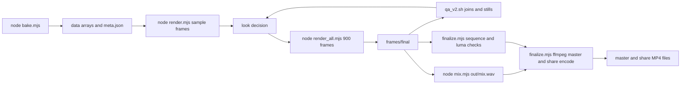
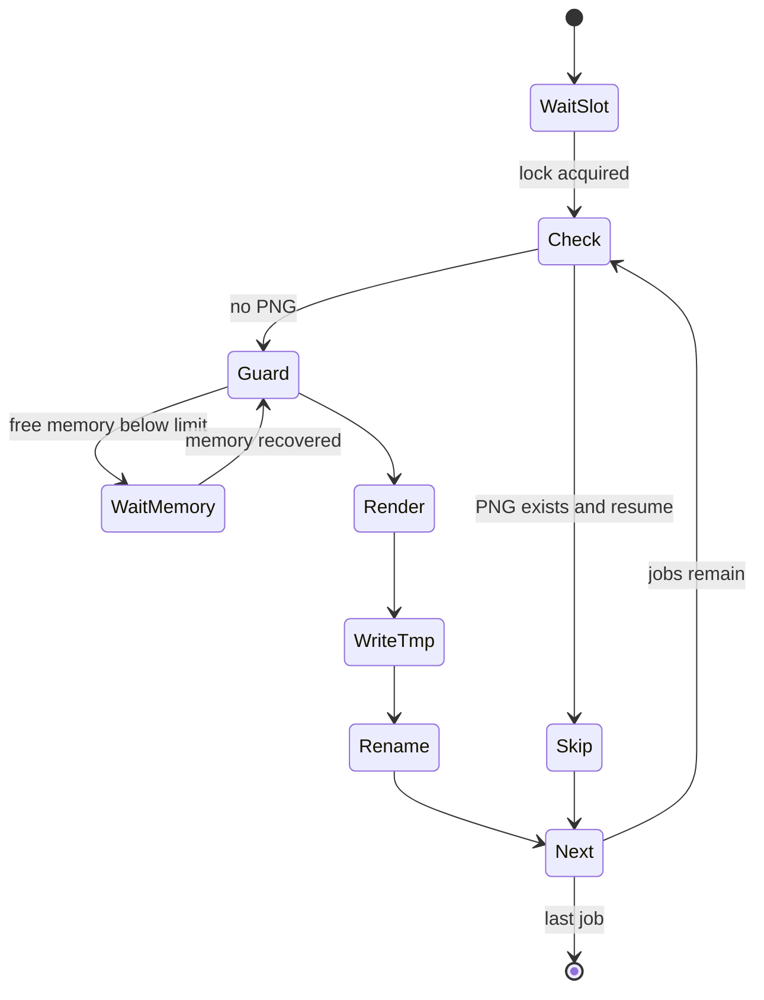

# Workflow and quality: from bake to encoded file

## Thesis

The film is made by a chain of offline steps. Each step writes a file that the next step reads. The chain is the bake, the look loop, the camera and timeline, the frame render, the frame check, the audio mix and the encode. A failure at one step leaves the next step without an input, and the tools report that condition.

The chain has no hidden state between the render and the encode. Frames are numbered files. The encode reads the numbers in order. The audio mix is a waveform file. The encode reads that file. A reader can re-run one step without re-running the earlier steps, as long as the input files exist.



The diagram is the main chain. The look loop feeds back into the render. The join check feeds back into a second render round. The encode is inside `finalize.mjs`. That step is the only one that reads the whole frame set and the audio at once.

The workflow also protects the machine. The render driver lowers its own priority. It waits for free memory. It samples a Blender process and yields longer when Blender is busy. A machine-wide lock allows at most two render processes (`render.mjs:74-95`). This matters because the source names a shared laptop with other graphics work (`DEV_GUIDE.md:109-113`).

**Aha:** The resume path is safe because a frame is a pure function of time and the write is atomic. The driver renders to a temporary file and renames it into place (`render.mjs:142-143`). A stop can leave a temporary file, but it cannot leave a half-written numbered frame.

## The bake

The bake turns the layout functions into data. It runs on the central processing unit and writes float arrays. The first output is the terrain height. The bake samples `height()` on the warped grid and writes `terrain_h.f32` (`bake.mjs:21-30`).

```text
# bake.mjs:21-30
const N = L.GRID.N;
const H = new Float32Array(N * N);
const xs = Array.from({ length: N }, (_, i) => L.gridX(i)), zs = Array.from({ length: N }, (_, j) => L.gridZ(j));
for (let j = 0; j < N; j++) {
  for (let i = 0; i < N; i++) H[j * N + i] = L.height(xs[i], zs[j]);
  if (j % 256 === 0) log('heights row', j);
}
writeAtomic(path.join(OUT, 'terrain_h.f32'), Buffer.from(H.buffer));
log('terrain heights written');
const hAt = L.makeSampler(H);
```

The bake is separate from the render for two reasons. The first is time. A distance solve over one million cells costs much more than a frame. The page must not pay that cost on every load. The second is determinism. The render reads a fixed float array from disk. The same file gives the same arrival field on every run. A rebake after a code change can give a different array. The file therefore pins one version of the bake code and the layout. Determinism comes from the pinned artifact, not from the bake method.

The write helper is atomic. It writes a temporary file and renames it over the target. It throws only after more than 40 failed retries (`bake.mjs:14`). The retry covers a temporary lock on the target file. A reader can run the bake again while another tool reads the old file. The file is either the old complete array or the new complete array.

The bake writes a separate patch for the waterfall. The patch centre is the waterfall position. The patch is 760 metres across with 1,024 cells (`bake.mjs:33`). The main grid is warped. Its cells are about 0.3 metres at the grid centre and much larger at the rim (`src/world/layout.js:274-277`). The patch cell is 0.74 metres. The patch is much finer than the main grid at the waterfall, so the ice and the water sheet have enough detail.

```text
# bake.mjs:108-128
const FAR = { minX: -4096, minZ: -4096, sizeX: 8192, sizeZ: 8192, nx: 1024, nz: 1024 };
const farD = dijkstra({ ...FAR, seeds: [{ x: 0, z: 0, d: 0 }] });
writeAtomic(path.join(OUT, 'arrival_far.f32'), Buffer.from(farD.buffer));
log('far arrival written');

const NEAR = { minX: -128, minZ: -128, sizeX: 512, sizeZ: 512, nx: 1024, nz: 1024 };
const nearD = dijkstra({ ...NEAR, seeds: [{ x: 0, z: 0, d: 0 }] });
writeAtomic(path.join(OUT, 'arrival_near.f32'), Buffer.from(nearD.buffer));
log('near arrival written');

// info texture on the far grid: R riverDist, G streamDist, B lakeDist(signed), A forest
const info = new Float32Array(FAR.nx * FAR.nz * 4);
for (let j = 0; j < FAR.nz; j++) for (let i = 0; i < FAR.nx; i++) {
  const x = FAR.minX + (i + 0.5) * FAR.sizeX / FAR.nx, z = FAR.minZ + (j + 0.5) * FAR.sizeZ / FAR.nz;
  const o = (j * FAR.nx + i) * 4;
  info[o] = Math.min(2000, L.riverDist(x, z).d);
  info[o + 1] = Math.min(2000, L.creekDist(x, z).d);
  info[o + 2] = Math.max(-2000, Math.min(2000, L.lakeDist(x, z)));
  info[o + 3] = L.forestMask(x, z);
}
writeAtomic(path.join(OUT, 'info_far.f32'), Buffer.from(info.buffer));
```

The arrival solve runs on the far grid and the near grid. Both use the same origin seed. The far grid spans 8,192 metres with 1,024 cells per side (`bake.mjs:108`). The near grid spans 512 metres from minus 128 to plus 384 metres with 1,024 cells per side (`bake.mjs:113`). The near cell is therefore 0.5 metres. The bake writes both arrays.

The info map uses the far grid. Its four channels are the river distance, the creek distance, the signed lake distance and the forest mask (`bake.mjs:118-127`). Each distance is clamped to plus or minus 2,000 metres. The map is written as `info_far.f32`.

The second bake writes the petal map. `bake_info2.mjs` computes the petal field, the radius, the lobe delta and a fractal noise term (`bake_info2.mjs:1-50`). It writes `info2_far.f32`. A debug option writes a contour image with one contour line every 150 arrival units. One arrival unit is one cost-weighted metre (`bake_info2.mjs:42-43`).

The metadata file holds the grid and patch descriptions and a report. The report samples the arrival field at named points (`bake.mjs:131-141`). The points include the knoll, the chase path, the grove, the lake, the petal tip, the waterfall base and the rim. The report is a tuning aid. The source does not state that the report is an input to the render.

The report has a stale angle. Its waterfall points use 232.5 degrees (`bake.mjs:134`). The layout constant `WF_PHI` is 292.5 degrees (`src/world/layout.js:57`). The developer guide also gives 232.5 degrees (`DEV_GUIDE.md:121`). A timeline comment records that the falls were once at 232.5 and are now at 292.5 (`src/world/timeline.js:70`). This package reports the conflict and does not silently correct either file.

## Look development

The developer guide defines a look loop. A module builder renders a few times at a small size with only the target modules loaded. The command sets the world to `film`, the `only` query to the module name, three times, 960 by 540 pixels, 2 subframes and a contact sheet (`DEV_GUIDE.md:102-104`).

```text
# DEV_GUIDE.md:104
node render.mjs --q "world=film&only=<yourmodule>" --times 2,9,13.5 --w 960 --h 540 --spp 2 --out out/<yourmodule>_v01 --sheet --cols 3
```

The `only` query is important. It loads the listed modules, the terrain and the placeholder sky (`DEV_GUIDE.md:106`). A half-finished module from another builder cannot break the test. The `--stats` flag prints the time of each pass. The `--sheet` flag writes a contact sheet. The guide asks the builder to open the sheet and the full-size frames (`DEV_GUIDE.md:107-108`).

The render driver accepts either a time list or a frame range. A time list makes one job per time. A range makes one job per frame from `from` to `to` with a step (`render.mjs:34-40`). A job name is either `t` plus the time or `f` plus the zero-padded frame number. That name becomes the PNG file name.

Look development also has two override queries. The `cam` query replaces the camera position, target and field of view (`src/worlds/film.js:104-109`). The `post` query replaces any post key with a numeric value (`src/worlds/film.js:164-165`). These queries let a builder test a frame without editing the timeline.

The review script is a larger look tool. It renders 26 stills across the six shots at 1,920 by 1,080 and 4 subframes (`review.mjs:15-22`, `review.mjs:39-41`). It also renders five motion strips of six frames each. The strips cover the hit, the wavefront, the swift, the white-out and the shatter (`review.mjs:23`). Each strip is rendered at 960 by 540 and 6 subframes (`review.mjs:47-49`).

```text
# review.mjs:15-23
const STILLS = {
  macro: [1.0, 3.6, 5.6, 6.12, 6.35, 7.0, 7.4],
  fpv: [8.3, 9.9, 10.9, 12.4, 13.6, 14.16, 15.0],
  canopy: [15.7, 16.2],
  reveal: [17.4, 18.8, 20.4],
  falls: [21.0, 22.0, 23.3],
  aerial: [24.3, 25.6, 27.6, 29.0],
};
const STRIPS = { hit: 5.96, wavefront: 10.0, swift: 14.1, whiteout: 16.5, shatter: 20.7 };
```

The still times follow the story. The macro stills cover the frost, the first light, the held breath, the burst and the pull. The flight stills cover the wavefront, the creek, the sun break and the swift. The final stills cover the reveal, the rainbow and the glint (`review.mjs:15-22`). A reviewer can compare a look change against the same set of moments.

## The camera path and the music lock

The camera is part of the world, not the engine. The timeline module exports the times, the shot table, the camera rig and the bloom clock (`src/world/timeline.js:12-268`). Every module can call `rig.at(t)` and read the camera for any time.

```text
# src/world/timeline.js:26-38
export const SHOTS = [
  { id: 'macro', start: 0, end: () => TIMES.cut2 },
  { id: 'fpv', start: () => TIMES.cut2, end: () => TIMES.cut3 },
  { id: 'canopy', start: () => TIMES.cut3, end: () => TIMES.cut4 },
  { id: 'reveal', start: () => TIMES.cut4, end: () => TIMES.cut5 },
  { id: 'falls', start: () => TIMES.cut5, end: () => TIMES.cut6 },
  { id: 'aerial', start: () => TIMES.cut6, end: () => TIMES.end + 1 },
];
const val = v => (typeof v === 'function' ? v() : v);
export function shotAt(t) {
  for (const s of SHOTS) if (t >= val(s.start) && t < val(s.end)) return { id: s.id, t0: val(s.start), t1: val(s.end), local: t - val(s.start) };
  return { id: 'aerial', t0: TIMES.cut6, t1: TIMES.end, local: t - TIMES.cut6 };
}
```

The shot table is the authority for cuts. The camera functions are continuous inside a shot. The table returns a shot for any time. The last shot extends one second past the film end so the final fade stays inside a shot.

The film world builds two rigs. The current rig comes from `timeline.js`. The first-cut rig comes from `timeline_v1.js`. The world sets a `loading` flag while the modules lay out their instances. During that load-time pass, and only for times before cut6, the layout rig returns the first-cut path (`src/worlds/film.js:26-33`). After the load finishes, and for every per-frame camera call, the layout rig returns the current path. "Before cut6" means times below `TIMES.cut6`, which is 23.7 seconds (`src/world/timeline.js:22`). The load-time sample is the position that a module uses to place a plant, a tree or a cloud. The per-frame sample is the camera pose for the rendered frame. This design keeps the untouched frames identical to the first cut. The second fix round re-rendered only the ranges that changed.

The reason is the layout. A plant grows at a point that the module chooses at load time by sampling the camera path. If the module sampled the new path at load time, every plant in the meadow could move by a small amount. The untouched frames would then show a different field of flowers. The first-cut rig keeps the old points for load-time samples before the sixth cut. The frames after the sixth cut were all re-rendered with the new layout path.

```text
# src/worlds/film.js:26-33
  const rig = makeCameraRig(data);
  // Modules lay out vegetation, trees, clouds and lens tracks by sampling the camera path
  // at load. The final round changed only the pull-back and the aerial moves, so before
  // cut6 the load-time layout keeps the v1 path (frames that were not re-rendered stay
  // identical); per-frame calls and the aerial layout use the new rig.
  const rigV1 = makeCameraRigV1(data);
  let loading = true;
  const layoutRig = { ...rig, at: t => (loading && t < TIMES.cut6 ? rigV1 : rig).at(t) };
```

The music lock is a set of named times. The times are not free values. `firstLight` is 3.03. `held` is 5.18. `hit` is 6.0. `cut2` is 7.52. `creek` is 9.55. `catchUp` is 11.58. `sunBreak` is 12.09. `swift` is 14.16. `cut3` is 15.4. `whiteout` is 16.4. `cut4` is 16.79. `arrival` is 17.31. `cut5` is 20.72. `rainbow` is 21.21. `cut6` is 23.7. `resolve` is 25.5. `glint` is 27.5. `fadeOut` is 29.0. `end` is 30.0 (`src/world/timeline.js:12-24`).

The cue sheet imports the same values. A cue can name `T.hit`, `T.sunBreak`, `T.rainbow` or `T.glint` instead of a number (`audio/cues.mjs:12-69`). A change to a music time moves the picture event and the sound event together. The source does not claim that this makes the edit automatic. It makes the shared time explicit.

## The render driver

The driver has three layers of safety. The first is process priority. The driver sets itself below normal priority at start (`render.mjs:42`). On Windows the child Chrome process inherits the lower priority.

The second is a memory guard. The driver reads free memory before every job. If free memory is below 6 gigabytes, it waits five seconds and checks again (`render.mjs:64-72`). The limit is a command-line option with a default of 6 (`render.mjs:30`).

The third is a Blender guard. Every fifteenth job the driver runs a PowerShell query for the total central processing unit time of any Blender process. It compares the value with the previous sample. If the used fraction is above 0.2, it marks Blender as busy (`render.mjs:48-62`). A busy flag multiplies the normal yield by six (`render.mjs:72`). The driver never stops or throttles Blender.

```text
# render.mjs:48-72
let blenderCpu = null, blenderBusy = false;
function sampleBlender() {
  return new Promise(resolve => {
    execFile('powershell', ['-NoProfile', '-Command', '(Get-Process blender -ErrorAction SilentlyContinue | Measure-Object CPU -Sum).Sum'], { timeout: 15000 }, (err, out) => {
      const cpu = parseFloat(String(out).trim().replace(',', '.')) || 0;
      const now = Date.now();
      if (blenderCpu) {
        const used = (cpu - blenderCpu.cpu) / ((now - blenderCpu.t) / 1000) / os.cpus().length;
        blenderBusy = used > 0.2;
      }
      blenderCpu = { cpu, t: now };
      resolve();
    });
  });
}

async function guard(i) {
  let warned = false;
  while (os.freemem() / 2 ** 30 < MIN_FREE_GB) {
    if (!warned) { log(`low RAM (${(os.freemem() / 2 ** 30).toFixed(1)} GB free) - waiting`); warned = true; }
    await sleep(5000);
  }
  if (i % 15 === 0) await sampleBlender();
  await sleep(blenderBusy ? YIELD_MS * 6 : YIELD_MS);
}
```

The lock is a directory in the system temporary folder. The directory is named `film-render-locks`. Each slot is a file named `slot0.lock` or `slot1.lock`. A process creates a file with the exclusive flag. If the file exists, the process reads the owner process identifier and tests it. A dead owner is removed (`render.mjs:80-95`). The default slot count is 2 (`render.mjs:76`).

```text
# render.mjs:82-100
    for (let s = 0; s < MAX_JOBS; s++) {
      const f = path.join(LOCKDIR, `slot${s}.lock`);
      try {
        const fd = fs.openSync(f, 'wx'); fs.writeSync(fd, String(process.pid)); fs.closeSync(fd);
        lockFile = f; return;
      } catch {
        // stale lock (owner gone)?
        try { const pid = +fs.readFileSync(f, 'utf8'); process.kill(pid, 0); } catch (e) { if (e.code === 'ESRCH') { try { fs.unlinkSync(f); } catch {} } }
      }
    }
    if (waited % 30 === 0) log('waiting for a render slot...');
    await sleep(2000);
  }
}
const releaseSlot = () => { if (lockFile) { try { fs.unlinkSync(lockFile); } catch {} lockFile = null; } };
process.on('exit', releaseSlot);
process.on('SIGINT', () => { releaseSlot(); process.exit(130); });
process.on('SIGTERM', () => { releaseSlot(); process.exit(143); });
await acquireSlot();
```

The driver starts a local static server and a headless Chrome page. It uses the `d3d11` and `angle` backends on Windows. It sets an 8 gigabyte old-space limit for the page (`render.mjs:106-117`). It waits without a timeout for the page to report ready or an error (`render.mjs:128-130`).

The job loop has a resume check. If the `--resume` flag is set and the target PNG exists with a non-zero size, the loop skips the job (`render.mjs:137`). Otherwise it renders the frame, writes a temporary file and renames it (`render.mjs:141-143`). It then prints the frame time, the completed count and an estimate of the remaining time.

```text
# render.mjs:137-149
    if (SKIP_EXISTING && fs.existsSync(file) && fs.statSync(file).size > 0) continue;
    await guard(i);
    const ts = Date.now();
    const b64 = await page.evaluate(t => window.__film.renderFrame(t), j.t);
    if (!b64 || failed) throw new Error('render failed at t=' + j.t);
    fs.writeFileSync(file + '.tmp', Buffer.from(b64, 'base64'));
    fs.renameSync(file + '.tmp', file);
    const dt = (Date.now() - ts) / 1000;
    const done = i + 1, eta = ((Date.now() - t0) / done) * (jobs.length - done) / 1000;
    log(`${j.name} t=${j.t.toFixed(3)} ${dt.toFixed(2)}s  [${done}/${jobs.length}] eta ${(eta / 60).toFixed(1)}m  freeRAM ${(os.freemem() / 2 ** 30).toFixed(1)}G${blenderBusy ? ' (blender busy)' : ''}`);
    const stats = await page.evaluate('window.__film.stats || null');
    if (stats && (i === 0 || flag('stats'))) log('stats:', JSON.stringify(stats));
  }
```



The diagram is the per-job state. The slot is held for the whole process, not for one job. The resume check runs before the memory guard on each job. The temporary file name has a `.tmp` suffix, so a reader can see an interrupted write.

## Sample segments and fix rounds

The full render is split by motion. The split script defines 11 segments with a first frame, an exclusive end frame and a subframe count (`render_all.mjs:26-38`). The burst and the swift pass get 32 subframes. The shatter gets 28. The canopy gets 20. The pull and the two flight segments get 16. The macro, the reveal and the falls get 12. The aerial gets 10.

```text
# render_all.mjs:26-38
const SEGMENTS = [
  ['macro', 0, f(TIMES.hit - 0.1), 12],
  ['burst', f(TIMES.hit - 0.1), f(TIMES.pullStart), 32],
  ['pull', f(TIMES.pullStart), f(TIMES.cut2), 16],
  ['fpv', f(TIMES.cut2), f(TIMES.swift - 0.16), 16],
  ['swift', f(TIMES.swift - 0.16), f(TIMES.swift + 0.24), 32],
  ['fpv2', f(TIMES.swift + 0.24), f(TIMES.cut3), 16],
  ['canopy', f(TIMES.cut3), f(TIMES.cut4), 20],
  ['reveal', f(TIMES.cut4), f(TIMES.cut5), 12],
  ['shatter', f(TIMES.cut5), f(TIMES.cut5 + 0.55), 28],
  ['falls', f(TIMES.cut5 + 0.55), f(TIMES.cut6), 12],
  ['aerial', f(TIMES.cut6), f(TIMES.end), 10],
];
```

The script calls the driver with `--resume`, `--maxjobs 1` and `--yield 150` (`render_all.mjs:52`). The single job limit is a policy for this film. The driver can accept two, but the film run does not use two. The goal is to leave graphics capacity for other work.

The second fix round uses a range list. Each range has a name, a first frame, an exclusive end frame and a subframe count (`rerender_v2.mjs:18-27`). The aerial uses frames 711 to 899 at 10. The shatter uses 622 to 637 at 28. The falls uses 638 to 710 at 12. The creek window uses 281 to 365 at 16. The reveal uses 504 to 621 at 12. The pull uses 201 to 225 at 16. The canopy uses 462 to 503 at 20.

```text
# rerender_v2.mjs:19-27
const RANGES = [
  ['aerial', 711, 900, 10],
  ['shatter', 622, 638, 28],
  ['falls', 638, 711, 12],
  ['fpvCreek', 281, 366, 16],
  ['reveal', 504, 622, 12],
  ['pull', 201, 226, 16],
  ['canopy', 462, 504, 20],
];
```

For each range the script moves the first-cut frames to a backup folder once. It then renders the new frames into the final folder (`rerender_v2.mjs:35-44`). The ranges are in priority order. The high-value ranges render first.

The quality assurance script builds review material for the joins. It makes a row of six frames across each boundary between a re-rendered range and an untouched range (`qa_v2.sh:19-27`). The rows start at f198, f223, f278, f363, f459, f501, f619 and f708. It also builds grids at the fixed moments: the creek at f300, the pull at f201, the canopy at f470, the shatter at f622 and the glint at f818 (`qa_v2.sh:28-33`).

```text
# qa_v2.sh:8-27
fr() { printf "$F/f%05d.png" $1; }
grid() { # name start count cols width
  local name=$1 start=$2 n=$3 cols=$4 w=$5 h=$(( $5 * 9 / 16 )) args="" fil="" lay="" ins=""
  for k in $(seq 0 $((n-1))); do
    args="$args -i $(fr $((start+k)))"
    fil="$fil[$k:v]scale=$w:$h,drawtext=text='f$((start+k))':x=8:y=8:fontsize=22:fontcolor=white:box=1:boxcolor=black@0.5[s$k];"
    lay="$lay$(( (k%cols)*w ))_$(( (k/cols)*h ))|"; ins="$ins[s$k]"
  done
  ffmpeg -v error -y $args -filter_complex "${fil}${ins}xstack=inputs=$n:layout=${lay%|}" -q:v 3 $Q/$name.jpg 2>/dev/null
}
for s in $(seq 0 29); do f=$((s*30+15)); ffmpeg -v error -y -i $(fr $f) -vf scale=1920:-2 -q:v 3 $Q/sec$(printf %02d $s)_f$(printf %03d $f).jpg; done
# joins: last untouched / first re-rendered (or the reverse), 6 frames each
grid join_f198 198 6 3 640      # macro (old) -> pull (new) at f201
grid join_f223 223 6 3 640      # pull (new) -> fpv (old) at f226
grid join_f278 278 6 3 640      # fpv (old) -> creek window (new) at f281
grid join_f363 363 6 3 640      # creek window (new) -> fpv (old) at f366
grid join_f459 459 6 3 640      # fpv2 (old) -> canopy (new) at f462
grid join_f501 501 6 3 640      # canopy (new) -> reveal (new) white-out
grid join_f619 619 6 3 640      # reveal -> shatter
grid join_f708 708 6 3 640      # falls -> aerial
```

The join grids are the main check for the second fix round. A visible jump at f201 or f226 would mean the old and new frames do not match. The grid puts six consecutive frames side by side with their frame numbers. A reviewer can see a lighting or camera discontinuity without opening a video player.

The script also writes one keyframe per second at 1,920 width (`qa_v2.sh:18`). It writes centre crops at the master size for five frames (`qa_v2.sh:34`). These crops show whether the paint filter, the grain and the fine detail survive at 3,840 by 2,160 pixels.

## Frame checks and encode

The finalise script runs two checks before the encode. First it counts the frames. It expects 900 files with names from `f00000.png` to `f00899.png`. It also flags any file smaller than 200,000 bytes (`finalize.mjs:20-27`). Second it scans every third frame for a very dark or very bright mean value. It skips the fade zones and the white-out (`finalize.mjs:29-39`). The two checks print the frame count and any outliers. The script then encodes.

```text
# finalize.mjs:17-38
const N = 900, FPS = 30;
const threads = String(Math.max(2, Math.min(6, os.cpus().length - 6)));

// ---- 1. sequence check
const missing = [], tiny = [];
for (let f = 0; f < N; f++) {
  const p = path.join(FR, `f${String(f).padStart(5, '0')}.png`);
  if (!fs.existsSync(p)) missing.push(f); else if (fs.statSync(p).size < 200000) tiny.push(f);
}
console.log(`frames: ${N - missing.length}/${N} present; missing ${missing.length ? missing.slice(0, 20).join(',') : 'none'}; suspiciously small ${tiny.length ? tiny.slice(0, 20).join(',') : 'none'}`);
if (missing.length) process.exit(1);

// ---- 2. black / blown frame scan (1 in 3 frames, downscaled)
const bad = [];
for (let f = 0; f < N; f += 3) {
  const p = path.join(FR, `f${String(f).padStart(5, '0')}.png`);
  const b = execFileSync('ffmpeg', ['-v', 'error', '-i', p, '-vf', 'scale=64:-2', '-pix_fmt', 'gray', '-f', 'rawvideo', '-']);
  const mean = b.reduce((s, v) => s + v, 0) / b.length;
  const t = f / FPS;
  const fadeZone = t < 1.0 || t > 28.9 || (t > 16.6 && t < 16.95);
  if (!fadeZone && (mean < 25 || mean > 245)) bad.push(`${f}(${mean.toFixed(0)})`);
}
```

The master encode uses libx264. The settings are constant rate factor 16, a maximum rate of 120 megabits per second, a buffer of 240 megabits, High profile and level 5.2 (`finalize.mjs:47-49`). The share encode uses constant rate factor 17, a maximum rate of 40 megabits per second, High profile and level 4.2 (`finalize.mjs:51-53`). Both convert to BT.709 and limited range (`finalize.mjs:42-43`). When the mix file exists, the audio is Advanced Audio Coding (AAC) at 320 kilobits per second and 48 kilohertz (`finalize.mjs:44-45`).

The encoder thread count is the central processing unit count minus six. The value has a floor of two and a ceiling of six (`finalize.mjs:18`). This keeps the encode light on a shared machine. The frame names have five digits. The render driver pads the frame number to five places (`render.mjs:39`). The finalise check uses the same format (`finalize.mjs:23`).

```text
# finalize.mjs:41-60
// ---- 3. encodes
const vf709 = 'scale=in_range=full:out_range=tv:out_color_matrix=bt709:flags=lanczos+accurate_rnd+full_chroma_int';
const tags = ['-color_primaries', 'bt709', '-color_trc', 'bt709', '-colorspace', 'bt709', '-color_range', 'tv'];
const audio = fs.existsSync(MIX) ? ['-i', MIX] : [];
const amap = audio.length ? ['-map', '1:a', '-c:a', 'aac', '-b:a', '320k', '-ar', '48000'] : [];
const master = path.join(OUT, 'first_bloom_3840x2160.mp4');
execFileSync('ffmpeg', ['-v', 'error', '-stats', '-y', '-framerate', String(FPS), '-i', path.join(FR, 'f%05d.png'), ...audio, '-map', '0:v', ...amap,
  '-c:v', 'libx264', '-preset', 'fast', '-crf', '16', '-maxrate', '120M', '-bufsize', '240M', '-profile:v', 'high', '-level', '5.2', '-pix_fmt', 'yuv420p', '-threads', threads,
  '-vf', vf709, ...tags, '-movflags', '+faststart', '-shortest', master], { stdio: 'inherit' });
const hd = path.join(OUT, 'first_bloom_1920x1080.mp4');
execFileSync('ffmpeg', ['-v', 'error', '-stats', '-y', '-framerate', String(FPS), '-i', path.join(FR, 'f%05d.png'), ...audio, '-map', '0:v', ...amap,
  '-c:v', 'libx264', '-preset', 'medium', '-crf', '17', '-maxrate', '40M', '-bufsize', '80M', '-profile:v', 'high', '-level', '4.2', '-pix_fmt', 'yuv420p', '-threads', threads,
  '-vf', `scale=1920:1080:flags=lanczos,${vf709}`, ...tags, '-movflags', '+faststart', '-shortest', hd], { stdio: 'inherit' });

// ---- 4. poster + contact sheet
fs.copyFileSync(path.join(FR, `f${String(Math.round(27.2 * FPS)).padStart(5, '0')}.png`), path.join(OUT, 'poster_flower.png'));
fs.copyFileSync(path.join(FR, `f${String(Math.round(6.35 * FPS)).padStart(5, '0')}.png`), path.join(OUT, 'poster_bloom.png'));
const per = Array.from({ length: 30 }, (_, s) => path.join(FR, `f${String(s * FPS + 15).padStart(5, '0')}.png`));
const inputs = per.flatMap(p => ['-i', p]);
const fil = per.map((_, k) => `[${k}:v]scale=384:216[s${k}]`).join(';');
```

The poster frames are copies of rendered frames. The script copies the frame at 27.2 seconds as the flower poster and the frame at 6.35 seconds as the bloom poster (`finalize.mjs:56-57`). The contact sheet uses one frame per second, sampled at the half-second point (`finalize.mjs:58-62`). The output is a 6 by 5 grid of 384 by 216 tiles.

## The audio mix

The music edit is a separate step. `render_edit.cjs` reads a specification with four segments. It cuts each segment from the source, applies a gain and fades, delays it to its destination time and sums the segments (`audio/edit/render_edit.cjs:15-28`). It uses one ffmpeg process with one thread. It sets the process below normal priority (`audio/edit/render_edit.cjs:10-11`).

```text
# audio/edit/render_edit.cjs:14-29
E.src = require('path').resolve(ROOT, E.src); E.out = require('path').resolve(ROOT, E.out);
const SR = 48000;
const total = E.total || 30.0;
const N = E.segments.length;
const totalS = Math.round(total * SR);
let fc = `[0:a]aresample=${SR},asplit=${N}` + E.segments.map((_, i) => `[a${i}]`).join('') + ';';
E.segments.forEach((s, i) => {
  const len = s.src_end - s.src_start;
  const p = [`atrim=start=${s.src_start.toFixed(5)}:end=${s.src_end.toFixed(5)}`, 'asetpts=PTS-STARTPTS'];
  if (s.gain_db) p.push(`volume=${s.gain_db}dB`);
  if (s.fade_in_ms > 0) p.push(`afade=t=in:st=0:d=${(s.fade_in_ms / 1000).toFixed(4)}:curve=${s.fin_curve || 'qsin'}`);
  if (s.fade_out_ms > 0) p.push(`afade=t=out:st=${(len - s.fade_out_ms / 1000).toFixed(5)}:d=${(s.fade_out_ms / 1000).toFixed(4)}:curve=${s.fout_curve || 'qsin'}`);
  const dly = Math.round(s.dst_start * SR);
  if (dly > 0) p.push(`adelay=delays=${dly}S:all=1`);
  fc += `[a${i}]${p.join(',')}[m${i}];`;
});
```

The specification sets a 30 second total and a master gain of minus 3 decibels. It sets a limiter at minus 1 decibel full scale and an end fade from 27.6 to 30.0 seconds (`audio/edit/edit_1.spec.json:1-11`). The four segments start at 0.35, 178.5, 135.38 and 197.15 seconds in the source. They land at 0, 5.97, 17.215 and 23.7 seconds in the edit (`audio/edit/edit_1.spec.json:12-41`).

The cue mix is a second audio step. The cue sheet has 46 effect cues and one music entry (`audio/cues.mjs:10-69`). The mixer measures every segment before it sets a gain. It decodes to mono at 12 kilohertz. It computes the root mean square level and finds the peak and the onset (`mix.mjs:22-37`). It sets the gain so the segment reaches its target level. The gain is capped at 12 decibels (`mix.mjs:54`). The anchor places the chosen feature on the timeline time.

```text
# mix.mjs:60-73
  if (c.lowpass) ch.push(`lowpass=f=${c.lowpass}`);
  ch.push(`volume=${gain.toFixed(2)}dB`);
  if (c.pan) { const p = c.pan; ch.push(`pan=stereo|c0=${(1 - Math.max(0, p)).toFixed(3)}*c0|c1=${(1 + Math.min(0, p)).toFixed(3)}*c1`); }
  if (c.fadeIn) ch.push(`afade=t=in:st=0:d=${c.fadeIn}`);
  if (c.fadeOut) ch.push(`afade=t=out:st=${Math.max(0, len / (c.rate || 1) - c.fadeOut).toFixed(3)}:d=${c.fadeOut}`);
  ch.push(`adelay=${Math.round(delay * 1000)}|${Math.round(delay * 1000)}`);
  filters.push(`[${n}:a]${ch.join(',')}[s${n}]`);
  labels.push(`[s${n}]`);
  console.log(`${isMusic ? 'MUSIC' : 'cue  '} ${path.basename(c.file).padEnd(52)} at ${String(c.at ?? 0).padEnd(6)} anchor ${anchor.toFixed(2)} gain ${gain.toFixed(1)} dB (seg rms ${a.rmsDb.toFixed(1)})`);
  n++;
}

if (MUSIC) addSource(MUSIC, true);
for (const c of CUES) addSource(c);
```

The mix uses `amix` with `normalize=0`. That setting stops ffmpeg from dividing each input by the number of inputs. The mix is trimmed to 30 seconds and closed with a 0.6 second fade (`mix.mjs:75`). The two-pass loudness pass then targets minus 14 loudness units relative to full scale, a true peak of minus 1 decibel and a loudness range of 11 (`mix.mjs:83-86`).

The source gives a reason for the measurement. The comment says the levels are set by measurement, not by ear (`mix.mjs:1-2`). Each cue names a target root mean square level. The mixer does not trust the file level. It measures the actual segment and computes the gain.

**Aha:** A cue does not store a volume. It stores a target level and an anchor. The mixer derives the volume from the measured file. A replacement sound file therefore lands at the same loudness and the same picture event without a new mix decision.

The two audio steps are independent. The music edit makes one music file. The cue mix reads that file as the music entry and adds the effects (`audio/cues.mjs:10`). A reader can change an effect without touching the music edit. A reader can change a music cut without touching the effect list, as long as the edit keeps the same length.

## What the workflow does not do

The workflow does not render the film inside one process. The render is a set of jobs in a driver. The encode is a separate command. The audio is two separate commands. A reader must run the chain in order to rebuild the film.

The workflow does not fetch the audio inside the render. `audio/fetch_audio.mjs` is a separate tool. It reads the cue sheet and downloads only the files that the cues use, unless the `--all` flag is set (`audio/fetch_audio.mjs:1-34`). The licence note explains why the files are not in the tree (`README.md:41`).

The workflow does not bake at render time. The page loads the data arrays. If a file is missing, the loader throws an error that names the bake command (`src/world/data.js:6`). The render driver treats a page error as a failure and stops (`render.mjs:122-123`, `render.mjs:130`).

The workflow does not prove the film is good. The checks catch missing frames, black frames, blown frames and broken joins. They do not judge the acting of light, the colour or the music. The review stills and the contact sheets exist for a person to judge those things.
