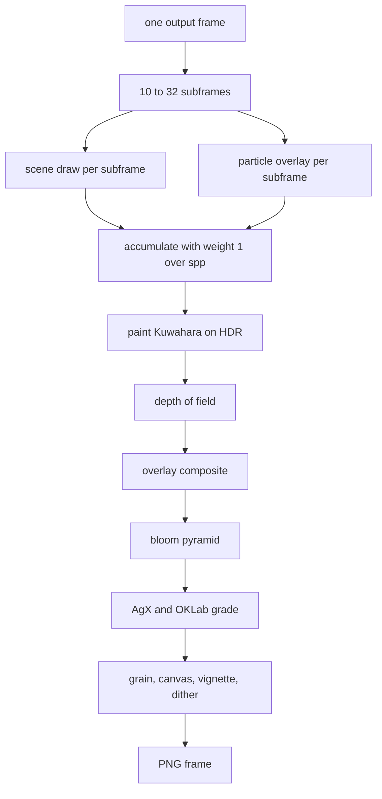
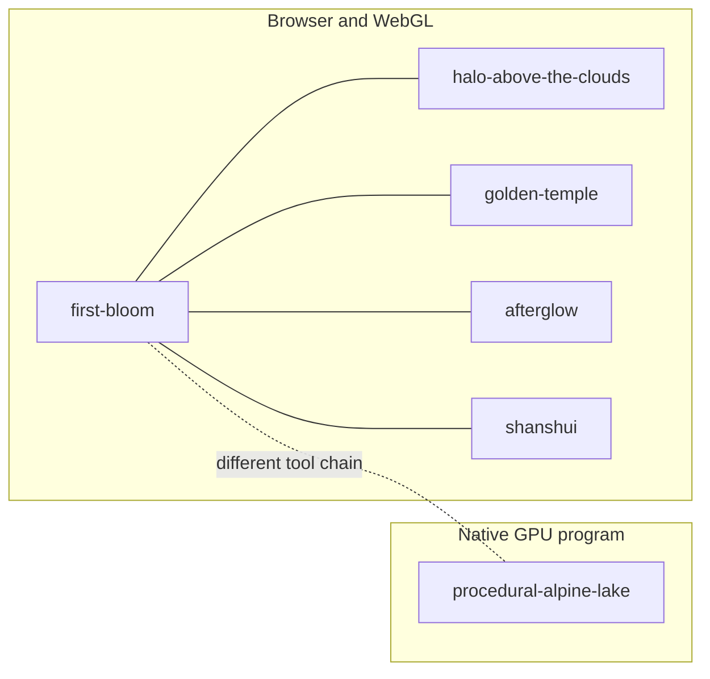

# Limits and comparison: what the film costs and what it does not prove

## Thesis

The film is a 30 second, 3,840 by 2,160 pixel, 30 frame per second render. That sentence fixes a large cost. Each output frame is a mean of 10 to 32 subframes (`README.md:24`). Each subframe draws the scene and the particle overlay. Each frame then runs a chain of full-screen passes at the master size. The cost therefore grows with the square of the resolution and with the subframe count.

The source states its own limits in three places. The developer guide gives a per-module time budget (`DEV_GUIDE.md:95-100`). The concept notes give an estimate for the whole render and a machine-safety plan (`CONCEPT.json:138`). The project README gives the release file sizes (`README.md:14-15`). The three sources do not agree on every number. This document reports the values and the disagreements. It does not reconcile them.

**Aha:** The package contains no measured frame time. The release file sizes are project README claims, not measurements made by this package. Every frame-time number is an estimate. The concept note gives about 4 to 10 seconds for a 4K frame, which is 3,840 by 2,160 pixels (`CONCEPT.json:138`). It gives about 20 to 40 seconds for a frame on the sub-frame shots 5 to 8. A sub-frame shot is a shot that asks for several jittered subframes in one output frame. The note then gives 3 to 4 hours for 720 frames at 24 frames per second (fps). The arithmetic is consistent. 720 frames times 15 to 20 seconds is 10,800 to 14,400 seconds, which is 3 to 4 hours. The range is an average over normal and sub-frame shots. The source gives no split between scene time and post time.

## Limits the source states

The developer guide gives four performance limits. The total scene should stay under about 450 milliseconds. Vegetation should stay under 180 milliseconds. Trees should stay under 100 milliseconds. Every other module should stay under 60 milliseconds each (`DEV_GUIDE.md:95-96`).

```text
# DEV_GUIDE.md:95-100
  - The total scene should stay under about 450 ms.
  - Your module should take a fair share: vegetation under 180 ms, trees under 100, the rest under 60 each.
  - GPU memory for your buffers should stay under about 300 MB.
  - Cull by camera: only build or draw instances near what the camera of each shot can see (`rig.at(t)` lets you precompute every shot's camera path), and set `mesh.visible` per shot in `update()`.
  - Distance LOD.
  - Nothing should ever be a single draw that takes more than about 300 ms (the Windows GPU watchdog).
```

The guide gives two more limits. Graphics processing unit (GPU) memory for a module should stay under about 300 megabytes. No single draw should take more than about 300 milliseconds (`DEV_GUIDE.md:97`, `DEV_GUIDE.md:100`). The second limit protects the Windows Timeout Detection and Recovery (TDR) watchdog. The watchdog resets a GPU that does not answer for about 2 seconds.

The guide states the machine. The render runs in three.js r187 on Web Graphics Library (WebGL) 2 inside headless Chrome. The GPU is an Advanced Micro Devices (AMD) Radeon 780M integrated GPU (`DEV_GUIDE.md:3`). The concept note calls the 780M memory shared random access memory (RAM) and caps the film at about 1.5 to 2 gigabytes of it (`CONCEPT.json:138`). A large render target can therefore reduce the memory that the operating system and other programs can use.

The concept note states a build plan and a risk list. It asks for one headless Chrome process at below-normal priority. It asks for one frame at a time with no parallel workers. It asks for a free memory check before each batch and a pause when free memory is low (`CONCEPT.json:138`). The render driver implements these rules. The concept note also asks for scissor tiles and a finish call between them. The engine implements that rule.

The concept note gives a render estimate. It says about 4 to 10 seconds per 4K frame. It says about 20 to 40 seconds for a frame on the sub-frame shots 5 to 8. It then gives a total of about 3 to 4 hours for 720 frames at 24 fps (`CONCEPT.json:138`). That total follows from the same note. 720 frames at an average of 15 to 20 seconds is 3 to 4 hours. The total does not match the finished film's frame count. The film has 900 frames at 30 fps (`README.md:5`). The estimate is a planning number from an earlier cut. This package reports the mismatch and does not use the estimate as a measured cost.

The project README states the delivered files. The 4K master is 461 megabytes. The 1,920 by 1,080 pixel (1080p) share file is 81 megabytes (`README.md:14-15`). The README also states the first cut exists as a separate 1080p file (`README.md:18`). This package did not download or open those files. It reports the README claim as a claim.

```text
# README.md:14-18
| [`first_bloom_3840x2160.mp4`](https://github.com/Leonxlnx/first-bloom/releases/download/v1.0/first_bloom_3840x2160.mp4) | The 4K master. H.264 High 5.2, BT.709, CRF 16 capped at 120 Mbit/s, with AAC 320k audio (461 MB). |
| [`first_bloom_1920x1080.mp4`](https://github.com/Leonxlnx/first-bloom/releases/download/v1.0/first_bloom_1920x1080.mp4) | A 1080p version for sharing (81 MB). |
| `poster_flower.png`, `poster_bloom.png` | 4K stills: the valley-is-a-flower reveal and the bud bursting open. |
| `first_bloom_contact.jpg` | A contact sheet with one frame per second. |
| `first_bloom_v1_1920x1080.mp4` | The first cut, before the final fix round, for comparison. |
```

The package specification has a verification table. Every row is `Pending` (`../spec.md:162-171`). The table covers the documents, the snippets, the diagrams, the Simplified Technical English, the links, the fresh-reader review, the build and the commit. This package must not treat the README release claim as a verified result.

## The cost model

A frame is not one draw. The engine clears an accumulation buffer. It then loops over the subframe count. For each subframe it updates the world, offsets the camera projection by a Halton point and draws the scene. It adds the result to the accumulator with weight one over the subframe count (`src/engine.js:464-499`). A Halton sequence is a low-discrepancy sequence that spreads sample points.

The subframe count changes per segment. The split script gives 32 subframes to the burst and the swift pass. It gives 28 to the shatter. It gives 20 to the canopy. It gives 16 to the pull and the two flight segments. It gives 12 to the macro, the reveal and the falls. It gives 10 to the aerial (`render_all.mjs:26-38`). The count follows motion. A fast pass needs more samples to hide aliasing and to make smooth motion blur.

The post chain adds a fixed cost for every frame. The chain has six stages in the code. The paint stage runs an anisotropic Kuwahara filter on the high dynamic range (HDR) image (`src/engine.js:507-521`). The depth of field stage reads the base depth (`src/engine.js:524-540`). The overlay stage composites the premultiplied particle layer (`src/engine.js:543-547`). The bloom stage builds a seven-level pyramid (`src/engine.js:550-565`). The grade stage applies the tone map and the colour grade (`src/engine.js:568-579`). The finish stage adds grain, canvas, vignette, letterbox and dither (`src/engine.js:582-588`).

The render defaults are 1,920 by 1,080 pixels, 30 frames per second and 4 subframes (`render.mjs:24-26`). A look test can use these defaults. The film run overrides them with 3,840 by 2,160 and the per-segment subframe counts (`render_all.mjs:52`).

```text
# render.mjs:24-32
const W = +opt('w', 1920), H = +opt('h', 1080);
const FPS = +opt('fps', 30);
const SPP = +opt('spp', 4);
const OUT = path.resolve(ROOT, opt('out', 'out/test'));
const PAGE = opt('page', 'index.html');
const EXTRA = opt('q', '');
const MIN_FREE_GB = +opt('minfree', 6);
const YIELD_MS = +opt('yield', 120);
const SKIP_EXISTING = flag('resume');
```

**Aha:** A 4K frame costs about four times a 1080p frame for every full-screen pass. The pixel count grows by four. The paint, depth of field, overlay, bloom, grade and finish stages all run per pixel. The 4K target is therefore the largest single multiplier in the budget.

The paint stage is a heavy per-pixel stage at 4K. It computes a structure tensor, blurs the tensor in two directions and runs the Kuwahara filter. It draws the filter in scissor tiles at 4K (`src/engine.js:519`). The tile count rises with the frame height. The source gives no per-stage timing for a finished frame. This package therefore does not rank the stages.

The encode is a separate cost. The master uses constant rate factor 16 with a maximum rate of 120 megabits per second (`finalize.mjs:47-49`). The file size depends on the picture content, so the source gives no predicted size. The README gives the delivered size, not a model.

```text
# finalize.mjs:47-49
execFileSync('ffmpeg', ['-v', 'error', '-stats', '-y', '-framerate', String(FPS), '-i', path.join(FR, 'f%05d.png'), ...audio, '-map', '0:v', ...amap,
  '-c:v', 'libx264', '-preset', 'fast', '-crf', '16', '-maxrate', '120M', '-bufsize', '240M', '-profile:v', 'high', '-level', '5.2', '-pix_fmt', 'yuv420p', '-threads', threads,
  '-vf', vf709, ...tags, '-movflags', '+faststart', '-shortest', master], { stdio: 'inherit' });
```

The constant rate factor and the maximum rate do different jobs. The constant rate factor sets the quality target. The maximum rate caps a hard scene. A long effects shot with fast motion can hit the cap. The source does not state that any scene hit the cap.

The master also carries the audio when the mix file exists. The audio is Advanced Audio Coding (AAC) at 320 kilobits per second (`finalize.mjs:45`). The share encode uses a lower rate cap and a different level. The reader gets the same cut and the same sound at two sizes.



The diagram shows why the subframe count dominates. Each subframe repeats the scene and the overlay. The post chain runs once. A frame at 32 subframes costs about three times a frame at 10 subframes for the scene part, before the post chain.

The film length is a cost choice. A 30 second film at 30 frames per second has 900 output frames (`README.md:5`). A 60 second film at the same rate has 1,800. The cost grows in a straight line with the length. The source gives a creative reason for 30 seconds in the concept notes. It gives no cost reason.

A measured cost would need three records. The first is a per-pass time. The engine already keeps a timing map and can print it (`src/engine.js:454`, `render.mjs:147-148`). The second is a GPU memory count. The source has no counter. The third is a total wall time. The driver prints an estimate per job (`render.mjs:145-146`). The source does not store the final value.

## Hardware bounds

The render page starts with a fixed JavaScript heap limit. Chrome gets `--max-old-space-size=8192` (`render.mjs:115`). The driver also waits for 6 gigabytes of free system memory before each job (`render.mjs:30`, `render.mjs:64-69`). These are two different limits. One limits the JavaScript heap. The other limits pressure on the shared memory of the integrated GPU.

```text
# render.mjs:106-117
const browser = await puppeteer.launch({
  executablePath: CHROME,
  headless: true,
  userDataDir: PROFILE,
  protocolTimeout: 0,
  args: [
    '--use-angle=d3d11', '--ignore-gpu-blocklist', '--enable-gpu-rasterization',
    '--disable-background-timer-throttling', '--disable-renderer-backgrounding',
    '--disable-backgrounding-occluded-windows', '--force-device-scale-factor=1',
    '--js-flags=--max-old-space-size=8192', '--window-size=960,540', '--mute-audio',
  ],
});
```

The terrain grid is 2,048 by 2,048 cells (`src/world/layout.js:274`). A 32-bit float per cell is 4 bytes. The height array is therefore about 16 megabytes. The far arrival array has 1,024 by 1,024 cells (`bake.mjs:108`). The info array has the same grid and four channels, so it is about 16 megabytes (`bake.mjs:119`). The page holds these arrays and the textures that copy them.

```text
# src/world/layout.js:272-279
// ---------- warped terrain grid (dense near the knoll, sparse far away)
// world = C + L * sinh(k*u)/sinh(k), u in [-1,1]
export const GRID = { N: 2048, cx: 60, cz: 40, Lx: 16000, Lz: 16000, k: 6.6 };
const SK = Math.sinh(GRID.k);
export const gridX = i => GRID.cx + GRID.Lx * Math.sinh(GRID.k * (i / (GRID.N - 1) * 2 - 1)) / SK;
export const gridZ = j => GRID.cz + GRID.Lz * Math.sinh(GRID.k * (j / (GRID.N - 1) * 2 - 1)) / SK;
const invX = x => (Math.asinh((x - GRID.cx) * SK / GRID.Lx) / GRID.k + 1) * 0.5 * (GRID.N - 1);
const invZ = z => (Math.asinh((z - GRID.cz) * SK / GRID.Lz) / GRID.k + 1) * 0.5 * (GRID.N - 1);
```

The engine uses scissor tiles to keep each GPU submission short. A sync helper binds the default framebuffer and reads one pixel. That read forces the GPU queue to drain (`src/engine.js:422-430`). Chrome does not block on `gl.finish()`, so the readback is the real wait.

```text
# src/engine.js:424-430
  sync() {
    const gl = this.gl; this._px = this._px || new Uint8Array(4);
    const fb = gl.getParameter(gl.FRAMEBUFFER_BINDING);
    gl.bindFramebuffer(gl.FRAMEBUFFER, null);
    gl.readPixels(0, 0, 1, 1, gl.RGBA, gl.UNSIGNED_BYTE, this._px);
    gl.bindFramebuffer(gl.FRAMEBUFFER, fb);
  }
```

The tile loop sets a scissor rectangle and draws the full-screen pass once per rectangle. It calls the sync after each rectangle (`src/engine.js:445-451`). The tile argument is a count per side. At 2,160 pixels the paint pass uses four tiles per side (`src/engine.js:519`). Four tiles per side makes 16 rectangles, so the pass makes 16 submissions. Each submission is shorter than the watchdog interval.

```text
# src/engine.js:445-451
    const tw = Math.ceil(w / tiles), th = Math.ceil(h / tiles);
    for (let y = 0; y < tiles; y++) for (let x = 0; x < tiles; x++) {
      if (target) { target.scissor.set(x * tw, y * th, tw, th); target.scissorTest = true; }
      else { r.setScissor(x * tw, y * th, tw, th); r.setScissorTest(true); }
      r.setRenderTarget(target); r.render(pass.mesh, quadCam); this.sync();
    }
    if (target) target.scissorTest = false; else r.setScissorTest(false);
```

The paint stage sets its own minimum tile count. It uses `Math.max(2, Math.round(4 * H / 2160))` (`src/engine.js:519`). At 2,160 pixels high the value is 4. At 1,080 pixels high the value is 2. The source sets the same pattern for the other heavy passes. The source does not state a measured tile time.

The page reads its size and sample count from the query string. The defaults are 1,920 by 1,080, 4 subframes and 30 frames per second (`src/main.js:4-5`). The engine builds with 4 multisamples by default (`src/main.js:9`). The film driver overrides every value for the master run.

```text
# src/main.js:3-10
const q = new URLSearchParams(location.search);
const W = +q.get('w') || 1920, H = +q.get('h') || 1080;
const spp = +q.get('spp') || 4, fps = +q.get('fps') || 30;
window.__film = { ready: false };

try {
  const engine = new Engine({ W, H, spp, fps, msaa: +(q.get('msaa') ?? 4) });
  const mod = await import(`./worlds/${q.get('world') || 'film'}.js`);
```

The render driver allows two processes on the machine. The lock directory has two slots by default (`render.mjs:76`). The film run uses one slot (`render_all.mjs:52`). A second process is possible for look development. The guide asks each person to run one render at a time (`DEV_GUIDE.md:111`).

## Failure modes

The chain has three failure shapes. An abort writes no file and exits with an error. A degraded output writes a complete file with a lower result. A silent misinformation writes no bad file, but a check, a lock or a comment reports a state that is not true.

The first abort is missing world data. The loader fetches each float array. A failed fetch throws an error that names the bake command (`src/world/data.js:6`). The page stores the error in `window.__film.error`. The driver reads that value and throws (`render.mjs:128-130`).

```text
# src/world/data.js:6
async function f32(url) { const r = await fetch(url); if (!r.ok) throw new Error('missing ' + url + ' (run node bake.mjs)'); return new Float32Array(await r.arrayBuffer()); }
```

The second abort is a page error during a frame. The driver listens for `pageerror` and sets a failed flag (`render.mjs:122-123`). After the render call it checks the flag and throws (`render.mjs:141`). The job loop stops. The frames already written stay on disk.

The third abort is a missing frame at encode time. The finalise script counts files from `f00000.png` to `f00899.png`. It exits with code 1 if any file is missing (`finalize.mjs:22-27`). It does not exit for a small file. It prints the small file numbers and continues.

The first degraded output is a missing audio file. The mixer warns and skips the cue (`mix.mjs:46`). The mix still renders with the remaining cues. The finalise script tests for the mix file. If the file is absent, it encodes video with no audio track (`finalize.mjs:44-45`). A reader can therefore get a silent film without an error from the encoder.

```text
# mix.mjs:44-47
function addSource(c, isMusic = false) {
  const file = path.resolve(ROOT, c.file);
  if (!fs.existsSync(file)) { console.warn('missing', c.file); return; }
  const from = c.from ?? 0, dur = c.dur ?? null;
```

The first silent misinformation is a stale lock. The driver reads the process identifier from the lock file and sends signal 0. Signal 0 tests for the process without changing it. If the process does not exist, the driver removes the lock (`render.mjs:89`). A reused process identifier can make a dead lock look alive. The driver then prints "waiting for a render slot" and never starts. No file is written and no error is raised. The source does not handle that case.

A related degraded output risk is the resume check. It trusts the file size. Any non-zero file is treated as complete (`render.mjs:137`). The atomic write makes a partial file unlikely, because the final name appears only after a full rename. The check does not test the image contents. A reader who suspects a bad file must remove it before the run.

The second silent misinformation is a stale bake report. The report samples the arrival field at the old waterfall angle of 232.5 degrees (`bake.mjs:134`). The world uses 292.5 degrees (`src/world/layout.js:57`). A reader who tunes the timeline from the report reads numbers for a different place. The bake completes and the render runs. The error is in the meaning of the report, not in the arrays.

The third silent misinformation is a stale comment. The engine header lists the post order as depth of field, bloom, grade, Kuwahara, finish (`src/engine.js:1-5`). The code runs paint, depth of field, overlay, bloom, grade, finish (`src/engine.js:507-588`). The project README gives the code order (`README.md:24`). A reader who trusts the header learns the wrong order.

```text
# src/engine.js:1-5
// Offline film engine: accumulates jittered, time-offset subframes (AA + true
// motion blur) into an HDR buffer, then runs the post chain:
//   DOF -> bloom -> tonemap/grade -> anisotropic Kuwahara (painterly) -> finish.
// Heavy fullscreen passes are drawn in scissor tiles with a sync after each so
// no single GPU submission runs long enough to trip a Windows TDR.
```

The source does not state that any of these failure modes occurred in a real run. This package did not run the chain. The list comes from the checks in the code.

## Values that disagree

The source contains several conflicting values. This package reports them instead of choosing one.

The first conflict is the subframe count. The concept note gives 4 to 8 subframes for the flight shots (`CONCEPT.json:138`). The render split gives 16 to 32 (`render_all.mjs:26-38`). The browser page defaults to 4 (`src/main.js:5`). The engine constructor defaults to 8 when the page does not pass a count (`src/engine.js:371`). The project README says 10 to 32 (`README.md:24`). These values describe different stages: a plan, a page default, an engine default, a per-segment setting and a summary.

The second conflict is the waterfall. The layout gives a drop of 150 metres and a radius of 1,720 metres (`src/world/layout.js:58`). The developer guide gives a base at about 20 metres and a lip at about 236 metres (`DEV_GUIDE.md:121`). Those two heights imply a drop of about 216 metres, not 150 metres. The guide also gives the old angle of 232.5 degrees. The layout uses 292.5 degrees.

The third conflict is the frame estimate. The concept note prices 720 frames at 24 frames per second (`CONCEPT.json:138`). The film has 900 frames at 30 frames per second (`README.md:5`). The concept note is earlier than the final timeline.

The fourth conflict is the delivery claim. The README links to a v1.0 release with measured file sizes (`README.md:10-18`). The package specification marks every verification row as pending (`../spec.md:162-171`). Both can be true at once. The release can exist while this package has not checked it.

The fifth conflict is the licence. `package.json` declares the Internet Systems Consortium (ISC) licence (`package.json:11`). The tree has no licence file. The media licences are in `CREDITS.md`, and the README explains why the audio files are absent (`README.md:41`). This package does not infer a root licence from the media licences.

```text
# package.json:11-16
  "license": "ISC",
  "dependencies": {
    "puppeteer-core": "^25.16.0",
    "three": "^0.187.0"
  },
  "type": "module"
```

The dependency list is short. The page needs `three` at version 0.187.0 and `puppeteer-core` at version 25.16.0 (`package.json:12-15`). The module type is `module`, so the tools use import syntax. The source does not state a Node.js version in `package.json`. The README asks for Node 20 or later (`README.md:32`).

## Sibling comparison

The sibling packages are static readings of other procedural films. This section compares only facts that their published documents state. It does not compare image quality.

| Package | Medium | Length | Shots | Master size and rate | Subframes per frame | Source |
|---|---|---|---|---|---|---|
| first-bloom | three.js r187 on WebGL2, headless Chrome | 30.0 s | 11 concept beats, 6 camera rigs | 3,840 by 2,160 at 30 fps | 10 to 32 per segment | this package |
| halo-above-the-clouds | three.js on WebGL2, headless Chrome | 45.0 s | 11 free-flight shots | not stated in the compared section | K, the sub-frame count; the compared section gives no number | `../halo-above-the-clouds/markdown/README.md:15`, `:25`, `:29` |
| procedural-alpine-lake | Python and OpenGL Shading Language (GLSL), OpenGL 4.3 | 60.0 s | 9 shots | 2,752 by 1,152 at 24 fps, upscaled to 3,440 by 1,440 | 6 or 8 per shot | `../procedural-alpine-lake/markdown/README.md:19`, `:58` |
| golden-temple | three.js 0.186.1 on WebGL2, Puppeteer Core | 70.0 s | 10 shots of 7 s | 1,920 by 1,080 at 60 fps | 8 per frame by default | `../golden-temple/markdown/README.md:46-55` |
| afterglow | three.js 0.186.1 on WebGL2, headless Chrome | 230.95 s | 26 shots | 1,920 by 1,080 at 60 fps | N, the sub-frame count; the value varies and the compared section gives no number | `../afterglow/markdown/README.md:7-14`, `:29` |
| shanshui | WebGL2 and Canvas2D, streamed to ffmpeg | 60 s | 10 paintings, 11 seam instances | 1,920 by 1,080 at 60 fps target | not stated in the compared section | `../shanshui/markdown/README.md:25` |



The family map is a tool comparison, not a quality comparison. Five packages render in a browser with WebGL. One renders in Python with OpenGL. First-bloom is the only one of the six that states a 4K master in the compared sections.

The length and shot structure differ. First-bloom is the shortest film at 30 seconds. Halo is 45 seconds. Alpine and shanshui are 60 seconds. Golden-temple is 70 seconds. Afterglow is 230.95 seconds and has 26 shots. First-bloom describes 11 concept beats and 6 camera rigs. Those are not the same count, and the overview explains the mapping (`00-overview.md`).

The sample strategies differ. First-bloom gives each motion segment a fixed count from 10 to 32. Alpine gives 6 or 8 samples per shot. Golden-temple uses 8 by default in render mode (`../golden-temple/markdown/README.md:53`). Afterglow varies the count by shot and by frame. Halo passes a count K. The packages record the same idea: one output frame is a mean of several renders.

The audio strategies differ more. First-bloom uses licensed library audio, a measured cue mix and a target of minus 14 loudness units relative to full scale (LUFS) (`audio/cues.mjs:8-10`). Shanshui synthesizes its instruments and also masters to minus 14 LUFS (`../shanshui/markdown/README.md:25`). Golden-temple edits one fetched track (`../golden-temple/markdown/README.md:55`). Halo credits a track edited to 45 seconds (`../halo-above-the-clouds/markdown/README.md:94`). Alpine synthesizes every audible sample in code and holds no audio recording (`../procedural-alpine-lake/markdown/README.md:15`).

The delivery sizes differ. First-bloom states a 4K master at 461 megabytes and a 1080p share file at 81 megabytes (`README.md:14-15`). The compared sections of the other documents give 1080p or 1,152-line masters. This is a real difference in the target, not a claim that one film looks better.

The data strategy is a shared idea. First-bloom bakes terrain, arrival and info maps (`bake.mjs:21-141`). Halo downloads about 0.3 gigabytes of baked scene data (`../halo-above-the-clouds/markdown/README.md:94`). Alpine bakes a height field and erosion maps. Shanshui bakes texture and shader cards. All four move expensive work out of the frame loop.

## What this package cannot claim

This package is a static reading. No command from the chain was run. No bake, render, mix or encode was started. No browser was opened. No frame was viewed.

The tree has no `data/` directory. The arrays are build products. The render cannot start until the bake runs. The tree has no audio files. The README explains the licence reason (`README.md:41`). The tree has no film file. The README links to a release instead.

The `docs/` directory holds README poster images and a contact sheet. Those images are not render evidence for this package. A reader must not call them reference images or measured output.

The source does not state a measured frame time, a total render time, a GPU memory peak or a thermal result. The source does not state that the film passed a visual review. The package specification marks the checks as pending.

The source does not state a root licence file. It declares ISC in `package.json:11`. It gives media licences in `CREDITS.md`. A reader who needs legal clarity must read those files and the original sources.

The comparison uses only the sibling documents. It does not judge colour, composition or motion. It compares stated lengths, formats, sample strategies, audio strategies and data strategies. A reader who wants a visual verdict must watch the released films.

The comparison also does not measure the released files. The sizes come from this project README and from the sibling documents. A reader who needs measured sizes must download the files and inspect them.
