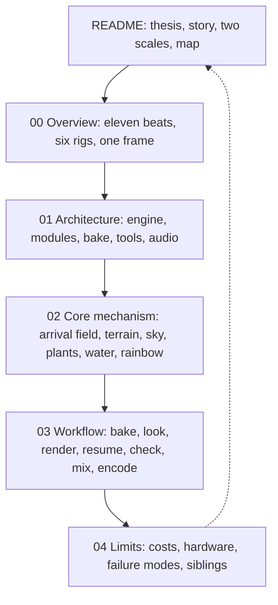

# first-bloom: one bud, one basin, one wave clock

## Thesis

`first-bloom` is a 30 second painterly nature film. It is 16:9 at 3,840 by 2,160 pixels and 30 frames per second (`README.md:5`). The film shows a frost-covered pasque-flower bud on a frozen meadow (`CONCEPT.json:10`). The bud opens on a musical hit. The spring that it releases runs outward across a mountain basin of about 3 kilometres (`CONCEPT.json:74`). The wave thaws a creek, breaks a frozen waterfall and draws a double rainbow. From above, the basin is itself a six-petalled flower (`CONCEPT.json:74`).

The source is not a recorded animation. It is a procedural world and a set of offline tools. A headless Chrome session runs a three.js scene at one instant and one sample per subframe. The engine averages many subframes into one output frame (`src/engine.js:472-499`). The world is a pure function of time and position. The render can stop and resume without a hidden state.

The central idea is a single scalar clock. `bloomD(t)` returns a wave clock in arrival units. One arrival unit is one cost-weighted metre. One metre of ground at cost 1.0 adds 1.0 to the arrival value. The clock is zero at the 6.0 second hit and 7,500 at the end (`src/world/timeline.js:41-53`). A baked arrival value is the lowest cost-weighted path length from the knoll seed to the cell (`bake.mjs:69-105`). Every material compares the clock with the arrival value for its own position. A place turns to spring when the clock passes its arrival value. The clock is not a time in seconds. The source relates arrival to time through the `bloomD` key list. The meadow, the ice, the trees and the particles all read the same comparison.

The second idea is that the camera never sees the whole world at once. Six fixed camera rigs carry eleven story beats (`src/world/timeline.js:26-33`). Each rig has its own field of view, focus and motion. Heavy modules precompute what each shot can see. They then cull or lower detail outside that view.

**Aha:** The film has no global simulation state. The wave is a distance field and a clock. The same two values drive snow melt, grass growth, flower opening, ice cracking and tree flushing. That is why the film can render frames out of order and resume after a stop.

## The story

The film starts at blue hour. A single closed bud stands on a small knoll. Frost covers its silver hairs. A thin dawn slot glows on the horizon (`CONCEPT.json:10`). The sun clears a saddle in the east-south-east rim. A warm edge of light crosses the snow and climbs the stem.

At 5.18 seconds the camera holds. The music drops to silence. The tepals strain by a small amount (`CONCEPT.json:22-27`). At 6.0 seconds the bud opens. Six violet tepals snap outward and throw off dew. A ring of gold light runs across the snow (`CONCEPT.json:30-35`).

The camera then pulls back and cuts to a low flight. The flight follows the wave along one petal axis. The front of spring runs ahead like a breaking wave (`CONCEPT.json:41`). Grass rises behind it, and flowers open in bursts. Swallows lift from the grass.

The flight reaches a frozen creek. A crack runs down the ice faster than the camera moves. The open water reflects a deep cyan summer sky with cumulus. The real sky above is still flat lavender (`CONCEPT.json:46-51`). This is the film's main surprise. The stream shows a season that has not arrived.

The wave catches the camera at 11.58 seconds. The frame flips to spring. The sun breaks through at 12.09 seconds. A swift passes close to the lens at 14.16 seconds. The camera then climbs over a grove. The grove flushes green and sheds its snow into the lens. A white-out hides a cut and a turn.

The camera comes out of the white-out above the basin. The wave crosses the floor in six lobes. Lake ice breaks into plates. River ice breaks in a chain. Forest belts turn green in rolling waves (`CONCEPT.json:74`). The camera rises to a wide reveal.

The wave reaches the north rim at 20.8 seconds. The frozen waterfall cracks and shatters. Water falls and throws a spray plume. A primary rainbow draws itself through the mist. A fainter secondary bow appears outside it (`CONCEPT.json:82`). The last shot rises high above the basin. The bloom pattern resolves into one violet flower with a gold heart. A small glint winks at the heart at 27.5 seconds (`CONCEPT.json:86-92`).

## Two scales

The film works at two scales. The first scale is the bud. The bud is about 12 centimetres tall (`CONCEPT.json:10`). The macro camera starts 0.135 metres from the bud head and holds at 0.126 metres (`src/world/timeline.js:124`). The developer guide states about 13 centimetres from the bud head (`DEV_GUIDE.md:128`). The concept describes the same shot as about 6 centimetres from the bud (`CONCEPT.json:9`). The source does not state the reference surface for the 6 centimetres. At that distance the film shows individual hairs, rime needles and dew drops. The hero module models six tepals, hair cards, rime cards, stamens and particles.

The second scale is the basin. The basin is about 3 kilometres across (`CONCEPT.json:74`). The terrain grid is 2,048 by 2,048 cells over 16 kilometres (`src/world/layout.js:274`). At that distance individual flowers are not geometry. The terrain shader paints the flower pattern into the ground colour. The pattern uses the petal field, the radius and the lobe delta from `info2` (`DEV_GUIDE.md:84`).

The same clock connects the scales. The macro flower opens because `bloomD(t)` passes its local arrival value. The basin flower appears because the wave has passed most of the basin. The two images are the same pattern at different sizes.

```text
# src/world/layout.js:49-60
export const LOBE0 = 22.5 * DEG;                       // first petal axis points ESE (toward the dawn sun)
export const LOBES = Array.from({ length: 6 }, (_, k) => LOBE0 + k * 60 * DEG);
export const PETAL_R = 1150;                           // petal tip radius
export const HEART_R = 85;                             // gold heart radius
export const BASIN_R = 1500;                           // floor radius (rim beyond)
export const dirv = phi => [Math.cos(phi), Math.sin(phi)];
// the falls sit exactly opposite the outlet: from the high aerial one axis runs
// down the frame — falls, river, lake, gold heart, stem leaving the bottom edge
const WF_PHI = 292.5 * DEG, STEM_PHI = 112.5 * DEG, GROVE_PHI = 55 * DEG;
export const WATERFALL = { phi: WF_PHI, r: 1720, x: Math.cos(WF_PHI) * 1720, z: Math.sin(WF_PHI) * 1720, drop: 150 };
export const LAKE = { x: Math.cos(WF_PHI) * 165, z: Math.sin(WF_PHI) * 165, rx: 78, rz: 58, rot: WF_PHI };
export const GROVE = { x: Math.cos(GROVE_PHI) * 262, z: Math.sin(GROVE_PHI) * 262, r: 46 };
```

These constants define the basin. `PETAL_R` is 1,150 metres. `BASIN_R` is 1,500 metres. `HEART_R` is 85 metres. There are six lobes, and the first lobe starts at 22.5 degrees. The lake is an ellipse. Its semi-axes are 78 metres and 58 metres (`src/world/layout.js:59`). Its centre is 165 metres from the knoll. The guide's 165 metres is that centre distance, not a body radius (`DEV_GUIDE.md:120`). The guide gives the lake direction as 232.5 degrees. The layout uses 292.5 degrees. The exploration reports both values and does not merge them.

```text
# src/world/timeline.js:41-55
export function bloomD(t) {
  const T = TIMES;
  if (t < T.hit) return -10;
  // FPV section solved from desired front offsets (out/fpvarr.mjs): front ~9 m
  // ahead -> camera overtakes at the creek -> front catches up and passes under
  // the lens on the sun break -> races ahead to the grove during the canopy climb
  return key([
    [T.hit, 0], [T.pullStart, 2.5], [T.cut2, 20.8], [8.02, 31.5], [8.52, 43.7], [9.02, 54], [9.52, 58.5],
    [10.02, 60.6], [10.52, 62.8], [11.02, 65.9], [11.52, 71.7], [12.02, 81.8], [12.52, 97.4], [13.02, 112.5],
    [13.52, 128.5], [14.02, 143.3], [14.5, 155], [T.cut3, 166], [16.0, 185], [T.whiteout, 205], [T.cut4, 225],
    [T.cut4 + 1.0, 340], [T.cut5, 1270], [T.cut6, 1950], [T.resolve, 5200], [T.end, 7500],
  ], t);
}
export function bloomWidth(t) { return 2.5 + Math.max(0, bloomD(t)) * 0.035; }
```

The key list is the wave clock. The clock grows slowly at first. It reaches 205 at the white-out and 225 at the cut to the reveal. It then jumps to 340, 1,270 and 1,950. The last keys run to 5,200 and 7,500. The width of the wave is 2.5 arrival units plus 0.035 times the clock (`src/world/timeline.js:54`).

```text
# src/engine.js:472-499
    for (let s = 0; s < spp; s++) {
      const st = spp > 1 ? (clamped ? lo + ((s + 0.5) / spp) * (hi - lo) : t + ((s + 0.5) / spp - 0.5) * shutter) : t;
      const jx = spp > 1 ? halton(s + 1, 2) - 0.5 : 0, jy = spp > 1 ? halton(s + 1, 3) - 0.5 : 0;
      const sub = { sub: s, spp, engine: this, frameTime: t };
      if (clamped) sub.slice = (hi - lo) / spp;
      this.time('update', () => world.update(st, sub));
      const cam = world.camera;
      cam.setViewOffset(W, H, jx, jy, W, H);
      this.time('scene', () => {
        const tiles = world.sceneTiles || 1;
        const tw = Math.ceil(W / tiles), th = Math.ceil(H / tiles);
        for (let y = 0; y < tiles; y++) for (let x = 0; x < tiles; x++) {
          this.sceneRT.scissor.set(x * tw, y * th, tw, th); this.sceneRT.scissorTest = tiles > 1;
          r.setRenderTarget(this.sceneRT); r.render(world.scene, cam); this.sync();
        }
        this.sceneRT.scissorTest = false;
      });
      if (hasOverlay) this.time('overlay', () => {
        r.setRenderTarget(this.overlayRT); r.render(world.overlay, cam); this.sync();
      });
      cam.clearViewOffset();
      this.pAccum.u.tSrc.value = this.sceneRT.texture; this.pAccum.u.weight.value = 1 / spp;
      this.time('accum', () => this.drawPass(this.pAccum, this.accumRT));
      if (hasOverlay) {
        this.pAccumPM.u.tSrc.value = this.overlayRT.texture; this.pAccumPM.u.weight.value = 1 / spp;
        this.drawPass(this.pAccumPM, this.overlayAccum);
      }
    }
```

The subframe loop is the sampling core. Each subframe has its own time `st` and its own Halton offset. A Halton sequence is a low-discrepancy sequence that spreads samples evenly. The scene is drawn in tiles when the world asks for tiles. The scene and the overlay are added into separate float targets with weight `1 / spp`. The weight is the mean, not a sum.

```text
# src/worlds/film.js:11-14
const MODULES = ['sky', 'vegetation', 'trees', 'hero', 'water', 'fx', 'glint'];

// finale grade (tuned with the aerial rig in the final round)
const AERIAL = { exposure: 0.80, contrast: 1.30, vignette: 0.42 };
```

The film world loads seven optional modules. The list is `sky`, `vegetation`, `trees`, `hero`, `water`, `fx` and `glint`. The terrain is not in the list. The world creates the terrain directly before it loads the modules (`src/worlds/film.js:35-36`). The aerial grade is a separate constant. It sets exposure 0.80, contrast 1.30 and vignette 0.42 (`src/worlds/film.js:14`).

## What the design trades

The film moves detail from geometry into shaders and baked maps. The meadow uses instanced blades near the camera. Far away it uses painted ground-cover dabs and flower strokes (`src/world/vegetation.js:515-519`). The valley flower is a terrain colour wash that uses the petal field. It is not a mesh (`CONCEPT.json:138`). The sky is an analytic function and a small set of cloud puffs. It is not a volume with a full light transport solve (`src/world/sky.js:100-140`, `src/world/sky.js:219-366`).

The water makes a similar trade. There is no planar reflection pass. The creek and the lake reflect an analytic summer sky along the reflection vector (`src/world/water.js:6-8`). The waterfall is seen only from a distance. The concept document states that no shot shows close water (`CONCEPT.json:138`). This choice keeps the water cheap and avoids a second scene render.

The render spends samples where motion is fastest. `render_all.mjs` gives 32 subframes to the burst and the swift pass. It gives 10 to the aerial hold (`render_all.mjs:26-38`). The README gives the wider range of 10 to 32 for the engine (`README.md:24`). The developer guide gives 8 to 16 (`DEV_GUIDE.md:94`). The counts are stage-dependent and the source does not make them equal.

The tools also protect a shared machine. The render driver lowers its own priority. It waits for free memory. It samples the central processing unit (CPU) time of any Blender process and yields longer when Blender is busy (`render.mjs:48-72`). A machine-wide lock directory allows at most two render processes (`render.mjs:78-100`). The film therefore yields to other work instead of competing with it.

## Package map



The dotted edge returns from the limits to the claims. A reader can test the costs and the absences against the thesis at the top.

## The five deep dives

| Document | Question it answers | Words | Snippets | Diagrams | Aha |
|---|---|---:|---:|---:|---:|
| [00-overview.md](00-overview.md) | What is the story, what do the six rigs show, and how is one frame finished? | 3,550 | 15 | 2 | 1 |
| [01-architecture.md](01-architecture.md) | How do the engine, the world modules, the bake, the tools and the audio fit together? | 3,150 | 13 | 2 | 1 |
| [02-core-mechanism.md](02-core-mechanism.md) | How do the arrival field, the bloom wave, the terrain, the sky, the plants, the water and the rainbow work? | 4,850 | 27 | 2 | 2 |
| [03-workflow-and-quality.md](03-workflow-and-quality.md) | How does a change reach baked data, a still, a checked film and an encoded file? | 3,200 | 16 | 2 | 2 |
| [04-limits-and-comparison.md](04-limits-and-comparison.md) | What does the design cost, where can it fail, and how does it compare with five siblings? | 3,300 | 13 | 2 | 2 |

The word counts are the measured prose counts, rounded to the nearest fifty. The snippet, diagram and Aha counts are exact.

## Reading order

1. Read this file. It gives the thesis, the story and the two scales.
2. Read [00-overview.md](00-overview.md). It follows the eleven beats and the six camera rigs.
3. Read [01-architecture.md](01-architecture.md). It gives the engine, the module contract and the data flow.
4. Read [02-core-mechanism.md](02-core-mechanism.md). It follows the wave from the baked field to the rainbow.
5. Read [03-workflow-and-quality.md](03-workflow-and-quality.md). It follows the bake, the look loop, the render and the checks.
6. Read [04-limits-and-comparison.md](04-limits-and-comparison.md). It gives the costs and the sibling comparison.

A reader who wants the evidence first can read document 04 and then document 01. A reader who wants to change the world can read document 02 and then document 03.

## Terms

| Term | Meaning in this package |
|---|---|
| arrival field | a baked map of the arrival value at each ground position; one arrival unit is one cost-weighted metre |
| bloom clock | the scalar `bloomD(t)`, in arrival units (cost-weighted metres), that the wave has reached from the knoll |
| wavefront | the band where the bloom clock is close to the arrival value |
| bake | a value or a map computed once and stored, not computed per frame |
| subframe | one render of the world at one time and one projection offset |
| shutter | the fraction of a frame interval that a subframe samples |
| accumulator | the floating-point target that sums the subframes |
| tiles | scissor rectangles that split a heavy pass to limit one GPU submission |
| rig | one camera function for one shot, with position, target, field of view and focus |
| beat | one story event in the concept document, with a start and an end time |
| hero flower | the pasque-flower bud and its opening animation |
| petal field | a signed field that is negative inside a petal lobe |
| level of detail | a cheaper mesh or shader used when an object is small on screen |
| CPU | central processing unit, the general processor |
| GPU | graphics processing unit, the render device |
| HDR | high dynamic range, the unclamped linear image before the grade |
| GLSL | OpenGL Shading Language, the shader source |
| JSON | JavaScript Object Notation, the data format |
| MP4 | Moving Picture Experts Group 4 Part 14, the video container |
| fps | frames per second, the film rate |
| FOV | field of view, the camera angle in degrees |
| DOF | depth of field, the distance range that stays sharp |
| CoC | circle of confusion, the blur diameter on screen |
| CLI | command-line interface |
| RAM | random access memory |
| TDR | Timeout Detection and Recovery, a Windows GPU reset after a long submission |
| LUFS | loudness units relative to full scale, an audio loudness measure |
| dBFS | decibels relative to full scale, an audio level measure |
| Internet Systems Consortium (ISC) | the permissive software licence declared in `package.json` |
| CC0 | Creative Commons Zero, a public-domain dedication |
| AAC | Advanced Audio Coding, the audio codec in the MP4 files |

## Non-claims

This package is a static reading. It does not run the bake, the render, the audio mix or the encode. It does not open a browser or a headless Chrome session. It does not download the audio files. It does not modify the source tree or `spec.md`.

No output of the project was viewed. The `docs/` directory holds three JPEG images. They are two README posters and one contact sheet. This package does not treat them as measurements. It does not compare them with a render.

The tree does not contain the baked world data. `src/world/data.js` fetches the data files and fails with a message that names `bake.mjs` when a file is missing (`src/world/data.js:11-13`). The tree does not contain the audio files. `README.md:41` states that the licences do not allow redistribution.

The source gives several subframe counts for different stages. The engine default is 8 (`src/engine.js:371`). The developer guide states 8 to 16 (`DEV_GUIDE.md:94`). The concept document asks for 4 to 8 on the flight shots (`CONCEPT.json:41`). The README states 10 to 32 (`README.md:24`). The render driver uses a per-segment value from 10 to 32 (`render_all.mjs:26-38`). This package quotes each count with its context and does not merge them.

The waterfall values also conflict. `src/world/layout.js:58` declares a drop of 150 metres. The same file builds a lip at height 236 metres (`src/world/layout.js:225`). The guide gives a base near 20 metres (`DEV_GUIDE.md:133`). The exploration states each value and the disagreement. It does not choose one.

`package.json` declares the ISC licence (`package.json:11`). The tree has no licence file. The media licences are separate and are listed in `CREDITS.md`.

The comparison in document 04 uses only statements in the published sibling documents and in this source. It does not rank visual quality.
