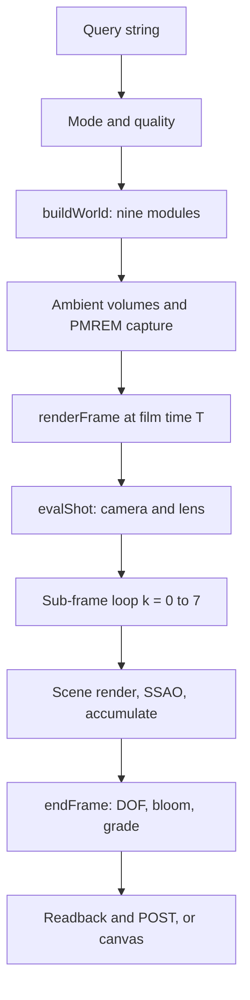

# 00 Overview: the temple, the ten shots, and one frame

This document gives the whole shape of Golden Temple before the later documents take it apart. It
names the place, the light, the ten shots, the nine world modules and the parts that run at startup.
It then traces one frame at film time 24.5 seconds through every stage that touches it.

## The thesis

Golden Temple is a film made from one deterministic world. The world is a Japanese temple complex
at the golden hour, built from code at load time. It has no three-dimensional model file, no
texture file, no high dynamic range image (HDRI) and no photograph. The film is 70 seconds long,
1920 by 1080 pixels, at 60 frames per second (FPS). Ten shots of seven seconds each show a close
object first and then reveal the complex around it.

The design rests on three decisions. First, one site plan in metres is the only source of position
data. Second, almost every surface is a three.js physical material with Graphics Library Shading
Language (GLSL) code injected by the patch system. The sky, the light shafts, the dust motes and
the incense smoke use their own shader materials. The water is a physical material with a large
injected shader.
Third, every frame is the weighted average of eight sub-frames
that differ in camera offset, shutter time, sun direction and ambient-occlusion rotation. The
average produces anti-aliasing, motion blur, soft sun shadows and clean ambient occlusion (AO)
without a temporal denoiser.

**Aha:** The film is not stored. It is a pure function of the query string, the site plan and the
shot table. A second run on the same code should reproduce the same pixels, because no module
calls `Math.random`. The inputs that are not in the repository are the music track, the installed
browser, the graphics processing unit (GPU) and its driver, and the ffmpeg binary. The source
cannot prove that two GPUs or two driver versions give bit-identical results.

That claim has a limit. The exploration did not run the project. The claim describes the source
logic, not a measured image.

## The place: one plan in metres

The site plan lives in `src/layout.js`. It states the units and the axes in a comment. Positive X
is east, positive Z is south, positive Y is up, and the courtyard ground is at Y equals zero. North
is negative Z. The plan also draws an ASCII map of the complex. The map is a reading aid. The
object below it is the data that the modules read.

```text
# src/layout.js:1-6
// ---------------------------------------------------------------------------
// SITE PLAN — the single source of truth for where everything is.
// Units: metres. +X = east, +Z = south, +Y = up (north is -Z).
// Courtyard ground level y = 0. The sun is low in the WEST-SOUTH-WEST
// (direction toward sun ~ (-0.94, 0.12, 0.34)), so west faces glow and long
// shadows fall toward the east-north-east.
```

The main hall sits at (10, 0, -22) and faces south. Its granite podium is 36 by 27 metres and 1.6
metres high. The lower roof eave is at 8.4 metres. The upper roof eave is at 13.8 metres. The main
ridge is at 21.5 metres. These values are inputs to the hall generator, not decorations.

```text
# src/layout.js:27-37
  hall: {
    center: [10, 0, -22],
    facing: [0, 0, 1],            // faces south
    platform: { w: 36, d: 27, h: 1.6 }, // granite podium (kidan); top at y = 1.6
    columns: { w: 26, d: 17, bays: [7, 5], height: 6.4 }, // outer column grid on the podium
    stairs: { width: 10, frontZ: -8.5 }, // main stair descends south to z ~ -8.5 + run
    mokoshiEaveY: 8.4,            // lower skirt roof eave height
    mainEaveY: 13.8,              // upper roof eave height
    ridgeY: 21.5,                 // main ridge top
    eaveOverhang: 3.6,
  },
```

The five-storey pagoda sits at (-32, 0, -8). Its base column grid is 7.6 metres wide. Each storey
shrinks by a factor of 0.92. The plan gives `totalHeight: 37`, but no code reads that field. It is a
site note. The plan also gives `storyHeight: 3.9` and `spireHeight: 10.5`, and the pagoda code reads
neither field. `makeStoreys` (`src/world/pagoda.js:20-55`) sets the body height of each storey:
2.7 metres for the first, then 1.4, 1.38, 1.36 and 1.34 metres. It adds the eaves, the roof rise
and a 0.32 metre gap before the next storey. `spire()` (`src/world/pagoda.js:832`) builds the
spire from fixed sizes above the top roof. The built height is therefore not the sum of the plan
fields.

```text
# src/layout.js:39-50
  // Five-storey pagoda (gojū-no-tō)
  pagoda: {
    center: [-32, 0, -8],
    platform: { w: 13, d: 13, h: 1.2 },
    baseWidth: 7.6,               // column grid width of the 1st storey
    storyHeight: 3.9,
    shrink: 0.92,                 // each storey's width multiplier
    eaveOverhang: 3.0,
    stories: 5,
    spireHeight: 10.5,            // sōrin (9 gold rings + suien + hōju)
    totalHeight: 37,
  },
```

The pond is a clockwise polygon in X and Z. The water surface is at Y equals -0.55 metres. The
bottom is at -1.7 metres. The polygon has 19 points. A small island polygon sits inside it. The
pond module smooths these outlines into a shoreline and a signed distance field. A signed distance
field gives the distance to the nearest outline edge, with a positive sign inside the outline and a
negative sign outside. The bridge, the shore stones, the lotus beds and the water mask all use the
same smoothed outline.

```text
# src/layout.js:52-61
  // Pond: water surface and outline (clockwise polygon in x,z). Shore is stone.
  pond: {
    waterY: -0.55,
    bottomY: -1.7,
    outline: [
      [-23, 7], [-14, 5.5], [-4, 6.5], [4, 7.5], [16, 7.5], [26, 6], [36, 7.5], [43, 11], [45, 18],
      [43, 26], [36, 31], [26, 33.5], [14, 34], [2, 33], [-8, 34.5], [-18, 32], [-25, 26], [-27, 17], [-26, 11],
    ],
    island: [[-6, 18], [-1, 16.5], [3, 19], [1, 23], [-5, 23]], // small rocky island with a pine
  },
```

The plan also holds the arched bridge, four processional paths, the gravel plaza and the viewing
pavilion. It holds the enclosing corridor, the south gate, the bell tower and two side halls. It
also holds 16 stone lanterns, 18 hero trees and the distance of the mountain ridges. A module may
add objects, but it must place them in agreement with these numbers. The plan is the contract
between modules.

The axes have visible consequences. A camera at positive Z looks north toward the hall. The sun
comes from negative X, so it lights west faces. The long shadows fall east and slightly north. The
hall faces south, so its front is in shade at this sun angle and its west side glows. The pagoda is
west of the hall, so it catches the direct sun and stands in front of the bright sky from many
cameras. The pond lies south of the hall and east of the pagoda. Its surface reflects both.


## The light and the air

The sun is the second global input. `src/core/env.js` fixes its elevation at 6.8 degrees. The
horizontal direction toward the sun is (-0.94, 0.34), normalised. That direction points west and
slightly south. The sun colour is linear red, green and blue (RGB) 1.0, 0.70 and 0.43. A comment
gives about 3300 kelvin. The direct sun intensity is 7.0. The sky shader uses a separate intensity
of 20.0.

```text
# src/core/env.js:10-18
// Sun: low golden-hour sun in the west-south-west.
export const SUN_ELEVATION = 6.8 * deg;
export const SUN_AZ_DIR = new THREE.Vector2(-0.94, 0.34).normalize(); // horizontal (x,z) direction TOWARD the sun

export const sunDir = new THREE.Vector3(
  SUN_AZ_DIR.x * Math.cos(SUN_ELEVATION),
  Math.sin(SUN_ELEVATION),
  SUN_AZ_DIR.y * Math.cos(SUN_ELEVATION)
).normalize();
```

The air is not three.js fog. The engine replaces the fog shader chunks with an exponential height
fog. The haze layer has a 22 metre scale height and an extinction of 0.0013 per metre at ground
level. A uniform air term adds 0.00022 per metre. The forward scattering uses a Henyey-Greenstein
phase function with g equal to 0.78. A Henyey-Greenstein phase function sets how much scattered
light continues toward the viewer. This combination gives bright warm air near the sun and cool
grey air away from it.

The low sun also fixes the shadow length. At 6.8 degrees the tangent is about 0.119, so a shadow is
about 8.4 times the height of the object that casts it. A 20 metre hall therefore casts a shadow
about 168 metres long. The engine does not render that full shadow. It fits the shadow camera
around a per-shot region and uses a bias and a normal bias to control acne. Shadows that fall
outside the region are absent. The shot table therefore chooses the region with care. A wide crane
shot uses a radius of 78 metres. The close shots use 21 to 28 metres, so the map spends its
resolution on the close object. The one exception is shot 7, the gate macro. It uses a 40 metre
radius to cover a subject at a 60 metre focus distance.


The fog is installed inside every material shader. The pond water shader calls the same fog
function for its surface. The sky uses its own atmosphere model and disables the fog chunk, so the
horizon blend is not the same code. The fog also reads up to 48 baked ambient volumes. A volume is a
box that multiplies image-based lighting (IBL) by a dark tint. The hall interior and the space under
each pagoda eave use these volumes to lose sky light without a light probe.

## The ten shots

The film has ten shots. `src/shots.js` declares a duration of 7.0 seconds and a base list of ten
shot definitions. Each shot has a name, an optional ease mode, a camera key list, a shadow focus
region and optional post settings.

```text
# src/shots.js:4-10
// ---------------------------------------------------------------------------
// The film: 10 shots x 7 s. Each shot: camera keyframes (pos/target) sampled
// by a Catmull-Rom spline with eased progress; lens; focus; post overrides;
// shadow focus region.
// ---------------------------------------------------------------------------

export const SHOT_DUR = 7.0;
```

Shot zero is the only shot whose keys survive unchanged. It opens inside the openwork of a stone
lantern at (43.62, 3.62, 22.28) with a 45 millimetre lens, focus at 1.05 metres and aperture f/2.8.
It pulls back to a 24 millimetre lens, focus at 40 metres and aperture f/5.6, and looks across the
pond toward the pagoda. The ease mode is `reveal`, which lingers on the close object and then
accelerates.

```text
# src/shots.js:14-24
export const SHOTS = [
  {
    name: 'Lantern — inside the glowing openwork, pulling back to the pagoda across the pond',
    ease: 'reveal',
    keys: [
      { pos: [43.62, 3.62, 22.28], look: [42.85, 3.72, 21.5], focal: 45, focus: 1.05, fstop: 2.8 },
      { pos: [44.45, 2.8, 21.0], look: [-30, 9.8, -9], focal: 24, focus: 40, fstop: 5.6 },
    ],
    shadow: { center: [24, 2, 8], radius: 50 },
    post: { dof: true },
  },
```

**Aha:** Nine of the ten shots in the released film do not come from this table. `src/shotkeys/`
holds nine files: `index.js` plus eight module files (`pagoda.js`, `hall.js`, `interior.js`,
`bridge.js`, `buildings.js`, `pond.js`, `terrain.js`, `vegetation.js`). There is no `props.js`.
`index.js` exports `OVERRIDES` as an array of the eight module objects. `terrain.js` is empty. Seven
files override nine shot entries with `Object.assign`. Only shot zero keeps the base keys. The base
list is a scaffold and a fallback, not the film.

```text
# src/shots.js:123-127
// per-module camera overrides (src/shotkeys/*.js)
for (const o of OVERRIDES) for (const [k, v] of Object.entries(o || {})) Object.assign(SHOTS[+k], v);
// motion smoothing (seconds) where hand-made keys produced acceleration snaps (tools/camcheck.mjs)
const SMOOTH = { 4: 0.22, 9: 0.45 };
for (const [k, v] of Object.entries(SMOOTH)) if (SHOTS[+k].smooth === undefined) SHOTS[+k].smooth = v;
```

`Object.assign` replaces a whole field. An override that supplies `keys` replaces the complete key
list. It does not merge keys one by one. The same rule applies to `shadow`, `post`, `near` and
`noShadow`. The index file lists the overrides in a fixed order. Later files win if two files give
the same shot, but the current files do not overlap.

The table below gives the effective opening and ending of each shot after the overrides. It uses
the source values and names the file that owns the shot. Focus is in metres. The focal length is in
millimetres.

| Shot | Opens on | Opening lens | Reveals | Ending lens | Owner |
|---:|---|---|---|---|---|
| 0 | Stone lantern openwork | 45 mm, f/2.8, 1.05 m | Pagoda across the pond | 24 mm, f/5.6, 40 m | base table |
| 1 | Sunlit lotus flower | 50 mm, f/8, 0.62 m | Lotus bed to the bridge | 26 mm, f/6.3, 13 m | `pond.js` |
| 2 | Gilt giboshi finial | 40 mm, f/4, 0.79 m | Over the rail to the hall | 20 mm, f/6.3, 28 m | `bridge.js` |
| 3 | Bronze wind bell | 40 mm, f/4, 2.15 m | Up all five pagoda storeys | 16.5 mm, f/8, 20 m | `pagoda.js` |
| 4 | Lantern fire-box window | 42 mm, f/3.5, 1.05 m | Processional axis to the hall | 28 mm, f/5.6, 16 m | `buildings.js` |
| 5 | Gilt rafter cap and bell | 42 mm, f/3.5, 3.3 m | High view of the two-tier hall | 24 mm, f/8, 28 m | `hall.js` |
| 6 | Amida Buddha face | 61.6 mm, f/5.6, 1.55 m | Whole inner sanctum | 20 mm, f/8, 12 m | `interior.js` |
| 7 | Gate pillar fitting | 45 mm, f/8, 0.47 m | Telephoto view through the gate | 50 mm, f/5.6, 60 m | `buildings.js` |
| 8 | Lotus pad above the water | 50 mm, f/11, 0.5 m | Mirror view of pagoda and hall | 24 mm, f/8, 40 m | `pond.js` |
| 9 | Backlit maple spray | 45 mm, f/2.8, 0.62 m | Crane over the whole precinct | 26 mm, f/10, 85 m | `vegetation.js` |

### How a camera move is evaluated

A key holds a position, a look point and optional lens values. The evaluator does not interpolate
the look point as a point. It converts each look point into a view direction and a look distance.
With two keys the evaluator normalises a linear blend of the two unit directions. With three or
more it builds a Catmull-Rom curve through the unit directions and normalises the result. The
distance is interpolated in log space, and the look point is rebuilt as position plus direction
times distance. This choice keeps a close-up to wide reveal smooth. A linear look-point interpolation would slow the pan
near the close object and then whip it around at the end. The log distance keeps the perceived
change of distance even.

With two keys the evaluator uses straight interpolation. With three or more keys it builds a
Catmull-Rom curve through the positions and a second curve through the directions. The curve
parameter is the eased progress, not the raw time. The `reveal` ease is a smoothstep raised to
1.35. It holds the close object for about the first third of the shot and then accelerates. The
`inout` ease is a blend of a linear term and a smoothstep. The blend keeps some motion in the
middle of the move.

Focus is special. If any key defines a focus distance, the evaluator interpolates the logarithm of
the focus distance. A key that omits focus uses the shot-level focus. If the shot focus is `look`
or is absent, the key uses its own look distance. If no key defines focus, the shot-level focus
applies, or the look distance when the shot focus is `look`. The aperture and focal length interpolate linearly. The shot-level values fill
gaps.

Two shots receive extra smoothing. Shot 4 uses a Gaussian sigma of 0.22 seconds. Shot 9 uses 0.45
seconds. `evalShot` (`src/shots.js:159`) applies optional temporal smoothing when a shot sets `smooth`. It
calls `evalShotRaw` (`src/shots.js:193`) for each sample, and that function evaluates the keys at
one local time. With smoothing on, `evalShot` averages 13 samples from minus 2.5 sigma to plus 2.5
sigma around the requested time, with Gaussian weights. Beyond the shot ends it reflects
the raw path around the edge. It reflects position, direction and focal length, and it reflects the
log look distance. This point-reflection keeps velocity continuous, so the average does not pull
the camera toward a stop at the cut. The smoothing was added after `tools/camcheck.mjs` reported
acceleration spikes.

Shot six is generated, not hand keyed. `src/shotkeys/interior.js` builds 29 keys from one
continuous distance function. It starts 1.55 metres from the face and ends 12.1 metres away. The
lens opens at about 61.6 millimetres and ends at 20 millimetres. The aperture opens from f/5.6 to
f/8. Shot nine is also generated, with 29 keys, an arc-length path and a speed profile. Both use
linear easing because the generated curve already carries the ease.

```mermaid
gantt
    title Film timeline, ten shots of seven seconds
    dateFormat X
    axisFormat %s
    section Shots
    Shot 0 Stone lantern openwork :s0, 0, 7
    Shot 1 Sunlit lotus flower    :s1, 7, 7
    Shot 2 Gilt giboshi finial    :s2, 14, 7
    Shot 3 Bronze wind bell       :s3, 21, 7
    Shot 4 Lantern fire-box window:s4, 28, 7
    Shot 5 Gilt rafter cap and bell:s5, 35, 7
    Shot 6 Amida Buddha face      :s6, 42, 7
    Shot 7 Gate pillar fitting    :s7, 49, 7
    Shot 8 Lotus pad above the water:s8, 56, 7
    Shot 9 Backlit maple spray    :s9, 63, 7
```



The film duration is derived, not typed. `FILM_DURATION` is the number of shots multiplied by the
shot duration. With ten shots, the result is 70 seconds. At 60 FPS the render loop covers 4,200
frames. A cut occurs every 7 seconds, at 7, 14, 21, 28, 35, 42, 49, 56 and 63 seconds.

```text
# src/shots.js:226-226
export const FILM_DURATION = SHOTS.length * SHOT_DUR;
```

## The film clock

A shot is evaluated at a local time from 0 to 7 seconds. A film time maps to a shot index and a
local time. `viewFromQuery` does this for a still. The render loop does it for every frame. In both
cases the film time is `i * SHOT_DUR + tLocal`.

`setTime` converts film time into shader time. It adds 37.0 seconds to the shader clock. The source
gives no reason for that number. The likely effect is to move the wind, cloud and water noise to a
different point in their cycles. With that offset, the first frame does not start at the phase
origin. This reading is an inference, not a source comment. The function also moves the cloud layer
and calls every module update callback.

```text
# src/main.js:169-174
function setTime(T) {
  G.uTime.value = T + 37.0;
  pipeline.time = T;
  SKY_UNIFORMS.uCloudOffset.value.set(T * 0.004, T * 0.0016);
  for (const fn of updates) fn(T, ctx);
}
```

The cloud offset moves 0.004 units per second in X and 0.0016 units per second in Y. Over 70
seconds the layer drifts slowly. The modules receive the film time, not the shot-local time. A
plant therefore keeps one continuous wind phase across a cut, while the camera jumps to a new shot.

## The nine world modules

The entry module declares the module names in one array. The order matters. Terrain builds first,
because the pond reads the terrain field. The props module builds eighth. It adds the suspension parts later, in
`placeAnchors`, after every module has built. The vegetation module must follow the terrain module,
because it calls `ctx.modules.terrain.heightAt` to place plants. It comes last because no later module needs it.
Its last position is only the declared order in `ALL_MODULES`.

```text
# src/main.js:32-32
export const ALL_MODULES = ['terrain', 'pond', 'hall', 'interior', 'pagoda', 'bridge', 'buildings', 'props', 'vegetation'];
```

Each module has one entry file in `src/world/`; some modules also use supporting files. The loader
imports the entry file at run time. It calls
the exported `build(ctx)` function and expects an object. The loader adds the returned object to
the scene and collects the update callback. A failure in one module is logged and does not stop
the other modules.

```text
# src/main.js:87-104
async function buildWorld(names) {
  const results = {};
  for (const name of names) {
    const t0 = performance.now();
    status(`building ${name}...`);
    try {
      const mod = await import(`./world/${name}.js`);
      const res = normalizeResult(await mod.build(ctx));
      res.module = mod;
      if (res.object) { res.object.name = res.object.name || name; scene.add(res.object); }
      if (res.update) updates.push(res.update);
      results[name] = res;
      ctx.modules[name] = res;
      console.log(`[world] ${name} built in ${(performance.now() - t0).toFixed(0)} ms`);
    } catch (e) {
      console.error(`[world] module "${name}" FAILED:`, e && e.stack ? e.stack : e);
    }
  }
```

The nine modules and their main parts are listed below. The file and line counts come from the
pinned checkout.

| Module | Files | Lines | Main parts |
|---|---:|---:|---|
| `terrain` | 11 | 3,800 | Ground field, gravel, moss, paving, pond bed, hills, forest, cover |
| `pond` | 10 | 4,439 | Planar-reflection water, shore stone, island, lotus, koi, debris |
| `hall` | 12 | 3,646 | Podium, stairs, columns, bracket sets, two roofs, karahafu porch, gold |
| `interior` | 11 | 3,478 | Amida statue, throne, mandorla, altar, canopies, ceiling, light shafts |
| `pagoda` | 3 | 1,711 | Five storeys, side-local parts, eaves, roofs, balcony, spire, bells |
| `bridge` | 1 | 1,517 | Deck arc, arch ribs, piers, railings, posts, giboshi finials |
| `buildings` | 7 | 3,220 | Pavilion, corridor, south gate, bell tower, two side halls |
| `props` | 6 | 2,650 | Stone lanterns, hanging lanterns, bells, burner, basin, stepping stones |
| `vegetation` | 5 | 3,866 | Pines, maples, cherries, shrubs, ferns, bark, leaf atlases, drift |

The tree holds 121 tracked files. The `src` tree holds 31,299 JavaScript lines. The `tools` tree
holds 612 module lines. The largest single module is the pond, because it carries the water shader,
the planar reflection, the lotus plan, the koi and the shore. The pagoda has only three files and
1,711 lines, because its parts file is dense and its material file is small.

## The startup parts

Startup is a fixed sequence. Each step prepares data for the next step.

1. Read the query string. Select the mode, the size, the quality preset and the sub-frame count.
2. Install the fog shader replacement before any material compiles.
3. Create the renderer with anti-aliasing off, tone mapping off and shadow map type percentage-closer
   filtering (PCF).
4. Create the scene, the camera, the sky dome and the sun light.
5. Create the post pipeline with four-sample multi-sample anti-aliasing (MSAA), 10 or 16 AO
   samples and the preview or final depth-of-field setting.
6. Build the world modules in order and collect their objects, updates, anchors and volumes.
7. Add the hall interior volume and the module ambient volumes, then bake them into the fog shader.
8. Compile every shader program in parallel with `renderer.compileAsync`.
9. Capture the sky into a prefiltered mipmapped radiance environment map (PMREM). At final quality,
   also capture the built scene and replace the sky-only environment.
10. Run each module `finalize` step. The hall captures an interior environment here. The pond
    removes the fallback ground where water should show.
11. Enter still, render or development mode.

Step eight is a performance step. The first draw of a material compiles its shader. Without a
pre-compile, the first frame would stall many times. `renderer.compileAsync` compiles every program
in parallel where the driver supports parallel compilation. The call uses a temporary camera at
(10, 4, 30) that looks north toward the hall with a 24 millimetre lens. That pose covers the
courtyard and the main buildings from the south. The shader cache key from the patch system keeps
the program count small, because materials with identical hooks share one program. The query string
can set `nopc` to skip this step.

Step nine uses a cube camera and a PMREM generator. The cube camera renders six 90 degree views
from the chosen point. The generator prefilters the cube into a mip chain with roughness levels.
The result is a texture that a physical material samples for diffuse and specular ambient light.
The sky capture point is (0, 2, 0). The scene capture point is (10, 4, 4), near the hall and the
pond. Both cube captures use a size of 256 pixels.


The two environment captures are different. The first capture sees only the sky. It gives every
material a warm sky reflection and a blue fill from the opposite side. The second capture sees the
built scene. It adds the bounce from the gravel court, the vermilion walls and the pond. The second
capture is skipped in preview quality, when fewer than four modules are loaded, or when the query
string sets `noenvcap`.

## One frame at 24.5 seconds

Film time 24.5 seconds is inside shot 3, the wind-bell shot. The shot index is 3 because
`floor(24.5 / 7)` equals 3. The local time is 3.5 seconds. The shot is owned by
`src/shotkeys/pagoda.js`. It has four keys and no smoothing value, so `evalShot` calls the raw
evaluator.

The stages below follow the actual calls in `src/main.js` and `src/core/post.js`.

1. `evalShot(3, 3.5)` applies the `reveal` ease. The progress fraction is 0.5. The eased value is
   0.5 raised to 1.35, about 0.392. The evaluator interpolates position and view direction with a
   Catmull-Rom curve. It interpolates the log of the look distance and the log of the focus
   distance. It interpolates the focal length and the aperture linearly. The result is one camera
   description. It has a focal length of about 28.6 millimetres at this time; the shot spans 40 to
   16.5 millimetres. It also has a focus distance, an aperture, a near plane of 0.04 metres and a
   shadow region.
2. `postFor` merges the default post settings with the shot post settings. Shot 3 turns depth of
   field (DOF) on. The focus distance and the aperture come from the camera keys.
3. The frame sets `G.uShot` to 3. The pagoda backlight shader reads this value. It switches the
   rim-light rig that suits the shot.
4. The frame sets the fog density. Shot 3 has no fog override, so the multiplier is 1.0.
5. `setShadowExclusions` receives `null`, because shot 3 has no `noShadow` list. All shadow casters
   stay enabled.
6. `pipeline.beginFrame()` clears the accumulation target to black. The sub-frame counter returns
   to zero.
7. The render loop computes eight Gaussian weights for eight sub-frames. It then runs eight
   sub-frames.
8. For each sub-frame `k`, the loop computes a shutter time from a permuted index. It calls
   `setTime(24.5 + off)`. This updates the shared time uniform, the cloud offset and every module
   animation.
9. The loop evaluates the camera again at `3.5 + off`. It applies the position, the look target,
   the lens and a projection-matrix offset from the Halton sequence. A Halton sequence is a list of
   points that fills a square evenly without a regular grid. The offset places the sample inside a
   two-pixel footprint.
10. The loop fits the sun shadow camera around the shot region. The region centre is (-34, 9, -5)
    and the radius is 21 metres. It adds a small jitter in the solar disc. The jitter is in radians,
    and its outer value is slightly larger than the 0.27 degree solar radius. The jitter follows a
    golden-angle spiral that depends only on `k`.
11. `pipeline.subframe` renders the scene into a half-float red, green, blue, alpha (RGBA) target
    with four-sample MSAA and a floating-point depth texture. It computes screen-space ambient
    occlusion (SSAO) at half resolution. It rotates the AO sample pattern by the sub-frame counter.
    It blurs the AO with a depth-aware two-pass filter. Volumetric light is off for this shot. It
    adds the result into the accumulation target with the Gaussian weight.
12. After eight sub-frames, `pipeline.endFrame` runs the frame-level passes. God rays are off
    because the shot does not set them. DOF runs, because the shot sets it. Bloom runs over seven
    mip levels. The final pass applies the tone map, the white balance, the lift, gamma and gain,
    the saturation, the contrast, the vignette, the chromatic aberration, the grain and the dither.
13. In render mode the result goes to an unsigned-byte output target. The page reads it back with
    `readRenderTargetPixelsAsync` and posts the raw bytes to the local render server. In still mode
    the result goes to the canvas.

The sub-frame time matters for animation. `setTime` runs inside the sub-frame loop, so wind,
water ripples, smoke and cloud drift advance by a fraction of a frame for each sample. The camera
also moves by the shutter offset. A moving leaf therefore blurs along its true path. The module
update receives the unclamped film time, while the render-mode camera is clamped inside the current
shot. This keeps animation continuous across a cut and keeps the camera inside one shot.

The key call is `renderFrame`. It owns the loop over sub-frames.

```text
# src/main.js:234-248
function renderFrame({ getCam, T, tLocal, dt = 1 / 60, spp = 1, shutter = 0.5, fade = 1, target = null, frameIndex = frameCounter++, q = Q }) {
  const c0 = getCam(tLocal);
  const P = postFor(c0, q);
  G.uShot.value = c0.index ?? -1;
  scene.fog.density = (P.fog ?? 1) * (q.has('fog') ? +q.get('fog') : 1);
  setShadowExclusions(q.has('noshadow') ? q.get('noshadow').split(',') : c0.noShadow);
  P.exposure *= fade;
  pipeline.beginFrame();
  const shadow = c0.shadow || { center: [c0.look.x, c0.look.y * 0.3, c0.look.z], radius: 60 };
  // all sub-frame sampling patterns depend ONLY on the sub-frame index k, never on the frame
  // index, so static surfaces are bit-identical frame to frame (no shadow / AA / AO flicker)
  const W8 = spp > 1 ? aaWeights(spp) : [1];
  for (let k = 0; k < spp; k++) {
    // shutter time: stratified, decorrelated from the AA offset (bit-reversed order)
    const kt = spp > 1 ? (k * (spp % 5 === 0 ? 7 : 5) + 1) % spp : 0;
```

The comment in the middle is the stability rule. It deserves its own treatment in
[02-core-mechanism.md](02-core-mechanism.md). In short, the anti-aliasing offset, the shutter time,
the sun jitter and the AO rotation depend only on `k`, not on the frame number. A static surface
therefore receives the same eight samples in every frame. The average is identical. The surface
does not crawl or shimmer.



## Terms used in this document

- Site plan: the `L` object in `src/layout.js`. It holds positions, sizes and routes in metres.
- World module: one of nine `build(ctx)` units in `src/world/`. Each returns an object and optional
  update and finalize functions.
- Shot: one seven-second camera move. The film has ten.
- Override: a module-owned replacement for a base shot entry, in `src/shotkeys/`.
- Sub-frame: one sample of a frame. The render mode uses eight. A frame is their weighted average.
- Accumulation: the additive buffer that receives every weighted sub-frame.
- Ambient volume: a box that darkens IBL inside a building or under a roof.
- PMREM: prefiltered mipmapped radiance environment map. It is the image-based light source.
- Anchor: a position declared by a building for a hanging lantern or a bell. The props module
  consumes anchors.
- Showcase: a list of preview camera positions that a module returns for development.

## Where to read next

[01-architecture.md](01-architecture.md) explains the layers, the module contract, the data that
modules exchange and the material patch system. [02-core-mechanism.md](02-core-mechanism.md)
follows one frame into the shaders and explains the sampling rules. [03-workflow-and-quality.md](03-workflow-and-quality.md)
describes the tool loop that produces stills and the film. [04-limits-and-comparison.md](04-limits-and-comparison.md)
lists what the static reading cannot prove and compares the package with its sibling projects.
