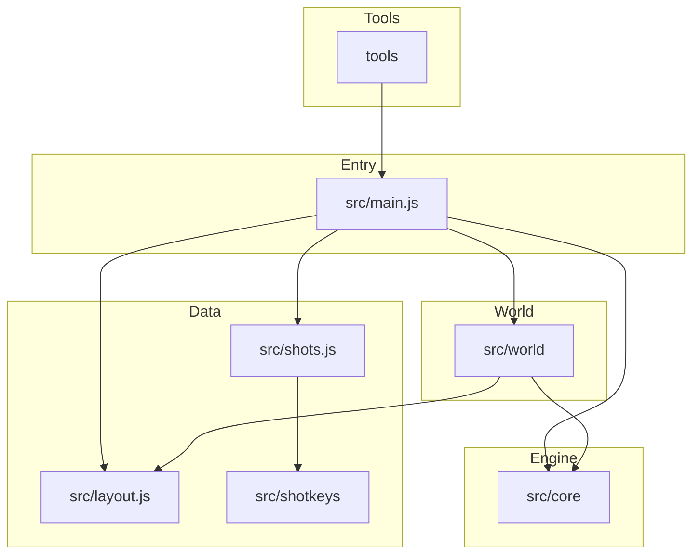
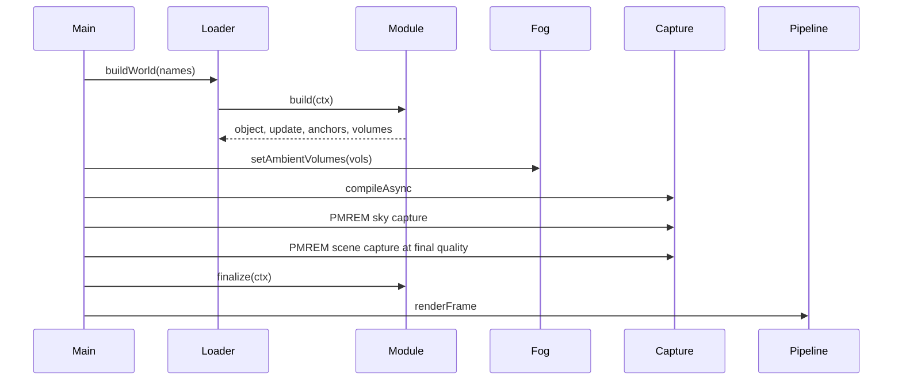

# 01 Architecture: layers, contracts and shared data

Golden Temple is one page, one renderer and nine world modules. The architecture is small in the
center and large at the edges. A few hundred lines of engine code define the frame, the light, the
materials and the film clock. About 28,000 lines of world code fill those definitions with a
temple, a pond, trees, statues and lanterns.

This document explains the layers, the object graph, the `build(ctx)` contract, the data that
modules share, the ownership of shots, the material vocabulary and the startup order. It also
explains how the code isolates failures and what the build surface does and does not include.

## The four layers

The repository has four code layers and one data layer. The data layer is the site plan and the
shot table. The code layers are the entry module, the engine, the world and the tools.

| Layer | Path | Responsibility | May import |
|---|---|---|---|
| Entry | `src/main.js` | Query string, renderer, startup, frame loop | All layers |
| Data | `src/layout.js`, `src/shots.js`, `src/shotkeys/` | Positions, camera keys and overrides | three.js only |
| Engine | `src/core/` | Sky, fog, sun, materials, geometry, post, random numbers | Data and three.js |
| World | `src/world/` | Geometry, shaders and animation for the scene | Engine, data, three.js |
| Tools | `tools/` | Stills, contact sheets, film capture, music edit, checks | Entry query strings, `src/shots.js` (`camcheck`) and ffmpeg |

The file distribution follows the same shape. The checkout holds 121 tracked files. The `src`
tree holds 87 of them, and that 87 includes the 9 engine files, the 9 shot override files and the
66 files in `src/world`. The tools have 11 files, and the documents and stills have 14. The root
has 9 files. Most of the code
mass is therefore in the world layer, which is the intended shape. The center stays small, and the
content stays local.

The import direction is mostly one way. The entry module imports the engine, the data and the
world. A world module imports the engine and reads `ctx.L` and `ctx.mat`. A world module does not
import the entry module. The tools do not import the world. They drive the page through a Uniform
Resource Locator (URL) query string and read the canvas or the raw frame stream. This separation
lets a tool change the camera without changing the world code.



A layer also has a negative rule. The engine does not import a world module. The world does not
open a browser, start a server or write a file. The data layer does not import the engine, except
for three.js types. The tools do not link against the world source. They speak to the page through
the query string, `window.__READY`, `window.__info` and `window.__renderView`. These rules keep a
module preview possible and keep the film path replaceable.

The query string is the tool interface. `snap` sets `mode=still` and a shot or camera. `render`
sets `mode=render`, a frame range, a size and a sub-frame count. A module preview sets `modules` to
a comma-separated list. The entry module reads all of these values before it builds anything. A
tool therefore does not need a private entry point.

There is one deliberate class of exception to the direction. A world module may import
`src/shots.js`. The pond does this at run time to place the hero lotus at the first key of shot 1 and to keep the
camera path clear of stems. The import sits inside a `try` block, and the module continues without
it. The vegetation module imports `SHOTS` directly at the top, because its hero spray is built in
the frame of shot 9.

## The runtime object graph

`src/main.js` creates one of each central object. The list is short: a renderer, a scene, a
perspective camera, a sky mesh, a directional sun light, a post pipeline and a context object
named `ctx`. The sky is added to the scene. The camera is also in the scene. The sky mesh copies the active
camera position in its render hook, so the dome stays centred on the view. The sun light and its target are added by `createSun`.

The context is the interface between the entry module and the world. It carries the three.js
namespace, the renderer, the scene, the camera, the data and the global uniforms. It carries the
geometry helpers, the random-number factory, the quality preset, the material library and the
material factories.

```text
# src/main.js:70-79
const updates = [];
const ctx = {
  THREE, renderer, scene, camera, L, G, ENV, sunDir, geom, rng, quality: QUALITY,
  M: materials(),
  mat: { patch, std, phys, glow, PROC, depthMaterialFor },
  onUpdate: (fn) => updates.push(fn),
  captureEnv: (pos, opts) => captureEnvironment(renderer, scene, new THREE.Vector3(...pos), opts),
  modules: {},
};
window.__ctx = ctx;
```

`window.__ctx` is a debug handle. The tools and a browser console can inspect the built world.
The context also exposes `captureEnv`, a closure over the renderer and the scene. A module can
capture a local environment map during its finalize step without importing the lighting module.
The hall and the buildings use this to give their interiors local bounce light.

The random-number factory in `ctx.rng` is deterministic. The source calls no `Math.random` in
`src` or in `tools`. A module names its stream with a string, as in `ctx.rng('pagoda')` or
`ctx.rng('pond-site')`. Each name is a string literal at the call site. The factory hashes the
name with the Fowler-Noll-Vo 1a (FNV-1a) string hash, and uses the result as the seed of
`mulberry32`, a small 32-bit generator. A string seed therefore gives the same sequence on every
load, and two modules with different names usually do not share a stream. The whole procedural
world is identical between a still and the film.

The loader accepts two shapes of module result. A module may return a bare three.js object, or it
may return a record with fields. `normalizeResult` converts the first shape to the second. This
keeps small showcase modules simple while giving full modules a place for updates and anchors.

```text
# src/main.js:81-85
function normalizeResult(res) {
  if (!res) return {};
  if (res.isObject3D) return { object: res };
  return res;
}
```

## Renderer configuration as an architecture choice

The renderer is configured for a post pipeline, not for direct display. Anti-aliasing is off
(`src/main.js:44`), because the pipeline averages sub-frames and the scene target uses four-sample
multi-sample anti-aliasing (MSAA). Tone mapping is off (`src/main.js:48`), because the final pass
applies the tone map after depth of field and bloom. The shadow map type is percentage-closer
filtering (`src/main.js:50`), and the fog shader replaces the standard three.js fog. Pixel ratio is
fixed at 1 (`src/main.js:46`), so a high-density display does not change the film size.

The canvas is created by the page, not by three.js. The entry module appends it to the body. The
renderer keeps the drawing buffer (`src/main.js:44`), because the still tool reads the canvas with
`toDataURL`. A render target is the real film output, but the canvas copy is useful for previews.

These settings are architectural. A change to tone mapping would double-grade the image. A change
to anti-aliasing would not remove the sub-frame average, but it would change the edge quality and
the memory cost. A change to pixel ratio would break the frame size contract with ffmpeg.

## The module contract

A world module exports an async `build(ctx)` function. It returns an object with optional fields.
The loader reads these fields and stores the whole record in `ctx.modules[name]`.

| Field | Type | Use |
|---|---|---|
| `object` | three.js `Object3D` | Added to the scene and named after the module |
| `update` | function `(T, ctx)` | Called on every sub-frame through `setTime` |
| `finalize` | async function `(ctx)` | Called once after environment capture |
| `anchors` | record of arrays | Positions for props, such as bells and hanging lanterns |
| `ambientVolumes` | array of boxes | image-based lighting (IBL) attenuation boxes baked into the fog shader |
| `showcase` | array of camera descriptions | Returned metadata only; no loader, tool or page code reads it |
| `heightAt`, `field`, `site` | module data | Read by other modules through `ctx.modules` |
| `module` | module namespace | Added by the loader, not by the module |

Every world module returns a `showcase` array. No loader, tool or page code reads the returned
field. The arrays are metadata for a person who wants a preview camera. They do not drive the
film, and a module can omit them without an error.

Terrain returns a minimal record. It has an object, a height function, a field object and two
showcase cameras. The field is the important part. It holds the ground height and the signed
distance functions that other modules read.

```text
# src/world/terrain.js:42-50
  return {
    object: group,
    heightAt: F.heightAt,
    field: F,
    showcase: [
      { cam: [10, 1.7, 6.5], look: [10, 0.6, -8], focal: 28 },
      { cam: [70, 26, 62], look: [-20, 10, -6], focal: 26 },
    ],
  };
```

The pagoda returns a larger record. It declares anchors for its corner bells. It returns five
ambient volumes, one under each storey eave. It returns six showcase cameras that cover the hero
corner, the five storeys, the backlit view and the spire. The whole return fits on one line.

```text
# src/world/pagoda.js:979-979
  return { object: root, anchors, showcase, ambientVolumes };
```

The pond returns an update, a finalize step and the site data. The site holds the shore distance
field, the depth map and the hero plan. The finalize step removes the fallback ground under the
water. The update forwards the film time to the water, koi and debris animations.

```text
# src/world/pond.js:302-312
  return {
    object: group,
    update: (T, c) => { for (const u of updates) u(T, c); },
    finalize: (c) => punchFallbackGround(c, site),
    site,
    showcase: [
      { cam: [20.6, 0.0, 19.4], look: [10, 1.7, 7.6], focal: 35 },
      { cam: [33, 0.28, 29.4], look: [-28, 9, -6], focal: 24 },
      { cam: [44, 4.5, 33], look: [8, 0, 14], focal: 30 },
    ],
  };
```

The hall returns an object, anchors, showcase cameras and a finalize step. Its finalize step
captures a local environment inside the hall twice. The second pass sees the first pass result,
so the interior gains a bounce. This is the one case where a module changes the light of its own
surfaces after the main capture.

Two fields deserve a closer look. `update` runs on every sub-frame, because `setTime` calls the
update list inside the sub-frame loop. An update must be cheap and must not allocate a new object
per call. The pond forwards the time to a small list of part updates. The props module reads the
camera position and moves four point lights to the nearest glow points. The pagoda does not need an
update, because its motion lives in the shaders.

`finalize` runs once, after the environment capture. It is the place for work that needs the whole
scene. The hall captures an interior environment. The buildings assign local environment maps to
materials that sit under deep eaves. The pond removes the fallback ground. A finalize step can be
async, and the loader awaits it. A failed finalize is logged and does not stop the next module.

The loader handles the record in a fixed order. It imports the file. It calls `build`. It attaches
the module namespace. It gives the object the module name if the object has no name, and then adds
the object to the scene. It pushes the update callback. It stores the record in `results` and in
`ctx.modules`. A module that throws is logged and skipped. The rest of the build continues.

## Shared data between modules

The `ctx` object is a live store, not a snapshot. When terrain finishes, its record appears in
`ctx.modules.terrain` before pond builds. Pond checks for `ctx.modules.terrain.field` and uses it
when it exists. If the field is missing, pond imports `terrain-field.js` and builds its own copy.
The copy is read only. This makes a pond-only preview possible.

The field is created by `createField(L)` in `src/world/terrain-field.js`. It holds a height
function, a pond distance, an island distance and a peninsula record. The height function returns
the ground height at a world position. Pond uses it to set the bank height and the depth map. The
pond module also reads a water-level crossing offset, so the visible waterline matches the stone
edge. The same field drives the forest placement, the paving and the cover.

This is the strongest data dependency in the package. If the field changes, the ground, the water,
the shore stones, the lotus beds and the camera clearance all change together. A module cannot
quietly move the shore. The plan and the field are the shared truth.

The field is more than a height function. Pond reads the shoreline distance, the island distance
and the peninsula rectangle from it. The shore stones, the depth map, the lotus placement and the
camera clearance all agree with the same bank. This is how nine modules keep one shoreline.

The pond turns the plan outlines into its own signed distance field. `smoothClosed(poly, spacing)`
runs a closed centripetal Catmull-Rom curve through the outline vertices and resamples the curve,
at 0.5 metres for the shore and 0.35 metres for the island. `sdPoly` returns the distance to the
nearest outline edge, positive inside the polygon and negative outside. For the waterline,
positive means water. This is the opposite of the box signed distance in the fog shader, which is
negative inside the box.

The pond samples that field on a 0.2 metre grid. `sdExact` is the pond query for the waterline.
It prefers the carved terrain field: `-F.sdPondEff - 0.65` for the shore and `F.sdIsland - 0.3`
for the island. The pond negates the terrain pond term and subtracts the island term. The offsets
move the outline to the place where the terrain bank crosses the water level. If the terrain field is
absent, the pond uses its own smoothed shore, island and bridge-landing polygons. The water shader
reads a texture built from the same grid: depth in red, shore distance in green and lotus mask in
blue. `buildStone`, `planLotus`, `buildLotus` and `buildShore` sample `site.sd`; the stone and shore
builders also sample `site.floorY`. The terrain carves the basin separately in `terrain-field.js`,
from the raw outline, the bridge-head peninsula and the land bumps at the shore lanterns.

Anchors are the second shared channel. A building declares a hanging lantern or a bell with a
position and optional style. The loader collects every `anchors` record after all modules build.
It flattens each key into one list. It stores the result on `window.__anchors` for debugging.

```text
# src/main.js:111-117
  // anchors (hanging lanterns, bells) declared by buildings -> props module places them
  const anchors = { hangingLanterns: [], bells: [], smallBells: [] };
  for (const r of Object.values(results)) {
    if (!r.anchors) continue;
    for (const k of Object.keys(r.anchors)) (anchors[k] = anchors[k] || []).push(...r.anchors[k]);
  }
  window.__anchors = anchors;
```

The props module is the only consumer. The loader calls `props.placeAnchors(ctx, anchors)` after
the build loop. That function filters the lists, builds one instanced geometry for each lantern
part, and pushes a light point for each hanging lantern. It gives each cluster a style number from
its position, unless the anchor states a style.

```text
# src/world/props.js:168-173
export function placeAnchors(ctx, anchors = {}) {
  const M = makeMats(ctx);
  const g = new THREE.Group();
  g.name = 'props.anchors';
  const lanterns = (anchors.hangingLanterns || []).filter((a) => a && a.pos);
  const bells = [...(anchors.bells || []), ...(anchors.smallBells || []).map((b) => ({ ...b, scale: (b.scale ?? 1) * 0.6 }))].filter((a) => a && a.pos);
```

**Aha:** Anchors are a late-bound channel, not a direct call. The hall and the pagoda do not import
the props module. They only publish positions. The loader decides who consumes them. If the query
string selects modules without `props`, every anchor is still collected and still visible on
`window.__anchors`, but no lantern or bell appears. The scene stays valid. This is why the module
list can be cut down for a showcase.

The third shared channel is ambient volumes. The entry module creates one volume for the hall
interior. It then appends the volume list of every module. The fog module compiles the boxes into
Graphics Library Shading Language (GLSL) constants. The volumes must exist before the first render,
because the shader source changes.
The loader calls `setAmbientVolumes` before the environment capture and before any frame.

```text
# src/main.js:276-283
  // sky-light attenuation volumes (interiors, under roofs) — must be set before the first render
  const vols = [];
  if (built.hall || built.interior) {
    const c = L.hall.center;
    vols.push({ min: [c[0] - 12.9, 1.8, c[2] - 8.4], max: [c[0] + 12.9, 9.4, c[2] + 8.4], tint: [0.11, 0.09, 0.075], soft: 0.7 });
  }
  for (const r of Object.values(built)) if (r.ambientVolumes) vols.push(...r.ambientVolumes);
  if (!Q.has('noav')) setAmbientVolumes(vols);
```

The fourth channel is the environment capture. After the build, the loader captures the sky into a
prefiltered mipmapped radiance environment map (PMREM). At final quality, and when more than three
modules are present, it replaces that map with a capture of the built scene.

The scene capture is one of three paths by which the built world changes ambient light. First, the
scene capture sets the environment map that most materials sample. Second, the ambient volumes
attenuate image-based sky light, and they are baked into the fog shader before the first frame.
Third, a module finalize step can give its own materials a local capture, as the hall does. The
first path has the widest reach. The second is a shader constant. The third is local to one
module.

```text
# src/main.js:300-308
  if (QUALITY !== 'preview' && !Q.has('noenvcap') && names.length > 3) {
    const prevEnv = scene.environment;
    fitSunShadow(sun, new THREE.Vector3(6, 0, 0), 90);
    const tc1 = performance.now();
    scene.environment = captureEnvironment(renderer, scene, new THREE.Vector3(10, 4, 4), { size: 256 });
    renderer.getContext().finish();
    console.log('[info] scene env capture ms', Math.round(performance.now() - tc1));
    prevEnv.dispose();
  }
```

The scene capture happens before the module finalize steps. A finalize step can therefore capture
a local environment that already contains the scene light. The hall uses this order. The pond
finalize step removes the fallback ground after the capture, so the capture may still see it. That
is a deliberate ordering trade, not an accident.

## Shot ownership

Shots are data, not code. `src/shots.js` holds the base list. `src/shotkeys/` holds module-owned
overrides. The index file imports eight module files and exports them as one array.

```text
# src/shotkeys/index.js:1-9
import pagoda from './pagoda.js';
import hall from './hall.js';
import interior from './interior.js';
import bridge from './bridge.js';
import buildings from './buildings.js';
import pond from './pond.js';
import terrain from './terrain.js';
import vegetation from './vegetation.js';
export const OVERRIDES = [pagoda, hall, interior, bridge, buildings, pond, terrain, vegetation];
```

The merge loop is one line. It walks every override object and every key of that object. The key is
a shot index as a string. `Object.assign` copies the override fields onto the base shot. A field
that the override supplies replaces the base field as a whole. The base shot keeps any field that
the override omits.

This rule explains the effective film. Only shot 0 keeps its base keys. The other nine entries
are replaced by seven files. `terrain.js` exports an empty object, because the terrain module owns
no shot. The index still imports it, so the array length is eight. A reader who counts files and
expects nine overrides will be wrong. A reader who counts shot indices will find nine.

The base table still matters. It supplies defaults that an override may omit. A shot that does
not override `near` keeps the base near plane. A shot that does not override `post` keeps the base
post record. The two smoothing entries are applied only when the shot has no `smooth` value. Shot
4 and shot 9 receive smoothing, and no override sets `smooth`, so both smoothing values survive.
Shot 4 is overridden by the buildings file and shot 9 by the vegetation file.

Shot 0 is the control case. It has no override, so a reader can compare the base schema with the
film. Its two keys give a 45 to 24 millimetre pull-back and a 1.05 to 40 metre focus rack. The
other shots show the same schema with more keys and with module-specific values.

Ownership has a practical value. The module that builds the hero object also knows where the
camera must stand to see it. The pond places the hero lotus at the first key of its shot. The
vegetation module builds the macro spray in the frame of its first key. The bridge file states the
finial position in its header comment. Ownership keeps the camera and the object in one place.

The cost is coupling. A change to a module can move a camera. The `camcheck` tool samples every
shot at 60 frames per second and reports speed, acceleration and angular speed. It catches a key
change that introduces a jerk. It does not know whether the new view is better.

## Materials as a shared vocabulary

Every patched physical material uses the same hook names. The patch header lists them. A module
writes GLSL statements into a named hook, and the patch function inserts them at a known three.js
chunk. The hook set covers declarations, world position, colour, roughness, metalness, normal,
emissive, physical parameters, light response and the final outgoing colour.

```text
# src/core/materials.js:18-24
// Hooks (strings of GLSL statements):
//   vertexHead    : declarations for the vertex shader (attributes, varyings, functions)
//   vertexWorld   : runs with `vec4 wPos4` = world position; may modify wPos4.xyz (wind etc.)
//                   `transformed` (object space) and `objectNormal` are in scope.
//   fragHead      : declarations for the fragment shader (varyings, globals, functions)
//   fragColor     : after <color_fragment>; modify `diffuseColor` (vec4, linear)
//   fragRough     : after <roughnessmap_fragment>; modify `roughnessFactor`
```

The patch function builds a program cache key from the hook strings and the defines. Two materials
with the same hooks and the same defines share one compiled program. The key is a hash, not a
counter. The order of the strings is fixed in the array. A material with no hooks still receives
the common head and the wind library.

```text
# src/core/materials.js:129-132
  const prevKey = mat.customProgramCacheKey;
  mat.customProgramCacheKey = () => key;
  mat.needsUpdate = true;
  return mat;
```

A local variant is not a copy for its own sake. The hall builds an ambient-occlusion-aware
variant of each shared material. The variant multiplies the indirect light by a baked occlusion
term and adds per-tile tint and weathering. The hall also merges several hook sets into one patch
with `mergeHooks`. The result is one program for the whole hall tile surface, not one program per
tile. The pagoda does the same for its gold and its tiles.

The material library adds a second layer. `ctx.M` holds shared materials for common surfaces.
`ctx.mat` holds the factories `std`, `phys`, `glow`, the procedural surface library `PROC` and the
shadow helper `depthMaterialFor`. A module may use a shared material, or it may make a local
variant. The hall makes local variants with baked occlusion for its exterior. The pagoda makes
local variants for its gold and its tiles.

The global uniforms are shared by reference. Every patched shader points at the same `G` uniform
objects. A change to `G.uTime.value` reaches every material without a per-material update.

```text
# src/core/env.js:33-42
// Global uniforms shared BY REFERENCE across every custom shader / patched material.
export const G = {
  uTime: { value: 0 },
  uWindDir: { value: new THREE.Vector2(0.8, 0.6).normalize() },
  uWindStrength: { value: 1.0 },
  uSunDir: { value: sunDir.clone() },
  uSunColor: { value: new THREE.Vector3(ENV.sunColor.r, ENV.sunColor.g, ENV.sunColor.b).multiplyScalar(ENV.sunIntensity) },
  uFrame: { value: 0 },
  uShot: { value: -1 }, // current film shot index (-1 = free camera)
};
```

`uShot` is a small but important channel. The pagoda backlight rig reads it. Shot 3 uses one rig,
and other shots use another. The uniform is set once per frame, not per sub-frame, so a shot
change is a step, not a blend. The global `uFrame` uniform stays at zero, and
the sampling patterns do not read it.

## The thin parts of the boundary

Three boundaries are thinner than the layer diagram suggests. The pond imports `src/shots.js` at
run time to read the hero shot. The vegetation module imports `SHOTS` at the top of the file. The
props module is called by the loader through `results.props.module.placeAnchors`, a module
namespace rather than a declared context field. These are pragmatic links, and each one is
documented in a comment. A reader who changes a shot key for the pond or the vegetation shot must
expect the hero object to move with it.

The anchors channel is the cleanest of the three. It has a declared shape, a single consumer and a
debug dump. The shot imports are the least clean. They make a world module depend on camera data.
The dependency is acceptable here because the hero object and the hero camera must agree to the
centimetre.

## Startup order

Startup is a sequence with one dependency chain. The chain is: data, then modules, then volumes,
then compilation, then captures, then finalize, then the frame.



The order has three hard constraints. The ambient volumes must be set before the first program
compiles, because they change the shader source. The compile step must run before the first frame,
because a first-use compile stalls the frame. The finalize step must run after the environment
capture, because a local capture needs the scene light. The code respects all three.

The loader logs a build time for each module, a total build time, a mesh count and a triangle
count. These values go to `window.__info`. The tools read that object after the first render. The
values are runtime measurements. This exploration did not run the code, so it does not report them
as facts.

## Failure isolation

The code uses `try` and `catch` at four levels. Each level narrows the damage.

1. The module loader catches an import error or a build error. The module is skipped. The rest of
   the world still builds.
2. Terrain wraps each of its five parts in a step function. The five steps are `ground` (gravel,
   moss and pond bed), `land` (hills, valley and ridges), `paving` (stone paths and revetment),
   `cover` (moss, ferns and fallen leaves) and `forest` (backdrop trees). Each step adds its result
   to the terrain group. A failed part is logged and returns null. The other parts still add their
   meshes.
3. Pond wraps each part in `tryPart`. Water, stone (including the island mound), lotus, koi, debris
   and shore fail separately.
4. The loader wraps `placeAnchors` in a try block. A failure in the props placement does not
   remove the props base or the rest of the scene.

The fallback ground is a separate guard. If terrain is absent, the loader adds a circle of radius
400 metres with the shared granite material. The circle receives shadows. The pond later removes the part of
the circle that lies under the water, so a pond-only preview does not show a flat disc through the
surface.

The visible result of a skipped module is a hole, not a crash. A missing terrain removes the
ground and the forest. The fallback ground covers the void with a flat disc, but the hills, the
paving and the cover are absent. A missing pond removes the water and the lotus, and the fallback
ground shows through. A missing props module removes the stone lanterns and the anchors, but the
halls and the trees remain.

Pond has two levels of fallback. If the terrain field is absent, it imports `terrain-field.js` and
creates a read-only copy from the plan. If that import also fails, `F` is null and the pond uses
its own basin. The own basin takes the signed distance from the smoothed shore, island and
bridge-landing polygons, and it fills the floor from a noise function. The two basin definitions
are not identical. The terrain copy uses the raw plan outline, and it also adds the bridge-head
peninsula and the land bumps at the shore lanterns. The copy can therefore differ from a separately
built terrain module. The module logs a warning when it takes the copy path. The warning is the
signal that the preview is not the full scene.

The loader does not retry. A failed import is final for that run. The console line names the
module and prints the stack. The page continues to the first frame with the modules that did
build. This is useful for development and dangerous for a final render. A render can finish with a
missing building and no error in the encoded file. The tool loop checks the console log for this
reason.

Shader errors are not isolated by module. A bad GLSL hook breaks the material that uses it, and
three.js logs the program error. The page has a `nocheck` query flag that turns off shader error
checking for a speed test. That flag does not make a bad shader work. It only hides the report.

## Build and test surface

The runtime is three.js 0.186.1. The page is served by Vite 8.3.4. The capture tools use
Puppeteer Core 25.13.0 with an installed Chrome or Edge. There is no unit test framework, no
linter configuration and no continuous integration file in the checkout.

The tool directory holds 11 files: 10 command-line tools plus the shared `tools/lib/chrome.mjs`
helper. The package has nine scripts. `dev` starts the server. `build` bundles the page. `snap`
captures stills. `sheet` captures a contact sheet. `render` captures the film. `fetch-music`
downloads the track. `score` edits and muxes the music. `camcheck` checks camera motion. `flicker`
is the alias for `lumaflicker`, the luma flicker metric. Three tools have no npm alias: `splice`,
`mcflicker` and `flickercheck`. A reader must run those three with `node` directly.

`npm run build` runs `vite build` for the browser page. It does not build the film. The film runs
through the development server and headless Chrome, and ffmpeg encodes the frames. The tools are
the test surface. `camcheck` checks camera motion on the central processing unit (CPU) without a
browser. `flickercheck`, `lumaflicker` and `mcflicker` check a finished film file. `snap` and
`sheet` check still views. `render` checks the full frame path.

The Vite configuration supports the capture loop. Hot module replacement is off, and the watch
list ignores `out`, `ref`, `tools` and `shots` (`vite.config.js:4`). A still or a frame written by
a tool therefore does not trigger a page reload during a capture. The server uses port 5173 with
`strictPort`, so the tools know the address. `tools/render.mjs` starts a second local server on
port 5190. The page POSTs raw frames to its `/frame` path. The `--port` flag and the `port` query
parameter keep the two sides in agreement.

This surface has a gap. A still can look correct while the film flickers, and a short segment can
look correct while a later segment fails. The tool loop in
[03-workflow-and-quality.md](03-workflow-and-quality.md) exists to close that gap with measurements
and with segment renders.

## Summary

The architecture is a central loop with a wide, loosely coupled edge. The center is small enough to
read in one sitting: one entry module, one context, one frame function. The edge is large because
the world is large. The contract keeps the edge manageable. A module returns an object and a few
optional fields. It reads positions from one plan and materials from one library. It publishes
anchors and volumes instead of calling other modules. The frame loop is the only place that knows
about time, sub-frames and post. [02-core-mechanism.md](02-core-mechanism.md) enters that loop in
detail, from the query string to a graded pixel. The entry module owns the frame. The data layer
owns positions and cameras. The engine owns light, air, materials and post. The world owns geometry
and animation. The tools own verification. Modules meet through four channels: `ctx`,
`ctx.modules`, anchors and ambient volumes. The index is [README.md](README.md).
