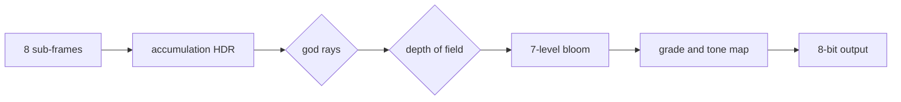
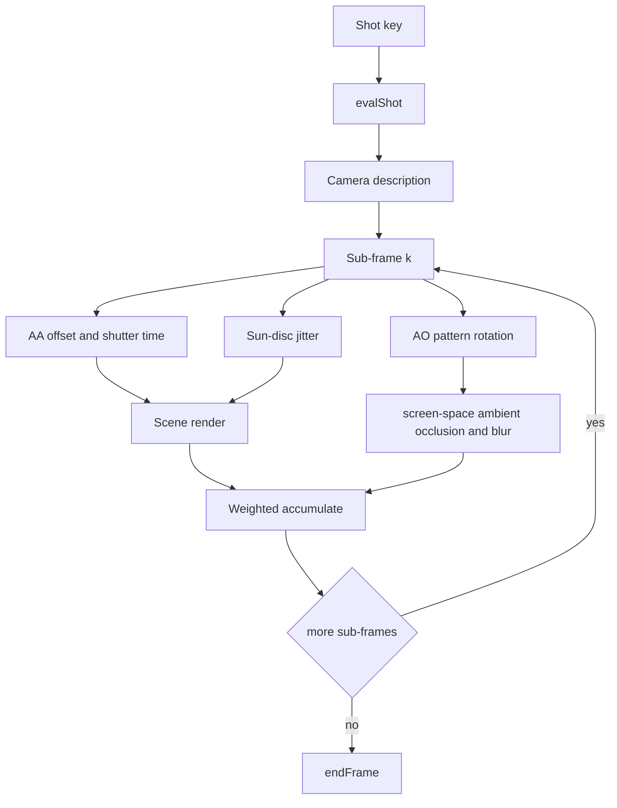

# 02 Core mechanism: from a query string to a graded pixel

This document follows the engine from the Uniform Resource Locator (URL) query string to a finished
pixel. It explains the sub-frame sampler in full, the frame-level post chain, the way a world module
makes geometry and a patched material, and the shader hook order. It ends with the stability rule,
which is the design idea that holds the moving image together.

The short form is this. In render mode, a film frame is a weighted average of eight sub-frames.
Each sub-frame renders
the same scene with a different camera offset, shutter time, sun direction and ambient-occlusion
rotation. The average is anti-aliasing, motion blur, soft sun shadow and clean ambient occlusion
(AO) at the same time. The patterns depend only on the sub-frame index, never on the frame number.
That single constraint stops static surfaces from crawling.

## From the query string to a frame request

The entry module reads the query string before it creates anything. Width and height default to
1280 by 720 pixels. The mode depends on the query. A `shot` or `cam` parameter selects still mode.
A `mode=render` parameter selects render mode. Otherwise the page runs in development mode. The
quality preset is `preview` in development mode and `final` otherwise. The sub-frame count is eight
in render mode, four in still mode and one in development mode.

```text
# src/main.js:25-30
const Q = new URLSearchParams(location.search);
const W = +Q.get('w') || 1280;
const H = +Q.get('h') || 720;
const MODE = Q.get('mode') || (Q.has('shot') || Q.has('cam') ? 'still' : 'dev');
const QUALITY = Q.get('q') || (MODE === 'dev' ? 'preview' : 'final');
const SPP = +Q.get('spp') || (MODE === 'render' ? 8 : MODE === 'still' ? 4 : 1);
```

A still request becomes a camera function and a film time. `viewFromQuery` handles two cases. An
explicit camera query builds one static camera description and uses the `t` value as the film time.
A shot query clamps the shot index at the top of the list only, reads a local time, and computes
the film time as `index * SHOT_DUR + tLocal`. A negative index passes through. The evaluator then
reads an undefined shot and throws. The default local time is half the shot, 3.5 seconds.

The returned object has three fields. `getCam` is a function from local time to a camera
description. `T` is the film time for the module animations. `tLocal` is the shot-local time for
the camera. A render frame computes the same three values from the frame number.

The camera description is a plain object. It holds position, look point, focal length, near and far
planes, focus distance, aperture, roll, shadow region, post overrides and an optional `noShadow`
list. `renderFrame` never reads the shot table directly. It only reads this description. A tool can
therefore build a camera by hand and use the same frame path.

### The lens model

A shot key gives a focal length in millimetres, not a field of view. `focalToFov` treats the sensor
as 36 millimetres wide. The sensor height is 36 millimetres divided by the image aspect. The
function returns the vertical field of view: twice the arc tangent of half the sensor height over
the focal length. `camera.fov` receives that vertical value. A 35 millimetre lens on a 16:9 frame
gives a vertical field of view of about 32.3 degrees and a horizontal field of view of about 54
degrees. The camera near plane defaults to 0.12 metres and the far plane to 6000 metres. A macro
shot may lower the near plane to 0.03 or 0.04 metres. When a query gives both `cam` and `shot`,
`cam` wins. When it gives both `fov` and `focal`, `fov` sets the projection directly and bypasses
the sensor conversion; `focal` still sets the depth-of-field focal length.

Focus is a distance in metres. The post shader computes the circle of confusion from the focus
distance, the focal length and the aperture number. The aperture is an f-number, so a smaller
number means a larger opening and a thinner focus zone. Shot 1 opens at f/8 on a 50 millimetre
lens, because the lotus is a small object and the whole flower should be sharp. Shot 3 opens at
f/4 on a 40 millimetre lens, because the bell should separate from the pagoda behind it.

The camera description also carries a shadow region. The region is a centre and a radius, not a
full box. The engine fits an orthographic shadow camera around that sphere. The shot author
chooses the sphere to cover the visible shadow receivers.

## renderFrame line by line

`renderFrame` is the only function that knows about sub-frames. It takes a camera function, the
film time, the local time, the frame interval, the sub-frame count, the shutter fraction, a fade
factor, a target and a frame index.

```text
# src/main.js:234-245
function renderFrame({ getCam, T, tLocal, dt = 1 / 60, spp = 1, shutter = 0.5, fade = 1, target = null, frameIndex = frameCounter++, q = Q }) {
  const c0 = getCam(tLocal);
  const P = postFor(c0, q);
  G.uShot.value = c0.index ?? -1;
  scene.fog.density = (P.fog ?? 1) * (q.has('fog') ? +q.get('fog') : 1);
  setShadowExclusions(q.has('noshadow') ? q.get('noshadow').split(',') : c0.noShadow);
  P.exposure *= fade;
  pipeline.beginFrame();
  const shadow = c0.shadow || { center: [c0.look.x, c0.look.y * 0.3, c0.look.z], radius: 60 };
  // all sub-frame sampling patterns depend ONLY on the sub-frame index k, never on the frame
  // index, so static surfaces are bit-identical frame to frame (no shadow / AA / AO flicker)
  const W8 = spp > 1 ? aaWeights(spp) : [1];
```

The first camera evaluation uses the requested local time. That camera gives the post parameters,
the shot index, the shadow region and the shadow exclusion list. The per-sub-frame cameras come
later. This split matters. The post focus and the shadow region stay stable inside the frame, while
the camera position and the shutter time move.

The fade factor multiplies exposure. The render loop fades in over the first 0.9 seconds and fades
out over the last 1.4 seconds. The fade is an exposure ramp, not a black overlay. A black overlay
would crush the highlights differently from an exposure change.

`setShadowExclusions` is a per-shot switch. It traverses each module once and caches its shadow
casters. A name in the list turns those casters off. Shot 6 uses this to remove the vegetation,
terrain, buildings and pagoda from the sun shadow map, so their shadows do not fall across the
interior. The cache avoids a traversal on every frame.

## The sub-frame loop

The loop runs once per sub-frame. It computes a time offset, a camera, a projection offset and a
sun jitter. It then renders and accumulates.

The sample offsets come from a Halton sequence with bases 2 and 3. A Halton sequence is a list of
points that fills a square evenly without a regular grid. The code maps each offset to a two-pixel
footprint and gives it a Gaussian weight with sigma 0.5 pixels. The weights are normalised. A wide,
smooth reconstruction filter is the reason fine geometry does not shimmer during a slow move. A
one-pixel box filter leaves aliasing that changes as an edge crosses a pixel.

```text
# src/main.js:136-148
const halton = (i, b) => { let f = 1, r = 0; while (i > 0) { f /= b; r += f * (i % b); i = Math.floor(i / b); } return r; };
// Anti-aliasing reconstruction filter: sub-frame k samples the pixel at a Halton offset
// inside a 2-px footprint and is weighted by a Gaussian (sigma 0.5 px). A wide, smooth
// filter (instead of a 1-px box) is what stops fine geometry from crawling/shimmering
// in slow camera moves.
const AA_RADIUS = Q.has('aar') ? +Q.get('aar') : 1.0, AA_SIGMA = Q.has('aas') ? +Q.get('aas') : 0.5;
function aaOffset(k) { return [(halton(k + 1, 2) * 2 - 1) * AA_RADIUS, (halton(k + 1, 3) * 2 - 1) * AA_RADIUS]; }
function aaWeights(spp) {
  const w = [];
  for (let k = 0; k < spp; k++) { const [x, y] = aaOffset(k); w.push(Math.exp(-(x * x + y * y) / (2 * AA_SIGMA * AA_SIGMA))); }
  const sum = w.reduce((a, b) => a + b, 0);
  return w.map((v) => v / sum);
}
```

The shutter offset is a second sequence. The loop computes a permuted index `kt` and maps it to a
time inside the shutter interval. The multiplier is 7 when the sub-frame count is a multiple of 5,
and 5 otherwise. With eight sub-frames the index order is 1, 6, 3, 0, 5, 2, 7, 4. The time offsets
are stratified but not sorted. The permutation decorrelates the time sample from the spatial
offset. A sorted order would make the first sample always the earliest, which couples motion blur
to the anti-aliasing pattern.

The shutter fraction is 0.5 by default. With eight sub-frames, `kt` takes every value from 0 to 7
in a permuted order. The offset runs from minus 0.21875 to plus 0.21875 of a frame interval. The
sampled span is therefore 0.4375 of a frame interval. The shutter interval is 0.5 of a frame
interval, and the outermost half-slot at each end receives no sample centre. The code calls the
blur half a frame because that is the shutter width. The actual sample span is 0.4375, not 0.5.
That choice keeps the image crisp while removing the strobing of a 60 frame per second (FPS) pan.

```text
# src/main.js:247-249
    // shutter time: stratified, decorrelated from the AA offset (bit-reversed order)
    const kt = spp > 1 ? (k * (spp % 5 === 0 ? 7 : 5) + 1) % spp : 0;
    const off = spp > 1 ? ((kt + 0.5) / spp - 0.5) * shutter * dt : 0;
```

The time samples are stratified by construction. The interval is divided into `spp` equal slots,
and each slot receives one sample. A sorted assignment would correlate the time with the spatial
Halton offset, because both would advance in the same order. The permutation breaks that
correlation. The result is a better estimate of the integral over the shutter interval for the same
number of samples.

The camera is applied with a projection jitter. The code adds the Halton offset to the projection
matrix elements 8 and 9, scaled by two over the width and height. This shifts the whole projection
by a fraction of a pixel. The inverse matrix is recomputed, because the shader uses it to rebuild
view positions for AO and depth of field.

```text
# src/main.js:150-167
function applyCamera(cam, c, jitterIndex = -1) {
  camera.position.copy(c.pos);
  camera.up.set(0, 1, 0);
  camera.lookAt(c.look);
  if (c.roll) camera.rotateZ(c.roll);
  camera.near = c.near || 0.12;
  camera.far = c.far || 6000;
  camera.fov = c.fov || focalToFov(c.focal || 35, W / H);
  camera.aspect = W / H;
  camera.updateProjectionMatrix();
  if (jitterIndex >= 0) {
    const [jx, jy] = aaOffset(jitterIndex);
    camera.projectionMatrix.elements[8] += (2 * jx) / W;
    camera.projectionMatrix.elements[9] += (2 * jy) / H;
    camera.projectionMatrixInverse.copy(camera.projectionMatrix).invert();
  }
  camera.updateMatrixWorld();
}
```

The sun jitter is a third pattern. The loop builds a point on a golden-angle spiral. The radius is
the square root of `(k + 0.5) / spp` times 0.0065 radians. With eight sub-frames, the outer sample
radius is 0.00629 radians. The angle is `k * 2.39996323 + 0.7` radians. `fitSunShadow` adds the
two components to the light direction. The sun is not a point. A real penumbra comes from the
finite angular size of the disc, about 0.00465 radians in radius. The outer samples lie slightly
outside that disc, so the source comment "inside solar disc" is approximate. The shadow map is
re-rendered for each sample, so the penumbra is geometric, not a blur kernel.

```text
# src/core/lighting.js:31-48
export function fitSunShadow(sun, center, radius, jitter = null) {
  const d = sunDir.clone();
  if (jitter) {
    const up = new THREE.Vector3(0, 1, 0);
    const right = new THREE.Vector3().crossVectors(d, up).normalize();
    const up2 = new THREE.Vector3().crossVectors(right, d).normalize();
    d.addScaledVector(right, jitter.x).addScaledVector(up2, jitter.y).normalize();
  }
  sun.position.copy(center).addScaledVector(d, 400);
  sun.target.position.copy(center);
  sun.target.updateMatrixWorld();
  const cam = sun.shadow.camera;
  cam.left = -radius; cam.right = radius; cam.top = radius; cam.bottom = -radius;
  cam.near = 400 - radius * 1.6; cam.far = 400 + radius * 1.6;
  if (cam.near < 1) cam.near = 1;
  cam.updateProjectionMatrix();
  sun.shadow.needsUpdate = true;
}
```

The shadow camera is orthographic. Its position is 400 metres from the region centre along the sun
direction. Its near and far planes straddle that distance by 1.6 times the region radius. A region
of 21 metres gives a depth range of about 67 metres. The map size is 8192 squared at final quality
and 2048 squared at preview quality. The region radius sets the world width of the shadow camera,
and the map size sets the texel count. One texel covers `2 * radius / mapSize` metres. At a 21 metre
radius and an 8192 map, one texel is about 5 millimetres. At the preview size, one texel is about
2 centimetres. A smaller region or a larger map gives a sharper shadow. The radius alone does not
set the sharpness.

### Fog and aerial perspective

Fog is not a post effect. The fog module replaces four three.js fog chunks: `fog_pars_vertex`,
`fog_vertex`, `fog_pars_fragment` and `fog_fragment`. It also appends an ambient-volume block to
`lights_fragment_maps`. Every material with `scene.fog` set evaluates the same function. The pond
water shader also calls `applyAerial` directly for its body and glint terms. The sky does not. The
sky uses its own atmosphere model and sets `fog: false` on its material, so the horizon blend is
not the fog function.

```text
# src/core/fog.js:101-114
    float hfac = abs(dy) > 0.01 ? (exp(-max(y0, -5.0) / H) - exp(-max(y0 + dy, -5.0) / H)) * H / dy : exp(-max(y0, -5.0) / H);
    float od = (D0 * hfac + DA) * dist * densMul;
    float T = exp(-od);
    float mu = dot(dir, SUN);
    const float g = ${f(P.mieG)};
    float hg = (1.0 - g * g) / pow(1.0 + g * g - 2.0 * g * mu, 1.5) / 12.566;
    vec3 sunGlow = vec3(${f(P.sunGlowColor[0])}, ${f(P.sunGlowColor[1])}, ${f(P.sunGlowColor[2])}) * ${f(P.sunGlowStrength)};
    // ambient haze: blue-lavender away from sun, warm gold toward it
    float toward = pow(max(mu, 0.0) * 0.5 + 0.5, 3.0);
    vec3 amb = mix(fogColor, fogColor * vec3(1.55, 1.12, 0.72), toward);
    // forward-scatter glow toward the sun, capped so backlit silhouettes keep their outline
    vec3 inscatter = amb + sunGlow * min(hg * 4.0, 1.6) * (0.55 + 0.45 * smoothstep(300.0, 3000.0, dist));
    inscatter *= (ambientVolume(camPos) + ambientVolume(wpos)) * 0.5;
    return col * T + inscatter * (1.0 - T);
```

`H` is the 22 metre scale height. `D0` is 0.0013 per metre at ground level. `DA` is 0.00022 per
metre everywhere. `y0` is the camera height, `dy` is the height change along the ray, and `densMul`
is a material multiplier.

`hfac` integrates the exponential height term along the view ray, with the start height clamped to
minus 5 metres. The optical depth is `D0 * hfac + DA` times distance times a density multiplier.
`T = exp(-od)` is the transmittance. The output is `col * T + inscatter * (1 - T)`. The
Henyey-Greenstein function is a phase function. It estimates the angular distribution of scattered
light, and it sets how much light continues toward the viewer. Its `g` value is 0.78, so forward
scatter dominates and a backlit object glows at its edge. The glow is capped at 1.6 so a silhouette
keeps its outline.

`ambientVolume` attenuates image-based sky light inside up to 48 axis-aligned boxes.
`setAmbientVolumes` keeps only the first 48 entries. Each box carries a tint and a soft edge. The
shader computes a box signed distance, which is negative inside the box and positive outside it,
turns that distance into a weight and blends the tint. The pond polygon signed distance uses the
opposite convention, with positive inside. The running product multiplies the indirect
diffuse and specular terms. A pond in the open gets a factor of one. A hall interior gets a dark
warm factor. This is a second path by which the built world changes ambient light, separate from
the scene environment capture.

## The sub-frame render and accumulation

One sub-frame has three possible layers. The scene render is always present. Ambient occlusion is
present when the strength is above 0.001. Volumetric light is present when the shot enables it and
the sun shadow map has a depth texture. The accumulation pass adds the result with the sub-frame
weight.

```text
# src/core/post.js:610-620
    const useAO = P.aoStrength > 0.001;
    if (useAO) {
      const u = this.aoMat.uniforms;
      u.tDepth.value = this.sceneRT.depthTexture;
      u.uRes.value.set(this.aoRT.width, this.aoRT.height);
      u.uRadius.value = P.aoRadius;
      u.uIntensity.value = P.aoIntensity;
      u.uFrame.value = this.subCount;
      u.uProj.value.copy(camera.projectionMatrix);
      u.uProjInv.value.copy(camera.projectionMatrixInverse);
      u.cameraNear.value = camera.near; u.cameraFar.value = camera.far;
```

The scene target is a half-float red, green, blue and alpha (RGBA) target with four-sample
multi-sample anti-aliasing (MSAA) and a floating-point depth texture. The AO target is half
resolution and uses an unsigned-byte format. The AO pass reads the depth, reconstructs view
positions, samples a hemisphere and writes an occlusion factor. The blur is two-pass and
depth-aware. It runs horizontally into a second target and vertically back into the first.

The AO pass reconstructs a view position from the depth at each half-resolution pixel. It builds a
surface normal from the depth derivatives of the neighbouring pixels. It then samples a Vogel disc
of points around the pixel and reconstructs a view position for each one. A Vogel disc is a spiral
of points that covers a circle evenly. A sample adds occlusion when its position lies in front of
the local surface and inside the radius. The weighted sum becomes the AO value. The radius is in
metres, so the occlusion scale stays physical across shots. The intensity scales the final term.

Half resolution is enough because AO is a low-frequency signal. The depth-aware blur removes the
sampling pattern without mixing across a depth edge. The two passes use the same depth texture, so
a foreground object does not receive the background occlusion.

`u.uFrame.value` is the sub-frame counter. The AO shader rotates its sample pattern by this value.
The noise of one sample set is different from the next. The accumulation average cancels the
noise. This is why the AO is clean without a spatial denoiser. The rotation depends on the
sub-frame index, so a static surface gets the same eight patterns every frame. The average is
identical, and the AO does not crawl.

The volume pass, when enabled, marches the shadow map from the camera to a maximum distance. It
produces a half-resolution volumetric light buffer. The accumulation shader adds it with the sun
colour and the volume strength. The hall interior uses a different method: a mesh-based shaft
volume with 56 slices. That volume samples the sun shadow map and the analytic window openings.
The post volume and the interior shafts are separate solutions to the same visual problem.

The accumulation target is cleared at `beginFrame`. The accumulation shader reads the scene colour
first. When ambient occlusion is on, it multiplies that colour by `mix(1.0, ao, uAOStrength)`.
Ambient occlusion therefore darkens the scene radiance only, not the volumetric light. When the
volume pass is on, the shader adds a five-tap blur of the volume buffer, with weight 0.4 at the
centre and 0.15 at each neighbour. The resulting colour is clamped to 60000 and checked for a
not-a-number value. The shader writes `(c * uWeight, uWeight)` with additive blending on both
channels. The weight is the Gaussian anti-aliasing weight. The weights are normalised to sum to
one before the loop, so the accumulated colour is already normalised. The alpha channel records
that sum, and no later pass divides by it. The result is a high dynamic range (HDR) frame that is
already anti-aliased, motion blurred, soft-shadowed and ambient-occlusion-filtered.

## The stability rule

The comment above the loop states the rule. All sub-frame sampling patterns depend only on the
sub-frame index `k`, never on the frame index. Four patterns obey it: the anti-aliasing offset, the
shutter order, the sun-disc jitter and the AO rotation.

**Aha:** The no-flicker property is not a denoiser. It is a constraint on how samples are
generated. A static surface receives the same eight camera offsets, the same eight shutter times
and the same eight sun positions in every frame. Its eight rendered values are identical, so its
average is bit-identical. A moving surface receives different values, because its geometry or its
camera moved. The average then gives true motion blur. The engine gets stability and blur from one
mechanism by making the sample set a pure function of `k`.

There is a fifth pattern that must obey the rule: the shadow filtering. Three.js rotates its
percentage-closer filtering (PCF) taps with a screen-space noise function. That rotation changes
with the pixel position and the frame. A static shadow edge then crawls when the camera moves. The
fog module replaces the tap rotation with a fixed angle of 0.785 radians. The soft shadow now comes
only from the sun-disc jitter across sub-frames.

```text
# src/core/fog.js:50-55
const LIGHTS_MAPS_ORIG = THREE.ShaderChunk.lights_fragment_maps;
// PCF: three rotates its Vogel taps with screen-space noise, which crawls when the camera
// moves (flickering penumbrae). Our soft shadows come from sun-disc jitter across
// sub-frames, so use a fixed rotation instead -> temporally stable shadows.
THREE.ShaderChunk.shadowmap_pars_fragment = THREE.ShaderChunk.shadowmap_pars_fragment
  .split('float phi = interleavedGradientNoise( gl_FragCoord.xy ) * PI2;').join('float phi = 0.785;');
```

The fixed rotation is a global shader chunk edit. It applies to every material that uses the
shadow map. The comment names the reason: the tap rotation was a source of flicker. The replacement
angle is arbitrary but fixed. The tap pattern is still a Vogel disc, so the filter is still
smooth. Only the rotation is frozen.

## The frame-level post chain

After the sub-frames, `endFrame` runs a fixed chain. God rays are optional. Depth of field is
optional. Bloom is always on, with a strength that can be zero. The final pass always runs.

The default post record defines the vocabulary. It includes exposure, AO strength and radius,
volumetric settings, god ray decay and threshold, depth-of-field focus and aperture. It also
includes bloom, vignette, grain, chromatic aberration, saturation, contrast, temperature, tint,
lift, gamma and gain. The remaining fields are tone map mode, highlight warmth, clarity, sharpen,
punch and flare.

```text
# src/core/post.js:39-52
export const DEFAULT_POST = {
  exposure: 1.0,
  aoStrength: 0.75, aoRadius: 0.9, aoIntensity: 1.3,
  vol: 0.0, volDensity: 0.012, volHeight: 20, volMaxDist: 150, volNoise: 0.5, volBox: null, // volBox: {min:[x,y,z], max:[x,y,z], density}
  godrays: 0.0, godraysDecay: 0.965, godraysThreshold: 10.0,
  dof: false, focusDist: 10, fstop: 4.0, focalLength: 35, maxCoc: 22,
  bloom: 0.06, bloomRadius: 0.85,
  vignette: 0.32, grain: 0.007, chromAb: 0.0015,
  saturation: 1.02, contrast: 1.05, temperature: 0.0, tint: 0.0,
  lift: [0, 0, 0], gain: [1, 1, 1], gamma: [1, 1, 1],
  tonemap: 2, // 0 = ACES, 1 = AgX-punchy, 2 = mix
  highlightWarmth: 0.0,
  clarity: 0.0, sharpen: 0.18, punch: 0.4, flare: 0.0,
};
```

The camera description overrides `focusDist` and `fstop`. A shot evaluator always supplies an
aperture and supplies a focus distance when the shot or a key defines one. The 10 metre and f/4
values apply only when the description omits them.

God rays are gated twice. The shot must set a positive strength, and the camera must face the sun
with a dot product above 0.05. The pass projects the sun to screen space, builds a threshold mask,
and blurs it with three increasing step sizes. The decay is 0.965 per step. The result is added to
the scene with a warm tint.

Depth of field uses a circle of confusion from the focus distance, the focal length and the
aperture. The maximum circle is scaled by the image width over 1920, so a smaller preview has a
proportionally smaller blur. The first pass writes the circle of confusion. The second pass is a
scatter-as-gather filter. The name means that each destination pixel gathers from its neighbours,
instead of each source pixel scattering forward. It samples a disc and weights each sample by its
own circle and by the centre circle. This reduces the bleeding of a sharp foreground onto a blurred
background.

```text
# src/core/post.js:691-704
    if (P.dof) {
      const c = this.cocMat.uniforms;
      c.tColor.value = src.texture; c.tDepth.value = this.sceneRT.depthTexture;
      c.uFocus.value = P.focusDist; c.uFocal.value = P.focalLength; c.uFstop.value = P.fstop;
      c.uWidth.value = this.w; c.uMaxCoc.value = P.maxCoc * (this.w / 1920);
      c.uProjInv.value.copy(camera.projectionMatrixInverse); c.cameraNear.value = camera.near; c.cameraFar.value = camera.far;
      const dst = src === this.workA ? this.workB : this.workA;
      this._pass(this.cocMat, dst);
      const d = this.dofMat.uniforms;
      d.tCoc.value = dst.texture; d.uRes.value.set(this.w, this.h); d.uMaxCoc.value = P.maxCoc * (this.w / 1920);
      d.uRadScale.value = this.dofQuality >= 1 ? 0.55 : 1.2;
      const dst2 = dst === this.workA ? this.workB : this.workA;
      this._pass(this.dofMat, dst2);
      src = dst2;
```

Bloom uses seven mip levels. The first downsample applies a Karis average, which weights each
sample by its inverse brightness. The Karis average reduces fireflies from a single very bright
pixel. The remaining levels are plain downsamples. The upsample chain adds each level back with a
radius. The final pass reads the base mip and a local mip for clarity and sharpening.

The first downsample is special. A very bright pixel can dominate a bloom level and produce a
moving firefly. The Karis average divides each sample by one plus its brightness before the average
and then restores the scale. A bright sample therefore contributes less than its raw value. The
remaining levels average normally. The upsample chain runs from the smallest level to the largest
and adds each result with a radius weight. The base level is the bloom texture that the final pass
reads.

The final pass is one fragment shader. Its operations run in this order (`src/core/post.js:486-537`):

1. Sample the scene with chromatic aberration. Red and blue shift outward by `cc * r2 * uChromAb * 4.0`. Green stays at the centre.
2. Sharpen with a four-neighbour unsharp mask, limited to half of `col + 0.05` to avoid halos.
3. Apply clarity. Compare the pixel luminance with the local mip luminance and scale the colour.
4. Add bloom.
5. Add lens flare, scaled by sun visibility.
6. Multiply by exposure and the white balance vector.
7. Apply highlight warmth.
8. Tone map. Mode 0 uses the Academy Color Encoding System (ACES) fit. Mode 1 uses the AgX chain with the punch setting. Mode 2 mixes the two at 0.5.
9. Apply gamma.
10. Apply gain and lift.
11. Apply saturation.
12. Apply contrast around 0.5.
13. Apply vignette.
14. Clamp to the 0 to 1 range.
15. Convert linear values to standard Red Green Blue (sRGB).
16. Add luma-dependent grain and a one-level dither.

The grade after the tone map works in display space. The dither breaks up banding in the dark
gradients of the sky.



## How a world module makes geometry

A world module builds three-dimensional objects from primitives, custom buffers and instanced
meshes. The shared `Builder` class (`src/core/geom.js:44`) collects geometry per material. `add`
clones each geometry, applies a matrix, calls `clean`, and stores the result in a bucket. `clean`
converts an indexed geometry to a non-indexed one. It computes vertex normals if they are absent,
and it adds a zero texture-coordinate attribute named `uv` if that attribute is absent. It keeps
only the position, normal, texture-coordinate and colour attributes. It also clears the morph
attributes and the groups. `build` merges each bucket into one mesh. It splits the bucket when the
accumulated vertex count passes 3,000,000, so an index buffer stays inside a safe range. The result
is a small number of draw calls for a large amount of geometry.

The bridge shows the derived-geometry style. The deck is a circular arc. The code knows the chord
half length and the rise at the crown. From those two values it derives the arc radius, the centre
height and the end angle. Every rail post, fascia board and arch rib then uses the same radius and
the same angle functions. The bridge cannot have a deck that disagrees with its railing, because
both come from one equation.

The bridge constants have plain meanings. `Y0` is the ground height. `ZC` is the Z midpoint between
the north and south landing points. `HALF` is half the Z distance between those points. `RISE` is
the deck rise at the crown. `RA` is the deck arc radius. `YC` is the arc-centre height. The next
block shows the derived values in code.

```text
# src/world/bridge.js:36-46
  const RA = (HALF * HALF + RISE * RISE) / (2 * RISE); // deck-surface arc radius
  const YC = Y0 + RISE - RA;                           // arc centre height
  const WATER = (L.pond && L.pond.waterY != null) ? L.pond.waterY : -0.55;
  const BOTTOM = (L.pond && L.pond.bottomY != null) ? L.pond.bottomY : -1.7;
  const HW = BR.width / 2;

  const LAND_TOP = Y0 + 0.06;                                   // landing slab top
  const thE = Math.acos((RA - RISE + (LAND_TOP - Y0)) / RA);    // deck end angle (deck meets slab)
  const zEndN = ZC - RA * Math.sin(thE), zEndS = ZC + RA * Math.sin(thE);

  const yAt = (z, off = 0) => YC + Math.sqrt(Math.max((RA + off) ** 2 - (z - ZC) ** 2, 0));
```

The pagoda shows the symmetry style. It does not model four sides. It models one side in a local
frame and rotates it by 0, 90, 180 and 270 degrees. The local frame has X along the wall, Y up and
P outward from the centre. A corner element belongs to the minus-X corner of one side. This rule
makes each corner appear once, not twice.

```text
# src/world/pagoda.js:1-8
// ---------------------------------------------------------------------------
// Five-storey pagoda (goju-no-to) — fully procedural.
//
// Side-local frame: every side j (0..3) is generated in a local frame
// (x = lateral along the wall, y = up, p = outward distance from the centre)
// and rotated by j*90deg about the pagoda axis. Corner elements belong to the
// side's -x corner so nothing is generated twice.
// ---------------------------------------------------------------------------
```

The vegetation module shows the recursive style. A tree is a recursive branch skeleton. Each
branch is a tapered tube with rings and parallel-transport frames. Parallel transport carries a
frame along a curve without twisting it around the tangent. The bark attributes carry the frame
and the taper into the shader. The foliage is not a mesh of leaves. It is a set of instanced
cards. Each card has two triangles, a petiole pivot, a blade towards positive Y and a face normal
towards positive Z. The card geometry is tiny; the atlas texture supplies the leaf shape and the
vein detail. The vertex shader receives a per-leaf flex value and an atlas cell.

```text
# src/world/vegetation.js:517-520
// card geometries
// ===========================================================================
function leafCardGeo(THREE, fold = 0.12) {
  // pivot at petiole end (0,0,0); blade towards +Y; face normal +Z.
```

This is the central economy of the world. A procedural mesh can be large, because it is built once.
A leaf card can be small, because the atlas carries the detail and the instance data carries the
variation. The engine pays for geometry once and for shading per pixel. The world code chooses the
cheaper side for each object.

## The shader hook order

A patched material is a standard three.js material with extra Graphics Library Shading Language
(GLSL) inserted at named chunks. The
insertion order follows the three.js fragment shader. The colour hook runs after the base colour is
computed. The roughness and metalness hooks run after their maps. The normal hook runs after the
normal maps. The emissive hook runs after the emissive map. The physical hook runs after the
physical material values are assembled. The light hook runs after the light loop. The end hook runs
before the opaque output is written.

```text
# src/core/materials.js:117-127
    let fs = shader.fragmentShader;
    fs = fs.replace('#include <common>', `#include <common>\n${COMMON_HEAD}\n${FRAG_UTIL}\n${o.fragHead || ''}`);
    if (o.fragColor) fs = fs.replace('#include <color_fragment>', `#include <color_fragment>\n${o.fragColor}`);
    if (o.fragRough) fs = fs.replace('#include <roughnessmap_fragment>', `#include <roughnessmap_fragment>\n${o.fragRough}`);
    if (o.fragMetal) fs = fs.replace('#include <metalnessmap_fragment>', `#include <metalnessmap_fragment>\n${o.fragMetal}`);
    if (o.fragNormal) fs = fs.replace('#include <normal_fragment_maps>', `#include <normal_fragment_maps>\n${o.fragNormal}`);
    if (o.fragEmissive) fs = fs.replace('#include <emissivemap_fragment>', `#include <emissivemap_fragment>\n${o.fragEmissive}`);
    if (o.fragPhysical) fs = fs.replace('#include <lights_physical_fragment>', `#include <lights_physical_fragment>\n${o.fragPhysical}`);
    if (o.fragLight) fs = fs.replace('#include <lights_fragment_end>', `#include <lights_fragment_end>\n${o.fragLight}`);
    if (o.fragEnd) fs = fs.replace('#include <opaque_fragment>', `${o.fragEnd}\n#include <opaque_fragment>`);
    shader.fragmentShader = fs;
```

The vertex side has one important replacement. The patch replaces the project-vertex chunk with a
block that computes the world position first. It applies the batching matrix and the instance
matrix when they exist. It computes the world normal from the object normal with the same matrices.
The batching matrix is a correctness path for a batched three.js mesh, not a memory-saving device.
The package does not create a `BatchedMesh`. Then the block runs the `vertexWorld` hook. That hook
may move `wPos4`, which is how wind bends a branch. The final clip position comes from the world
position, so a moved vertex is in the right place for the camera, the shadow map and the fog.

The depth material is the shadow counterpart. A shadow map renders with a depth material, not the
visible material. If a leaf moves in the visible shader but not in the depth shader, the shadow
stays still. `depthMaterialFor` creates a depth material and patches it with the same vertex head
and the same world hook. The shadow then follows the wind.

```text
# src/core/materials.js:136-140
export function depthMaterialFor(o = {}, base = {}) {
  const dm = new THREE.MeshDepthMaterial({ depthPacking: THREE.RGBADepthPacking, ...base });
  patch(dm, { vertexHead: o.vertexHead, vertexWorld: o.vertexWorld });
  return dm;
}
```

The cache key is built from the hook strings and the defines. Two materials with identical hook
text share a program. The key is a 32-bit hash, prefixed with `p`. A collision is possible in
principle. The code accepts that risk for a small cache. A collision would make two materials share
a program and show the wrong surface. No collision is reported in the source.

## Putting it together

The engine has two loops. The outer loop is the film clock: shot, frame, camera, fade. The inner
loop is the sub-frame sampler: offset, time, sun, render, accumulate. The outer loop changes once
per frame. The inner loop changes only with `k`. The post chain runs once per frame. The module
updates run once per sub-frame, because time moves inside the shutter.

This structure explains the image. A static wall is stable because its eight samples repeat. A
moving leaf blurs because its eight positions differ. A shadow edge is soft because the sun moves
across its disc. Ambient occlusion is clean because its eight noise patterns average out. The
motion blur, the anti-aliasing, the soft shadow and the AO are not four features. They are four
consequences of one sampler.

The cost is the reason the film is rendered offline. Eight sub-frames at 1920 by 1080 pixels and 60
FPS is 480 rendered images per second of film. The engine does not need a temporal denoiser or a
motion-vector buffer. It spends graphics processing unit (GPU) time instead. The tool path in
[03-workflow-and-quality.md](03-workflow-and-quality.md) exists to spend that time without
supervision.



[00-overview.md](00-overview.md) shows the site, the ten shots and one frame in context. The index is [README.md](README.md).
