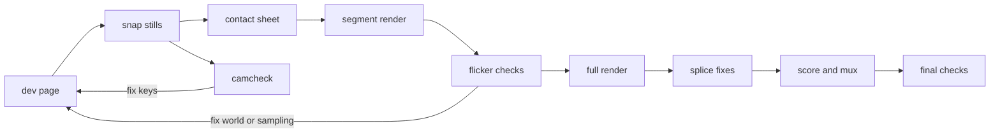
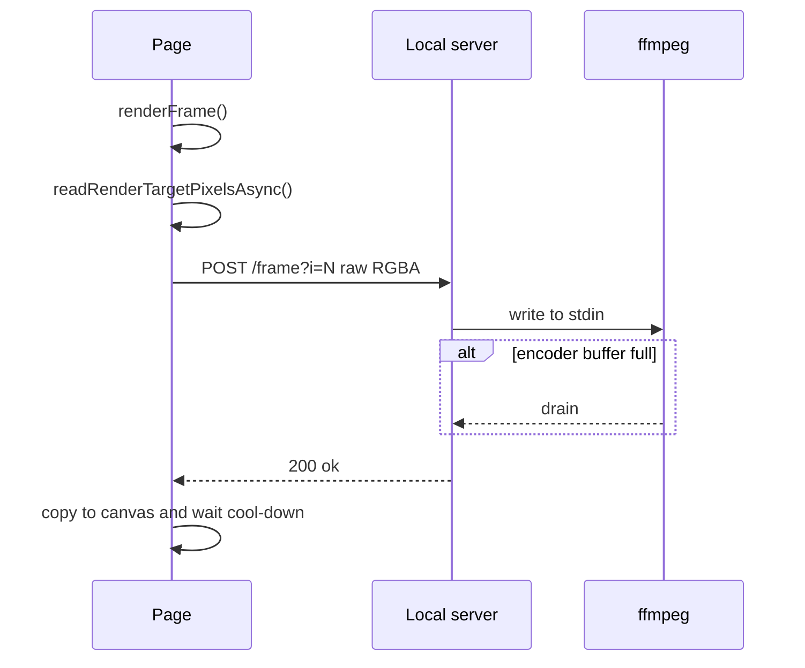

# 03 Workflow and quality: how one still becomes a film

Golden Temple is not produced by one command. It is produced by a loop. A camera is chosen, a still
is captured, the motion is measured, a segment is rendered, the segment is checked for flicker, and
only then is the full film encoded. The loop exists because the expensive step is the full film,
and a defect found after four hours costs four hours.

This document describes the loop, the Uniform Resource Locator (URL) parameters and the tool flags
and defaults. It follows the path of one still and the path of one film frame. It states the
runtime claims, the music edit and the four quality metrics. It also explains what each metric can
and cannot see.

## The loop

The loop has seven stages. Each stage answers a different question.

1. Build and view. Run the development server and open the page. A developer flies a free camera
   and reads the shot player. The status line shows build progress and the head-up display shows
   the shot and local time.
2. Capture stills. `tools/snap.mjs` loads the page once and renders several views from the same
   world. A view may be a shot time or an explicit camera.
3. Tile a contact sheet. `tools/sheet.mjs` calls `snap` for every shot at one or more times and
   joins the stills into one image. A contact sheet shows the film at a glance.
4. Check the motion. `tools/camcheck.mjs` runs on the central processing unit (CPU). It samples
   every shot at 60 frames per second and reports speed, acceleration and turn rate.
5. Render a segment. `tools/render.mjs` renders a frame range with a low sub-frame count, then a
   higher count for the candidate. The render is resumable and frame accurate.
6. Check the pixels. `tools/lumaflicker.mjs`, `tools/mcflicker.mjs` and `tools/flickercheck.mjs`
   measure a finished segment for brightness flicker, motion-compensated shimmer and second
   difference noise.
7. Splice and score. `tools/splice.mjs` replaces a range in a finished film. `tools/score.mjs`
   edits the music and muxes it onto a copy of the video.



The loop is not a formal pipeline. A person decides when a still is good and when a metric is low
enough. The tools supply evidence. They do not supply a pass mark. The source does not define a
threshold for any metric.

## The URL parameters

The page is driven by the query string. The tools pass parameters through that string. The table
below groups the parameters by purpose. Each entry gives the name, the type, the default and an
example. A flag is active when the key is present; the examples use `=1`. The table covers the
parameters that the entry module reads and the post overrides in `postFor`.

| Purpose | Parameters: type, default, example |
|---|---|
| Size and mode | `w` number, 1280, `w=1920`; `h` number, 720, `h=1080`; `mode` text dev/still/render, derived, `mode=render`; `q` text preview/final, derived, `q=final`; `spp` number, 8 render / 4 still / 1 dev, `spp=8` |
| Shot or camera | `shot` number, 0 from `snap`, `shot=3`; `t` seconds, 3.5 for a shot and 0 for a camera, `t=2`; `cam` x,y,z metres, none, `cam=10,1.7,6.5`; `look` x,y,z metres, 0,0,0, `look=10,0.6,-8`; `focal` millimetres, 35 for a camera and the shot key for a shot, `focal=50`; `fov` degrees, focal value, `fov=40`; `near` metres, 0.12, `near=0.03`; `focus` metres, camera-to-look distance for a camera and the shot key for a shot, `focus=85`; `fstop` number, 8 for a camera and the shot key for a shot, `fstop=2.8` |
| Shadow | `shadow` x,y,z,radius metres, shot value, `shadow=6,0,0,21`; `noshadow` module list, shot value, `noshadow=vegetation,terrain`; `smap` texels, 2048 preview / 8192 final, `smap=4096` |
| Modules | `modules` list, all nine, `modules=terrain,pond` |
| Post | `exp` number, 1.0, `exp=1.2`; `godrays` number, 0, `godrays=0.5`; `dof` 0 or 1, off, `dof=1`; `ao` number, 0.75, `ao=0.6`; `bloom` number, 0.06, `bloom=0.1`; `tm` 0, 1 or 2, 2, `tm=0`; `vol` number, 0, `vol=1`; `vold` number, 0.012, `vold=0.02`; `volbox` six bounds plus density, none, `volbox=-5,-1,-5,5,5,5,0.02`; `clarity` number, 0, `clarity=0.3`; `sat` number, 1.02, `sat=1.1`; `punch` number, 0.4, `punch=0.7`; `flare` number, 0, `flare=0.2`; `con` number, 1.05, `con=1.1`; `sharpen` number, 0.18, `sharpen=0.25`; `fog` multiplier, 1, `fog=0.8` |
| Sampling | `aar` pixels, 1.0, `aar=0.8`; `aas` pixels, 0.5, `aas=0.4` |
| Startup | `nopc` flag, off, `nopc=1`; `noenvcap` flag, off, `noenvcap=1`; `noav` flag, off, `noav=1`; `nocheck` flag, off, `nocheck=1`; `skipfirst` flag, off, `skipfirst=1`; `dumpanchors` flag, off, `dumpanchors=1` |
| Render pacing | `cool` milliseconds, 60, `cool=0`; `restEvery` frames, 250, `restEvery=100`; `rest` seconds, 15, `rest=5` |
| Render range | `fps` number, 60, `fps=30`; `from` frame, 0, `from=2520`; `to` frame, 4200 at 60 FPS, `to=2940`; `port` number, 5190, `port=5190` |
| Debug | `fi` frame index, 1, `fi=1`; `play` flag, off, `play=1`; `propstest` flag, off, `propstest=1`; `ishell` value 1, off, `ishell=1` |

The defaults are set in the entry module. Width and height default to 1280 by 720. The sub-frame
count is eight in render mode, four in still mode and one in development mode. Quality is
`preview` in development mode and `final` otherwise. The mode is `still` when the query has a shot
or a camera, and `dev` otherwise. The tools override these defaults with their own values.

## The tools and their defaults

The tool directory holds 11 files: 10 command-line tools and the shared helper
`tools/lib/chrome.mjs`. The package has nine scripts. `dev` starts the server. `build` bundles the
page. Seven scripts are tool aliases: `snap`, `sheet`, `render`, `fetch-music`, `score`, `camcheck`
and `flicker`. `flicker` runs `lumaflicker`. Three tools have no alias: `splice`, `mcflicker` and
`flickercheck`. Run those three with `node` directly.

The table below lists the tool entry points and the defaults in the source. A default is the value
that applies when the flag is absent.

| Tool | npm alias | Main flags and defaults | Output |
|---|---|---|---|
| `snap.mjs` | `snap` | Base query as the first argument, repeated `--view "<query>" out.png`, `--timeout 600` | Portable Network Graphics (PNG) stills |
| `sheet.mjs` | `sheet` | `--t 3.5`, `--shots 0..9`, `--w 960`, `--h 540`, `--spp 2`, `--tag sheet`, `--extra ""`, `--modules ""` | One Joint Photographic Experts Group (JPEG) sheet |
| `render.mjs` | `render` | `--w 1920`, `--h 1080`, `--fps 60`, `--spp 8`, `--from 0`, `--to 0` (sentinel: full film), `--out out/temple.mp4`, `--crf 14`, `--preset slow`, `--port 5190`, `--extra ""` | MPEG-4 Part 14 (MP4) video, no audio |
| `score.mjs` | `score` | `--video out/temple.mp4`, `--out out/temple_final.mp4`, `--music assets_audio/finding_movement.mp3` | MP4 with Advanced Audio Coding (AAC) audio |
| `splice.mjs` | none | `--base out/temple.mp4`, `--seg out/seg.mp4`, `--from 0`, `--to 0`, `--out out/temple_spliced.mp4`, `--crf 12` | MP4 with the range replaced |
| `camcheck.mjs` | `camcheck` | No flags. Samples all shots at 60 frames per second (FPS) | Text report |
| `lumaflicker.mjs` | `flicker` | `film.mp4`; reads 320 by 180 grey frames | Text report |
| `mcflicker.mjs` | none | `film.mp4 [start=0] [dur=7]`; reads 640 by 360 grey frames | Text report |
| `flickercheck.mjs` | none | `film.mp4 [start=0] [dur=70]`; reads 480 by 270 grey frames | Text report per shot |
| `fetch-music.mjs` | `fetch-music` | `--force` is optional | Audio file |
| `lib/chrome.mjs` | imported helper | `CHROME` environment variable, else a detected browser; `ANGLE` selects the backend | None |

The capture tools share a browser locator. `tools/lib/chrome.mjs` uses the `CHROME` environment
variable first. If it is absent, it searches the usual Chrome, Edge and Chromium paths for the
platform. The graphics processing unit (GPU) flags enable the GPU, ignore the block list, enable
the Web Graphics Library (WebGL), and disable the GPU watchdog, renderer backgrounding and
background timer throttling. On
Windows the launcher forces the Direct3D 11 (D3D11) ANGLE backend. The `ANGLE` environment variable
overrides the backend on any platform.

`snap` and `render` refuse to start if the development server is not reachable. The error names the
expected address and the command that starts the server. This turns a common mistake into a clear
message instead of a blank page.

## One still from first view to accepted frame

A still starts with a query string. A typical request is shot 3 at local time 3.5 seconds, at 1280
by 720 pixels. `snap` adds `mode=still` if the query has no mode. It adds `shot=0` if the query has
neither a shot nor a camera. If any `--view` has its own query, it adds `skipfirst=1`, so the base
page load does not render a still that nobody asked for.

`snap` then takes a lock. The lock is a file in `out/.gpu.lock`. `snap` opens it with the
exclusive-create flag. If the file exists, the tool waits and retries every 700 milliseconds. A lock
older than 15 minutes is treated as stale and removed. The wait has a 60 minute limit.

```text
# tools/snap.mjs:38-48
let lockHeld = false;
async function acquireLock() {
  fs.mkdirSync(path.dirname(LOCK), { recursive: true });
  const start = Date.now();
  for (;;) {
    try { const fd = fs.openSync(LOCK, 'wx'); fs.writeSync(fd, String(process.pid)); fs.closeSync(fd); lockHeld = true; return; } catch {}
    try { const st = fs.statSync(LOCK); if (Date.now() - st.mtimeMs > 15 * 60 * 1000) fs.unlinkSync(LOCK); } catch {}
    if (Date.now() - start > 60 * 60 * 1000) throw new Error('lock wait timeout');
    await new Promise((r) => setTimeout(r, 700));
  }
}
```

The lock matters because two headless browsers on one GPU compete for memory and can reset the
context. The render tool holds the same lock. It refreshes the lock file every 30 seconds, so a
long render is not mistaken for a stale lock. A still capture waits behind a full render, and a
render waits behind a still.

`snap` launches the browser with a persistent profile. The profile holds the shader cache, so a
second run is faster. A launch can fail if a recently closed Chrome still holds the profile. `snap`
retries the launch 12 times and falls back to a fresh profile after eight attempts. This removes a
common transient failure on Windows.

The page loads once. `snap` waits for `window.__READY`. It reads `window.__ERROR` and
`window.__info`. It then renders each view through `window.__renderView`, which the still mode
installs. That function builds a fresh query object, computes the camera and film time, renders one
frame, waits one animation frame, and returns a data URL.

```text
# tools/snap.mjs:95-104
  for (const v of views) {
    let dataUrl;
    const t1 = Date.now();
    if (first && !v.q) {
      dataUrl = await page.evaluate(() => document.querySelector('canvas').toDataURL('image/png'));
    } else {
      dataUrl = await page.evaluate(async (q) => window.__renderView(q), v.q || '');
    }
    first = false;
    if (!dataUrl || !dataUrl.startsWith('data:image')) { console.log('[snap] no image for', v.q, String(dataUrl).slice(0, 300)); continue; }
```

The page side is small. `__renderView` parses the view query, takes the sub-frame count from the
view or the page default, and calls `renderFrame`. The frame index defaults to 1, so the grain and
any frame-indexed pattern do not use a random value. The function waits one animation frame before
it reads the canvas. That wait lets the browser present the drawing buffer.

The saved file is the decoded base64 data. The tool does not read the canvas through a screenshot
call, so the browser window size does not affect the image. The image size is the drawing buffer
size, which the page set from `w` and `h`.

An accepted still is a human decision. The tool can show a broken frame, a missing module, a wrong
focus or a black image. It cannot say whether the composition is good. The contact sheet is the
main tool for that decision, because it puts the ten shots side by side at the same local time.

A still run can render many views from one page load. Each view writes its own file, and the name
comes from the command line. The world is built once, so the second view pays only the render cost.
This is why a contact sheet is cheap: the expensive startup is shared across ten shots. A view
without a query reuses the page that is already on screen, and a view with a query builds its own
camera and time.

## The film frame path

`render.mjs` starts ffmpeg before it starts the browser. ffmpeg reads raw red, green, blue and alpha
(RGBA) frames from standard input. It flips the image vertically and converts to
luminance-chrominance (YUV) 4:2:0 with 8 bits per component. It then encodes with the
H.264/Advanced Video Coding (AVC) encoder at the requested constant rate factor (CRF).

```text
# tools/render.mjs:32-41
const ff = spawn('ffmpeg', [
  '-hide_banner', '-loglevel', 'warning', '-y',
  '-f', 'rawvideo', '-pix_fmt', 'rgba', '-s', `${opt.w}x${opt.h}`, '-r', String(opt.fps), '-i', '-',
  '-vf', 'vflip,format=yuv420p',
  '-c:v', 'libx264', '-preset', opt.preset, '-crf', String(opt.crf), '-tune', 'film',
  '-profile:v', 'high', '-color_primaries', 'bt709', '-color_trc', 'bt709', '-colorspace', 'bt709',
  // write the BT.709 primaries/transfer into the H.264 VUI too (ffmpeg 8 drops them otherwise; pixels unchanged)
  '-bsf:v', 'h264_metadata=colour_primaries=1:transfer_characteristics=1:matrix_coefficients=1',
  '-movflags', '+faststart', outPath,
], { stdio: ['pipe', 'inherit', 'inherit'] });
```

BT.709 is the colour standard for high-definition television. The encoder writes the primaries, the
transfer function and the matrix into both the stream filter and the H.264 video usability
information. Without that step a player may guess the colour space and show a shifted image. The
comment states that ffmpeg 8 drops the tags otherwise.

The sequence below shows the transfer of one frame. The page never writes a file. The encoder is
the only consumer of the pixels, and the server is the only writer to the encoder.



The tool starts a small Hypertext Transfer Protocol (HTTP) server on port 5190. The page posts each
raw frame to `/frame?i=N`. The direction is page to tool. The tool never reads the canvas or a
frame file. The server writes the buffer to the ffmpeg input. If the write returns false, the server
waits for the drain event before it answers the page. This backpressure is the reason memory stays
bounded. The browser cannot run ahead of the encoder by an unbounded number of frames.

The page does not encode a Portable Network Graphics (PNG) image for each frame. It reads the raw
bytes from the post output target with `readRenderTargetPixelsAsync` and posts the buffer. The
encoder flips the rows. A frame at 1920 by 1080 pixels with four channels is 8.3 megabytes. The
transfer is one read and one post. The canvas copy that the render loop shows is a separate step
and does not affect the posted bytes. A per-frame PNG encode would add processor work and a second
copy, and it would not change the output film.

The read is asynchronous. The page awaits the read before it posts. A slow read therefore limits
the frame rate, and the encoder waits. The two waits meet at the server, which is the only place
where a queue exists. The queue has a natural limit, because the server does not answer the page
until the encoder accepts the bytes. The design is a chain of backpressure, not a buffer of frames.

```text
# tools/render.mjs:56-69
    if (url.pathname === '/frame') {
      const buf = Buffer.concat(chunks);
      const i = +url.searchParams.get('i');
      if (expected !== null && i !== expected) console.log(`[render] warning: got frame ${i}, expected ${expected}`);
      expected = i + 1;
      const ok = ff.stdin.write(buf);
      heartbeat();
      if (frames === 0) t0 = Date.now();
      frames++;
      const el = (Date.now() - t0) / 1000;
      const per = el / frames;
      const remain = (opt.to - i - 1) * per;
      if (frames % 10 === 0 || frames < 4) console.log(`[render] frame ${i + 1}/${opt.to}  ${per.toFixed(2)} s/frame  ETA ${(remain / 60).toFixed(1)} min`);
      if (ok) { res.writeHead(200); res.end('ok'); } else ff.stdin.once('drain', () => { res.writeHead(200); res.end('ok'); });
```

The render tool holds the GPU lock for the whole run. The lock is refreshed every 30 seconds while
frames arrive. A still capture that starts during a render sees a fresh lock and waits. The tool
polls the page every second. If the page reports an error in `window.__ERROR`, the tool prints the
error, closes the browser, ends the encoder and stops. It does not retry the frame.

```text
# tools/render.mjs:77-91
// share the GPU lock with tools/snap.mjs (kept fresh while frames arrive, so snap never treats it as stale)
const LOCK = path.join(ROOT, 'out', '.gpu.lock');
fs.mkdirSync(path.dirname(LOCK), { recursive: true });
for (;;) {
  try { const fd = fs.openSync(LOCK, 'wx'); fs.writeSync(fd, String(process.pid)); fs.closeSync(fd); lockHeld = true; break; } catch {}
  await new Promise((r) => setTimeout(r, 1000));
}
function heartbeat() {
  const now = Date.now();
  if (!lockHeld || now - lastBeat < 30000) return;
  lastBeat = now;
  try { fs.utimesSync(LOCK, now / 1000, now / 1000); } catch {}
}
const unlock = () => { if (!lockHeld) return; lockHeld = false; try { fs.unlinkSync(LOCK); } catch {} };
process.on('exit', unlock); process.on('SIGINT', () => { unlock(); process.exit(1); });
```

The page side renders frames in a loop. It computes the film time, the shot, the local time and the
fade. It clamps the camera time inside the shot. It calls `renderFrame`, reads the output target,
posts the bytes and copies the frame to the canvas for a live preview. It then waits for the
cool-down.

```text
# src/main.js:387-391
    // GPU cool-down: brief idle after every frame, longer rest periodically (iGPU thermals)
    const coolMs = Q.has('cool') ? +Q.get('cool') : 60;
    const restEvery = Q.has('restEvery') ? +Q.get('restEvery') : 250, restMs = Q.has('rest') ? +Q.get('rest') * 1000 : 15000;
    if (coolMs > 0) await new Promise((r) => setTimeout(r, coolMs));
    if (restEvery > 0 && (f + 1 - from) % restEvery === 0) { console.log('[info] cool-down rest after frame', f + 1); await new Promise((r) => setTimeout(r, restMs)); }
```

The pauses are 60 milliseconds after every frame and 15 seconds every 250 frames. For 4,200 frames
the long rests add 16 rests of 15 seconds, or 240 seconds, plus 4,200 times 60 milliseconds, or 252
seconds. The total pause is about 8.2 minutes. The project README states about 8 minutes. The project also
states about 4 hours for the full film on an AMD Radeon 780M. This exploration did not run the
film, so these values are project claims, not measured facts.

**Aha:** The render has no frame files. The page posts raw bytes to a local server, and the server
pipes them straight into ffmpeg. The run writes the final MP4, the Chrome profile and the lock, and
no image sequence. This removes the disk space and the file naming of an image sequence. It also
makes the frame number the only handle. That handle is enough for `--from` and `--to`, so a segment
is resumable and a splice is frame accurate.

The resumable unit is a frame range. A segment render uses `--from A --to B` and writes a short MP4.
`splice.mjs` trims the base film into three parts: before A, the segment, and after B. It joins
them with a filter graph and re-encodes the result. The filter graph takes `to - from` frames from
the segment. The tool checks only that `to` is greater than `from` (`tools/splice.mjs:13`). It
does not compare the segment length with the replaced range. A longer segment has its extra frames
dropped. A shorter segment makes the whole film shorter by the difference, and the tail moves
earlier. Neither case stops the tool. The video stream is re-encoded; the score must be muxed again
afterwards.

```text
# tools/splice.mjs:14-24
const fc = [
  `[0:v]trim=start_frame=0:end_frame=${o.from},setpts=PTS-STARTPTS[a]`,
  `[1:v]trim=start_frame=0:end_frame=${o.to - o.from},setpts=PTS-STARTPTS[b]`,
  `[0:v]trim=start_frame=${o.to},setpts=PTS-STARTPTS[c]`,
  `[a][b][c]concat=n=3:v=1:a=0,format=yuv420p[v]`,
].join(';');
const r = spawnSync('ffmpeg', ['-hide_banner', '-loglevel', 'error', '-y', '-i', o.base, '-i', o.seg, '-filter_complex', fc, '-map', '[v]',
  '-c:v', 'libx264', '-preset', 'slow', '-crf', String(o.crf), '-tune', 'film', '-profile:v', 'high',
  '-color_primaries', 'bt709', '-color_trc', 'bt709', '-colorspace', 'bt709',
  '-bsf:v', 'h264_metadata=colour_primaries=1:transfer_characteristics=1:matrix_coefficients=1',
  '-r', '60', '-movflags', '+faststart', o.out], { cwd: ROOT, stdio: 'inherit' });
```

The tool assumes 60 frames per second in the output rate. It does not read the base frame rate. A
film at another rate would need a matching `-r` value. The default CRF is 12, which is higher
quality than the default 14 of the full render. A spliced range can therefore have a different
size and a slightly different quantiser history from its neighbours.

## The music edit

The film is silent until `score.mjs` runs. The tool reads one music file twice and builds a score.
Track A starts at 4.46 seconds of the track and is placed at film time zero. Track B starts at
85.96 seconds and is placed at film time 39 seconds. The tool states the reason in a comment. The
first koto note lands at film 0.2 seconds. A string crescendo lands on the 28 second cut. The
biggest hit lands on the 42 second cut to the Buddha.

```text
# tools/score.mjs:34-34
const A0 = 4.46, FILM = 70.0, B0 = 85.96, B_AT = 39.0;
```

The filter graph trims, fades and mixes the two sections. Track A fades in over 0.6 seconds and out
from 38 seconds for 3 seconds. Track B fades in over 1.5 seconds and is delayed by 39 seconds. The
mix uses `normalize=0`, so the tool does not change the relative level. The result is padded or
trimmed to 70 seconds and faded out from 67.5 seconds. It is normalised to minus 16 loudness units
relative to full scale (LUFS). The true peak is minus 1.5 decibels true peak (dBTP), and the
loudness range is 11.

```text
# tools/score.mjs:42-47
const filter = [
  `[0:a]atrim=start=${A0}:end=${A0 + 41},asetpts=PTS-STARTPTS,afade=t=in:st=0:d=0.6,afade=t=out:st=38:d=3[a]`,
  `[1:a]atrim=start=${B0},asetpts=PTS-STARTPTS,afade=t=in:st=0:d=1.5,adelay=${B_AT * 1000}|${B_AT * 1000}[b]`,
  `[a][b]amix=inputs=2:normalize=0:duration=longest,apad=whole_dur=${FILM},atrim=0:${FILM},afade=t=out:st=${FILM - 2.5}:d=2.5,loudnorm=I=-16:TP=-1.5:LRA=11,aresample=48000[m]`,
].join(';');
ff(['-i', o.music, '-i', o.music, '-filter_complex', filter, '-map', '[m]', '-ac', '2', '-c:a', 'pcm_s24le', o.score]);
```

The score is written as 24-bit pulse-code modulation (PCM) at 48 kilohertz. The mux step copies the
video stream without re-encoding and encodes the audio as AAC at 320 kilobits per second. The
comment metadata records the music credit. The tool does not include the music file in the
repository. `fetch-music.mjs` downloads it and checks a SHA-256 (Secure Hash Algorithm 256-bit)
digest. The digest belongs to the
file against which the edit points were timed. A different file raises a warning, because the cut
points may not land on the musical hits.

Three audio measures set the level. Integrated loudness is the average level over the programme,
in loudness units relative to full scale (LUFS). True peak is the highest reconstructed analogue
peak, in decibels true peak (dBTP). Loudness range is the spread between quiet and loud passages.
The target of minus 16 LUFS with a true peak of minus 1.5 dBTP leaves room for lossy encoding and
for playback gain. The tool uses a single loudnorm pass, so the result is close to the target but
not exact. A two-pass measurement would be more exact and would cost one extra decode.

The mux copies the video stream. A copy does not decode and encode the image again, so the picture
keeps the quality of the silent render and the step is fast. The audio is encoded once, at 320
kilobits per second, which is above the usual transparency point for stereo. A splice breaks the
copy rule: it re-encodes the whole film, so the audio must be muxed again and the video has one
more encode generation. The workflow therefore renders a candidate segment, checks it, and splices
only when the fix is worth a new encode.

## The four quality metrics

The tools measure four different things. No single metric covers the whole image.

| Tool | Signal | Isolates | Blind to |
|---|---|---|---|
| `camcheck.mjs` | Camera position and direction from `evalShot` | Speed, acceleration spikes, turn rate | Image quality, flicker, composition |
| `lumaflicker.mjs` | Mean luma in a 4 by 4 grid | Brightness flicker in a region, frame to frame | Small moving detail, colour shifts |
| `mcflicker.mjs` | Residual after optical-flow prediction | Shimmer and crawl that flow cannot predict | New content at the frame edge, cuts |
| `flickercheck.mjs` | Second temporal difference of luma | Per-frame noise and shimmer, per shot | Slow drift, focus errors |

`camcheck` is a pure data tool. It imports `evalShot`, samples every shot at 60 FPS, and computes
the first difference of position and direction. The output reports the maximum speed, the maximum
turn rate, the maximum acceleration and the maximum turn acceleration. It also reports the time of
each acceleration maximum. A large acceleration is a visual jerk even when every frame is sharp.

```text
# tools/camcheck.mjs:14-23
  const v = [], w = [];
  for (let f = 1; f <= n; f++) { v.push(P[f].distanceTo(P[f - 1]) / dt); w.push(Math.acos(Math.min(1, D[f].dot(D[f - 1]))) / dt * 180 / Math.PI); }
  let maxJerk = 0, at = 0, maxWJ = 0, atw = 0;
  for (let f = 1; f < v.length; f++) {
    const a = Math.abs(v[f] - v[f - 1]) / dt; if (a > maxJerk) { maxJerk = a; at = f * dt; }
    const aw = Math.abs(w[f] - w[f - 1]) / dt; if (aw > maxWJ) { maxWJ = aw; atw = f * dt; }
  }
  const vmax = Math.max(...v), wmax = Math.max(...w);
  console.log(`shot ${i}: keys=${SHOTS[i].keys.length} ease=${SHOTS[i].ease || 'inout'} speed max ${vmax.toFixed(2)} m/s | turn max ${wmax.toFixed(1)} deg/s | ` +
    `max accel ${maxJerk.toFixed(1)} m/s2 @${at.toFixed(2)}s | max turn-accel ${maxWJ.toFixed(0)} deg/s2 @${atw.toFixed(2)}s | focal ${F[0].toFixed(0)}->${F[n].toFixed(0)}`);
```

`lumaflicker` reads a film at 320 by 180 pixels in grey. It divides the frame into a 4 by 4 grid and
computes the mean luma of each cell. It then measures the high-pass value: the absolute difference
between the current value and the average of the two neighbours. A smooth exposure change or a
slow camera drift changes all three values together, so it cancels. A frame-to-frame brightness
jump remains. The tool skips frames within 0.05 seconds of a cut, because a cut is a real jump.

```text
# tools/lumaflicker.mjs:24-32
  const per = new Map(); let all = 0, n = 0, worst = 0, wt = 0;
  for (let t = 1; t < L.length - 1; t++) {
    const sec = t / 60; if (sec % 7 < 0.05 || sec % 7 > 6.95) continue;
    let e = 0; for (let i = 0; i < G * G; i++) e += Math.abs(L[t][i] - (L[t - 1][i] + L[t + 1][i]) / 2);
    e /= G * G; all += e; n++; if (e > worst) { worst = e; wt = sec; }
    const s = Math.floor(sec / 7); const p = per.get(s) || [0, 0]; p[0] += e; p[1]++; per.set(s, p);
  }
  console.log(file, 'shots:', [...per].map(([s, [a, c]]) => `${s}:${(a / c).toFixed(3)}`).join(' '));
  console.log(`  ALL mean ${(all / n).toFixed(4)} /255   worst ${worst.toFixed(3)} @ ${wt.toFixed(2)}s`);
```

`mcflicker` predicts every odd frame from its even neighbours. It decodes the film at 640 by 360
pixels, selects the even frames, and asks ffmpeg to interpolate them back to 60 FPS with
motion-compensated interpolation. The residual between the real odd frame and the predicted odd
frame is the error. Smooth motion is predicted away; shimmer and sampling noise remain. The tool
ignores a 12 percent border, because new content entering the frame cannot be predicted by flow.

```text
# tools/mcflicker.mjs:14-28
const orig = grab(`scale=${W}:${H},format=gray`);
const pred = grab(`scale=${W}:${H},select='not(mod(n\\,2))',minterpolate=fps=60:mi_mode=mci:mc_mode=aobmc:me_mode=bidir:vsbmc=1,format=gray`);
const nf = Math.min(orig.length, pred.length) / N | 0;
let s = 0, n = 0, hi = 0;
for (let f = 1; f < nf - 1; f += 2) {
  const o = orig.subarray(f * N, (f + 1) * N), p = pred.subarray(f * N, (f + 1) * N);
  // ignore a 12% border: content entering the frame cannot be predicted by flow
  let e = 0, big = 0, cnt = 0;
  const mx = Math.round(W * 0.12), my = Math.round(H * 0.12);
  for (let y = my; y < H - my; y++) for (let x = mx; x < W - mx; x++) {
    const i = y * W + x; const d = Math.abs(o[i] - p[i]); e += d; if (d > 12) big++; cnt++;
  }
  s += e / cnt; hi += big / cnt; n++;
}
console.log(`${file} @${start}s: residual ${(s / n).toFixed(3)} /255, pixels >12: ${(100 * hi / n).toFixed(2)}%  (${n} frames)`);
```

`flickercheck` is the simplest of the three image metrics. It reads at 480 by 270 pixels and
computes the mean absolute second temporal difference. It also reports the first difference for
reference. It groups the result by shot. The second difference removes linear motion and linear
exposure ramps. It does not remove a shadow that grows or a highlight that shifts colour.

**Aha:** The three image metrics are not redundant. A brightness flicker shows in `lumaflicker`
but not in `mcflicker`, because a uniform brightness change is easy for flow to predict. A crawling
texture shows in `mcflicker` but can cancel in the 4 by 4 grid of `lumaflicker`, because each cell
averages many pixels. A per-frame noise pattern shows in `flickercheck` and in `mcflicker`, but a
slow exposure drift shows in neither. The project uses all three because each one is blind to a
different defect.

## The quality gates

A candidate shot passes a sequence of gates. The source does not enforce the gates. The workflow
comment and the tools define them.

1. The still renders without a page error and without a missing module. The console shows the
   module build lines and no `[world] ... FAILED` line.
2. The contact sheet shows the right subject, the right focus and the right exposure at the chosen
   local time.
3. `camcheck` reports no large acceleration spike near the ends of the shot.
4. A low-cost segment at reduced size and sub-frame count shows the motion and the cut.
5. The segment at final size and eight sub-frames passes the three image metrics at a level the
   author accepts.
6. The full render completes. The frame counter matches the requested range.
7. The music is muxed. The credits file is kept with any copy that contains the music.
8. The final file is checked for duration, frame count, colour tags and audio level.

The gates have a cost. A still at 1280 by 720 with four sub-frames is cheap. A full segment at 1920
by 1080 with eight sub-frames is expensive. The loop runs the cheap gates first. It spends the
expensive gate only on a candidate that already passed the cheap ones.

The gates also have a blind spot. No tool measures whether the subject is in the right third of the
frame. No tool knows whether the camera move tells the intended story. No tool checks whether the
focus falls on the face of the Buddha rather than the halo. No tool knows the intended colour. The
metrics are comparative:
the author compares a candidate with the previous candidate, or with a different time, and judges
the difference. A number alone does not pass a shot. The source contains no threshold constant for
flicker, acceleration or residual. A reader must not infer an official pass mark from the tools.
The project supplies evidence for a human decision, and the human owns the decision.

## Credits and licences in the workflow

The code is MIT licensed. The music is Creative Commons Attribution 4.0 and is not redistributed.
The music tool prints the credit and the licence URL, and the mux step writes the credit into the
file metadata. `CREDITS.txt` states that the credit must stay with any copy of the film that
contains the music. The third-party reference images are not in the repository, and `.gitignore`
excludes them.

The workflow therefore has two outputs. The silent render is the code product. The scored film is a
combined product with a separate licence obligation. A reader who copies the film must keep the
music credit. A reader who copies only the code must keep the MIT notice.

The next document turns to the limits. It separates what the source states from what only a render
can show, and it compares this package with three sibling projects. The file is
[04-limits-and-comparison.md](04-limits-and-comparison.md). The index is [README.md](README.md).
