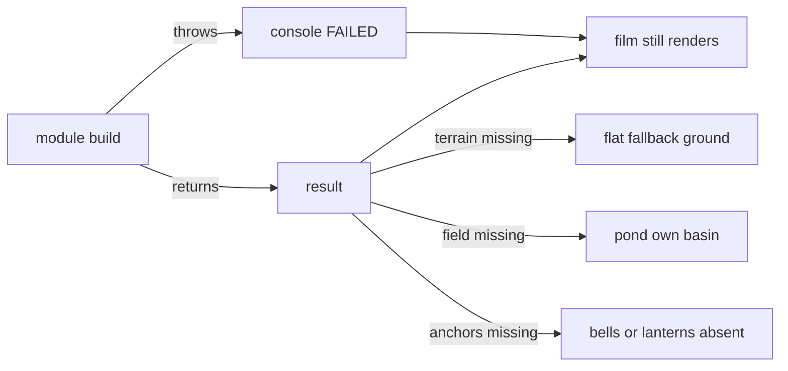
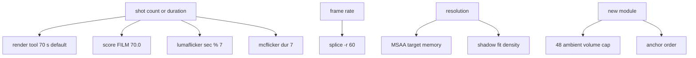

# 04 Limits and comparison: what the source can and cannot prove

This document turns from mechanism to evidence. It asks four hard questions. What does the source
prove? What does it leave to a render? What can break without an error? How does the package compare
with its siblings? The answers separate a construction record from a finished film.

The most important limit is stated first. This exploration read the source. It did not run the
project, did not render a frame, did not measure a timing and did not view the film. Every claim
about appearance, performance or quality is a project claim or a source-derived inference. The
exploration marks the difference throughout.

## The claim ledger

The table below sorts the main claims into four classes. `Source` means the code or a file in the
repository states it. `Render` means only a rendered frame can show it. `Project claim` means the
repository text states it but this exploration did not verify it. `Not defined` means no file in
the repository states a value.

| Claim | Evidence | Class |
|---|---|---|
| The film is ten shots of 7 seconds, 70 seconds in total | `src/shots.js:10`, `src/shots.js:226` | Source |
| The site is procedural and uses no model or texture files | `src/world/*.js`, project README, line 13 | Source |
| The world is lit by a low sun at 6.8 degrees | `src/core/env.js:10-18` | Source |
| A frame combines eight sub-frames in render mode | `src/main.js:30` | Source |
| The scene holds about 24.4 million triangles | project README, line 15 | Project claim |
| A full render takes about 4 hours on a Radeon 780M | project README, line 114; project `docs/ARCHITECTURE.md`, line 285 | Project claim |
| The picture is free of flicker | tools and workflow | Render |
| The focus lands on the intended subject in every shot | shot keys | Render |
| The music hits the cuts | `tools/score.mjs:7-9` | Project claim |
| A maximum triangle budget per module | none | Not defined |
| A pass threshold for any flicker metric | none | Not defined |

Two rows say "not defined", and the absence is evidence. No file states a triangle budget for a
module and no file states a pass threshold for a metric. A build can succeed while one module is
slow. A metric can move while no rule says the move is too large. A reader must not invent a
threshold and must not treat a tool report as a verdict. The project gives numbers, and a person
interprets them.

**Aha:** The source is strong evidence of structure and weak evidence of appearance. A construct
such as the patch system either exists or does not exist, and a reader can prove it by reading. A
claim such as "the gold reads as gold" depends on the shader, the light, the tone map and the
display. The code can suggest the result. Only a render can show it. A reader who confuses the two
classes will overstate what this package proves.

## What is absent at runtime

The project has no asset pipeline in the usual sense. There are no glTF or OBJ models, no texture
images, no high dynamic range (HDR) environment maps and no photographs in the runtime scene. The
geometry is built from primitives, lathes, sweeps and instanced parts. The surfaces are procedural
shaders and canvas-drawn atlases. The reader should look for a texture loader and will not find
one in the world modules.

The nearest thing to an atlas is a canvas. The world modules draw small images with the Canvas 2D
interface or build them as data arrays. The terrain and vegetation modules both do this. The
drawing code is source, so the pattern is inspectable and reproducible. A reader can change a
colour or a stroke and rebuild. The same fact explains a load cost: the textures are generated at
startup, not downloaded, so the startup time is part of the build.

The absence of assets has a second effect. A reader cannot swap in a better model or a photographed
surface without writing code. The look is not tunable by replacing a file. It is tunable by editing
a shader or a drawing function. That is a higher skill barrier and a stronger guarantee that the
repository describes the whole result.

Three asset classes sit outside the repository. Rendered output, stills, logs, browser profiles and
the graphics processing unit (GPU) lock are ignored. Third-party reference images are ignored. The
music and its raw decodes are ignored.

```text
# .gitignore:4-13
# renders, stills, contact sheets, logs, headless Chrome profiles, GPU lock
out/
shots/
*.log

# third-party reference images (not redistributable)
ref/

# music (fetched by `npm run fetch-music`, CC BY 4.0, not redistributed) and raw decodes
assets_audio/
```

The music is fetched by a tool, not vendored. The tool checks a SHA-256 (Secure Hash Algorithm
256-bit) digest and warns if the file differs. The digest is the identity of the file against which
the edit points were timed. A different master, a different encoder or a repaired download changes
the digest and can move the musical hits away from the cuts.

```text
# tools/fetch-music.mjs:17-18
// the file the edit points in tools/score.mjs were timed against (4,644,674 bytes)
const SHA256 = 'b8621ea5d156839f3e1b349b6bfd904fdd35c33bf36867cba0e2bdf0307f4019';
```

The check is a warning, not a stop. The film still renders and still muxes with a different file.
A reader who wants a reproducible music edit must keep the exact file and must treat the warning as
a failure. The repository cannot guarantee that, because the file is not redistributed.

The reference images matter for a different reason. They are not inputs to the build. They are
visual targets for the author. A reader cannot reconstruct the intended look from them, and the
repository does not ship them. The code is the only shipped description of the look.

## Contract boundaries

The module contract is optional in almost every field. A module may return an object, anchors,
update, finalize, ambient volumes, showcase data, a height function, a field or site data. The
entry module normalises the result and adds only what exists. This flexibility keeps nine modules
independent, but it moves failure from build time to render time.

The build order is the other half of the contract. Terrain comes first, then pond, hall, interior,
pagoda, bridge, buildings, props and vegetation. A module can read an earlier module through
`ctx.modules`. Pond reads the terrain field. Props adds anchors later, after the loop. A
module cannot read a later module, because the result does not exist yet. The order is an implicit
dependency graph, and no file states it as a graph. A reader must infer it from the module list and
from the read sites.

This order is easy to break. Moving one name in the module list changes which dependencies are
available. A module that reads a later module gets `undefined` and may fall back, throw or skip a
detail. The failure is not a compile error. It is a quiet difference in the world.

The first boundary is the terrain field. The pond module wants the terrain basin so that shore
stones, depth and lotus agree with the bank. It reads `ctx.modules.terrain.field` when the terrain
module has loaded. If the field is absent, it imports a standalone field builder. If that import
fails, it falls back to its own basin and logs a warning.

```text
# src/world/pond.js:35-40
  // The terrain module carves the basin (raw outline, bridge-head peninsula,
  // land bumps at shore lanterns). Use its field so shore stones, depth map and
  // lotus all agree with the real bank. Standalone previews import it read-only.
  let F = ctx.modules && ctx.modules.terrain && ctx.modules.terrain.field;
  const terrainLoaded = !!F;
  if (!F) { try { F = (await import('./terrain-field.js')).createField(L); } catch (e) { F = null; console.warn('[pond] terrain field unavailable, using own basin', e && e.message); } }
```

The fallback is a deliberate decoupling. It also creates a possible difference between the pond
preview and the full world. The pond has three states. `F` is the built terrain field, or `F` is a
read-only copy from `terrain-field.js`, or `F` is null. When `F` is null, the pond uses its own
basin from the smoothed shore, island and bridge-landing polygons, with a noise floor. The terrain
field uses the raw outline, the bridge-head peninsula and the land bumps at the shore lanterns.
The two basin definitions are close but not identical. The comment names the risk: the shore
stones, the depth map and the lotus must agree with the real bank. A change to one basin and not
the other is a silent visual defect, not a crash.

The second boundary is the anchor handoff. Buildings declare hanging lantern positions and bell
positions. After all modules build, the props module reads the merged anchor lists and places the
suspension parts. The order is fixed: every building must finish before props runs. A building that
forgets an anchor produces a missing lantern or a floating bell without an error.

```text
# src/main.js:111-125
  // anchors (hanging lanterns, bells) declared by buildings -> props module places them
  const anchors = { hangingLanterns: [], bells: [], smallBells: [] };
  for (const r of Object.values(results)) {
    if (!r.anchors) continue;
    for (const k of Object.keys(r.anchors)) (anchors[k] = anchors[k] || []).push(...r.anchors[k]);
  }
  window.__anchors = anchors;
  if (Q.has('dumpanchors')) console.log('[info] anchors ' + JSON.stringify({ b: anchors.bells.map((b) => b.pos.map((v) => +v.toFixed(2))), l: anchors.hangingLanterns.map((b) => b.pos.map((v) => +v.toFixed(2))) }));
  if (results.props && results.props.module.placeAnchors) {
    try {
      const o = await results.props.module.placeAnchors(ctx, anchors);
      if (o) scene.add(o.isObject3D ? o : o.object);
    } catch (e) { console.error('[world] placeAnchors FAILED:', e.stack || e); }
  }
  return results;
```

The `dumpanchors` query exists because the handoff is hard to inspect by eye. It prints the bell
and lantern positions to the console. A developer can compare the list with the expected count.
The tool is a debugging aid, not a test. It does not assert a count.

The third boundary is the ambient volume list. The fog system bakes box-shaped sky-light
attenuation volumes into the shader as constants. It accepts the first 48 entries and silently
drops the rest (`src/core/fog.js:26`). A tenth module that adds many interior boxes can cross the
limit without a message. The render would show too much sky light in the lost regions. The limit is
a constant in the source, not a documented contract.

The fourth boundary is the fallback ground. If the terrain module fails, the build adds a flat
granite circle at radius 400. The world then renders with a plain disc under every other module.
The film is not empty. It is wrong in a quiet way. This is the central failure pattern of the
package.

## Failure isolation and its cost

The build loop wraps each module import and build in a try block. A thrown error is logged with the
module name and the stack. The loop continues to the next module. One broken module does not stop
the other eight, and the page still reaches the ready state.

```text
# src/main.js:92-103
    try {
      const mod = await import(`./world/${name}.js`);
      const res = normalizeResult(await mod.build(ctx));
      res.module = mod;
      if (res.object) { res.object.name = res.object.name || name; scene.add(res.object); }
      if (res.update) updates.push(res.update);
      results[name] = res;
      ctx.modules[name] = res;
      console.log(`[world] ${name} built in ${(performance.now() - t0).toFixed(0)} ms`);
    } catch (e) {
      console.error(`[world] module "${name}" FAILED:`, e && e.stack ? e.stack : e);
    }
```

Isolation is good for development and dangerous for a film. The render tool does not fail when a
module fails. It renders the remaining world. A missing pagoda is a large hole, but a missing
detail module or a failed prop placement can be subtle. The only automatic signal is the console
line. The workflow document therefore tells the author to read the console before a long render.
A reader who runs the render and checks only the exit code can accept a broken film.



The GPU lock reduces a different failure. Two headless browsers on one GPU can exhaust memory and
lose the Web Graphics Library (WebGL) context. The lock serialises the capture tools. A crash can
leave a stale lock. `snap` treats a lock older than 15 minutes as stale and removes it. `snap` also
gives up after 60 minutes. The render tool does not remove a lock. It retries once per second until
it takes the lock, and it refreshes the lock every 30 seconds while frames arrive. A killed render
can leave a fresh lock. `snap` removes that lock after 15 minutes, but the render tool waits
without a timeout.

The page also has an error hook. A rejection of the startup promise sets `window.__ERROR` and
prints it. A failed module script sets the same value from a page-level listener. The capture
tools read that value and report it. The hook covers a failure that escapes the module try block,
such as a failure in startup or a failure to load the entry module. It does not cover a caught
module failure. It also does not cover a shader that compiles with errors and renders a wrong
colour.

The source has no WebGL context loss handler. A search of `src` and `tools` finds no listener for
`webglcontextlost` or `webglcontextrestored`. If a driver reset or a GPU hang loses the context,
the page has no path to rebuild its buffers, textures and programs. The capture tool would see a
stalled frame loop or a page error. The render would not recover and would not finish. The GPU
lock, the cool-downs and the modest frame size reduce the risk on an integrated graphics processor.
They do not remove it. A reader who plans a long render should expect an occasional lost context
and should rely on the resumable frame range.

## Internal inconsistencies

A good exploration reports the places where the repository disagrees with itself. Five matter.

**The shadow map comment.** The lighting module says the shadow map is 4k. The entry module picks
2048 in preview quality and 8192 in final quality. The comment is stale. A reader who trusts it will
estimate the shadow memory and the shadow cost wrong.

```text
# src/core/lighting.js:28-30
// Fit the shadow frustum around a sphere (center, radius). Called per shot so the
// 4k shadow map is spent where the camera looks. `jitter` (vec2, radians) offsets
// the sun direction inside the solar disc for soft penumbrae across sub-frames.
```

The comment is approximate. The jitter scale is 0.0065 radians, and the outer sample radius is
about 0.00629 radians. The solar radius is about 0.00465 radians. The outer samples are therefore
slightly outside the disc.

The actual value is chosen at the call site. The map is 8192 by 8192 texels in the final film, or
67 million texels. The comment says 4k, which is half of that in each axis and one quarter in area.

```text
# src/main.js:60-65
const sky = createSky();
scene.add(sky);
const sun = createSun(scene, { mapSize: Q.has('smap') ? +Q.get('smap') : (QUALITY === 'preview' ? 2048 : 8192) });

const pipeline = new Pipeline(renderer, { width: W, height: H, msaa: 4, aoSamples: QUALITY === 'preview' ? 10 : 16, dofQuality: QUALITY === 'preview' ? 0 : 1 });
pipeline.setSun(sun, sunDir, G.uSunColor.value);
```

The same lines show a second hidden cost. Multisample anti-aliasing (MSAA) is fixed at four samples
in every mode. The preview mode lowers the ambient occlusion sample count and turns off the high
depth-of-field quality, but it does not lower the MSAA count. A preview still pays a four-sample
scene target.

**The 70-second literals.** `src/shots.js` exports `FILM_DURATION`, which is the shot count times
the shot duration. The page uses it for the fade and the clock. Several tools do not use it.

```text
# src/shots.js:226-226
export const FILM_DURATION = SHOTS.length * SHOT_DUR;
```

```text
# tools/render.mjs:102-104
const fps = opt.fps;
if (!opt.to) opt.to = Math.round(70 * fps);
const q = `mode=render&w=${opt.w}&h=${opt.h}&fps=${fps}&spp=${opt.spp}&from=${opt.from}&to=${opt.to}&port=${opt.port}${opt.extra ? '&' + opt.extra : ''}`;
```

The render tool defaults the end frame to 70 seconds times the frame rate. The score tool holds
`FILM = 70.0`. The splice tool writes a fixed output rate of 60. The brightness tool detects cuts
with `sec % 7`. The motion tool defaults to a 7 second window. A change to the shot count or the
shot duration breaks these tools in different places. `FILM_DURATION` is the page source of truth,
but it is not the repository source of truth. Project `docs/ARCHITECTURE.md`, line 269, states that
several tools assume the 70 second cut. The source confirms it.

**The base focus list is not the film.** The base table in `src/shots.js` records ten first-key
focus values: 1.05, 0.6, 0.9, 1.35, 1.3, 4.0, 2.8, 1.0, 3.0 and 1.1 metres. They are not the
values that the film uses. Nine of the ten shots have their keys replaced by a module override.

```text
# src/shots.js:123-124
// per-module camera overrides (src/shotkeys/*.js)
for (const o of OVERRIDES) for (const [k, v] of Object.entries(o || {})) Object.assign(SHOTS[+k], v);
```

The effective first-key focus values are 1.05, 0.62, 0.79, 2.15, 1.05, 3.3, about 1.54, 0.47,
0.5 and 0.62. Shot 0 is the only shot that keeps the base keys. Shot 6 and shot 9 compute their
keys from a function, so their values are derived and rounded. A reader who quotes the base list
describes a film that the repository does not render.

**The "every surface" claim.** The project README, line 13, states that "every surface is procedural
GLSL injected into three.js's physically based materials". GLSL means Graphics Library Shading
Language. The sky, the light shafts, the dust motes and the incense smoke use their own shader
materials. The water is a patched physical material, but it carries a large custom shader. The
statement describes the common case, not every surface.

```text
# src/core/sky.js:168-170
  const mat = new THREE.ShaderMaterial({
    uniforms: {
      uSunDir: G.uSunDir,
```

**The time boundary.** The render loop clamps the camera time inside the shot. The comment says the
clamp keeps cuts clean.

```text
# src/main.js:376-379
    if (T < 0.9) fade = Math.pow(T / 0.9, 1.6);
    if (T > FILM_DURATION - 1.4) fade = Math.max(0, (FILM_DURATION - T) / 1.4);
    // clamp sub-frame times inside the shot so cuts stay clean
    const getCam = (t) => evalShot(shot, Math.min(Math.max(t, 0), SHOT_DUR - 1e-4));
```

The clamp exists in the render loop, not in the query parser. A still with a time outside the shot
passes the raw time to `renderFrame`. `evalShotRaw` evaluates the camera keys at one local time.
`evalShot` adds the optional smoothing and calls `evalShotRaw` one or more times. Inside
`evalShotRaw`, the progress fraction clamps to the shot, so a raw time outside the shot holds the
view at the shot end. With smoothing on, `evalShot` reflects times outside the shot before it calls
`evalShotRaw`. The world clock still
advances, because `setTime` receives the unclamped film time. The result is a still with the camera
of one time and the sky and wind of another. The difference is small for a time near the shot. It
is large for a time far outside the film.

The query parser has a related gap. It clamps the shot index only at the upper end
(`src/main.js:329`). A negative `shot` value passes through, and the array lookup returns
undefined. A still request with `shot=-1` therefore reaches `evalShot` without a shot object and
throws. The tools never send a negative shot. A hand-written query can.

## Cost and scaling

The project states about 31,000 lines of JavaScript and 24.4 million triangles. The triangle count
is plausible from the world modules: instanced stone lanterns, eighteen trees with leaf cards, a
five-storey pagoda with bracket sets, and a bridge with many small parts. The count is not measured
here.

The full film is 4,200 frames at 60 frames per second. At eight sub-frames per frame the page
renders 33,600 sub-frames. Each sub-frame draws the scene and a fitted shadow pass, and the post
chain runs once for the frame. The project states about 3.35 seconds per frame and about 4 hours
for the film on an integrated AMD Radeon 780M. The stated pause is 60 milliseconds after every
frame and 15 seconds every 250 frames, or about 8.2 minutes in total. Those numbers are consistent:
4,200 times 3.35 seconds is about 235 minutes, or 3.9 hours. The project rounds that figure with the
startup time and the pauses to about 4 hours.

The sub-frame count is a mode default, not a fixed rule. The entry module selects it from the mode.

```text
# src/main.js:28-30
const MODE = Q.get('mode') || (Q.has('shot') || Q.has('cam') ? 'still' : 'dev');
const QUALITY = Q.get('q') || (MODE === 'dev' ? 'preview' : 'final');
const SPP = +Q.get('spp') || (MODE === 'render' ? 8 : MODE === 'still' ? 4 : 1);
```

The default is eight for a film frame, four for a still and one for interactive development. Each
sub-frame runs the scene pass and a fitted shadow pass, so the render cost grows almost linearly in
the sub-frame count. The post end frame runs once per film frame, not once per sub-frame. A higher
sub-frame count therefore buys anti-aliasing and softer sampling at a cost close to linear, while
the fixed post cost is amortised. A lower count shortens a test render and also changes the look.
The noise level and the softness of the shadow edge are not identical between four and eight
sub-frames. A test at four sub-frames cannot prove that the same frame at eight is clean.

Memory has several fixed costs. The scene target is a red-green-blue-alpha 16-bit floating point
(RGBA16F) buffer with four-sample MSAA. At 1920 by 1080 that is eight bytes per sample, four
samples, about 66 megabytes for colour, plus a float depth buffer. The shadow map is 8192 squared,
so its depth texture runs to hundreds of megabytes, depending on the depth format. The music score
is small. The frame transfer is one frame at a time, so it does not grow with the film length.
These are estimates from the formats, not measurements.

A reader can lower the cost in defined ways. The `spp` parameter lowers the sub-frame count. The
`smap` parameter lowers the shadow map. The `q` parameter selects the preview settings. The `w` and
`h` parameters lower the resolution. The `modules` parameter builds a subset. The `w` and `h`
parameters change the output size, and the post chain scales its targets from the size. Some
settings interact. The half-resolution ambient occlusion target follows the main size. The bloom
chain always makes seven levels, and each level halves the width and height down to one pixel. At
a small frame the later levels are already one pixel, so they add no detail but still cost a pass.

## Comparison with the sibling packages

Three sibling packages are useful comparisons. The statements below come from their specifications.
This exploration did not re-read their source trees, so treat the numbers as inventory claims.

| Property | Golden Temple | Athenaion | Casa Ocaso | Shanshui |
|---|---|---|---|---|
| Files | 121 | about 220 | about 193 | about 146 |
| World modules | 9 | 15 | not stated | not stated |
| Renderer | three.js r186 | three.js r186 | WebGPU and Three.js Shading Language (TSL) | WebGL 2 and Canvas 2D |
| Film | 70 s, 10 shots | 54 s, 9 shots | no film; 8 shots, 6 views | 60 s, 10 paintings |
| Assets | fully procedural | not stated | HDR panoramas | fully procedural |
| Capture tool | Puppeteer Core | Puppeteer Core | Playwright | Puppeteer Core |
| Sound | fetched music, edited | not stated | not stated | synthesised |

Golden Temple sits between Athenaion and Casa Ocaso on the renderer axis. Athenaion is the closest sibling: same renderer version,
same headless capture style, a larger module count and a shorter film. A reader who understands one
package can transfer most of the architecture to the other. The main difference is the module count
and the film length, not the rendering model.

Casa Ocaso is the modern-renderer sibling. It has no film; the 8 shots and 6 views in the table
are its own count units, not film frames. It uses WebGPU and TSL, and it depends on captured high
dynamic range (HDR) panoramas. That choice moves work from procedural shaders to image assets and
moves the driver requirement from WebGL 2 to WebGPU. Golden Temple deliberately avoids both. Its
environment is captured from its own sky at run time, and it runs on an older, wider graphics stack.

Shanshui is the no-build sibling. It runs on WebGL 2 and Canvas 2D without a bundler, and it
synthesises its soundtrack. Golden Temple uses Vite and a fetched, edited music track. The trade is
clear. Shanshui has fewer moving parts and no external asset licence. Golden Temple has a module
system, a Vite build and a music edit that must be reproduced.

The comparison of line counts needs care. A procedural module contains geometry detail that another
package stores in a model file. A large `pagoda.js` is not automatically more complex than a small
loader plus a binary model. The line count measures how much detail is written as code. The asset
count measures how much detail is stored as data. Golden Temple moves the detail into code, so its
lines are high and its assets are zero. Casa Ocaso moves part of the look into panoramas, so its
asset count is high. Neither number is a quality score.

What transfers between Golden Temple and Athenaion is the contract and the shot override pattern.
A module returns a result and optional hooks, and a shot file replaces the camera keys for one
shot. What does not transfer is the site plan, the module count and the timing budget. A reader who
learns one package can read the other quickly, but cannot copy the world.

None of the four specifications describes a rendered film stored in the repository. Each film
package relies on a local capture step and on excluded output. The comparison is therefore about
construction, not about delivered media.

## Risk map

The table below lists changes that look local and are not local.

| Change | First break | Second break | Detection |
|---|---|---|---|
| Shot count or shot length | `FILM_DURATION` changes, tools do not | Score and cut detection drift | Manual duration check |
| Frame rate | Splice writes 60 | Audio and video lengths diverge | Player duration |
| Resolution | Post targets scale | Memory and sampling density change | Render crash or soft image |
| three.js version | Shader chunk names and post interface | Patch hooks and depth material | Shader compile error |
| New module with many volumes | Ambient volume list drops entries past 48 | Interiors too bright | Visual only |
| New module without anchors | Props places fewer parts | Missing lanterns or bells | `dumpanchors` |
| Terrain basin change | Pond fallback disagrees | Shore stones and lotus float | Visual only |



The pattern is the same in every row. A value that looks like a constant is copied into a tool or
into a comment. The copy does not update when the source changes. The page often adapts, because it
derives values. The tools often do not, because they were written for one film.

Mitigations exist for most rows. A reader can search for the literal `70` and for the literal `7`
before a change. A reader can run `camcheck` after a camera edit and compare the maxima. A reader
can run `dumpanchors` after a building edit and count the result. A reader can render a short range
and check the console. None of these checks is automatic. The package has no test suite that
asserts the film length, the shot count or the anchor count. The quality system is a set of tools
and a habit, not a gate that blocks a bad render. A reader who changes two rows at once cannot
attribute a failure to either change. The safer method is one change, one short render and one
comparison.

## What to inspect next

A reader who wants to test these limits can do so without a full render. Read the console during a
development load and look for a `FAILED` line. Run `camcheck` and compare the acceleration maxima
with the chosen easing. Render one still at shot 3 and read the focus distance in the camera
parameters. Run `dumpanchors` and count the bells against the building plan. Change the shot count
in memory and observe which tools still assume 70 seconds. Read `fog.js:26` and count the ambient
volumes that the modules return.

A reader can turn these inspections into a short checklist. Load the page in development mode and
read the console. Render one still per shot at local time 3.5 seconds and tile them. Run
`camcheck`. Render a short range at a low sub-frame count. Run the three image metrics on that
range. Compare the numbers with a second range that uses the same settings. Only then start the
film. The checklist is cheap and it catches the failures that the source cannot.

A reader who wants to test appearance must render. The source cannot settle the colour of the gold,
the softness of the god rays or the readability of the Buddha face. This exploration makes no claim
about those results.

## Summary

Golden Temple is a coherent construction with a clear central mechanism. The site plan, the module
contract, the patch system and the sub-frame sampler fit together. The limits are equally clear.
The source cannot prove appearance. The tools assume one film length. A module can fail and the
film can still render. Several hard-coded time assumptions and several stale comments disagree with the code
around them. The sibling comparison shows that the package shares its architecture with Athenaion,
its procedural discipline with Shanshui, and its choice of renderer against Casa Ocaso. A reader
who holds those limits in view can use the package as a reliable map of a film that they have not
yet seen.

Return to [README.md](README.md) for the map, or read [00-overview.md](00-overview.md) for the site
and the shots. [02-core-mechanism.md](02-core-mechanism.md) traces one frame in full.
