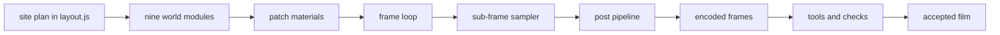

# Golden Temple

**Golden Temple is a 70-second film of a Japanese temple complex that exists only as code.**

The package builds a complete site in JavaScript. It lights the site with one low sun and renders
it to a fixed set of camera moves. It loads no three-dimensional model, no texture file, no high dynamic
range (HDR) environment image and no photograph at run time. The buildings, roofs, bracket sets,
statues, trees, lotus, water, terrain, clouds and sky are geometry and shaders. The film is the
output of that construction, captured frame by frame in a headless browser.

This README is the map. It gives the thesis, a short summary and the inventory. It lists the six
files, four reading orders, the entry points and a glossary. It ends with a clear list of what
this exploration does not claim.

## The film in one paragraph

The site is a temple precinct at the golden hour. A low sun at 6.8 degrees in the west-south-west
rakes the stone court, the vermilion bridge, the gold fittings and the mirror pond. Ten shots of
seven seconds each open on one small subject and pull back to the whole complex. The first shot
starts inside a stone lantern and ends on the pagoda across the water. The last shot starts on
backlit maple leaves and rises over the entire precinct. Every frame is an average of sub-frames.
Each sub-frame has a different anti-aliasing offset, shutter time, sun position and ambient
occlusion pattern. The average gives clean edges, motion blur, soft shadows and stable detail. A
post pipeline adds ambient occlusion, depth of field, bloom, god rays, a tone map and a grade. The
picture is encoded with ffmpeg, and a music track is edited onto it.

## Inventory

The table records the package as the specification counts it. The source tree is read only for this
exploration, so the counts describe the pin, not a changed working tree.

| Property | Value |
|---|---|
| Pin | `97fd9ec` |
| Tracked files | 121 |
| Source files under `src` | 87 |
| JavaScript lines under `src` | 31,299 |
| World modules | 9 |
| Files under `src/world` | 66 |
| Lines under `src/world` | 28,327 |
| Engine files under `src/core` | 9 |
| Engine lines under `src/core` | 1,880 |
| Camera override files | 9: `index.js` plus 8 module files; `terrain.js` is empty |
| Tools | 11 files, 612 module lines |
| Documentation | 14 files, including 13 film stills |
| Renderer | three.js 0.186.1 on the Web Graphics Library (WebGL) 2 |
| Build tool | Vite 8.3.4 |
| Capture tool | Puppeteer Core 25.13.0 with an installed Chrome or Edge |
| Encoder | ffmpeg with the libx264 encoder |
| Film | 70 seconds, 10 shots of 7 seconds |
| Frame size | 1920 by 1080 pixels |
| Frame rate | 60 frames per second, 4,200 frames |
| Sub-frames per film frame | 8 by default in render mode |
| Stated triangle count | about 24.4 million |
| Music | one fetched track, edited into a 70-second score |

The camera override directory `src/shotkeys/` holds nine files: `index.js` and eight module
files (`pagoda.js`, `hall.js`, `interior.js`, `bridge.js`, `buildings.js`, `pond.js`, `terrain.js`
and `vegetation.js`). There is no `props.js` file. `index.js` exports `OVERRIDES` as an array of
the eight module objects. `terrain.js` is the empty file.

The inventory figures come from the package specification. The runtime figures marked as stated
come from the project README or architecture guide. This exploration did not run the project, so it
did not verify a triangle count, a frame time or a film duration. The source lines in this package
are quoted byte for byte from the pin.

## The five deep dives

This README is the sixth file. The table lists the five deep dives.

| Document | What it teaches | Prose words | All words | Snippets | Mermaid | Aha |
|---|---|---:|---:|---:|---:|---:|
| [00-overview.md](00-overview.md) | The site, the light, the ten shots, the nine modules and one frame at T equals 24.5 seconds | 4,334 | 5,307 | 13 | 2 | 2 |
| [01-architecture.md](01-architecture.md) | The four layers, the module contract, shared data, the shot override system and startup | 4,708 | 5,402 | 13 | 2 | 1 |
| [02-core-mechanism.md](02-core-mechanism.md) | The full path from a query string to a graded pixel, including sub-frame sampling and shader hooks | 4,457 | 5,917 | 16 | 2 | 1 |
| [03-workflow-and-quality.md](03-workflow-and-quality.md) | The authoring loop, Uniform Resource Locator parameters, tool flags, the film path, the music edit and four metrics | 4,212 | 5,383 | 12 | 2 | 2 |
| [04-limits-and-comparison.md](04-limits-and-comparison.md) | The claim ledger, contract boundaries, failure modes, internal inconsistencies, costs and sibling comparisons | 4,505 | 5,157 | 13 | 2 | 1 |

"Prose words" excludes fenced code. "All words" includes code, tables and headings. The counts are
from the files as written. Every deep dive stays under 6,000 words in total and above 3,000 words
of prose.

## Reading orders

**Full course, in dependency order.** Read [00-overview.md](00-overview.md) for the site and the
shot list. Read [01-architecture.md](01-architecture.md) for the layers and the module contract.
Read [02-core-mechanism.md](02-core-mechanism.md) for the frame in full. Read
[03-workflow-and-quality.md](03-workflow-and-quality.md) for the production loop. Read
[04-limits-and-comparison.md](04-limits-and-comparison.md) for the evidence limits.

**Mechanism first.** Start with [02-core-mechanism.md](02-core-mechanism.md). It follows one frame
from the query string to the encoded pixel. Then read [01-architecture.md](01-architecture.md) to
see where each stage lives. Then read [00-overview.md](00-overview.md) for the site and the shots.
Finish with [03-workflow-and-quality.md](03-workflow-and-quality.md) and
[04-limits-and-comparison.md](04-limits-and-comparison.md).

**Production first.** Start with [03-workflow-and-quality.md](03-workflow-and-quality.md). It shows
how a still becomes a film and what each tool measures. Then read
[04-limits-and-comparison.md](04-limits-and-comparison.md) to see what the tools cannot prove. Then
read [02-core-mechanism.md](02-core-mechanism.md) for the engine path.

**Short visit.** Read this README, then [00-overview.md](00-overview.md), then the summary of
[02-core-mechanism.md](02-core-mechanism.md). That path gives the site, the shots and the frame
without the tool detail.



## Entry points

Four short passages show the centre of the package. The first is the site plan header. One plan
holds every position, so nine modules agree on where the hall, the pagoda, the pond and the gate
stand.

```text
# src/layout.js:1-5
// ---------------------------------------------------------------------------
// SITE PLAN — the single source of truth for where everything is.
// Units: metres. +X = east, +Z = south, +Y = up (north is -Z).
// Courtyard ground level y = 0. The sun is low in the WEST-SOUTH-WEST
// (direction toward sun ~ (-0.94, 0.12, 0.34)), so west faces glow and long
```

The second is the shot header. The film is ten shots of seven seconds. Each shot is a set of camera
keys, and the camera evaluator samples them with an eased spline.

```text
# src/shots.js:5-10
// The film: 10 shots x 7 s. Each shot: camera keyframes (pos/target) sampled
// by a Catmull-Rom spline with eased progress; lens; focus; post overrides;
// shadow focus region.
// ---------------------------------------------------------------------------

export const SHOT_DUR = 7.0;
```

The third is the sun. It is a direction, not a lamp position. The elevation and the horizontal
direction define the whole light mood and the shadow direction.

```text
# src/core/env.js:10-18
// Sun: low golden-hour sun in the west-south-west.
export const SUN_ELEVATION = 6.8 * deg;
export const SUN_AZ_DIR = new THREE.Vector2(-0.94, 0.34).normalize(); // horizontal (x,z) direction TOWARD the sun

export const sunDir = new THREE.Vector3(
  SUN_AZ_DIR.x * Math.cos(SUN_ELEVATION),
  Math.sin(SUN_ELEVATION),
  SUN_AZ_DIR.y * Math.cos(SUN_ELEVATION)
).normalize();
```

The fourth is the mode switch. One query string selects development, still or render mode. The same
switch sets the quality level and the sub-frame count. The module list is the build order.

```text
# src/main.js:28-32
const MODE = Q.get('mode') || (Q.has('shot') || Q.has('cam') ? 'still' : 'dev');
const QUALITY = Q.get('q') || (MODE === 'dev' ? 'preview' : 'final');
const SPP = +Q.get('spp') || (MODE === 'render' ? 8 : MODE === 'still' ? 4 : 1);

export const ALL_MODULES = ['terrain', 'pond', 'hall', 'interior', 'pagoda', 'bridge', 'buildings', 'props', 'vegetation'];
```

The abbreviation SPP means samples per pixel. The value is the sub-frame count for one film frame.
The module list is also the build order, and the order is a dependency rule.

## Who this is for

- A graphics engineer who wants to see a large scene built without assets.
- A rendering engineer who wants a worked example of sub-frame accumulation and a post chain.
- A three.js user who wants to see how far a patched physical material can go.
- A film pipeline engineer who wants a headless capture path with no intermediate frames.
- An artist or art director who wants to understand what the code controls.
- A reviewer who needs to separate source claims from render claims.

The package assumes comfort with JavaScript, three.js, shader code and the command line. It does
not assume that the reader has run the project. The documents explain the terms they use.

## Glossary

| Term | Meaning |
|---|---|
| Site plan | The `layout.js` data set that holds every world position in metres. |
| Module | One world builder with a `build(ctx)` function. |
| Context object | The `ctx` value that carries the scene, renderer, site plan, materials and module results. |
| Anchor | A named position that one module publishes for another module to use. |
| Ambient volume | A box that reduces image-based sky light in an interior or under a deep eave. |
| Patch | A function that injects shader code into a three.js material. |
| Hook | A named point in the patched shader where a module adds code. |
| Sub-frame | One sample of a film frame with a different camera, shutter, sun or ambient occlusion state. |
| Samples per pixel | The number of sub-frames that are averaged for one film frame. |
| Accumulation | The weighted sum of sub-frames into one high dynamic range image. |
| Ambient occlusion | A shading term that darkens crevices and contact areas. |
| Depth of field | The blur of objects outside the focus distance. |
| Bloom | The glow that spreads from bright pixels. |
| Tone map | The curve that maps high dynamic range values into display values. |
| Image-based lighting | Light taken from a captured environment rather than from a small set of lamps. |
| Prefiltered mipmapped environment map | A blurred environment map that supplies rough reflections. |
| Percentage-closer filtering | A shadow filter that samples a small pattern around each pixel. |
| Multisample anti-aliasing | A hardware method that stores several colour samples per pixel. |
| Constant rate factor | The quality setting of the H.264 encoder. |
| Loudness units relative to full scale | A measure of average audio loudness. |
| Decibels true peak | A measure of the highest audio peak. |

## What this package does not claim

- It did not run the project.
- It did not start the development server or open a browser.
- It did not build the world or compile a shader.
- It did not render a still or a frame.
- It did not encode a film or fetch the music.
- It did not measure a frame time, a triangle count or a flicker metric.
- It did not view the film.
- It does not claim that the film looks correct, clean or complete.
- It does not claim a fresh-reader review.
- Runtime numbers are project claims and are marked as such.
- Sibling package numbers come from their specifications and were not re-verified.
- The film stills in `docs/` are not analysed as evidence for the runtime result.

A reader must treat every statement about appearance as an inference from source. The source is
strong evidence for structure. It is weak evidence for the final image.

## Source method

The exploration read the source at pin `97fd9ec` and modified nothing. It read the entry module, the
site plan, the shot list, the engine modules, the world module tree, the shot override files, the
tools and the project documents. It did not use the network and did not install a dependency.

Every quoted block carries a header with the source path and the line range. A separate check
compared each block with the pinned file, line by line and byte for byte, including indentation and
trailing semicolons. The check reported zero mismatches for the six documents. Line numbers refer to
the pin, not to a later version.

The counts in the document table come from the same files. A word is a whitespace-separated token.
The all-word count includes code blocks. The prose count excludes fenced code. The snippet count
counts fenced `text` blocks with a source header. The Mermaid count counts diagram blocks. The Aha
count counts bold `Aha:` paragraphs.

If a value is not defined in the source, the documents say "not defined" and name the file that
would define it. If a claim depends on a render, the documents mark it as a render claim. This
method is the reason the package can be trusted as a map and not as a review of the film.
