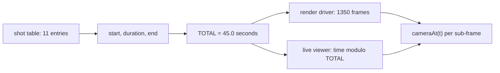
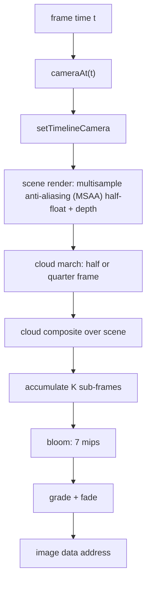

# 00 Overview: the place, the scene, the film and one frame

This document answers four questions. What is the place? What does the browser draw? What is the film? How is one frame finished? It gives the whole system before the later documents take it apart.

## The place

The world is a real location with a fictional building on it. The source comment names the Brienzer Rothorn at 46.787 degrees north and 8.047 degrees east, above Lake Brienz, facing the Bernese Alps (`src/config.js:4`). The terrain tools use a centre of 46.7871 north and 8.0466 east (`tools/terrain.mjs:13`). The two points differ by 0.0001 degree of latitude and 0.0004 degree of longitude. At this latitude that is about 11 metres north-south and 30 metres east-west, or about 32 metres apart. The renderer does not read either coordinate. It reads the baked terrain files. The source does not explain the difference.

The ring roof deck is at 2,180 metres. The lake surface is at 564 metres (`src/config.js:5-6`). The cloud sea has a base at 1,500 metres and a mean top at 1,780 metres (`src/config.js:30-33`). The cloud layer therefore sits about 700 metres below the deck. Its tops are about 400 metres below the deck. Some lumps reach about 1,900 metres, and wisps reach 240 metres above the mean top (`src/config.js:32-33`).

The sun is below the horizon. Its azimuth is 214 degrees and its elevation is -4.0 degrees (`src/config.js:22-23`). The hero camera looks along azimuth 210 degrees. The glow core therefore sits 4 degrees to the right of the hero axis. The source comment states that the reference images place the core 2 to 5 degrees right of that axis (`src/config.js:22`).

```text
# src/config.js:4-13
// Location: Brienzer Rothorn (46.787 N, 8.047 E) above Lake Brienz, facing the Bernese Alps.
export const DECK_Y = 2180;          // ring roof-deck altitude (m)
export const LAKE_Y = 564;           // Lake Brienz surface
export const HERO_AZ = 210;          // azimuth the hero camera looks along (through the gorge, toward the lake)
// Ring frame -> world: rotation about Y so that the ring's front (+Z ref) faces back toward the camera.
export function ringYaw() {
  const a = HERO_AZ * Math.PI / 180, dx = Math.sin(a), dz = -Math.cos(a);
  return Math.atan2(-dx, -dz);
}
export const EARTH_R = 6371000;
```

The Earth radius is a working constant, not a note. The cloud shader changes a height by `dot(p.xz, p.xz) / (2.0 * uEarthR)` (`src/clouds.js:43`). The dot product is the squared horizontal distance from the world origin, which is the ring centre, not from the camera. The far shader and the light shader use the same correction. A flat sea of clouds would otherwise rise above the horizon at long range. The curve keeps the far layer below the line of sight. The far-dip term later in this document uses distance from the camera instead (`src/glsl/common.js:56`).

```text
# src/config.js:22-28
export const SUN_AZ = 214;          // refs put the glow core 2-5 deg right of the hero axis (210)
export const SUN_EL = -4.0;
export function sunDirection() {
  const az = THREE.MathUtils.degToRad(SUN_AZ), el = THREE.MathUtils.degToRad(SUN_EL);
  // x east, z south
  return new THREE.Vector3(Math.sin(az) * Math.cos(el), Math.sin(el), -Math.cos(az) * Math.cos(el)).normalize();
}
```

The direction vector uses east for positive `x` and south for positive `z`. The light is 4 degrees below the horizon. The scene still has strong light because the sky itself is bright. The shaders use a broad sky dome, a warm horizon glow and a weaker key from azimuth 110 degrees. The key exists to give the far ranges shape, not to act as a sun.

## The building

The ring is a concrete annulus. Its outer radius is 55 metres. Its void radius is 42.6 metres (`src/config.js:16-19`). The roof deck is the top surface at local height zero. Below it are the outer wall, the soffit, the terrace and the glazed restaurant ring. The outer facade has one lens-shaped glazed slot from 36 to 144 degrees. The slot is full height in its middle and tapers to a point at each end (`src/structure.js:14-28`, `src/glsl/structure.js:19-22`).

Two bridges leave the ring along the local east and west axes. Two glass pavilions sit at their ends. A cantilevered path follows the cliff from one pavilion (`src/structure.js:737-738`, `src/structure.js:894-897`). People stand on the roof deck, the terrace and the walkway. The code places them in small groups and skips the ones too close to a reference camera (`src/structure.js:640-677`).

The ring is not a single mesh. The builder creates several hundred meshes and instanced groups. It uses revolved profiles for the roof, wall, soffit, fascia and canopy. It uses instanced boxes for mullions, balustrade posts and fins. It uses custom strip geometry for the path. Every mesh has `frustumCulled = false`, because the ring occupies one small part of a very large world and the culling test costs more than it saves (`src/structure.js:204`).

The interior is built from the same frame. The restaurant sits behind low-iron glazing at radius 47 metres. A row of mullions at 3.0 metre bays runs around the ring. Twelve bronze piers mark the joints. The terrace lies between the glazing and the balustrade at radius 42.8 metres. The roof deck lies between the canopy edge and the outer balustrade (`src/structure.js:309-351`). Analytic lamps are collected while the geometry is built. They are transformed into world space and copied into shared uniform arrays for the structure shader (`src/structure.js:364-372`).

```text
# src/glsl/structure.js:6-21
export const RING_CONST = /* glsl */ `
#define R_OUT 55.0
#define R_GLASS_OUT 54.4
#define R_GLAZE_IN 47.0
#define R_CANOPY 44.4
#define R_DOWN 45.5       // canopy downlight row over the walkway
#define R_RAIL 42.8
#define R_VOID 42.6
#define Y_SOFFIT -9.3
#define Y_TERRACE -7.3
#define Y_CANOPY -1.9
#define Y_SLOT_TOP -0.8
#define Y_SLOT_BOT -7.0
#define SLOT_A0 36.0
#define SLOT_A1 144.0
#define SLOT_TAPER 16.0
```

The constants exist twice. The JavaScript builder uses `R_CAN` 44.4 and the same slot angles (`src/structure.js:17-33`). The shader uses `R_CANOPY` and the same values. A comment on each side asks the reader to keep the pair in sync. This duplication is a deliberate choice. The geometry needs metre values in world space. The shader needs the same values in the ring frame. There is no shared include between JavaScript and OpenGL Shading Language (GLSL) in the project. A JavaScript template can copy a value into a shader string, but that is a copy at build time, not a shared definition (`src/sky.js:38-39`).

## The scene at load

The page starts with a WebGL2 renderer. The renderer disables hardware anti-aliasing, enables a logarithmic depth buffer, keeps the drawing buffer for capture, and asks for the high-performance graphics processing unit (GPU) (`src/main.js:16`). The camera has a 40 degree field of view (FOV), a near plane at 0.2 metres and a far plane at 600,000 metres (`src/main.js:23`). The far plane must cover the 240 kilometre terrain and the 450 kilometre sky sphere.

The scene builds in a fixed order. Terrain comes first. Structure, lights and clouds follow. The sky is created before the terrain, but its texture loads asynchronously. The matte is conditional. It loads only if `data/matte/force.json` returns a JavaScript Object Notation (JSON) response (`src/main.js:61-88`).

```text
# src/main.js:61-78
async function init() {
  const terrain = await createTerrain(shared);
  scene.add(terrain);
  modules.terrain = terrain;
  try {
    const { createStructure } = await import('./structure.js');
    const st = await createStructure(shared, terrain);
    scene.add(st);
    modules.structure = st;
  } catch (e) { console.warn('structure', e); }
  try {
    const { createVillageLights } = await import('./lights.js');
    modules.village = createVillageLights(shared, terrain, renderer, scene);
  } catch (e) { console.warn('lights', e); }
  if (!qs.has('noclouds')) try {
    const { Clouds } = await import('./clouds.js');
    modules.clouds = await Clouds.create(renderer, shared, post, W, H, CAPTURE ? 1 : 0.5);
  } catch (e) { console.warn('clouds', e); }
```

The structure, lights and clouds modules load through dynamic import. A failure in one logs a warning and leaves the rest of the scene alive. A reader can therefore open the terrain alone, or the scene without clouds with `?noclouds` (`src/main.js:75`). The source does not state why the sky and post modules load statically while the others do not. A likely reason is that the sky and the post chain are part of the base frame, and the other modules are optional detail. The source does not state that reason.

The matte check is unusual. It calls `fetch('data/matte/force.json')` and tests both the response status and the content type. A missing file, a HyperText Markup Language (HTML) error page or a network failure all produce `false` (`src/main.js:82-83`). The project README states that the reference images are absent from the public repository, so the matte is skipped (`README.md:67-69`). The film never sets a matte anyway. Every film shot leaves the `matte` field undefined (`src/timeline.js:1`).

## The film

The film has eleven shots. The names are `open`, `strut`, `glaze`, `plunge`, `flyby`, `under`, `glaze2`, `strut2`, `soffit`, `deck` and `finale` (`src/timeline.js:147-209`). Their lengths are 10, 1, 1, 6, 3, 3, 3, 1, 2, 3 and 12 seconds. The sum is 45.0 seconds. At 30 frames per second (FPS), the film has 1,350 frames (`src/timeline.js:23`, `src/timeline.js:215`).

| Shot | Start (seconds) | End (seconds) | Length (seconds) | Character |
|---|---:|---:|---:|---|
| open | 0 | 10 | 10 | long descending orbit into the hero view |
| strut | 10 | 11 | 1 | one-second whip under the east bridge |
| glaze | 11 | 12 | 1 | one-second glide along the front glazing |
| plunge | 12 | 18 | 6 | run over the rim and dive into the void |
| flyby | 18 | 21 | 3 | rising pass along the north-east flank |
| under | 21 | 24 | 3 | first-person pass under the ring |
| glaze2 | 24 | 27 | 3 | glide back along the facade |
| strut2 | 27 | 28 | 1 | whip under the west bridge |
| soffit | 28 | 30 | 2 | rising look under the lit soffit |
| deck | 30 | 33 | 3 | low first-person run over the deck |
| finale | 33 | 45 | 12 | long rising pull-back and fade |

The cut times sit on musical beats. The timeline comment gives a 60 beat per minute score in 3/4 time. It lists bars every 3 seconds and phrases at 0, 6, 12, 15, 21, 27, 33 and 39 seconds (`src/timeline.js:8-11`). Every shot except the finale ends at a half-frame time just before its beat. The finale ends at 45.0 seconds, because the film ends there (`src/timeline.js:207`). The helper `at(T)` returns `(Math.round(T * FPS) - 0.5) / FPS` (`src/timeline.js:57`). That offset keeps every motion-blur sub-frame on one side of the cut.

```text
# src/timeline.js:152-153
  shot({ name: 'open', end: at(10), speed: [58, 50, 40, 29, 21, 19, 18], path: OPEN,
    aim: framing(OPEN, RC, [[0.6, 0.62], [0.58, 0.61], [0.55, 0.6], [0.53, 0.59], [0.52, 0.58], [0.5, 0.58], [0.47, 0.58]], [36, 30]), fov: [36, 30] }),
```

The opening shot uses a speed key at every path knot. The aim is built by `framing`, which solves an aim point that puts the ring centre at a chosen screen position. The screen positions move from `[0.6, 0.62]` to `[0.47, 0.58]`, so the ring drifts from the right side toward the centre. The FOV narrows from 36 to 30 degrees over the shot (`src/timeline.js:53`, `src/timeline.js:152-153`).

```text
# src/timeline.js:207-208
  shot({ name: 'finale', end: 45.0, times: [33.0, 35.0, 37.15, 39.0, 41.0, 43.0, 45.0], path: FINALE,
    aim: framing(FINALE, RC, [[0.56, 0.56], [0.54, 0.58], [0.52, 0.6], [0.51, 0.61], [0.5, 0.62], [0.5, 0.62], [0.5, 0.62]], [40, 44]), fov: [40, 44] }),
```

The finale uses timed knots, not a speed profile. Each path knot has an absolute film time. The shot starts at 33.0 seconds and ends at 45.0. It passes a knot at 37.15 seconds, which the comment calls a hit (`src/timeline.js:9`). The aim puts the ring near the centre and slightly below the middle of the frame. The FOV widens from 40 to 44 degrees.

The shot table is the only clock. The timeline does not store a frame list. A frame index becomes a time by division. The render driver reads `APP.TOTAL` from the page and computes the frame count (`tools/render.mjs:14-16`). The live viewer also reads `TOTAL` and wraps the film time with a modulo (`src/main.js:234`). One constant therefore drives the offline frame count and the live loop.



The camera function `cameraAt(t)` selects the shot whose end time is after `t`. It converts the film time to a local fraction, evaluates the path and the aim, adds bank, drift, FOV ramp and fade, and returns a camera record (`src/timeline.js:239-266`). The record has a position, a target, a FOV, a roll, optional dip and sky framing, an outcrop value, a fade value, a shot name and a local time.

## One frame end to end

The film path calls `APP.renderFrame(t, { K, shutter, fps })`. The driver defaults to `K` 4 and a shutter of 0.5 (`tools/render.mjs:9-10`). The project README recommends `K` 8 for the final film (`README.md:80`). The function clears the accumulator and loops over `K` sub-frames (`src/main.js:149-172`).

```text
# src/main.js:130-143
function setTimelineCamera(t) {
  const c = cameraAt(t);
  camera.position.copy(c.pos); camera.up.set(0, 1, 0); camera.lookAt(c.tgt);
  if (c.roll) camera.rotateZ(c.roll);
  camera.fov = c.fov; camera.updateProjectionMatrix();
  shared.uniforms.uFarDip.value = c.dip || 0;
  setSkyView(c.sky);
  // free-flight film: no shot carries `matte`, so the background is the 3D world (matte off)
  if (modules.setMatte) modules.setMatte(c.matte || 0, 1, 30, 0);
  // per-shot snow outcrops (rock.js uLandAB2.w: r9 p2 pieces 1 / p1 0) - every terrain level's copy of the uniform
  if (!landAB2 || !landAB2.length) { landAB2 = []; scene.traverse(o => { const u = o.material && o.material.uniforms; if (u && u.uLandAB2 && !landAB2.includes(u.uLandAB2)) landAB2.push(u.uLandAB2); }); }
  for (const u of landAB2) u.value.w = c.outcrop ?? LAND_AB[1][3];
  return c;
}
```

The camera update is more than a position and a look. The roll rotates the camera about its view axis after `lookAt`. The far dip goes into a shared uniform, so the terrain, lights, clouds and sky all bend by the same amount. The sky framing goes into another shared uniform. The snow outcrop setting is pushed into every terrain material that owns the uniform. The function returns the camera record, so the caller can read the fade and the shot name.

The frame loop then renders the scene and the clouds. The scene render targets a half-float buffer with four multisamples and a float depth texture (`src/post.js:146`). The cloud render reads that depth texture, marches the cloud slab and composites the result over the scene. The accumulation shader adds the result with weight `1 / K` and clamps extreme fireflies (`src/post.js:129-138`).

```text
# src/main.js:149-155
modules.renderFrame = (t, { K = 1, shutter = 0.5, fps = 30 } = {}) => {
  post.clearAccum();
  let fade = 1;
  for (let k = 0; k < K; k++) {
    const tk = t + ((k + 0.5) / K - 0.5) * shutter / fps;
    const c = setTimelineCamera(tk);
    if (k === 0 || Math.abs(tk - t) < 1e-6) fade = c.fade;
```

Each sub-frame time is centred on the frame time. With `K` 8 and a shutter of 0.5, the eight samples spread across half a frame interval. The samples are inset by half a step. The first is at `t - (0.5 - 0.5 / K) * shutter / fps`. The last is at `t + (0.5 - 0.5 / K) * shutter / fps`. The interval ends are not sampled. The sub-frame index does not select the path differently. It selects a slightly different time, and therefore a slightly different camera path position.

```text
# src/main.js:164-170
    let hdr = post.sceneRT;
    if (modules.clouds) hdr = modules.clouds.render(post.sceneRT, camera, tk, frameNo++);
    post.accumulate(hdr, 1 / K);
    camera.clearViewOffset();
  }
  fade = cameraAt(t).fade;
  post.finish(post.accumRT, t, null, fade);
```

After the loop, the frame function reads the fade again at the exact frame time. It grades the accumulated image, not the last sub-frame. The grade adds bloom, exposure, white balance, vignette, tone curve, contrast, saturation, lift, warm highlights, toe and grain (`src/post.js:96-126`). It also applies the picture fade. The final call returns the shot name (`src/main.js:171`).

```text
# src/post.js:199-204
  finish(hdrRT, time, target = null, fade = 1) {
    const bl = this.bloom(hdrRT);
    const u = this.finalMat.uniforms, p = this.params;
    u.tScene.value = hdrRT.texture; u.tBloom.value = bl.texture; u.tBlur.value = this.mips[3].texture; u.uClarity.value = p.clarity; u.uTime.value = time;
    u.uExposure.value = p.exposure; u.uBloom.value = p.bloomStrength; u.uVignette.value = p.vignette; u.uGrain.value = p.grain;
    u.uSat.value = p.saturation; u.uContrast.value = p.contrast; u.uLift.value.copy(p.lift); u.uWarmHi.value = p.warmHi;
```

The clarity blur uses mip level 3. The bloom uses a seven-level pyramid. The source sets `this.mips[3]` by name and builds seven levels in `setSize` (`src/post.js:153`, `src/post.js:202`). A reader who changes the pyramid depth must also change that index. The source does not guard the index.

The colour path stays linear until the final shader. The renderer sets `LinearSRGBColorSpace`, so the drawing buffer is not converted at write time (`src/main.js:19`). The sky texture also declares `NoColorSpace`, because its bytes are log2 radiance and not colour (`src/sky.js:73`). The final shader applies the tone curve, the contrast, the saturation, the lift and the white balance in one pass. It writes a display value in the range 0 to 1 (`src/post.js:96-126`). A reader who moves the grade earlier would have to undo the tone curve before the bloom.

The live loop is a request for the next animation frame. It updates the frames-per-second readout twice a second. In film mode it computes the film time as `now / 1000 - film` modulo `TOTAL`, calls `setTimelineCamera`, and renders. In orbit mode it updates the controls and renders with the current camera (`src/main.js:230-237`). The loop does not use a fixed step. A slow frame produces a larger time step in the live viewer, but the film path is independent of frame rate because it is a function of `t`.

```text
# src/main.js:230-237
  const loop = () => {
    requestAnimationFrame(loop);
    const now = performance.now(); const dt = now - last; last = now; acc += dt; frames++;
    if (acc > 500) { if (hud) hud.textContent = `${(1000 * frames / acc).toFixed(1)} fps`; acc = 0; frames = 0; }
    if (film !== null) { if (film === 0) film = now / 1000; const ft = (now / 1000 - film) % TOTAL; setTimelineCamera(ft); if (hud) hud.dataset.shot = cameraAt(ft).shot; }
    else controls.update();
    render(now / 1000);
  };
```

Capture mode removes the user interface. The page adds a `capture` class to the body, and a style rule hides the view buttons and the help text (`src/main.js:210`, `index.html:17`). The page reads the width and height from the query string, so the driver controls the frame size without a window (`src/main.js:12-13`). The camera controls still exist, but no person uses them. The page exposes `APP.ready` as a promise that resolves after the terrain, structure, lights, clouds and optional matte finish loading (`src/main.js:208`). The driver waits for that promise before it renders (`tools/shot.mjs:33-34`).

The live viewer starts on reference view 7 and sets the orbit target to that view's target (`src/main.js:58-59`). The key map sends `1` to `9`, `0` to view 10 and `-` to view 11. The V key or the film button toggles the film (`src/main.js:220-227`). A resize rebuilds the post targets and the cloud target (`src/main.js:239-245`). The source does not state a frame-rate target for the live viewer. It supplies the `?noclouds` flag for a weaker GPU (`README.md:34`).



The final image leaves the page as a data address, a Uniform Resource Locator (URL). In capture mode the driver calls `toDataURL` on the drawing buffer and writes the decoded bytes (`tools/render.mjs:32-33`). The page keeps `preserveDrawingBuffer` true for this reason (`src/main.js:16`). In the live viewer the same `render` function draws to the screen instead of a target.

## Stills and the reference views

The project also has eleven reference camera views. Their numbers are 1 to 11. They are not the eleven film shots. A reader can mistake one set for the other, because both have eleven entries. The views are fixed cameras used to compare a still with an artificial intelligence reference image. The film shots are moving cameras used for the film (`src/views.js:1-3`, `src/timeline.js:147-209`).

```text
# src/views.js:1-3
// Reference camera matches. Authored in "ref frame" (origin ring centre, y=0 deck top, bridges on +/-X,
// camera front at +Z looking -Z toward the glow) in units of the ring outer radius, then mapped to world:
// world X = ref Z (west = -X is toward the sun), world Z = -ref X, world Y = DECK_Y + y*R.
```

The reference views are authored in a normalised ring frame. The position and target are multiplied by the ring outer radius, rotated by the ring yaw and lifted to the deck (`src/views.js:8-12`). The film shots use a different frame. They use polar world points, a ring-frame helper and explicit world vectors. The two systems meet only through the ring yaw and the deck height.

A shot path is a centripetal Catmull-Rom curve. This is a spline that passes through every knot and uses a centripetal parameter spacing to avoid loops and cusps (`src/timeline.js:83`). The `shot` constructor stores the path, the aim, the look blend, the tilt, the speed keys, the FOV and the bank weight. It computes the arc length and a speed profile scaled to that length (`src/timeline.js:81-90`). A speed profile is a Catmull-Rom curve in time. The code integrates it at 2,048 steps and normalises the result to the path length (`src/timeline.js:61-74`). A timed shot instead maps path length to time with a monotone cubic through its knots (`src/timeline.js:94-111`). The first method gives a physical speed in metres per second. The second gives exact arrival times.

The aim comes from one of three sources. A gimbal shot can key an aim point to the path. A framing call can solve an aim that puts a world point at a chosen screen position. A first-person shot can blend the aim toward the flight direction. The `cameraAt` function then adds bank from the lateral acceleration, a deterministic wobble, an FOV ramp and the picture fade (`src/timeline.js:239-266`). The fade is `min(1, t / 0.6, max(0, (TOTAL - t) / 1.8))`, so the picture fades in over 0.6 seconds and out over 1.8 seconds (`src/timeline.js:264`).

The cloud gap is also a film decision. A capsule from the near shore to the far end of the lake lowers the cloud coverage along the hero line of sight (`src/config.js:34-39`). A second capsule follows the lake itself. The sight-window strength is zero in this version, because the source comment states that the valley is open between the banks everywhere in the film (`src/config.js:43-46`). A reader who enables the windows would see cloud gaps cut for specific still cameras.

The tool `tools/shot.mjs` renders a reference view and compares it with `ref/<view>.webp` if that file exists (`tools/shot.mjs:84-85`). The comparison samples a 32 by 18 grid and computes a mean colour difference in the Commission Internationale de l'Éclairage L*a*b* (CIELAB) colour space. The reference files are absent from the public tree, so the tool writes `NaN` (Not a Number) for the difference and continues (`README.md:67-69`, `tools/shot.mjs:85`).

The still path is otherwise close to the film path. `renderStill(t, K)` accumulates `K` jittered sub-frames of a fixed camera (`src/main.js:174-192`). The driver `tools/shot.mjs` calls `APP.render(10)` first, then either `renderStill(10, K)` or another `render(10)`, and captures the result (`tools/shot.mjs:76-80`). The time value 10 is arbitrary. The fixed view does not use the timeline.

## What the source does not contain

The checkout does not contain the runtime data. The terrain files, the light table, the cloud noise volumes, the sky texture and the photographic textures arrive through `npm run data` (`tools/fetch-data.mjs:1-3`). The archive is about 0.3 gigabytes. The tree does not contain the `data/` directory, the `ref/` directory, the music track or the encoded Moving Picture Experts Group 4 Part 14 (MP4) file. The README links the film on a release page (`README.md:9`).

The tree does not contain a record of a completed render. The README gives a speed estimate of about five seconds per frame at `K` 8 on a Radeon 780M integrated GPU, or roughly two hours for 1,350 frames (`README.md:88`). It does not give a measured total. It does not give a peak memory figure for the film render. It does not give a bake duration for the terrain, the lights or the cloud noise. The repository also does not contain a frame manifest, a render log or a checksum file. The render driver trusts the file names and skips a frame when its file exists (`tools/render.mjs:27-29`). A corrupt or outdated frame therefore survives a resumed run unless the user forces a new render. Where a value is absent, this package says so and does not invent one.

**Aha:** A "frame" in this project is not a moment. It is an integral over a short interval. The camera moves during the shutter, the projection jitters for anti-aliasing, and the cloud marcher stratifies its noise over the sub-frames. The frame is the average of those samples. This is why the film can look smooth at 30 frames per second and why a single frame costs several full scene renders.

## Summary

The place is a real mountain with a fictional ring above a cloud sea. The scene is a nested terrain, a detailed building, a volumetric cloud layer, a photographic sky, a field of town lights and a filmic grade. The film is eleven camera moves over 45.0 seconds. One frame is a loop of `K` sub-frames, a cloud composite per sub-frame, an accumulation, a bloom pyramid and one grade. The next document maps the modules, the shader files, the tools and the data flow that make that loop possible.
