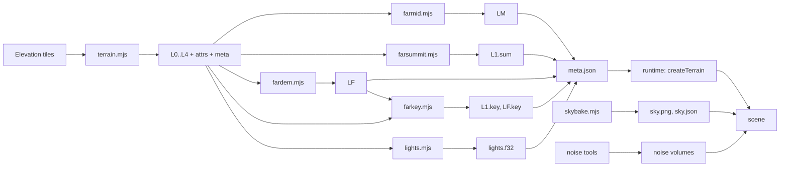

# 01 Architecture: modules, shaders, tools and data flow

This document maps the code base. It shows the entry page, the scene modules, the OpenGL Shading Language (GLSL) modules and the tool scripts. It then shows the data that connects them. At the end it follows one live frame and one capture frame through the map.

## The repository shape

The checkout has 55 tracked files (`spec.md:25`). Seven files sit at the root (`spec.md:77`). Twelve JavaScript scene modules sit under `src/`. Five GLSL modules sit under `src/glsl/`. Twenty-seven tool scripts sit under `tools/` (`spec.md:37-39`). Four still images sit under `docs/` (`spec.md:39`). The licence is the Massachusetts Institute of Technology (MIT) License (`package.json:6`).

The page is one HyperText Markup Language (HTML) document. It has an inline Cascading Style Sheets (CSS) block and three empty elements. The elements are `#views`, `#help` and `#hud` (`index.html:20-23`). The page loads one module script, `/src/main.js` (`index.html:24`). The CSS hides the view buttons and the help text when the body has the `capture` class (`index.html:17`). The page therefore has no build step of its own.

```text
# index.html:20-25
<body>
  <div id="views"></div>
  <div id="help"><b>drag</b> orbit · <b>scroll</b> zoom · <b>1–9, 0, −</b> reference views · <b>V</b> play film</div>
  <div id="hud"></div>
  <script type="module" src="/src/main.js"></script>
</body>
```

The package manifest names three scripts. The `dev` script starts Vite. The `data` script runs the download helper. The `render` script runs the offline film driver (`package.json:14-18`). The runtime dependency is Three.js 0.187. The development dependencies are Puppeteer Core 25.16, Sharp 0.35 and Vite 8.3.5 (`package.json:19-26`). The engine field requires Node.js 22.12 or newer (`package.json:11-13`).

```text
# package.json:14-26
  "scripts": {
    "dev": "vite",
    "data": "node tools/fetch-data.mjs",
    "render": "node tools/render.mjs"
  },
  "dependencies": {
    "three": "^0.187.0"
  },
  "devDependencies": {
    "puppeteer-core": "^25.16.0",
    "sharp": "^0.35.5",
    "vite": "^8.3.5"
  }
```

The Vite configuration sets one server port. The value comes from the `PORT` environment variable or defaults to 5173. The configuration sets `strictPort` to true (`vite.config.js:4`). The render driver and the checker both use that port (`tools/shot.mjs:31`, `tools/filmcheck.mjs:8`). A port change must therefore reach the environment of every tool.

## The scene modules

The twelve scene modules divide into four groups. The first group is the bootstrap, made of `main.js` and `config.js`. The second group is the camera and time system, made of `timeline.js` and `views.js`. The third group is the world, made of `terrain.js`, `structure.js`, `lights.js`, `clouds.js` and `sky.js`. The fourth group is the image pipeline, made of `post.js` and `matte.js`. `tex.js` is a cross-cutting helper that both the world and image groups use.

| Module | Lines | Role | Source |
|---|---:|---|---|
| `src/main.js` | 246 | bootstrap, shared uniforms, render loop, capture hooks | `src/main.js:246` |
| `src/config.js` | 99 | world constants and cloud tuning | `src/config.js:99` |
| `src/timeline.js` | 266 | shot table, paths, speed, aim, camera record | `src/timeline.js:266` |
| `src/views.js` | 39 | eleven reference cameras | `src/views.js:39` |
| `src/post.js` | 211 | accumulation, bloom, grade, matte hook | `src/post.js:211` |
| `src/sky.js` | 85 | sky sphere and baked sky texture | `src/sky.js:85` |
| `src/terrain.js` | 474 | nested terrain meshes and placement queries | `src/terrain.js:474` |
| `src/structure.js` | 985 | ring, bridges, pavilions, path, people | `src/structure.js:985` |
| `src/lights.js` | 352 | village and road light sprites | `src/lights.js:352` |
| `src/clouds.js` | 1,353 | cloud march, atlas and composite | `src/clouds.js:1353` |
| `src/tex.js` | 25 | photographic texture loader | `src/tex.js:25` |
| `src/matte.js` | 210 | reference background projector | `src/matte.js:210` |

The line counts come from the pinned files. The tree gives 474 lines for `terrain.js`, 1,353 for `clouds.js` and 985 for `structure.js` (`src/terrain.js:474`, `src/clouds.js:1353`, `src/structure.js:985`). The table above records the count for every module. A reader who needs the exact code should use the tree.

The dependency direction is mostly downward. `main.js` imports the sky, the terrain, the post object, the views and the timeline (`src/main.js:1-9`). The structure imports the timeline, the views, the texture loader and the terrain lamp limit (`src/structure.js:6-11`). The clouds import the configuration and the views (`src/clouds.js:5-7`). No scene module imports `main.js`. The modules receive a `shared` object, a `post` object and a `renderer` object instead. The bootstrap therefore controls construction order.

```text
# src/main.js:1-9
import * as THREE from 'three';
import { OrbitControls } from 'three/addons/controls/OrbitControls.js';
import { sunDirection, DECK_Y, RING } from './config.js';
import { createSky } from './sky.js';
import { createTerrain, LAMPS_MAX } from './terrain.js';
import { LAND_AB } from './glsl/rock.js';
import { Post } from './post.js';
import { VIEWS, applyView, refToWorld } from './views.js';
import { cameraAt, TOTAL, SHOTS } from './timeline.js';
```

The import list holds the static core. The sky, the terrain, the post chain and the timeline load at module time. The structure, the lights, the clouds and the matte load through a dynamic `import()` inside `init` (`src/main.js:61-88`). The dynamic group is optional detail. The static group is the frame itself. The source does not state a reason for the split. The effect is visible: a failure in the structure does not stop the terrain.

The structure call sits inside a `try` block with a console warning (`src/main.js:65-70`). The light call has the same guard (`src/main.js:71-74`). The cloud call has a guard and a query flag (`src/main.js:75-78`). This pattern is the main fault barrier. One missing module downgrades the frame instead of stopping the page.

```text
# src/main.js:75-78
  if (!qs.has('noclouds')) try {
    const { Clouds } = await import('./clouds.js');
    modules.clouds = await Clouds.create(renderer, shared, post, W, H, CAPTURE ? 1 : 0.5);
  } catch (e) { console.warn('clouds', e); }
```

The cloud scale is a constructor argument. A capture page passes 1.0. A normal page passes 0.5. The cloud object multiplies that value by `CLOUDS.res`, which is 0.5 (`src/clouds.js:1275`, `src/config.js:97`). The film march therefore covers half the frame width and height. The live march covers one quarter. The difference is a quality budget, not a separate renderer.

`tex.js` is small but central. It loads a texture set from `./data/tex/<id>/`. The diffuse map uses the sRGB colour space. The other maps stay linear. Every map repeats, uses mipmaps and uses anisotropic filtering at the given level (`src/tex.js:11-20`). The concrete, steel, glass and interior materials use these sets.

## The GLSL modules

The shaders are JavaScript template strings. They are not separate `.glsl` files. This choice lets a shader import another shader string with a normal module import. It also lets JavaScript constants enter the shader text through template interpolation. That interpolation is a copy at string construction, not a shared include.

| Module | Lines | Contents | Source |
|---|---:|---|---|
| `src/glsl/common.js` | 537 | hashes, value noise, gradient noise, far dip, sky model, atmosphere | `src/glsl/common.js:537` |
| `src/glsl/far.js` | 517 | far ribs, aretes, gullies, snow, rock and key light | `src/glsl/far.js:517` |
| `src/glsl/rock.js` | 982 | near land material, photographic maps, snow, forest, valley | `src/glsl/rock.js:982` |
| `src/glsl/structure.js` | 1,208 | ring fields, concrete, glass, steel, interior, lamps | `src/glsl/structure.js:1208` |
| `src/glsl/water.js` | 177 | lake wind, slicks, ripples, reflection, glitter | `src/glsl/water.js:177` |

The common module exports a noise block and a far-dip block. The far-dip block defines a function that lowers a point with distance from the camera. The amount is controlled by `uFarDip` and the window `uDipWin` (`src/glsl/common.js:48-58`). The same block is inserted into the terrain, cloud, light and sky shaders. That shared include is how the world bends as one piece.

```text
# src/glsl/common.js:48-58
export const FARDIP = /* glsl */ `
#ifndef FAR_DIP_U
#define FAR_DIP_U
uniform float uFarDip;
uniform vec2 uDipWin;
#endif
// ramp window (m from the camera): it must sit where the cloud tops' depression angle still exceeds the dip,
// otherwise nearer undipped cloud rises above the lowered horizon (fold). ~0.6-1.8 km for a camera ~450 m above the tops.
float farOffC(vec3 p, vec3 cam){ float dh = length(p.xz - cam.xz); return uFarDip * dh * smoothstep(uDipWin.x, uDipWin.y, dh); }
#define farOff(p) farOffC(p, cameraPosition)
`;
```

The far shader module holds the distant range look. It adds fall-line ribs and aretes to the ridges. It also applies the key light and the aerial perspective (`src/glsl/far.js:1-8`). The rock module holds the near land material. Its header defines the interface with `terrain.js` (`src/glsl/rock.js:1-12`). The water module holds the lake shading. It adds wind gusts, cat's-paws, slicks and a reflected-slope march (`src/glsl/water.js:19-40`). The structure module holds the ring fields and the surface functions for concrete, glass, steel and interior surfaces (`src/glsl/structure.js:1-5`).

The shader modules also carry the look rules. Comments give the reference reason for a term. For example, the far module states that the ranges need crisp lit snow faces beside blue shadow faces (`src/glsl/far.js:4-6`). The water module states that the lake must show mirror-calm patches and rippled patches (`src/glsl/water.js:27-31`). These comments are the closest the source comes to an art direction document.

## The tool modules

The twenty-seven tools divide into five groups. Each group writes or reads one kind of data.

| Group | Tools | Output or role |
|---|---|---|
| elevation | `dem.mjs`, `demlib.mjs`, `terrain.mjs` | `data/terrain/L0..L4`, attributes, `meta.json` |
| far terrain | `farmid.mjs`, `farsummit.mjs`, `fardem.mjs`, `farkey.mjs` | `LM`, `L1.sum`, `LF`, key maps |
| lights and noise | `lights.mjs`, `noise.mjs`, `noise3d.mjs`, `noise_billow.mjs`, `noise_curl.mjs` | `lights.f32`, noise volumes, weather map |
| sky and data | `skybake.mjs`, `skyhdr.mjs`, `fetch-data.mjs` | `data/sky/sky.png`, `sky.json`, `data/` |
| render and review | `render.mjs`, `shot.mjs`, `gpulock.mjs`, `filmcheck.mjs`, `gradetune.mjs`, and helpers | frames, checks, comparisons, video |

The elevation tool builds four nested square levels and one fine rectangle. The level table is a constant at the top of the module. L0 covers 320 kilometres at 1,025 cells. L1 covers 50 kilometres at 1,601 cells. L2 covers 8 kilometres at 1,281 cells. L3 covers 1.6 kilometres at 1,025 cells (`tools/terrain.mjs:14-19`). L4 is a rectangle with 0.39 metre cells around the ring and an 18 metre seam band (`tools/terrain.mjs:24-29`).

The far tools extend the same data set. `farmid.mjs` adds a mid level from 4 to 12 kilometres at 15.6 metres (`tools/farmid.mjs:1-8`). `farsummit.mjs` sharpens the Alpine summits on the outer band of L1 (`tools/farsummit.mjs:1-10`). `fardem.mjs` builds the polar far level from 25 to about 240 kilometres (`tools/fardem.mjs:1-9`). `farkey.mjs` bakes key-light visibility for the far shading (`tools/farkey.mjs:1-6`).

The render tools do not write world data. `render.mjs` writes a numbered frame sequence. `shot.mjs` writes reference-view stills and comparisons. `gpulock.mjs` serialises access to the graphics processing unit (GPU). `filmcheck.mjs` samples the camera path and reports clearances. `encode.ps1` calls `ffmpeg` to encode the film (`tools/encode.ps1:1-10`). The remaining tools build contact sheets, stacked comparisons, loudness graphs and matte data.

The data fetch is simple. `fetch-data.mjs` downloads a release archive of about 0.3 gigabytes and unpacks it into `data/` (`tools/fetch-data.mjs:1-3`, `tools/fetch-data.mjs:9-27`). The archive holds the terrain heights, the light table, the cloud noise volumes, the sky texture and the photographic textures (`tools/fetch-data.mjs:1-2`). The tree does not hold that directory. This package therefore never opens a data file.

## Data flow

The runtime reads a data directory that is not in the tree. The directory has five parts: terrain, sky, noise, textures and matte. The terrain part holds the height fields, attribute maps, key maps, light table and a `meta.json` file. The sky part holds a portable network graphics (PNG) texture and a small JavaScript Object Notation (JSON) file. The noise part holds noise volumes and a weather map. The texture part holds one folder per photographic set. The matte part is optional and absent.

The scene reads `meta.json` first. It takes the level list, the far-level record, the summit record, the mid-level record, the fine record and the centre (`src/terrain.js:200-210`). It then fetches each level's height file and attribute file. The file names and grid sizes come from the metadata, not from fixed paths (`src/terrain.js:283-284`). A rebuild can change a grid size without a code change, provided the metadata changes too.

```text
# src/terrain.js:200-210
export async function createTerrain(shared) {
  const base = './data/terrain/';
  const meta = await (await fetch(base + 'meta.json')).json();
  if (NOFAR) delete meta.MID;
  if (NOFAR && meta.FAR) { delete meta.FAR; meta.LEVELS[1] = { ...meta.LEVELS[1], file: 'L1.blend' }; }
  // round 8 pass 2: L1's outer band (12.3-24.9 km) with peaked summits and serrated crests (tools/farsummit.mjs)
  else if (meta.SUMMIT && !NOSUM) meta.LEVELS[1] = { ...meta.LEVELS[1], file: meta.SUMMIT.file };
  const group = new THREE.Group();
  group.name = 'terrain';
  const levels = meta.LEVELS;
  const mats = [];
```

The terrain module also builds a town-glow texture from the light table. It sums the light intensity into a 512 by 512 grid over the L1 extent. It blurs the grid twice and scales it by 0.12 (`src/terrain.js:220-227`). That texture feeds the cloud shader and the land shader. The clouds use it to open thin windows over the lake shores. The land uses it to add warm light to the ground under the towns (`src/terrain.js:231`).

The far level replaces L0 when the metadata has a `FAR` record. The code still keeps L0 in the metadata. It skips the L0 mesh at build time (`src/terrain.js:279-282`). This is a graceful fallback. If the far build fails, or if the flag `NOFAR` is set, the scene uses the older square L0 (`src/terrain.js:204`). The source does not state whether that fallback was tested at this pin.

```text
# src/terrain.js:275-278
  // round 8: the polar far level (tools/fardem.mjs) takes L0's place: L1's edge out to ~240 km at the DEM's own
  // resolution (z12 ~26 m within ~60 km), instead of L0's 312 m cells that rounded the Bernese Alps into domes
  // (pass 2: with its summit / crest pass, LF.sum.f32 / LF.sum.nrm, unless '&nosum')
  if (meta.FAR) group.add(await createFarLevel(base, meta.FAR, makeMat(0), meta.SUMMIT && meta.SUMMIT.lf && !NOSUM ? '.sum' : ''));
```



The diagram separates build products from runtime. Every arrow into `meta.json` is a tool that adds a record. The runtime reads only the metadata and the named files. It does not run a tool. This is the main contract between the build side and the render side.

## Shared state and the module contract

The bootstrap creates one `shared` object. It holds a `uniforms` dictionary. Every custom material spreads that dictionary into its own uniforms (`src/main.js:26-43`). Three.js creates one uniform object per material, but the values point to the same objects. A write to `shared.uniforms.uTime.value` therefore changes every material that copied the entry. This is how one clock drives the terrain, the structure, the clouds, the lights and the sky.

```text
# src/main.js:26-43
// uniforms shared by every custom material
const shared = {
  uniforms: {
    uSunDir: { value: sunDirection() },
    uSkyExposure: { value: 1.0 },
    uHorizonDip: { value: 0.025 },
    uFarDip: { value: 0 },
    uDipWin: { value: new THREE.Vector2(600, 1800) },          // camera-relative far-field dip (tan): >0 lowers sky + terrain beyond ~4-12 km
    uFogDensity: { value: 1 / 15000 },
    uSkyView: { value: new THREE.Vector4(1, 0, 0, 0) },        // per-view sky framing (zoom, centre el, glow az offset, sky dip): common.js skyView
    uTime: { value: 0 },
    uLampPos: { value: [...Array(LAMPS_MAX)].map(() => new THREE.Vector4()) },
    uLampCol: { value: [...Array(LAMPS_MAX)].map(() => new THREE.Vector4()) },
    uLampCount: { value: 0 },
    uReflTex: { value: null },
    uResolution: { value: new THREE.Vector2(W, H) },
  },
};
```

The `(tan)` label on the `uDipWin` line applies to `uFarDip`, which is the tangent of the dip angle. The window values are metres from the camera. The ramp starts at 600 metres and is fully on at 1,800 metres (`src/glsl/common.js:54-56`). The 4 to 12 kilometre note describes where the offset is needed in the view, not the width of the ramp (`src/glsl/common.js:46-47`).

The object has thirteen entries when it is created. `createSky` adds `uSkyTex` and `uSkyTexP` later (`src/sky.js:11-12`). `uLampPos` and `uLampCol` are arrays of vectors. The structure shader uses them for analytic lamps. The terrain shader uses them for lamp light on the rock and concrete. The clouds use `uTime`, the sun direction and several other shared values. The post chain does not use the shared block. It has its own materials and its own time uniform.

The `APP` object is the public application programming interface (API). It exposes the modules, the render function, the post object, the frame functions, the view selector and the capture function (`src/main.js:51-52`, `src/main.js:106-107`, `src/main.js:149-206`). The driver uses this surface. It does not reach into module internals, except in the checker, which reads the terrain height query (`tools/filmcheck.mjs:51`).

The `ready` promise marks the end of loading. It resolves after `init` returns. It also sets a data attribute on the body (`src/main.js:208`). The driver waits for `window.APP` and then awaits `window.APP.ready` (`tools/shot.mjs:33-34`). A page that fails to load never sets the flag. The driver then stops at its 120 second timeout (`tools/shot.mjs:32`).

The matte is the one optional module with a network probe. The code fetches `data/matte/force.json`. It accepts the result only when the status is acceptable and the content type contains `json` (`src/main.js:82-83`). That test rejects a development server's HTML fallback page. The matte loads after the clouds, so its absence never blocks the main world.

```text
# src/main.js:82-88
  const hasMatte = !qs.has('nomatte') && await fetch('data/matte/force.json')
    .then(r => r.ok && /json/.test(r.headers.get('content-type') || '')).catch(() => false);
  if (hasMatte) try {
    const { Matte } = await import('./matte.js');
    modules.matte = post.matte = await Matte.create(renderer, post, camera, { showW: qs.has('mattew') });
    modules.matte.set(CAPTURE ? 0 : +(qs.get('view') || 7));
  } catch (e) { console.warn('matte', e); }
```

The matte works by camera projection. It stores a reference image per view and a projector matrix per view. It accumulates a weight buffer per sub-frame. At the end of the frame it composites the projected reference over far regions, using a distance ramp (`src/matte.js:16-22`, `src/matte.js:126-156`). The film never sets this projector, because no film shot carries a matte index (`src/main.js:137-138`). The film is therefore fully three-dimensional.

## The render loop

The live loop and the film loop share `render(t)`. The function sets the time uniform and updates the lights. It renders the scene and runs the clouds if present. It stores the last high dynamic range (HDR) image and calls the post finish (`src/main.js:92-105`).

```text
# src/main.js:92-105
function render(t) {
  time = t;
  shared.uniforms.uTime.value = t;
  camera.updateMatrixWorld();
  if (modules.village) modules.village.update(camera, t);
  renderer.setRenderTarget(post.sceneRT);
  renderer.setClearColor(0x000000, 1);
  renderer.clear();
  renderer.render(scene, camera);
  let hdr = post.sceneRT;
  if (modules.clouds) hdr = modules.clouds.render(post.sceneRT, camera, t, frameNo++);
  modules.lastHdr = hdr;
  post.finish(hdr, t, null);
}
```

The render target is not the screen. Every frame draws into `post.sceneRT`, a half-float buffer with four samples and a depth texture. The cloud pass reads the depth and writes a lower-resolution cloud target. The composite reads both and writes the full-size cloud target. The grade reads that target or the accumulation target and writes the screen or a capture target.

The post object owns the targets. In `setSize` it creates the scene target, the cloud target, the accumulation target, seven mip targets and seven up targets (`src/post.js:142-158`). At 1920 by 1080, one half-float red, green, blue and alpha (RGBA) target costs about 16.6 megabytes. The source does not state a total memory figure. The target count is large enough that memory is a design constraint, not an afterthought.

```text
# src/post.js:142-159
  setSize(w, h) {
    this.w = w; this.h = h;
    const dt = new THREE.DepthTexture(w, h, THREE.FloatType);
    if (this.sceneRT) { this.sceneRT.dispose(); this.cloudRT.dispose(); this.mips.forEach(m => m.dispose()); this.ups.forEach(m => m.dispose()); }
    this.sceneRT = new THREE.WebGLRenderTarget(w, h, { type: THREE.HalfFloatType, samples: 4, depthTexture: dt, depthBuffer: true });
    this.sceneRT.texture.minFilter = this.sceneRT.texture.magFilter = THREE.LinearFilter;
    this.cloudRT = new THREE.WebGLRenderTarget(w, h, { type: THREE.HalfFloatType, depthBuffer: false });
    if (this.accumRT) this.accumRT.dispose();
    this.accumRT = new THREE.WebGLRenderTarget(w, h, { type: THREE.HalfFloatType, depthBuffer: false });
    this.mips = []; this.ups = [];
    let mw = w, mh = h;
    for (let i = 0; i < 7; i++) {
      mw = Math.max(1, mw >> 1); mh = Math.max(1, mh >> 1);
      const o = { type: THREE.HalfFloatType, depthBuffer: false, minFilter: THREE.LinearFilter, magFilter: THREE.LinearFilter };
      this.mips.push(new THREE.WebGLRenderTarget(mw, mh, o));
      this.ups.push(new THREE.WebGLRenderTarget(mw, mh, o));
    }
  }
```

The depth texture is `FloatType`, not the default. The cloud shader reconstructs a world position from the depth and the inverse projection. A 16-bit depth buffer would lose precision over the 600 kilometre far plane. The float depth keeps the reconstruction usable near the ring and at the far ridges. The camera near plane is 0.2 metres and the far plane is 600,000 metres (`src/main.js:23`).

The sky is a sphere of radius 450,000. It has `renderOrder` set to -10, so it draws before the world. Its `onBeforeRender` callback copies the camera position into the sphere position (`src/sky.js:61-67`). The sphere therefore follows the camera and never clips.

```text
# src/sky.js:61-67
  const mesh = new THREE.Mesh(geo, mat);
  mesh.scale.setScalar(450000);
  mesh.frustumCulled = false;
  mesh.renderOrder = -10;
  mesh.onBeforeRender = (r, s, cam) => mesh.position.copy(cam.position);
  mesh.name = 'sky';
  return mesh;
```

The sky texture loads asynchronously. `loadSky` fetches a JSON file and a PNG file. It sets no colour space, repeat wrapping in azimuth, clamp in elevation, mipmaps, linear filtering and anisotropy 16. It then writes the log2 minimum, the log2 range and the bottom elevation into the sky parameters (`src/sky.js:70-85`). Until that write, the shader uses the analytic sky fallback (`src/glsl/common.js:164-166`).

```text
# src/sky.js:70-85
async function loadSky(shared) {
  const meta = await (await fetch('./data/sky/sky.json')).json();
  const tex = await new THREE.TextureLoader().loadAsync('./data/sky/sky.png');
  tex.colorSpace = THREE.NoColorSpace;          // log-encoded data, decoded in skyPhoto
  tex.wrapS = THREE.RepeatWrapping;             // azimuth
  tex.wrapT = THREE.ClampToEdgeWrapping;
  tex.magFilter = THREE.LinearFilter;
  tex.minFilter = THREE.LinearMipmapLinearFilter;
  tex.generateMipmaps = true;
  tex.anisotropy = 16;                          // (clamped to the device maximum) near the zenith the rows converge
  tex.needsUpdate = true;
  shared.uniforms.uSkyTex.value = tex;
  shared.uniforms.uSkyTexP.value.set(1, meta.lmin, meta.lrange, meta.elBot * Math.PI / 180);
  shared.skyMeta = meta;
  return meta;
}
```

The sky module starts its load immediately with `loadSky` (`src/sky.js:13`). It then uses `queueMicrotask` to fold the load into `APP.ready` (`src/sky.js:15-18`). That detail makes the capture driver wait for the sky before the first frame. The live viewer can draw the analytic fallback while the texture loads. A slow sky can arrive after the first live frame. The analytic fallback covers that interval.

```mermaid
sequenceDiagram
    participant Loop as Live loop or driver
    participant Render as render(t)
    participant Scene as Scene render
    participant Cloud as Clouds.render
    participant Post as Post.finish
    Loop->>Render: call with time t
    Render->>Render: set uTime, update lights
    Render->>Scene: draw into sceneRT
    Scene-->>Render: colour and depth
    Render->>Cloud: depth, camera, time
    Cloud-->>Render: cloud-composited HDR
    Render->>Post: HDR, time, fade
    Post-->>Loop: screen or capture target
```

The diagram shows one live frame. A film or still frame repeats the middle of this sequence. `renderFrame` loops over `K` sub-frames. Each sub-frame sets a shutter time, applies a Halton projection offset, draws the scene, composites the clouds and adds the result to the accumulator with weight `1 / K` (`src/main.js:149-172`). The grade runs once, after the loop (`src/main.js:170`).

## The capture path

The capture path starts in `tools/shot.mjs`. The `launch` function takes a GPU lock, starts headless Chrome with GPU flags, opens a page, forwards console messages, sets the viewport and navigates to the capture page (`tools/shot.mjs:14-32`). It then waits for `APP.ready` and reads the renderer string for the log (`tools/shot.mjs:33-40`).

```text
# tools/shot.mjs:30-41
  await page.setViewport({ width: w, height: h });
  const port = process.env.PORT || 5173;
  await page.goto(`http://localhost:${port}/?capture&w=${w}&h=${h}${extra}`, { waitUntil: 'load', timeout: 120000 });
  await page.waitForFunction('window.APP && window.APP.ready', { timeout: 120000 });
  await page.evaluate('window.APP.ready');
  const gpu = await page.evaluate(() => {
    const gl = window.APP.renderer.getContext(); const e = gl.getExtension('WEBGL_debug_renderer_info');
    return e ? gl.getParameter(e.UNMASKED_RENDERER_WEBGL) : 'unknown';
  });
  console.log('GPU:', gpu);
  return { browser, page };
}
```

The launch function is exported. `render.mjs`, `shot.mjs`, `filmcheck.mjs` and `gradetune.mjs` share it. One lock therefore covers every headless path. A tool cannot start a second browser through the exported function, because the lock acquisition blocks first.

The film driver adds three controls on top of the launch. It reads `APP.TOTAL`, so the frame count follows the timeline. It skips a frame file that already exists unless `--force` is set. It calls `gpuRest` after each frame to leave the integrated GPU idle (`tools/render.mjs:13-41`). The rest length is half the frame time, with a floor of 200 milliseconds and a ceiling of 20 seconds (`tools/gpulock.mjs:14-16`).

```text
# tools/render.mjs:13-17
const { browser, page } = await launch(W, H, process.env.Q || '');   // env Q: URL flags, e.g. '&noclouds'
const total = await page.evaluate(() => window.APP.TOTAL);
const nFrames = Math.round(total * fps);
const start = +arg('start', 0), end = Math.min(nFrames, +arg('end', nFrames));
console.log(`timeline ${total.toFixed(2)} s -> ${nFrames} frames; rendering ${start}..${end - 1} every ${every}, K=${K}`);
```

The frame call is a page evaluation. The driver passes the time, the sub-frame count, the shutter and the frame rate. The page returns the shot name. The driver then calls `toDataURL` on the drawing buffer and writes the base64 body to a file (`tools/render.mjs:31-33`). The image format is PNG by default and Joint Photographic Experts Group (JPEG) when `--jpg` is set (`tools/render.mjs:9-10`, `tools/render.mjs:32`).

The GPU lock is a file in the operating system's temporary folder. The `GPU_LOCK` environment variable can override the path (`tools/gpulock.mjs:9`). The acquire loop uses an exclusive create. If the file exists, it reads the owner record. A dead process is removed after a second read confirms that the record did not change. The loop waits 1.5 seconds between attempts and logs at 30 seconds, then at doubling intervals (`tools/gpulock.mjs:21-40`).

```text
# tools/gpulock.mjs:21-41
  for (;;) {
    try {
      fs.writeFileSync(LOCK, JSON.stringify({ pid: process.pid, label, cwd: process.cwd(), t: new Date().toISOString() }), { flag: 'wx' });
      break;
    } catch (e) {
      if (e.code !== 'EEXIST') throw e;
    }
    const o = read();
    if (o && !alive(o.pid)) {
      // stale: re-check it is still the same dead holder before removing it
      const o2 = read();
      if (o2 && o2.pid === o.pid && o2.t === o.t) { try { fs.unlinkSync(LOCK); } catch { /* someone else took it */ } }
      continue;
    }
    const w = Math.round((Date.now() - t0) / 1000);
    if (w >= said) {
      console.log(`[gpu] waiting ${w} s for the GPU lock (held by pid ${o?.pid} ${o?.label || ''} in ${o?.cwd || '?'} since ${o?.t || '?'})`);
      said = said ? said * 2 : 30;
    }
    await sleep(1500);
  }
```

Release runs on normal exit and on four signals (`tools/gpulock.mjs:44-52`). The acquired lock also releases when the browser closes, because `launch` wraps the close call (`tools/shot.mjs:24-26`). That wrapper matters. A crash that skips `process.exit` still reaches the close handler when Chrome disconnects.

The lock exists because of a hardware failure. The header states that several WebGL renderers competed for a Radeon 780M and crashed Windows twice on 2026-11-01, with bugcheck 0x119 (`tools/gpulock.mjs:1-4`). The lock is therefore a workaround for an integrated GPU driver fault, not a general scheduler.

## The quality tools

`filmcheck.mjs` is the camera guard. It samples the timeline every frame against the running scene. It reports the minimum clearance to the terrain, to the structure, to outdoor figures and to the cloud ceiling. It also reports angular speed, acceleration, linear acceleration and pitch (`tools/filmcheck.mjs:1-5`). The default limits are 15 metres for terrain, 1.5 metres for structure and 1.0 metre for a figure (`tools/filmcheck.mjs:22`). The other limits are 4 figures inside the frame, 0 metres for the cloud ceiling, 12 degrees per second for rotation and 80 degrees for pitch (`tools/filmcheck.mjs:22`). A violation gives exit code 1 (`tools/filmcheck.mjs:5`).

The checker does not render clouds. It launches a 320 by 180 page with `&noclouds` (`tools/filmcheck.mjs:45`). It imports the timeline, the configuration and the views inside the page. It takes the terrain height function from the loaded application (`tools/filmcheck.mjs:46-51`). It builds a point-triangle index of the structure at a 4 metre grid (`tools/filmcheck.mjs:58-78`). This is the only place that reaches into a module's user data, and the document calls it out for that reason.

The flash scan is a second mode. It reads rendered frames and counts near-white pixels. It reports a frame when the count exceeds both neighbours by 25 pixels and by a factor of two (`tools/filmcheck.mjs:25-43`). The source states that the cause can be a NaN or an extreme HDR pixel that the bloom spreads (`tools/filmcheck.mjs:26`). The post shader has its own guard for that case (`src/post.js:6`).

`shot.mjs` also holds the comparison tool. It samples a reference image and a render at 32 by 18 pixels. It converts both to the International Commission on Illumination L*a*b* colour space. It reports a mean colour difference and a mean lightness difference (`tools/shot.mjs:43-68`). If the reference file is absent, it writes `NaN` and continues (`tools/shot.mjs:84-85`). The reference images are not in the public tree (`README.md`, `tools/shot.mjs:84`).

`encode.ps1` is the last tool. It calls `ffmpeg` with the frame pattern, the soundtrack and the H.264 High profile at level 4.2. It uses a constant rate factor of 16 and a 192 kilobit per second Advanced Audio Coding (AAC) audio stream (`tools/encode.ps1:4-8`). The default soundtrack path is `out/music/soundtrack.wav` (`tools/encode.ps1:3`). Neither the frames nor the soundtrack are in the tree.

## Failure isolation and flags

The query string is the main switchboard. `capture` changes the render size, the cloud scale, the matte and the page style (`src/main.js:14`, `src/main.js:18`, `src/main.js:77`, `src/main.js:87`, `src/main.js:210`). `noclouds` skips the cloud module (`src/main.js:75`). `nofar` and `nosum` change the terrain selection (`src/terrain.js:203-206`). `nomatte` skips the matte probe (`src/main.js:82`). `mattew` shows the matte weight (`src/main.js:86`). The cloud module has its own flags for the cache, reuse and phase (`src/clouds.js:1264-1267`).

The flags are not one system. Each module reads the query string on its own, or reads a parameter passed by `main.js`. `terrain.js` defines its flags at module scope. `clouds.js` defines its flags in its own header. The source does not state a single registry. A reader who adds a flag must find the module that owns the feature.

The fault barriers are also local. Each dynamic import has its own `try` block (`src/main.js:65-78`). The matte has a probe and a `try` block (`src/main.js:82-88`). The terrain has no barrier, because the terrain is the base of the scene. A terrain failure stops `init`, and `ready` never resolves. The driver then times out. This is the intended hard failure for a missing data directory.

**Aha:** The architecture separates three clocks, not two. The live loop uses the browser clock. The film uses a fixed 30 frame per second clock. The GPU lock uses wall-clock time. A live frame can take any duration, while a film frame must sample a fixed interval. The lock and the rest call protect the shared device from that mismatch. The separation is why the same `render` function can serve both outputs without a mode switch inside the world modules.

## Summary

The page loads one module. The module builds a renderer, a camera, a shared uniform block, a post chain and a sky. It then loads the terrain and the optional detail. The world modules read baked data, draw into a half-float target and hand the result to a cloud composite and a grade. The film path reuses the same functions with more sub-frames and a locked GPU. The tools build the data, check the camera and encode the result. The next document follows the mechanisms inside the terrain, the clouds, the ring, the sky, the lights and the post chain.
