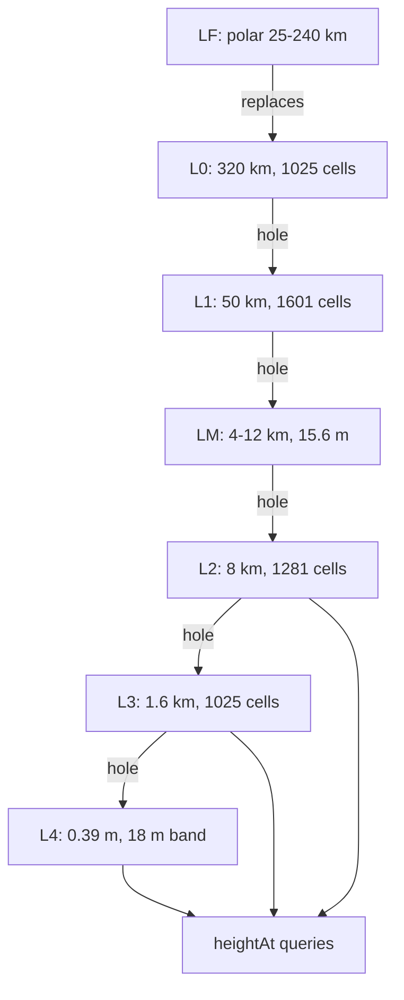
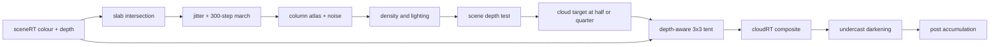
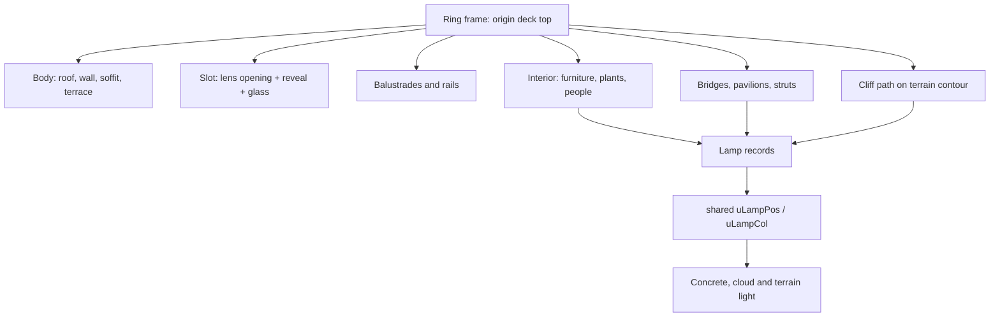

# 02 Core mechanism: terrain, clouds, ring, sky, lights and grade

The world has eight mechanisms. A stack of terrain levels builds the ground. A far-field key bakes the broad twilight shadow. A polar map extends the ground to the horizon. A raymarch fills the valley with cloud. A revolve profile builds the ring. A bake turns two photographs into a sky. A point field adds the valley lights. A post chain turns the high dynamic range (HDR) image into a film frame. This document follows each mechanism.

The split between baked and live work is the main design rule. Terrain heights, sky radiance, key visibility, light records and noise volumes are computed before the scene loads. The frame computes only the view-dependent parts. That rule explains most of the code shape.

## Terrain: a stack of levels

The terrain tool builds four nested square levels and one fine rectangle (`tools/terrain.mjs:14-19`). L0 covers 320 kilometres at 1,025 cells. L1 covers 50 kilometres at 1,601 cells. L2 covers 8 kilometres at 1,281 cells. L3 covers 1.6 kilometres at 1,025 cells. L4 is a rectangle with 0.39 metre cells and an 18 metre seam band (`tools/terrain.mjs:24-29`). A mid level LM and a polar far level LF add two more pieces (`tools/farmid.mjs:1-8`, `tools/fardem.mjs:1-9`).

The runtime does not draw every level over its full square. Each level draws a mesh with a hole where the next finer level takes over. The code tests each cell against the inner level's bounds. It skips a cell when the whole cell lies inside the inner rectangle (`src/terrain.js:335-345`). The result is a set of rings that share an edge, not a set of overlapping sheets.

```text
# src/terrain.js:335-346
    // hole where the next finer level takes over (cells entirely inside it)
    const inner = all[li + 1] ? lvGrid(all[li + 1]) : null;
    const ix0 = inner ? inner.x0 - 1e-3 : 0, ix1 = inner ? inner.x0 + (inner.nx - 1) * inner.step + 1e-3 : 0;
    const iz0 = inner ? inner.z0 - 1e-3 : 0, iz1 = inner ? inner.z0 + (inner.nz - 1) * inner.step + 1e-3 : 0;
    const idx = new Uint32Array((g - 1) * (gzN - 1) * 6);
    let ni = 0;
    for (let j = 0; j < gzN - 1; j++) for (let i = 0; i < g - 1; i++) {
      const x0 = gx0 + i * step, x1 = x0 + step, z0 = gz0 + j * step, z1 = z0 + step;
      if (inner && x0 >= ix0 && x1 <= ix1 && z0 >= iz0 && z1 <= iz1) continue;
      const a = j * g + i, b = a + 1, c = a + g, d = c + 1;
      idx[ni++] = a; idx[ni++] = c; idx[ni++] = b; idx[ni++] = b; idx[ni++] = c; idx[ni++] = d;
    }
```

The hole test uses whole cells. A boundary cell that crosses the inner edge is kept. The inner level also covers that cell. The two meshes therefore overlap by at most one cell at the seam. The source does not state the overlap width. A reader can see the intent: no visible gap, and no large double surface.

The vertex loop builds positions and normals from the height field. A central difference gives the slope in x and z. The normal is `(-sx, 1, -sz)` after normalisation (`src/terrain.js:288-295`). The code then builds a second, smoothed normal. The window is three cells on L3 and twelve cells on L4 (`src/terrain.js:296-313`). The smoothed normal decides where snow can lie. A 0.4 metre block on L4 does not create a false cliff for the snow mask.

```text
# src/terrain.js:279-295
  for (let li = 0; li < all.length; li++) {
    const lv = all[li];
    const LI = lv.idx;   // the level's own index (L0..L4; 1.5 = LM)
    if (LI === 0 && meta.FAR) continue;
    const [H, A] = await Promise.all([fetchBin(base + (lv.file || lv.name) + '.f32', Float32Array), fetchBin(base + lv.name + '.attr', Uint8Array)]);
    const { x0: gx0, z0: gz0, nx: g, nz: gzN, step } = lvGrid(lv), N = g * gzN;
    // baked outcrop mask (sculpted near field only); other levels use the shader's procedural field
    const RK = LI >= 3 ? await fetchBin(base + lv.name + '.rock', Uint8Array).catch(() => new Uint8Array(N)) : new Uint8Array(N);
    const pos = new Float32Array(N * 3), nrm = new Float32Array(N * 3);
    for (let j = 0; j < gzN; j++) for (let i = 0; i < g; i++) {
      const k = j * g + i;
      pos[k * 3] = gx0 + i * step; pos[k * 3 + 1] = H[k]; pos[k * 3 + 2] = gz0 + j * step;
      const im = Math.max(0, i - 1), ip = Math.min(g - 1, i + 1), jm = Math.max(0, j - 1), jp = Math.min(gzN - 1, j + 1);
      const sx = (H[j * g + ip] - H[j * g + im]) / ((ip - im) * step), sz = (H[jp * g + i] - H[jm * g + i]) / ((jp - jm) * step);
      const l = Math.hypot(sx, 1, sz);
      nrm[k * 3] = -sx / l; nrm[k * 3 + 1] = 1 / l; nrm[k * 3 + 2] = -sz / l;
    }
```

The L4 seam gets extra work. Its normals blend into the L3 normals over a band. The blend uses a smoothstep weight on the distance to the edge (`src/terrain.js:315-334`). The heights and attributes already blend in the build tool. The normals blend in the runtime mesh. This is a deliberate split. A normal is a lighting input, and a mismatch shows as a visible shading line.

Each level also carries attributes. The attribute array has four channels. They are sky visibility, glow visibility, water and concavity (`src/glsl/rock.js:7-9`). The key-visibility array is separate. L1 uses its baked key map. The other square levels sample the L1 key map with bilinear filtering (`src/terrain.js:243-256`). The far level uses its own key map (`src/terrain.js:395-396`).

The group stores the L2, L3 and L4 height arrays for placement queries. The `heightAt` function tests the levels from fine to coarse and returns the first hit (`src/terrain.js:366-376`). The path, the bridges and the camera checker use this function. It is a bilinear sample, not a ray cast. The source does not state its accuracy against the mesh at an arbitrary point.



The diagram shows the nesting, not the mesh sizes. The hole test makes the levels a partition. LF replaces L0 when the far data exists. The runtime keeps the L0 branch as a fallback.

## Far field: key light and polar map

The far shading needs a broad shadow. The key comes from the bright sky at azimuth 110 degrees and about 15 degrees above the horizon. A ridge that rises above that line shades the ground behind it. The penumbra is about 7 degrees, because the source is a patch of sky, not a sun disc (`tools/farkey.mjs:1-6`). The bake includes Earth curvature.

The key vector is constant. Its horizontal part is normalised, and `tanK` is the vertical ratio (`tools/farkey.mjs:24`). The visibility function marches from a point toward the key. It stops at 16 kilometres. The source does not state why 16 kilometres is enough. It records L1 as the occluder within plus or minus 25 kilometres at 31 metres, and L0 beyond at 312 metres, and it includes Earth curvature (`tools/farkey.mjs:5`, `tools/farkey.mjs:28-31`). A ridge farther than 16 kilometres is not sampled, so its shadow is not in the bake. The source does not state the size of that error. The step grows by a factor of 1.06 and adds 8 metres (`tools/farkey.mjs:26-32`). At each sample it subtracts the curvature drop `d * d / (2 * R)` from the height. The maximum rise angle sets the shadow. A smoothstep from -0.05 to +0.07 radians maps the angle to a byte (`tools/farkey.mjs:33-35`).

```text
# tools/farkey.mjs:24-36
const K = [0.908, 0.259, 0.330], kh = Math.hypot(K[0], K[2]), dir = [K[0] / kh, K[2] / kh], tanK = K[1] / kh;
const smoothstep = (a, b, x) => { const t = Math.min(1, Math.max(0, (x - a) / (b - a))); return t * t * (3 - 2 * t); };
const keyVis = (x, z, h0, d0) => {
  let maxT = -10, d = d0;
  while (d < 16000) {
    const t = (hAt(x + dir[0] * d, z + dir[1] * d) - h0 - d * d / (2 * EARTH_R)) / d;
    if (t > maxT) maxT = t;
    d = d * 1.06 + 8;
  }
  // angle of the key above the horizon toward it (rad): lit above ~+4 deg, dark below ~-3 deg
  const a = Math.atan(tanK) - Math.atan(maxT);
  return Math.round(255 * smoothstep(-0.05, 0.07, a));
};
```

The occluder source depends on distance. Inside the L1 square the bake uses L1 at 31 metre cells. Outside it uses L0 at 312 metre cells (`tools/farkey.mjs:5`). The far polar level is not an occluder in this bake. The source does not state why. A reader can see the consequence: a far ridge beyond 25 kilometres cannot cast a new shadow on a nearer point.

The polar far level replaces L0. The build tool starts at the L1 half size of 25 kilometres. L1 has 6,400 edge vertices (`tools/fardem.mjs:82-84`). The first two bands keep 6,400 segments. The third band uses 3,200. The fourth uses 1,600 (`tools/fardem.mjs:86-91`). The radius grows by a factor per ring. The ring shape morphs from the L1 square to a circle between 25 and 60 kilometres (`tools/fardem.mjs:92`, `tools/fardem.mjs:99-110`).

```text
# tools/fardem.mjs:82-92
const S0 = 25000;                  // L1 half size
const L1G = meta.LEVELS[1].grid;   // 1601
const NA = 4 * (L1G - 1);          // 6400 edge vertices of L1
// (band A in two radial densities: the Bernese Alps' main crest stands at 22-45 km)
const BANDS = [
  { seg: NA, q: 0.0016, s1: 45000 },
  { seg: NA, q: 0.0025, s1: 62000 },
  { seg: NA / 2, q: 0.005, s1: 125000 },
  { seg: NA / 4, q: 0.01, s1: 212000 },
];
const MORPH = [S0, 60000];
```

The height source also changes with radius. A terrarium tile is a Portable Network Graphics (PNG) height tile. Its height in metres is `red * 256 + green + blue / 256 - 32768` (`tools/demlib.mjs:31-33`). The values z12, z11 and z10 are Web Mercator zoom levels. The source gives z12 as about 26 metres per sample and does not state the z11 and z10 cell sizes (`tools/fardem.mjs:7`). The tool samples terrarium tiles at z12 inside 56 kilometres. It blends z12 and z11 between 56 and 60 kilometres. It uses z11 to 116 kilometres. It blends z11 and z10 to 124 kilometres. It uses z10 beyond that (`tools/fardem.mjs:126-135`). The transition strips in the mesh stitch rings of different vertex counts. They use two triangles and three triangles per outer vertex. That choice avoids T-junctions (`src/terrain.js:400-421`).

The far mesh is one draw call. Its bounding sphere has a radius of 260 kilometres (`src/terrain.js:431`). It carries the same attribute and key arrays as the square levels (`src/terrain.js:422-430`). The shader uses the key array to darken the lee faces. The same far-dip function lowers the far surface with distance (`src/glsl/common.js:48-58`). The dip is a view effect, not a change to the data.

## Clouds: a depth-aware raymarch

The cloud sea is a volumetric layer between 1,500 and 1,780 metres (`src/config.js:30-33`). The layer is drawn with a fragment shader, not with geometry. The shader marches a ray through a curved slab. The slab uses the Earth radius to bend the altitude (`src/clouds.js:43`). The march runs at half resolution for the film and one quarter for the viewer (`src/main.js:77`, `src/clouds.js:1275`). The composite upsamples it.

The static layout is baked into a column atlas. Two 2,048 by 1,024 half-float targets hold the near and far tiles (`src/clouds.js:1247-1263`). The atlas stores coverage, top height and gap data per column. The shader samples the atlas for the static part. It evaluates the moving part from the noise volumes. A flag can disable the atlas and use the analytic function everywhere (`src/clouds.js:1264`).

The slab intersection solves a quadratic for the base and the top. It runs the solve up to twice: once for the plain ray and once for the fully dipped ray. The second pass is skipped when `uFarDip` is zero (`src/clouds.js:659-661`). The union of the two ranges covers the visible layer (`src/clouds.js:653-672`). The march then stops at the scene depth. The depth comes from the logarithmic depth buffer and the inverse projection (`src/clouds.js:630-633`). The cloud can therefore sit behind a ridge or in front of it, with one depth test.

```text
# src/clouds.js:653-672
  // slab intersection (curved)
  float topMax = uTop + max(uWisp, 160.0) + 40.0;
  float camAlt = altOf(ro);
  float t0 = 1e9, t1 = -1.0;
  // far-field dip (common.js FARDIP): the march runs along the image-space ray and samples the undipped
  // cloud field (p.y + farOff); the slab range is the union of the plain and the fully dipped ray
  for (int k = 0; k < 2; k++) {
    vec3 rk = rd; float kk = 1.0;
    if (k == 1) { if (uFarDip == 0.0) break; rk = vec3(rd.x, rd.y + uFarDip * length(rd.xz), rd.z); kk = length(rk); rk /= kk; }
    vec2 tt = solveAlt(ro, rk, topMax) / kk;
    vec2 tb = solveAlt(ro, rk, uBase) / kk;
    float a0, a1;
    if (camAlt > topMax) { a0 = tt.x; a1 = tt.y; }
    else { a0 = 0.0; a1 = tt.y; }
    if (camAlt > uBase) { if (tb.x > 0.0 && tb.x < 1e8) a1 = min(a1, tb.x); }
    else { a0 = max(a0, tb.y); }
    if (a1 > a0 && a0 < 1e8) { t0 = min(t0, a0); t1 = max(t1, a1); }
  }
  t0 = max(t0, 0.0);
  t1 = min(min(t1, sceneT), 90000.0);
```

The march budget is 300 steps (`src/clouds.js:1208-1210`). The shader loop has a fixed upper bound of 400 iterations. The `i >= N` test stops the loop at the 300-step budget (`src/clouds.js:691`, `src/clouds.js:700-701`). The loop also breaks at the exit distance or at a low transmittance (`src/clouds.js:700-701`). The step size grows with distance and with empty space. It is clamped between a near minimum and a far maximum (`src/clouds.js:704-705`). The jitter comes from a 64 by 64 blue-noise rank map. The sub-frame offset is added to the rank (`src/clouds.js:677-682`).

```text
# src/clouds.js:697-715
    float t = t0, stepK = 1.0, tc = t0, fineEnd = -1.0, fineCap = -1.0, tS = -1e9;
    vec3 Sp = vec3(0.0);
    bool armed = true;
    for (int i = 0; i < 400; i++) {
      if (i >= N || tc > t1 || T < 0.015) break;
      // (r8: beyond 4 km the step grows faster - the rays grazing the far sea toward the horizon were half the march cost
      // of a free camera above the tops; there the sea is a few pixels high and hazed)
      float fsx = max(tc - 4000.0, 0.0);
      float dtN = clamp(baseStep, max(3.0, tc * 0.0025 + fsx * 0.01), 6.0 + tc * 0.006 + fsx * 0.02);
      // (p2: fine steps ~4 px instead of 8, and a ramp ~1.1 of them (below): crisp lobe silhouettes that the jittered
      // samples still resolve - with a ramp under one step the thin tops sampled as noise)
      float dtF = clamp(4.0 * tc * uPixA, 1.5, dtN);
      float dt = tc < fineEnd ? dtF : dtN * stepK;
      float tp = tc;
      t = tc + dt * ign;
      tc += dt;
      if (t > t1) break;
      vec3 p = ro + rd * t;
      p.y += farOffC(p, ro);
```

The march has a refine rule. When it first meets a density above 0.0015, it backs up one step and uses fine steps. The fine range extends 40 metres past the contact, with a cap at 120 metres (`src/clouds.js:747-751`). The fine step is about four pixels. The source states that this rule keeps the billow edges crisp through a long lens (`src/clouds.js:695-696`). A thin cloud keeps fine steps while half the budget remains (`src/clouds.js:756-757`).

The density field combines several noise scales. The coarse billow octave has a 2,600 metre tile. The mid octave has a 600 metre tile. The fine octave has its own weight and a 56 metre tile (`src/config.js:92-95`). A terrain coverage term reduces the cloud over ground that rises into the layer (`src/config.js:88`). The L2 height field feeds that term (`src/clouds.js:1204`).

The layout also has two gap capsules. One follows the hero line of sight from the ring toward the lake. The second follows the lake itself (`src/config.js:34-39`). The capsules open the valley through the cloud. The sight windows are a separate feature. Their strength is zero in this version, because the film needs an open valley (`src/config.js:44-46`). A window would cut a hole only for a camera near a listed view (`src/clouds.js:1296-1301`).

The cloud lighting combines four groups of terms. The first group is the glow direction, the sun azimuth with a small upward component (`src/clouds.js:683-684`). Three scattering octaves use a Henyey-Greenstein phase function. That function is a scattering phase function whose asymmetry parameter sets the strength of forward scattering (`src/clouds.js:616`, `src/clouds.js:686-689`). The second group is the sky light from three upward samples with growing spacing (`src/clouds.js:810-815`). The third group is the ground light from one downward sample (`src/clouds.js:817`). The fourth group is the local warm light from the town glow and the ring (`src/clouds.js:865-875`). A humid haze term fades the far sea (`src/clouds.js:884-888`).

The march also closes the cloud behind ground. When the scene depth lies inside the layer, the code samples the density at the ground point and 15 and 40 metres above it. It adds the remaining cloud over a fixed depth (`src/clouds.js:904-920`). This stops a ridge from showing through a closed sea. The source states that the effect was visible before the rule (`src/clouds.js:904-908`).

The composite is depth aware. It reads the cloud target at the sub-frame phase. It takes eight neighbours in a 3 by 3 tent. It rejects a neighbour when its depth differs by more than a threshold (`src/clouds.js:954-972`). It clamps the centre to the range of its same-surface neighbours. That removes a lone outlier in thin cloud (`src/clouds.js:957-958`). The tent falloff is sharper when the march runs below the frame resolution (`src/config.js:82`, `src/clouds.js:968-970`).

```text
# src/clouds.js:960-974
  vec2 uvC = vUv - uPhase;
  vec4 c = vec4(0.0), c0 = texture2D(tCloud, uvC), lo = vec4(1e9), hi = vec4(-1e9); float wsum = 0.0;
  for (int j = -1; j <= 1; j++) for (int i = -1; i <= 1; i++) {
    if (i == 0 && j == 0) continue;
    vec2 o = vec2(float(i), float(j)) * uTexel;
    float wd = exp2(-abs(texture2D(tDepth, vUv + o).r - dep) * uLogFar * 6.0);
    vec4 cs = texture2D(tCloud, uvC + o);
    if (wd > 0.5) { lo = min(lo, cs); hi = max(hi, cs); }
    // (r8 p2: uSharp - narrower when the march runs below the frame resolution: the tent over half-resolution texels was a
    // ~3 px blur at 1080p; the K film sub-frames average the march jitter instead)
    float w = exp2(-float(i * i + j * j) * uSharp) * wd;
    c += cs * w; wsum += w;
  }
  c0 = hi.a > -1e8 ? clamp(c0, lo, hi) : c0;
  c = (c + c0) / (wsum + 1.0);
```

The composite also darkens the world under the cloud. The code reconstructs the scene point from the depth. It estimates the cover above that point and the coverage of the gap. It reduces the sky-lit part and keeps the warm part from lamps (`src/clouds.js:933-935`, `src/clouds.js:976-984`). That is why a village under a closed sea keeps its warm dots but loses its blue ambient light.

The march is submitted in strips. The code divides the target into strips of about 60,000 pixels. It scissor-tests each strip and flushes it (`src/clouds.js:1330-1348`). The header states the reason. A single full-screen draw of 0.5 to 1 second cannot be preempted on the Radeon 780M. Long non-preemptible submissions next to other graphics clients are linked to the bugcheck 0x119 crashes. Each strip is at most about 150 milliseconds (`src/clouds.js:1331-1334`).

```text
# src/clouds.js:1330-1352
  march() {
    // the march runs in horizontal strips of ~60k px, each flushed as its own GPU submission: a single
    // full-screen march draw (~0.5-1 s on the Radeon 780M at 1080p) cannot be preempted, and long
    // non-preemptible submissions next to other GPU clients are what the bugcheck-0x119 crashes point to
    // (strips: <= ~150 ms each)
    const rt = this.rt, gl = this.renderer.getContext();
    const n = Math.max(1, Math.ceil(rt.width * rt.height / 60000));
    // (URL flag ctime: a 1-px read after each strip waits for the GPU, so the strip times are real)
    const timing = this.timing, px = timing ? new Float32Array(4) : null;
    const sync = () => { this.renderer.setRenderTarget(rt); gl.readPixels(0, 0, 1, 1, gl.RGBA, gl.FLOAT, px); return performance.now(); };
    let tPrev = timing ? sync() : 0, worst = 0, total = 0;
    rt.scissorTest = true;
    for (let i = 0; i < n; i++) {
      const y0 = Math.floor(i * rt.height / n), y1 = Math.floor((i + 1) * rt.height / n);
      rt.scissor.set(0, y0, rt.width, y1 - y0);
      this.post.pass(this.mat, rt);
      gl.flush();
      if (timing) { const tn = sync(); worst = Math.max(worst, tn - tPrev); total += tn - tPrev; tPrev = tn; }
    }
    rt.scissorTest = false;
    rt.scissor.set(0, 0, rt.width, rt.height);
    if (timing) { this.lastTiming = { strips: n, worst, total }; console.log(`clouds: ${n} strips, march ${total.toFixed(0)} ms, worst strip ${worst.toFixed(0)} ms`); }
  }
```



The diagram separates the march from the composite. The march is the costly part, and it runs at reduced resolution. The composite is full size and cheap. The scene colour enters twice: once as the background for the cloud and once as the source for the final blend.

## The ring: a revolve profile

The ring lives in its own frame. The origin is the ring centre at the deck top. The y axis is up. The bridges lie on the x axis, and the front side is +Z (`src/glsl/structure.js:1-2`). The runtime group is placed at the deck height and rotated by the ring yaw (`src/structure.js:196-201`). Every part is built in the ring frame and then transformed by the group.

The dimensions are constants in both JavaScript and OpenGL Shading Language (GLSL). The outer radius is 55 metres. The glazing sits at 54.4. The canopy inner edge is 44.4. The void radius is 42.6. The soffit is at -9.3 metres. The terrace is at -7.3. The slot runs from -7.0 to -0.8 (`src/glsl/structure.js:6-24`). The structure module repeats the important values in its own constants (`src/structure.js:13-33`). The source comments say to keep the two sets in sync.

```text
# src/glsl/structure.js:6-25
export const RING_CONST = /* glsl */ `
#define R_OUT 55.0
#define R_GLASS_OUT 54.4
#define R_GLAZE_IN 47.0
#define R_CANOPY 44.4
#define R_DOWN 45.5       // canopy downlight row over the walkway
#define R_RAIL 42.8
#define R_VOID 42.6
#define Y_SOFFIT -9.3
#define Y_TERRACE -7.3
#define Y_CANOPY -1.9
#define Y_SLOT_TOP -0.8
#define Y_SLOT_BOT -7.0
#define SLOT_A0 36.0
#define SLOT_A1 144.0
#define SLOT_TAPER 16.0
#define SLOT_NM 32.0      // slot mullion bays (3.2 m at R_GLASS_OUT; = SLOT_NM in structure.js)
#define R_SPINE 51.6
#define Y_CEIL -0.8
#define DEG 0.017453292
```

The main body is a set of revolved surfaces. A flat ring forms the roof. A cylinder forms the outer wall. An arc revolve forms the fillet. A flat ring forms the soffit, the terrace and the canopy. The lower fascia is a cylinder (`src/structure.js:233-251`). The `revolve` helper turns a profile and a normal list into triangles (`src/structure.js:37`). The builder uses it for every circular part.

```text
# src/structure.js:233-253
  // ---------------- ring body
  add(flatH(R_CAN, 55.0, 0, true), roofMat, 'roof');
  add(cyl(55.0, -7.8, 0, true), wallMat, 'outerWall');
  {
    const [p, q] = arc(53.5, -7.8, 1.5, 0, -Math.PI / 2, 16);
    add(revolve(p, q), soffitMat, 'fillet');
  }
  add(flatH(42.85, 53.5, -9.3, false), soffitMat, 'soffit');
  {
    const [p, q] = arc(42.85, -9.05, 0.25, -Math.PI / 2, -Math.PI, 6);
    add(revolve(p, q), soffitMat, 'innerRound');
  }
  add(cyl(42.6, -9.05, -7.15, false), fascia, 'lowerFascia');
  // balustrade shoe: a slim dark bronze channel (ref 1), not a lit concrete upstand
  add(flatH(42.6, 42.95, -7.15, true), bronze, 'upstandTop');
  add(cyl(42.95, -7.3, -7.15, true), bronze, 'upstandIn');
  add(flatH(42.95, 47.0, -7.3, true), terrazzo, 'terrace');
  add(flatH(R_CAN, 47.15, Y_CAN, false), canopyMat, 'canopySoffit');
  add(cyl(R_CAN, Y_CAN, 0, false), fascia, 'canopyFascia');
  // top edge lips
  add(flatH(R_CAN - 0.05, R_CAN + 0.05, 0.0, true), fascia);
```

The outer opening is a lens-shaped slot. The GLSL function `openingSDF` returns the signed distance to the opening along the facade (`src/glsl/structure.js:44-55`). The slot runs from 36 to 144 degrees. The sill curves up to a point at each end over 16 degrees. A separate signed distance covers the two bridge portals (`src/glsl/structure.js:56-62`). The fragment shader uses the distance for the glass mask, the reveal and the mullion pattern.

The builder also adds the visible detail. Light-emitting diode (LED) rings mark the soffit, the terrace base, the balustrade base and the roof base (`src/structure.js:255-266`). Reveals and glazing fill the slot (`src/structure.js:268-307`). Balustrades and glass rails follow the arcs (`src/structure.js:328-351`). The interior, the people, two bridges, the pavilions and the cliff path are separate builders (`src/structure.js:353-362`). The path is a 2.4 metre cantilevered walkway at bridge-floor level. It follows the rock contour and uses a centripetal Catmull-Rom centreline (`src/structure.js:894-924`).

The people are instanced. A standing figure is a lathe torso plus limbs. The builder places small groups on the roof deck, at the outer rail and on the terrace (`src/structure.js:637-676`). A figure is dropped when it is within 30 metres of a camera or would stand taller than about 36 pixels in a 1080p frame (`src/structure.js:637-650`). That rule keeps distant specks and removes a visible mannequin near the lens.

The lamps are the link to the shaders. The builder writes each lamp position and colour into the shared uniform arrays. It transforms the position into world space and multiplies the colour by the intensity (`src/structure.js:364-372`). The count is clamped to the lamp maximum. The terrain, the clouds and the structure shader then read the same arrays. The analytic light on the concrete and the glow inside the cloud therefore agree.



The diagram shows that the lamps cross the module boundary. The structure does not own the light pass. It publishes the lamp data, and the shaders consume it.

## The sky: a photographic bake with an analytic target

The sky starts from two photographic panoramas. The default sources are `belfast_sunset_puresky` and `cedar_bridge_sunset_1` (`tools/skybake.mjs:14-15`). The source README lists the Poly Haven credits and the Creative Commons Zero (CC0) licence (`README.md:113-119`). The bake turns the panorama so its sun sits at the scene glow azimuth. It lowers the sun by 3.5 degrees at the horizon, with the drop tapering to zero at the zenith (`tools/skybake.mjs:1-4`, `tools/skybake.mjs:25-27`).

The bake does not use the photo colours directly. It compares the photo's clear sky with an analytic twilight target. The target is a port of the `skyClear` function in the common shader (`tools/skybake.mjs:51-53`). It computes a per-direction gain. The gain maps the photo's clear sky onto the target colours. The clouds keep their ratio to the sky behind them (`tools/skybake.mjs:4-8`). A haze, a band restore and a two-scale clarity pass follow (`tools/skybake.mjs:8`, `tools/skybake.mjs:29-46`).

The output is an equirectangular image. The width defaults to 8,192 pixels. The rows run from +90 degrees down to -10 degrees (`tools/skybake.mjs:9-10`, `tools/skybake.mjs:22-24`). The texture stops at -10 degrees. Its vertical wrap mode clamps to the edge, so a direction below -10 degrees repeats the bottom row (`src/sky.js:75`). The source does not state a separate colour below that row. The encoder takes the log2 of each channel with a triangular dither. It stores the result in 8 bits (`tools/skybake.mjs:461-477`). The JavaScript Object Notation (JSON) file stores the log2 minimum, the log2 range, the sun angle and the source names (`tools/skybake.mjs:481-483`).

```text
# tools/skybake.mjs:461-477
// ---- log encode (a NaN anywhere would silently encode as black: count and zero them)
{ let nn = 0; for (let i = 0; i < out.length; i++) if (!(out[i] >= 0)) { out[i] = 1e-6; nn++; } if (nn) console.warn('WARNING: ' + nn + ' non-finite values'); }
let lo = Infinity, hi = -Infinity;
const ls = [];
for (let i = 0; i < out.length; i += 97) ls.push(out[i]);
ls.sort((a, b) => a - b);
lo = Math.log2(Math.max(ls[Math.floor(ls.length * 0.0005)] * 0.8, 1e-4));
hi = Math.log2(ls[ls.length - 1] * 1.05);
const rng = hi - lo;
console.log(`log2 range ${lo.toFixed(3)} .. ${hi.toFixed(3)} (${rng.toFixed(2)} stops, ${(100 * (Math.pow(2, rng / 255) - 1)).toFixed(2)} % per code)`);
const px = Buffer.alloc(OW * OH * 3);
let seed = 12345;
const rnd = () => { seed = (seed * 1664525 + 1013904223) >>> 0; return seed / 4294967296; };
for (let i = 0; i < out.length; i++) {
  const v = (Math.log2(Math.max(out[i], 1e-6)) - lo) / rng * 255 + (rnd() - rnd());
  px[i] = Math.min(255, Math.max(0, Math.round(v)));
}
```

The runtime decodes the texture with `exp2(y + v * z)` (`src/glsl/common.js:120-155`). The decode is inside the sky photo function. The texture uses no colour space, because it holds log data, not sRGB colour (`src/sky.js:73`). The sky shader also computes screen-space gradients to choose a mip level near the zenith (`src/glsl/common.js:144-155`).

The analytic sky remains as a fallback. `skyFull` chooses between the photo texture and the analytic model. Until the texture arrives, `uSkyTex` is null and the analytic path runs (`src/glsl/common.js:164-166`). The fallback is also the reference for the bake. The bake's target function is a port of the same colour knots (`tools/skybake.mjs:51-52`). The two paths therefore share a colour definition even though they run in different languages.

## The lights: a point field with a reflection pass

The valley holds about 117,000 village and road lights (`README.md:62`). The build tool writes one record per light. The record holds position, intensity and a warm/class code (`tools/lights.mjs:1-11`). The runtime packs the code into a vertex attribute. The attribute value is `warm + 2 * class + 8 * direction` (`src/lights.js:18-20`). A second attribute holds the local lamp density (`src/lights.js:21`).

```text
# src/lights.js:18-25
attribute vec2 info;          // intensity, warm + 2 * class + 8 * dir (warm 1 = sodium orange .. 0 = 3000 K LED;
                              // class 0 house / window / farm, 1 town street + hot spot, 2 main road / quay;
                              // dir 0 none, 1..32 street / road direction in pi / 32 steps)
attribute float dens;         // local lamp density (lamps / m2 over ~120 m), computed at load
uniform float uEarthR;
uniform float uMirror;        // 1 = render mirrored about the lake plane
uniform float uPool;          // 1 = wide ground-glow pools instead of lamp cores
uniform float uLakeY;
```

The same shader draws three passes. The scene pass draws the lamp cores and small halos. The mirror pass draws glitter streaks into a reflection target. The pool pass draws wide ground-glow ellipses under dense towns (`src/lights.js:12-13`). The pool pass skips two of every three lamps. That reduction keeps the pool cost low and the core field dense (`src/lights.js:54`).

The sprite size and brightness come from the distance and the class. A house lamp has a lower peak than a street lamp. A main-road lamp has the highest peak (`src/lights.js:105-111`). The screen-space crowding rule thins a distant town. The rule estimates the projected ground area per lamp and keeps a random subset. The survivors carry the light of the culled lamps, so the total brightness is preserved (`src/lights.js:112-128`). That is why a far town stays a field of dots instead of a cream blow-out.

The road segments are a separate visual. A directed lamp draws a short screen-space segment along its street. The segment is 30 metres for a main road and 16 metres for a town street. It fades when it shrinks below about 2 pixels or grows too long on screen (`src/lights.js:131-153`). The result is a continuous winding line instead of a row of beads.

The reflection pass mirrors each bright lamp about the lake plane. The sprite becomes a vertical glitter streak. The length depends on the wave state and the view angle. It is clamped between 2 and 64 pixels (`src/lights.js:160-190`). The streak is desaturated toward the reference colour. The water shader samples the reflection target on lake pixels (`src/glsl/water.js:1-3`). The reflection target is created by the lights module and exposed as `uReflTex` (`src/lights.js:325-326`).

## The post chain: accumulate, bloom, grade

The post chain starts with the scene target. It is a half-float red, green, blue and alpha (RGBA) target with four samples and a float depth texture (`src/post.js:146`). The film and still paths render several sub-frames into an accumulation target. The accumulation shader drops non-finite samples and clamps a single-pixel firefly while keeping its hue (`src/post.js:129-138`). The weight per sub-frame is `1 / K`.

The bloom is a seven-level pyramid (`src/post.js:153`). The down pass uses a 13-tap filter. The first level also applies a soft-knee threshold, so only emitters and hot speculars bloom (`src/post.js:39-52`). The up pass uses a 3 by 3 tent and adds the current mip (`src/post.js:62-69`). The final shader samples the third mip as the wide blur for the clarity term (`src/post.js:202`).

```text
# src/post.js:167-187
  bloom(src) {
    let prev = src;
    for (let i = 0; i < this.mips.length; i++) {
      this.downMat.uniforms.tSrc.value = prev.texture;
      this.downMat.uniforms.uTexel.value.set(1 / prev.width, 1 / prev.height);
      this.downMat.uniforms.uPrefilter.value = i === 0 ? 1 : 0;
      this.downMat.uniforms.uThreshold.value = this.params.bloomThreshold;
      this.pass(this.downMat, this.mips[i]);
      prev = this.mips[i];
    }
    let up = this.mips[this.mips.length - 1];
    for (let i = this.mips.length - 2; i >= 0; i--) {
      this.upMat.uniforms.tSrc.value = this.mips[i].texture;
      this.upMat.uniforms.tPrev.value = up.texture;
      this.upMat.uniforms.uTexel.value.set(1 / up.width, 1 / up.height);
      this.upMat.uniforms.uRadius.value = this.params.bloomRadius;
      this.pass(this.upMat, this.ups[i]);
      up = this.ups[i];
    }
    return up;
  }
```

The grade runs in a fixed order. It applies clarity in linear HDR, adds the bloom, multiplies by exposure and white balance, and applies the vignette (`src/post.js:100-110`). It then applies the tone curve, converts to sRGB and applies saturation, contrast, lift, warm highlights and the toe (`src/post.js:112-121`). Grain and the fade are last (`src/post.js:122-125`). The default grade is exposure 0.69, saturation 1.18, contrast 1.05, toe 0.06 and shoulder 0.6 (`src/post.js:26-28`).

```text
# src/post.js:26-28
      exposure: 0.69, bloomStrength: 0.08, bloomRadius: 0.6, bloomThreshold: 1.5, vignette: 0.12, grain: 0.005,
      saturation: 1.18, contrast: 1.05, lift: new THREE.Vector3(0.03, 0.036, 0.048), warmHi: 0.0,
      toe: 0.06, shoulder: 0.6, clarity: 0.22, wb: new THREE.Vector3(1.12, 1, 1.08),
```

The finish function ties the pieces together. It runs the bloom, binds the HDR image, the bloom result and the third mip. It writes the grade parameters, runs the final pass and then composites the matte if the matte is active (`src/post.js:199-210`). The film path passes the accumulation target. The live path passes the cloud-composited scene target.

```text
# src/post.js:199-204
  finish(hdrRT, time, target = null, fade = 1) {
    const bl = this.bloom(hdrRT);
    const u = this.finalMat.uniforms, p = this.params;
    u.tScene.value = hdrRT.texture; u.tBloom.value = bl.texture; u.tBlur.value = this.mips[3].texture; u.uClarity.value = p.clarity; u.uTime.value = time;
    u.uExposure.value = p.exposure; u.uBloom.value = p.bloomStrength; u.uVignette.value = p.vignette; u.uGrain.value = p.grain;
    u.uSat.value = p.saturation; u.uContrast.value = p.contrast; u.uLift.value.copy(p.lift); u.uWarmHi.value = p.warmHi;
```

The tone curve is per channel, then blended toward a luminance-preserving version. The blend weight is 0.65 (`src/post.js:86-94`). That choice keeps a hot lamp amber instead of clipping it to cream. The toe affects only the dark-mid band. It does not move the blacks or the middle greys (`src/post.js:119-121`). The grain uses a hash of the pixel and a time offset (`src/post.js:123-124`).

**Aha:** The terrain and the clouds meet through one depth buffer, not through a sorting order. The cloud march reads the scene depth and stops at the first opaque surface. The composite then darkens the scene under the cloud cover. A ridge can therefore stand inside the cloud sea, hide part of the march and still receive the undercast light. No separate cloud geometry or transparency sort is needed.

**Aha:** The far terrain is not a lower-detail copy of the near terrain. It is a different topology. The square levels end at 25 kilometres, and a polar mesh continues from the exact edge vertices. The ring count starts at 6,400 to match that edge, then halves twice. The seam is closed by construction, and the transition strips avoid T-junctions. That is why the 240 kilometre horizon can use a 26 metre source without a visible square boundary.

## Summary

The ground is a stack of nested meshes with holes and blended seams. The far field adds a key-shadow bake and a polar mesh that continues the L1 edge. The clouds are a depth-aware raymarch over a curved slab, with a baked column atlas, a 300-step budget and a depth-aware composite. The ring is a revolve profile with a signed-distance opening and instanced people. The sky is a photographic bake aimed at an analytic twilight target. The lights are a packed point field with thinning, road segments and a mirror pass. The post chain accumulates sub-frames, blooms seven levels and applies one fixed grade. The next document follows the build order and the quality loop that keep these parts consistent.
