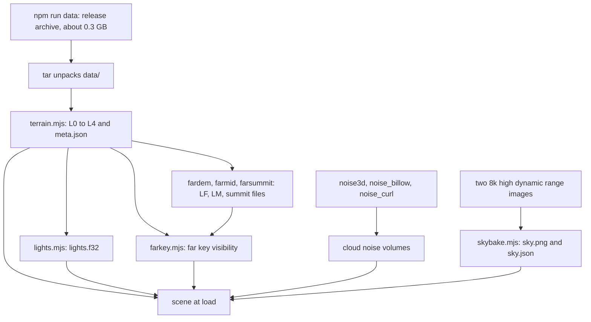
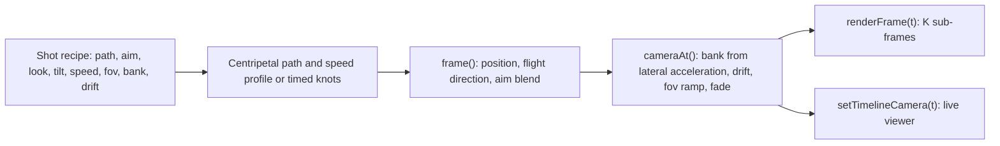

# 03 Workflow and quality: data, bakes, look, render, checks and encode

The scene is one program with two outputs. The film adds a production line around that program. The line has six stages. Data is acquired and baked. The look is tuned against reference stills. The camera is authored on a timeline. Headless Chrome renders numbered frames. A checker tests the camera and the frames. An encoder writes the final file.

This document follows that line in order. It also states where a step depends on files that the checkout does not contain. No step below was run. The commands and values are read from the source.

## The data archive

The checkout does not contain the baked scene data. The `npm run data` script runs `node tools/fetch-data.mjs` (`package.json:14-18`). That script downloads one release archive, unpacks it with `tar` and deletes the temporary file (`tools/fetch-data.mjs:9`, `tools/fetch-data.mjs:22-26`). The archive is about 0.3 gigabytes (`tools/fetch-data.mjs:1`, `README.md:25`).

```text
# tools/fetch-data.mjs:1-3
// Download the baked scene data (terrain levels, lights, cloud noise volumes, sky dome, textures; ~0.3 GB) from the
// GitHub release and unpack it into data/.  usage: npm run data   (needs tar, which ships with Windows 10+, macOS
// and Linux)
```

The archive is not in the repository. The source does not state its exact file count. It states that no tool downloads the texture sets under `data/tex` (`README.md:118-119`). Those textures arrive with the archive. The two sky source images are the exception. A user downloads them at 8k before a sky bake (`README.md:113-116`).

## Rebuild order

The project README gives one rebuild sequence (`README.md:96-111`). The order is a dependency order, not a convenience list. The first command fetches a digital elevation model (DEM) and bakes ambient occlusion (AO), the sky-visibility shading that the terrain shader reads (`README.md:99`, `tools/terrain.mjs:1-2`). `terrain.mjs` writes the level metadata. The far tools add their levels to that metadata. The runtime reads the metadata before it fetches any level file (`src/terrain.js:202`, `src/terrain.js:275-278`).

```text
# README.md:99-108
node tools/terrain.mjs --refetch   # fetch the DEM, sculpt the near field, bake AO
node tools/lights.mjs              # village and road lights
node tools/fardem.mjs              # polar far level
node tools/farmid.mjs              # 4-12 km mid level
node tools/farsummit.mjs --lf      # summit and crest pass
node tools/farkey.mjs              # key-light shadows for the far ranges
node tools/noise3d.mjs             # cloud shape, detail and weather noise
node tools/noise_billow.mjs
node tools/noise_curl.mjs
node --max-old-space-size=14000 tools/skybake.mjs   # sky dome, needs ~5 GB RAM
```

The 14,000 megabyte old-space flag is a heap ceiling, not the expected use. The source states that the bake needs about 5 gigabytes with both sources (`tools/skybake.mjs:16`). The flag leaves headroom for the image buffers. The source does not state the peak heap use.

The README names the reason for the order. `terrain.mjs` rewrites `data/terrain/meta.json`, and the far tools add their levels to it (`README.md:111`). A run of `fardem.mjs` before `terrain.mjs` would write into a file that the next terrain run replaces.



The `--refetch` flag fetches the elevation model, sculpts the near field and bakes ambient occlusion (`README.md:99`). The tool header lists narrower rebuild flags (`tools/terrain.mjs:4-5`). `--only-l3` rebuilds L3 and L4 in about two minutes. `--only-l4` rebuilds L4 only in about one minute.

## Terrain build

The terrain tool builds four nested square levels and one fine rectangle (`tools/terrain.mjs:13-29`). L0 covers 320,000 metres at 1,025 cells. L1 covers 50,000 metres at 1,601 cells. L2 covers 8,000 metres at 1,281 cells. L3 covers 1,600 metres at 1,025 cells.

```text
# tools/terrain.mjs:14-19
export const LEVELS = [
  { name: 'L0', size: 320000, grid: 1025, zoom: 9 },
  { name: 'L1', size: 50000, grid: 1601, zoom: 12 },
  { name: 'L2', size: 8000, grid: 1281, zoom: 13 },
  { name: 'L3', size: 1600, grid: 1025 },
];
```

The fine level is L4. It uses one quarter of the L3 step, which is 0.39 metres (`tools/terrain.mjs:20-28`). Its rectangle snaps to L3 vertex lines, so its border vertices lie on L3 edges. It covers every ray of the eleven reference views that lands where a 1.56 metre L3 facet would span more than six pixels at 1,672 pixels wide. It adds about 40 metres of margin around the view-tested rectangle for the film, and an 18 metre seam band. The seam band is the width over which L4 fades into L3 (`tools/terrain.mjs:20-29`). The bounds imply about 40 metres on each side.

The L4 comment records the look-development process. A reference view defined a screen-space error. A facet size defined a world-space cell. The build chose the rectangle that removes that error. The film margin and the seam band are extra coverage, not part of the test. The source does not state how many reference iterations produced the rectangle.

The build uses worker threads. The count is at most half the logical cores, between two and eight (`tools/terrain.mjs:40-41`). The comment says the laptop also renders and runs other agents. The build leaves capacity for other work. The source does not state the worker count on a named machine.

The terrain tool also bakes the masks that the shader reads. The header lists sky visibility, horizon glow, concavity, a water mask and outcrop masks (`tools/terrain.mjs:1-3`). The runtime loads the height field, the attribute byte map and the near-field rock mask per level (`src/terrain.js:283-286`).

## Far levels and the key

Three tools extend the ground beyond the square levels. `fardem.mjs` builds the polar far level (`README.md:101`). `farmid.mjs` builds the mid level from 4 to 12 kilometres (`README.md:102`). `farsummit.mjs --lf` adds the summit and crest pass to the far level (`README.md:103`). The runtime adds the far level first and then skips L0 when the far level exists (`src/terrain.js:275-282`).

The far key is a separate bake. `farkey.mjs` writes key-light visibility for the far ranges (`README.md:104`). The key is the broad twilight light from azimuth 110 degrees, 15 degrees above the horizon. The terrain shader multiplies the far surface by that visibility. The visibility function marches 16 kilometres with a growth factor and an Earth-curvature drop (`tools/farkey.mjs:1-6`, `tools/farkey.mjs:24-36`).

The order matters again. The key reads the far height and normal files, and the summit pass changes those files. The README puts `farsummit.mjs` before `farkey.mjs` (`README.md:103-104`). The key therefore sees the sharpened crests.

## Light bake

The light bake writes one record for each village and road light (`tools/lights.mjs:1-9`). The record holds a position, an intensity and one packed number. The packed number is `warm + 2 * class`. The warm value runs from 1 for low-pressure sodium orange to 0 for a 3,000 kelvin light-emitting diode. The class selects the core size and the brightness ceiling in the runtime shader (`tools/lights.mjs:2-5`).

```text
# tools/lights.mjs:1-9
// Village / road light placement from the baked terrain (L2 + L1 + L0 heights and water masks).
// usage: node tools/lights.mjs   -> data/terrain/lights.f32  [x, y, z, intensity, warm + 2 * class] per light
//   warm: 1 = low-pressure sodium orange .. 0 = 3000 K LED; intensity ~0.2..2.2
//   class (src/lights.js core size / brightness ceiling): 0 house / window / farm, 1 town street lamp, hot
//   spot, rural lane, 2 main road / lakefront quay (the brightest continuous lines, refs 2, 4)
// Layers: real towns/villages around Lake Brienz (Brienz on the delta at the near end, Interlaken /
// Unterseen / Boenigen at the far end, Meiringen, Grindelwald, ...) as dense clusters; least-cost routed
// roads (shore roads hugging both shores, valley roads, switchback climbs to the slope villages) lit as
// dotted strings; hamlets, scattered farms on the slopes; a sparse far field on L0.
```

The layers are explicit. Real towns sit as dense clusters. Roads follow least-cost routes along the shores and up the slopes. Hamlets and farms fill the slopes. A sparse far field sits on L0 (`tools/lights.mjs:6-9`). The tool uses the terrain water masks to keep lights off the lake (`tools/lights.mjs:1`, `tools/lights.mjs:29-46`).

The runtime does not draw every record as a geometry instance. It packs the records into vertex attributes and decodes them in the vertex shader (`src/lights.js:18-25`, `src/lights.js:248-272`). It thins the field with distance and conserves the lost energy (`src/lights.js:105-128`). It also builds road segments and a mirrored glitter pass into a reflection target (`src/lights.js:131-153`, `src/lights.js:160-190`). The bake writes the input. The runtime decides how much of it each frame can afford.

The source states about 117,000 lights in the shipped data (`README.md:62`). It does not state the exact count in the pinned checkout, because the data is not present.

## Noise volumes

Three tools bake the cloud noise. `noise3d.mjs` writes the shape, detail and weather noise. `noise_billow.mjs` writes the billow noise. `noise_curl.mjs` writes the curl noise (`README.md:54-56`, `README.md:105-107`). The cloud raymarch reads the volumes through a texture atlas (`src/clouds.js:1247-1263`). The source does not state the volume resolution or the bake time in the README.

The noise volumes are independent of the terrain. The README places them after the far tools and before the sky bake (`README.md:105-108`). The source does not give a reason for that placement.

## Sky bake

The sky bake turns two photographic high dynamic range images into one equirectangular sky texture and one small metadata file (`tools/skybake.mjs:1`, `tools/skybake.mjs:9-10`). The source images are Poly Haven Creative Commons Zero (CC0) panoramas at 8k: Belfast Sunset (Pure Sky) and Cedar Bridge Sunset 1 (`README.md:113-116`). The default output width is 8,192 pixels (`tools/skybake.mjs:11`).

```text
# tools/skybake.mjs:11-16
// usage: node tools/skybake.mjs [src.hdr] ; env W (out width, 8192), DELTA (3.5), AZ_OFF (-5), GD / GB / CHROMA,
// CH_HI / GB_HI, LM_A / LM_B, HAZE / HAZE_E / HAZE_K, BAND, CLARITY / CL_SIG / CLARITY2 / CL_SIG2, STREAKS (0: off),
// OUT (data/sky), PREVIEW=1; second HDRI: SRC2 (none: off), MIRROR2, AZ_OFF2, DELTA2, T2A..T2D, EL2A / EL2B,
// DISP_T / DISP_E, GD2 / GB2, W2, W2Z / E2A / E2B (overhead), BLUE2. The defaults reproduce the shipped data/sky
// (round 8 pass 2: belfast_sunset_puresky + cedar_bridge_sunset_1 right of the glow, the refs' bluer grade, streaks).
// Takes ~1-2 min and ~5 GB with both sources (node --max-old-space-size=14000).
```

The bake is not a simple panorama copy. It turns the image so that its sun sits at the scene glow azimuth. It lowers the sun at the horizon and tapers the lowering to zero at the zenith. It grades each direction by the ratio of a reference twilight sky to the image's own clear sky on its cloud-free side. It adds horizon haze, restores a band in the glow sector and applies two scales of clarity (`tools/skybake.mjs:1-8`).

The output is a log2-encoded 8-bit red-green-blue image with triangular dither (`tools/skybake.mjs:9-10`). The encoder finds a low and a high value from sampled radiance, converts each pixel to a log2 code and adds dither before rounding (`tools/skybake.mjs:461-477`). The shader decodes it with `exp2(lmin + v * lrange)` (`tools/skybake.mjs:10`, `src/glsl/common.js:120-155`). A non-finite value would become black, so the bake counts and replaces those values first (`tools/skybake.mjs:461-462`).

The bake needs about five gigabytes of random access memory and one to two minutes with both sources (`tools/skybake.mjs:16`). The README repeats the memory figure in the rebuild command (`README.md:108`). The source does not state a memory peak above five gigabytes or a bake time on a named machine.

The runtime falls back if the sky files are absent. The sky module loads `data/sky/sky.png` and `sky.json`, and the material can use an analytic sky when the texture is missing (`src/sky.js:70-85`, `src/glsl/common.js:164-166`). The fallback keeps the scene usable without the bake, but it is not the same image. The source does not state how close the fallback is to the baked result.

## Look development against references

The look loop needs eleven reference stills under `ref/`, with numbers that match the eleven views (`src/views.js:17-31`, `tools/shot.mjs:84`). The tree does not contain `ref/`. The project README states that the images are not in the repository and that the comparison tools need the user's own images (`README.md:67-69`).

The still tool renders one or more views at 1,672 by 941 pixels (`tools/shot.mjs:1-11`). It opens the capture page and waits until `APP.ready` is true (`tools/shot.mjs:27-34`). It logs the unmasked graphics processing unit name (`tools/shot.mjs:35-39`). It then calls `APP.capture()` and writes a portable network graphics file under `out/shots/` (`tools/shot.mjs:80-83`). The comparison is a colour statistic, not a visual verdict. It resizes both images to 32 by 18 pixels and converts each cell to the L*a*b* colour space of the International Commission on Illumination (`tools/shot.mjs:43-54`). It reports the mean colour distance and the mean lightness difference. It also writes a side-by-side image at 836 by 470 pixels per side (`tools/shot.mjs:55-67`).

```text
# tools/shot.mjs:51-60
export async function compare(refPath, renderPath, outPath) {
  const gw = 32, gh = 18;
  const a = await sharp(refPath).removeAlpha().resize(gw, gh, { fit: 'fill' }).raw().toBuffer();
  const b = await sharp(renderPath).removeAlpha().resize(gw, gh, { fit: 'fill' }).raw().toBuffer();
  let dE = 0, dL = 0;
  for (let i = 0; i < gw * gh; i++) {
    const la = toLab([a[i * 3], a[i * 3 + 1], a[i * 3 + 2]]), lb = toLab([b[i * 3], b[i * 3 + 1], b[i * 3 + 2]]);
    dE += Math.hypot(la[0] - lb[0], la[1] - lb[1], la[2] - lb[2]); dL += lb[0] - la[0];
  }
  dE /= gw * gh; dL /= gw * gh;
```

A 32 by 18 grid discards detail. That is deliberate. The grade tuner comment says the statistic is insensitive to the unavoidable composition differences (`tools/gradetune.mjs:1-4`). The ring can move a few pixels between the reference and the render without a large colour penalty. The mean still reports a broad colour shift.

If `ref/<n>.webp` is absent, the still tool writes `NaN` for both metrics and continues (`tools/shot.mjs:84-86`). The source treats a missing reference as a missing measurement, not as an error.

The grade tuner uses the same comparison in a search loop. It renders each requested view once and stores the high dynamic range frame. It then re-runs only the tone and grade while a coordinate descent searches seven parameters: exposure, white balance, saturation, contrast, lift, warm highlights and shoulder (`tools/gradetune.mjs:1-5`).

```text
# tools/gradetune.mjs:1-5
// Automatic grade calibration: matches the Lab distributions (percentiles of L, a, b, chroma) of our renders
// to the references, which is insensitive to the (unavoidable) composition differences. Each view is rendered
// once, its HDR frame is snapshotted, and only tone + grade are re-run while a coordinate descent searches
// exposure / white balance / saturation / contrast / lift / warm highlights / shoulder.
// usage: node tools/gradetune.mjs [views=1,...,11] [tag]   (env PORT, Q)  -> prints params, writes out/shots/<tag>_vN.png
```

The search matches distributions, not pixels. It computes L percentiles at 5, 25, 50, 75, 95 and 99 percent. It computes a and b percentiles at 10, 50 and 90 percent, and chroma at 25, 50 and 90 percent (`tools/gradetune.mjs:34-39`). The loss weights a and b at 1.5, and L and chroma at 1 (`tools/gradetune.mjs:41-46`). The a and b opponent-colour channels therefore matter more than the lightness channel in the fit.

The tuner can mask the background. The mask limits the comparison to the part of the frame that the matte does not own (`tools/gradetune.mjs:48-50`). The matte background is the reference image itself, composited after the grade, so a comparison against it would be circular.

The source does not state how many reference views were used for the final grade, how many descent passes ran, or which values the search returned. The shipped grade defaults are in `src/post.js:26-28`. The source does not claim that they came from the tuner.

## The matte

The matte is a camera-projected reference background for still views. It keeps the reference sky and far ground. It needs the derived backgrounds under `data/matte` and a `data/matte/force.json` index of the regions to cover (`src/main.js:79-83`).

The runtime probes that file at start. If it is absent or is not JavaScript Object Notation, the matte module is not imported (`src/main.js:82-88`). The film path never selects a matte projector, and the capture page starts with the matte off (`src/main.js:79-87`). The film therefore does not depend on reference images.

The bake tool has two modes. The `raw` mode converts the reference images to portable network graphics with no cleanup. The `clean` mode removes the reference's own ring structure and fills the hole (`tools/matte_bake.mjs:1-11`). The hole is the project's own structure silhouette, dilated, plus traced polygons. The fill uses push-pull inpainting, then offset clones of the reference's own texture (`tools/matte_bake.mjs:4-11`).

```text
# tools/matte_bake.mjs:1-8
// Bake the matte backgrounds data/matte/bg_<n>.png from ref/<n>.webp.
// usage: node tools/matte_bake.mjs raw [views]       -> the refs as PNG (no cleanup)
//        node tools/matte_bake.mjs clean [views]     -> the ref's own ring structure removed + inpainted:
//   hole = our structure silhouette from the same camera (out/shots/mstruct_v<n>_struct.png, tools/matte_cap.mjs
//   mode 'struct': 0 = structure) dilated by DIL px + the traced polygons in tools/matte_masks.json (ref px),
//   filled by push-pull (pyramid) inpainting with a little texture from the surround; out/matte/hole_<n>.png for checks
// r7 pass 2: the hole is filled by offset clones of the ref's own texture (cloneFill: visible part first, from
//   out/shots/<WT|final>_v<n>_w.png, then the part hidden behind our structure), 'clone' regions from a given source
```

The tool writes a force mask for each view and a `force.json` index (`tools/matte_bake.mjs:9`). The runtime takes the maximum of the geometric farness ramp and the forced mask (`src/matte.js:19-22`, `tools/matte_bake.mjs:9`). That rule lets the matte cover a local object without moving the whole far boundary.

The mask cannot be checked from this checkout. The reference images and the derived backgrounds are absent. The source does not state their pixel dimensions beyond the capture size of 1,672 by 941 (`src/matte.js:16`, `tools/shot.mjs:11`).

## Timeline authoring

The film has eleven shots with hard cuts. The shot table states an end time and a camera recipe for each shot (`src/timeline.js:147-209`). The opening is one continuous ten-second glide. The plunge is paced across the drop. The finale is a long pull-back that ends at 45.0 seconds (`src/timeline.js:148-153`, `src/timeline.js:164-174`, `src/timeline.js:204-208`).

The table is the only authority on time. A loop derives each start time and duration from the end times, and `TOTAL` becomes the last end time (`src/timeline.js:210-215`). A change to one end time moves every later shot and changes the film length.

```text
# src/timeline.js:210-215
let acc0 = 0;
for (const s of SHOTS) {
  s.start = acc0; s.dur = s.end - acc0; acc0 = s.end;
  if (s.times) { s.S = timed(s); s.scale = 1; } else s.scale = s.len / (s.S.mean * s.dur);
}
export const TOTAL = acc0;
```

Every cut lands on a half-frame time. The helper `at(T)` returns the time just before frame `T * FPS`, where `FPS` is frames per second (`src/timeline.js:56-57`). The film runs at 30 frames per second (`src/timeline.js:23`). The finale is the exception: its end is 45.0 seconds, the film end, not a cut (`src/timeline.js:207`). The film therefore has 1,350 frames. The renderer computes that count from `TOTAL` and the frame rate (`tools/render.mjs:14-15`).

The camera path uses a centripetal Catmull-Rom curve through world-space knots (`src/timeline.js:81-90`). Two speed systems produce the motion. A shot can give speed keys in metres per second. The tool integrates a Catmull-Rom speed profile over 2,048 steps and scales the integral to the path length (`src/timeline.js:59-74`). A shot can instead give timed knots, the absolute film time at which each knot is passed. This path uses a monotone cubic through the knots. The method is Fritsch-Carlson interpolation. It limits the slopes so the curve does not overshoot and cannot run backwards (`src/timeline.js:91-110`). The curve can stop where two knots are close in space but apart in time. At that point the speed falls to zero; the path does not reverse.

The timed system makes a physical move possible. The plunge has a long drop and a tight low exit. Speed keys alone would need repeated adjustment to land the cut at the right height. Timed knots pin the position at the beat times, and the speed follows from the distance between knots. The source comments say the plunge is paced to 19.0 seconds and cut at 18.0 seconds low over the cloud bank (`src/timeline.js:164-166`). The shot end is 18.0 seconds (`src/timeline.js:170`). The knots to 19.0 set the curve slope at the cut. The render never reaches the 19.0 knot.

The aim is separate from the path. A shot can give explicit aim knots, one world point, or no aim. The `look` value blends between aim and flight direction. The `tilt` value adds pitch, the `bank` value adds roll from lateral acceleration, and the `drift` value adds deterministic buffeting (`src/timeline.js:76-90`, `src/timeline.js:230-264`).

The framing helper solves for an aim point that puts a world point at a chosen screen position. It starts from the direction to the point and iterates twelve times, projecting the point and correcting azimuth and elevation (`src/timeline.js:36-51`). A shot can therefore say "keep the ring centre at 52 percent width and 60 percent height" (`src/timeline.js:152-153`, `src/timeline.js:207-208`).

The bank is not a keyed roll. The camera computes lateral acceleration from second differences of the path over plus and minus 0.35 seconds. It averages five instants and converts the result to a roll angle. A hyperbolic tangent limits the roll to 32 degrees (`src/timeline.js:243-256`, `src/timeline.js:24`). The bank fades out in a vertical dive, because a dive has no heading to bank about (`src/timeline.js:244-246`).

The drift is deterministic. It sums three incommensurate sine waves at different frequencies and phases (`src/timeline.js:236-237`). The same film time always gives the same offset. A re-render of frame 700 therefore matches the earlier frame 700, which a resumable render needs.

The fade is part of the camera result. The factor is the minimum of one, time divided by 0.6 and the remaining time divided by 1.8 (`src/timeline.js:264`). The film fades in over 0.6 seconds and out over 1.8 seconds. The frame function passes the factor to the grade (`src/main.js:169-170`).



The live viewer and the film call the same camera function. The viewer's V key starts the timeline and calls `setTimelineCamera` each display frame (`src/main.js:130-143`, `src/main.js:234`). The film calls `renderFrame`, which calls `setTimelineCamera` for each sub-frame (`src/main.js:152-155`). A change to a shot moves both outputs.

## Headless render

The renderer needs a development server in another terminal (`README.md:78-82`). The driver then starts headless Chrome through `puppeteer-core` (`tools/shot.mjs:17-23`). On Windows, the launch adds the Almost Native Graphics Layer Engine (ANGLE) backend for Direct3D 11. On other systems, the user sets the `CHROME` variable to the browser path (`README.md:75-76`, `tools/shot.mjs:18-21`).

The page runs in capture mode. The address includes `?capture&w=<width>&h=<height>` (`tools/shot.mjs:31-32`). Capture mode hides the view buttons and help text through a body class (`index.html:17`). It also sets the cloud scale to 1.0, which the cloud object multiplies by its configured 0.5 (`src/main.js:77`, `src/clouds.js:1275`). The film marches clouds at half width and half height. The live viewer uses one quarter.

The driver waits for `window.APP.ready` before it asks for a frame (`tools/shot.mjs:32-34`). The page sets that flag after the modules load (`src/main.js:208`). A slow shader compile therefore delays the first frame instead of producing an empty one.

The render defaults are 1,920 by 1,080 pixels at 30 frames per second, with four sub-frames and a shutter of 0.5 (`tools/render.mjs:9-10`). The README uses eight sub-frames for the final film (`README.md:80`). At eight, the author records about five seconds per frame on a laptop Radeon 780M integrated graphics processing unit, or roughly two hours for 1,350 frames (`README.md:88`).

```text
# tools/render.mjs:9-10
const out = arg('out', 'out/frames'), W = +arg('w', 1920), H = +arg('h', 1080), fps = +arg('fps', 30), K = +arg('K', 4);
const every = +arg('every', 1), jpg = flag('jpg'), shutter = +arg('shutter', 0.5);
```

The driver builds a frame list from the requested start, end and stride. A `--times` list replaces it with the frames at named film times. A `--coarse` value sorts every Nth frame first, for an early preview across all shots (`tools/render.mjs:20-26`). The coarse pass does not change the file names, so the fill pass skips those frames.

The resume rule is a file test. If the frame file exists and the `--force` flag is absent, the driver skips it (`tools/render.mjs:27-29`). The file name is `f_` plus the frame number padded to five digits, with a portable network graphics or Joint Photographic Experts Group suffix (`tools/render.mjs:28`, `tools/render.mjs:32`). The driver does not store a manifest.

The frame request passes the film time, the sub-frame count, the shutter and the frame rate into the page (`tools/render.mjs:31`). The page clears the accumulator and loops over the sub-frames (`src/main.js:149-152`). For each sub-frame it computes a time inside the shutter interval and sets the camera (`src/main.js:153-155`). It offsets the projection by a Halton sequence when more than one sub-frame is used (`src/main.js:156`). It renders the scene, lets the cloud module composite, and adds the result with weight one over K (`src/main.js:157-166`).

```text
# src/main.js:149-156
modules.renderFrame = (t, { K = 1, shutter = 0.5, fps = 30 } = {}) => {
  post.clearAccum();
  let fade = 1;
  for (let k = 0; k < K; k++) {
    const tk = t + ((k + 0.5) / K - 0.5) * shutter / fps;
    const c = setTimelineCamera(tk);
    if (k === 0 || Math.abs(tk - t) < 1e-6) fade = c.fade;
    if (K > 1) camera.setViewOffset(W, H, halton(k + 1, 2) - 0.5, halton(k + 1, 3) - 0.5, W, H);
```

The shutter interval is centred on the frame time. The first sub-frame time is `t - (0.5 - 0.5 / K) * shutter / fps`. The last is `t + (0.5 - 0.5 / K) * shutter / fps`. The samples are inset by half a step and do not reach the interval ends. A shutter of 0.5 therefore samples half a frame interval. The README states that K 1 has no blur and that the shutter sets the blur length (`README.md:84-85`).

The accumulator uses a half-float target. The post module guards the sum against non-finite values and clamps fireflies before the grade (`src/post.js:129-138`). That guard matters for a long render. One non-finite cloud sample would otherwise become a white or black speck in one frame. The flash checker can find such a speck after the render.

The grade runs once, after the loop. The page calls the finish function with the accumulated texture, the film time and the fade (`src/main.js:169-170`). It returns the shot name, which the driver prints in the progress line (`src/main.js:171`, `tools/render.mjs:37-40`).

```text
# tools/render.mjs:27-35
for (const f of list) {
  const file = `${out}/f_${String(f).padStart(5, '0')}.${jpg ? 'jpg' : 'png'}`;
  if (fs.existsSync(file) && !flag('force')) continue;
  const tf = Date.now();
  const shot = await page.evaluate((t, o) => window.APP.renderFrame(t, o), f / fps, { K, shutter, fps });
  const url = await page.evaluate(j => window.APP.renderer.domElement.toDataURL(j ? 'image/jpeg' : 'image/png', 0.92), jpg);
  fs.writeFileSync(file, Buffer.from(url.split(',')[1], 'base64'));
  const ms = Date.now() - tf;
  await gpuRest(ms);
```

The driver reads the frame back through `toDataURL`. The Joint Photographic Experts Group path uses quality 0.92 (`tools/render.mjs:32`). The source does not state the frame or sequence size.

After each frame, the driver calls `gpuRest` with the frame duration (`tools/render.mjs:35`). The rest lasts half the render time, clamped between 200 and 20,000 milliseconds (`tools/gpulock.mjs:14-16`). The comment says the integrated graphics processing unit is shared with other work on the laptop. The rest gives it idle gaps instead of minutes at full load.

## The graphics processing unit lock

Only one headless renderer may use the graphics processing unit at a time. The lock module states the reason. Several WebGL renderers competing for the Radeon 780M crashed Windows twice on 2026-11-01 with bugcheck 0x119, VIDEO_SCHEDULER_INTERNAL_ERROR (`tools/gpulock.mjs:1-4`). The lock is a stability requirement on that machine.

```text
# tools/gpulock.mjs:1-4
// Machine-wide GPU lock: only one headless renderer (Chrome / WebGL) at a time, across the main project and every
// sandbox. Several WebGL renderers competing for the Radeon 780M crashed Windows twice on 2026-11-01 (bugcheck 0x119
// VIDEO_SCHEDULER_INTERNAL_ERROR). acquireGpu() blocks until the lock file is free (locks of dead processes are taken
// over) and returns release(), which also runs on process exit.
```

The lock file lives in the temporary folder. The `GPU_LOCK` environment variable can move it (`tools/gpulock.mjs:9`). The acquisition writes a JavaScript Object Notation record with a process identifier, a label and a working directory. It uses the exclusive-create flag, so the write fails if the file exists (`tools/gpulock.mjs:18-24`). There is no test-then-create gap. The file creation is the atomic step.

A stale lock does not block forever. The waiter reads the record and tests whether the recorded process is alive (`tools/gpulock.mjs:11`, `tools/gpulock.mjs:28-33`). If the process is dead, the waiter reads the file again. It removes the file only if the process identifier and timestamp still match. A second waiter could otherwise remove a fresh lock set by a third process. The retry loop sleeps for 1.5 seconds and prints a message at growing intervals (`tools/gpulock.mjs:35-40`).

The release function removes the file only when the record matches the current process (`tools/gpulock.mjs:43-49`). It runs on normal exit and on four termination signals (`tools/gpulock.mjs:50-52`). The browser close wrapper calls the same release function (`tools/shot.mjs:24-26`). A normal render therefore releases the lock before the Node.js process exits.

```text
# tools/gpulock.mjs:43-53
  let held = true;
  const release = () => {
    if (!held) return;
    held = false;
    const o = read();
    if (o && o.pid === process.pid) { try { fs.unlinkSync(LOCK); } catch { /* gone */ } }
  };
  process.on('exit', release);
  for (const s of ['SIGINT', 'SIGTERM', 'SIGBREAK', 'SIGHUP']) process.on(s, () => { release(); process.exit(130); });
  return release;
}
```

The source does not state how the lock behaves on a network file system or across different machines. It states that the lock is machine-wide for the project and its sandboxes on one machine (`tools/gpulock.mjs:1-2`).

## The film camera checker

The checker tests the camera before a long render. It imports the timeline, the configuration and the view list into the running scene (`tools/filmcheck.mjs:46-51`). It samples the camera at every frame and reports the minimum clearance to the terrain, the structure, the outdoor figures and the cloud ceiling. It also reports angular speed, angular acceleration, linear acceleration and pitch (`tools/filmcheck.mjs:1-5`).

The checker needs no clouds. The header states a run of about 15 seconds without them, and the launch uses a 320 by 180 viewport with `&noclouds` (`tools/filmcheck.mjs:7-8`, `tools/filmcheck.mjs:45`). The small viewport is enough for camera geometry.

The default limits are numeric. The terrain limit is 15 metres. The structure limit is 1.5 metres. The figure limit is 1.0 metre. The figure-in-view limit is 4 figures. The cloud limit is 0 metres, which means the camera must stay below the cloud ceiling. The rotation limit is 12 degrees per second. The pitch limit is 80 degrees (`tools/filmcheck.mjs:20-22`).

```text
# tools/filmcheck.mjs:20-23
const fps = +arg('fps', 30);
// m, except rot (deg/s of the full camera orientation) and pitch (deg); figureInView: figures inside the frame
const LIMITS = { terrain: 15, structure: 1.5, figure: 1.0, figureInView: 4, cloud: 0, rot: 12, pitch: 80 };
const WARN = { angAcc: 40, linAcc: 40 };   // deg/s^2, m/s^2: hints of a jerk inside a shot (warning only)
```

A shot can relax a limit. The timeline shots carry a `check` object with a wider rotation limit on the whip pans. The strut shot uses 45 degrees per second, the glaze shot uses 25, and the deck shot uses 20 (`src/timeline.js:158`, `src/timeline.js:163`, `src/timeline.js:203`). The checker merges the shot object over the defaults (`tools/filmcheck.mjs:202`). The per-shot value is visible next to the shot recipe, so a reader can see why a fast move is allowed.

The terrain clearance uses the scene's own height function (`tools/filmcheck.mjs:51`). The structure clearance builds a triangle index in world space on a 4 metre grid. It adds every mesh, including instanced meshes, with world transforms applied (`tools/filmcheck.mjs:58-79`). It then computes the point-to-triangle distance for each camera sample. The run prints the triangle count (`tools/filmcheck.mjs:248`).

The checker tests the same camera that the render uses. The timeline import is the same module, the camera function is the same function, and the height function is the one attached to the terrain object that the render draws. There is no second collision model to keep in step. A pass means the move is clear in the loaded scene.

The checker reports spans, not single samples. For each kind of violation it stores the first time, the last time and the worst value (`tools/filmcheck.mjs:203-211`). The report prints one line per shot with the minimum values and the worst time (`tools/filmcheck.mjs:251-262`). It counts the violations and exits with code 1 if any exist (`tools/filmcheck.mjs:263`, `tools/filmcheck.mjs:294`). A shell script can therefore stop a render on a failed check.

```text
# tools/filmcheck.mjs:209-215
    bad('terrain', tc < L.terrain, tc); bad('structure', nn.s < L.structure, nn.s);
    bad('figure', nn.f < L.figure, nn.f); bad('figureInView', nn.fv < L.figureInView, nn.fv);
    bad('cloud', cl < L.cloud, cl); bad('pitch', Math.abs(pitch) > L.pitch, pitch);
    if (prev && prev.shot === c.shot) {
      const rot = prev.q.angleTo(q) * 180 / Math.PI * fps, v = p.distanceTo(prev.p) * fps;
      if (rot > s.rot[0]) s.rot = [rot, t];
      bad('rot', rot > L.rot, rot);
```

The rotation test uses the full camera orientation, including roll (`tools/filmcheck.mjs:1-5`, `tools/filmcheck.mjs:213`). A fast roll can violate the limit even when the aim direction moves slowly.

The checker can also write a top-view plot and an American Standard Code for Information Interchange (ASCII) height map. The plot shows the terrain in the ring frame with every shot path and aim direction (`tools/filmcheck.mjs:10-12`, `tools/filmcheck.mjs:267-291`). The map prints heights in 10 metre units relative to the deck (`tools/filmcheck.mjs:12`, `tools/filmcheck.mjs:227-233`). These outputs help a reader see why a clearance value is low.

The flash mode is a second, independent check. It scans the rendered frame files, not the camera. For each frame it counts near-white pixels above 245, 245 and 240 in the three channels. It flags a frame when its count is more than 25 above both neighbours and more than twice the larger neighbour (`tools/filmcheck.mjs:25-39`). The comment names the likely cause: a non-finite or extreme high dynamic range pixel blown up by the bloom (`tools/filmcheck.mjs:25-26`). The mode exits with code 1 on a flash (`tools/filmcheck.mjs:41-42`).

The flash test needs one frame on each side, so it skips the first and last frames (`tools/filmcheck.mjs:37`). A flash on either boundary frame is not detected.

## Encode

The encoder is a PowerShell script around `ffmpeg` (`tools/encode.ps1:1-3`). It reads a numbered frame sequence at 30 frames per second and the soundtrack. It writes a Moving Picture Experts Group 4 Part 14 file with the Advanced Video Coding video stream and the Advanced Audio Coding audio stream (`tools/encode.ps1:1`, `tools/encode.ps1:4-8`).

```text
# tools/encode.ps1:4-8
ffmpeg -y -hide_banner -framerate 30 -i "$Frames\f_%05d.$Ext" -i $Audio `
  -c:v libx264 -preset slow -crf $Crf -profile:v high -level 4.2 -pix_fmt yuv420p `
  -x264-params "keyint=60:min-keyint=30:aq-mode=3:deblock=-1,-1:colorprim=bt709:transfer=bt709:colormatrix=bt709" -maxrate 30M -bufsize 60M `
  -vf "scale=out_color_matrix=bt709:out_range=tv:flags=lanczos+accurate_rnd+full_chroma_int,format=yuv420p" -colorspace bt709 -color_primaries bt709 -color_trc bt709 -color_range tv `
  -c:a aac -b:a 192k -ar 48000 -shortest -movflags +faststart $Out
```

The defaults are the High profile at level 4.2, constant rate factor 16, slow preset, 8-bit 4:2:0 colour and the International Telecommunication Union Radiocommunication Sector BT.709 (BT.709) colour matrix (`tools/encode.ps1:5-7`). The key frame interval is 60 frames with a minimum of 30. The average bit rate ceiling is 30 megabits per second with a 60 megabit buffer (`tools/encode.ps1:6`). The audio is Advanced Audio Coding at 192 kilobits per second and 48 kilohertz (`tools/encode.ps1:8`).

The `-shortest` flag stops at whichever input ends first, the frames or the audio (`tools/encode.ps1:8`). The README tells the user to trim the track to 45 seconds and fade it out first (`README.md:86`). The credited track was edited to 45 seconds with a fade-out (`README.md:129-130`). The source does not state the loudness target of the track.

The default audio path is `out\music\soundtrack.wav` and the default output is `out\halo_1080p30.mp4` (`tools/encode.ps1:3`). The source does not state the size of the encoded film, because the frames and the audio are not in the tree.

## The quality gates

The workflow has four gates before a film is final. A missing level or failed fetch stops the scene at load. The checker tests clearance, rotation, pitch and the cloud ceiling against the loaded scene. The flash scan fails on a single-frame flash. The encode script fails if `ffmpeg` fails or an input is missing.

| Gate | Input | Test | Failure |
|---|---|---|---|
| Data | archive and baked files | scene loads every level | fetch or parse error |
| Camera | timeline and scene geometry | clearance, rotation, pitch, cloud ceiling | exit code 1 |
| Frame | rendered frame files | near-white count against neighbours | exit code 1 |
| Encode | frames and audio | `ffmpeg` reads the sequence and the track | encoder error |

The gates form an order. A failure should stop the pipeline.

**Aha:** The camera checker is not a separate simulation. It imports the timeline into the live page. It calls the same camera function against the same terrain height function that the renderer draws (`tools/filmcheck.mjs:46-51`, `tools/filmcheck.mjs:58-79`). A pass therefore means the authored move is clear in the actual scene, not in a simplified model.

**Aha:** The render is resumable because a frame is a pure function of its number. The camera depends on film time. The sub-frame offsets come from a fixed Halton sequence. The cloud module receives an incrementing frame counter, but in the film path with more than one sub-frame it recovers the sub-frame index from the Halton view offset (`src/clouds.js:1006-1016`). The counter drives only the interactive four-frame jitter cycle. It does not make a film frame depend on the order of rendering. The noise and the drift use deterministic functions. The file name is the frame number (`tools/render.mjs:28`, `src/main.js:152-166`). An interrupted render therefore leaves a valid prefix, and a restart skips the files that exist. The source does not use a manifest, a database or a checksum. It trusts the file name.

## Summary

The production line has a clear hand-off. One archive brings the baked inputs, and the rebuild order protects the metadata file. The terrain, far-level, key, light, noise and sky tools write the files that the scene reads. The look loop compares stills against references in a coarse colour space. The timeline turns path, aim, speed and bank recipes into a deterministic camera. The render driver turns that camera into numbered frames with sub-frame averaging and a graphics processing unit lock. The checker tests the camera before the render and the frames after it. The encoder writes the final file.

The checkout contains the code for every stage. It does not contain the data archive, the reference images, the rendered frames, the soundtrack or the encoded film. The source gives times for a partial terrain rebuild, a sky bake, a checker run and a film render on one laptop. It does not give a time for a full rebuild, a light bake, a far bake or an encode. Those gaps are recorded here instead of filled with estimates. The next document collects the costs, the hardware bounds, the failure modes and the comparison with five sibling packages.
