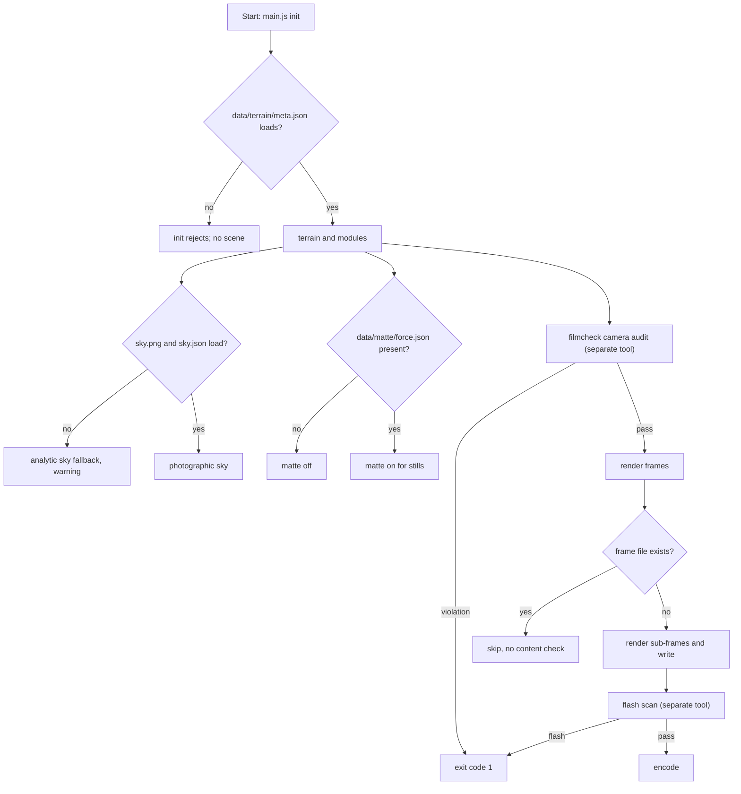
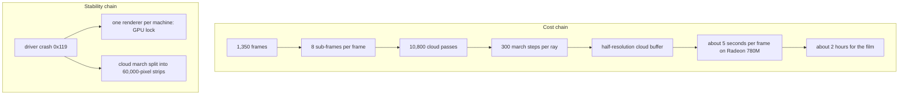

# 04 Limits and comparison: costs, bounds, failure modes and five siblings

A design becomes useful when a reader knows where it stops. This document collects the limits of `halo-above-the-clouds`. It gives the recorded costs and the hardware bounds that the source states. It lists the failure modes that the code guards and the ones it leaves open. It then compares the package with five published sibling explorations in the same container.

Every value below comes from the pinned source or from the published sibling documents. No project command was run for this exploration. No frame was rendered, no bake was executed and no encoded file was opened. A value that the source does not state is marked "the source does not state". It is not estimated.

A note on names. A citation to `README.md` without a directory prefix names the source project README. A citation that starts with a sibling name, such as `golden-temple/markdown/README.md`, names that published exploration.

## The cost ledger

The film is 45.0 seconds at 30 frames per second, which gives 1,350 frames (`src/timeline.js:207`, `src/timeline.js:23`). The recorded film timing uses eight sub-frames per frame, a count that the command names `K` (`README.md:84-85`, `README.md:88`). That is 10,800 sub-frame renders for the film. The render defaults are 1,920 by 1,080 pixels (`tools/render.mjs:9`).

| Cost | Value | Condition | Source |
|---|---:|---|---|
| Film length | 45.0 seconds | fixed shot table | `src/timeline.js:207`, `src/timeline.js:215` |
| Frame rate | 30 frames per second | timeline constant | `src/timeline.js:23` |
| Frames | 1,350 | 45.0 times 30 | `src/timeline.js:207` |
| Picture size | 1,920 by 1,080 | default render | `tools/render.mjs:9` |
| Sub-frames | 8 | recorded film timing | `README.md:88` |
| Sub-frame renders | 10,800 | 1,350 times 8 | computed from the two rows above |
| Frame time | about 5 seconds | K 8, laptop Radeon 780M | `README.md:88` |
| Film render | about 2 hours | 1,350 frames, same record | `README.md:88` |
| Frame time, K 4 | about 1.5 seconds | 1,080p with clouds | `src/config.js:97-98` |
| Cloud steps | 300 | per marcher ray | `src/clouds.js:1210` |
| Cloud scale, film | 0.5 of width and height | capture 1.0 times 0.5 | `src/main.js:77`, `src/config.js:97` |
| Cloud scale, viewer | 0.25 of width and height | live 0.5 times 0.5 | `src/main.js:77`, `src/config.js:97` |
| Cloud submission | about 60,000 pixels per strip | each strip a separate submission | `src/clouds.js:1330-1336` |
| Cloud strip time | at most about 150 milliseconds | Radeon 780M, 1,080p | `src/clouds.js:1334` |
| Scene data archive | about 0.3 gigabytes | download | `tools/fetch-data.mjs:1`, `README.md:25` |
| Sky bake memory | about 5 gigabytes | both source images | `tools/skybake.mjs:16` |
| Sky bake time | 1 to 2 minutes | both source images | `tools/skybake.mjs:16` |
| Terrain L3 and L4 rebuild | about 2 minutes | `--only-l3` | `tools/terrain.mjs:5` |
| Terrain L4 rebuild | about 1 minute | `--only-l4` | `tools/terrain.mjs:5` |
| Camera check | about 15 seconds | no clouds | `tools/filmcheck.mjs:7-8` |
| First page load | a few minutes | shader compile | `README.md:29` |
| Lights | about 117,000 | shipped data | `README.md:62` |

Two records give the frame time. A comment in the cloud configuration says 1,080p at K 4 with clouds takes about 1.5 seconds (`src/config.js:97-98`). The project README says K 8 took about 5 seconds per frame on a laptop Radeon 780M, or roughly two hours for 1,350 frames (`README.md:88`). The source does not reconcile the two figures. They may describe different conditions, because the comment names K 4 and the README names K 8. The exploration reports both and does not choose one.

```text
# src/config.js:97-98
  res: 0.5,          // (r8) cloud march resolution (fraction of the frame; the composite upsamples it): the film budget
                     // (1080p K=4 with clouds in ~1.5 s) - 1 for full-resolution stills
```

The cost model is multiplicative. The frame count, the sub-frame count and the cloud steps multiply (`src/clouds.js:1210`, `src/main.js:77`). A change from K 4 to K 8 doubles all of that work before any other change.

```text
# src/clouds.js:1208-1210
        // (p2: 300 - the fine steps over thin cloud and next to the tops used up 200 on grazing rays, which then ended
        // short of the cloud: terrain showed through)
        uSteps: { value: 300 }, uFrame: { value: 0 },
```

The cloud resolution split is explicit. The capture page passes 1.0 to the cloud module, and the module multiplies that value by `CLOUDS.res`, which is 0.5 (`src/main.js:77`, `src/config.js:97`). The normal page passes 0.5, which becomes 0.25 (`src/main.js:77`, `src/config.js:97`). The film therefore marches half as many pixels in each direction as the frame. The live viewer marches one quarter. The composite upsamples the result (`src/config.js:97`).

The 300 steps are a quality budget, not a physical constant. The comment records a past failure: fine steps over thin cloud and near the tops used 200 steps on grazing rays, and the rays ended short of the cloud. Terrain then showed through (`src/clouds.js:1208-1209`). The budget is a fix for a visible error. A lower value would bring the error back.

The author records a full-screen march at 1,080p as about 0.5 to 1 second on the Radeon 780M (`src/clouds.js:1331-1332`). The renderer splits the march into strips of about 60,000 pixels (`src/clouds.js:1331-1336`). The strip count follows the cloud buffer size. A full 1,080p buffer gives about 35 strips. The film buffer at half width and half height gives about 9 strips. The live buffer at one quarter gives about 3 strips (`src/main.js:77`, `src/clouds.js:1275`, `src/clouds.js:1336`). The 150 millisecond figure is a ceiling for one strip, not a typical time. The source gives no typical strip time. If the total is spread evenly, a strip is about 15 to 30 milliseconds. The strip size is a stability measure. It is discussed under failure modes.

The data and bake costs are separate from the frame cost. The scene archive is about 0.3 gigabytes (`tools/fetch-data.mjs:1`, `README.md:25`). The sky bake needs about 5 gigabytes of random access memory and one to two minutes (`tools/skybake.mjs:16`). A partial terrain rebuild takes about two minutes for L3 and L4, or about one minute for L4 alone (`tools/terrain.mjs:5`). The source does not state the full terrain build time, the light bake time, the far level times, the noise volume times or the encode time.

The source also does not state four sizes. It gives no size for one rendered frame, the frame sequence, the encoded film or the disk space for a full render. The encode settings imply a bit-rate ceiling, not a file size. The average video bit rate is capped at 30 megabits per second with a 60 megabit buffer (`tools/encode.ps1:6`). A 45 second film at that ceiling would carry at most 1,350 megabits, or about 169 megabytes, of video payload. The actual file size also depends on the encoder decisions and the audio. The source does not state the result, so this document does not compute a claim about it.

## Hardware bounds

The stated runtime requirement is Node.js 22.12 or newer and a graphics processing unit with WebGL2 (`README.md:21`, `package.json:11-13`). The recorded render machine is a laptop with an Advanced Micro Devices Radeon 780M integrated graphics processing unit (`README.md:88`, `src/clouds.js:1332`). The project is set up for Windows. The launch path defaults to a Windows Chrome location, and the lock module records a Windows crash on the recorded laptop (`tools/shot.mjs:18`, `tools/gpulock.mjs:2-3`). The source does not state the Windows version.

```text
# tools/gpulock.mjs:1-4
// Machine-wide GPU lock: only one headless renderer (Chrome / WebGL) at a time, across the main project and every
// sandbox. Several WebGL renderers competing for the Radeon 780M crashed Windows twice on 2026-11-01 (bugcheck 0x119
// VIDEO_SCHEDULER_INTERNAL_ERROR). acquireGpu() blocks until the lock file is free (locks of dead processes are taken
// over) and returns release(), which also runs on process exit.
```

The source gives no minimum graphics processing unit model, no minimum video memory, no minimum system memory and no processor requirement. It gives one measured machine and one memory figure for the sky bake. It does not state a supported operating system list. The `CHROME` variable and the non-Windows launch path show that other systems are considered, but the source does not state a tested result on them (`README.md:75-76`, `tools/shot.mjs:18-21`).

The sky bake has a hard memory instruction. The README runs it with a 14,000 megabyte old-space limit and says it needs about 5 gigabytes of random access memory (`README.md:108`). The tool header repeats the same figure (`tools/skybake.mjs:16`). A machine with less free memory can fail the bake. The source does not state the exact peak or the failure message.

The render loop deliberately leaves the graphics processing unit idle between frames. `gpuRest` sleeps for half the frame time, clamped between 200 and 20,000 milliseconds (`tools/gpulock.mjs:14-16`). The comment says the integrated unit is shared with other work on the laptop. A dedicated graphics processing unit would not need the same gap, but the source does not state a render time without the gap.

The first page load can take a few minutes while the shaders compile (`README.md:29`). This is a startup bound, not a frame bound. The capture tools wait for `APP.ready` before they ask for a frame, so the wait appears in the first frame time, not as an empty image (`tools/shot.mjs:32-34`, `src/main.js:208`).

The cloud march has a second hardware link. A single full-screen submission cannot be preempted. The source records that long non-preemptible submissions next to other graphics processing unit clients are what the bugcheck 0x119 crashes point to (`src/clouds.js:1331-1334`). The strip size and the lock are responses to a driver scheduler limit, not to a slow frame. The source does not state whether the problem appears on other drivers.

## Failure modes

The scene has several fallbacks and several hard stops. The distinction matters. A fallback keeps the scene usable with a different image. A hard stop stops the pipeline with a nonzero result.



The terrain load is a hard dependency. `init` awaits `createTerrain` before the guarded module imports (`src/main.js:61-70`). The terrain builder fetches `meta.json` before it fetches any level (`src/terrain.js:202`). A missing archive or a missing metadata file therefore rejects the start. The source does not wrap that call in a fallback. The scene cannot draw an empty terrain in its place.

The sky load is a soft dependency. `createSky` starts with a one-pixel blank texture and registers it as the sky source (`src/sky.js:8-12`). It then calls `loadSky` and catches a failure with a warning that names the analytic fallback (`src/sky.js:13`). The shader selects the photographic path only when the sky texture flag is positive (`src/glsl/common.js:164-166`). A missing sky file therefore gives a different sky, not a failed load.

```text
# src/sky.js:4-13
// Round 8: the sky dome is a real photographic dusk sky (data/sky/sky.png + sky.json, baked by tools/skybake.mjs
// from a CC0 Poly Haven HDRI). createSky registers its texture as shared uniforms (uSkyTex, uSkyTexP) before the
// other materials are built, so glass and lake reflections and every other sky caller see the same sky. Until the
// texture is in (or if it fails to load) the analytic sky + procedural deck of common.js is drawn.
export function createSky(shared) {
  const blank = new THREE.DataTexture(new Uint8Array([128, 128, 128, 255]), 1, 1);
  blank.needsUpdate = true;
  shared.uniforms.uSkyTex = { value: blank };
  shared.uniforms.uSkyTexP = { value: new THREE.Vector4(0, 0, 1, -10 * Math.PI / 180) };
  shared.skyReady = loadSky(shared).catch(e => console.warn('sky: photographic sky not loaded, analytic fallback', e));
```

The matte is a soft dependency with a clean skip. The runtime probes `data/matte/force.json` and tests that the response is JavaScript Object Notation (`src/main.js:82-83`). If the test fails, the module is not imported (`src/main.js:84-88`). The capture page starts with the matte off, and no film shot carries a matte (`src/main.js:87`, `src/main.js:137`). The absent reference images therefore do not block the film.

```text
# src/main.js:82-88
  const hasMatte = !qs.has('nomatte') && await fetch('data/matte/force.json')
    .then(r => r.ok && /json/.test(r.headers.get('content-type') || '')).catch(() => false);
  if (hasMatte) try {
    const { Matte } = await import('./matte.js');
    modules.matte = post.matte = await Matte.create(renderer, post, camera, { showW: qs.has('mattew') });
    modules.matte.set(CAPTURE ? 0 : +(qs.get('view') || 7));
  } catch (e) { console.warn('matte', e); }
```

The still comparison is a soft failure. If a reference image is absent, the tool records `NaN` (Not a Number) for the colour distance and lightness difference and continues the loop (`tools/shot.mjs:84-86`). The output is a measurement gap, not a crash. The grade tuner and the matte bake need the same images, and the source does not give them a fallback.

```text
# tools/shot.mjs:84-86
    const ref = `ref/${v}.webp`;   // the reference images are not in the public repo: no comparison without them
    const r = fs.existsSync(ref) ? await compare(ref, file, `out/shots/cmp_${tag}_v${v}.png`) : { dE: NaN, dL: NaN };
    results[v] = r;
```

The graphics processing unit is a shared, fragile resource. The lock module records two Windows crashes on 2026-11-01 when several WebGL renderers competed for the Radeon 780M (`tools/gpulock.mjs:1-4`). The lock file uses exclusive creation, so two renderers cannot both acquire it (`tools/gpulock.mjs:18-24`). A dead owner is detected and its lock is removed after a re-read (`tools/gpulock.mjs:28-33`). The release runs on exit and on four signals (`tools/gpulock.mjs:43-53`).

The cloud march adds a second guard for the same crash class. It splits the screen into strips of about 60,000 pixels and flushes each strip as its own submission (`src/clouds.js:1330-1336`). The comment gives the reason. A single full-screen march draw cannot be preempted. Long non-preemptible submissions next to other graphics processing unit clients are what the 0x119 crashes point to (`src/clouds.js:1331-1334`). The strips keep each submission at about 150 milliseconds or less.

```text
# src/clouds.js:1330-1334
  march() {
    // the march runs in horizontal strips of ~60k px, each flushed as its own GPU submission: a single
    // full-screen march draw (~0.5-1 s on the Radeon 780M at 1080p) cannot be preempted, and long
    // non-preemptible submissions next to other GPU clients are what the bugcheck-0x119 crashes point to
    // (strips: <= ~150 ms each)
```

The post chain guards against non-finite pixels. The accumulation shader applies `finite3` to every sample and drops negative values before the weighted add (`src/post.js:131-136`). It also clamps a very bright single pixel while it keeps the hue (`src/post.js:134-135`). The comment gives the reason: a NaN or infinity from any material would bloom into a one-frame white disc (`src/post.js:131`). The guard is necessary because the film averages many samples.

```text
# src/post.js:131-136
      // NaN / Inf from any material would bloom into a one-frame white disc: drop such samples
      fragmentShader: `uniform sampler2D tSrc; uniform float uW; varying vec2 vUv; ${FINITE}
        void main(){ vec3 c = max(finite3(texture2D(tSrc, vUv).rgb), 0.0);
          // firefly clamp per sub-frame (single-pixel glints on glass / steel), hue kept
          float l = dot(c, vec3(0.2126, 0.7152, 0.0722)); c *= min(1.0, 32.0 / max(l, 1e-4));
          gl_FragColor = vec4(c * uW, 1.0); }`,
```

The camera has a hard check. The film checker tests the terrain clearance, the structure clearance, the figure clearance, the figure-in-view distance, the cloud ceiling, the angular speed and the pitch (`tools/filmcheck.mjs:20-22`). A violation sets the exit code to 1 (`tools/filmcheck.mjs:294`). The checker is not part of the page. It is a separate tool that imports the timeline and tests the camera against the loaded scene (`tools/filmcheck.mjs:46-51`).

```text
# tools/filmcheck.mjs:20-22
const fps = +arg('fps', 30);
// m, except rot (deg/s of the full camera orientation) and pitch (deg); figureInView: figures inside the frame
const LIMITS = { terrain: 15, structure: 1.5, figure: 1.0, figureInView: 4, cloud: 0, rot: 12, pitch: 80 };
```

The render resume is a soft check with a sharp edge. The driver skips a frame when the file exists and the `--force` flag is absent (`tools/render.mjs:27-29`). It does not read the file, compare a size, or store a manifest. A truncated frame or a frame from an older timeline is therefore accepted on a later run. The user must pass `--force` or delete the file. The source does not state a content check.

```text
# tools/render.mjs:27-29
for (const f of list) {
  const file = `${out}/f_${String(f).padStart(5, '0')}.${jpg ? 'jpg' : 'png'}`;
  if (fs.existsSync(file) && !flag('force')) continue;
```

The flash scan is a partial frame check. It finds a frame with far more near-white pixels than both neighbours (`tools/filmcheck.mjs:25-39`). It does not test for a dark frame, a shifted frame, a wrong shot or a duplicated frame. It skips the first and the last frame because it needs one neighbour on each side (`tools/filmcheck.mjs:37`). It is a detector for one failure class, not a general image check.

The encode step is a hard dependency on the environment. The script calls `ffmpeg` with the libx264 encoder and expects the file path style of Windows PowerShell (`tools/encode.ps1:3-8`). The source README says the encoder needs `ffmpeg` with libx264 on the path and the browser needs `CHROME` outside Windows (`README.md:75-76`). A missing encoder stops the step. The source does not state a fallback path.

## What the source does not state

The source is detailed about the render and silent about several production values. This list separates the two.

- The minimum graphics processing unit model, video memory and system memory. The source names WebGL2 and one recorded laptop.
- The supported operating systems and the tested browser versions. The source gives a Chrome path and a `CHROME` variable.
- The full terrain build time, the light bake time, the far level build times and the noise volume build times. The source gives only the L3 and L4 partial times (`tools/terrain.mjs:5`).
- The encode time and the encoded file size. The source gives the encoder settings, not a result (`tools/encode.ps1:5-8`).
- The size of a rendered frame and the total size of the frame sequence.
- The triangle count, the draw-call count and the video memory use of the scene.
- The number of look-development passes and the final tuned values that produced the shipped grade.
- The loudness and the peak level of the soundtrack. A loudness tool exists, but the source states no measured value.
- The result of a full film checker run on the shipped timeline. The tool defines the limits and the exit code, but no passing or failing record is in the tree.
- The render time on a dedicated graphics processing unit or on a machine other than the recorded laptop.

Two of these gaps affect a production plan. The first is the full rebuild time. A reader can time the partial terrain rebuild from the tool comment, but not the whole chain. The second is the frame check. The camera checker tests geometry, and the flash scan tests one image defect. Neither proves that the encoded film matches the intended edit.

## The stability bound

**Aha:** The hard limit on this project is driver stability, not the frame budget. The cloud march is split into about 60,000 pixel strips because one full-screen submission cannot be preempted. The source records that competing WebGL clients crashed Windows with bugcheck 0x119 (`src/clouds.js:1331-1334`). The lock admits one renderer per machine (`tools/gpulock.mjs:1-4`). These are correctness measures. A renderer with a faster card can still fail this limit if it starts two jobs at once.

The cost model has a second insight.

**Aha:** The film cost is a product, not a sum. The frame count, the sub-frame count and the cloud steps multiply (`README.md:88`, `src/clouds.js:1210`). The K 4 record and the K 8 record differ by more than a factor of two in frame time (`src/config.js:97-98`, `README.md:88`). The source does not reconcile them. Both records still point to the same rule. The cloud sub-frame is the unit of cost, and the film's quality is bought in that unit. A terrain edit adds scene work, but it does not multiply the cost by the same factor as K or the step count. A change to K or to the step count changes every frame.



## Comparison with five siblings

The five comparisons below use only the published sibling documents and this source. They do not rank visual quality. They compare the shape of each production, the frame budget and the recorded cost. The sibling documents are static readings too. Their values are author records, not measurements repeated here.

| Package | Output | Length and rate | Picture and samples | Render path | Recorded cost |
|---|---|---|---|---:|---|
| `halo-above-the-clouds` | Film and live scene | 45.0 seconds, 30 frames per second, 1,350 frames | 1,920 by 1,080, K 8 | three.js on WebGL2, raster scene plus cloud raymarch | about 5 seconds per frame, about 2 hours on a Radeon 780M |
| `procedural-alpine-lake` | Film | 60.0 seconds, 24 frames per second, 9 shots | 2,752 by 1,152, 6 or 8 samples per pixel, upscale to 3,440 by 1,440 | Python on OpenGL 4.3, ray renderer | 14 hours, 17 gigabyte commit peak |
| `golden-temple` | Film | 70 seconds, 60 frames per second, 4,200 frames, 10 shots | 1,920 by 1,080, 8 sub-frames | three.js on WebGL2, raster | about 3.35 seconds per frame, about 4 hours on a Radeon 780M |
| `athenaion` | Stills and film | 54.3 seconds, 30 frames per second, 8 segments | 1,672 by 941 for stills; film samples not stated | three.js on WebGL2, sub-frame accumulation | build stated as 45 hours with 55 subagents; render cost not stated |
| `afterglow` | Film | 230.95 seconds, 60 frames per second, 13,857 frames, 26 shots | 1,920 by 1,080; 360,368 sub-frames in the release | three.js on WebGL2, headless Chrome | 21.8 hours wall, 9.7 hours pure render on a Radeon 780M |
| `feed-backrooms` | Interactive game | 120 second hunger clock, 8 people | browser viewport; resolution not stated | three.js on WebGL2, real time | no frame-rate measurement stated |

The sources for the table are the sibling documents: `procedural-alpine-lake/markdown/README.md:19`, `procedural-alpine-lake/markdown/README.md:58`, `procedural-alpine-lake/markdown/README.md:170`; `golden-temple/markdown/README.md:50-55` and `golden-temple/markdown/04-limits-and-comparison.md:366-370`; `athenaion/markdown/README.md:3`, `athenaion/markdown/README.md:12` and `athenaion/markdown/00-overview.md:314-336`; `afterglow/markdown/README.md:7-14`, `afterglow/markdown/README.md:130-135`, `afterglow/markdown/README.md:285-287` and `afterglow/markdown/04-limits-and-comparison.md:83-85`; `feed-backrooms/markdown/README.md:3-15`, `feed-backrooms/markdown/README.md:163-164`, `feed-backrooms/markdown/README.md:197-200`, `feed-backrooms/markdown/README.md:286`.

### procedural-alpine-lake

This sibling is the closest in output and the farthest in method. It makes a 60 second film of an alpine lake with nine shots at 24 frames per second (`procedural-alpine-lake/markdown/README.md:19`, `procedural-alpine-lake/markdown/README.md:58`). It is an offline ray renderer in Python on OpenGL 4.3. It requests 2,752 by 1,152 pixels with 6 or 8 samples per pixel and upscales to 3,440 by 1,440 (`procedural-alpine-lake/markdown/README.md:58`). Its author records a 14 hour render and a 17 gigabyte commit peak (`procedural-alpine-lake/markdown/README.md:170`).

The world method is opposite. The alpine package holds no texture, no mesh, no environment map and no audio recording. Every surface comes from an analytic height function, a graphics processing unit erosion simulation and shader code (`procedural-alpine-lake/markdown/README.md:15`). `halo-above-the-clouds` uses a real digital elevation model, Poly Haven textures, a baked photographic sky and a prepared light record. The alpine tree holds no external image asset, so its inputs are code.

Both films are deterministic functions of time, and neither stores an animation. The alpine renderer uses 6 or 8 samples per pixel. The halo film uses 8 sub-frames. The halo picture is smaller and shorter, at 1,920 by 1,080 and 45 seconds, but it renders at 30 frames per second instead of 24. The halo author records about two hours, and the alpine author records 14 hours. The comparison is not like for like: one is a raster scene with a cloud raymarch, the other is a ray renderer that upscales a wider picture. The two records do show that both packages accept hours of offline work to remove noise and aliasing.

The portability bound also differs. The alpine project needs OpenGL 4.3, and the sibling states that macOS offers only OpenGL 4.1 and cannot run it (`procedural-alpine-lake/markdown/README.md:19`). The halo project needs WebGL2 in a browser and Node.js 22.12 or newer (`README.md:21`, `package.json:11-13`). Both are graphics application programming interface bounds. Neither source states a minimum card.

### golden-temple

This sibling is the nearest in technology. It is a 70 second film of a Japanese temple at 60 frames per second, or 4,200 frames, at 1,920 by 1,080 with 8 sub-frames (`golden-temple/markdown/README.md:50-55`). It uses three.js 0.186.1 on WebGL2, Vite and Puppeteer Core, the same family as the halo scene (`golden-temple/markdown/README.md:46-49`). The halo scene uses three.js 0.187.0, Vite 8.3.5 and Puppeteer Core 25.16.0 (`package.json:19-26`). The versions are close but not equal. A reader must not treat the sibling's version numbers as the halo versions.

The world inputs differ. The golden temple loads no three-dimensional model, no texture file, no high dynamic range environment image and no photograph at run time. The buildings, roofs, statues, trees, water and sky are geometry and shaders (`golden-temple/markdown/README.md:5-9`). This sibling states a triangle count of about 24.4 million (`golden-temple/markdown/README.md:54`). The halo source does not state a triangle count.

The recorded costs are close in order of magnitude. The golden temple records about 3.35 seconds per frame and about 4 hours for 4,200 frames on a Radeon 780M (`golden-temple/markdown/04-limits-and-comparison.md:366-370`). The halo record is about 5 seconds per frame and about 2 hours for 1,350 frames on the same class of machine (`README.md:88`). The golden film has more frames because it is longer, 70 seconds against 45, and it runs at 60 frames per second against 30. The halo film spends more time per frame and has fewer frames. Both use eight sub-frames. The comparison shows that the frame count and the frame rate drive the total more than the per-frame difference in this pair.

The two packages also differ in their limits. The golden temple has a dense code-built world with a stated triangle count. The halo scene has a much larger terrain reach, about 240 kilometres, and a volumetric cloud march (`README.md:38-48`, `README.md:54-57`). Large reach and volumetric cloud are halo features that the temple film does not need. The temple film has more frames and a higher rate. Neither source claims the other's result.

### athenaion

This sibling is a procedural ancient Greek world with nine shot cameras, nine still images and an eight-segment film (`athenaion/markdown/README.md:12`). It uses fifteen world modules and one master plan (`athenaion/markdown/README.md:3`, `athenaion/markdown/README.md:80-101`). The film runs at 30 frames per second, and the sibling computes a duration of 54.3 seconds from eight segments and seven cross-dissolves of 0.8 seconds (`athenaion/markdown/00-overview.md:314-336`). The halo film is 45.0 seconds at the same rate, with eleven shots and hard cuts (`src/timeline.js:147-209`).

The two pipelines share a pattern. Both build a world from code and a small set of parameters, render several sub-frames, accumulate a high dynamic range image and apply a grade (`athenaion/markdown/README.md:3`, `athenaion/markdown/00-overview.md:167-183`; `src/main.js:149-172`). Athenaion has no input image, model or audio asset. Halo uses a prepared archive with terrain, textures and sky. The athenaion sibling states that an artificial intelligence coding agent built the world over about two days with 55 subagents (`athenaion/markdown/README.md:3`). The halo source does not state an authorship process, so this document makes no comparison of that kind.

The output shape differs. Athenaion has nine still cameras and a film that reuses eight of them. The film uses cross-dissolves between segments (`athenaion/markdown/00-overview.md:314-336`). Halo has eleven film shots that are separate from its eleven reference views (`src/views.js:17-31`), and the shots use hard cuts (`README.md:65`). Athenaion renders stills at 1,672 by 941. Halo uses the same still size in its look-development tool (`tools/shot.mjs:11`). The match is a shared reference-still convention, not a shared renderer.

### afterglow

This sibling is the largest production in the set. It is a 230.95 second film at 60 frames per second, or 13,857 frames, with 26 shots (`afterglow/markdown/README.md:7-14`). It uses 360,368 sub-frames in the release, with N as high as 128 on some frames (`afterglow/markdown/README.md:130-135`). It renders 1,920 by 1,080 on three.js 0.186.1 and WebGL2, with headless Chrome on a Radeon 780M (`afterglow/markdown/README.md:285-287`). Its author records 21.8 hours of wall-clock time and 9.7 hours of pure render time (`afterglow/markdown/04-limits-and-comparison.md:83-85`).

The halo film is a small fraction of that. It is 45.0 seconds, 1,350 frames and 10,800 sub-frames at K 8. Its recorded render is about two hours (`README.md:88`). The difference in frame count is about ten times, and the difference in recorded wall time is about ten times. The afterglow record gives 21.8 hours of wall time and 9.7 hours of pure render time. Its wall time per frame is about 5.7 seconds, and its pure render time per frame is about 2.5 seconds (`afterglow/markdown/04-limits-and-comparison.md:83-85`). The halo record gives about 5 seconds per frame, before the driver's rest sleep, and about two hours in total (`README.md:88`, `tools/render.mjs:30-35`). The two per-frame figures are not the same quantity. The source does not give halo's total wall time with the rest sleep. The similarity is on the same class of machine and the same browser renderer. The comparison is useful because it shows that halo sits at the small end of the same offline browser-film family.

The state models differ. Afterglow keeps scene history across frames. The piano module depends on the frame before it, and the driver pre-rolls three frames so that a chunked render matches a continuous render (`afterglow/markdown/README.md:140-173`). Halo does not state a cross-frame scene history. Its camera is a function of time, its drift is a deterministic sum of sines (`src/timeline.js:236-237`), and the render driver resumes by frame number (`tools/render.mjs:27-29`). Halo can skip a frame and return later without a pre-roll. The cloud module does receive an incrementing frame counter, but the film path with more than one sub-frame recovers the sub-frame index from the Halton view offset (`src/clouds.js:1006-1016`). The counter only drives the interactive four-frame jitter cycle. It does not carry scene history. Afterglow cannot make that claim without its pre-roll.

The audio paths also differ. Afterglow solves a score into performance tracks and renders a soundtrack (`afterglow/markdown/README.md:175-243`). Halo uses an external music track edited to 45 seconds with a fade-out (`README.md:129-130`). The halo tree does not generate audio. The encode script mixes the frames and the track at the end (`tools/encode.ps1:4-8`).

### feed-backrooms

This sibling is the only interactive work in the set. It is a first-person horror game in a Backrooms building. The player is the monster, eight people enter, and the player must catch all eight before hunger reaches zero (`feed-backrooms/markdown/README.md:3-15`). The run has a 120 second hunger clock (`feed-backrooms/markdown/README.md:197-200`). The level is a 98 metre square, and the nine modules total 2,699 JavaScript lines (`feed-backrooms/markdown/README.md:163-164`). It runs in a browser with three.js and WebGL2, and the source does not state a measured frame rate (`feed-backrooms/markdown/README.md:286`).

The halo package has a live scene, but it is not a game. The live page gives an orbit camera and eleven reference views (`src/main.js:54-59`, `src/views.js:17-31`). There is no player state, no hunger clock and no artificial intelligence. The film path is deterministic and offline. The two packages share a browser renderer and a three.js scene, but the product is different: one is a playable system, the other is a camera film with a viewer.

The scale comparison is also different in kind. Feed has eight characters and one 98 metre level. Halo has a terrain reach of about 240 kilometres, about 117,000 lights and a ring structure of 110 metres across (`README.md:38-62`). A larger world does not make a better game, and a game does not need a 240 kilometre horizon. The comparison shows the range of the same renderer family. It does not rank the two works.

Feed also has a different quality gate. Its published exploration states that no script in the checkout measures frame rate and that no test suite is present (`feed-backrooms/markdown/README.md:284-286`). Halo has a camera checker and a flash scan, but the package scripts list only `dev`, `data` and `render` (`package.json:14-18`). The halo checks are tools that a user runs. They are not a test suite and they do not run on every edit.

## Summary

The project has a clear cost shape. A 45 second film at 30 frames per second gives 1,350 frames. Eight sub-frames multiply the work to 10,800 renders. The cloud march adds 300 steps per ray at half resolution. The recorded result is about 5 seconds per frame and about 2 hours on a laptop integrated graphics processing unit (`README.md:88`). The scene data is about 0.3 gigabytes, and the sky bake needs about 5 gigabytes (`README.md:25`, `tools/skybake.mjs:16`).

The hardware bounds are narrow and partly unstated. WebGL2 and Node.js 22.12 are the stated requirements. The recorded machine is a Radeon 780M on Windows. The source does not state a minimum card, a minimum memory or a supported system list. The stability bound is stronger than the speed bound: the project serialises renderers and splits the cloud march to avoid a Windows bugcheck (`tools/gpulock.mjs:1-4`, `src/clouds.js:1330-1334`).

The failure modes divide into hard stops and fallbacks. Missing terrain rejects the start. Missing sky gives an analytic fallback. Missing matte data turns the matte off. Missing references give `NaN` metrics. A camera violation, a flash or a failed encode stops the pipeline with a nonzero result. The resume path trusts a file name, so a corrupt frame survives unless the user forces a re-render (`tools/render.mjs:27-29`).

The comparison places halo at the small, fast end of the offline browser-film family. It is shorter than golden-temple, athenaion, procedural-alpine-lake and afterglow. It uses fewer frames than golden-temple and afterglow. It renders at 30 frames per second, where golden-temple and afterglow use 60. It uses a cloud raymarch and a 240 kilometre terrain reach (`README.md:38-48`, `README.md:54-57`). It is not a game, unlike feed-backrooms.
