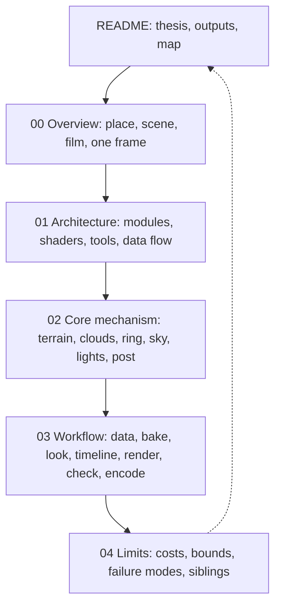

# halo-above-the-clouds: one scene, two outputs

## Thesis

`halo-above-the-clouds` is a real-time Three.js scene and an offline drone film. The scene shows a concrete ring restaurant on a mountain pinnacle. The restaurant stands above a sea of clouds at blue hour (`README.md:3-5`). The checkout is small, but the world is large. A nested terrain system reaches about 240 kilometres from the ring (`README.md:38-48`). A volumetric cloud march fills the valley below the deck (`README.md:54-57`). About 117,000 village and road lights sit under the cloud base (`README.md:62`). The same source draws the live view and the film.

The design has one central idea. The world is a function of position, time and a small set of baked maps. A browser evaluates that function at interactive rates. A headless browser evaluates it again, frame by frame, with more samples. No stored animation drives the camera. No video file is an input. The film is a second evaluation of the same world.

Two rules follow from that idea. First, expensive work moves into data. Terrain heights, sky visibility, key-light shadows, cloud noise and sky radiance are baked before the scene loads. Second, every frame is an average. The film renderer draws several sub-frames with small camera offsets and shutter times. It averages them in a high dynamic range (HDR) buffer before the grade (`src/main.js:149-172`).

## The two outputs

The first output is the live scene. A reader runs `npm run dev` and opens the page (`README.md:23-29`). The page creates a WebGL2 renderer and an orbit camera (`src/main.js:16-23`). The reader can drag, scroll and jump to eleven reference views (`src/main.js:224-229`). The scene draws at the full window size. The cloud march runs at a quarter of the frame width and height. The source sets the march scale to `0.5` and the cloud configuration multiplies it by `0.5` again (`src/main.js:77`, `src/config.js:97`). The page also has a film button that plays the timeline in real time (`src/main.js:220-222`). The V key does the same (`src/main.js:224-227`).

The second output is the film. The film is 45.0 seconds long at 30 frames per second. That gives 1,350 frames. It has eleven free-flight shots with hard cuts (`src/timeline.js:147-209`, `src/timeline.js:215`). A Node.js driver starts headless Chrome, asks the page for each frame and writes a numbered image (`tools/render.mjs:13-33`). A PowerShell script calls `ffmpeg` and encodes the images with the soundtrack (`tools/encode.ps1:4-8`).

The two outputs share the timeline camera. The film path calls `APP.renderFrame(t, options)`. The live viewer calls the same camera function, `setTimelineCamera`, when the reader presses V (`src/main.js:130-143`, `src/main.js:234`).

The two paths also share the post chain. A live frame draws the scene, composites the clouds and calls the grade once (`src/main.js:92-104`). A film sub-frame draws the same scene and the same cloud composite. It adds the result to the accumulator with weight `1 / K`, where `K` is the number of sub-frames (`src/main.js:149-172`). The grade, the bloom pyramid and the matte then run once per film frame (`src/post.js:199-210`). The live viewer therefore shows one sample. The film shows the mean of several samples. A reader can use the live page to inspect the world and use the film path to judge the averaged image.

```text
# src/config.js:5-13
export const DECK_Y = 2180;          // ring roof-deck altitude (m)
export const LAKE_Y = 564;           // Lake Brienz surface
export const HERO_AZ = 210;          // azimuth the hero camera looks along (through the gorge, toward the lake)
// Ring frame -> world: rotation about Y so that the ring's front (+Z ref) faces back toward the camera.
export function ringYaw() {
  const a = HERO_AZ * Math.PI / 180, dx = Math.sin(a), dz = -Math.cos(a);
  return Math.atan2(-dx, -dz);
}
export const EARTH_R = 6371000;
```

Those constants set the whole stage. The ring deck is at 2,180 metres. Lake Brienz is at 564 metres. The hero azimuth is 210 degrees. The Earth radius is 6,371,000 metres. The value is not decoration. The cloud march and the far terrain bend their heights by that radius (`src/clouds.js:43`, `src/glsl/common.js:56`).

```text
# src/timeline.js:210-215
let acc0 = 0;
for (const s of SHOTS) {
  s.start = acc0; s.dur = s.end - acc0; acc0 = s.end;
  if (s.times) { s.S = timed(s); s.scale = 1; } else s.scale = s.len / (s.S.mean * s.dur);
}
export const TOTAL = acc0;
```

The shot table is the only authority on time. Each shot records an end time. The loop derives the start time and the duration. `TOTAL` is the last end time. The last shot ends at 45.0 seconds (`src/timeline.js:207`). The source therefore gives no separate duration constant that could drift from the shot table.

A film frame is an average, not one draw. The driver passes `K` sub-frames and a shutter fraction. The frame function moves the camera to several times inside the shutter interval. It offsets the projection by a Halton pattern for anti-aliasing. A Halton sequence is a low-discrepancy sequence that spreads sample points evenly. It adds each cloud-composited scene into an accumulator with weight `1 / K`. It then runs the grade once (`src/main.js:149-172`).

```text
# src/main.js:152-166
  for (let k = 0; k < K; k++) {
    const tk = t + ((k + 0.5) / K - 0.5) * shutter / fps;
    const c = setTimelineCamera(tk);
    if (k === 0 || Math.abs(tk - t) < 1e-6) fade = c.fade;
    if (K > 1) camera.setViewOffset(W, H, halton(k + 1, 2) - 0.5, halton(k + 1, 3) - 0.5, W, H);
    shared.uniforms.uTime.value = tk;
    camera.updateMatrixWorld();
    if (modules.village) modules.village.update(camera, tk);
    renderer.setRenderTarget(post.sceneRT);
    renderer.setClearColor(0x000000, 1);
    renderer.clear();
    renderer.render(scene, camera);
    let hdr = post.sceneRT;
    if (modules.clouds) hdr = modules.clouds.render(post.sceneRT, camera, tk, frameNo++);
    post.accumulate(hdr, 1 / K);
```

The order is strict. The scene draws first. The cloud march reads the scene depth. The composite returns the cloud-composited HDR image. The accumulator adds that image. The grade, bloom and matte run only after every sub-frame.

```text
# src/main.js:77
    modules.clouds = await Clouds.create(renderer, shared, post, W, H, CAPTURE ? 1 : 0.5);
```

This line separates the two outputs at run time. A capture page passes `1.0` as the cloud scale. A normal page passes `0.5`. The cloud object multiplies that value by `CLOUDS.res`, which is `0.5` (`src/clouds.js:1275`). The film march therefore covers half the frame width and height. The live march covers one quarter. The film spends the saved time on sub-frames and noise reduction.

**Aha:** The film is not a recording of the live scene. Both outputs call the same world, the same camera timeline and the same grade. The film differs by a quality budget, not by a separate renderer path. That is why a change to the ring or the cloud shader changes both outputs at once.

## What the checkout contains

The pinned tree has 55 tracked files and two commits. The current commit is `1d08819` with subject "Fix README facts, skip the matte without data, key fixes". The first commit adds the scene, the film driver and the tools. The tree holds twelve JavaScript scene modules, five OpenGL Shading Language (GLSL) modules, twenty-seven tool scripts, seven root files and four Joint Photographic Experts Group (JPEG) stills under `docs/` (`spec.md:36-39`). The project licence is the Massachusetts Institute of Technology (MIT) License (`README.md:123`).

The tree does not contain the baked scene data. `npm run data` downloads a release archive of about 0.3 gigabytes and unpacks it into `data/` (`tools/fetch-data.mjs:1-3`, `README.md:25`). The tree does not contain the eleven reference images. The project README states that the reference images are absent and that the matte is skipped for that reason (`README.md:67-69`). The tree does not contain the film or the music track. The README links to a release video and credits a track edited to 45 seconds (`README.md:9`, `README.md:129-130`).

Those absences matter for this exploration. No frame was rendered. No bake was run. No data file was opened. Every statement about a pixel comes from the source, not from a viewed image.

## Package map



The dotted edge returns from the limits to the claims. A reader can test the costs and the absences against the thesis at the top.

## The five deep dives

| Document | Question it answers | Words | Snippets | Diagrams | Aha |
|---|---|---:|---:|---:|---:|
| [00-overview.md](00-overview.md) | What is the place, what are the two outputs, and how is one frame finished? | 3,200 | 12 | 2 | 1 |
| [01-architecture.md](01-architecture.md) | How do the scene modules, shader modules, tools and data fit together? | 3,550 | 16 | 2 | 1 |
| [02-core-mechanism.md](02-core-mechanism.md) | How do terrain, clouds, the ring, the sky, the lights and the post chain work? | 3,900 | 15 | 3 | 2 |
| [03-workflow-and-quality.md](03-workflow-and-quality.md) | How does a change reach baked data, a still, a checked film and an encoded file? | 5,000 | 17 | 2 | 2 |
| [04-limits-and-comparison.md](04-limits-and-comparison.md) | What does the design cost, where does it fail, and how does it compare with five siblings? | 4,350 | 10 | 2 | 2 |

The word counts are the measured prose counts, rounded to the nearest fifty. The snippet, diagram and Aha counts are exact.

## Reading order

1. Read this file. It gives the thesis, the two outputs and the map.
2. Read [00-overview.md](00-overview.md). It gives the place, the scene and one frame end to end.
3. Read [01-architecture.md](01-architecture.md). It gives the module map, the data flow and the capture path.
4. Read [02-core-mechanism.md](02-core-mechanism.md). It follows the terrain, the cloud march, the ring, the sky, the lights and the grade.
5. Read [03-workflow-and-quality.md](03-workflow-and-quality.md). It follows the bake order, the look loop, the render and the checks.
6. Read [04-limits-and-comparison.md](04-limits-and-comparison.md). It gives the costs and the sibling comparison.

A reader who wants the evidence first can read document 04 and then document 01. A reader who wants to change the world can read document 02 and then document 03.

## Terms

| Term | Meaning in this package |
|---|---|
| bake | a value or a map computed once and stored, not computed per frame |
| level | one nested terrain mesh with its own extent and cell size |
| far level | the ring-centred polar terrain level from about 25 to 240 kilometres |
| key light | the broad twilight light from azimuth 110 degrees, 15 degrees above the horizon |
| cloud sea | the volumetric layer between 1,500 and 1,780 metres, with wisps above |
| ring | the concrete restaurant annulus with its deck, glazing, terrace and void |
| shot | one continuous camera move with an end time and a path |
| sub-frame | one render of the world at one time and one projection offset |
| shutter | the fraction of a frame interval that a sub-frame samples |
| accumulator | the floating-point target that sums the sub-frames |
| matte | a camera-projected reference background for the still views |
| GPU | graphics processing unit, the render device |
| HDR | high dynamic range, the unclamped linear image before the grade |
| GLSL | OpenGL Shading Language, the shader source |
| JSON | JavaScript Object Notation, the data format |
| MP4 | Moving Picture Experts Group 4 Part 14, the video container |
| fps | frames per second, the film rate |
| FOV | field of view, the camera angle in degrees |
| CLI | command-line interface |
| RAM | random access memory |

## Non-claims

This package is a static reading. It does not run the development server. It does not open a browser or a headless Chrome session. It does not render a still, a frame or the film. It does not run a terrain build, a sky bake, a light bake or an encode. It does not download the scene data. It does not modify the source tree or `spec.md`.

No output of the project was viewed. The four JPEG files under `docs/` are README stills. This package does not treat them as measurements and does not compare them with a render. The look-development references under `ref/` are absent from the tree, so no reference image was viewed either.

The performance figures are the author's records. A render at `K` 8 took about five seconds per frame on a Radeon 780M integrated graphics processing unit, or roughly two hours for 1,350 frames (`README.md:88`). The sky bake needs about five gigabytes of random access memory (`README.md:108`). This package repeated none of those measurements.

The source gives some values and omits others. Where the source gives no value, this package says "the source does not state". It does not guess a resolution, a memory peak, a bake duration or a wall-clock render time that the source does not record.

The comparison in document 04 uses only statements in the published sibling documents and in this source. It does not rank visual quality.
